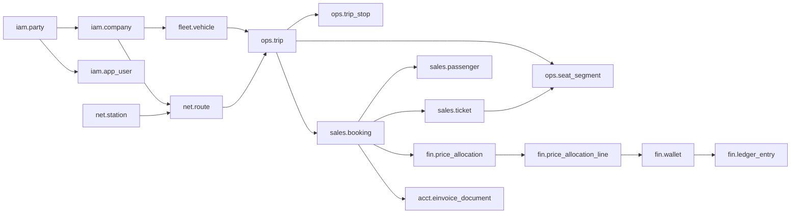

# Masslak Database

Built from the **Analysis and Design Study**, first v2.7 and now v3.9 (`docs/Masslak_Analysis_and_Design_EN_v3.9.docx`). Files 000 to 998
cover the Phase 1 scope of sections 21 and 22.2 and the fields the owner decided to build from Phase 1 onwards
(Decision 88). Files 1003 and 1010 to 1032 complete the model against every entity the study defines, including the
modules of later phases (sections 4.10, 9, 10, 11, 13, 14, 21 and appendix D). Those modules stay disabled behind
feature flags until their phase starts (2.8, decision D-6). File 1033 applies the relationship rules of design v3.0:
every table has a primary key, every reference is a foreign key (or documents why not), and every foreign key has a
supporting index, except references to lookup lists and to the staff member who recorded a row, which are never deleted
(`docs/database/STANDARDS.md`).

<!-- stats:begin (db/tools/gen_docs.py) -->
| | |
|---|---|
| Engine | PostgreSQL 16 with PostGIS 3 (extensions: pgcrypto, citext, btree_gist, pg_trgm, postgis in schema `gis`; Docker and CI image `postgis/postgis:16-3.4`, Ubuntu package `postgresql-16-postgis-3`) |
| Schemas | 26 separate schemas, each with its own privileges |
| Tables | 565 tables (8 partitioned), 5,974 columns, 1,671 foreign keys |
| Security | row-level security on 565 of 565 tables, 1,028 policies; 490 triggers, 518 functions |
| Tests | 971 automated checks against a freshly built database (`db/tests/run.sh`) |
| Design | [Database design and ERD document](../docs/database/) with diagrams in the study's colors |
| Docs | [Data dictionary](DATA_DICTIONARY.md) · [ERD diagrams](ERD.md) (both generated from the database) |
<!-- stats:end -->

## Language and localization policy

- **English only** for the database and code: schema, table and column names, enum values, comments, seed data, tests, scripts and generated docs.
- **Localization belongs to the UI layer.** No table has per-language columns (`name_ar`, `name_en`...). Each reference row has one English `name`.
- **`ref.locale`** lists supported UI locales with their text direction. English (`en`, LTR) is the default, Arabic (`ar`, RTL) is enabled, and Turkish, French and Spanish are seeded disabled for later phases. Adding a language is a row insert plus UI resource files, with no schema change.
- **`ref.translation`** (entity, entity_key, field, locale, value) holds localized display values for reference data such as city, station, fare brand and role names. The English value in the source row is always the fallback.
- **User preferences:** `iam.app_user.preferred_locale` and `crm.notification_template.locale` reference `ref.locale`.
- **User-entered data** may be in any script, for example a party's legal name as registered. `iam.party.name_latin` holds an optional Latin transliteration.

## Running

```bash
createdb masslak
./db/build.sh masslak                 # builds the schema in order (000 -> 990) and records each file
./db/upgrade.sh masslak               # on an existing database: applies only the files it has not run yet
./db/tests/run.sh                     # builds a temporary database, runs the tests, then drops it
python3 db/tools/gen_docs.py masslak  # regenerates the data dictionary, the ERD and the figures at the top of this file
```
psql connection arguments can follow the database name, e.g. `./db/build.sh masslak -h host -U owner`.

**Upgrades.** Applied files are recorded with their SHA-256 in `sys.schema_file`. `upgrade.sh` runs each newer file
in its own transaction and records it. Files from 980 on are upgrade files: they are written to be idempotent
(`IF NOT EXISTS`, `ON CONFLICT DO NOTHING`, `DROP POLICY IF EXISTS`) and are never edited once released; a change
is a new file. A database built before file tracking is treated as having every file up to 970.
If an applied file no longer matches its recorded SHA-256, `upgrade.sh` stops with exit code 3 before applying
anything and names the files: restore them from the release the database was built with and put the change in a new
file. `MASSLAK_SCHEMA_DRIFT=warn` turns this into a warning, for development databases only. CI checks both, and
checks with `gen_docs.py --check` that the generated documents and figures match a freshly built database.

**PostGIS from the database image.** The `postgis/postgis` image loads PostGIS into the `public` schema of the
database it creates, while `1045_postgis.sql` keeps it in `gis`. Before any file, `build.sh` and `upgrade.sh` run
`postgis_prepare.sql`, which removes such a copy as long as 1045 has not run and nothing depends on it, so 1045 installs
PostGIS in `gis`. Until 9 October 2026 a first start of the Docker stack stopped at 1045 for this reason.

| File | Contents |
|---|---|
| `000_init.sql` | Extensions, schemas, roles, request context, helper functions |
| `010_ref_sys.sql` | Locales and translations, countries, currencies, exchange rates, cities, files, encryption keys, settings, outbox and webhooks |
| `020_iam.sql` | Parties, companies, users, roles and permissions, sessions, devices and MFA, API clients and keys, identity verification (KYC) |
| `030_net_fleet.sql` | Stations and compliance profiles, routes, carrier codes and service numbers, vehicles and seats, leases, crew, locked licenses, insurance |
| `040_pricing.sql` | Fare brands, fare tables, modifiers, taxes and commissions, allocation templates, campaigns, loyalty |
| `050_ops.sql` | Trip templates, trips, stops, per-segment inventory, crew, changes, tracking, incidents and trip continuity |
| `060_sales.sql` | Channels, bookings, passengers, tickets, boarding, refunds, compensation |
| `070_fin.sql` | Wallets, double-entry ledger, payments and notifications, withdrawals, price allocation, tax ledger, settlement, payouts and reconciliation |
| `080_acct.sql` | Chart of accounts and journals, accounting integration, tax authority and tax profiles, e-invoices, tax returns |
| `090_crm_gov.sql` | Complaints, ratings, notifications, AI assistant, policy authority matrix, obligations, data protection |
| `100_sec.sql` | IP blocking rules, risk and fraud, security events, document signing, security & compliance hub |
| `110_audit.sql` | Login, activity, data-access and change logs, sealing, monthly partitions |
| `900_rls_grants.sql` | Tenant isolation and role privileges |
| `950_seed.sql` | Seed data: locales, currencies, countries, cities, platform wallets, permission and role catalog, settings |
| `960_platform_config.sql` | Fare brands, sandbox payment provider, API permissions |
| `970_passenger_names.sql` | Structured passenger names by identity document, full country list |
| `980_mfa.sql` | Two-factor sign-in: replay protection, one active factor, failure count per session |
| `990_agency.sql` | Travel agencies: agreements (commission, daily limit), booking attribution and its RLS, agency roles |
| `995`–`998` | Seat layouts, default locale, payouts, company documents |
| `1000`–`1002` | Notifications, privacy self-service, mobile devices |
| `1003_extensibility.sql` | Reference tables for extensible lists; passenger transit and contracted transport readiness (appendix D) |
| `1010_model_helpers.sql` | New schemas (bill, ptn, ship, frt, brd, rail, taxi, rent) and the row-level security and privilege helpers |
| `1011_core_fleet.sql` | Crew additions, driving hours, vehicle service status, insurance claims, authority alerts, trucks, trailers, validators |
| `1012_lines_shuttle.sql` | Approved lines, versions, permits, tariffs and timetables (4.15); shuttle rides and proximity (7.13); subscriptions and passes |
| `1013_trips_booking.sql` | Seat locks, cancellation policies, waiting lists, entry rules, ticket documents, inspections, tracking state, station gates |
| `1014_service_partners.sql` | Fuel stations and rest stops: contracts, fuel cards, sessions, odometer, anomalies, sales, orders, settlement (14.11) |
| `1015_loyalty_campaigns.sql` | Loyalty partners, rewards, vouchers, transfers, points liability, sponsors, BIN ranges, override policies |
| `1016_billing_finance.sql` | Plans, agreements, subscriptions, metering and carrier invoices; cash remittances; float and deposit placements |
| `1017_shipping.sql` | Shipments, parcels, handling units, loads, couriers, hubs, zones, rates, delivery, claims and partner integration (9) |
| `1018_freight.sql` | Freight requests, bids, contracts, containers, handovers, ports, transit declarations, weighbridge, claims (10, D.3) |
| `1019_border_manifest.sql` | Border points, crossing profiles, manifests with persons, vehicles and cargo, responses and discrepancies (11) |
| `1020_accounting_ops.sql` | Sales invoices, credit notes, cash boxes and sessions, receipts and payments, tax codes, sync jobs (13.7) |
| `1021_channels.sql` | Channel agreements, allotments, API profiles, statements and memos, supplier sources and mappings (14.7) |
| `1022_contact_center_gov.sql` | AI-first contact center (7.11) and government registry adapters (phase 5) |
| `1023_rail_taxi.sql` | Rail fare classes, coaches, compositions and connected journeys; taxi permits, shifts, dispatch and rides |
| `1024_car_rental.sql` | Rental companies, branches, fleet, rates, bookings, contracts, inspections, deposits and telematics |
| `1029_model_flags.sql` | Feature flags of the new modules (all off) and schema version 1.12.0 |
| `1030`–`1038` | Module permissions, workflows, travel documents, relationship rules, reports, payments, integration API, RLS coverage, passenger categories, families and manifests |
| `1039_review_hardening.sql` | Database architecture review: RLS and a data class on every table, AUTH scope, typed foreign keys behind polymorphic references, same-company checks, ledger reversals and reconciliation, seat rules, business rules, retention and erasure, scopes and decision log, key rules, module gates (see `docs/database/REVIEW_RESPONSE.md`) |
| `1040_integrity_audit.sql` | Strategic review and relationship audit: composite keys for the sale chain (ticket, booking, passenger, seat, trip), guards for boarding scans, manifest persons, cargo legs, payment wallets and fare brands, 27 more tenant guards and 9 vehicle guards (ownership or lease), one company wallet per currency, jurisdiction tree, schema dependency and JSONB inventories (see `docs/database/INTEGRITY_AUDIT.md`) |
| `1041_project_phases.sql` | Project phases: the study roadmap (releases 1A and 1B, phases 2 to 15) in `sys.project_phase`, the phase of every table in `sys.table_phase`, `sys.v_phase_summary` and `sys.v_phase_forward_reference`; the tests require a phase for every table and no required reference to a later phase |
| `1042_rollout_decisions.sql` | Owner decisions: the contact center and the AI assistant in a later phase (CS), support on cases from WhatsApp and email until then; the shuttle as a phase of its own opened city by city (`sys.city_rollout`, a shuttle line or zone is activated only in an opened city) |
| `1043_route_compliance.sql` | Route compliance: licences, tracking sources and reporting duties registered with a level switched by configuration (`sys.compliance_requirement`: OFF, OPTIONAL, REQUIRED); tracking from the driver's phone or a contracted device; vehicles bound to their approved line (`fleet.line_permit_vehicle`); the route obligation of every trip; regulator diversions; route violations with driver warning and continuous alarm, reported to the authorities only when required and only while the vehicle is in service (see `docs/database/ROUTE_COMPLIANCE_AND_SCHOOL.md`) |
| `1044_school_transport.sql` | School transport as its own phase (SCH, schema `sch`): schools, operators of five kinds under a school transport licence, pupils linked to their guardians (minors by `person.age_of_majority`), contracts, routes with bus, driver and attendant, daily runs, hand-over to authorised receivers under the hand-over age (12), the empty-bus check, absence notices |
| `1045_postgis.sql` | PostGIS in schema `gis`: generated geography for lines, diversions, corridors, school routes and stations with spatial indexes; valid shapes required before a route binds; `ops.route_distance_m` and `net.stations_near` |
| `1046_audit_hardening.sql` | Third-party audit hardening: passengers' and family members' phones encrypted, a person's contact only on their account, contact columns hidden from reporting and audit roles and masked in the change log (R-04); company party type (R-06); registry of every polymorphic reference and a weekly orphan sweep with an outbox alert (R-03); every table of a switched phase closed in the database (`phase_gate`, R-14); school transport before the last phase, authority reporting in Phase 5 (see `docs/database/THIRD_PARTY_AUDIT.md`) |
| `1047_audit_operations.sql` | Remaining audit items: schema change log `audit.ddl_event` with an alert for security-relevant changes outside migrations (build and upgrade set `masslak.migrating`) (R-09); every JSONB column registered, rule and shape contracts checked on write, price and terms snapshots frozen (R-08); lifecycle matrix and purge of delivered events, webhook deliveries and notifications (R-11); the permission matrix `sys.v_policy_matrix` (R-05); and three cross-company write paths found by the write sweep, closed (R-01) |
| `1048_design_audit_t3.sql` | Technical audit of design 3.7 (T3): signatures, ledger, family spending and legal holds check the row they name when written (T3-04); break-glass with mandatory expiry, second-person approval or a reviewed emergency, alerts and a sealed record (T3-03); daily position partitions matching the 7-day retention, device evidence and trust grades, low-trust violations reviewed by a person (T3-10, T3-11); two-person requirement changes with measured impact (T3-14); file quarantine until scanned (T3-15); no self-review and an actor on every sensitive read (T3-19); encrypted government endpoints and mandatory city time zones (T3-02, T3-18); schema version, correlation and per-record sequence on outbox events (T3-12) |
| `1049_recheck_operations.sql` | Re-audit of design 3.8: operational metrics `sys.ops_metrics()` and the job log `sys.job_run` for monitoring (T3-16); sensitive scheduled reports need consent and go by a per-recipient link, with every download logged (T3-05); positions record the session's registered device, a revoked or failed device rejects them, attestation switched by configuration (T3-11); resends of money and authority events need a second person's approval, and daily payment reconciliation (T3-12) |
| `1050_owner_decisions.sql` | Owner decisions after the review of design 3.9: approved RPO, RTO and SLOs stored as settings, time-bound read-only access for external reviewers |
| `1051_architecture_review.sql` | Architecture review actions: reports from the read replica, trigger and function cost measured, the outbox partitioning threshold, corrected table comments |
| `1052_scale_ten_million.sql` | Ten million operations a day: shared wallets in DEFERRED mode with a roll-up, ledger entries partitioned by month, closed-day totals for incremental reconciliation, the latest position of each vehicle |
| `1053_outbox_partitions.sql` | The outbox partitioned by day and purged by dropping days |
| `1054_launch_completeness.sql` | Launch completeness: complaints and claims with service levels, trip ratings, pricing setup and the other launch tables given their endpoints |
| `1055_ai_phase_gate.sql` | The contact centre and AI assistant phase stays closed until its threat model and DPIA are approved (launch gate 9) |
| `1056_payment_options.sql` | Payment options switched by the platform: cash at the counter, pay later with a pay-by time, card, instalments and financing providers |
| `1057_review_stage_b.sql` | Review stage B: ageing of the cash carriers owe, freshness limits of reports on the replica |
| `1058_release_manifest.sql` | Review stage C: release manifest and schema hash; upgrades refuse a hand-changed record |
| `1059_app_delete_grants.sql` | Review stage C: the application deletes only from the 36 tables listed with their reason |
| `1060_monitoring_detail.sql` | Review stage C: lock waits per table, partitions ahead and default-partition rows per partitioned table |
| `1061_markets.sql` | Review stage D: markets with their time zone, currency and language; platform wallets per currency; days and money read in the market of the data |
| `1062_warehouse_publication.sql` | Review stage D: publication of facts and dimensions without personal data for the data warehouse, its replication role and slot metrics |
| `1063_telemetry.sql` | Review stage D: one set of trust rules for positions, batch grading on the primary when the history lives in the telemetry database (`db/telemetry/`) |
| `1064_partitioned_bookings.sql` | Review stage D: bookings partitioned by ranges of id, keys unique over all partitions in `sales.booking_key`, generic conversion `sys.partition_by_id` |
| `1065_failover.sql` | Review stage D: standby figures for automatic failover and the table the failover drill writes to |
| `1066_position_without_vehicle.sql` | A position without a vehicle is graded again (regression of 1063, found by the launch gate 4 rehearsal) |
| `1067_cargo_capacity.sql` | Cargo stays within the capacity of the vehicle that carries it: used weight counted from what is loaded, overloads refused (external technical report) |
| `1068_shared_rate_limits.sql` | Request limits shared by every API process: sign-in buckets per address (sized for carrier-grade NAT) and per account identifier, kept in an unlogged table reached only through `sec.rate_take` (code review, October 2026) |
| `1069_audit_archive_lag.sql` | How far the signed audit archive lags: per audit log, the age of the oldest record no recorded archive covers, for the metrics endpoint and the alert AuditArchiveBehind (third-party follow-up, October 2026) |
| `1070_partition_upkeep_late.sql` | Partition upkeep that survives running late: `sys.create_partition` moves the rows of a missing period out of the default partition (through a plain table, so no trigger fires twice) instead of aborting the whole upkeep (code review, October 2026) |
| `1071_late_provider_payment.sql` | A provider's confirmation that arrives after the platform stopped waiting is credited to the payer's wallet instead of lost; flagged `captured_late`, counted for the alert PaymentCapturedLate (code review, October 2026) |
| `1072_trip_rating_privacy.sql` | Trip ratings readable by the rater, the rated carrier and the platform only; the read policy had been open to every company and passenger (code review, October 2026) |
| `1073_signed_notice_dedup.sql` | A provider's event id is unique among signed notices only, so an unsigned copy posted first cannot make the real notice a replay; unsigned notices per provider counted for review (review of 1.47.0, R-18) |
| `1074_money_boundaries.sql` | Money boundaries: payments recorded before the provider is called (stages CREATED and PROVIDER_UNKNOWN), refunds held and sent once under a fixed reference, payment fee rules per way of paying, currency, customer and period (`fin.fee_rule`, `fin.payment_fee`), the payer of a withdrawal is not its approver, and the approval matrix of money decisions (`fin.approval_policy`, levels, named members, requests and decisions checked in the database) (review of 1.47.0, package B; owner's decisions 4 and 5) |
| `1075_sign_in_and_operations.sql` | Two-factor sign-in by several methods: the platform's policy (`sys.setting auth.mfa`: methods open among the authenticator app, text message and WhatsApp, the portals that must use one, drivers included), message codes kept only as keyed hashes for minutes with five tries (`iam.mfa_challenge`), one verified and one pending factor of each kind; a boarding names a stop its ticket covers (`sales.tg_boarding_stop`); offline pack downloads per driver bound the time of offline scans; the partition upkeep creates every late period (`sys.default_partition_oldest`); positions wait on the primary when the telemetry database does not answer (`ops.position_backlog`) (review of 1.47.0, package C; owner's decision 2) |
| `1076_backups_and_durability.sql` | Backups that leave the server and durability the owner chooses: each nightly backup's local and off-site copy recorded (`sys.backup_run`, `sys.record_backup`); the age of both and whether commits wait for a standby for the monitoring (`sys.durability_metrics`, zero data loss as a setting, deploy/durability.sh); the security console's connections capped by their role (review of 1.47.0, package D; owner's decision 1) |
| `1077_statement_statistics.sql` | Statement statistics: `pg_stat_statements` where the server offers it, read only through functions that mask literals and never carry bind values (`sys.top_statements` by total or mean time, calls or disk reads; `sys.statement_metrics` for the monitoring; `sys.reset_statement_stats` to start a measurement window); everything answers empty where the server does not preload it (review of 1.47.0, package F) |
| `1078_manifests_and_parcels.sql` | Manifests sealed once issued: their people, vehicle and cargo rows and their header content cannot change (`brd.tg_manifest_sealed`, `brd.tg_manifest_content_sealed`; key rotation may still re-encrypt document numbers), signed hashes of a canonical form (`payload_signature`, `signing_kid`, `canonical_version`); parcels booked on a trip's hold: carrier tariffs by weight, volume, the dearer of both, fixed or agreed (`ship.parcel_tariff`, `ship.parcel_price`), prices agreed per parcel (`ship.parcel_offer`), free hold for customers (`ship.trip_hold`), a guaranteed shipment committed only with a leg holding capacity (review of 1.47.0, package G; owner's decision 3) |
| `1079_lifecycle_coverage.sql` | Every table has a lifecycle: a dataset of its own in `gov.data_inventory` or membership of one (`gov.dataset_member`), the tables not yet covered grouped by schema and sensitivity (personal records, records, configuration, catalog) with retention, erasure method and copies; `gov.lifecycle_gaps()` lists any table without one or more sensitive than its dataset (checked in CI); `gov.v_table_lifecycle` per table (review of 1.47.0, package H, R-04) |
| `1080_verified_context.sql` | The request context row-level security trusts is set only with the API's ticket: `sys.set_context` checks an HMAC of the context and its time under a key the application's roles cannot read (`sys.context_key`); `set_config` and temporary objects are withdrawn from PUBLIC; `sys.context_status` for readiness; a superuser-only window of at most a day for a rollback to an older release (`sys.context_unsigned_window`) (reviews of October 2026, C-01) |
| `1081_definer_search_path.sql` | Every SECURITY DEFINER function ends its `search_path` with `pg_temp`; creating objects in `public` is withdrawn; `sys.definer_path_gaps()` lists any new function that does not (checked in CI) (reviews of October 2026, addition 1 and M-09) |
| `1082_validate_constraints.sql` | Constraints added NOT VALID are validated after the files: `db/build.sh` and `db/upgrade.sh` end with `CALL sys.validate_constraints()`, each in its own transaction; one that old rows break stays NOT VALID, is named, and `sys.unvalidated_constraints()` keeps `/api/ready` not ready until it is fixed (reviews of October 2026, H-09) |
| `1083_default_partition_batches.sql` | A late upkeep moves a large period out of a default partition one period per transaction: the daily upkeep moves a period itself only up to `partitions.inline_move_rows` (50,000 rows), and the worker moves larger ones with `sys.move_default_period()`, each with its own lock and timeout (reviews of October 2026, M-08) |
| `1084_settings_guard.sql` | The settings the database trusts are listed (`sys.guarded_settings`) and reported as enforced by the server (`sys.guard_status`): the server module `db/guard` defines them, so only the platform's own functions set them (reviews of release 1.49.0, C-01) |
| `1085_account_deactivation.sql` | A closed account keeps its data: the status `DEACTIVATED` and the sign-in audit events `ACCOUNT_DEACTIVATED` and `ACCOUNT_REACTIVATED`; nothing is deleted, and the same details reactivate it through `POST /api/auth/reactivate` (the owner's rule of 10 October 2026) |
| `1086_boarding_photo.sql` | The boarding photo of a person: a table of its own (`iam.party_photo`, one row per person, an encrypted file), taken at the profile's creation by the person or the head of their family (`iam.set_party_photo`), kept while the account exists, and removed by `gov.erase_party_photo` in an erasure; nothing refers to the table, so it adds no reference cycle
| `1087_photo_policy.sql` | The boarding photo policy and its replacement (WP1 and WP4 of the sixth round): `iam.photo_rule` (whether a photo is REQUIRED, OPTIONAL or NOT_APPLICABLE, by market, trip scope, traveller class and passenger category, with a legal basis and an effective date; proposed and approved by two platform people, retired by a third), `iam.photo_change_request` (a platform request to replace a photo on file, with its evidence, applied by a second person); `iam.photo_requirement` (read at booking and at boarding), `ops.trip_photo_scope`, `iam.traveller_class`; `PHOTO_REQUIRED` is a boarding result; `gov.erase_party_photo` also removes the evidence and candidate photos; neither new table is referred to, so no reference cycle (the owner's decisions of 10 and 11 October 2026) |
| `1088_photo_evidence_kinds.sql` | The documents accepted as evidence for a change of the boarding photo, kept as a platform setting (`iam.photo_evidence_kind`: national identity card, civil registry extract, passport; each on or off). The request's evidence kind refers to it, and `iam.request_photo_change` refuses a kind that is off; `iam.set_photo_evidence_kind` switches it. Nothing new refers to the table, so no reference cycle |
| `1089_photo_policy_approvals.sql` | A change to the documents accepted for a photo change, and to the age below which a national identity card is not accepted, needs two people: the one who asks counts as the first approval and the number in the settings (never below two) applies (`iam.photo_policy_change`, `iam.photo_policy_approval`, `iam.request_photo_policy_change`, `iam.approve_photo_policy_change`, `iam.reject_photo_policy_change`). `iam.evidence_accepted` is the rule a request is checked against, with the age; the one-person switch of 1088 is withdrawn. The settings are `sys.setting` keys. Nothing new refers to the tables except the approvals, so no reference cycle |
| `1090_photo_evidence_national.sql` | The documents accepted nationally for a photo change: the national identity card, the civil registry extract that shows the national number, the passport, the travel document issued by a Syrian mission abroad (for Syrian citizens only), and the temporary identity document of the first phase (to be switched off later). A new flag on the kinds marks those under the age rule of the identity card; `iam.evidence_accepted` applies the nationality condition and the age rule. No table is added, so no reference cycle |
| `1091_photo_approval_stages.sql` | The approval stages of a photo change and of a change to the photo policy are a platform setting (`photo.approval_stages`, by default a checker and a final approval; at least two); each change snapshots them when it is asked; one approval table for both kinds (`iam.photo_approval`); the age default is 18; the data items a photo change needs are required or optional by setting (`iam.data_requirement`, `iam.data_requirement_met`); the change of a photo on file passes the stages (`iam.approve_photo_change`). Nothing new refers to the approvals except the requests, so no reference cycle |
| `1092_photo_rule_stages.sql` | The approval stages apply to the photo rules: a proposal is in force when its stages are passed (`iam.approve_photo_rule`); a proposal not yet in force is withdrawn (`iam.withdraw_photo_rule`); a rule in force is retired through its own stages, and stays in force until they are passed (`iam.request_photo_rule_retirement`, `iam.approve_photo_rule_retirement`, `iam.reject_photo_rule_retirement`); the retirement has its own approval subject, from a sequence; `iam.photo_requirement` counts a rule being retired as in force. Nothing new refers to the rules except the approvals, so no reference cycle |
| `1093_photo_rule_retirement_proposer.sql` | The person who proposed a photo rule does not approve its retirement (`iam.approve_photo_rule_retirement`); the proposer may still ask for it. Nothing new refers to the rules, so no reference cycle |
| `1094_photo_feature_switch.sql` | The boarding photo is off at launch. The switch is the setting `photo.enabled` (false), read by `iam.photo_enabled()`. Switching it on is a change with a legal basis (`iam.request_photo_feature_change`) that passes the approval stages of the photo policy (`iam.approve_photo_policy_change`); `iam.set_party_photo` refuses a photo while it is off. Nothing new refers to the table, so no reference cycle |
| `1095_photo_switch_settings.sql` | The approval stages of the photo policy are a setting the platform changes (`iam.set_photo_approval_stages`: at least two stages, APPROVE last, no stage forced); the legal document number is recorded with an approval (`iam.approve_photo_policy_change`, optional). Nothing new refers to the tables, so no reference cycle |
| `1096_photo_settings.sql` | The photo's settings are platform settings changed through the approval stages: who may see the photo and when (`photo.view_access`: the traveler on request, the driver and the carrier's office only while the trip is boarding), the date the rules are enforced from (`photo.enforce_from`), how often a person is checked (`photo.verify_every_days`) and the identity provider (`photo.identity_provider`, NONE). Read by `iam.photo_setting`; changed by `iam.request_photo_setting_change`, applied by `iam.approve_photo_policy_change`. Nothing new refers to the tables, so no reference cycle |
| `1097_boarding_stations.sql` | Boarding stations, off at launch: the platform settings (`boarding.stations.enabled`, the two operating-company modes, the check-in window, the required references), each checked by `net.set_boarding_setting`; each station's own switch, counter system, screens and window (`net.station_boarding`, read by `net.boarding_station_on`); counters and bays numbered by the platform per station (`net.open_station_gate`, a counter names its operating company, `net.station_gate.operator_company_id`); a carrier's agreement and licence numbers, retired and never changed (`net.operation_reference`, `net.operation_references_missing`). Permissions `boarding.manage` and `boarding.references`; the two new tables are in phases 7 and 1A. The station table refers to `net.station` and `iam.company`, which already precede it |
| `1098_boarding_operators.sql` | What an operating company may do at a station, for which carrier (boarding stations, step 2): `net.station_operator_grant`, a grant given by the carrier for its own trips or by the platform to a state-mandated operator (no carrier), revoked and never changed; read by the carrier that gave it and the operating company it went to (`sys.rls_split`). The decision `net.operator_may(operator, carrier, station, right)` needs the station to be boarding and the mode that gave the grant to be on. Permission `boarding.operators` for the carrier's operations role. Phase 7, classified and dataset-assigned like 1097 |
| `1099_station_portal.sql` | The station portal (the owner's option A): sessions may open `STATION` (the rule is added `NOT VALID` and then checked, so a live session table is not locked for the check); a company type `STATION_OPERATOR` and its party role; the permission `station.counter` with the role template `STATION_COUNTER`; the two-factor policy (`auth.mfa`) requires the new portal wherever it requires the carrier portal. No table is added |
| `1100_tracking_alerts.sql` | The platform opens tracking alerts (a gap found by the use case review): `ops.raise_tracking_alerts()`, called by the worker every minute, opens one `SIGNAL_LOST` alert for a departed trip whose vehicle has been silent longer than `tracking.alert.silence_seconds` (300) and escalates it to `HIGH` past `tracking.alert.escalate_seconds` (900); a `STRICT` trip uses half of each. Silence counts from the latest position on the trip, the latest recorded departure or the scheduled one. Each opening and escalation leaves an outbox event that tells the carrier's owners. The existing paths still close the alert when positions return. No table is added |
| `1101_sos_incidents.sql` | SOS and incident reports from the apps (a gap found by the use case review): `sec.raise_sos` lets the trip's assigned driver or a passenger holding a live ticket (booker or traveller) raise an SOS while the trip is under way; a second press while it is open returns the same SOS; the carrier's owners and the platform's security staff are told (`sos.raised`). `ops.report_incident` lets the assigned driver report an incident: the driver's open SOS is linked, a `SEVERE` one opens an out-of-service period for the vehicle, and the carrier (and the platform when severe or injured) is told (`incident.reported`). The trigger `a_trip_vehicle_in_service` refuses a vehicle that is out of service or impounded at a trip's departure. Adds `ops.incident.description` |
| `1102_trip_cancellation.sql` | A carrier cancels a trip with full refunds (a gap found by the use case review): the permission `trip.cancel` (sensitive, held by the carrier operations role and owners); `ops.trip_disruption.reason`, required for a `CANCEL` decision; the trip read rule lets whoever booked a cancelled trip (passenger or agency) still see it, so the cancelled booking and its refund stay in their lists. The cancellation itself is `cancel_trip` in `backend/app/modules/sales/service.py`: every paid booking refunded in full, the fee included, to the wallet that paid it (passenger, family, agency, or the carrier's cash account for counter sales), every allocation line refunded, reservations and baskets released, the crew released, parcels on the hold refused until moved |
| `1103_loyalty_earn_redeem.sql` | Loyalty points are earned and redeemed (a gap found by the use case review): `pricing.earn_points_for_trip`, called by the trip completion, gives each completed booking made by a person the points of every active `EARN` rule on its boarded tickets (formula `per_amount`, `points`, `multiplier`; condition `min_amount`, `company_ids`), once, with expiry after the programme's months and the tier following the points earned; `pricing.redeem_points` spends points for wallet credit at the point value by the `BURN` rule's `min_points` and `step`, the application posting the money from the platform's new loyalty `EXPENSE` wallet to the member's wallet in the same transaction; `pricing.expire_points` (daily) removes points past expiry that were not spent, oldest spent first. `pricing.points_liability` follows issued, redeemed and expired value per month and issuer. No table is added |
| `1104_einvoice_issuing.sql` | E-invoices are issued for paid sales (a gap found by the use case review): the worker (`backend/app/modules/einvoice/service.py`) gives each paid booking an invoice from each seller with an active issuing unit and a tax profile valid now (the carrier for the tickets, the platform for its fee), and each refunded booking a credit note per invoice for what was refunded of that seller's lines. The hash (SHA-256 of a canonical JSON of content, number, time and the previous hash) is signed with its own Ed25519 key and carried with the signature in a TLV QR code; `GET /api/verify/einvoice/{uuid}` checks hash, signature, QR and chain. Adds the settings `einvoice.tax_rate_pct` (0) and `einvoice.issue_window_days` (30), `acct.einvoice_chain_breaks` and an index on the unit's counter. No table is added |
| `1105_station_checkin.sql` | The counter check and the boarding pass (boarding stations, build step 3): `brd.station_checkin` keeps each check-in with the station, counter, operating company, carrier, staff member and document check, visible to the carrier and the operating company and written only by the functions; `brd.station_checkin_ticket` checks the station is boarding, the ticket valid at this station on a trip not yet left, the `BOARDING_PASS` right (`net.operator_may`) and the company's own counter, the check-in window (the station's or the platform's) and the carrier's required references (`REFERENCES_MISSING`), and issues the pass numbered by the station with the bay of the boarding stop; `brd.cancel_station_checkin` before boarding; `brd.station_may_board` lets station staff with the `BOARDING` right board only checked-in tickets; `brd.station_trips` and `brd.ticket_uid` serve the station portal |
| `1106_cancel_penalty.sql` | A penalty on a carrier that cancels a trip, only where the regulators impose one (owner's decision): the platform setting `trip.cancel_penalty` (off at launch) checked by `ops.set_cancel_penalty` (basis per fares, per ticket or per trip, payee platform, passengers or a named authority, an optional window before departure and the regulator's decision as `legal_ref`); `ops.trip_cancel_penalty` records the penalty with the trip, taken from the carrier's balance at once or left `DUE` and set off at its next trip completion; the passengers still get back everything they paid |
| `1107_loyalty_agreements.sql` | Points redeemed at partners under agreements per partner (owner's decision): `pricing.loyalty_agreement` (points = amount, the percentage the platform pays the partner, minimum and step, voucher days, contract reference; written by one officer, activated by another, frozen once active, one active per partner, currency and day); `pricing.redeem_at_partner` turns points into a voucher (code stored as a keyed hash and encrypted), `pricing.accept_voucher` records the honoured voucher with what the platform owes, `pricing.cancel_voucher` and the daily `pricing.release_vouchers` give unused points back; `pricing.loyalty_settlement` and its lines draw up, approve and pay a partner's statement with three different people; the `PARTNER` wallet type; partner redemption joins the loyalty release (1B) |
| `1108_einvoice_taxes_keys.sql` | Taxes on e-invoices from the platform's tax schemes and named signing keys (owner's decisions): `acct.einvoice_line_tax` keeps each tax of each line (scheme, treatment, rate, base, amount, authority) and is written once; a tax scheme goes live only approved by a second officer and computable (rules for its treatment, no formula rules, bands for tiered rules, taxes on taxes without loops), and its rules and bands are then frozen; `base_type` FARE or TAXES with `base_include` for compound taxes and taxes on taxes; documents name their key (`signing_kid`, canonical version 2) and `acct.einvoice_signing_key` keeps the public key of every key that signed; the single rate `einvoice.tax_rate_pct` is retired |
| `1109_station_trips_horizon.sql` | The station's list of trips covers today, tomorrow and the day after in the station's time zone instead of a rolling 48 hours |
| `1110_station_sales.sql` | Selling at a station counter under the carrier's `BOOKING` right (owner's decision: first release): `brd.station_may_sell`, the `STATION` sales channel, `brd.station_sale` (station, counter, clerk; checked against its booking), an operating company sees the bookings it sold at stations, the station's trip list shows whether the counter may sell; station boarding tables move from phase 7 to 1B |
| `1111_counter_photo_gate.sql` | The photo at a station counter stays off until a legal approval allows it: a fifth view role `STATION_COUNTER_AT_CHECKIN`, off, turned on only by an approved change that records the legal document number |
| `1112_station_board.sql` | The station's public departure board (build step 4): departures of the next 12 hours and arrivals of the next 6, with bays and states, without passenger data, only where the platform switched the station's screens on |
| `1113_station_screens_review.sql` | What the station screens show after their design review of October 2026 (`docs/design/STATION_SCREENS_REVIEW.md`); fields added, none removed: the counter's trips name where each goes and carry the check-in window at the station (`brd.station_trips`, a trip ending at the station is no longer listed), the boarding pass names its ticket for the signed code printed on it (`brd.boarding_pass`), and the departure board gives the city codes of the stops on the way (`brd.station_board`) |
| `1114_trip_numbers.sql` | The trip number passengers read, as airlines do (owner's decision, October 2026): `ops.trip.trip_code` ("DC 101") is the carrier's designator (`net.carrier_code.code2`, else its three-letter code) and a service number (`service_no`), the same for the same departure every day; `service_date` is the trip's day where it starts; a carrier never runs two trips under one number on one day (`trip_number_day_uq`). The number comes from the trip's or its template's service number, else the route's at the same local time on the nearest other day, else the lowest free number of the extra block (`ops.pick_service_no`); a service number serves one template at a time. Existing trips are numbered; `trip_no` stays the trip's reference |
| `1115_station_bays_logos_board.sql` | The owner's decisions on the station screens: the platform names a station's administration (`net.station_boarding.manager_company_id`, a station operating company), which assigns the bays per carrier (`net.station_carrier_bay`, permanent and changeable) or per trip (`ops.trip_stop.gate_id`), the trip's own first (`brd.stop_bay_id`, `brd.station_bays`, `brd.assign_trip_bay`, `net.set_carrier_bay`, `net.set_station_bay_mode`, permission `station.bays`); a company's logo, re-encoded to a specification by the application and public like the name (`iam.company_logo`, removed by `iam.remove_company_logo`); the board's languages shown in turn (`boarding.board.languages`, `boarding.board.rotate_seconds`); the counter's trips, the boarding pass and the board show the bay in force, the trip code and the carrier's logo |
| `1116_carrier_logo_everywhere.sql` | The carrier's logo next to its name wherever the name is shown (owner's note): the logo belongs to the carrier, added once by the platform (`iam.company_logo`), never set per trip; `iam.logo_version` gives the version every answer puts in the logo's address, and the counter's trips, the boarding pass and the bays page give it with the carrier's name |
| `1117_trip_schedules.sql` | Regular trips the carrier defines (owner's decision): a route, a departure time and a pattern - every day, on days of the week or on days of the month - from a date, to a date or with no end, without its dates off (`ops.trip_template.recurrence`, `days_of_month`, `skip_dates`, `ops.recurrence_days`), under one number every day it runs; the carrier asks through requests (`ops.schedule_request`: NEW, CHANGE, STOP, TRIP) that pass the approval stages of the settings, the platform first and later government authorities whose members decide (`schedule.approval_stages`, `sec.authority_member`, `ops.schedule_approval`, `ops.decide_schedule_request`); the platform organizes the numbers in blocks by trip type with odd outbound and even return numbers (`ops.number_problem`, `ops.suggest_schedule_number`); an approved request is applied by the database (`ops.apply_schedule_request`) and the worker makes the trips up to the horizon (`ops.schedules_due`, `schedule.horizon_days`); which requests need approval, the notice and the patterns are settings (`ops.schedule_setting_problem`); a trip made by hand is published once approved while TRIP needs approval (`ops.tg_trip_publish_approval`) |
| `1118_company_kyc.sql` | Know your customer for the companies on the platform (owner's request): the form is a versioned definition of sections, fields, option sets and documents that the platform changes and activates without a release (`iam.kyc_form`, checked by `iam.kyc_form_problem`, frozen once in force); a company's file (`iam.company_kyc`) holds the answers, filled by the company or captured by platform staff, sensitive values encrypted by the application; a complete file is submitted (`iam.kyc_missing`, `iam.submit_company_kyc`) and passes the review stages of the settings (`kyc.review_stages`: compliance, finance, tax or a government authority), one person per stage, each decision kept (`iam.kyc_decision`, `iam.decide_company_kyc`); risk is scored by rules that are settings (`kyc.risk_rules`, `iam.kyc_risk`), a prohibited file is never approved and an approved one is reviewed again after the months of its level; publishing trips and withdrawals may require an approved file (`kyc.required_before`, off by default); every company gets a first file (`docs/design/COMPANY_KYC.md`) |
| `1119_trip_rotations.sql` | Four-digit trip numbers and the legs of a vehicle's day (owner's decision): blocks by trip type (scheduled 1000-4999, international 5000-5999, shuttle 6000-6999, cargo 7000-7999, extra 8000-8999, 9000-9999 kept), odd outbound and even return on the last digit; the numbers given so far move into their blocks with the same parity and trips ahead nobody booked take them; a number may continue the leg before it on the same vehicle (`net.service_number.follows_id`, the carrier's number one lower in the same block); a regular trip names the leg it continues and takes the next number, checked for the city, vehicle, days and turnaround (`schedule.min_turnaround_min`, `ops.leg_problem`, `ops.rotation_problem`, `ops.followers_problem`); a regular trip on its own starts a free line (`ops.suggest_schedule_number`, `ops.request_number`); passengers see the return on the same vehicle (`ops.trip_return`) (`docs/design/TRIP_NUMBERS.md`) |
| `1120_station_screens.sql` | Separate Departures and Arrivals screens at a station (owner's decision): the platform allows the kinds a station shows (`net.station_boarding.display_kinds`: departures, arrivals, both on one board); the station's administration registers its screens, each with a kind, a place and its own link, and distributes them (`net.station_screen`, `net.add_station_screen`, `net.change_station_screen`, `net.remove_station_screen`, `net.station_screens`; permission `station.screens`); the board of one kind (`brd.station_board(uid, kind)`) and of one screen, which marks it seen (`brd.screen_board`) (`docs/design/STATION_DISPLAY_SCREENS.md`) |
| `1121_journeys.sql` | Journeys booked together (owner's request): one way, a round trip or several places one after the other, and an agency's group, booked in one go and paid at once, one booking per trip sharing the journey (`sales.booking.journey_uid`, `journey_kind`, `journey_leg`); an agency books a group of up to `agency.group.max_passengers` travellers in bookings of four seats (`docs/design/JOURNEYS.md`) |
| `1122_seat_limits.sql` | Seats booked at once (owner's decision): four by default, the platform's to change with the decision behind it (`booking.max_seats`); the head of a larger family books up to the family's size within `booking.family.max_seats`; read wherever seats are held or booked (`sales.seat_limit`), changed by the platform only (`sales.set_seat_limits`, `sales.seat_limits`) (`docs/design/JOURNEYS.md`) |
| `1123_charter.sql` | Charter (owner's request): carriers hire out a vehicle apart from their trips or their scheduled trips whole or in blocks, to tourism companies and travellers by special request, on their own terms (`sales.charter_offer`); requests with the offer's terms frozen, the carrier's price, payment into escrow, release to the carrier less the platform's commission (`charter.commission_bp`), refunds (`sales.charter_request`); the seats a confirmed trip charter takes off sale (`sales.charter_seat`, `sales.charter_block_seats`, `sales.charter_release_seats`); permission `charter.manage` (`docs/design/CHARTER.md`) |
| `1124_admin_geography.sql` | Administrative geography (owner's request): governorates, districts and sub-districts (`ref.admin_area`), communities and city neighbourhoods with positions (`ref.place`) under the United Nations' codes, each load recorded (`ref.geo_source`); cities and stations linked to places (`ref.city.place_id`, `net.station.place_id`); a community opened for routes as a city of the network (`ref.serve_place`), the way up from a place (`ref.place_path`); permission `geo.manage` (`docs/design/ADMIN_GEOGRAPHY.md`) |
| `1125_geography_in_use.sql` | The geography in use (owner's decision): places surveyed in the field proposed with an F code and accepted by a second person (`ref.propose_place`, `ref.review_place`, role `PLATFORM_GEOGRAPHY`); the areas' boundaries (`ref.admin_area.boundary`, PostGIS); where a point lies (`ref.locate`) (`docs/design/ADMIN_GEOGRAPHY.md`) |
| `1126_charter_passengers.sql` | Charter travellers (owner's decision): the travellers named on a charter's blocked seats are tickets of a booking of the charter (`sales.booking.charter_request_id`, `sales.charter_seat.ticket_id`), on the manifest; a name taken off blocks the seat again (`sales.charter_seat_ticket`, `sales.charter_seat_unticket`); a released charter cancels its travellers' tickets (`docs/design/CHARTER.md`) |
| `1127_place_name_corrections.sql` | Corrected names (owner's request): names kept as published (`published_en`, `published_ar`) and shown with the platform's corrections (`ref.name_correction`, by area, place or country; `ref.corrected`, `ref.apply_name_corrections`, `ref.set_name_correction`), applied again after each load; the owner's spellings (Palmyra for the city of Tadmor, Qamishli, Latakia, Idlib and others) (`docs/design/ADMIN_GEOGRAPHY.md`) |
| `1128_charter_deposit_vehicles.sql` | Charter paid in parts and vehicles named one by one (open items of 1123): `charter_offer.deposit_pct` and `balance_hours`; `charter_request.paid_amount`, `balance_due`, `balance_due_at`, `balance_txn_id`, `balance_paid_at`; `sales.charter_vehicle`, `sales.vehicle_hired` and the trigger that refuses a trip on a vehicle hired out at its time (`VEHICLE_HIRED`) (`docs/design/CHARTER.md`) |
| `1129_station_screen_pairing.sql` | Station screens (open items of 1120): a screen's bays and carriers (`net.station_screen.bays`, `carrier_ids`, `net.set_screen_filter`); a display paired by a short code (`net.screen_pairing`, `net.start_screen_pairing`, `net.claim_screen_pairing`, `net.screen_pairing_state`); a screen unseen past `boarding.screens.unseen_minutes` told once per outage (`net.raise_screen_alerts`, outbox `screen.unseen`) (`docs/design/STATION_DISPLAY_SCREENS.md`) |
| `1130_connections.sql` | Connections across carriers (owner's request): the platform's change times and flexible later trips (`journey.connections.*`, `sales.connection_settings`, `sales.set_connection_settings`); each carrier's policy for a missed trip (`ops.carrier_connection_policy`, `ops.connection_policy`: FREE_CHANGE, FARE_RULES, NONE, change window); the risks accepted on a connection's bookings (`sales.booking.risk_ack_at`, `booking_connection_ack_ck`, journey kind `CONNECTION`); a booking changed to another trip (`sales.booking.changed_from_id`, `sales.booking_change`, `sales.missed_connection`) (`docs/design/CONNECTIONS.md`) |
| `1131_freight_transport.sql` | Truck transport of goods and containers (owner's request, phase 8, module E33, switch `features.freight`): shipping lines, bills of lading with house bills and containers (ISO 6346 check digit, the declared count, the customs release), consignments by route kind (domestic, port, export, import, transit) with seller, buyer, papers and goods, the truck owner's rates, truck movements with trailer and driver copied and the trailer's length checked, transport invoices per bill, container or consignment (never twice, frozen), and consignment notes and TCNs issued as frozen snapshots with a hash and a verification code (`docs/design/FREIGHT_TRANSPORT.md`) |
| `1132_connection_holds.sql` | A connection's missed booking kept open after its trip is completed (owner's decision): its escrow held, its tickets issued, until the carrier's change window ends (`sales.connection_hold`, `sales.hold_missed_connections`); released by the worker when the window ends, or ended by a change (`docs/design/CONNECTIONS.md`) |
| `1133_outbox_review_point.sql` | The outbox's review point (systems review of study 3.8): the outbox is partitioned by day since 1053, so its rows are summed over its partitions (`masslak_outbox_rows_estimate`; the metric of 1051 had read 0 since); the partitioning point of 1051 becomes a review point of 8 million rows (`capacity.outbox_review_rows`, alert `OutboxReviewDue`) |
| `1134_ai_tool_guard.sql` | The AI assistant's tools authorised by the database (systems review of study 3.8, launch gate 9): `crm.ai_authorize_tool` records each request and allows it only with the assistant switched on (kill switch), the tool enabled, the traveller's confirmation where required, an open conversation and the tool's limits (`max_calls_per_conversation`, `max_amount`); a refusal is kept with its reason (`crm.ai_tool_call.refusal`); a row written as allowed by another path is checked the same way |
| `1135_definer_execute.sql` | No SECURITY DEFINER function executable by PUBLIC (evaluation reports of October 2026, MANU; owner's approval): each callable one is granted to the roles that use its schema, then `EXECUTE` is revoked from `PUBLIC`; trigger functions need no grant. A later file that forgets `REVOKE ... FROM PUBLIC` fails the check "Definer functions (1135)" |
| `1136_step_up.sql` | Step-up authentication (evaluation reports of October 2026, GP): `iam.user_session.mfa_at` records when the session last passed its second factor; `auth.mfa.step_up_minutes` (10 by default, 5 to 60) is how recent it must be before money out, wider access, data out or API keys (`require_step_up`, `POST /api/auth/mfa/step-up`) |
| `1137_ai_tool_guard_hardening.sql` | The assistant's tool guard hardened (independent review of 18 October 2026, plan item B2): the policy's limits must be numbers and a currency code (`ai_policy_limits_ck`), so a limit written as text can no longer be silently off; an amount must be above zero and in the policy's currency; a request names an existing conversation (`AI_CONVERSATION_UNKNOWN`); a conversation once ended stays ended. The injection test set grew from 13 to 51 checks, each assuming a model that obeys the injected instruction |
| `1138_dead_delivery_owner.sql` | A delivery that gave up names its destination and owner (independent review, round 8, T-08): `sys.dead_delivery_metrics()` gives one series per partner endpoint with a dead delivery in the last 7 days (endpoint, host only, API client, company, event types) and dead outbox events per type; alert `WebhookEndpointDead` and RUNBOOKS.md section 33 say who is told and who resends |
| `1139_company_report_schedules.sql` | The scheduler sees the schedules of companies (independent review, round 8, T-07): the policy of `rpt.report_schedule` let the SYSTEM context see platform schedules only, so a company's scheduled report was never sent; now SYSTEM sees every schedule, platform staff the platform's and a company member their own |
| `1140_release_versions.sql` | One version for each release (independent review, round 9): records 1.49.0, 1.50.0 and 1.51.0 in `sys.schema_migration`, which stopped at 1.48.0 so every later build called itself 1.48.0; `scripts/check_release.py` keeps the highest recorded version equal to `VERSION` (docs/operations/RELEASES.md) |

## Design rules (study 29.1)

- **Amounts:** `bigint` in the currency's minor unit, never floating point. Every amount carries its currency.
- **Timestamps:** `timestamptz` in UTC. Times are displayed in the city's time zone.
- **Identifiers:** an internal `bigint` key for relationships and a public `uid` (UUID) for interfaces and links only, so sequential numbers are never exposed.
- **Statuses:** text with `CHECK` constraints (no enum types). Adding a status means changing a constraint, not rebuilding the table.
- **Flexibility:** purpose-specific `jsonb` fields (price and terms snapshots, compliance-profile fields, settings), never as a substitute for columns.
- **Foreign keys:** declared explicitly on every relationship, except the high-volume tracking table, which skips them for insert performance.
- **Configuration before code:** feature flags and policies live in `sys.setting` and `sys.company_setting` (principle 2.8).
- **Expand, then contract:** a schema file never breaks the release before it, so `deploy/update.sh --rollback` can
  restart the previous images on the new schema (code review of October 2026). A column or table is added (nullable,
  or with a default) and filled in one release, used by the code in the same or the next one, and only dropped or made
  `NOT NULL` in a later release, once no running code reads the old shape. A rename is an addition, a copy and a later
  drop. On tables that grow with traffic, a new index is built `CONCURRENTLY` outside the transaction and a new check
  is added `NOT VALID` and validated in a later step, so neither holds a long lock (`docs/database/MIGRATION_PLANS.md`).

## Core relationships



- **Unified party** (`iam.party`): any person, company or entity is registered once and can hold several roles (passenger, driver, vehicle owner...). A carrier company is a 1:1 profile of its party and is the tenant.
- **Trip** (`ops.trip`): a fixed snapshot of the route, its stops, fares and crew at publication. Inventory has one row per (trip, seat, segment), so a seat can be sold for any station pair whose segments are all vacant (4.12).
- **Booking:** carries the price snapshot and its allocation tree across beneficiaries (carrier, platform, tax, intermediary). Each leaf is released to its beneficiary's wallet through a ledger entry.
- **E-invoice:** created for every booking and locked after payment. A refund is a credit note linked to it.

## Invariants enforced by the database

Neither the application nor a direct query can bypass these rules, and every one is covered by the tests:

| Invariant | Mechanism |
|---|---|
| A vehicle cannot be assigned to two overlapping trips (including turnaround) | `EXCLUDE USING gist` constraint |
| A driver or host cannot be assigned to two overlapping trips | Exclusion constraint on crew assignment |
| One active lessee per vehicle per period | Exclusion constraint on leases |
| No trip is published on a blocked vehicle (expired license, insurance or lease) or one the carrier neither owns nor leases | Trigger rejects the assignment |
| Every ledger transaction balances (debits = credits) | Deferred constraint trigger checked at commit |
| Ledger entries are never updated or deleted | Trigger plus revoked privileges |
| Wallet balances never go negative (except clearing wallets) | CHECK constraint with atomic balance update |
| Idempotency keys prevent double postings, bookings and payments | Unique indexes |
| Allocation tree leaves sum to the total price | Deferred constraint trigger |
| A finalized invoice never changes and is never deleted | Trigger allows only status transitions and the authority's response |
| Gapless invoice numbering with a hash chain | `acct.finalize_einvoice` with a unit row lock |
| Credit notes cannot exceed the original invoice | Check at finalization |
| License expiry dates are locked; changes need approval by a different officer | Trigger plus CHECK constraint |
| Only allowed status transitions (booking, ticket, payment, invoice) | Triggers per section 28 |
| Financial rules are versioned, and the creator cannot approve their own rule | CHECK constraints on every tax, commission, campaign and allocation scheme |
| Users and templates reference a supported locale only | Foreign keys to `ref.locale` |

## Security, encryption and data protection

**Field-level encryption (16.18):** highly sensitive fields (ID and passport numbers, IBAN, MFA and webhook secrets, biometric templates) are stored in `*_enc` columns. They are encrypted with AES-256-GCM in the application layer, using a data key per class and a master key in KMS. Each such field also has:
- `*_bidx`: an HMAC-SHA256 blind index with a separate key, for lookup and uniqueness (for example, preventing duplicate IDs) without decryption.
- `*_last4`: for masked display only.
- `enc_key_id`: the key reference in `sec.key_registry`, so keys rotate yearly without losing older data.

The database never holds the keys themselves, so a stolen copy does not reveal these fields. Passwords are hashed with Argon2id. API keys, session tokens and OTPs are stored only as SHA-256 hashes.

**Tenant isolation (RLS):** the application sets each request's context with `sys.set_context(user, company, scope, api_client, request_id, ip, session, party)`. Policies then stop any carrier from seeing or changing another carrier's data, and limit a passenger to their own bookings, wallet and invoices. If the context is not set, no private row is visible (deny by default).

**Least privilege (16.17):**

| Role | Privileges |
|---|---|
| `masslak_owner` | Schema owner, used for migrations only; the application never connects as it |
| `masslak_app` | The application: subject to RLS, cannot modify or delete append-only tables, and can write logs but not read them |
| `masslak_readonly` | Reporting |
| `masslak_auditor` | Read access to audit and security logs only |

## Audit logs: every login and every action

| Log | What it records | Written by |
|---|---|---|
| `audit.auth_event` | Every login, logout, MFA, OTP, token refresh or API key use, successful or failed. Includes user or client, portal, device, IP, country, ASN and reason | Application and API gateway |
| `audit.activity_log` | Every request or action (UI or API): who, when, from which IP, which endpoint, which permission, which entity, the outcome (success, denied, blocked, rate-limited), latency and before/after changes | Application (per-request middleware) |
| `audit.data_access_log` | Every reveal of a sensitive field (passport, ID, IBAN), with a mandatory reason | Application |
| `audit.row_change` | Any insert, update or delete on 58 sensitive tables, even outside the application. Includes the user identity and IP from the request context | Database triggers, automatically |

- **Append-only:** a trigger rejects updates and deletes, even from the table owner. The application role has no update privilege and cannot read the logs.
- **Tamper evidence:** every row carries a SHA-256 hash of its content. `audit.seal()`, a job scheduled every few minutes, seals each new block into a hash chain linked to the previous block, with a slot for a KMS signature. Any later deletion, change or insertion breaks the chain and is detected on verification.
- **Redaction:** passwords, tokens and encrypted values are never stored in any log; they are automatically replaced with `***`.
- **Performance and retention:** logs are partitioned monthly, so they stay fast with millions of rows. They are removed only by dropping partitions after the statutory period and after archiving. The default period is 84 months, to be set by legal counsel.

## IP and range blocking

`sec.ip_rule` can block, allow, throttle or challenge traffic:
- **Targets:** a single address, a CIDR range (IPv4 and IPv6), a country, or a network provider (ASN).
- **Scope:** the whole platform, a specific portal (passenger, operator, agency, admin, API, payment webhooks, driver), or a single API client.
- **Priority:** the highest-priority rule wins, then the most specific range. A whole range can therefore be blocked while one partner address is still allowed on the API only (tested).
- **Duration:** permanent or temporary. Rules are never deleted. They are revoked with a reason and the name of the revoker, so a trace remains.
- **Automatic blocking:** `sec.auto_block_ip()` blocks an address that abuses or floods the platform. The duration doubles with each repeat within 30 days, from 15 minutes up to 30 days. As a safety net inside the database itself, 30 failed logins from one address within an hour block it automatically (configurable in `sys.setting`).
- **Immediate enforcement at the edge:** every change is published through the outbox to the WAF, the API gateway and the Redis cache. Requests are rejected before they reach the application and consume no application resources.
- **API client allowlists:** each client can have an optional address allowlist and optional mTLS. The admin portal can be restricted to specific addresses by enabling a single setting.

## Later phases, added without disruption

The core is designed so that later phases add new tables that link to it, without changing existing tables:

| Phase | Added | Links to |
|---|---|---|
| 2. Shuttle | Approved line catalog with versions and paths (PostGIS recommended for geometry), subscriptions, QR/NFC, boarding devices | `ops.trip` (capacity fields ready), `fin.wallet` |
| 3. Cargo | Shipments, parcels, legs, handling units, loads and external references | `ops.trip.cargo_capacity_kg`, `fin.price_allocation.subject_type` |
| 4 & 6. International and borders | Border crossings, entry rules, ticket documents, automated manifest | `sales.passenger` (passport fields ready), `sec.manifest_submission` |
| 5. Government integration | Activate the adapters in `iam.identity_provider`, `sec.authority_profile` and `acct.tax_authority` | Tables exist; activation by configuration |
| 9. Intermediary platforms | Channel agreements and quotas, bundles and subscriptions, fuel stations and rest stops | `sales.channel`, `pricing.commission_scheme` |
| Any. Additional UI languages | Enable the locale in `ref.locale` and add `ref.translation` rows and UI resources | `ref.locale`, `ref.translation` |

## Open points before production

1. **Syrian currency code:** currently `SYP` with two decimal places. If a different code or subdivision is adopted for the new pound, only the currency row needs updating.
2. **Retention periods:** defaults live in `gov.retention_policy` and `gov.data_inventory` (positions 90 days, logs 7 years) and are applied daily by `sys.run_maintenance` (worker `--maintenance`) unless a legal hold applies; the final values are set by legal and accounting advisors.
3. **KMS provider:** tables hold key references only. A KMS or Vault must be chosen before launch (section 18); outside the sandbox the API refuses to start without `MASSLAK_FIELD_KEYS` and `MASSLAK_BIDX_KEY`, and `python -m app.tools.rekey` re-encrypts after a rotation.
4. **Ledger partitioning:** not partitioned in Phase 1, to keep things simple and preserve foreign-key integrity. Partition it by time once it passes tens of millions of entries.
5. **Production schema owner:** migrations run as `masslak_owner`. The application connects as a user that is only a member of `masslak_app`.
