# DATABASE DESIGN AND ERD — BankFas

| البند | القيمة |
|---|---|
| الحالة | **مسودة للتقييم (الإصدار 0.3)** — تصميم قاعدة البيانات مع مخططات ERD مهنية (تدوين Crow's Foot) ومواصفات الجداول والعلاقات، مُولَّدة من النموذج |
| التاريخ | 2026-10-11 |
| المحرك المعتمد | **SQL Server 2025** |
| المرجع | `db/model/*.model` (194 جدولًا في 20 مخططًا) — الملفات المولَّدة لا تُعدَّل يدويًا |
| الدعم | `tools/dbgen/erd_mermaid.py` (المخططات) · `tools/dbgen/build_erd_doc.py` · `tools/dbgen/check_grants.py` · `tools/dbgen/check_review_fixes.py` |

## 0. سجل التعديلات (الإصدار 0.2)

جاء الإصدار 0.2 بعد مراجعة خارجية لتقارير التقييم الأربعة. ما قُبل منها وما رُفض موثّق هنا:

| # | التعديل | السبب |
|---|---|---|
| C-1 | `sec.usp_SetSessionContext` يتحقق الآن من أن المستخدم **نشط وينتمي إلى المشترك نفسه** قبل ضبط السياق (§3.2) | كان الإجراء يتحقق من المشترك فقط، فيختار التطبيق أي مشترك |
| C-2 | استبدال منح المخطط بـ**منح صريح لكل جدول** يولّده النموذج (`007_table_grants.sql`) (§9) | منح المخطط كان يعطي `tp_app` الكتابة على الجداول العالمية (`ref`، `sec.Permission`، `cfg.SettingDefinition`) |
| C-3 | `tp_app` لا يقرأ `plat.PlatformOperator` ولا `plat.Tenant` مباشرة؛ يقرأ صفّ مشتركه من العرض `plat.v_CurrentTenant` (§3.6) | أسرار المشغّلين كانت مقروءة للتطبيق، وكان ممكنًا تعداد المشتركين |
| C-4 | `tp_platform` بلا وصول مباشر إلى جداول المشتركين (§3.5، §9) | الوثيقة وصفته بـ«كتابة على plat» فقط، والمنح الفعلي كان أوسع |
| C-5 | مواصفة الغلاف المشفّر وإصدار المفتاح في كل صف (§6) | تدوير المفاتيح وإعادة التشفير لا يمكن إثباتهما بلا مرجع لمفتاح كل صف |
| C-6 | تخفيف ادعاء سلسلة البصمات: لا تكشف العبث بذاتها، وتحتاج مرساة خارجية (§5.3) | الادعاء كان مبالغًا فيه |
| C-7 | **إقفال دورة العمل بيد إدارة الخزينة** (حالة `AWAITING_CLOSE` ثم `COMPLETED` بالإقفال) (§11) | قرار المالك: لا تُقفل دورة العمل إلا بعد إقفال إدارة الخزينة |
| C-8 | حساب خدمة لكل مشترك (`IsSystemUser`) للمهام، لأن المهام لا تملك مستخدمًا (§3.2) | لازم عن C-1 |
| C-9 | إضافة `tools/dbgen/check_grants.py`: تحقق ثابت من قواعد الصلاحيات والتشفير (§14) | لا يُعتمد على المراجعة اليدوية وحدها |
| C-10 | إضافة مخططات العلاقات والعزل والأدوار ودورة الطلب (صور تُولَّد من النموذج بـ`tools/dbgen/erd.py`)، ومنها مخطط العلاقات الأساسية في §3.7 ومخططات الوحدات في §10.2 | طُلب توضيح العلاقات بين الجداول وعزل المشتركين بمخطط لا بنص وحده |
| C-11 | إعادة بناء الوثيقة كـ **DATABASE DESIGN AND ERD**: مخططات Crow's Foot مهنية، ومواصفة لكل جدول ولكل علاقة، مُولَّدة من النموذج بدل الصور البسيطة السابقة | طُلب ERD بمستوى مهني ومواصفات كاملة لكل جدول ومودول وعلاقة |
| C-12 | تطبيق الإصلاحات الحرجة العشرة من مراجعة التصميم (DR-01 إلى DR-10) على النموذج والـDDL: كتالوجات القيم مملوكة للمشترك بنسخ لكل مشترك (DR-03/05/07)، ومفتاح الغرض في مفاتيح التشفير (DR-02)، والمالك المتعدد بأقواس خارجية (DR-04)، وربط المراجع بالتسهيل والشركة والقالب (DR-06/09/10)، وتصنيف `Collateral.Attributes` (DR-08)، و`plat.TenantModule` مملوك للمنصة (DR-01) | المراجع في الجداول المختلطة وبعض المفاتيح الأجنبية لا تُقيَّد بالنطاق (المشترك أو الغرض أو التسهيل أو الشركة)، فيقبل قيد المفتاح قيمة من خارج النطاق (§18) |

**مرفوض:** اقتراح تقرير Technical Evaluation بـ.NET 9، لأن قرار المشروع `.NET 10 LTS` (`01` §13) ويبقى كما هو. **مؤجَّل:** أدوات الترحيل (O-2)، ومرساة سلسلة التدقيق (O-13)، وRPO/RTO (O-14)، ومكدّس الواجهات (خارج نطاق وثيقة القاعدة). **لم يُعتمد** الادعاء بأن القيود وحدها تضمن سلامة الحجز؛ الحجز يبقى ذريًا بالقفل في طبقة التطبيق (§7.1).

---

## 1. النطاق والحالة

**داخل هذه الوثيقة:** التصميم المنطقي والفيزيائي الكامل لقاعدة البيانات لكل الوحدات: المنصة والأمن والتدقيق (م0)، الهيكل المؤسسي والأشخاص (م1)، الجهات المالية والحسابات والمفوّضون والكتالوجات (م2–م4)، التسهيلات والتسعير والضمانات والالتزامات والبيانات المالية ومكتبة الشروط (م5)، محرك الطلبات ودورات العمل والإشعارات (م6)، الاعتمادات المستندية والبروفورما (م7/م8).

**ليس فيها (لم يُطلب بعد):** إجراءات تخزين الأعمال (حدود/حجوزات…) — خدمات الحدود (`fac.reserve_limit` وإخوتها) **عقود في طبقة التطبيق** تقرأ وتكتب هذه الجداول؛ بيانات البذور الفعلية (§13)؛ سكربتات الترحيل بين الإصدارات؛ شيفرة التطبيق والواجهات؛ مسار **ما قبل المصادقة** (تسجيل الدخول والدعوات واستعادة كلمة المرور، O-9).

| المؤشر | القيمة |
|---|---|
| جداول | **198** في 20 مخططًا |
| أعمدة | 3,280 مُعرَّفة في النماذج + الأعمدة الآلية = **3,804** في DDL |
| مفاتيح أجنبية | **763** = 184 لملكية المشترك (`TenantId → plat.Tenant`) + **515 مركّبة** `(TenantId, …)` بين جداول المشترك + 64 بسيطة نحو جداول عالمية/مختلطة |
| فهارس | 700 غير مجمّع (206 مصفّاة · 47 بأعمدة `INCLUDE`) |
| قيود | 1,158 `CHECK` (قوائم قيم وتناسق حقول وتواريخ وأطوال الأغلفة المشفّرة) · 387 قيد `UNIQUE` + 128 فهرسًا فريدًا |
| جداول بمعرّف عام `PublicId` | 38 (جذور التجميعات المعرَّضة عبر API) |
| جداول خاضعة لعزل الصفوف RLS | 183 (180 مملوكة للمشترك + 3 مختلطة، منها `aud.AuditLog` بسياسة خاصة؛ الـ11 العالمية خارجها) |
| أعمدة محجوبة عن دور التقارير | 29 |
| جداول محجوبة كليًا عن تطبيق المشترك (`noapp`) | 4 (`plat.Tenant` و`plat.PlatformOperator` و`plat.ReservedSubdomain` و`plat.TenantModule`؛ يقرأ التطبيق وحدات مشتركه عبر `plat.v_TenantModule`) |

---

## 2. القرارات التقنية الأساسية

| # | القرار | السبب |
|---|---|---|
| T-1 | **SQL Server 2025** قاعدة واحدة `BankFas` لكل المشتركين | D-1، حمل منخفض على VPS خاص (`01` §0) |
| T-2 | **Collation القاعدة `Arabic_100_CI_AS_SC`** (غير حساس لحالة الأحرف، حساس للنبرات، يدعم المحارف التكميلية) | بيانات عربية وإنجليزية؛ البحث والفرادة غير حساسة لحالة الأحرف |
| T-3 | **كل النصوص البشرية `NVARCHAR`**، والرموز والأكواد `VARCHAR` ASCII (`ascii(n)`) | توفير مساحة وسرعة فهرسة للأكواد |
| T-4 | **JSON كنص** `NVARCHAR(MAX)` + `CHECK (ISJSON(...) = 1)` | نموذج واحد يُتحقَّق منه على PostgreSQL؛ نوع JSON الأصلي مرشَّح لاحقًا عند حاجة فعلية |
| T-5 | **لا Temporal Tables**؛ التاريخ بصفوف مراجَعة (`rev`) + `aud.AuditLog` | تاريخ ذو معنى أعمال، لا تاريخ تقني فقط |
| T-6 | **عزل المشتركين: `TenantId` + مفاتيح مركّبة + RLS + ربط الهوية بالمشترك داخل الإجراء** (أربع طبقات) | §3 |
| T-7 | التشفير على مستوى **الأعمدة في طبقة التطبيق** (AES-256-GCM) بغلاف مُصدَّر، والمفتاح ملفوف بمفتاح رئيسي **خارج القاعدة** | §6 |
| T-8 | **التوليد من نموذج واحد** (`dbgen`) لا كتابة DDL يدوية، و**الصلاحيات الجدولية نفسها مولَّدة** | اتساق 198 جدولًا؛ تتبّع التغيير في ملف واحد |
| T-9 | **PostgreSQL 16 للتحقق البنيوي فقط**؛ المعتمد للتسليم هو T-SQL | تنفيذ فعلي لما تيسّر (§14) دون ادعاء أنه اختبار على SQL Server |
| T-10 | اللغة: **الإنجليزية الأساس** في واجهات المشتركين، والعربية لاحقًا؛ أعمدة الأسماء ثنائية (`NameAr` إلزامي، `NameEn` اختياري في الكتالوجات) | FR-PLT-032 |
| T-11 | **لا منح على مستوى المخطط** لتطبيق المشترك أو للمشغّلين؛ كل منحة جدولية صريحة ويتحقق منها `check_grants.py` | C-2 |
| T-12 | **الجداول العالمية للقراءة فقط لتطبيق المشترك**، وكتابتها للمشغّلين عبر `tp_platform` | C-2 |
| T-13 | **إقفال دورة العمل حدث مستقل بيد إدارة الخزينة**؛ انتهاء المراحل بنجاح يضع الطلب في `AWAITING_CLOSE` فقط | C-7، §11 |

---

## 3. العزل بين المشتركين

### 3.1 الطبقات الأربع
1. **بنية:** كل جدول مملوك للمشترك فيه `TenantId INT NOT NULL` مع `FK` إلى `plat.Tenant`.
2. **مفاتيح مركّبة:** كل جدول يملك `UNIQUE (TenantId, <Id>)` هدفًا، وكل مرجع بين جدولين للمشترك **مركّب** `(TenantId, [أعمدة النطاق…], Col) → (TenantId, [أعمدة النطاق…], Id)`. يستحيل ربط سجل بسجل مشترك آخر **حتى لو أخطأ التطبيق**. و**أعمدة النطاق `via=`** تمنع الربط عبر تجميعتين داخل المشترك نفسه: حد أب من تسهيل آخر، حجز على خط منتج من حد آخر، مرحلة من قالب آخر… (88 مفتاحًا من الـ515 المركّبة تحمل أعمدة نطاق).
3. **عزل الصفوف RLS** (`db/static/010_rls.sql`): سياسة أمنية لكل جدول؛ ترشيح وحجب إدراج/تعديل بالمعيار `TenantId = SESSION_CONTEXT('TenantId')`.
4. **ربط الاتصال بجلسة دخول** داخل `sec.usp_SetSessionContext` (§3.2، ADR 0002): الاتصال يُربط بالمشترك برمز جلسة صادر عن دخول تحقق من كلمة المرور داخل القاعدة، والمستخدم يؤخذ من الجلسة لا من التطبيق.

الطبقات الأربع كلها داخل القاعدة. المخاطر داخل المشترك الواحد (O-24، erd_open_items) أُغلقت بـ ADR 0003 عدا ما يذكره (§3.2).


### 3.2 سياق الجلسة وربط الهوية
التصميم المعتمد في ADR 0002 (`docs/adr/0002-login-and-session-bound-context.md`) وADR 0003 (`docs/adr/0003-account-security-in-the-database.md`)، والمنفّذ في `db/static/030_session_context.sql` و`db/static/035_account_security.sql`؛ يحل O-9 وO-11 (20-database-design) وO-17 وO-18 وO-19 وO-24 (erd_open_items).
- **الدخول داخل القاعدة:** `sec.usp_GetPasswordParams` يعيد معاملات Argon2id المخزّنة دون التجزئة؛ يحسب التطبيق التجزئة من كلمة المرور؛ `sec.usp_StartSession` يقارنها داخل القاعدة، ويطبّق القفل (BR-PLT-005)، ويسجّل كل محاولة في `sec.LoginAttempt`، وينشئ جلسة في `sec.UserSession` بتجزئة SHA-256 لرمز الجلسة (خمول 30 دقيقة، مطلق 12 ساعة). كل فشل قبل إثبات كلمة المرور يرفع الخطأ نفسه `50005` فلا يكشف وجود البريد؛ ومن أثبت كلمة مروره ورفضته حالة المشترك يأخذ `50006` (DQ-F03-11). MFA إلزامي لكل مستخدم غير خدمي: `sec.usp_ConfirmMfa` يسجّل نتيجة رمز TOTP وخطوته الزمنية، والخطوة المكررة والرمز الخاطئ يُعدّان في عداد القفل، و`sec.usp_CompleteMfaEnrolment` يسجّل أول تسجيل، و`sec.usp_UseRecoveryCode` يستهلك رمز الاسترداد داخل القاعدة.
- **الربط لكل اتصال:** `sec.usp_SetSessionContext(@TenantId, @SessionToken, @ClientIp, @CorrelationId)` يُستدعى عند فتح كل اتصال من المجمّع وقبل أي استعلام. يأخذ المستخدم من الجلسة لا من التطبيق، ويرفض: مدخلات ناقصة (`50001`)، مشتركًا مجهولًا أو مؤرشفًا أو مغلقًا منذ أكثر من 30 يومًا (`50002`)، جلسة منتهية أو مستخدمًا غير نشط أو خدميًا أو جلسة بلا MFA أو مستخدمًا لا تقبله حالة المشترك (`50003`؛ المعلّق والمغلق لمدير الحساب TA وحده، O-18)، واتصالًا مربوطًا من قبل (`50004`). ثم يكتب صف `sec.SessionBinding` لـ`@@SPID` ويضبط المفاتيح بـ`@read_only = 1`، ودوال RLS في 010 تشترط تطابق السياق وصف الربط ورمزه.
- **السحب الفوري:** قوادح على `sec.AppUser` و`sec.UserSession` و`plat.Tenant` تحذف صف الربط عند تعطيل المستخدم أو حذفه، أو إنهاء الجلسة، أو خروج المشترك من `TRIAL/ACTIVE`.
- **التنفيذ بصفة `tp_auth_exec`** (عضو `tp_auth`، بلا تسجيل دخول): يتجاوز RLS داخل الإجراءات والقوادح فقط (`IS_MEMBER(N'tp_auth')`). منحه في 020: قراءة `sec.AppUser` و`plat.Tenant` و`sec.UserRole` و`sec.Role`، وتعديل `sec.AppUser`، وكامل `sec.SessionBinding`، وقراءة `sec.UserSession` وإدراجها وتعديلها، وإدراج `sec.LoginAttempt`، وما تحتاجه إجراءات 035 على `sec.UserToken` و`sec.MfaRecoveryCode` و`sec.UserPasswordHistory`.
- **حسابات المستخدمين (035، ADR 0003):** الدعوة وإعادة التعيين وتغيير كلمة المرور بقاعدة السجل، وروابط البريد (دعوة 48 ساعة، إعادة تعيين 30 دقيقة، إعادة تسجيل MFA 24 ساعة) تُخزَّن ببصمة SHA-256 فقط، وفك القفل وتصفير MFA وتغيير حالة المستخدم وإنهاء الجلسة وتمديد الخمول: كلها إجراءات بصفة `tp_auth_exec`.
- **حدود `tp_app`:** لا يقرأ `PasswordHash` ولا `MfaSecretEnc` ولا تجزئات السجل ورموز الاسترداد، ولا ينشئ جلسة ولا يعدّلها، ولا يعدّل أعمدة كلمة المرور وMFA والقفل والحالة، ولا يصدر رابطًا (DENY في 030 و035 بعد المنح المولّدة 007؛ الاختباران T35 وT45). ينشئ مستخدمًا بحالة INVITED فقط بلا بيانات اعتماد (قادح، 50012). ولأن بعض الأعمدة محجوبة يسمّي التطبيق أعمدته: `SELECT *` و`COUNT(*)` على هذه الجداول يرفضان بالخطأ 230.
- **الفشل:** عند أي خطأ يجب على التطبيق ألا يستعمل الاتصال، و`sp_reset_connection` من المجمّع يمسح السياق قبل إعادة الاستعمال.
- **حساب الخدمة (`IsSystemUser`):** مستخدم خدمة لكل مشترك بلا كلمة مرور ولا MFA (قيد `CHECK`). لا يربط بـ `usp_SetSessionContext` لأن الربط يتطلب جلسة متحققة بـ MFA لمستخدم غير خدمي، ولا يُقفل بمحاولات خاطئة لأنها لا تُعدّ له؛ وتربط به المهام الخلفية عبر `sec.usp_SetJobContext` (037، ADR 0004) لمهمة من القائمة المغلقة `cfg.JobDefinition` وبحالة مشترك تسمح بها، فيقرأ ويكتب بصلاحيات `tp_app` في مشترك واحد، ولا يستعمل إجراءات المدير (`sec.fn_BoundAsUser`).
- **المخاطر المتبقية داخل المشترك الواحد (ADR 0003):** التطبيق يرى رمز الرابط الخام لأنه يرسل البريد، وفحص TOTP في التطبيق لأن المفتاح عنده (مع فحص التكرار وحد الإخفاقات في القاعدة). لا يعبر أي منها حدود المشترك. وأُغلق R6: حذف `tp_app` صفوف `sec.LoginAttempt` لم يعد يمحو الأثر، لأن كل محاولة تُنسخ إلى `aud.AuditLog` (ADR 0007، DQ-F03-10).

### 3.3 أنواع النطاق
| النوع | علامة النموذج | الجداول | القراءة (tp_app) | الكتابة (tp_app) | الكتابة (tp_platform) |
|---|---|---|---|---|---|
| مملوك للمشترك | (افتراضي) | 180 | صفوف مشتركه | صفوف مشتركه | **لا وصول مباشر** |
| عالمي | `global` | 7 | الكل (ما عدا `noapp`) | **لا** | نعم |
| عالمي محجوب | `global noapp` | 5 (`plat.Tenant`، `plat.PlatformOperator`، `plat.ReservedSubdomain`، `plat.TenantModule`، `cfg.JobDefinition`) | **لا وصول** (يُقرأ صف المشترك عبر §3.6، ووحدات الاشتراك عبر `plat.v_TenantModule`) | لا | نعم، والإنشاء والحالة وحسابات المشغّلين بإجراءات فقط (ADR 0004) |
| داخلي | `global noapp noplat` | 3 (`sec.SessionBinding`، `plat.OperatorSession`، `plat.OperatorToken`) | **لا وصول** | لا | لا: تكتبها إجراءات بعينها فقط (030، 036) |
| مختلط | `mixed` | 3 (`aud.AuditLog`، `cfg.NonWorkingDay`، `ref.UcpArticle`) | صفوف المنصة (`TenantId IS NULL`) + صفوف مشتركه | صفوف مشتركه فقط | صفوف المنصة وغيرها |

قيدان بنيويان يفرضهما المولّد: لا جدول عالمي أو مختلط يشير إلى جدول مملوك (يُرفض عند التوليد)، والمراجع نحو العالمي/المختلط مفاتيح بسيطة.

### 3.4 سياسة خاصة لـ `aud.AuditLog`
`aud.AuditLog` جدول مختلط بسياسة خاصة (BR-PLT-001/009):
- **القراءة:** المشترك يرى صفوفه فقط. صفوف `TenantId IS NULL` (أحداث المنصة) **لأعضاء `tp_platform` فقط**.
- **الكتابة (إدراج فقط):** `TenantId` الخاص بالمشترك أو `NULL` لحدث منصة؛ لا تعديل ولا حذف (`UPDATE` ممنوع لكل الأدوار بالمنح والـ`DENY`).
- الدوال: `rls.fn_AuditRead` و`rls.fn_AuditWrite`، والسياسة `rls.TP_aud_AuditLog`.

### 3.5 مشغّلو المنصة والدعم
- **`tp_platform` لا يملك وصولًا مباشرًا لجداول المشتركين** (C-4). يكتب على الجداول العالمية (بما فيها `plat` المحجوبة) وعلى صفوف المنصة في الجداول المختلطة الثلاثة (§3.3)، ويقرأ/يكتب سجلات المنصة في `aud`. هذا يعني أن التعديل على بيانات مشترك لا يُمكن إلا عبر **إجراءات مُراجَعة** للمنصة (O-12): إنشاء المشترك `plat.usp_CreateTenant` وتغيير حالته `plat.usp_SetTenantStatus` (038، ADR 0004)، ولا يدرج المشترك ولا يعدّل رمزه وحالته مباشرة. المشغّلون يدخلون بإجراءات داخل القاعدة على نمط ADR 0002 (`plat.usp_StartOperatorSession` وTOTP إلزامي، 036)، وحساباتهم لا تتغير إلا بإجراءات: تمهيد أول مدير عند النشر، والدعوة، والإعداد، والإعادة، والحالة مع بقاء مديرَين نشطين.
- **وصول الدعم** إلى بيانات مشترك يمر عبر `plat.SupportAccessGrant`: يفعّله مستخدم من المشترك لمشغّل محدد، بنافذة زمنية (ساعة إلى 72 ساعة، الافتراضي 4) وسبب إلزامي، ويُلغى بـ`RevokedAt/By`، ويُسجَّل في `aud.AuditLog` بشدة عالية (BR-PLT-009). **الإجراء منفّذ (036، ADR 0004):** اتصال الدعم عضو في `tp_support` (ضمن `tp_readonly`، بلا أعمدة مقيّدة ولا كتابة)، ويربطه `sec.usp_SetSupportContext` بمشترك واحد بجلسة مشغّل متحققة بـ MFA ومنحة فعّالة له لا تزيد على 72 ساعة، وفي المشترك المعلّق بمنحة أقدم من التعليق فقط؛ وتسحب القوادح الربط عند إلغاء المنحة أو انتهاء جلسة المشغّل أو تعطيله.
- دور `tp_platform` **يتجاوز RLS** لكنه لا يملك جداول مشتركين يتجاوزها؛ التجاوز يبقى في دوال السياسات للكتالوجات المختلطة، وفي سجل التدقيق للكتابة فقط: قراءته محصورة في أحداث المنصة (`TenantId IS NULL`، `rls.fn_AuditRead`، الاختبار T38).

### 3.6 قراءة صف المشترك للتطبيق
`plat.Tenant` محجوب عن `tp_app` (`noapp`). يقرأ التطبيق صف مشتركه من العرض `plat.v_CurrentTenant` الذي يرشّح بـ`SESSION_CONTEXT('TenantId')`، فلا يرى أي مشترك آخر ولا قائمة المشتركين. العرض يملكه نفس مالك الجدول الأساسي، فتعمل سلسلة الملكية دون منح للجدول. وكذلك وحدات الاشتراك `plat.TenantModule` (مملوكة للمنصة ويكتبها مشغّلوها فقط، DR-01) تُقرأ عبر العرض المماثل `plat.v_TenantModule` بالترشيح نفسه.

---

### 3.7 العلاقات الأساسية: المشترك والمستخدمون والصلاحيات

يوضح المخطط كيف يرتبط `plat.Tenant` بالمستخدمين والأدوار والصلاحيات ومفتاح تشفيره وشركاته ووحداته. كل خط **مفتاح أجنبي فعلي** ويحمل اسم عمود الربط، والجداول مرسومة بمفاتيحها (`PK` و`FK` و`UK`) فقط. عمود `TenantId` الذي تحمله جداول المشترك كلها وإشارته إلى `plat.Tenant` **لم يُرسم في كل جدول** لتفادي الازدحام، وترد كاملة في جداول المواصفات (§10). الروابط إلى جداول خارج المجموعة لا تُرسم، وتظهر في جدول العلاقات بعمود «مرسوم: لا».


## 4. الاتفاقيات (Conventions)

| الموضوع | الاتفاق |
|---|---|
| **المفاتيح** | `<Table>Id BIGINT IDENTITY` (و`INT` للكتالوجات الصغيرة بعلامة `int`، 48 جدولًا)؛ المفتاح الأساسي مجمّع على المعرّف وحده؛ الفرادة المركّبة `(TenantId, Id)` هدفًا للمراجع |
| **المعرّف العام** | `PublicId UNIQUEIDENTIFIER DEFAULT NEWSEQUENTIALID()` على جذور التجميعات المعرَّضة (علامة `public`)، فريد على مستوى القاعدة؛ **لا يُعرَّض `BIGINT` عبر API** |
| **التدقيق** | `CreatedAt/CreatedBy/UpdatedAt/UpdatedBy` (UTC `DATETIME2(3)`) + `RowVersion ROWVERSION` للتزامن المتفائل (161 جدولًا) |
| **للإضافة فقط** | علامة `append`: بلا `UpdatedAt/By` وبلا `RowVersion`؛ **تُفرض بالمنح** (`INSERT` و`SELECT` فقط) و**`DENY UPDATE`** — §9 |
| **الحذف** | **لا حذف فعلي** إلا على الجداول المعلَّمة `deletable` (36 جدولًا: وسطاء وجلسات ورموز مؤقتة…)؛ الباقي بالحالة (أرشفة/إلغاء/استبدال) |
| **المبالغ** | `DECIMAL(19,4)` + عمود `CurrencyId` مجاور؛ لا مبلغ بلا عملة. أسعار الصرف `DECIMAL(19,8)` |
| **النسب** | `DECIMAL(9,6)` بنقاط مئوية (1.5 = 1.5%) |
| **القوائم المغلقة** | `VARCHAR` + `CHECK ... IN (...)` (لا جداول بحث لقيم منطق ثابت)؛ القوائم القابلة للتخصيص لكل مشترك في `cat.LookupList/LookupItem` أو كتالوجات مسمّاة |
| **القوائم المتعددة القيم** | جدول وسيط؛ `set{}` (نص مفصول بفواصل) لقوائم صغيرة جدًا ثابتة فقط |
| **التواريخ** | ميلادي `DATE`؛ الهجري نص `NVARCHAR(20)` حيث تفرضه المستندات |
| **الأسماء** | مخططات بحروف صغيرة (`fac`)، جداول `PascalCase` مفرد، قيود `PK_/UQ_/IX_/FK_/CK_/DF_<Table>_…` ≤ 128 حرفًا (ومن 60 حرفًا يُقصَّر بلاحقة تجزئة في PostgreSQL) |
| **الكتالوجات** | علامة `catalog`: `Code, NameAr, NameEn, Description, IsActive, IsSystem, IsLocked, SortOrder, SeedKey, ExternalCode` + فرادة `(Tenant,Code)` و`(Tenant,SeedKey)`؛ `SeedKey` يربط صف البذرة عبر الإصدارات |
| **حقول الربط الخارجي** | `ExternalCode`/`ExternalRef` نصية عامة لربط ERP والبنوك لاحقًا دون تغيير بنيوي |

---

## 5. التاريخ والمراجعات ومصدر القيمة

### 5.1 الصفوف المراجَعة `rev` (13 جدولًا)
الأعمدة: `FromRevision`, `ToRevision` (NULL = الجاري), `SupersedesId`. التعديل **يُنشئ صفًا جديدًا** ويغلق السابق. الفرادة تُصفّى على الجاري (`WHERE ToRevision IS NULL`). التسهيل يملك رأسًا واحدًا + `fac.FacilityRevision` (مسودة/تقديم/رفض/اعتماد؛ مراجعة مفتوحة واحدة لكل تسهيل عبر فهرس فريد مصفّى).

### 5.2 ختم المصدر `src` (11 جدولًا)
كل قيمة ائتمانية مقروءة من اتفاقية تحمل: `SourceDocumentId`, `SourcePage`, `ReadFromScan`, `OriginalText`, `NoSourceReason`, `Confidence` (`ENTERED_NO_DOCUMENT` / … / `CONFIRMED_AGAINST_ORIGINAL`), `VerifiedBy/On`, `ConflictId → fac.ValueConflict`.
- قيد `CHECK`: إما مستند وصفحة، وإما `ENTERED_NO_DOCUMENT` — فلا قيمة بلا أصل أو إقرار بغيابه.
- «مؤكَّد مقابل الأصل» يستلزم مدققًا وتاريخًا.
- التعارض بين مستندين يُسجَّل في `fac.ValueConflict` ولا يُحلّ بالتخمين.

### 5.3 التدقيق وحدوده
- `aud.AuditLog`: من/متى/ماذا (`BeforeJson/AfterJson` مع إخفاء الحقول المقيَّدة)/من أي عنوان وارتباط (`IpAddress`, `CorrelationId`)؛ إدراج فقط، بتصنيف (`Category`) وشدة (`Severity`) ونتيجة (`Result`).
- **من يكتب التدقيق (ADR 0007):** إجراءات القاعدة تكتب صفوف أحداثها في معاملة التغيير نفسها عبر الإجراء الداخلي `aud.usp_WriteEvent` (029): كل محاولة دخول بقادح على `sec.LoginAttempt`، وتغييرات الحسابات والجلسات (035)، ودخول المشغّلين وحساباتهم وربط الدعم (036)، وربط المهام (037)، والتهيئة وحالة المشترك (038). صفوف المشترك يراها عارض تدقيقه، وصفوف المنصة (`TenantId` فارغ) للمشغّلين وحدهم، ولا صف يحمل بريدًا أو تجزئة أو رمزًا. ويكتب التطبيق ما يفعله هو: بيانات الخزينة والكشف والتصدير وعرض التدقيق.
- **سلسلة البصمات** اختيارية لكل مشترك (`ChainSeq`, `PrevHash`, `RowHash` = SHA-256 للسابق مع تمثيل قانوني للصف) (FR-PLT-025). **حدّها:** السلسلة وحدها **لا تكشف العبث**؛ من يملك تعديل السجل يستطيع إعادة حساب البصمات كلها. لذلك يلزم **تثبيت جذر السلسلة خارج القاعدة** دوريًا (مرساة في تخزين غير قابل للتعديل أو تجزئة منشورة)، ومراقبة انقطاع التسلسل. موقع المرساة قرار مفتوح (O-13).
- `aud.SensitiveAccessLog`: كل كشف أو تصدير أو عرض صورة هوية، مسموحًا أو مرفوضًا، مع حدثه في `aud.AuditLog` للمشترك نفسه (مرجع إلزامي، DR-12). السبب اختياري يفعّله المشترك (Q-PTY-05).
- `wfl.RequestAction`: سجل إجراءات الطلب (الخط الزمني للمستخدم) — **غير** سجل التدقيق الأمني.
- `sec.KeyEvent`: دورة حياة المفاتيح.

---

## 6. حماية البيانات الحساسة

### 6.1 ما يُخزَّن
| الجدول | العمود المشفّر | مفتاح البيانات (المرجع + الغرض) | مفتاح الفهرسة HMAC (المرجع + الغرض) |
|---|---|---|---|
| `pty.IdentityDocument` | `NumberEnc` | `EncKeyPurpose` = `DATA` → `EncKeyId` | `HashKeyPurpose` = `BLIND_INDEX` → `HashKeyId` ← `NumberHash` |
| `pty.PartyCustomField` | `ValueEnc` (للحقل المقيَّد) | `EncKeyPurpose` = `DATA` → `EncKeyId` | — |
| `acc.BankAccount` | `AccountNoEnc`، `IbanEnc` | `EncKeyPurpose` = `DATA` → `EncKeyId` | `HashKeyPurpose` = `BLIND_INDEX` → `HashKeyId` ← `AccountNoHash`، `IbanHash` |
| `lc.LcTerms` | `BeneficiaryAccountIbanEnc` | `EncKeyPurpose` = `DATA` → `EncKeyId` | `HashKeyPurpose` = `BLIND_INDEX` → `HashKeyId` ← `BeneficiaryAccountIbanHash` |
| `sec.AppUser` | `MfaSecretEnc` | `MfaKeyPurpose` = `DATA` → `MfaKeyId` | — |
| `doc.DocumentVersion` | ملف الهوية في مخزن خارجي (`StorageKey`، `Sha256`) | `KeyPurpose` = `FILE` → `KeyId` | — |
| `plat.PlatformOperator` | `MfaSecretEnc` | `MfaKeyRef` (مفتاح المنصة في KMS وإصداره) | — |
| `sec.TenantKey` | `WrappedKey` | مغلَّف بمفتاح رئيسي خارج القاعدة (`MasterKeyRef`) | — |

أرقام الهوية والإقامة والجواز **لا تُعرض ولا تُخزَّن صريحة**؛ القناع `NumberMask` (آخر 4) للعرض، والبصمة `NumberHash` للبحث بالتطابق وكشف التكرار دون فك التشفير.

### 6.2 شكل الغلاف المشفّر (إلزامي لطبقة التطبيق)
كل قيمة مشفّرة في عمود `bin` تُخزَّن بهذه الصيغة:

| الجزء | الحجم | المحتوى |
|---|---|---|
| إصدار الصيغة | 1 بايت | `0x01` |
| الـnonce | 12 بايت | عشوائي، **فريد لكل عملية تشفير** (لا عداد يُعاد استخدامه) |
| النص المشفّر | متغيّر | AES-256-GCM بمفتاح `DATA` المُشار إليه بعمود المفتاح في الصف |
| الوسم (tag) | 16 بايت | وسم GCM للتحقق من السلامة |

- **أدنى طول للغلاف = 29 بايت**، ويفرضه `CHECK DATALENGTH(...) >= 29` على كل عمود مشفّر.
- **AAD** (البيانات المصادَقة غير المشفّرة): `TenantId` (4 بايت، big-endian) ‖ اسم الجدول ‖ اسم العمود ‖ **المعرّف الثابت للصف**. هذا يمنع نقل نص مشفّر من مشترك إلى آخر أو من عمود إلى آخر. المعرّف الثابت يُحدَّد لكل جدول في S0 (إن لم يكن للجدول `PublicId` يُستعمل المفتاح الأساسي بعد الإدراج، فتُكتب القيمة المشفّرة في المعاملة نفسها).
- **إصدار المفتاح:** عمود المفتاح في الصف (`EncKeyId`/`MfaKeyId`/`MfaKeyRef`) يحدد نسخة المفتاح التي شُفِّر بها الصف. القيد `CHECK` يفرض وجود عمود المفتاح عند وجود القيمة المشفّرة.
- **غرض المفتاح:** بجانب كل مفتاح عمود ثابت للغرض (`EncKeyPurpose = DATA`، `HashKeyPurpose = BLIND_INDEX`، `MfaKeyPurpose = DATA`، `KeyPurpose = FILE`)، والمفتاح الأجنبي إليه **مركّب** `(TenantId، الغرض، معرّف المفتاح)` إلى `sec.TenantKey(TenantId, Purpose, TenantKeyId)`. لا يمكن بذلك ربط مفتاح فهرسة بعمود تشفير، ولا مفتاح مشترك آخر (DR-02).
- **الطول والصيغة يتحقق منهما التطبيق**؛ القاعدة تفرض الحد الأدنى فقط.

### 6.3 التدوير وإعادة التشفير
1. إنشاء صف `sec.TenantKey` جديد بحالة `PENDING` ثم `ACTIVE` (فرادة `ACTIVE` لكل غرض).
2. الصفوف الجديدة تُشفَّر بالمفتاح `ACTIVE`، والقديم يصير `RETIRING`.
3. مهمة خلفية تعيد تشفير كل صف، فيتغير `EncKeyId` إلى المفتاح الجديد داخل المعاملة نفسها التي تكتب الغلاف.
4. تقدّم الإعادة = عدد الصفوف التي ما زالت تشير إلى المفتاح `RETIRING`؛ عند الصفر يصير `RETIRED`.
5. **فهرس HMAC** (`HashKeyId`) يتطلب إعادة حساب البصمات ثم إعادة بناء الفهرس؛ لا يُدار بالتشفير المعتاد.

### 6.4 مفاتيح وأغلفة أخرى
| العنصر | التصميم |
|---|---|
| **المفاتيح** | `sec.TenantKey`: لكل مشترك مفاتيح بأغراض `DATA` / `BLIND_INDEX` / `FILE` وإصدارات؛ `WrappedKey` **ملفوف بمفتاح رئيسي خارج القاعدة**؛ مفتاح `ACTIVE` واحد لكل غرض؛ التدوير بحالة `RETIRING` |
| **كلمات المرور والرموز** | تُخزَّن **بصمات** فقط (`PasswordHash`, `TokenHash`, `CodeHash`) وأسرار MFA مشفّرة؛ `sec.UserPasswordHistory` لمنع إعادة الاستخدام |
| **حجب عن التقارير** | `DENY SELECT` على 29 عمودًا موسومة `sens=restricted` للدور `tp_readonly` (`006`) |
| **صور الهوية** | ملفات في مخزن خارج القاعدة: `doc.DocumentVersion` بـ`StorageKey` معزول لكل مشترك، و`Sha256` يحسبه الخادم، و`KeyId → sec.TenantKey` بمفتاح `FILE`، وفحص `ScanStatus` — لا يُنزَّل إلا `CLEAN`. عرضها بصلاحية `party.identity.image.view` وسبب |
| **من يرى الأرقام كاملة** | مدير الخزينة وموظف التسهيلات فقط (`04` §9.4)؛ غيرهما يرى `NumberMask`. يُطبَّق بالصلاحيات في طبقة التطبيق، والقاعدة تضمن أن لا شيء يُقرأ نصًّا صريحًا |

⚠ لا أسرار في النماذج: لا مفاتيح، ولا قيم افتراضية لكلمات مرور. البيانات الشخصية المقروءة من الاتفاقيات المرفوعة **لا تدخل الوثائق ولا البذور**.

---

## 7. استراتيجية سلامة البيانات

| المستوى | ما يضمنه | أين |
|---|---|---|
| **مرجعي** | كل مرجع مفتاح أجنبي (763)، والمركّب يمنع العبور بين المشتركين والتجميعات | `002_foreign_keys.sql` |
| **حالة** | قيم الحالات والأنواع `CHECK IN` | `001_tables.sql` |
| **تناسق الحقول** | مبلغ مطلق أو نسبة من الأب (حسب `AmountBasis`)، ترتيب التواريخ، `ExposureAmount >= Amount`، `LcClass` يقيّد الحقول، **لا إكمال طلب بلا إقفال من الخزينة** (§11)، وأطوال الأغلفة المشفّرة | `CHECK` على الجداول |
| **فرادة** | رموز الكتالوج، الرقم الداخلي، **فريد بين الجاري فقط** (`WHERE ToRevision IS NULL`)، **حجز فعّال واحد لكل طلب**، **تحويل حجز واحد لكل استخدام**، وإعادة إرسال أمر الحجز لا تكرّره (`IdempotencyKey` فريد)، و**دورة عمل واحدة مفتوحة** بالفهرس المصفّى | `UNIQUE` وفهارس فريدة مصفّاة |
| **تزامن** | `RowVersion` + مقارنة في التحديث | طبقة التطبيق |
| **لا حذف متتالي على بيانات الائتمان والتدقيق وKYC** | حذف متتالي واحد فقط في القاعدة: شروط بند ملف الاكتمال مع بندها، والبنود لا تتغير إلا في نسخة مسودة (`DRAFT`)؛ والنسخة الفعّالة أو المسحوبة لا تعود مسودة (50033). القاعدة R11 ترفض أي حذف متتالي آخر في النموذج (O-13 في erd_open_items، ADR 0006) | `041_kyc_profile_versions.sql` و`check_grants.py` |
| **ترقيم بلا فجوات** | رقم الطلب والبروفورما يؤخذ داخل معاملة الكتابة نفسها بقفل صف العدّاد (`UPDLOCK, HOLDLOCK`)، فالتراجع يعيد الرقم والطلب المتزامن ينتظر الالتزام؛ والملغى يبقى «ملغى» بسبب ولا يُعاد؛ وتعريفا `req:<TypeCode>` و`PROFORMA` لا يقبلان غير `GAP_FREE` (O-12 في erd_open_items، Q-PLT-08) | `cfg.usp_AllocateNumber` و`cfg.usp_VoidNumber` (039، ADR 0005) |
| **منطق معقّد يبقى في التطبيق** (مذكور برمز `BR-…` في تعليق العمود) | عمق شجرة الحدود ≤ 6 وبلا حلقات · سقف الابن ≤ الأب · حساب المتاح `Available` · إعادة حساب `EffectiveAmount` · صلاحيات التفويض · فحص التعارض بين المفوّضين · **معاملة الحجز** (§7.1) | خدمات `fac.*` وخدمات التطبيق |

### 7.1 الحجز الذري للحدود (شرط في طبقة التطبيق)
الحجز والتحويل والتحرير عمليات مالية، والقيود وحدها لا تمنع التجاوز تحت التزامن:
- كل عملية في **معاملة قصيرة واحدة** تبدأ بقفل صف الحد (`UPDLOCK, ROWLOCK` على `fac.Limit`) ثم تحسب المتاح وتكتب `LimitReservation` و`LimitMovement` و`OutboxEvent` معًا.
- مفتاح `IdempotencyKey` يضمن أن إعادة الإرسال لا تكرر الحجز.
- **مستوى العزل:** `READ_COMMITTED` مع القفل الصريح؛ لا يُعتمد `SERIALIZABLE` عامًّا لأنه يخنق الأداء.
- **المتاح لا يُخزَّن وحده:** `reconciliation` دوري يعيد حسابه من `LimitMovement`.
- **الاختبار المطلوب:** 100 طلب متزامن على الحد نفسه، بنجاح واحد أو نتائج محددة بدقة (S2).
- أخطاء الأعمال تُعاد كرموز ثابتة للـ API لا كنصوص SQL.

---

## 8. الفهرسة

| النوع | الاستخدام |
|---|---|
| **تلقائي لكل مفتاح أجنبي** | يُنشأ ما لم يغطّه مفتاح/فهرس أو وُسم `noidx` — يمنع الأقفال الطويلة عند الحذف/التحديث ويُسرّع الربط. أعمدة المفاتيح ومراجع الغلاف `noidx` لأنها لا تُبحث |
| **`TenantId` أولًا** في كل فهرس لجداول المشترك | توافق مع مرشّح RLS |
| **مصفّاة (196)** | استحقاقات وتنبيهات على الحالات الحية فقط |
| **`INCLUDE` (47)** | لوحات التوفر وتقارير الاستحقاق دون رجوع للجدول |
| **بحث نصي كامل** | `wfl.Request.SearchText` — اختياري `db/static/040_fulltext_optional.sql` (يتطلب ميزة Full-Text Search) |

قيود SQL Server التي فُحصت آليًا: لا مفتاح فهرس يتجاوز **1,700 بايت** ولا 16 عمودًا؛ المسندات المصفّاة تستعمل `=` و`<>` و`IN` و`IS [NOT] NULL` و`AND` فقط (**لا `OR`**)؛ مفتاحان فقط بـ`ON DELETE CASCADE` فلا مسارات تعاقب متعددة.

> ملاحظة التنفيذ: الفهارس المصفّاة والأعمدة المحسوبة المخزَّنة تتطلب `QUOTED_IDENTIFIER ON` وخيارات ANSI. أدوات `sqlcmd` تفترضها `OFF`؛ لذلك يبدأ كل ملف مولَّد وثابت بضبطها ويُشغَّل النشر بالخيار `-I`.

---

## 9. الأدوار والصلاحيات (على مستوى القاعدة)

### 9.1 الأدوار
| الدور | الغرض | الصلاحيات (ملخص؛ التفصيل الجدولي في 007) |
|---|---|---|
| `tp_app` | حساب تشغيل تطبيق المشترك | **المشترك والمختلط:** `SELECT, INSERT, UPDATE` (RLS يقصر الصفوف على المشترك) · **العالمي:** `SELECT` فقط · **للإضافة فقط:** `SELECT, INSERT` · **`noapp`:** لا شيء · **`plat.v_CurrentTenant` و`plat.v_TenantModule`:** `SELECT` · الحذف الفعلي على `deletable` فقط · `EXECUTE` على الإجراءات العامة في 030 (`usp_GetPasswordParams` و`usp_StartSession` و`usp_ConfirmMfa` و`usp_SetSessionContext`) و035 (خمسة عشر إجراءً، ADR 0003) و039 (`cfg.usp_AllocateNumber` و`cfg.usp_VoidNumber`، ADR 0005) و042 (`cfg.usp_RequestDataExport` و`cfg.usp_ApproveDataExport`، ADR 0008) فقط · لا يدرج طلب تصدير ولا يعدّله مباشرة (`DENY` في 042) · لا يكتب العدّادات ولا الأرقام المصدرة مباشرة (`DENY` في 039)، ويربط الرقم بكيانه فقط · لا `REFERENCES` · لا منح على مستوى المخطط |
| `tp_platform` | مشغّلو المنصة | **العالمي والمختلط:** `SELECT, INSERT, UPDATE` (للإضافة فقط: `SELECT, INSERT`) · **جداول المشتركين: لا شيء** · لا حذف · `DENY UPDATE` على جداول الإضافة فقط · `EXECUTE` على إجراءات المشغّلين والتهيئة وحالة المشترك (036، 038)، و`DENY` على إدراج المشترك والمشغّل وعلى أعمدة الرمز والحالة وبيانات الاعتماد (ADR 0004) |
| `tp_auth` | داخلي بلا تسجيل دخول (عبر المستخدم `tp_auth_exec`) | منح 020 على `sec.AppUser` و`plat.Tenant` و`sec.SessionBinding` و`sec.UserSession` و`sec.LoginAttempt` فقط؛ تُنفَّذ به إجراءات 030 الأربعة وقوادحها فقط (`EXECUTE AS`) · ومنح 028 و036 إلى 038 (الإعدادات، المشغّلون وجلساتهم وروابطهم، منح الدعم، قائمة المهام، التهيئة)، ADR 0004 |
| `tp_readonly` | تقارير/تحليل | `SELECT` على كل المخططات دون الأعمدة الحساسة (`006`)؛ `DENY SELECT` على `plat.PlatformOperator` كليًا |
| `tp_support` | الدعم المؤقت (FR-PLT-007) | عضو في `tp_readonly`؛ `EXECUTE` على `sec.usp_SetSupportContext` فقط، فيقرأ مشتركًا واحدًا بمنحة فعّالة (036، ADR 0004) |
| `tp_jobs` | عامل المهام الخلفية (FR-PLT-044) | عضو في `tp_app`؛ `EXECUTE` على `sec.usp_SetJobContext` و`plat.usp_ListTenantsForJobs` و`plat.usp_RunTenantTransitions` و`sec.usp_InviteFirstAdministrator` (037، 038)، وإجراءات مهمتي التصدير في 042 (`cfg.usp_StartDataExport` و`usp_FinishDataExport` و`usp_FailDataExport` و`usp_ExpireDataExports`، ADR 0008) |
| `tp_migrator` | النشر والترحيل | يُنشأ الدور فقط؛ **لا منح تشغيلية له هنا** (تُحدَّد مع أداة الترحيل O-2)، ويُستعمل حساب مالك القاعدة أثناء النشر |


### 9.2 من أين تأتي المنح
| الملف | المحتوى |
|---|---|
| `db/static/020_roles_and_grants.sql` | إنشاء الأدوار، `tp_auth`، قراءة `tp_readonly`، الحجب عن `PlatformOperator` |
| `db/generated/tsql/005_delete_grants.sql` | الحذف على الجداول `deletable` لـ`tp_app`، و`DENY UPDATE` على جداول الإضافة فقط |
| `db/generated/tsql/006_sensitive_columns.sql` | `DENY SELECT` على 29 عمودًا لـ`tp_readonly` |
| `db/generated/tsql/007_table_grants.sql` | **المنح الجدولية الصريحة لـ`tp_app` و`tp_platform`** (204 عبارات `GRANT`) |
| `db/static/025_tenant_views.sql` | عرض `plat.v_CurrentTenant` لـ`tp_app` |
| `db/static/030_session_context.sql` | إجراءات الدخول والربط الأربعة وقوادح السحب و`DENY` الخاصة بـ`tp_app` (ADR 0002) |

### 9.3 التحقق الثابت من الصلاحيات
`tools/dbgen/check_grants.py` يقرأ النموذج والملفات المولَّدة والثابتة ويفشل عند المخالفة. القواعد:
- **R1** لا كتابة لـ`tp_app` على جدول عالمي. **R2** لا منح لـ`tp_app` على `noapp`.
- **R3** لا منح مباشر لـ`tp_platform` على جدول مشترك. **R4** لا `REFERENCES` لدور تطبيقي.
- **R5** لا منح على مستوى المخطط لـ`tp_app`/`tp_platform` (استثناء موثَّق: مخطط `rls` للقراءة).
- **R6** `tp_auth` لا يملك منحًا إلا على الجداول الخمسة التي تحتاجها إجراءات 030. **R7** عدد أعمدة `sens=restricted` = عدد عبارات `DENY` لـ`tp_readonly`.
- **R8** كل جدول فيه عمود مشفّر يملك مفتاح بيانات، وكل بصمة فهرسة مفتاح HMAC. **R9** لا `UPDATE` على جدول للإضافة فقط.
- **R10** كل ملف في `deploy.sql` موجود، ومنح مخطط `rls` يأتي بعد إنشائه في `010` (وقد كان هذا خطأ في الترتيب قبل المراجعة فاكتُشف وصُحِّح).
- **R11** لا حذف متتالي (`cascade`) في النموذج إلا على الروابط المسموحة في `CASCADE_ALLOWED`، وهي اليوم شروط بند ملف الاكتمال وحدها (O-13، ADR 0006).

**اختباره:** حُقنت ثلاث مخالفات متعمدة في `007` (كتابة على `ref.Currency`، ومنح على `plat.Tenant`، ومنح مباشر لـ`tp_platform` على `org.Company`) فاكتشفها الفحص كلها ثم أُزيلت. الفحص الثابت **لا يثبت** أن المحرك ينفّذ المنح كما هي؛ ذلك في S0.

### 9.4 قواعد عامة
- **لا يملك `tp_app` حذفًا** على أي جدول غير مصرَّح به.
- `DENY` يقيّد الأعضاء بالدور؛ مالكو القاعدة (`db_owner`/`sysadmin`) خارج هذا النموذج ويُحصرون تشغيليًا.
- حساب خدمة واحد للتطبيق (`tp_app`)، وحساب منفصل لمهام المنصة (`tp_platform`)، ولا يُشارَك بيانات الاعتماد.
- التطبيق لا يملك `ALTER` على السياسات أو المخططات.

---

## 10. ERD والمواصفات التفصيلية حسب الوحدة

كل مخطط في هذا القسم **مُولَّد من النموذج نفسه** (`db/model`)، فلا ينحرف عن قاعدة البيانات. الترتيب: أولًا خريطة المخططات، ثم مخطط كل مجموعة، ثم جدول مواصفات الجداول، ثم جدول علاقات كل مفتاح أجنبي.

### 10.1 خريطة المخططات (Schema Map)

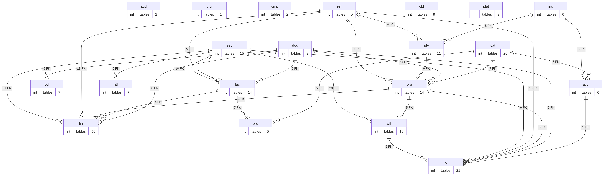

### 10.2 قراءة المخططات

**مفتاح الرسم (معيار Crow's Foot):** `PK` المفتاح الأساسي · `FK` مفتاح أجنبي · `UK` فريد. طرف الأب `||` = واحد إلزامي، وطرف الابن `}o` = صفر أو أكثر؛ الاختياري `|o` = واحد أو لا شيء. اسم العلاقة = أعمدة الربط.

الإحاطة: كل جدول مملوك للمشترك يحمل `TenantId` ويشير إلى `plat.Tenant`، ولم يُرسم هذا الربط في كل مخطط. العلاقات المرسومة **مفاتيح أجنبية فعلية**، وكل علاقة مكتوبة في جدول العلاقات بإلزامها ونطاقها وسلوك حذفها. أعمدة الإثبات والتدقيق (`SourceDocumentId` و`VerifiedBy` و`ConflictId` و`SupersedesId` و`CreatedBy` و`UpdatedBy`…) لا تُرسم في المخطط لتقليل الازدحام، وترد كاملة في جداول العلاقات. الجداول خارج المجموعة تظهر بمفتاحها فقط.

### 10.3 م0 · المنصة والهوية والتدقيق

#### م0 · المشترك والاشتراكات والمشغّلون (1/3)

*Tenancy & platform operators* — 4 جدولًا

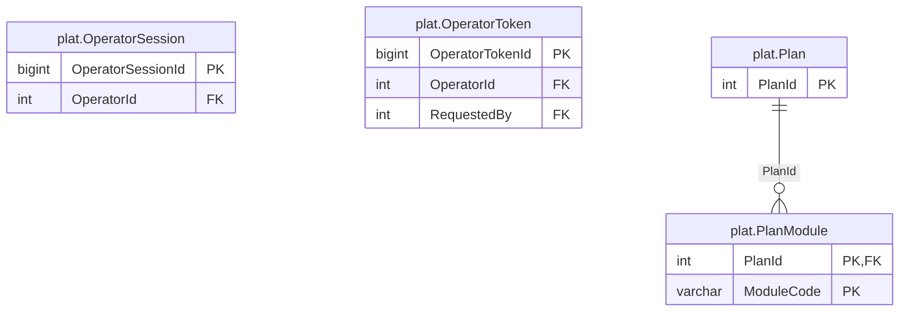

**مواصفات الجداول**

| الجدول | الغرض | PK | FK | UQ | CHECK | أعمدة أخرى |
|---|---|---|---|---|---|---|
| `plat.OperatorSession` | Platform operator sessions: 15-minute idle and 8-hour absolute timeout (FR-PLT-006) | OperatorSessionId | 1 | 1 | 1 | 12 |
| `plat.OperatorToken` | One-time operator set-up links: password and MFA (FR-PLT-006) | OperatorTokenId | 2 | 1 | 0 | 9 |
| `plat.Plan` | Subscription plan: a bundle of modules and soft limits (FR-PLT-003/004, Q-PLT-11) | PlanId | 0 | 1 | 3 | 10 |
| `plat.PlanModule` | Modules included in a plan (replaces the Plan.IncludedModules JSON column) | PlanId, ModuleCode | 1 | 0 | 0 | 4 |

**العلاقات (المفاتيح الأجنبية)**

| الطفل (الجدول.العمود) | الأب | العلاقة | الإلزام | النطاق | الحذف | أعمدة النطاق |
|---|---|---|---|---|---|---|
| `plat.OperatorSession.OperatorId` | `plat.PlatformOperator` | 1 : N | إلزامي | عام | قيد | — |
| `plat.OperatorToken.OperatorId` | `plat.PlatformOperator` | 1 : N | إلزامي | عام | قيد | — |
| `plat.OperatorToken.RequestedBy` | `plat.PlatformOperator` | 1 : N | اختياري | عام | قيد | — |
| `plat.PlanModule.PlanId` | `plat.Plan` | 1 : N | إلزامي | عام | قيد | — |

#### م0 · المشترك والاشتراكات والمشغّلون (2/3)

*Tenancy & platform operators* — 4 جدولًا

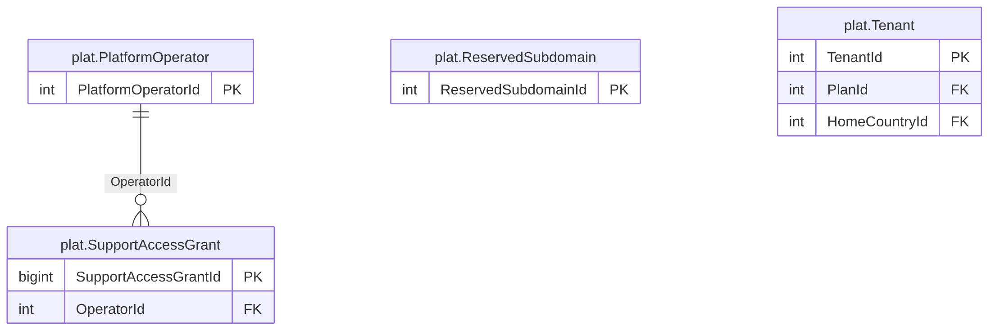

**مواصفات الجداول**

| الجدول | الغرض | PK | FK | UQ | CHECK | أعمدة أخرى |
|---|---|---|---|---|---|---|
| `plat.PlatformOperator` | Platform operator account: not readable by the tenant application (tp_app); identity store separate from AppUser (FR-PLT-006) | PlatformOperatorId | 0 | 2 | 7 | 19 |
| `plat.ReservedSubdomain` | Subdomains reserved for the system: www, admin, api, app and others (FR-PLT-046) | ReservedSubdomainId | 0 | 1 | 1 | 5 |
| `plat.SupportAccessGrant` | Temporary support access, activated by the tenant's account administrator (FR-PLT-007, BR-PLT-017) | SupportAccessGrantId | 3 | 1 | 3 | 7 |
| `plat.Tenant` | No direct access for the tenant application (it reads its row through plat.v_CurrentTenant); isolation root: the tenant (FR-PLT-001/002/046, BR-PLT-001/002) | TenantId | 2 | 2 | 7 | 18 |

**العلاقات (المفاتيح الأجنبية)**

| الطفل (الجدول.العمود) | الأب | العلاقة | الإلزام | النطاق | الحذف | أعمدة النطاق |
|---|---|---|---|---|---|---|
| `plat.SupportAccessGrant.OperatorId` | `plat.PlatformOperator` | 1 : N | إلزامي | مرجع عام | قيد | — |
| `plat.SupportAccessGrant.GrantedBy` | `sec.AppUser` | 1 : N | إلزامي | مشترك · مركّب | قيد | — |
| `plat.SupportAccessGrant.RevokedBy` | `sec.AppUser` | 1 : N | اختياري | مشترك · مركّب | قيد | — |
| `plat.Tenant.PlanId` | `plat.Plan` | 1 : N | إلزامي | عام | قيد | — |
| `plat.Tenant.HomeCountryId` | `ref.Country` | 1 : N | إلزامي | عام | قيد | — |

#### م0 · المشترك والاشتراكات والمشغّلون (3/3)

*Tenancy & platform operators* — 1 جدولًا

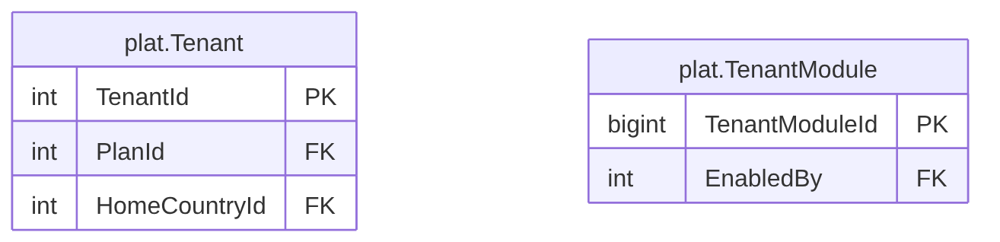

**مواصفات الجداول**

| الجدول | الغرض | PK | FK | UQ | CHECK | أعمدة أخرى |
|---|---|---|---|---|---|---|
| `plat.TenantModule` | Modules enabled per tenant; owned by the platform only: written by platform operators, read by the tenant through a restricted view (DR-01) | TenantModuleId | 1 | 1 | 1 | 6 |

**العلاقات (المفاتيح الأجنبية)**

| الطفل (الجدول.العمود) | الأب | العلاقة | الإلزام | النطاق | الحذف | أعمدة النطاق |
|---|---|---|---|---|---|---|
| `plat.TenantModule.TenantId` | `plat.Tenant` | 1 : N | إلزامي | عام | قيد | — |
| `plat.TenantModule.EnabledBy` | `plat.PlatformOperator` | 1 : N | اختياري | عام | قيد | — |

#### م0 · الهوية والصلاحيات (1/2)

*Identity & authorisation* — 4 جدولًا

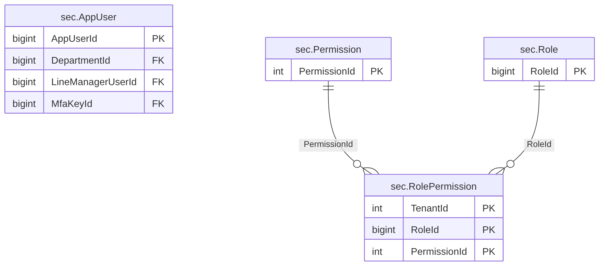

**مواصفات الجداول**

| الجدول | الغرض | PK | FK | UQ | CHECK | أعمدة أخرى |
|---|---|---|---|---|---|---|
| `sec.AppUser` | Tenant portal user (FR-PLT-010..016, BR-PLT-004..006) | AppUserId | 3 | 3 | 11 | 27 |
| `sec.Role` | Role defined by the tenant or seeded (FR-PLT-018) | RoleId | 0 | 4 | 1 | 11 |
| `sec.Permission` | Permission catalogue owned by the platform; a tenant cannot add a permission (FR-PLT-017) | PermissionId | 0 | 1 | 1 | 11 |
| `sec.RolePermission` | Role–permission link; a locked permission goes only to the system roles it names, enforced by sec.TR_RolePermission_Locked (043, BR-PLT-019, DR-16) | TenantId, RoleId, PermissionId | 3 | 0 | 0 | 4 |

**العلاقات (المفاتيح الأجنبية)**

| الطفل (الجدول.العمود) | الأب | العلاقة | الإلزام | النطاق | الحذف | أعمدة النطاق |
|---|---|---|---|---|---|---|
| `sec.AppUser.DepartmentId` | `org.Department` | 1 : N | اختياري | مشترك · مركّب | قيد | — |
| `sec.AppUser.LineManagerUserId` | `sec.AppUser` | 1 : N | اختياري | مشترك · مركّب | قيد | — |
| `sec.AppUser.MfaKeyId` | `sec.TenantKey` | 1 : N | اختياري | مشترك · مركّب | قيد | MfaKeyPurpose |
| `sec.RolePermission.RoleId` | `sec.Role` | 1 : N | إلزامي | مشترك · مركّب | قيد | — |
| `sec.RolePermission.PermissionId` | `sec.Permission` | 1 : N | إلزامي | مرجع عام | قيد | — |
| `sec.RolePermission.AssignedBy` | `sec.AppUser` | 1 : N | اختياري | مشترك · مركّب | قيد | — |

#### م0 · الهوية والصلاحيات (2/2)

*Identity & authorisation* — 3 جدولًا

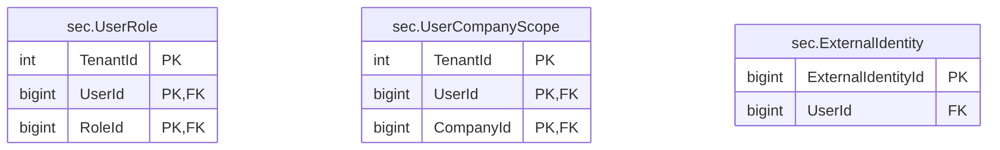

**مواصفات الجداول**

| الجدول | الغرض | PK | FK | UQ | CHECK | أعمدة أخرى |
|---|---|---|---|---|---|---|
| `sec.UserRole` | User–role link; permissions are the union of the roles (BR-PLT-007, FR-PLT-018) | TenantId, UserId, RoleId | 3 | 0 | 0 | 4 |
| `sec.UserCompanyScope` | Companies a user can see; ignored when CompanyScopeMode = ALL (FR-PLT-020) | TenantId, UserId, CompanyId | 2 | 0 | 0 | 4 |
| `sec.ExternalIdentity` | Link between an external OIDC or Entra identity and a user; readiness only (FR-PLT-015, section 11) | ExternalIdentityId | 1 | 3 | 0 | 8 |

**العلاقات (المفاتيح الأجنبية)**

| الطفل (الجدول.العمود) | الأب | العلاقة | الإلزام | النطاق | الحذف | أعمدة النطاق |
|---|---|---|---|---|---|---|
| `sec.UserRole.UserId` | `sec.AppUser` | 1 : N | إلزامي | مشترك · مركّب | قيد | — |
| `sec.UserRole.RoleId` | `sec.Role` | 1 : N | إلزامي | مشترك · مركّب | قيد | — |
| `sec.UserRole.AssignedBy` | `sec.AppUser` | 1 : N | اختياري | مشترك · مركّب | قيد | — |
| `sec.UserCompanyScope.UserId` | `sec.AppUser` | 1 : N | إلزامي | مشترك · مركّب | قيد | — |
| `sec.UserCompanyScope.CompanyId` | `org.Company` | 1 : N | إلزامي | مشترك · مركّب | قيد | — |
| `sec.ExternalIdentity.UserId` | `sec.AppUser` | 1 : N | إلزامي | مشترك · مركّب | قيد | — |

#### م0 · الجلسات والمفاتيح والمحاولات (1/2)

*Sessions, keys & attempts* — 4 جدولًا

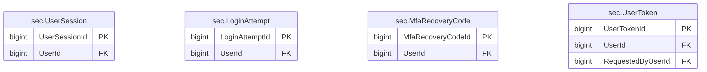

**مواصفات الجداول**

| الجدول | الغرض | PK | FK | UQ | CHECK | أعمدة أخرى |
|---|---|---|---|---|---|---|
| `sec.UserSession` | User sessions: 30-minute idle timeout and 12-hour absolute timeout (FR-PLT-014) | UserSessionId | 2 | 2 | 1 | 12 |
| `sec.LoginAttempt` | Login attempts for rate limiting and lockout windows (BR-PLT-005); written by sec.usp_StartSession. A permanent trace in aud.AuditLog is not written yet (O-24) | LoginAttemptId | 1 | 1 | 1 | 5 |
| `sec.MfaRecoveryCode` | Ten single-use recovery codes, stored hashed (FR-PLT-011, BR-PLT-006); replaces the AppUser.RecoveryCodesHash JSON | MfaRecoveryCodeId | 1 | 2 | 0 | 6 |
| `sec.UserToken` | Single-use invitation link (48 hours), password-reset token (30 minutes) or MFA re-enrolment link (24 hours) (FR-PLT-013, DQ-F03-8) | UserTokenId | 2 | 2 | 0 | 12 |

**العلاقات (المفاتيح الأجنبية)**

| الطفل (الجدول.العمود) | الأب | العلاقة | الإلزام | النطاق | الحذف | أعمدة النطاق |
|---|---|---|---|---|---|---|
| `sec.UserSession.UserId` | `sec.AppUser` | 1 : N | إلزامي | مشترك · مركّب | قيد | — |
| `sec.UserSession.EndedBy` | `sec.AppUser` | 1 : N | اختياري | مشترك · مركّب | قيد | — |
| `sec.LoginAttempt.UserId` | `sec.AppUser` | 1 : N | اختياري | مشترك · مركّب | قيد | — |
| `sec.MfaRecoveryCode.UserId` | `sec.AppUser` | 1 : N | إلزامي | مشترك · مركّب | قيد | — |
| `sec.UserToken.UserId` | `sec.AppUser` | 1 : N | إلزامي | مشترك · مركّب | قيد | — |
| `sec.UserToken.RequestedByUserId` | `sec.AppUser` | 1 : N | اختياري | مشترك · مركّب | قيد | — |

#### م0 · الجلسات والمفاتيح والمحاولات (2/2)

*Sessions, keys & attempts* — 3 جدولًا

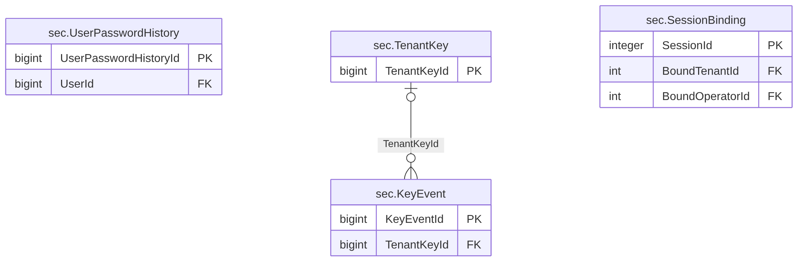

**مواصفات الجداول**

| الجدول | الغرض | PK | FK | UQ | CHECK | أعمدة أخرى |
|---|---|---|---|---|---|---|
| `sec.UserPasswordHistory` | Last five passwords, to prevent reuse (BR-PLT-004) | UserPasswordHistoryId | 1 | 1 | 1 | 2 |
| `sec.TenantKey` | Tenant key register; each key is wrapped by a master key held outside the database (FR-PLT-037, BR-PLT-015) | TenantKeyId | 0 | 4 | 3 | 11 |
| `sec.KeyEvent` | Key event log: create, rotate and revoke (FR-PLT-037; high severity BR-PLT-009) | KeyEventId | 1 | 1 | 0 | 7 |

**العلاقات (المفاتيح الأجنبية)**

| الطفل (الجدول.العمود) | الأب | العلاقة | الإلزام | النطاق | الحذف | أعمدة النطاق |
|---|---|---|---|---|---|---|
| `sec.UserPasswordHistory.UserId` | `sec.AppUser` | 1 : N | إلزامي | مشترك · مركّب | قيد | — |
| `sec.KeyEvent.TenantKeyId` | `sec.TenantKey` | 1 : N | اختياري | مشترك · مركّب | قيد | — |

#### م0 · التدقيق والمستندات (1/2)

*Audit & documents* — 4 جدولًا

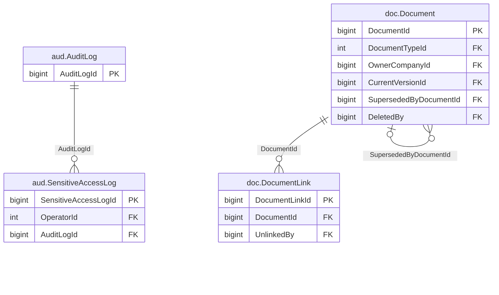

**مواصفات الجداول**

| الجدول | الغرض | PK | FK | UQ | CHECK | أعمدة أخرى |
|---|---|---|---|---|---|---|
| `aud.AuditLog` | Append-only audit log; NULL TenantId = platform event, not visible to any tenant; dedicated RLS policy (BR-PLT-001, BR-PLT-009) | AuditLogId | 0 | 2 | 0 | 19 |
| `aud.SensitiveAccessLog` | Access log for sensitive data: identity reveals, image views, exports and restricted downloads; flags anomalies above 20 per hour (BR-PTY-009) | SensitiveAccessLogId | 3 | 1 | 3 | 14 |
| `doc.Document` | Logical document: document data and status; the file itself is in doc.DocumentVersion (FR-PLT-027/028, BR-PLT-011) | DocumentId | 5 | 2 | 5 | 15 |
| `doc.DocumentLink` | Links a document to any entity with a role and a reference page; unlinking is logical (FR-PLT-028) | DocumentLinkId | 2 | 2 | 1 | 9 |

**العلاقات (المفاتيح الأجنبية)**

| الطفل (الجدول.العمود) | الأب | العلاقة | الإلزام | النطاق | الحذف | أعمدة النطاق |
|---|---|---|---|---|---|---|
| `aud.SensitiveAccessLog.ActorUserId` | `sec.AppUser` | 1 : N | اختياري | مشترك · مركّب | قيد | — |
| `aud.SensitiveAccessLog.OperatorId` | `plat.PlatformOperator` | 1 : N | اختياري | مرجع عام | قيد | — |
| `aud.SensitiveAccessLog.AuditLogId` | `aud.AuditLog` | 1 : N | إلزامي | مرجع عام | قيد | — |
| `doc.Document.DocumentTypeId` | `cat.DocumentType` | 1 : N | إلزامي | مشترك · مركّب | قيد | — |
| `doc.Document.OwnerCompanyId` | `org.Company` | 1 : N | اختياري | مشترك · مركّب | قيد | — |
| `doc.Document.CurrentVersionId` | `doc.DocumentVersion` | 1 : N | اختياري | مشترك · مركّب | قيد | DocumentId |
| `doc.Document.SupersededByDocumentId` | `doc.Document` | 1 : N | اختياري | مشترك · مركّب | قيد | — |
| `doc.Document.DeletedBy` | `sec.AppUser` | 1 : N | اختياري | مشترك · مركّب | قيد | — |
| `doc.DocumentLink.DocumentId` | `doc.Document` | 1 : N | إلزامي | مشترك · مركّب | قيد | — |
| `doc.DocumentLink.UnlinkedBy` | `sec.AppUser` | 1 : N | اختياري | مشترك · مركّب | قيد | — |

#### م0 · التدقيق والمستندات (2/2)

*Audit & documents* — 1 جدولًا

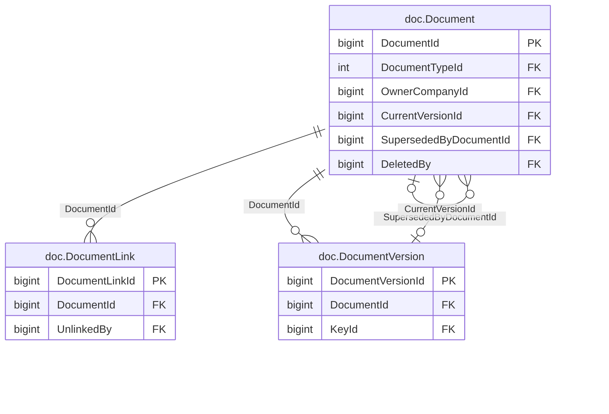

**مواصفات الجداول**

| الجدول | الغرض | PK | FK | UQ | CHECK | أعمدة أخرى |
|---|---|---|---|---|---|---|
| `doc.DocumentVersion` | Immutable file version; a change creates a new version: the application may update only the scan and integrity columns (043, FR-PLT-027, BR-PLT-011, DR-11) | DocumentVersionId | 2 | 4 | 3 | 15 |

**العلاقات (المفاتيح الأجنبية)**

| الطفل (الجدول.العمود) | الأب | العلاقة | الإلزام | النطاق | الحذف | أعمدة النطاق |
|---|---|---|---|---|---|---|
| `doc.DocumentVersion.DocumentId` | `doc.Document` | 1 : N | إلزامي | مشترك · مركّب | قيد | — |
| `doc.DocumentVersion.KeyId` | `sec.TenantKey` | 1 : N | إلزامي | مشترك · مركّب | قيد | KeyPurpose |

#### م0 · الإعدادات والمهام الخلفية (1/4)

*Configuration & background jobs* — 4 جدولًا

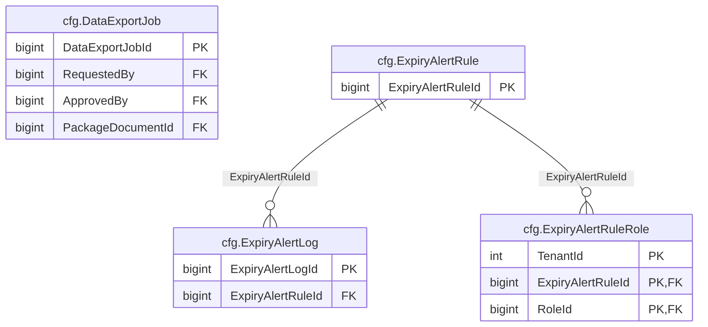

**مواصفات الجداول**

| الجدول | الغرض | PK | FK | UQ | CHECK | أعمدة أخرى |
|---|---|---|---|---|---|---|
| `cfg.DataExportJob` | Tenant data export request (FR-PLT-039, BR-PLT-016) | DataExportJobId | 3 | 2 | 5 | 15 |
| `cfg.ExpiryAlertLog` | Log of sent expiry alerts: one event per (item, threshold), never repeated on the same day (FR-PLT-038) | ExpiryAlertLogId | 1 | 2 | 0 | 5 |
| `cfg.ExpiryAlertRule` | Expiry alert rule per item type (FR-PLT-038, BR-PLT-013) | ExpiryAlertRuleId | 0 | 3 | 1 | 9 |
| `cfg.ExpiryAlertRuleRole` | Roles that receive an alert rule's alerts, within the company scope; replaces the RecipientRoles code list, so a renamed or missing role cannot silently receive nothing (FR-PLT-038, DR-16) | TenantId, ExpiryAlertRuleId, RoleId | 2 | 0 | 0 | 3 |

**العلاقات (المفاتيح الأجنبية)**

| الطفل (الجدول.العمود) | الأب | العلاقة | الإلزام | النطاق | الحذف | أعمدة النطاق |
|---|---|---|---|---|---|---|
| `cfg.DataExportJob.RequestedBy` | `sec.AppUser` | 1 : N | إلزامي | مشترك · مركّب | قيد | — |
| `cfg.DataExportJob.ApprovedBy` | `sec.AppUser` | 1 : N | اختياري | مشترك · مركّب | قيد | — |
| `cfg.DataExportJob.PackageDocumentId` | `doc.Document` | 1 : N | اختياري | مشترك · مركّب | قيد | — |
| `cfg.ExpiryAlertLog.ExpiryAlertRuleId` | `cfg.ExpiryAlertRule` | 1 : N | إلزامي | مشترك · مركّب | قيد | — |
| `cfg.ExpiryAlertRuleRole.ExpiryAlertRuleId` | `cfg.ExpiryAlertRule` | 1 : N | إلزامي | مشترك · مركّب | قيد | — |
| `cfg.ExpiryAlertRuleRole.RoleId` | `sec.Role` | 1 : N | إلزامي | مشترك · مركّب | قيد | — |

#### م0 · الإعدادات والمهام الخلفية (2/4)

*Configuration & background jobs* — 4 جدولًا

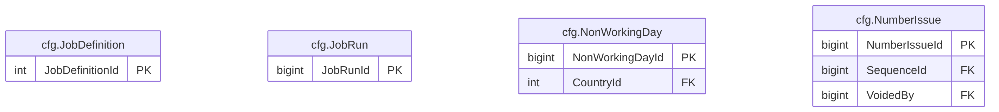

**مواصفات الجداول**

| الجدول | الغرض | PK | FK | UQ | CHECK | أعمدة أخرى |
|---|---|---|---|---|---|---|
| `cfg.JobDefinition` | Background job catalogue: the only JobKey values a job connection may bind with (FR-PLT-044) | JobDefinitionId | 0 | 1 | 1 | 8 |
| `cfg.JobRun` | Background job run log: last run, duration and result, visible to the account administrator (FR-PLT-044) | JobRunId | 0 | 1 | 3 | 14 |
| `cfg.NonWorkingDay` | Non-working day; NULL TenantId = platform holiday, read-only (FR-PLT-035, BR-PLT-014) | NonWorkingDayId | 1 | 2 | 0 | 7 |
| `cfg.NumberIssue` | Issued document numbers; a cancelled number is never reused (FR-PLT-026, BR-PLT-010) | NumberIssueId | 2 | 3 | 2 | 10 |

**العلاقات (المفاتيح الأجنبية)**

| الطفل (الجدول.العمود) | الأب | العلاقة | الإلزام | النطاق | الحذف | أعمدة النطاق |
|---|---|---|---|---|---|---|
| `cfg.NonWorkingDay.CountryId` | `ref.Country` | 1 : N | إلزامي | عام | قيد | — |
| `cfg.NumberIssue.SequenceId` | `cfg.NumberSequence` | 1 : N | إلزامي | مشترك · مركّب | قيد | — |
| `cfg.NumberIssue.VoidedBy` | `sec.AppUser` | 1 : N | اختياري | مشترك · مركّب | قيد | — |

#### م0 · الإعدادات والمهام الخلفية (3/4)

*Configuration & background jobs* — 4 جدولًا

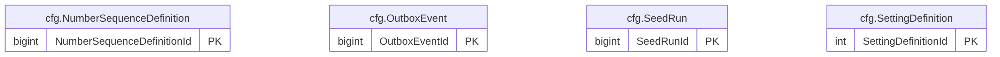

**مواصفات الجداول**

| الجدول | الغرض | PK | FK | UQ | CHECK | أعمدة أخرى |
|---|---|---|---|---|---|---|
| `cfg.NumberSequence` | Counter per (definition, optional company, period); its row is locked on allocation inside the caller's transaction (BR-PLT-010) | NumberSequenceId | 2 | 3 | 1 | 5 |
| `cfg.NumberSequenceDefinition` | Numbering-type definition with a tag-based format, for example {seq:000}-{erp}-{yy} (FR-PLT-026) | NumberSequenceDefinitionId | 0 | 3 | 2 | 11 |
| `cfg.OutboxEvent` | Outbound queue with at-least-once delivery; the payload carries identifiers without restricted data; only DELIVERED events may be deleted (043, FR-PLT-042, DR-14) | OutboxEventId | 0 | 2 | 5 | 17 |
| `cfg.SeedRun` | Numbered seed-run log per package; re-running a seed adds nothing (FR-PLT-008) | SeedRunId | 0 | 1 | 1 | 11 |

**العلاقات (المفاتيح الأجنبية)**

| الطفل (الجدول.العمود) | الأب | العلاقة | الإلزام | النطاق | الحذف | أعمدة النطاق |
|---|---|---|---|---|---|---|
| `cfg.NumberSequence.DefinitionId` | `cfg.NumberSequenceDefinition` | 1 : N | إلزامي | مشترك · مركّب | قيد | — |
| `cfg.NumberSequence.CompanyId` | `org.Company` | 1 : N | اختياري | مشترك · مركّب | قيد | — |

#### م0 · الإعدادات والمهام الخلفية (4/4)

*Configuration & background jobs* — 2 جدولًا

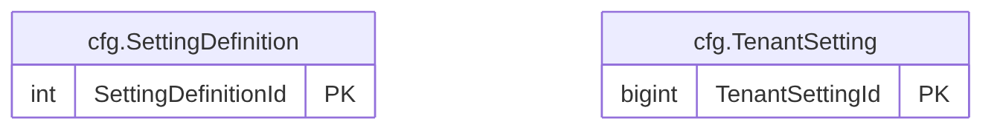

**مواصفات الجداول**

| الجدول | الغرض | PK | FK | UQ | CHECK | أعمدة أخرى |
|---|---|---|---|---|---|---|
| `cfg.SettingDefinition` | Setting-key definition with platform minimum and maximum bounds (BR-PLT-018, FR-PLT-043) | SettingDefinitionId | 0 | 1 | 0 | 12 |
| `cfg.TenantSetting` | Tenant settings: security policies, timeouts, thresholds, and work start and end times (FR-PLT-043) | TenantSettingId | 0 | 2 | 0 | 5 |

**العلاقات (المفاتيح الأجنبية)**

| الطفل (الجدول.العمود) | الأب | العلاقة | الإلزام | النطاق | الحذف | أعمدة النطاق |
|---|---|---|---|---|---|---|
| — | — | — | — | — | — | — |

### 10.4 م1 · الهيكل المؤسسي والأشخاص

#### م1 · الشركات والحوكمة (1/2)

*Company structure & governance* — 4 جدولًا

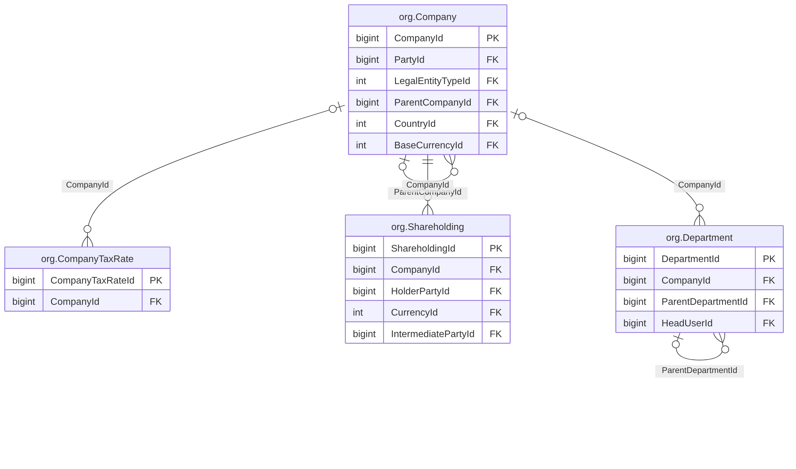

**مواصفات الجداول**

| الجدول | الغرض | PK | FK | UQ | CHECK | أعمدة أخرى |
|---|---|---|---|---|---|---|
| `org.Company` | Company: root of the corporate structure (FR-ORG-001..010, BR-ORG-001..004) | CompanyId | 5 | 6 | 4 | 19 |
| `org.CompanyTaxRate` | Tax rate with an effective date; NULL CompanyId = tenant default (FR-ORG-007, BR-ORG-005) | CompanyTaxRateId | 1 | 3 | 2 | 7 |
| `org.Department` | Department (FR-ORG-014, BR-ORG-016, Q-ORG-09): at tenant level, optionally per company | DepartmentId | 3 | 3 | 1 | 10 |
| `org.Shareholding` | Ownership interest with an effective date; the owner is a Party, an individual or an entity (FR-ORG-015..018, BR-ORG-006..008, G-7) | ShareholdingId | 4 | 3 | 5 | 10 |

**العلاقات (المفاتيح الأجنبية)**

| الطفل (الجدول.العمود) | الأب | العلاقة | الإلزام | النطاق | الحذف | أعمدة النطاق |
|---|---|---|---|---|---|---|
| `org.Company.PartyId` | `pty.Party` | 1 : N | إلزامي | مشترك · مركّب | قيد | PartyKind |
| `org.Company.LegalEntityTypeId` | `cat.LegalEntityType` | 1 : N | إلزامي | مشترك · مركّب | قيد | — |
| `org.Company.ParentCompanyId` | `org.Company` | 1 : N | اختياري | مشترك · مركّب | قيد | — |
| `org.Company.CountryId` | `ref.Country` | 1 : N | إلزامي | مرجع عام | قيد | — |
| `org.Company.BaseCurrencyId` | `ref.Currency` | 1 : N | اختياري | مرجع عام | قيد | — |
| `org.CompanyTaxRate.CompanyId` | `org.Company` | 1 : N | اختياري | مشترك · مركّب | قيد | — |
| `org.Department.CompanyId` | `org.Company` | 1 : N | اختياري | مشترك · مركّب | قيد | — |
| `org.Department.ParentDepartmentId` | `org.Department` | 1 : N | اختياري | مشترك · مركّب | قيد | — |
| `org.Department.HeadUserId` | `sec.AppUser` | 1 : N | اختياري | مشترك · مركّب | قيد | — |
| `org.Shareholding.CompanyId` | `org.Company` | 1 : N | إلزامي | مشترك · مركّب | قيد | — |
| `org.Shareholding.HolderPartyId` | `pty.Party` | 1 : N | إلزامي | مشترك · مركّب | قيد | — |
| `org.Shareholding.CurrencyId` | `ref.Currency` | 1 : N | اختياري | مرجع عام | قيد | — |
| `org.Shareholding.SourceDocumentId` | `doc.Document` | 1 : N | اختياري | مشترك · مركّب | قيد | — |

#### م1 · الشركات والحوكمة (2/2)

*Company structure & governance* — 3 جدولًا

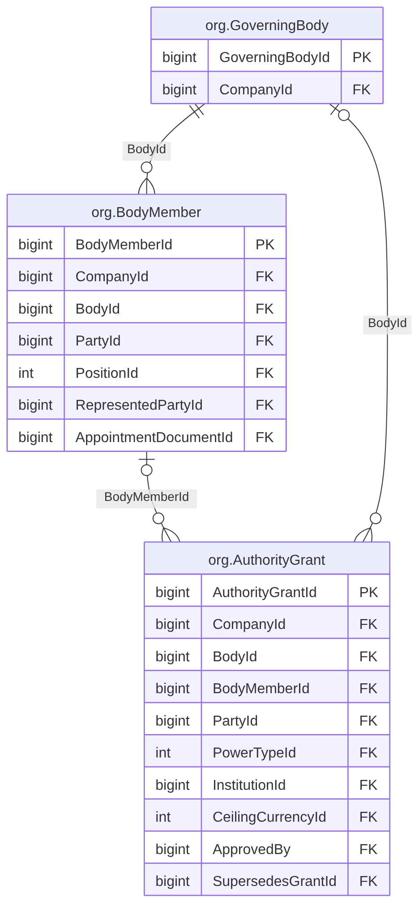

**مواصفات الجداول**

| الجدول | الغرض | PK | FK | UQ | CHECK | أعمدة أخرى |
|---|---|---|---|---|---|---|
| `org.GoverningBody` | Governing body (FR-ORG-019, BR-ORG-009) | GoverningBodyId | 2 | 4 | 1 | 12 |
| `org.BodyMember` | Membership of a governing body (FR-ORG-020, FR-ORG-021, BR-ORG-010) | BodyMemberId | 6 | 4 | 3 | 6 |
| `org.AuthorityGrant` | Authority grant to a company (FR-ORG-023..028, BR-ORG-011..014) | AuthorityGrantId | 10 | 3 | 10 | 18 |

**العلاقات (المفاتيح الأجنبية)**

| الطفل (الجدول.العمود) | الأب | العلاقة | الإلزام | النطاق | الحذف | أعمدة النطاق |
|---|---|---|---|---|---|---|
| `org.GoverningBody.CompanyId` | `org.Company` | 1 : N | إلزامي | مشترك · مركّب | قيد | — |
| `org.GoverningBody.SourceDocumentId` | `doc.Document` | 1 : N | اختياري | مشترك · مركّب | قيد | — |
| `org.BodyMember.CompanyId` | `org.Company` | 1 : N | إلزامي | مشترك · مركّب | قيد | — |
| `org.BodyMember.BodyId` | `org.GoverningBody` | 1 : N | إلزامي | مشترك · مركّب | قيد | CompanyId |
| `org.BodyMember.PartyId` | `pty.Party` | 1 : N | إلزامي | مشترك · مركّب | قيد | — |
| `org.BodyMember.PositionId` | `cat.Position` | 1 : N | إلزامي | مشترك · مركّب | قيد | — |
| `org.BodyMember.RepresentedPartyId` | `pty.Party` | 1 : N | اختياري | مشترك · مركّب | قيد | — |
| `org.BodyMember.AppointmentDocumentId` | `doc.Document` | 1 : N | اختياري | مشترك · مركّب | قيد | — |
| `org.AuthorityGrant.CompanyId` | `org.Company` | 1 : N | إلزامي | مشترك · مركّب | قيد | — |
| `org.AuthorityGrant.BodyId` | `org.GoverningBody` | 1 : N | اختياري | مشترك · مركّب | قيد | CompanyId |
| `org.AuthorityGrant.BodyMemberId` | `org.BodyMember` | 1 : N | اختياري | مشترك · مركّب | قيد | CompanyId |
| `org.AuthorityGrant.PartyId` | `pty.Party` | 1 : N | اختياري | مشترك · مركّب | قيد | — |
| `org.AuthorityGrant.PowerTypeId` | `cat.PowerType` | 1 : N | إلزامي | مشترك · مركّب | قيد | — |
| `org.AuthorityGrant.InstitutionId` | `ins.Institution` | 1 : N | اختياري | مشترك · مركّب | قيد | — |
| `org.AuthorityGrant.CeilingCurrencyId` | `ref.Currency` | 1 : N | اختياري | مرجع عام | قيد | — |
| `org.AuthorityGrant.ApprovedBy` | `sec.AppUser` | 1 : N | اختياري | مشترك · مركّب | قيد | — |
| `org.AuthorityGrant.SourceDocumentId` | `doc.Document` | 1 : N | اختياري | مشترك · مركّب | قيد | — |
| `org.AuthorityGrant.SupersedesGrantId` | `org.AuthorityGrant` | 1 : N | اختياري | مشترك · مركّب | قيد | CompanyId |

#### م1 · ملف الشركة و KYC (1/2)

*Company profile & KYC* — 4 جدولًا

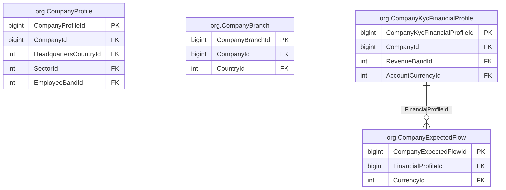

**مواصفات الجداول**

| الجدول | الغرض | PK | FK | UQ | CHECK | أعمدة أخرى |
|---|---|---|---|---|---|---|
| `org.CompanyProfile` | Company profile, 1:1 (G-1) | CompanyProfileId | 4 | 2 | 3 | 15 |
| `org.CompanyBranch` | Branch, warehouse or subsidiary outside the account, held as text (G-3) | CompanyBranchId | 2 | 2 | 3 | 13 |
| `org.CompanyKycFinancialProfile` | KYC financial profile with an effective date: revenue band and purpose (G-4) | CompanyKycFinancialProfileId | 3 | 3 | 1 | 9 |
| `org.CompanyExpectedFlow` | Monthly expected cash-flow matrix (CTP): direction x five items (G-4) | CompanyExpectedFlowId | 2 | 2 | 1 | 6 |

**العلاقات (المفاتيح الأجنبية)**

| الطفل (الجدول.العمود) | الأب | العلاقة | الإلزام | النطاق | الحذف | أعمدة النطاق |
|---|---|---|---|---|---|---|
| `org.CompanyProfile.CompanyId` | `org.Company` | 1 : N | إلزامي | مشترك · مركّب | قيد | — |
| `org.CompanyProfile.HeadquartersCountryId` | `ref.Country` | 1 : N | اختياري | مرجع عام | قيد | — |
| `org.CompanyProfile.SectorId` | `cat.LookupItem` | 1 : N | اختياري | مشترك · مركّب | قيد | — |
| `org.CompanyProfile.EmployeeBandId` | `cat.LookupItem` | 1 : N | اختياري | مشترك · مركّب | قيد | — |
| `org.CompanyBranch.CompanyId` | `org.Company` | 1 : N | إلزامي | مشترك · مركّب | قيد | — |
| `org.CompanyBranch.CountryId` | `ref.Country` | 1 : N | اختياري | مرجع عام | قيد | — |
| `org.CompanyKycFinancialProfile.CompanyId` | `org.Company` | 1 : N | إلزامي | مشترك · مركّب | قيد | — |
| `org.CompanyKycFinancialProfile.RevenueBandId` | `cat.LookupItem` | 1 : N | اختياري | مشترك · مركّب | قيد | — |
| `org.CompanyKycFinancialProfile.AccountCurrencyId` | `ref.Currency` | 1 : N | اختياري | مرجع عام | قيد | — |
| `org.CompanyExpectedFlow.FinancialProfileId` | `org.CompanyKycFinancialProfile` | 1 : N | إلزامي | مشترك · مركّب | قيد | — |
| `org.CompanyExpectedFlow.CurrencyId` | `ref.Currency` | 1 : N | إلزامي | مرجع عام | قيد | — |

#### م1 · ملف الشركة و KYC (2/2)

*Company profile & KYC* — 3 جدولًا

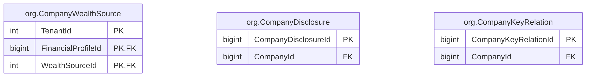

**مواصفات الجداول**

| الجدول | الغرض | PK | FK | UQ | CHECK | أعمدة أخرى |
|---|---|---|---|---|---|---|
| `org.CompanyWealthSource` | Sources of funds and wealth: multiple-value list (G-4) | TenantId, FinancialProfileId, WealthSourceId | 2 | 0 | 0 | 4 |
| `org.CompanyDisclosure` | Company disclosures (G-5) | CompanyDisclosureId | 2 | 1 | 1 | 8 |
| `org.CompanyKeyRelation` | Key relations: auditors, legal counsel, regulators, and major customers and suppliers (G-6) | CompanyKeyRelationId | 1 | 1 | 1 | 9 |

**العلاقات (المفاتيح الأجنبية)**

| الطفل (الجدول.العمود) | الأب | العلاقة | الإلزام | النطاق | الحذف | أعمدة النطاق |
|---|---|---|---|---|---|---|
| `org.CompanyWealthSource.FinancialProfileId` | `org.CompanyKycFinancialProfile` | 1 : N | إلزامي | مشترك · مركّب | قيد | — |
| `org.CompanyWealthSource.WealthSourceId` | `cat.LookupItem` | 1 : N | إلزامي | مشترك · مركّب | قيد | — |
| `org.CompanyDisclosure.CompanyId` | `org.Company` | 1 : N | إلزامي | مشترك · مركّب | قيد | — |
| `org.CompanyDisclosure.SourceDocumentId` | `doc.Document` | 1 : N | اختياري | مشترك · مركّب | قيد | — |
| `org.CompanyKeyRelation.CompanyId` | `org.Company` | 1 : N | إلزامي | مشترك · مركّب | قيد | — |

#### م1 · الأشخاص والهوية و KYC (1/3)

*Parties, identity documents & KYC* — 4 جدولًا

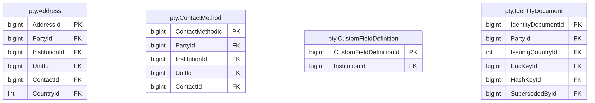

**مواصفات الجداول**

| الجدول | الغرض | PK | FK | UQ | CHECK | أعمدة أخرى |
|---|---|---|---|---|---|---|
| `pty.Address` | Postal address with an exclusive owner arc: exactly one of Party, Institution, Unit or Contact (FR-PTY-011, BR-PTY-015) | AddressId | 5 | 5 | 3 | 17 |
| `pty.ContactMethod` | Contact method (phone, e-mail and similar) with an exclusive owner arc, as for addresses (FR-PTY-012, BR-PTY-015) | ContactMethodId | 4 | 9 | 1 | 8 |
| `pty.CustomFieldDefinition` | Custom field definition (FR-PTY-013, BR-PTY-014) | CustomFieldDefinitionId | 1 | 3 | 1 | 12 |
| `pty.IdentityDocument` | Identity document; the number is encrypted and images are restricted documents (FR-PTY-004..009, FR-PTY-020..022, BR-PTY-002..008) | IdentityDocumentId | 6 | 4 | 5 | 18 |

**العلاقات (المفاتيح الأجنبية)**

| الطفل (الجدول.العمود) | الأب | العلاقة | الإلزام | النطاق | الحذف | أعمدة النطاق |
|---|---|---|---|---|---|---|
| `pty.Address.PartyId` | `pty.Party` | 1 : N | اختياري | مشترك · مركّب | قيد | — |
| `pty.Address.InstitutionId` | `ins.Institution` | 1 : N | اختياري | مشترك · مركّب | قيد | — |
| `pty.Address.UnitId` | `ins.InstitutionUnit` | 1 : N | اختياري | مشترك · مركّب | قيد | — |
| `pty.Address.ContactId` | `ins.Contact` | 1 : N | اختياري | مشترك · مركّب | قيد | — |
| `pty.Address.CountryId` | `ref.Country` | 1 : N | إلزامي | مرجع عام | قيد | — |
| `pty.ContactMethod.PartyId` | `pty.Party` | 1 : N | اختياري | مشترك · مركّب | قيد | — |
| `pty.ContactMethod.InstitutionId` | `ins.Institution` | 1 : N | اختياري | مشترك · مركّب | قيد | — |
| `pty.ContactMethod.UnitId` | `ins.InstitutionUnit` | 1 : N | اختياري | مشترك · مركّب | قيد | — |
| `pty.ContactMethod.ContactId` | `ins.Contact` | 1 : N | اختياري | مشترك · مركّب | قيد | — |
| `pty.CustomFieldDefinition.InstitutionId` | `ins.Institution` | 1 : N | اختياري | مشترك · مركّب | قيد | — |
| `pty.IdentityDocument.PartyId` | `pty.Party` | 1 : N | إلزامي | مشترك · مركّب | قيد | — |
| `pty.IdentityDocument.IssuingCountryId` | `ref.Country` | 1 : N | إلزامي | مرجع عام | قيد | — |
| `pty.IdentityDocument.EncKeyId` | `sec.TenantKey` | 1 : N | إلزامي | مشترك · مركّب | قيد | EncKeyPurpose |
| `pty.IdentityDocument.HashKeyId` | `sec.TenantKey` | 1 : N | إلزامي | مشترك · مركّب | قيد | HashKeyPurpose |
| `pty.IdentityDocument.SupersededById` | `pty.IdentityDocument` | 1 : N | اختياري | مشترك · مركّب | قيد | PartyId |
| `pty.IdentityDocument.VerifiedBy` | `sec.AppUser` | 1 : N | اختياري | مشترك · مركّب | قيد | — |

#### م1 · الأشخاص والهوية و KYC (2/3)

*Parties, identity documents & KYC* — 4 جدولًا

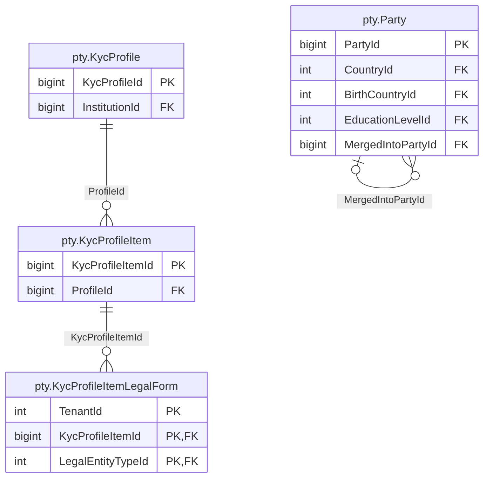

**مواصفات الجداول**

| الجدول | الغرض | PK | FK | UQ | CHECK | أعمدة أخرى |
|---|---|---|---|---|---|---|
| `pty.KycProfile` | KYC completeness checklist per bank and role (FR-PTY-023, BR-PTY-012..013, G-8, G-14) | KycProfileId | 2 | 5 | 3 | 13 |
| `pty.KycProfileItem` | Completeness item (FR-PTY-023, FR-PTY-024, G-14) | KycProfileItemId | 1 | 3 | 2 | 14 |
| `pty.KycProfileItemLegalForm` | Conditions for an item to apply, by legal form; no rows = applies to all (G-15) | TenantId, KycProfileItemId, LegalEntityTypeId | 2 | 0 | 0 | 3 |
| `pty.Party` | Person or entity; no stored role (FR-PTY-001..003, BR-PTY-001..004, BR-PTY-016..018) | PartyId | 4 | 4 | 3 | 16 |

**العلاقات (المفاتيح الأجنبية)**

| الطفل (الجدول.العمود) | الأب | العلاقة | الإلزام | النطاق | الحذف | أعمدة النطاق |
|---|---|---|---|---|---|---|
| `pty.KycProfile.InstitutionId` | `ins.Institution` | 1 : N | اختياري | مشترك · مركّب | قيد | — |
| `pty.KycProfile.SourceDocumentId` | `doc.Document` | 1 : N | اختياري | مشترك · مركّب | قيد | — |
| `pty.KycProfileItem.ProfileId` | `pty.KycProfile` | 1 : N | إلزامي | مشترك · مركّب | قيد | — |
| `pty.KycProfileItemLegalForm.KycProfileItemId` | `pty.KycProfileItem` | 1 : N | إلزامي | مشترك · مركّب | CASCADE | — |
| `pty.KycProfileItemLegalForm.LegalEntityTypeId` | `cat.LegalEntityType` | 1 : N | إلزامي | مشترك · مركّب | قيد | — |
| `pty.Party.CountryId` | `ref.Country` | 1 : N | اختياري | مرجع عام | قيد | — |
| `pty.Party.BirthCountryId` | `ref.Country` | 1 : N | اختياري | مرجع عام | قيد | — |
| `pty.Party.EducationLevelId` | `cat.LookupItem` | 1 : N | اختياري | مشترك · مركّب | قيد | — |
| `pty.Party.MergedIntoPartyId` | `pty.Party` | 1 : N | اختياري | مشترك · مركّب | قيد | — |

#### م1 · الأشخاص والهوية و KYC (3/3)

*Parties, identity documents & KYC* — 3 جدولًا

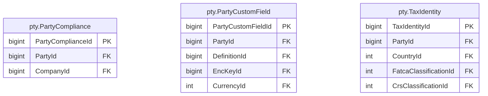

**مواصفات الجداول**

| الجدول | الغرض | PK | FK | UQ | CHECK | أعمدة أخرى |
|---|---|---|---|---|---|---|
| `pty.PartyCompliance` | Dated compliance declarations per person in their capacity: PEP, sanctions, investigations, immunity (G-9) | PartyComplianceId | 3 | 3 | 0 | 12 |
| `pty.PartyCustomField` | Custom-field value for a party (FR-PTY-013, FR-PTY-014) | PartyCustomFieldId | 4 | 2 | 3 | 7 |
| `pty.TaxIdentity` | Tax identity and FATCA/CRS tax declaration (G-13) | TaxIdentityId | 5 | 3 | 1 | 7 |

**العلاقات (المفاتيح الأجنبية)**

| الطفل (الجدول.العمود) | الأب | العلاقة | الإلزام | النطاق | الحذف | أعمدة النطاق |
|---|---|---|---|---|---|---|
| `pty.PartyCompliance.PartyId` | `pty.Party` | 1 : N | إلزامي | مشترك · مركّب | قيد | — |
| `pty.PartyCompliance.CompanyId` | `org.Company` | 1 : N | اختياري | مشترك · مركّب | قيد | — |
| `pty.PartyCompliance.SourceDocumentId` | `doc.Document` | 1 : N | اختياري | مشترك · مركّب | قيد | — |
| `pty.PartyCustomField.PartyId` | `pty.Party` | 1 : N | إلزامي | مشترك · مركّب | قيد | — |
| `pty.PartyCustomField.DefinitionId` | `pty.CustomFieldDefinition` | 1 : N | إلزامي | مشترك · مركّب | قيد | — |
| `pty.PartyCustomField.EncKeyId` | `sec.TenantKey` | 1 : N | اختياري | مشترك · مركّب | قيد | EncKeyPurpose |
| `pty.PartyCustomField.CurrencyId` | `ref.Currency` | 1 : N | اختياري | مرجع عام | قيد | — |
| `pty.TaxIdentity.PartyId` | `pty.Party` | 1 : N | إلزامي | مشترك · مركّب | قيد | — |
| `pty.TaxIdentity.CountryId` | `ref.Country` | 1 : N | إلزامي | مرجع عام | قيد | — |
| `pty.TaxIdentity.FatcaClassificationId` | `cat.LookupItem` | 1 : N | اختياري | مشترك · مركّب | قيد | — |
| `pty.TaxIdentity.CrsClassificationId` | `cat.LookupItem` | 1 : N | اختياري | مشترك · مركّب | قيد | — |
| `pty.TaxIdentity.SourceDocumentId` | `doc.Document` | 1 : N | اختياري | مشترك · مركّب | قيد | — |

### 10.5 م2–م3 · الجهات المالية والحسابات

#### م2–م3 · الجهات المالية والحسابات والمفوّضون (1/3)

*Institutions, bank accounts & signatories* — 4 جدولًا

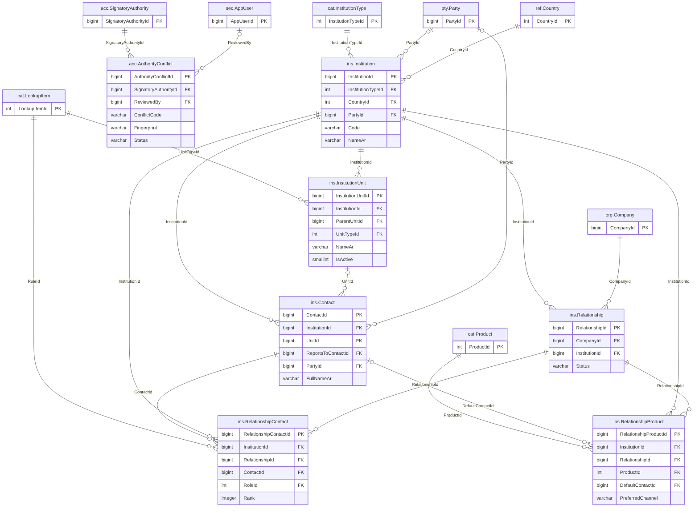

**مواصفات الجداول**

| الجدول | الغرض | PK | FK | UQ | CHECK | أعمدة أخرى |
|---|---|---|---|---|---|---|
| `ins.Contact` | Contact at a bank: a lightweight record with no identity; PartyId is optional, for promotion (FR-INS-007/008, BR-INS-005/006/014) | ContactId | 4 | 4 | 2 | 11 |
| `ins.Institution` | Financial institution (FR-INS-001..004, BR-INS-001..003, BR-INS-012); Locality (local or foreign) is derived (BR-INS-002) and therefore not stored | InstitutionId | 3 | 4 | 2 | 12 |
| `ins.InstitutionUnit` | Unit in an institution's structure: division, department or branch; self-referencing tree of up to four levels (FR-INS-005/006, BR-INS-004) | InstitutionUnitId | 3 | 3 | 1 | 6 |
| `ins.Relationship` | Company–institution relationship (D-4); unique regardless of status (FR-INS-009, BR-INS-007/011) | RelationshipId | 2 | 5 | 2 | 10 |

**العلاقات (المفاتيح الأجنبية)**

| الطفل (الجدول.العمود) | الأب | العلاقة | الإلزام | النطاق | الحذف | أعمدة النطاق |
|---|---|---|---|---|---|---|
| `ins.Contact.InstitutionId` | `ins.Institution` | 1 : N | إلزامي | مشترك · مركّب | قيد | — |
| `ins.Contact.UnitId` | `ins.InstitutionUnit` | 1 : N | اختياري | مشترك · مركّب | قيد | InstitutionId |
| `ins.Contact.ReportsToContactId` | `ins.Contact` | 1 : N | اختياري | مشترك · مركّب | قيد | InstitutionId |
| `ins.Contact.PartyId` | `pty.Party` | 1 : N | اختياري | مشترك · مركّب | قيد | — |
| `ins.Institution.InstitutionTypeId` | `cat.InstitutionType` | 1 : N | إلزامي | مشترك · مركّب | قيد | — |
| `ins.Institution.CountryId` | `ref.Country` | 1 : N | إلزامي | مرجع عام | قيد | — |
| `ins.Institution.PartyId` | `pty.Party` | 1 : N | اختياري | مشترك · مركّب | قيد | — |
| `ins.InstitutionUnit.InstitutionId` | `ins.Institution` | 1 : N | إلزامي | مشترك · مركّب | قيد | — |
| `ins.InstitutionUnit.ParentUnitId` | `ins.InstitutionUnit` | 1 : N | اختياري | مشترك · مركّب | قيد | InstitutionId |
| `ins.InstitutionUnit.UnitTypeId` | `cat.LookupItem` | 1 : N | إلزامي | مشترك · مركّب | قيد | — |
| `ins.Relationship.CompanyId` | `org.Company` | 1 : N | إلزامي | مشترك · مركّب | قيد | — |
| `ins.Relationship.InstitutionId` | `ins.Institution` | 1 : N | إلزامي | مشترك · مركّب | قيد | — |

#### م2–م3 · الجهات المالية والحسابات والمفوّضون (2/3)

*Institutions, bank accounts & signatories* — 4 جدولًا

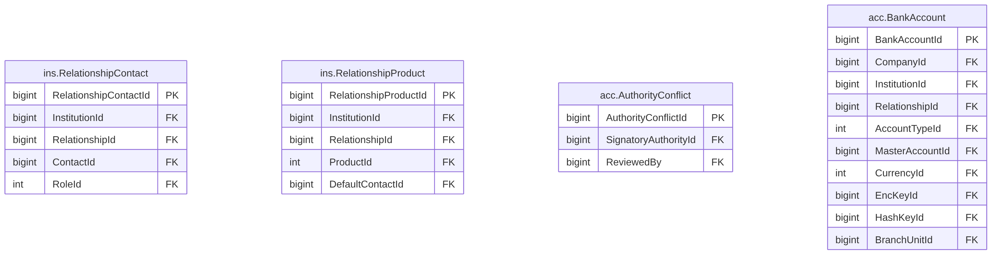

**مواصفات الجداول**

| الجدول | الغرض | PK | FK | UQ | CHECK | أعمدة أخرى |
|---|---|---|---|---|---|---|
| `ins.RelationshipContact` | Relationship coverage (first layer): contact with role, rank and period (FR-INS-010, BR-INS-008/009) | RelationshipContactId | 4 | 5 | 2 | 8 |
| `ins.RelationshipProduct` | Product handled within a relationship, with a default contact and channel (FR-INS-011..013, BR-INS-010) | RelationshipProductId | 4 | 2 | 0 | 7 |
| `acc.AuthorityConflict` | Result of checking a signatory's authority against governance rules, and the reviewer's decision (S1-B) (FR-ACC-018, BR-ACC-015) | AuthorityConflictId | 2 | 2 | 2 | 9 |
| `acc.BankAccount` | Company bank account at a financial institution (FR-ACC-001..009, BR-ACC-001..006, BR-ACC-016); account number and IBAN are encrypted, with blind-index uniqueness | BankAccountId | 9 | 8 | 8 | 20 |

**العلاقات (المفاتيح الأجنبية)**

| الطفل (الجدول.العمود) | الأب | العلاقة | الإلزام | النطاق | الحذف | أعمدة النطاق |
|---|---|---|---|---|---|---|
| `ins.RelationshipContact.InstitutionId` | `ins.Institution` | 1 : N | إلزامي | مشترك · مركّب | قيد | — |
| `ins.RelationshipContact.RelationshipId` | `ins.Relationship` | 1 : N | إلزامي | مشترك · مركّب | قيد | InstitutionId |
| `ins.RelationshipContact.ContactId` | `ins.Contact` | 1 : N | إلزامي | مشترك · مركّب | قيد | InstitutionId |
| `ins.RelationshipContact.RoleId` | `cat.LookupItem` | 1 : N | إلزامي | مشترك · مركّب | قيد | — |
| `ins.RelationshipProduct.InstitutionId` | `ins.Institution` | 1 : N | إلزامي | مشترك · مركّب | قيد | — |
| `ins.RelationshipProduct.RelationshipId` | `ins.Relationship` | 1 : N | إلزامي | مشترك · مركّب | قيد | InstitutionId |
| `ins.RelationshipProduct.ProductId` | `cat.Product` | 1 : N | إلزامي | مشترك · مركّب | قيد | — |
| `ins.RelationshipProduct.DefaultContactId` | `ins.Contact` | 1 : N | اختياري | مشترك · مركّب | قيد | InstitutionId |
| `acc.AuthorityConflict.SignatoryAuthorityId` | `acc.SignatoryAuthority` | 1 : N | إلزامي | مشترك · مركّب | قيد | — |
| `acc.AuthorityConflict.ReviewedBy` | `sec.AppUser` | 1 : N | اختياري | مشترك · مركّب | قيد | — |
| `acc.BankAccount.CompanyId` | `org.Company` | 1 : N | إلزامي | مشترك · مركّب | قيد | — |
| `acc.BankAccount.InstitutionId` | `ins.Institution` | 1 : N | إلزامي | مشترك · مركّب | قيد | — |
| `acc.BankAccount.RelationshipId` | `ins.Relationship` | 1 : N | إلزامي | مشترك · مركّب | قيد | CompanyId, InstitutionId |
| `acc.BankAccount.AccountTypeId` | `cat.AccountType` | 1 : N | إلزامي | مشترك · مركّب | قيد | — |
| `acc.BankAccount.MasterAccountId` | `acc.BankAccount` | 1 : N | اختياري | مشترك · مركّب | قيد | CompanyId, InstitutionId, CurrencyId |
| `acc.BankAccount.CurrencyId` | `ref.Currency` | 1 : N | إلزامي | مرجع عام | قيد | — |
| `acc.BankAccount.EncKeyId` | `sec.TenantKey` | 1 : N | إلزامي | مشترك · مركّب | قيد | EncKeyPurpose |
| `acc.BankAccount.HashKeyId` | `sec.TenantKey` | 1 : N | إلزامي | مشترك · مركّب | قيد | HashKeyPurpose |
| `acc.BankAccount.BranchUnitId` | `ins.InstitutionUnit` | 1 : N | اختياري | مشترك · مركّب | قيد | InstitutionId |

#### م2–م3 · الجهات المالية والحسابات والمفوّضون (3/3)

*Institutions, bank accounts & signatories* — 4 جدولًا

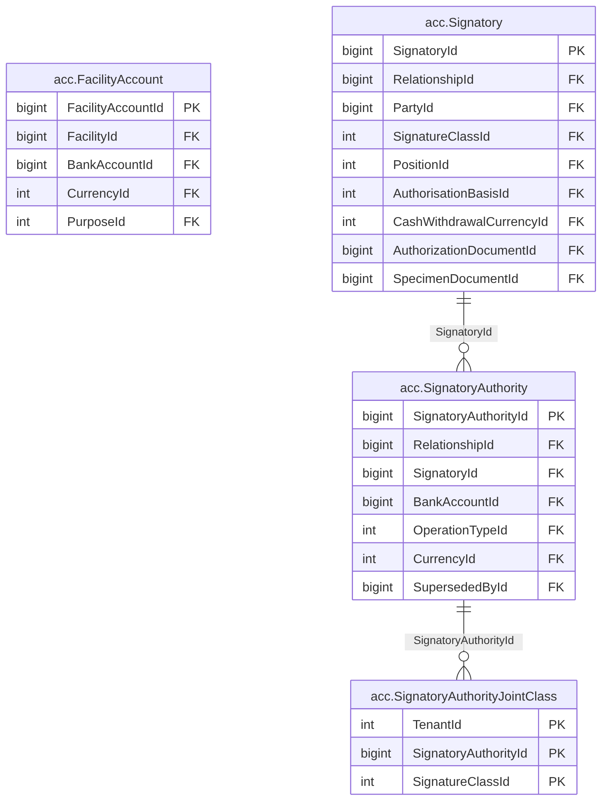

**مواصفات الجداول**

| الجدول | الغرض | PK | FK | UQ | CHECK | أعمدة أخرى |
|---|---|---|---|---|---|---|
| `acc.FacilityAccount` | Account linked to a facility for a specific purpose (S2) (FR-ACC-010, BR-ACC-007); populated from the facility screen | FacilityAccountId | 4 | 3 | 1 | 7 |
| `acc.Signatory` | Person authorised to sign for a relationship (S1-B) (FR-ACC-012, FR-ACC-023, BR-ACC-008/009), plus additions from docs/05 G-10 | SignatoryId | 8 | 5 | 6 | 14 |
| `acc.SignatoryAuthority` | Signatory authority for an operation on an account or on the bank (S1-B) (FR-ACC-013/014/017, BR-ACC-010/011); not edited in place: closed and reopened instead; its status is derived and not stored | SignatoryAuthorityId | 7 | 4 | 8 | 10 |
| `acc.SignatoryAuthorityJointClass` | Signature classes required for joint signing (JointClassIds) (BR-ACC-013) | TenantId, SignatoryAuthorityId, SignatureClassId | 2 | 0 | 0 | 3 |

**العلاقات (المفاتيح الأجنبية)**

| الطفل (الجدول.العمود) | الأب | العلاقة | الإلزام | النطاق | الحذف | أعمدة النطاق |
|---|---|---|---|---|---|---|
| `acc.FacilityAccount.FacilityId` | `fac.Facility` | 1 : N | إلزامي | مشترك · مركّب | قيد | — |
| `acc.FacilityAccount.BankAccountId` | `acc.BankAccount` | 1 : N | إلزامي | مشترك · مركّب | قيد | CurrencyId |
| `acc.FacilityAccount.CurrencyId` | `ref.Currency` | 1 : N | إلزامي | مرجع عام | قيد | — |
| `acc.FacilityAccount.PurposeId` | `cat.LookupItem` | 1 : N | إلزامي | مشترك · مركّب | قيد | — |
| `acc.Signatory.RelationshipId` | `ins.Relationship` | 1 : N | إلزامي | مشترك · مركّب | قيد | — |
| `acc.Signatory.PartyId` | `pty.Party` | 1 : N | إلزامي | مشترك · مركّب | قيد | — |
| `acc.Signatory.SignatureClassId` | `cat.LookupItem` | 1 : N | إلزامي | مشترك · مركّب | قيد | — |
| `acc.Signatory.PositionId` | `cat.Position` | 1 : N | اختياري | مشترك · مركّب | قيد | — |
| `acc.Signatory.AuthorisationBasisId` | `cat.LookupItem` | 1 : N | اختياري | مشترك · مركّب | قيد | — |
| `acc.Signatory.CashWithdrawalCurrencyId` | `ref.Currency` | 1 : N | اختياري | مرجع عام | قيد | — |
| `acc.Signatory.AuthorizationDocumentId` | `doc.Document` | 1 : N | اختياري | مشترك · مركّب | قيد | — |
| `acc.Signatory.SpecimenDocumentId` | `doc.Document` | 1 : N | اختياري | مشترك · مركّب | قيد | — |
| `acc.SignatoryAuthority.RelationshipId` | `ins.Relationship` | 1 : N | إلزامي | مشترك · مركّب | قيد | — |
| `acc.SignatoryAuthority.SignatoryId` | `acc.Signatory` | 1 : N | إلزامي | مشترك · مركّب | قيد | RelationshipId |
| `acc.SignatoryAuthority.BankAccountId` | `acc.BankAccount` | 1 : N | اختياري | مشترك · مركّب | قيد | RelationshipId |
| `acc.SignatoryAuthority.OperationTypeId` | `cat.OperationType` | 1 : N | إلزامي | مشترك · مركّب | قيد | — |
| `acc.SignatoryAuthority.CurrencyId` | `ref.Currency` | 1 : N | اختياري | مرجع عام | قيد | — |
| `acc.SignatoryAuthority.SourceDocumentId` | `doc.Document` | 1 : N | اختياري | مشترك · مركّب | قيد | — |
| `acc.SignatoryAuthority.SupersededById` | `acc.SignatoryAuthority` | 1 : N | اختياري | مشترك · مركّب | قيد | SignatoryId |
| `acc.SignatoryAuthorityJointClass.SignatoryAuthorityId` | `acc.SignatoryAuthority` | 1 : N | إلزامي | مشترك · مركّب | قيد | — |
| `acc.SignatoryAuthorityJointClass.SignatureClassId` | `cat.LookupItem` | 1 : N | إلزامي | مشترك · مركّب | قيد | — |

### 10.6 م4 · الكتالوجات والمراجع

#### م4 · المنتجات والرسوم والتمويل والضمانات (1/3)

*Products, fees, financing & collateral types* — 4 جدولًا

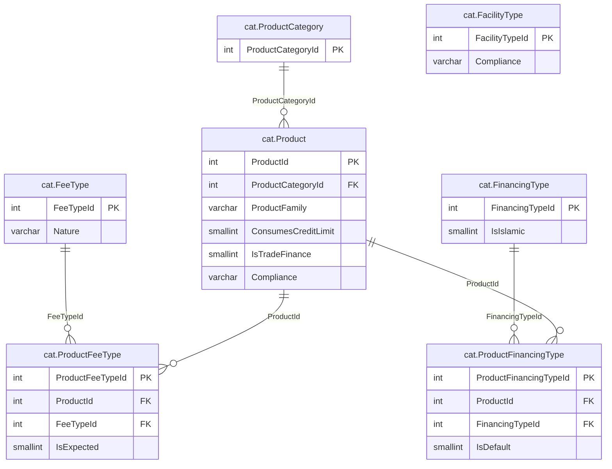

**مواصفات الجداول**

| الجدول | الغرض | PK | FK | UQ | CHECK | أعمدة أخرى |
|---|---|---|---|---|---|---|
| `cat.ProductCategory` | Product category: flat list (FR-CAT-007) | ProductCategoryId | 0 | 3 | 2 | 13 |
| `cat.Product` | Bank product with its flags (FR-CAT-007, BR-CAT-004) | ProductId | 1 | 5 | 2 | 18 |
| `cat.FeeType` | Fee type: a broad category, not a tariff item (FR-CAT-008, BR-CAT-005, Q-CAT-10) | FeeTypeId | 0 | 3 | 2 | 15 |
| `cat.FinancingType` | Financing type (FR-CAT-009, BR-CAT-006) | FinancingTypeId | 0 | 4 | 2 | 15 |

**العلاقات (المفاتيح الأجنبية)**

| الطفل (الجدول.العمود) | الأب | العلاقة | الإلزام | النطاق | الحذف | أعمدة النطاق |
|---|---|---|---|---|---|---|
| `cat.Product.ProductCategoryId` | `cat.ProductCategory` | 1 : N | إلزامي | مشترك · مركّب | قيد | — |

#### م4 · المنتجات والرسوم والتمويل والضمانات (2/3)

*Products, fees, financing & collateral types* — 4 جدولًا

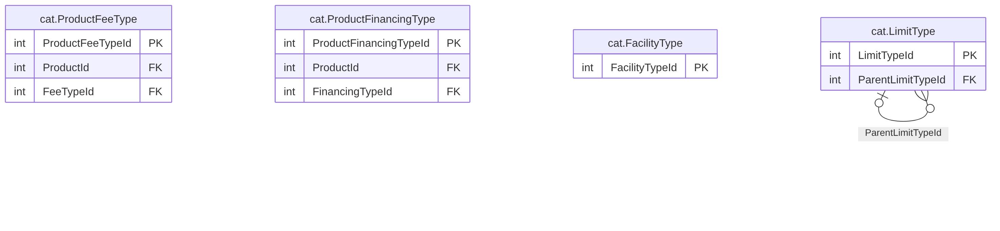

**مواصفات الجداول**

| الجدول | الغرض | PK | FK | UQ | CHECK | أعمدة أخرى |
|---|---|---|---|---|---|---|
| `cat.ProductFeeType` | Fee types allowed for a product; disabling a link deletes it and does not affect list pricing rules (FR-CAT-010, BR-CAT-007) | ProductFeeTypeId | 2 | 2 | 0 | 4 |
| `cat.ProductFinancingType` | Financing types allowed for a product (FR-CAT-010, BR-CAT-007); the pair respects the Shariah classification (DR-30) | ProductFinancingTypeId | 2 | 3 | 1 | 6 |
| `cat.FacilityType` | Facility type (FR-CAT-011) | FacilityTypeId | 0 | 3 | 2 | 14 |
| `cat.LimitType` | Limit type: master or sub-limit (FR-CAT-012, BR-CAT-008) | LimitTypeId | 1 | 3 | 4 | 16 |

**العلاقات (المفاتيح الأجنبية)**

| الطفل (الجدول.العمود) | الأب | العلاقة | الإلزام | النطاق | الحذف | أعمدة النطاق |
|---|---|---|---|---|---|---|
| `cat.ProductFeeType.ProductId` | `cat.Product` | 1 : N | إلزامي | مشترك · مركّب | قيد | — |
| `cat.ProductFeeType.FeeTypeId` | `cat.FeeType` | 1 : N | إلزامي | مشترك · مركّب | قيد | — |
| `cat.ProductFinancingType.ProductId` | `cat.Product` | 1 : N | إلزامي | مشترك · مركّب | قيد | ProductCompliance |
| `cat.ProductFinancingType.FinancingTypeId` | `cat.FinancingType` | 1 : N | إلزامي | مشترك · مركّب | قيد | FinancingIsIslamic |
| `cat.LimitType.ParentLimitTypeId` | `cat.LimitType` | 1 : N | اختياري | مشترك · مركّب | قيد | — |

#### م4 · المنتجات والرسوم والتمويل والضمانات (3/3)

*Products, fees, financing & collateral types* — 4 جدولًا

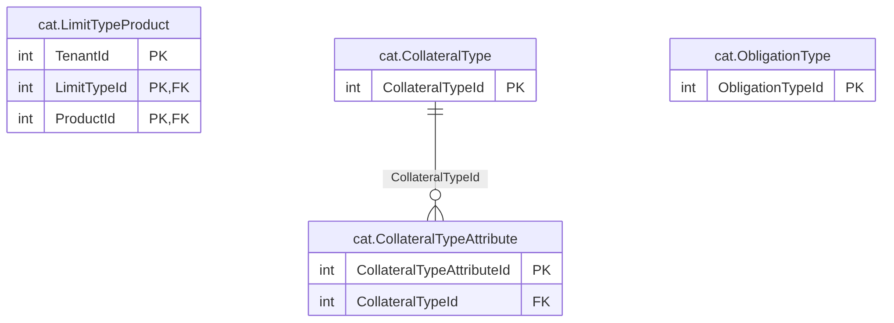

**مواصفات الجداول**

| الجدول | الغرض | PK | FK | UQ | CHECK | أعمدة أخرى |
|---|---|---|---|---|---|---|
| `cat.LimitTypeProduct` | Products allowed for a limit type; no rows = any product, with a visible flag (BR-CAT-008) | TenantId, LimitTypeId, ProductId | 2 | 0 | 0 | 3 |
| `cat.CollateralType` | Collateral type with its structure type and attribute template (FR-CAT-013) | CollateralTypeId | 0 | 4 | 2 | 14 |
| `cat.CollateralTypeAttribute` | Attribute in a collateral-type template; never deleted, only marked Retired (BR-CAT-009) | CollateralTypeAttributeId | 1 | 2 | 1 | 11 |
| `cat.ObligationType` | Obligation type with four families (FR-CAT-014, BR-CAT-010) | ObligationTypeId | 0 | 4 | 4 | 18 |

**العلاقات (المفاتيح الأجنبية)**

| الطفل (الجدول.العمود) | الأب | العلاقة | الإلزام | النطاق | الحذف | أعمدة النطاق |
|---|---|---|---|---|---|---|
| `cat.LimitTypeProduct.LimitTypeId` | `cat.LimitType` | 1 : N | إلزامي | مشترك · مركّب | قيد | — |
| `cat.LimitTypeProduct.ProductId` | `cat.Product` | 1 : N | إلزامي | مشترك · مركّب | قيد | — |
| `cat.CollateralTypeAttribute.CollateralTypeId` | `cat.CollateralType` | 1 : N | إلزامي | مشترك · مركّب | قيد | — |

#### م4 · الكتالوجات المرجعية (1/2)

*Reference catalogues* — 4 جدولًا

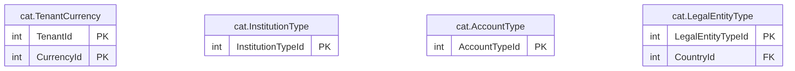

**مواصفات الجداول**

| الجدول | الغرض | PK | FK | UQ | CHECK | أعمدة أخرى |
|---|---|---|---|---|---|---|
| `cat.TenantCurrency` | Currencies enabled for the tenant: a subset of the global currency reference (FR-CAT-023, Q-CAT-08) | TenantId, CurrencyId | 1 | 0 | 0 | 5 |
| `cat.InstitutionType` | Financial institution type: bank, finance company, investment company, financial company, individual (FR-INS-001) | InstitutionTypeId | 0 | 3 | 2 | 14 |
| `cat.AccountType` | Account type (FR-ACC-001) | AccountTypeId | 0 | 3 | 2 | 14 |
| `cat.LegalEntityType` | Legal entity type: the entity and its attributes are defined in specification 10 (FR-ORG-002, BR-CAT-017) and seeded by this module; catalogue columns are written by hand because code uniqueness is per country (specification 10, section 6.2), not global | LegalEntityTypeId | 1 | 3 | 2 | 16 |

**العلاقات (المفاتيح الأجنبية)**

| الطفل (الجدول.العمود) | الأب | العلاقة | الإلزام | النطاق | الحذف | أعمدة النطاق |
|---|---|---|---|---|---|---|
| `cat.TenantCurrency.CurrencyId` | `ref.Currency` | 1 : N | إلزامي | مرجع عام | قيد | — |
| `cat.LegalEntityType.CountryId` | `ref.Country` | 1 : N | اختياري | مرجع عام | قيد | — |

#### م4 · الكتالوجات المرجعية (2/2)

*Reference catalogues* — 3 جدولًا

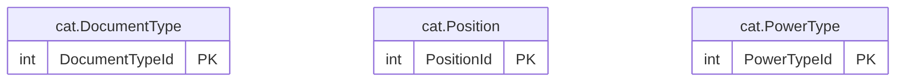

**مواصفات الجداول**

| الجدول | الغرض | PK | FK | UQ | CHECK | أعمدة أخرى |
|---|---|---|---|---|---|---|
| `cat.DocumentType` | Document type; applies the flags defined in specification 10 at upload (FR-CAT-018, BR-CAT-016, FR-PLT-028) | DocumentTypeId | 0 | 3 | 5 | 20 |
| `cat.Position` | Job position: its attributes are defined in specification 10 (section 6.2) only, and this module seeds its rows (FR-CAT-019, BR-CAT-017); SortOrder comes from the catalogue base | PositionId | 0 | 3 | 2 | 15 |
| `cat.PowerType` | Governance power type: its attributes are defined in specification 10 (section 6.2) only, and this module seeds its rows (FR-CAT-019, FR-ORG-024) | PowerTypeId | 0 | 3 | 2 | 15 |

**العلاقات (المفاتيح الأجنبية)**

| الطفل (الجدول.العمود) | الأب | العلاقة | الإلزام | النطاق | الحذف | أعمدة النطاق |
|---|---|---|---|---|---|---|
| — | — | — | — | — | — | — |

#### م4 · الأسعار المرجعية والقوائم (1/2)

*Base rates & lookup lists* — 4 جدولًا

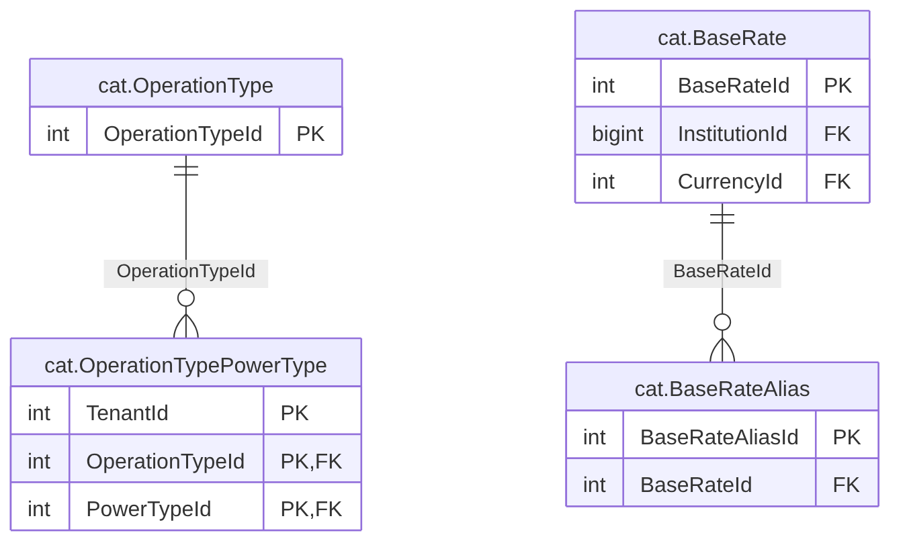

**مواصفات الجداول**

| الجدول | الغرض | PK | FK | UQ | CHECK | أعمدة أخرى |
|---|---|---|---|---|---|---|
| `cat.OperationType` | Bank operation type that a signatory is authorised for (FR-ACC-013, BR-CAT-014) | OperationTypeId | 0 | 3 | 2 | 15 |
| `cat.OperationTypePowerType` | Links an operation to governance power type(s): any one is sufficient (BR-CAT-014, FR-CAT-019, Q-ACC-05) | TenantId, OperationTypeId, PowerTypeId | 2 | 0 | 0 | 3 |
| `cat.BaseRate` | Base rate: market-wide (InstitutionId NULL) or internal to a bank (FR-CAT-015, BR-CAT-011); alternative names are in BaseRateAlias | BaseRateId | 2 | 5 | 4 | 18 |
| `cat.BaseRateAlias` | Alternative name for a base rate (for example SIBOR and SAIBOR); case-insensitive search; unique within scope (BR-CAT-011, FR-CAT-015) | BaseRateAliasId | 1 | 2 | 0 | 7 |

**العلاقات (المفاتيح الأجنبية)**

| الطفل (الجدول.العمود) | الأب | العلاقة | الإلزام | النطاق | الحذف | أعمدة النطاق |
|---|---|---|---|---|---|---|
| `cat.OperationTypePowerType.OperationTypeId` | `cat.OperationType` | 1 : N | إلزامي | مشترك · مركّب | قيد | — |
| `cat.OperationTypePowerType.PowerTypeId` | `cat.PowerType` | 1 : N | إلزامي | مشترك · مركّب | قيد | — |
| `cat.BaseRate.InstitutionId` | `ins.Institution` | 1 : N | اختياري | مشترك · مركّب | قيد | — |
| `cat.BaseRate.CurrencyId` | `ref.Currency` | 1 : N | إلزامي | مرجع عام | قيد | — |
| `cat.BaseRateAlias.BaseRateId` | `cat.BaseRate` | 1 : N | إلزامي | مشترك · مركّب | قيد | Tenor, ScopeKey |

#### م4 · الأسعار المرجعية والقوائم (2/2)

*Base rates & lookup lists* — 3 جدولًا

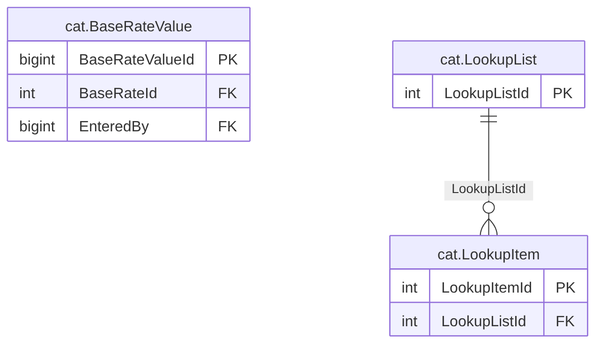

**مواصفات الجداول**

| الجدول | الغرض | PK | FK | UQ | CHECK | أعمدة أخرى |
|---|---|---|---|---|---|---|
| `cat.BaseRateValue` | Base-rate value with an effective date; rows are never deleted: a correction inserts a new row and the old one becomes SUPERSEDED (FR-CAT-016, BR-CAT-012/013) | BaseRateValueId | 3 | 3 | 1 | 9 |
| `cat.LookupList` | Tenant-owned lookup list (FR-CAT-020, BR-CAT-015) | LookupListId | 0 | 3 | 3 | 16 |
| `cat.LookupItem` | Item in a tenant-owned lookup list (FR-CAT-020) | LookupItemId | 1 | 3 | 2 | 15 |

**العلاقات (المفاتيح الأجنبية)**

| الطفل (الجدول.العمود) | الأب | العلاقة | الإلزام | النطاق | الحذف | أعمدة النطاق |
|---|---|---|---|---|---|---|
| `cat.BaseRateValue.BaseRateId` | `cat.BaseRate` | 1 : N | إلزامي | مشترك · مركّب | قيد | — |
| `cat.BaseRateValue.SupersedesId` | `cat.BaseRateValue` | 1 : N | اختياري | مشترك · مركّب | قيد | BaseRateId |
| `cat.BaseRateValue.EnteredBy` | `sec.AppUser` | 1 : N | إلزامي | مشترك · مركّب | قيد | — |
| `cat.LookupItem.LookupListId` | `cat.LookupList` | 1 : N | إلزامي | مشترك · مركّب | قيد | — |

#### م4 · المراجع العامة (ref)

*Global references (shared, read-only)* — 4 جدولًا

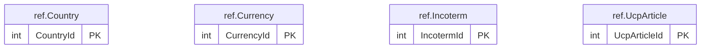

**مواصفات الجداول**

| الجدول | الغرض | PK | FK | UQ | CHECK | أعمدة أخرى |
|---|---|---|---|---|---|---|
| `ref.Country` | Country: global reference, read-only, managed by the platform operator (FR-CAT-026, BR-CAT-018, BR-CAT-015) | CountryId | 0 | 2 | 3 | 11 |
| `ref.Currency` | Currency: global ISO 4217 reference, read-only (FR-CAT-021, Q-CAT-08) | CurrencyId | 0 | 2 | 3 | 10 |
| `ref.Incoterm` | Incoterms delivery term: global reference, read-only, managed by the operator; legacy terms are displayed, not selectable (FR-LCT-013, FR-CAT-021, BR-CAT-015) | IncotermId | 0 | 1 | 1 | 11 |
| `ref.UcpArticle` | UCP 600 reference article: NULL TenantId = global read-only row, published only by the platform operator (FR-LCT-006, BR-LCT-018, BR-PLT-001) | UcpArticleId | 1 | 3 | 2 | 12 |

**العلاقات (المفاتيح الأجنبية)**

| الطفل (الجدول.العمود) | الأب | العلاقة | الإلزام | النطاق | الحذف | أعمدة النطاق |
|---|---|---|---|---|---|---|
| `ref.UcpArticle.VerifiedBy` | `plat.PlatformOperator` | 1 : N | اختياري | عام | قيد | — |

### 10.7 م5 · التسهيلات والتسعير والضمانات والالتزامات والبيانات المالية

#### م5 · التسهيلات والمراجعات (1/2)

*Facilities & revisions* — 4 جدولًا

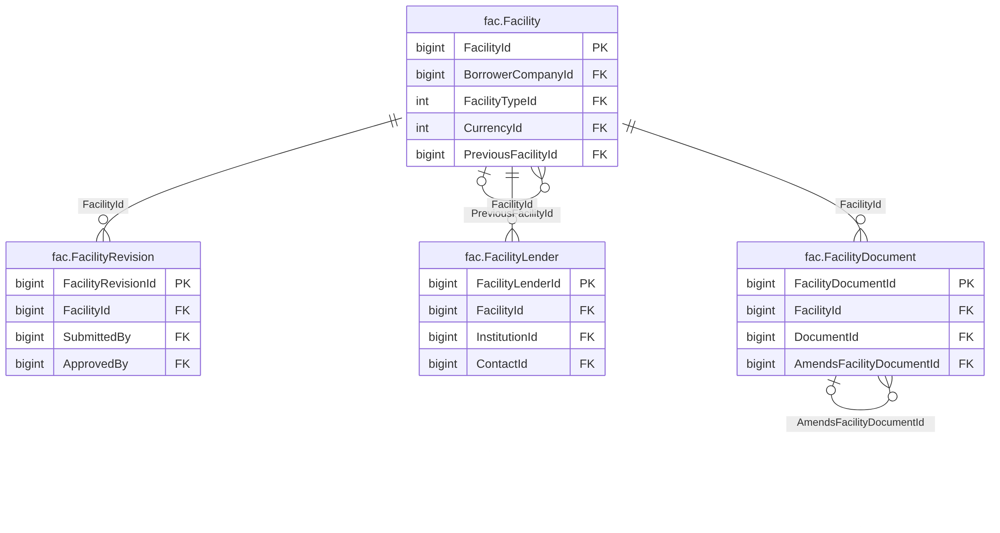

**مواصفات الجداول**

| الجدول | الغرض | PK | FK | UQ | CHECK | أعمدة أخرى |
|---|---|---|---|---|---|---|
| `fac.Facility` | Facility agreement package: root of the aggregate (FR-FAC-001..008, BR-FAC-001/005/006) | FacilityId | 4 | 4 | 11 | 28 |
| `fac.FacilityRevision` | Preparer and approver revision of facility terms (FR-FAC-024, BR-FAC-003/004, section 8) | FacilityRevisionId | 3 | 3 | 5 | 13 |
| `fac.FacilityDocument` | Document within the package, with precedence (FR-FAC-004, BR-FAC-008, V-FAC-03); its type comes from doc.Document.DocumentTypeId | FacilityDocumentId | 4 | 4 | 4 | 12 |
| `fac.FacilityLender` | Lender and its share (FR-FAC-003, BR-FAC-007, V-FAC-02); shares total 100 and a single agent: checked by the application for every revision, and by trigger fac.TR_FacilityLender_ApprovedShares (db/static/050) for approved revisions | FacilityLenderId | 4 | 2 | 4 | 7 |

**العلاقات (المفاتيح الأجنبية)**

| الطفل (الجدول.العمود) | الأب | العلاقة | الإلزام | النطاق | الحذف | أعمدة النطاق |
|---|---|---|---|---|---|---|
| `fac.Facility.BorrowerCompanyId` | `org.Company` | 1 : N | إلزامي | مشترك · مركّب | قيد | — |
| `fac.Facility.FacilityTypeId` | `cat.FacilityType` | 1 : N | إلزامي | مشترك · مركّب | قيد | — |
| `fac.Facility.CurrencyId` | `ref.Currency` | 1 : N | إلزامي | مرجع عام | قيد | — |
| `fac.Facility.PreviousFacilityId` | `fac.Facility` | 1 : N | اختياري | مشترك · مركّب | قيد | — |
| `fac.FacilityRevision.FacilityId` | `fac.Facility` | 1 : N | إلزامي | مشترك · مركّب | قيد | — |
| `fac.FacilityRevision.SubmittedBy` | `sec.AppUser` | 1 : N | اختياري | مشترك · مركّب | قيد | — |
| `fac.FacilityRevision.ApprovedBy` | `sec.AppUser` | 1 : N | اختياري | مشترك · مركّب | قيد | — |
| `fac.FacilityDocument.FacilityId` | `fac.Facility` | 1 : N | إلزامي | مشترك · مركّب | قيد | — |
| `fac.FacilityDocument.DocumentId` | `doc.Document` | 1 : N | إلزامي | مشترك · مركّب | قيد | — |
| `fac.FacilityDocument.AmendsFacilityDocumentId` | `fac.FacilityDocument` | 1 : N | اختياري | مشترك · مركّب | قيد | FacilityId |
| `fac.FacilityDocument.SupersedesId` | `fac.FacilityDocument` | 1 : N | اختياري | مشترك · مركّب | قيد | — |
| `fac.FacilityLender.FacilityId` | `fac.Facility` | 1 : N | إلزامي | مشترك · مركّب | قيد | — |
| `fac.FacilityLender.InstitutionId` | `ins.Institution` | 1 : N | إلزامي | مشترك · مركّب | قيد | — |
| `fac.FacilityLender.ContactId` | `ins.Contact` | 1 : N | اختياري | مشترك · مركّب | قيد | InstitutionId |
| `fac.FacilityLender.SupersedesId` | `fac.FacilityLender` | 1 : N | اختياري | مشترك · مركّب | قيد | — |

#### م5 · التسهيلات والمراجعات (2/2)

*Facilities & revisions* — 2 جدولًا

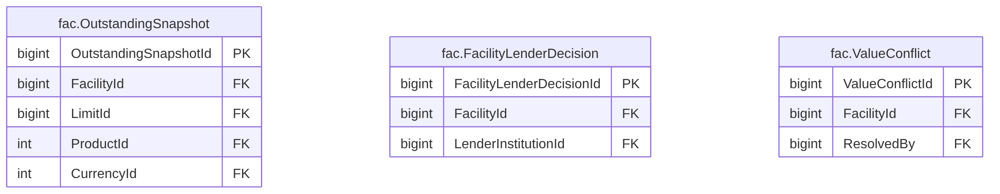

**مواصفات الجداول**

| الجدول | الغرض | PK | FK | UQ | CHECK | أعمدة أخرى |
|---|---|---|---|---|---|---|
| `fac.OutstandingSnapshot` | Snapshot of the recognised outstanding balance (FR-FAC-009, BR-FAC-017); PctOfLimit is derived and not stored | OutstandingSnapshotId | 7 | 2 | 4 | 13 |
| `fac.ValueConflict` | Conflict between two values of one field, and its resolution (FR-FAC-026, BR-FAC-019, BR-FAC-008) | ValueConflictId | 4 | 2 | 7 | 21 |

**العلاقات (المفاتيح الأجنبية)**

| الطفل (الجدول.العمود) | الأب | العلاقة | الإلزام | النطاق | الحذف | أعمدة النطاق |
|---|---|---|---|---|---|---|
| `fac.OutstandingSnapshot.FacilityId` | `fac.Facility` | 1 : N | إلزامي | مشترك · مركّب | قيد | — |
| `fac.OutstandingSnapshot.LimitId` | `fac.Limit` | 1 : N | اختياري | مشترك · مركّب | قيد | FacilityId |
| `fac.OutstandingSnapshot.ProductId` | `cat.Product` | 1 : N | اختياري | مشترك · مركّب | قيد | — |
| `fac.OutstandingSnapshot.CurrencyId` | `ref.Currency` | 1 : N | إلزامي | مرجع عام | قيد | — |
| `fac.OutstandingSnapshot.SourceDocumentId` | `doc.Document` | 1 : N | اختياري | مشترك · مركّب | قيد | — |
| `fac.OutstandingSnapshot.VerifiedBy` | `sec.AppUser` | 1 : N | اختياري | مشترك · مركّب | قيد | — |
| `fac.OutstandingSnapshot.ConflictId` | `fac.ValueConflict` | 1 : N | اختياري | مشترك · مركّب | قيد | — |
| `fac.ValueConflict.FacilityId` | `fac.Facility` | 1 : N | اختياري | مشترك · مركّب | قيد | — |
| `fac.ValueConflict.CandidateASourceDocumentId` | `doc.Document` | 1 : N | اختياري | مشترك · مركّب | قيد | — |
| `fac.ValueConflict.CandidateBSourceDocumentId` | `doc.Document` | 1 : N | اختياري | مشترك · مركّب | قيد | — |
| `fac.ValueConflict.ResolvedBy` | `sec.AppUser` | 1 : N | اختياري | مشترك · مركّب | قيد | — |

#### م5 · الحدود والاستخدام والحجوزات (1/2)

*Limits, utilisation & reservations* — 4 جدولًا

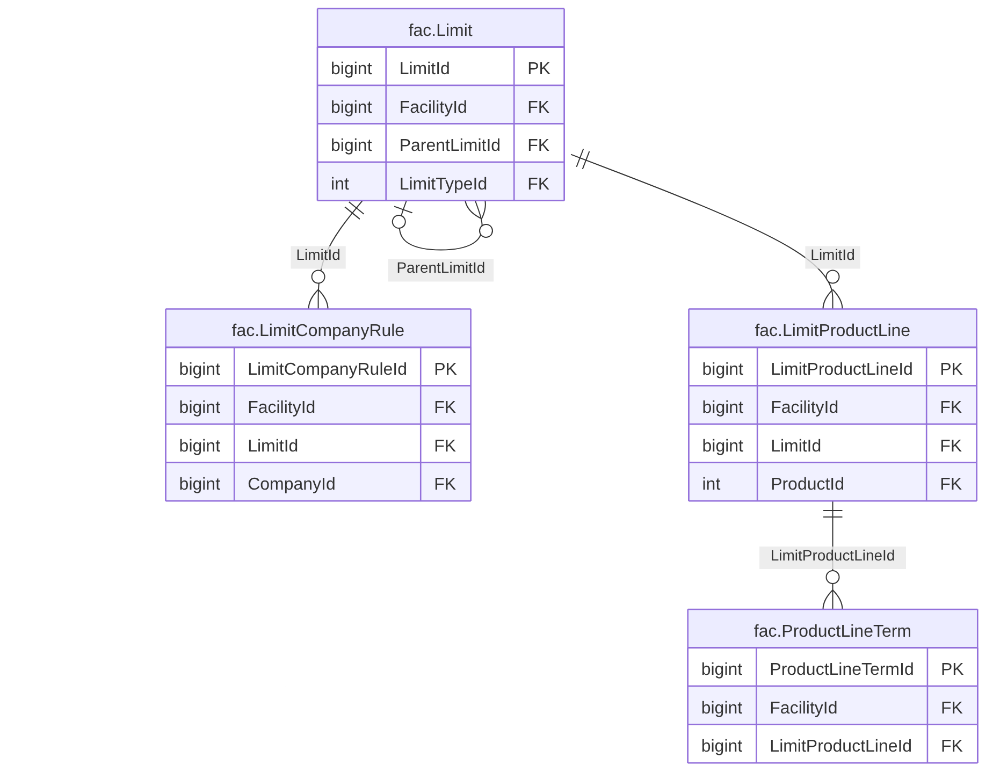

**مواصفات الجداول**

| الجدول | الغرض | PK | FK | UQ | CHECK | أعمدة أخرى |
|---|---|---|---|---|---|---|
| `fac.Limit` | Limit-tree node (FR-FAC-010/011, BR-FAC-009/010, V-FAC-04..07) | LimitId | 7 | 3 | 9 | 27 |
| `fac.LimitProductLine` | Product line within a limit, with an optional SHARED_CAP ceiling (FR-FAC-012, V-FAC-08) | LimitProductLineId | 7 | 4 | 6 | 18 |
| `fac.LimitCompanyRule` | Company rule on a limit: allowed, excluded or allocated (FR-FAC-013, BR-FAC-012, V-FAC-09) | LimitCompanyRuleId | 7 | 2 | 8 | 17 |
| `fac.ProductLineTerm` | Operational terms of a product line with effective dates; NULL means 'not specified', not zero (FR-FAC-014, BR-FAC-016) | ProductLineTermId | 6 | 2 | 11 | 22 |

**العلاقات (المفاتيح الأجنبية)**

| الطفل (الجدول.العمود) | الأب | العلاقة | الإلزام | النطاق | الحذف | أعمدة النطاق |
|---|---|---|---|---|---|---|
| `fac.Limit.FacilityId` | `fac.Facility` | 1 : N | إلزامي | مشترك · مركّب | قيد | — |
| `fac.Limit.ParentLimitId` | `fac.Limit` | 1 : N | اختياري | مشترك · مركّب | قيد | FacilityId |
| `fac.Limit.LimitTypeId` | `cat.LimitType` | 1 : N | إلزامي | مشترك · مركّب | قيد | — |
| `fac.Limit.SupersedesId` | `fac.Limit` | 1 : N | اختياري | مشترك · مركّب | قيد | — |
| `fac.Limit.SourceDocumentId` | `doc.Document` | 1 : N | اختياري | مشترك · مركّب | قيد | — |
| `fac.Limit.VerifiedBy` | `sec.AppUser` | 1 : N | اختياري | مشترك · مركّب | قيد | — |
| `fac.Limit.ConflictId` | `fac.ValueConflict` | 1 : N | اختياري | مشترك · مركّب | قيد | — |
| `fac.LimitProductLine.FacilityId` | `fac.Facility` | 1 : N | إلزامي | مشترك · مركّب | قيد | — |
| `fac.LimitProductLine.LimitId` | `fac.Limit` | 1 : N | إلزامي | مشترك · مركّب | قيد | FacilityId |
| `fac.LimitProductLine.ProductId` | `cat.Product` | 1 : N | إلزامي | مشترك · مركّب | قيد | — |
| `fac.LimitProductLine.SupersedesId` | `fac.LimitProductLine` | 1 : N | اختياري | مشترك · مركّب | قيد | — |
| `fac.LimitProductLine.SourceDocumentId` | `doc.Document` | 1 : N | اختياري | مشترك · مركّب | قيد | — |
| `fac.LimitProductLine.VerifiedBy` | `sec.AppUser` | 1 : N | اختياري | مشترك · مركّب | قيد | — |
| `fac.LimitProductLine.ConflictId` | `fac.ValueConflict` | 1 : N | اختياري | مشترك · مركّب | قيد | — |
| `fac.LimitCompanyRule.FacilityId` | `fac.Facility` | 1 : N | إلزامي | مشترك · مركّب | قيد | — |
| `fac.LimitCompanyRule.LimitId` | `fac.Limit` | 1 : N | إلزامي | مشترك · مركّب | قيد | FacilityId |
| `fac.LimitCompanyRule.CompanyId` | `org.Company` | 1 : N | إلزامي | مشترك · مركّب | قيد | — |
| `fac.LimitCompanyRule.SupersedesId` | `fac.LimitCompanyRule` | 1 : N | اختياري | مشترك · مركّب | قيد | — |
| `fac.LimitCompanyRule.SourceDocumentId` | `doc.Document` | 1 : N | اختياري | مشترك · مركّب | قيد | — |
| `fac.LimitCompanyRule.VerifiedBy` | `sec.AppUser` | 1 : N | اختياري | مشترك · مركّب | قيد | — |
| `fac.LimitCompanyRule.ConflictId` | `fac.ValueConflict` | 1 : N | اختياري | مشترك · مركّب | قيد | — |
| `fac.ProductLineTerm.FacilityId` | `fac.Facility` | 1 : N | إلزامي | مشترك · مركّب | قيد | — |
| `fac.ProductLineTerm.LimitProductLineId` | `fac.LimitProductLine` | 1 : N | إلزامي | مشترك · مركّب | قيد | FacilityId |
| `fac.ProductLineTerm.SupersedesId` | `fac.ProductLineTerm` | 1 : N | اختياري | مشترك · مركّب | قيد | — |
| `fac.ProductLineTerm.SourceDocumentId` | `doc.Document` | 1 : N | اختياري | مشترك · مركّب | قيد | — |
| `fac.ProductLineTerm.VerifiedBy` | `sec.AppUser` | 1 : N | اختياري | مشترك · مركّب | قيد | — |
| `fac.ProductLineTerm.ConflictId` | `fac.ValueConflict` | 1 : N | اختياري | مشترك · مركّب | قيد | — |

#### م5 · الحدود والاستخدام والحجوزات (2/2)

*Limits, utilisation & reservations* — 3 جدولًا

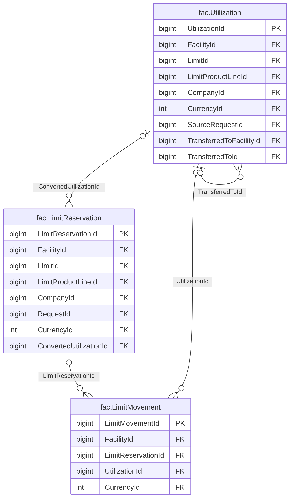

**مواصفات الجداول**

| الجدول | الغرض | PK | FK | UQ | CHECK | أعمدة أخرى |
|---|---|---|---|---|---|---|
| `fac.Utilization` | Active utilisation item: manual or linked to a letter of credit; never deleted (FR-FAC-016/030, BR-FAC-013/020) | UtilizationId | 6 | 5 | 7 | 14 |
| `fac.LimitReservation` | Amount reserved for a request, equal to ExposureAmount (FR-FAC-017/018/020, BR-FAC-015) | LimitReservationId | 7 | 5 | 7 | 13 |
| `fac.LimitMovement` | Movement record on a reservation or usage; no update or delete; duplicate-prevention key (BR-FAC-015, BR-FAC-020) | LimitMovementId | 5 | 2 | 4 | 11 |

**العلاقات (المفاتيح الأجنبية)**

| الطفل (الجدول.العمود) | الأب | العلاقة | الإلزام | النطاق | الحذف | أعمدة النطاق |
|---|---|---|---|---|---|---|
| `fac.Utilization.FacilityId` | `fac.Facility` | 1 : N | إلزامي | مشترك · مركّب | قيد | — |
| `fac.Utilization.LimitId` | `fac.Limit` | 1 : N | إلزامي | مشترك · مركّب | قيد | FacilityId |
| `fac.Utilization.LimitProductLineId` | `fac.LimitProductLine` | 1 : N | اختياري | مشترك · مركّب | قيد | FacilityId, LimitId |
| `fac.Utilization.CompanyId` | `org.Company` | 1 : N | إلزامي | مشترك · مركّب | قيد | — |
| `fac.Utilization.CurrencyId` | `ref.Currency` | 1 : N | إلزامي | مرجع عام | قيد | — |
| `fac.Utilization.SourceRequestId` | `wfl.Request` | 1 : N | اختياري | مشترك · مركّب | قيد | CompanyId |
| `fac.LimitReservation.FacilityId` | `fac.Facility` | 1 : N | إلزامي | مشترك · مركّب | قيد | — |
| `fac.LimitReservation.LimitId` | `fac.Limit` | 1 : N | إلزامي | مشترك · مركّب | قيد | FacilityId |
| `fac.LimitReservation.LimitProductLineId` | `fac.LimitProductLine` | 1 : N | اختياري | مشترك · مركّب | قيد | FacilityId, LimitId |
| `fac.LimitReservation.CompanyId` | `org.Company` | 1 : N | إلزامي | مشترك · مركّب | قيد | — |
| `fac.LimitReservation.RequestId` | `wfl.Request` | 1 : N | إلزامي | مشترك · مركّب | قيد | — |
| `fac.LimitReservation.CurrencyId` | `ref.Currency` | 1 : N | إلزامي | مرجع عام | قيد | — |
| `fac.LimitReservation.ConvertedUtilizationId` | `fac.Utilization` | 1 : N | اختياري | مشترك · مركّب | قيد | FacilityId |
| `fac.LimitMovement.FacilityId` | `fac.Facility` | 1 : N | إلزامي | مشترك · مركّب | قيد | — |
| `fac.LimitMovement.LimitReservationId` | `fac.LimitReservation` | 1 : N | اختياري | مشترك · مركّب | قيد | FacilityId |
| `fac.LimitMovement.UtilizationId` | `fac.Utilization` | 1 : N | اختياري | مشترك · مركّب | قيد | FacilityId |
| `fac.LimitMovement.CurrencyId` | `ref.Currency` | 1 : N | إلزامي | مرجع عام | قيد | — |
| `fac.LimitMovement.ActorUserId` | `sec.AppUser` | 1 : N | إلزامي | مشترك · مركّب | قيد | — |

#### م5 · التسعير وشروط المقارنة (1/2)

*Pricing, tariffs & comparable terms* — 4 جدولًا

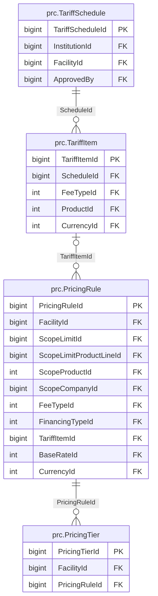

**مواصفات الجداول**

| الجدول | الغرض | PK | FK | UQ | CHECK | أعمدة أخرى |
|---|---|---|---|---|---|---|
| `prc.PricingRule` | Pricing rule with scope, inheritance and methods (FR-PRC-006..017, BR-PRC-006..012, V-PRC-02) | PricingRuleId | 14 | 4 | 38 | 40 |
| `prc.PricingTier` | Tier of a TIERED rule by amount and/or term (FR-PRC-003, BR-PRC-002) | PricingTierId | 3 | 2 | 8 | 13 |
| `prc.TariffItem` | Fee item in a tariff schedule (FR-PRC-002, BR-PRC-002..005) | TariffItemId | 7 | 2 | 11 | 24 |
| `prc.TariffSchedule` | Bank tariff schedule version; optionally specific to a facility (FR-PRC-001, BR-PRC-001, V-PRC-01) | TariffScheduleId | 4 | 4 | 3 | 11 |

**العلاقات (المفاتيح الأجنبية)**

| الطفل (الجدول.العمود) | الأب | العلاقة | الإلزام | النطاق | الحذف | أعمدة النطاق |
|---|---|---|---|---|---|---|
| `prc.PricingRule.FacilityId` | `fac.Facility` | 1 : N | إلزامي | مشترك · مركّب | قيد | — |
| `prc.PricingRule.ScopeLimitId` | `fac.Limit` | 1 : N | اختياري | مشترك · مركّب | قيد | FacilityId |
| `prc.PricingRule.ScopeLimitProductLineId` | `fac.LimitProductLine` | 1 : N | اختياري | مشترك · مركّب | قيد | FacilityId, ScopeLimitId |
| `prc.PricingRule.ScopeProductId` | `cat.Product` | 1 : N | اختياري | مشترك · مركّب | قيد | — |
| `prc.PricingRule.ScopeCompanyId` | `org.Company` | 1 : N | اختياري | مشترك · مركّب | قيد | — |
| `prc.PricingRule.FeeTypeId` | `cat.FeeType` | 1 : N | اختياري | مشترك · مركّب | قيد | — |
| `prc.PricingRule.FinancingTypeId` | `cat.FinancingType` | 1 : N | اختياري | مشترك · مركّب | قيد | — |
| `prc.PricingRule.TariffItemId` | `prc.TariffItem` | 1 : N | اختياري | مشترك · مركّب | قيد | — |
| `prc.PricingRule.BaseRateId` | `cat.BaseRate` | 1 : N | اختياري | مشترك · مركّب | قيد | — |
| `prc.PricingRule.CurrencyId` | `ref.Currency` | 1 : N | اختياري | مرجع عام | قيد | — |
| `prc.PricingRule.SupersedesId` | `prc.PricingRule` | 1 : N | اختياري | مشترك · مركّب | قيد | — |
| `prc.PricingRule.SourceDocumentId` | `doc.Document` | 1 : N | اختياري | مشترك · مركّب | قيد | — |
| `prc.PricingRule.VerifiedBy` | `sec.AppUser` | 1 : N | اختياري | مشترك · مركّب | قيد | — |
| `prc.PricingRule.ConflictId` | `fac.ValueConflict` | 1 : N | اختياري | مشترك · مركّب | قيد | — |
| `prc.PricingTier.FacilityId` | `fac.Facility` | 1 : N | إلزامي | مشترك · مركّب | قيد | — |
| `prc.PricingTier.PricingRuleId` | `prc.PricingRule` | 1 : N | إلزامي | مشترك · مركّب | قيد | FacilityId |
| `prc.PricingTier.SupersedesId` | `prc.PricingTier` | 1 : N | اختياري | مشترك · مركّب | قيد | — |
| `prc.TariffItem.ScheduleId` | `prc.TariffSchedule` | 1 : N | إلزامي | مشترك · مركّب | قيد | — |
| `prc.TariffItem.FeeTypeId` | `cat.FeeType` | 1 : N | إلزامي | مشترك · مركّب | قيد | — |
| `prc.TariffItem.ProductId` | `cat.Product` | 1 : N | اختياري | مشترك · مركّب | قيد | — |
| `prc.TariffItem.CurrencyId` | `ref.Currency` | 1 : N | اختياري | مرجع عام | قيد | — |
| `prc.TariffItem.SourceDocumentId` | `doc.Document` | 1 : N | اختياري | مشترك · مركّب | قيد | — |
| `prc.TariffItem.VerifiedBy` | `sec.AppUser` | 1 : N | اختياري | مشترك · مركّب | قيد | — |
| `prc.TariffItem.ConflictId` | `fac.ValueConflict` | 1 : N | اختياري | مشترك · مركّب | قيد | — |
| `prc.TariffSchedule.InstitutionId` | `ins.Institution` | 1 : N | إلزامي | مشترك · مركّب | قيد | — |
| `prc.TariffSchedule.FacilityId` | `fac.Facility` | 1 : N | اختياري | مشترك · مركّب | قيد | — |
| `prc.TariffSchedule.SourceDocumentId` | `doc.Document` | 1 : N | اختياري | مشترك · مركّب | قيد | — |
| `prc.TariffSchedule.ApprovedBy` | `sec.AppUser` | 1 : N | اختياري | مشترك · مركّب | قيد | — |

#### م5 · التسعير وشروط المقارنة (2/2)

*Pricing, tariffs & comparable terms* — 3 جدولًا

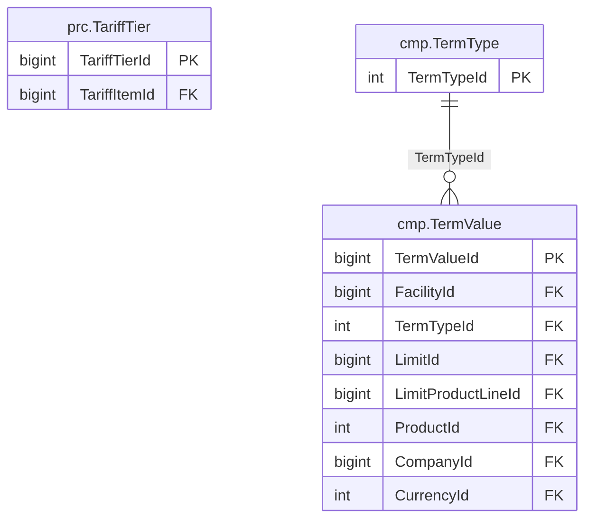

**مواصفات الجداول**

| الجدول | الغرض | PK | FK | UQ | CHECK | أعمدة أخرى |
|---|---|---|---|---|---|---|
| `prc.TariffTier` | Tier of a tariff item by amount and/or term (FR-PRC-003, BR-PRC-002) | TariffTierId | 1 | 3 | 8 | 11 |
| `cmp.TermType` | Comparable term key (FR-CMP-001); the code follows the pattern PRC.MARGIN_PCT; system terms cannot be deleted and their unit cannot change (IsSystem) | TermTypeId | 0 | 3 | 3 | 22 |
| `cmp.TermValue` | Term value in a facility, with its scope and source (FR-CMP-002..006, BR-CMP-001..006, V-CMP-01) | TermValueId | 11 | 2 | 10 | 24 |

**العلاقات (المفاتيح الأجنبية)**

| الطفل (الجدول.العمود) | الأب | العلاقة | الإلزام | النطاق | الحذف | أعمدة النطاق |
|---|---|---|---|---|---|---|
| `prc.TariffTier.TariffItemId` | `prc.TariffItem` | 1 : N | إلزامي | مشترك · مركّب | قيد | — |
| `cmp.TermValue.FacilityId` | `fac.Facility` | 1 : N | إلزامي | مشترك · مركّب | قيد | — |
| `cmp.TermValue.TermTypeId` | `cmp.TermType` | 1 : N | إلزامي | مشترك · مركّب | قيد | — |
| `cmp.TermValue.LimitId` | `fac.Limit` | 1 : N | اختياري | مشترك · مركّب | قيد | FacilityId |
| `cmp.TermValue.LimitProductLineId` | `fac.LimitProductLine` | 1 : N | اختياري | مشترك · مركّب | قيد | FacilityId, LimitId |
| `cmp.TermValue.ProductId` | `cat.Product` | 1 : N | اختياري | مشترك · مركّب | قيد | — |
| `cmp.TermValue.CompanyId` | `org.Company` | 1 : N | اختياري | مشترك · مركّب | قيد | — |
| `cmp.TermValue.CurrencyId` | `ref.Currency` | 1 : N | اختياري | مرجع عام | قيد | — |
| `cmp.TermValue.SupersedesId` | `cmp.TermValue` | 1 : N | اختياري | مشترك · مركّب | قيد | — |
| `cmp.TermValue.SourceDocumentId` | `doc.Document` | 1 : N | اختياري | مشترك · مركّب | قيد | — |
| `cmp.TermValue.VerifiedBy` | `sec.AppUser` | 1 : N | اختياري | مشترك · مركّب | قيد | — |
| `cmp.TermValue.ConflictId` | `fac.ValueConflict` | 1 : N | اختياري | مشترك · مركّب | قيد | — |

#### م5 · الضمانات (1/2)

*Collateral & guarantees* — 4 جدولًا

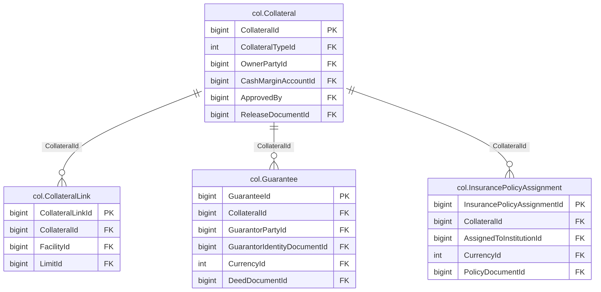

**مواصفات الجداول**

| الجدول | الغرض | PK | FK | UQ | CHECK | أعمدة أخرى |
|---|---|---|---|---|---|---|
| `col.Collateral` | Collateral record; approved independently of the facility review, and an amendment creates a new revision (FR-COL-001/014, V-COL-01, section 8) | CollateralId | 9 | 3 | 9 | 20 |
| `col.CollateralLink` | Link between collateral and a facility or limit; one collateral can serve several facilities (FR-COL-002, BR-COL-005) | CollateralLinkId | 4 | 2 | 4 | 9 |
| `col.Guarantee` | Guarantee, 1:1 with Collateral; the guarantor is always a Party, and no identity numbers are stored here (FR-COL-003/004, BR-COL-001) | GuaranteeId | 5 | 2 | 5 | 10 |
| `col.InsurancePolicyAssignment` | Insurance policy assignment; the uniqueness key (CollateralId, PolicyNo) allows the policy to be renewed (FR-COL-006, BR-COL-003) | InsurancePolicyAssignmentId | 4 | 2 | 5 | 13 |

**العلاقات (المفاتيح الأجنبية)**

| الطفل (الجدول.العمود) | الأب | العلاقة | الإلزام | النطاق | الحذف | أعمدة النطاق |
|---|---|---|---|---|---|---|
| `col.Collateral.CollateralTypeId` | `cat.CollateralType` | 1 : N | إلزامي | مشترك · مركّب | قيد | StructureKind |
| `col.Collateral.OwnerPartyId` | `pty.Party` | 1 : N | اختياري | مشترك · مركّب | قيد | — |
| `col.Collateral.CashMarginAccountId` | `acc.BankAccount` | 1 : N | اختياري | مشترك · مركّب | قيد | — |
| `col.Collateral.ApprovedBy` | `sec.AppUser` | 1 : N | اختياري | مشترك · مركّب | قيد | — |
| `col.Collateral.SupersedesId` | `col.Collateral` | 1 : N | اختياري | مشترك · مركّب | قيد | — |
| `col.Collateral.ReleaseDocumentId` | `doc.Document` | 1 : N | اختياري | مشترك · مركّب | قيد | — |
| `col.Collateral.SourceDocumentId` | `doc.Document` | 1 : N | اختياري | مشترك · مركّب | قيد | — |
| `col.Collateral.VerifiedBy` | `sec.AppUser` | 1 : N | اختياري | مشترك · مركّب | قيد | — |
| `col.Collateral.ConflictId` | `fac.ValueConflict` | 1 : N | اختياري | مشترك · مركّب | قيد | — |
| `col.CollateralLink.CollateralId` | `col.Collateral` | 1 : N | إلزامي | مشترك · مركّب | قيد | — |
| `col.CollateralLink.FacilityId` | `fac.Facility` | 1 : N | إلزامي | مشترك · مركّب | قيد | — |
| `col.CollateralLink.LimitId` | `fac.Limit` | 1 : N | اختياري | مشترك · مركّب | قيد | FacilityId |
| `col.CollateralLink.SupersedesId` | `col.CollateralLink` | 1 : N | اختياري | مشترك · مركّب | قيد | — |
| `col.Guarantee.CollateralId` | `col.Collateral` | 1 : N | إلزامي | مشترك · مركّب | قيد | StructureKind |
| `col.Guarantee.GuarantorPartyId` | `pty.Party` | 1 : N | إلزامي | مشترك · مركّب | قيد | — |
| `col.Guarantee.GuarantorIdentityDocumentId` | `pty.IdentityDocument` | 1 : N | اختياري | مشترك · مركّب | قيد | GuarantorPartyId |
| `col.Guarantee.CurrencyId` | `ref.Currency` | 1 : N | اختياري | مرجع عام | قيد | — |
| `col.Guarantee.DeedDocumentId` | `doc.Document` | 1 : N | اختياري | مشترك · مركّب | قيد | — |
| `col.InsurancePolicyAssignment.CollateralId` | `col.Collateral` | 1 : N | إلزامي | مشترك · مركّب | قيد | StructureKind |
| `col.InsurancePolicyAssignment.AssignedToInstitutionId` | `ins.Institution` | 1 : N | إلزامي | مشترك · مركّب | قيد | — |
| `col.InsurancePolicyAssignment.CurrencyId` | `ref.Currency` | 1 : N | إلزامي | مرجع عام | قيد | — |
| `col.InsurancePolicyAssignment.PolicyDocumentId` | `doc.Document` | 1 : N | اختياري | مشترك · مركّب | قيد | — |

#### م5 · الضمانات (2/2)

*Collateral & guarantees* — 3 جدولًا

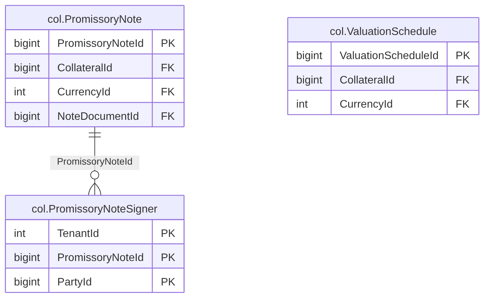

**مواصفات الجداول**

| الجدول | الغرض | PK | FK | UQ | CHECK | أعمدة أخرى |
|---|---|---|---|---|---|---|
| `col.PromissoryNote` | Promissory note, 1:1; its own amount may exceed the limit (FR-COL-005, BR-COL-002); NextRenewalDue and PNRatio are derived | PromissoryNoteId | 3 | 2 | 5 | 11 |
| `col.PromissoryNoteSigner` | Signers of the promissory note (SignerPartyIds) | TenantId, PromissoryNoteId, PartyId | 2 | 0 | 0 | 3 |
| `col.ValuationSchedule` | Property valuation schedule (FR-COL-008, BR-COL-004), for example three valuers in the first year, then one valuer per year | ValuationScheduleId | 2 | 3 | 7 | 12 |

**العلاقات (المفاتيح الأجنبية)**

| الطفل (الجدول.العمود) | الأب | العلاقة | الإلزام | النطاق | الحذف | أعمدة النطاق |
|---|---|---|---|---|---|---|
| `col.PromissoryNote.CollateralId` | `col.Collateral` | 1 : N | إلزامي | مشترك · مركّب | قيد | StructureKind |
| `col.PromissoryNote.CurrencyId` | `ref.Currency` | 1 : N | إلزامي | مرجع عام | قيد | — |
| `col.PromissoryNote.NoteDocumentId` | `doc.Document` | 1 : N | اختياري | مشترك · مركّب | قيد | — |
| `col.PromissoryNoteSigner.PromissoryNoteId` | `col.PromissoryNote` | 1 : N | إلزامي | مشترك · مركّب | قيد | — |
| `col.PromissoryNoteSigner.PartyId` | `pty.Party` | 1 : N | إلزامي | مشترك · مركّب | قيد | — |
| `col.ValuationSchedule.CollateralId` | `col.Collateral` | 1 : N | إلزامي | مشترك · مركّب | قيد | StructureKind |
| `col.ValuationSchedule.CurrencyId` | `ref.Currency` | 1 : N | اختياري | مرجع عام | قيد | — |

#### م5 · الالتزامات والتعهدات (1/2)

*Obligations, covenants & reporting* — 4 جدولًا

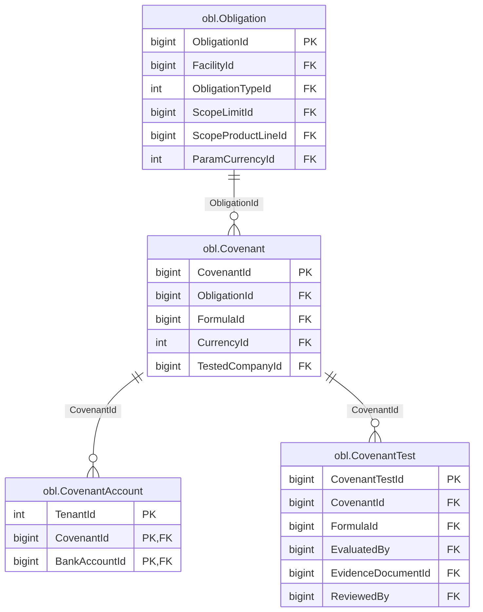

**مواصفات الجداول**

| الجدول | الغرض | PK | FK | UQ | CHECK | أعمدة أخرى |
|---|---|---|---|---|---|---|
| `obl.Covenant` | Covenant revision with dates; graduated limits are several revisions (FR-OBL-006, BR-OBL-001/005/006, Q-OBL-01) | CovenantId | 5 | 2 | 11 | 23 |
| `obl.CovenantAccount` | Accounts covered by a covenant when specific accounts are selected (AccountIds) | TenantId, CovenantId, BankAccountId | 2 | 0 | 0 | 3 |
| `obl.CovenantTest` | Covenant test for a period and test version; the application prevents editing a stored test (FR-OBL-011, FR-FIN-012/013, BR-OBL-006/007, section 8) | CovenantTestId | 4 | 3 | 14 | 22 |
| `obl.Obligation` | Obligation on a facility (or on a limit, line or set of companies); the family comes from ObligationType and cannot be edited (FR-OBL-001, BR-OBL-001) | ObligationId | 9 | 3 | 12 | 29 |

**العلاقات (المفاتيح الأجنبية)**

| الطفل (الجدول.العمود) | الأب | العلاقة | الإلزام | النطاق | الحذف | أعمدة النطاق |
|---|---|---|---|---|---|---|
| `obl.Covenant.ObligationId` | `obl.Obligation` | 1 : N | إلزامي | مشترك · مركّب | قيد | Family |
| `obl.Covenant.FormulaId` | `fin.MeasureFormula` | 1 : N | اختياري | مشترك · مركّب | قيد | — |
| `obl.Covenant.CurrencyId` | `ref.Currency` | 1 : N | اختياري | مرجع عام | قيد | — |
| `obl.Covenant.TestedCompanyId` | `org.Company` | 1 : N | إلزامي | مشترك · مركّب | قيد | — |
| `obl.Covenant.SupersedesId` | `obl.Covenant` | 1 : N | اختياري | مشترك · مركّب | قيد | — |
| `obl.CovenantAccount.CovenantId` | `obl.Covenant` | 1 : N | إلزامي | مشترك · مركّب | قيد | — |
| `obl.CovenantAccount.BankAccountId` | `acc.BankAccount` | 1 : N | إلزامي | مشترك · مركّب | قيد | — |
| `obl.CovenantTest.CovenantId` | `obl.Covenant` | 1 : N | إلزامي | مشترك · مركّب | قيد | — |
| `obl.CovenantTest.EvaluatedBy` | `sec.AppUser` | 1 : N | اختياري | مشترك · مركّب | قيد | — |
| `obl.CovenantTest.EvidenceDocumentId` | `doc.Document` | 1 : N | اختياري | مشترك · مركّب | قيد | — |
| `obl.CovenantTest.ReviewedBy` | `sec.AppUser` | 1 : N | اختياري | مشترك · مركّب | قيد | — |
| `obl.Obligation.FacilityId` | `fac.Facility` | 1 : N | إلزامي | مشترك · مركّب | قيد | — |
| `obl.Obligation.ObligationTypeId` | `cat.ObligationType` | 1 : N | إلزامي | مشترك · مركّب | قيد | Family |
| `obl.Obligation.ScopeLimitId` | `fac.Limit` | 1 : N | اختياري | مشترك · مركّب | قيد | FacilityId |
| `obl.Obligation.ScopeProductLineId` | `fac.LimitProductLine` | 1 : N | اختياري | مشترك · مركّب | قيد | FacilityId, ScopeLimitId |
| `obl.Obligation.ParamCurrencyId` | `ref.Currency` | 1 : N | اختياري | مرجع عام | قيد | — |
| `obl.Obligation.SupersedesId` | `obl.Obligation` | 1 : N | اختياري | مشترك · مركّب | قيد | — |
| `obl.Obligation.SourceDocumentId` | `doc.Document` | 1 : N | اختياري | مشترك · مركّب | قيد | — |
| `obl.Obligation.VerifiedBy` | `sec.AppUser` | 1 : N | اختياري | مشترك · مركّب | قيد | — |
| `obl.Obligation.ConflictId` | `fac.ValueConflict` | 1 : N | اختياري | مشترك · مركّب | قيد | — |

#### م5 · الالتزامات والتعهدات (2/2)

*Obligations, covenants & reporting* — 4 جدولًا

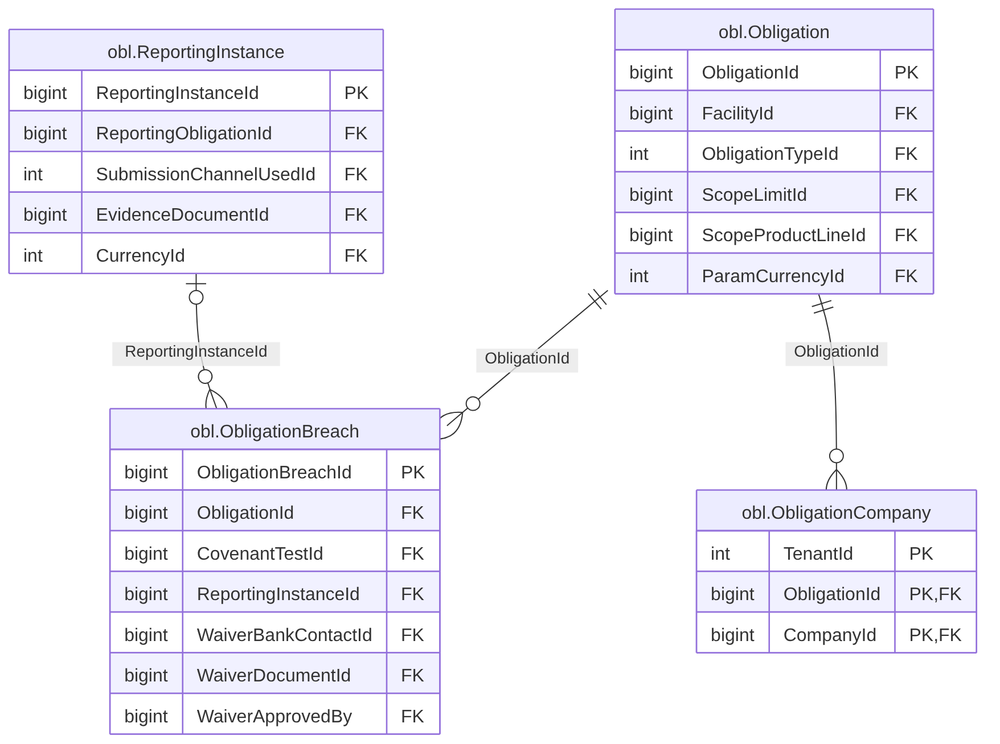

**مواصفات الجداول**

| الجدول | الغرض | PK | FK | UQ | CHECK | أعمدة أخرى |
|---|---|---|---|---|---|---|
| `obl.ObligationBreach` | Breach record, its remedy and any waiver (FR-OBL-012, BR-OBL-009/011, section 8) | ObligationBreachId | 5 | 4 | 10 | 17 |
| `obl.ObligationCompany` | Companies the obligation applies to (AppliesToCompanyIds) | TenantId, ObligationId, CompanyId | 2 | 0 | 0 | 3 |
| `obl.ReportingInstance` | Agenda item generated or logged for an event (FR-OBL-003..005, BR-OBL-003, section 8); DUE_SOON and OVERDUE are derived | ReportingInstanceId | 4 | 5 | 7 | 15 |
| `obl.ReportingObligation` | Reporting or notice-due rule, 1:1 with Obligation (FR-OBL-002/003, BR-OBL-002, V-OBL-01) | ReportingObligationId | 3 | 2 | 10 | 19 |

**العلاقات (المفاتيح الأجنبية)**

| الطفل (الجدول.العمود) | الأب | العلاقة | الإلزام | النطاق | الحذف | أعمدة النطاق |
|---|---|---|---|---|---|---|
| `obl.ObligationBreach.ObligationId` | `obl.Obligation` | 1 : N | إلزامي | مشترك · مركّب | قيد | — |
| `obl.ObligationBreach.CovenantTestId` | `obl.CovenantTest` | 1 : N | اختياري | مشترك · مركّب | قيد | — |
| `obl.ObligationBreach.ReportingInstanceId` | `obl.ReportingInstance` | 1 : N | اختياري | مشترك · مركّب | قيد | — |
| `obl.ObligationBreach.WaiverBankContactId` | `ins.Contact` | 1 : N | اختياري | مشترك · مركّب | قيد | — |
| `obl.ObligationBreach.WaiverDocumentId` | `doc.Document` | 1 : N | اختياري | مشترك · مركّب | قيد | — |
| `obl.ObligationCompany.ObligationId` | `obl.Obligation` | 1 : N | إلزامي | مشترك · مركّب | قيد | — |
| `obl.ObligationCompany.CompanyId` | `org.Company` | 1 : N | إلزامي | مشترك · مركّب | قيد | — |
| `obl.ReportingInstance.ReportingObligationId` | `obl.ReportingObligation` | 1 : N | إلزامي | مشترك · مركّب | قيد | — |
| `obl.ReportingInstance.SubmissionChannelUsedId` | `cat.LookupItem` | 1 : N | اختياري | مشترك · مركّب | قيد | — |
| `obl.ReportingInstance.EvidenceDocumentId` | `doc.Document` | 1 : N | اختياري | مشترك · مركّب | قيد | — |
| `obl.ReportingInstance.CurrencyId` | `ref.Currency` | 1 : N | اختياري | مرجع عام | قيد | — |
| `obl.ReportingObligation.ObligationId` | `obl.Obligation` | 1 : N | إلزامي | مشترك · مركّب | قيد | Family |
| `obl.ReportingObligation.SubmissionChannelId` | `cat.LookupItem` | 1 : N | اختياري | مشترك · مركّب | قيد | — |
| `obl.ReportingObligation.SupersedesId` | `obl.ReportingObligation` | 1 : N | اختياري | مشترك · مركّب | قيد | — |

#### م5 · البيانات المالية والأرصدة (1/2)

*Financial statements & balances* — 4 جدولًا

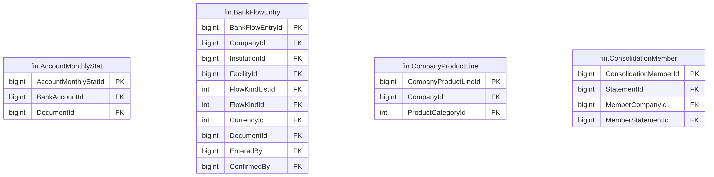

**مواصفات الجداول**

| الجدول | الغرض | PK | FK | UQ | CHECK | أعمدة أخرى |
|---|---|---|---|---|---|---|
| `fin.AccountMonthlyStat` | Monthly balance of an account in the account currency (FR-FIN-008, BR-FIN-005/006, V-FIN-02) | AccountMonthlyStatId | 2 | 3 | 1 | 12 |
| `fin.BankFlowEntry` | Amount transferred to the bank in a month; annual totals are computed automatically (FR-FIN-009/010, BR-FIN-007/008) | BankFlowEntryId | 6 | 3 | 2 | 7 |
| `fin.FinancialStatement` | Financial statement header; highly confidential (FR-FIN-002/005/006, BR-FIN-001..004, section 8) | FinancialStatementId | 6 | 6 | 8 | 19 |
| `fin.LineCatalogItem` | Standard statement line item; 39 items seeded; system items used in formulas cannot be deleted (FR-FIN-001, CatalogBase) | LineCatalogItemId | 0 | 3 | 5 | 17 |

**العلاقات (المفاتيح الأجنبية)**

| الطفل (الجدول.العمود) | الأب | العلاقة | الإلزام | النطاق | الحذف | أعمدة النطاق |
|---|---|---|---|---|---|---|
| `fin.AccountMonthlyStat.BankAccountId` | `acc.BankAccount` | 1 : N | إلزامي | مشترك · مركّب | قيد | — |
| `fin.AccountMonthlyStat.DocumentId` | `doc.Document` | 1 : N | اختياري | مشترك · مركّب | قيد | — |
| `fin.BankFlowEntry.CompanyId` | `org.Company` | 1 : N | إلزامي | مشترك · مركّب | قيد | — |
| `fin.BankFlowEntry.InstitutionId` | `ins.Institution` | 1 : N | إلزامي | مشترك · مركّب | قيد | — |
| `fin.BankFlowEntry.FacilityId` | `fac.Facility` | 1 : N | اختياري | مشترك · مركّب | قيد | — |
| `fin.BankFlowEntry.FlowKindId` | `cat.LookupItem` | 1 : N | إلزامي | مشترك · مركّب | قيد | — |
| `fin.BankFlowEntry.CurrencyId` | `ref.Currency` | 1 : N | إلزامي | مرجع عام | قيد | — |
| `fin.BankFlowEntry.DocumentId` | `doc.Document` | 1 : N | اختياري | مشترك · مركّب | قيد | — |
| `fin.FinancialStatement.CompanyId` | `org.Company` | 1 : N | إلزامي | مشترك · مركّب | قيد | — |
| `fin.FinancialStatement.CurrencyId` | `ref.Currency` | 1 : N | إلزامي | مرجع عام | قيد | — |
| `fin.FinancialStatement.SupersedesId` | `fin.FinancialStatement` | 1 : N | اختياري | مشترك · مركّب | قيد | CompanyId, Basis, Assurance, PeriodType, PeriodEnd |
| `fin.FinancialStatement.SourceDocumentId` | `doc.Document` | 1 : N | اختياري | مشترك · مركّب | قيد | — |
| `fin.FinancialStatement.PreparedBy` | `sec.AppUser` | 1 : N | اختياري | مشترك · مركّب | قيد | — |
| `fin.FinancialStatement.ApprovedBy` | `sec.AppUser` | 1 : N | اختياري | مشترك · مركّب | قيد | — |

#### م5 · البيانات المالية والأرصدة (2/2)

*Financial statements & balances* — 3 جدولًا

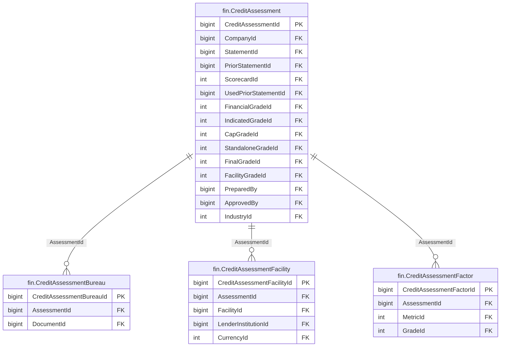

**مواصفات الجداول**

| الجدول | الغرض | PK | FK | UQ | CHECK | أعمدة أخرى |
|---|---|---|---|---|---|---|
| `fin.LineCatalogItemAlias` | Alternative names (aliases) for a line item, used for paste and matching | LineCatalogItemAliasId | 1 | 2 | 1 | 4 |
| `fin.MeasureFormula` | Measure formula: a template or a facility-agreement version with revisions; never executed as text (FR-FIN-011, BR-FIN-009, section 12) | MeasureFormulaId | 6 | 3 | 10 | 20 |
| `fin.StatementLine` | Statement line in the header currency; stored value = input x UnitScale; Variance is derived; highly confidential (BR-FIN-001/002) | StatementLineId | 2 | 2 | 0 | 5 |

**العلاقات (المفاتيح الأجنبية)**

| الطفل (الجدول.العمود) | الأب | العلاقة | الإلزام | النطاق | الحذف | أعمدة النطاق |
|---|---|---|---|---|---|---|
| `fin.LineCatalogItemAlias.LineCatalogItemId` | `fin.LineCatalogItem` | 1 : N | إلزامي | مشترك · مركّب | قيد | — |
| `fin.MeasureFormula.FacilityId` | `fac.Facility` | 1 : N | اختياري | مشترك · مركّب | قيد | — |
| `fin.MeasureFormula.BaseTemplateId` | `fin.MeasureFormula` | 1 : N | اختياري | مشترك · مركّب | قيد | — |
| `fin.MeasureFormula.ApprovedBy` | `sec.AppUser` | 1 : N | اختياري | مشترك · مركّب | قيد | — |
| `fin.MeasureFormula.SourceDocumentId` | `doc.Document` | 1 : N | اختياري | مشترك · مركّب | قيد | — |
| `fin.MeasureFormula.VerifiedBy` | `sec.AppUser` | 1 : N | اختياري | مشترك · مركّب | قيد | — |
| `fin.MeasureFormula.ConflictId` | `fac.ValueConflict` | 1 : N | اختياري | مشترك · مركّب | قيد | — |
| `fin.StatementLine.StatementId` | `fin.FinancialStatement` | 1 : N | إلزامي | مشترك · مركّب | قيد | — |
| `fin.StatementLine.LineCatalogItemId` | `fin.LineCatalogItem` | 1 : N | إلزامي | مشترك · مركّب | قيد | — |

### 10.8 م6 · الطلبات ودورات العمل والإشعارات

#### م6 · قوالب دورات العمل (1/3)

*Workflow templates* — 4 جدولًا

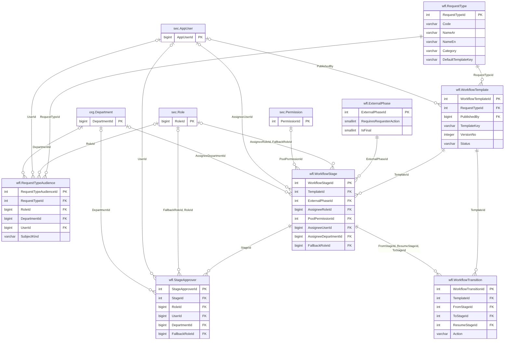

**مواصفات الجداول**

| الجدول | الغرض | PK | FK | UQ | CHECK | أعمدة أخرى |
|---|---|---|---|---|---|---|
| `wfl.RequestType` | Request type definition (FR-REQ-001, BR-REQ-001, V-REQ-01); new types need no code (FR-REQ-021) | RequestTypeId | 0 | 4 | 3 | 21 |
| `wfl.RequestTypeAudience` | Audience of a request type: who may raise it; no rows = nobody (fail closed) (FR-REQ-007) | RequestTypeAudienceId | 4 | 4 | 1 | 5 |
| `wfl.ExternalPhase` | Phase shown to the requester: DRAFT, IN_APPROVAL, RETURNED, AWAITING_REQUESTER, IN_PROGRESS, COMPLETED, REJECTED, CANCELLED (BR-WFL-011, D-6) | ExternalPhaseId | 0 | 3 | 1 | 16 |
| `wfl.WorkflowTemplate` | Workflow template version; a published version is immutable (FR-WFL-001/028, BR-WFL-019, AC-WFL-6) | WorkflowTemplateId | 2 | 6 | 9 | 20 |

**العلاقات (المفاتيح الأجنبية)**

| الطفل (الجدول.العمود) | الأب | العلاقة | الإلزام | النطاق | الحذف | أعمدة النطاق |
|---|---|---|---|---|---|---|
| `wfl.RequestTypeAudience.RequestTypeId` | `wfl.RequestType` | 1 : N | إلزامي | مشترك · مركّب | قيد | — |
| `wfl.RequestTypeAudience.RoleId` | `sec.Role` | 1 : N | اختياري | مشترك · مركّب | قيد | — |
| `wfl.RequestTypeAudience.DepartmentId` | `org.Department` | 1 : N | اختياري | مشترك · مركّب | قيد | — |
| `wfl.RequestTypeAudience.UserId` | `sec.AppUser` | 1 : N | اختياري | مشترك · مركّب | قيد | — |
| `wfl.WorkflowTemplate.RequestTypeId` | `wfl.RequestType` | 1 : N | إلزامي | مشترك · مركّب | قيد | — |
| `wfl.WorkflowTemplate.PublishedBy` | `sec.AppUser` | 1 : N | اختياري | مشترك · مركّب | قيد | — |

#### م6 · قوالب دورات العمل (2/3)

*Workflow templates* — 4 جدولًا

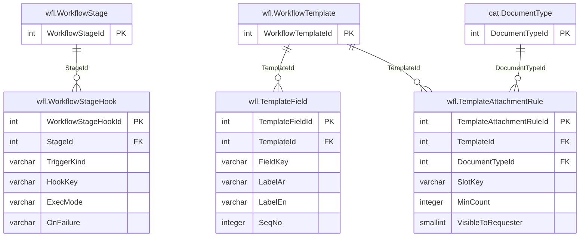

**مواصفات الجداول**

| الجدول | الغرض | PK | FK | UQ | CHECK | أعمدة أخرى |
|---|---|---|---|---|---|---|
| `wfl.WorkflowStage` | Stage in a template version (FR-WFL-003/004/005, BR-WFL-002/010/012); physical delete only for a draft version | WorkflowStageId | 7 | 4 | 14 | 22 |
| `wfl.StageApprover` | Approval slot in an APPROVAL stage; ALL = every slot, and a role requiring two people together = two slots (FR-WFL-007/041, BR-WFL-003/004) | StageApproverId | 5 | 2 | 7 | 10 |
| `wfl.WorkflowTransition` | Transition between two stages with a condition and a priority; a linear flow with simple conditional branching (FR-WFL-006, BR-WFL-001, D-8) | WorkflowTransitionId | 4 | 2 | 4 | 9 |
| `wfl.WorkflowStageHook` | Hook registered on a stage: a key and parameters, no code (FR-WFL-021, BR-WFL-015, section 5.4) | WorkflowStageHookId | 1 | 2 | 2 | 10 |

**العلاقات (المفاتيح الأجنبية)**

| الطفل (الجدول.العمود) | الأب | العلاقة | الإلزام | النطاق | الحذف | أعمدة النطاق |
|---|---|---|---|---|---|---|
| `wfl.WorkflowStage.TemplateId` | `wfl.WorkflowTemplate` | 1 : N | إلزامي | مشترك · مركّب | قيد | — |
| `wfl.WorkflowStage.ExternalPhaseId` | `wfl.ExternalPhase` | 1 : N | إلزامي | مشترك · مركّب | قيد | — |
| `wfl.WorkflowStage.AssigneeRoleId` | `sec.Role` | 1 : N | اختياري | مشترك · مركّب | قيد | — |
| `wfl.WorkflowStage.PoolPermissionId` | `sec.Permission` | 1 : N | اختياري | مرجع عام | قيد | — |
| `wfl.WorkflowStage.AssigneeUserId` | `sec.AppUser` | 1 : N | اختياري | مشترك · مركّب | قيد | — |
| `wfl.WorkflowStage.AssigneeDepartmentId` | `org.Department` | 1 : N | اختياري | مشترك · مركّب | قيد | — |
| `wfl.WorkflowStage.FallbackRoleId` | `sec.Role` | 1 : N | اختياري | مشترك · مركّب | قيد | — |
| `wfl.StageApprover.StageId` | `wfl.WorkflowStage` | 1 : N | إلزامي | مشترك · مركّب | قيد | — |
| `wfl.StageApprover.RoleId` | `sec.Role` | 1 : N | اختياري | مشترك · مركّب | قيد | — |
| `wfl.StageApprover.UserId` | `sec.AppUser` | 1 : N | اختياري | مشترك · مركّب | قيد | — |
| `wfl.StageApprover.DepartmentId` | `org.Department` | 1 : N | اختياري | مشترك · مركّب | قيد | — |
| `wfl.StageApprover.FallbackRoleId` | `sec.Role` | 1 : N | اختياري | مشترك · مركّب | قيد | — |
| `wfl.WorkflowTransition.TemplateId` | `wfl.WorkflowTemplate` | 1 : N | إلزامي | مشترك · مركّب | قيد | — |
| `wfl.WorkflowTransition.FromStageId` | `wfl.WorkflowStage` | 1 : N | إلزامي | مشترك · مركّب | قيد | TemplateId |
| `wfl.WorkflowTransition.ToStageId` | `wfl.WorkflowStage` | 1 : N | إلزامي | مشترك · مركّب | قيد | TemplateId |
| `wfl.WorkflowTransition.ResumeStageId` | `wfl.WorkflowStage` | 1 : N | اختياري | مشترك · مركّب | قيد | TemplateId |
| `wfl.WorkflowStageHook.StageId` | `wfl.WorkflowStage` | 1 : N | إلزامي | مشترك · مركّب | قيد | — |

#### م6 · قوالب دورات العمل (3/3)

*Workflow templates* — 2 جدولًا

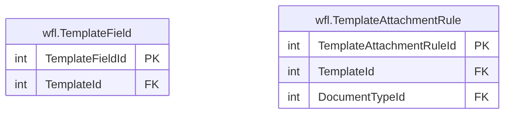

**مواصفات الجداول**

| الجدول | الغرض | PK | FK | UQ | CHECK | أعمدة أخرى |
|---|---|---|---|---|---|---|
| `wfl.TemplateField` | Field in a template version; the form UI is generated without code (FR-REQ-002..005, BR-REQ-003/004) | TemplateFieldId | 1 | 3 | 4 | 21 |
| `wfl.TemplateAttachmentRule` | Attachment rule on a template version (FR-REQ-006, BR-REQ-005, FR-WFL-024/025) | TemplateAttachmentRuleId | 2 | 2 | 4 | 11 |

**العلاقات (المفاتيح الأجنبية)**

| الطفل (الجدول.العمود) | الأب | العلاقة | الإلزام | النطاق | الحذف | أعمدة النطاق |
|---|---|---|---|---|---|---|
| `wfl.TemplateField.TemplateId` | `wfl.WorkflowTemplate` | 1 : N | إلزامي | مشترك · مركّب | قيد | — |
| `wfl.TemplateAttachmentRule.TemplateId` | `wfl.WorkflowTemplate` | 1 : N | إلزامي | مشترك · مركّب | قيد | — |
| `wfl.TemplateAttachmentRule.DocumentTypeId` | `cat.DocumentType` | 1 : N | إلزامي | مشترك · مركّب | قيد | — |

#### م6 · الطلبات وإجراءاتها (1/3)

*Requests, approvals & actions* — 4 جدولًا

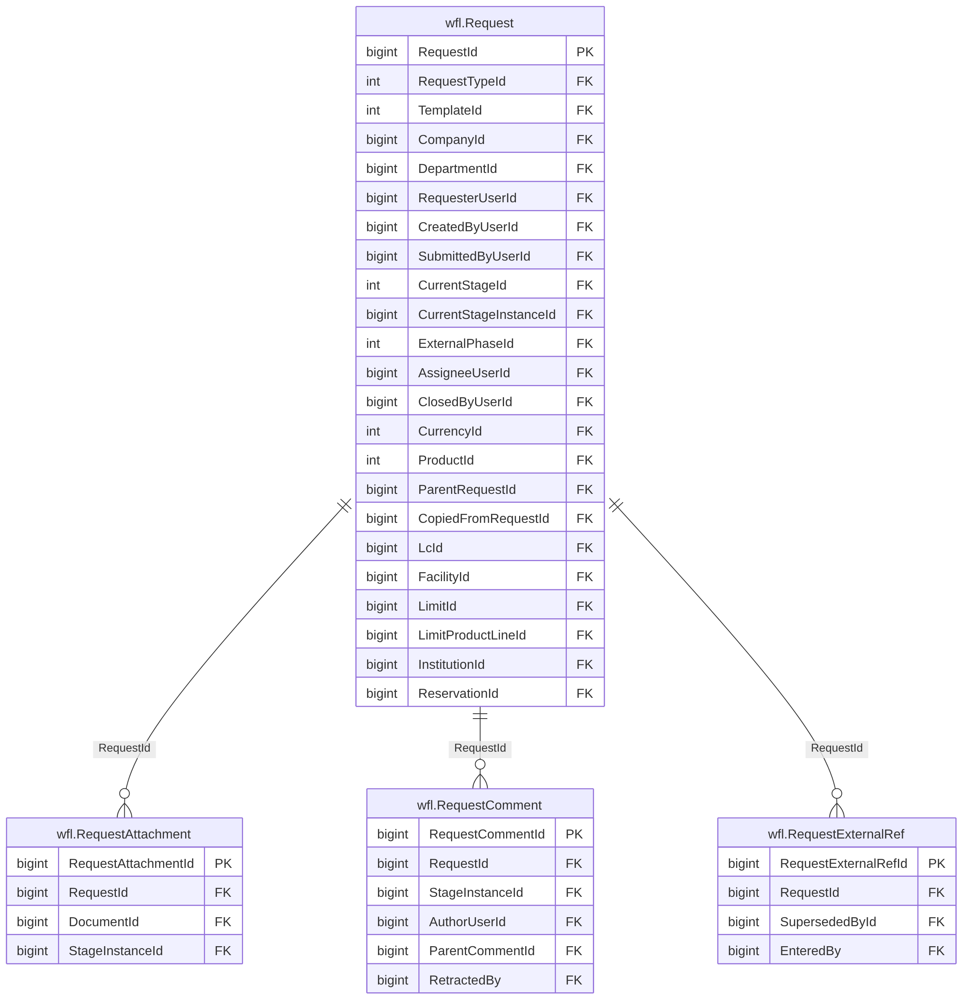

**مواصفات الجداول**

| الجدول | الغرض | PK | FK | UQ | CHECK | أعمدة أخرى |
|---|---|---|---|---|---|---|
| `wfl.Request` | Request: the most heavily used table; the internal status is kept separate from the visible phase (FR-WFL-001, FR-REQ-009, D-6, BR-REQ-002/003) | RequestId | 22 | 6 | 24 | 36 |
| `wfl.RequestComment` | Comment visible to the requester or internal; the application prevents editing it, and withdrawal keeps the original (FR-REQ-017, BR-REQ-014) | RequestCommentId | 5 | 2 | 2 | 6 |
| `wfl.RequestAttachment` | Links a document to a request and creates a DocumentLink (EntityType = Request) (FR-REQ-006, BR-REQ-005) | RequestAttachmentId | 3 | 2 | 0 | 6 |
| `wfl.RequestExternalRef` | External reference as free text; edits replace the value and keep the history; no external validation (FR-REQ-010, X-DAT-7, BR-REQ-006) | RequestExternalRefId | 3 | 2 | 2 | 10 |

**العلاقات (المفاتيح الأجنبية)**

| الطفل (الجدول.العمود) | الأب | العلاقة | الإلزام | النطاق | الحذف | أعمدة النطاق |
|---|---|---|---|---|---|---|
| `wfl.Request.RequestTypeId` | `wfl.RequestType` | 1 : N | إلزامي | مشترك · مركّب | قيد | — |
| `wfl.Request.TemplateId` | `wfl.WorkflowTemplate` | 1 : N | إلزامي | مشترك · مركّب | قيد | RequestTypeId |
| `wfl.Request.CompanyId` | `org.Company` | 1 : N | إلزامي | مشترك · مركّب | قيد | — |
| `wfl.Request.DepartmentId` | `org.Department` | 1 : N | اختياري | مشترك · مركّب | قيد | — |
| `wfl.Request.RequesterUserId` | `sec.AppUser` | 1 : N | إلزامي | مشترك · مركّب | قيد | — |
| `wfl.Request.CreatedByUserId` | `sec.AppUser` | 1 : N | إلزامي | مشترك · مركّب | قيد | — |
| `wfl.Request.SubmittedByUserId` | `sec.AppUser` | 1 : N | اختياري | مشترك · مركّب | قيد | — |
| `wfl.Request.CurrentStageId` | `wfl.WorkflowStage` | 1 : N | اختياري | مشترك · مركّب | قيد | TemplateId |
| `wfl.Request.CurrentStageInstanceId` | `wfl.RequestStageInstance` | 1 : N | اختياري | مشترك · مركّب | قيد | — |
| `wfl.Request.ExternalPhaseId` | `wfl.ExternalPhase` | 1 : N | إلزامي | مشترك · مركّب | قيد | — |
| `wfl.Request.AssigneeUserId` | `sec.AppUser` | 1 : N | اختياري | مشترك · مركّب | قيد | — |
| `wfl.Request.ClosedByUserId` | `sec.AppUser` | 1 : N | اختياري | مشترك · مركّب | قيد | — |
| `wfl.Request.CurrencyId` | `ref.Currency` | 1 : N | اختياري | مرجع عام | قيد | — |
| `wfl.Request.ProductId` | `cat.Product` | 1 : N | اختياري | مشترك · مركّب | قيد | — |
| `wfl.Request.ParentRequestId` | `wfl.Request` | 1 : N | اختياري | مشترك · مركّب | قيد | — |
| `wfl.Request.CopiedFromRequestId` | `wfl.Request` | 1 : N | اختياري | مشترك · مركّب | قيد | — |
| `wfl.Request.LcId` | `lc.LetterOfCredit` | 1 : N | اختياري | مشترك · مركّب | قيد | CompanyId |
| `wfl.Request.FacilityId` | `fac.Facility` | 1 : N | اختياري | مشترك · مركّب | قيد | — |
| `wfl.Request.LimitId` | `fac.Limit` | 1 : N | اختياري | مشترك · مركّب | قيد | FacilityId |
| `wfl.Request.LimitProductLineId` | `fac.LimitProductLine` | 1 : N | اختياري | مشترك · مركّب | قيد | FacilityId, LimitId |
| `wfl.Request.InstitutionId` | `ins.Institution` | 1 : N | اختياري | مشترك · مركّب | قيد | — |
| `wfl.Request.ReservationId` | `fac.LimitReservation` | 1 : N | اختياري | مشترك · مركّب | قيد | — |
| `wfl.RequestComment.RequestId` | `wfl.Request` | 1 : N | إلزامي | مشترك · مركّب | قيد | — |
| `wfl.RequestComment.StageInstanceId` | `wfl.RequestStageInstance` | 1 : N | اختياري | مشترك · مركّب | قيد | RequestId |
| `wfl.RequestComment.AuthorUserId` | `sec.AppUser` | 1 : N | إلزامي | مشترك · مركّب | قيد | — |
| `wfl.RequestComment.ParentCommentId` | `wfl.RequestComment` | 1 : N | اختياري | مشترك · مركّب | قيد | RequestId |
| `wfl.RequestComment.RetractedBy` | `sec.AppUser` | 1 : N | اختياري | مشترك · مركّب | قيد | — |
| `wfl.RequestAttachment.RequestId` | `wfl.Request` | 1 : N | إلزامي | مشترك · مركّب | قيد | — |
| `wfl.RequestAttachment.DocumentId` | `doc.Document` | 1 : N | إلزامي | مشترك · مركّب | قيد | — |
| `wfl.RequestAttachment.StageInstanceId` | `wfl.RequestStageInstance` | 1 : N | اختياري | مشترك · مركّب | قيد | RequestId |
| `wfl.RequestExternalRef.RequestId` | `wfl.Request` | 1 : N | إلزامي | مشترك · مركّب | قيد | — |
| `wfl.RequestExternalRef.SupersededById` | `wfl.RequestExternalRef` | 1 : N | اختياري | مشترك · مركّب | قيد | RequestId |
| `wfl.RequestExternalRef.EnteredBy` | `sec.AppUser` | 1 : N | اختياري | مشترك · مركّب | قيد | — |

#### م6 · الطلبات وإجراءاتها (2/3)

*Requests, approvals & actions* — 4 جدولًا

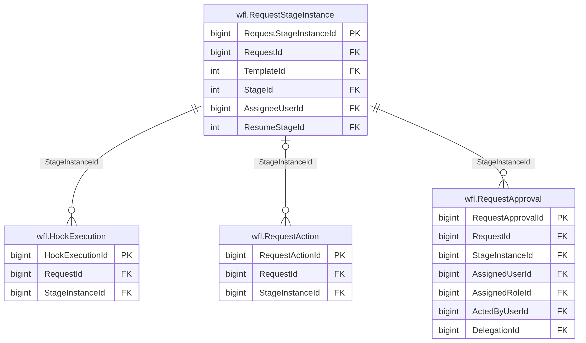

**مواصفات الجداول**

| الجدول | الغرض | PK | FK | UQ | CHECK | أعمدة أخرى |
|---|---|---|---|---|---|---|
| `wfl.RequestStageInstance` | Entry of a request into a stage; source of the cycle-time, withdrawal and SLA metrics (BR-WFL-002/007/012, section 8) | RequestStageInstanceId | 5 | 3 | 13 | 17 |
| `wfl.RequestApproval` | Approval slot created per entry and cycle; a new cycle creates new slots (BR-WFL-003, FR-WFL-007/008/011) | RequestApprovalId | 7 | 2 | 8 | 16 |
| `wfl.RequestAction` | Append-only action log covering every event; separate from the security audit log (FR-WFL-033/034, section 6.2) | RequestActionId | 4 | 2 | 2 | 14 |
| `wfl.HookExecution` | Execution of a hook with an idempotency key; a repeat returns the stored result (FR-WFL-021, BR-WFL-015) | HookExecutionId | 2 | 2 | 4 | 17 |

**العلاقات (المفاتيح الأجنبية)**

| الطفل (الجدول.العمود) | الأب | العلاقة | الإلزام | النطاق | الحذف | أعمدة النطاق |
|---|---|---|---|---|---|---|
| `wfl.RequestStageInstance.RequestId` | `wfl.Request` | 1 : N | إلزامي | مشترك · مركّب | قيد | — |
| `wfl.RequestStageInstance.TemplateId` | `wfl.WorkflowTemplate` | 1 : N | إلزامي | مشترك · مركّب | قيد | — |
| `wfl.RequestStageInstance.StageId` | `wfl.WorkflowStage` | 1 : N | إلزامي | مشترك · مركّب | قيد | TemplateId |
| `wfl.RequestStageInstance.AssigneeUserId` | `sec.AppUser` | 1 : N | اختياري | مشترك · مركّب | قيد | — |
| `wfl.RequestStageInstance.ResumeStageId` | `wfl.WorkflowStage` | 1 : N | اختياري | مشترك · مركّب | قيد | TemplateId |
| `wfl.RequestApproval.RequestId` | `wfl.Request` | 1 : N | إلزامي | مشترك · مركّب | قيد | — |
| `wfl.RequestApproval.StageInstanceId` | `wfl.RequestStageInstance` | 1 : N | إلزامي | مشترك · مركّب | قيد | RequestId |
| `wfl.RequestApproval.AssignedUserId` | `sec.AppUser` | 1 : N | اختياري | مشترك · مركّب | قيد | — |
| `wfl.RequestApproval.AssignedRoleId` | `sec.Role` | 1 : N | اختياري | مشترك · مركّب | قيد | — |
| `wfl.RequestApproval.ActedByUserId` | `sec.AppUser` | 1 : N | اختياري | مشترك · مركّب | قيد | — |
| `wfl.RequestApproval.OnBehalfOfUserId` | `sec.AppUser` | 1 : N | اختياري | مشترك · مركّب | قيد | — |
| `wfl.RequestApproval.DelegationId` | `wfl.UserDelegation` | 1 : N | اختياري | مشترك · مركّب | قيد | — |
| `wfl.RequestAction.RequestId` | `wfl.Request` | 1 : N | إلزامي | مشترك · مركّب | قيد | — |
| `wfl.RequestAction.StageInstanceId` | `wfl.RequestStageInstance` | 1 : N | اختياري | مشترك · مركّب | قيد | RequestId |
| `wfl.RequestAction.ActorUserId` | `sec.AppUser` | 1 : N | اختياري | مشترك · مركّب | قيد | — |
| `wfl.RequestAction.OnBehalfOfUserId` | `sec.AppUser` | 1 : N | اختياري | مشترك · مركّب | قيد | — |
| `wfl.HookExecution.RequestId` | `wfl.Request` | 1 : N | إلزامي | مشترك · مركّب | قيد | — |
| `wfl.HookExecution.StageInstanceId` | `wfl.RequestStageInstance` | 1 : N | إلزامي | مشترك · مركّب | قيد | RequestId |

#### م6 · الطلبات وإجراءاتها (3/3)

*Requests, approvals & actions* — 1 جدولًا

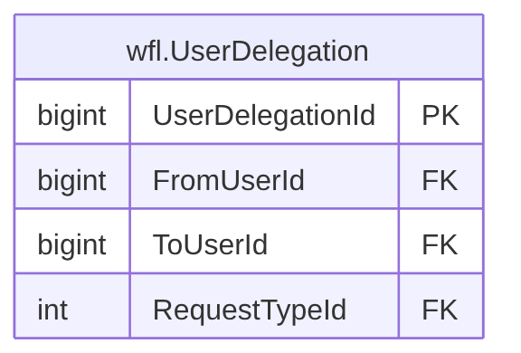

**مواصفات الجداول**

| الجدول | الغرض | PK | FK | UQ | CHECK | أعمدة أخرى |
|---|---|---|---|---|---|---|
| `wfl.UserDelegation` | Task delegation with a period and scope; no chained delegation (FR-WFL-020, BR-WFL-021, V-WFL-06) | UserDelegationId | 4 | 2 | 4 | 10 |

**العلاقات (المفاتيح الأجنبية)**

| الطفل (الجدول.العمود) | الأب | العلاقة | الإلزام | النطاق | الحذف | أعمدة النطاق |
|---|---|---|---|---|---|---|
| `wfl.UserDelegation.FromUserId` | `sec.AppUser` | 1 : N | إلزامي | مشترك · مركّب | قيد | — |
| `wfl.UserDelegation.ToUserId` | `sec.AppUser` | 1 : N | إلزامي | مشترك · مركّب | قيد | — |
| `wfl.UserDelegation.RequestTypeId` | `wfl.RequestType` | 1 : N | اختياري | مشترك · مركّب | قيد | — |
| `wfl.UserDelegation.RevokedBy` | `sec.AppUser` | 1 : N | اختياري | مشترك · مركّب | قيد | — |

#### م6 · الإشعارات (1/2)

*Notifications* — 4 جدولًا


**مواصفات الجداول**

| الجدول | الغرض | PK | FK | UQ | CHECK | أعمدة أخرى |
|---|---|---|---|---|---|---|
| `ntf.DigestBatch` | Digest batch for a user, channel and period; never sent empty (FR-NTF-014, BR-NTF-004, JOB-NTF-DIGEST) | DigestBatchId | 1 | 2 | 4 | 12 |
| `ntf.Notification` | Notification for a user; the content carries no restricted values (FR-NTF-005/006/007/021, BR-NTF-001/002/007/008/011) | NotificationId | 3 | 3 | 5 | 21 |
| `ntf.NotificationDelivery` | Delivery of a notification per channel, with status and retries (FR-NTF-019, BR-NTF-009, section 8) | NotificationDeliveryId | 2 | 2 | 6 | 10 |
| `ntf.NotificationEventType` | Event catalogue: specification 13 owns it for all modules, and modules seed their events into it (FR-NTF-001, section 9.2) | NotificationEventTypeId | 0 | 3 | 4 | 16 |

**العلاقات (المفاتيح الأجنبية)**

| الطفل (الجدول.العمود) | الأب | العلاقة | الإلزام | النطاق | الحذف | أعمدة النطاق |
|---|---|---|---|---|---|---|
| `ntf.DigestBatch.UserId` | `sec.AppUser` | 1 : N | إلزامي | مشترك · مركّب | قيد | — |
| `ntf.Notification.UserId` | `sec.AppUser` | 1 : N | إلزامي | مشترك · مركّب | قيد | — |
| `ntf.Notification.EventTypeId` | `ntf.NotificationEventType` | 1 : N | إلزامي | مشترك · مركّب | قيد | — |
| `ntf.Notification.CompanyId` | `org.Company` | 1 : N | اختياري | مشترك · مركّب | قيد | — |
| `ntf.NotificationDelivery.NotificationId` | `ntf.Notification` | 1 : N | إلزامي | مشترك · مركّب | قيد | — |
| `ntf.NotificationDelivery.DigestBatchId` | `ntf.DigestBatch` | 1 : N | اختياري | مشترك · مركّب | قيد | — |

#### م6 · الإشعارات (2/2)

*Notifications* — 3 جدولًا


**مواصفات الجداول**

| الجدول | الغرض | PK | FK | UQ | CHECK | أعمدة أخرى |
|---|---|---|---|---|---|---|
| `ntf.NotificationPreference` | User preference per event group and channel (FR-NTF-010, BR-NTF-003/014); mandatory notifications cannot be switched off in the application | NotificationPreferenceId | 1 | 2 | 0 | 6 |
| `ntf.NotificationRule` | Recipient rule for an event; changes apply to subsequent events only (FR-NTF-003, BR-NTF-001, V-NTF-02) | NotificationRuleId | 4 | 2 | 2 | 10 |
| `ntf.NotificationTemplate` | Message template per (event, channel, language); deleting it reverts to the seed template (FR-NTF-012, FR-NTF-025) | NotificationTemplateId | 1 | 2 | 0 | 8 |

**العلاقات (المفاتيح الأجنبية)**

| الطفل (الجدول.العمود) | الأب | العلاقة | الإلزام | النطاق | الحذف | أعمدة النطاق |
|---|---|---|---|---|---|---|
| `ntf.NotificationPreference.UserId` | `sec.AppUser` | 1 : N | إلزامي | مشترك · مركّب | قيد | — |
| `ntf.NotificationRule.EventTypeId` | `ntf.NotificationEventType` | 1 : N | إلزامي | مشترك · مركّب | قيد | — |
| `ntf.NotificationRule.RoleId` | `sec.Role` | 1 : N | اختياري | مشترك · مركّب | قيد | — |
| `ntf.NotificationRule.PermissionId` | `sec.Permission` | 1 : N | اختياري | مرجع عام | قيد | — |
| `ntf.NotificationRule.UserId` | `sec.AppUser` | 1 : N | اختياري | مشترك · مركّب | قيد | — |
| `ntf.NotificationTemplate.EventTypeId` | `ntf.NotificationEventType` | 1 : N | إلزامي | مشترك · مركّب | قيد | — |

### 10.9 م7/م8 · الاعتمادات المستندية والبروفورما

#### م7/م8 · شروط الاعتماد والنماذج (1/3)

*LC terms, fields & form maps* — 4 جدولًا


**مواصفات الجداول**

| الجدول | الغرض | PK | FK | UQ | CHECK | أعمدة أخرى |
|---|---|---|---|---|---|---|
| `lc.LcFieldDefinition` | Definition of a field in letter-of-credit terms: data seeded per tenant (FR-LCT-004, BR-LCT-002); UCP references are in lc.LcFieldUcpRef | LcFieldDefinitionId | 0 | 3 | 3 | 20 |
| `lc.LcFieldUcpRef` | UCP reference for a field: article and paragraph (UcpRefs in specification); feeds the badge, R-LCT-01 and BR-LCT-018 | LcFieldUcpRefId | 2 | 2 | 0 | 4 |
| `lc.Counterparty` | Counterparty: lightweight supplier or customer without identity; promoted to Party when needed (FR-LCT-036/037, BR-LCT-022, Q-PTY-03) | CounterpartyId | 3 | 3 | 2 | 21 |
| `lc.LcDocumentClause` | Document-clause library with versions: template text with parameters (FR-LCT-017..019, BR-LCT-012); UCP references are in lc.LcDocumentClauseUcpRef | LcDocumentClauseId | 1 | 4 | 5 | 21 |

**العلاقات (المفاتيح الأجنبية)**

| الطفل (الجدول.العمود) | الأب | العلاقة | الإلزام | النطاق | الحذف | أعمدة النطاق |
|---|---|---|---|---|---|---|
| `lc.LcFieldUcpRef.LcFieldDefinitionId` | `lc.LcFieldDefinition` | 1 : N | إلزامي | مشترك · مركّب | قيد | — |
| `lc.LcFieldUcpRef.UcpArticleId` | `ref.UcpArticle` | 1 : N | إلزامي | مرجع عام | قيد | — |
| `lc.Counterparty.CountryId` | `ref.Country` | 1 : N | إلزامي | مرجع عام | قيد | — |
| `lc.Counterparty.PartyId` | `pty.Party` | 1 : N | اختياري | مشترك · مركّب | قيد | — |
| `lc.Counterparty.MergedIntoId` | `lc.Counterparty` | 1 : N | اختياري | مشترك · مركّب | قيد | — |
| `lc.LcDocumentClause.InstitutionId` | `ins.Institution` | 1 : N | اختياري | مشترك · مركّب | قيد | — |

#### م7/م8 · شروط الاعتماد والنماذج (2/3)

*LC terms, fields & form maps* — 4 جدولًا


**مواصفات الجداول**

| الجدول | الغرض | PK | FK | UQ | CHECK | أعمدة أخرى |
|---|---|---|---|---|---|---|
| `lc.LcDocumentClauseUcpRef` | UCP 600 reference for a document clause: article and paragraph (UcpRefs in specification) | LcDocumentClauseUcpRefId | 2 | 2 | 0 | 4 |
| `lc.LcTerms` | Letter-of-credit terms version: one row per version, with the section 6.2 dictionary columns; shared by proforma, request, credit and amendment (FR-LCT-001..035) | LcTermsId | 15 | 6 | 44 | 88 |
| `lc.LcTermsDocument` | Document clause selected in the terms, with its parameters; the rendered text is frozen at lock (FR-LCT-018, BR-LCT-012) | LcTermsDocumentId | 2 | 2 | 5 | 12 |
| `lc.LcChargesMatrix` | Charges per term: one row per category; six complete rows, checked by the application (V-LCT-12) (FR-LCT-020, BR-LCT-014) | LcChargesMatrixId | 1 | 2 | 2 | 8 |

**العلاقات (المفاتيح الأجنبية)**

| الطفل (الجدول.العمود) | الأب | العلاقة | الإلزام | النطاق | الحذف | أعمدة النطاق |
|---|---|---|---|---|---|---|
| `lc.LcDocumentClauseUcpRef.LcDocumentClauseId` | `lc.LcDocumentClause` | 1 : N | إلزامي | مشترك · مركّب | قيد | — |
| `lc.LcDocumentClauseUcpRef.UcpArticleId` | `ref.UcpArticle` | 1 : N | إلزامي | مرجع عام | قيد | — |
| `lc.LcTerms.ApplicantCompanyId` | `org.Company` | 1 : N | اختياري | مشترك · مركّب | قيد | — |
| `lc.LcTerms.ApplicantCounterpartyId` | `lc.Counterparty` | 1 : N | اختياري | مشترك · مركّب | قيد | — |
| `lc.LcTerms.BeneficiaryCompanyId` | `org.Company` | 1 : N | اختياري | مشترك · مركّب | قيد | — |
| `lc.LcTerms.BeneficiaryCounterpartyId` | `lc.Counterparty` | 1 : N | اختياري | مشترك · مركّب | قيد | — |
| `lc.LcTerms.EncKeyId` | `sec.TenantKey` | 1 : N | اختياري | مشترك · مركّب | قيد | EncKeyPurpose |
| `lc.LcTerms.HashKeyId` | `sec.TenantKey` | 1 : N | اختياري | مشترك · مركّب | قيد | HashKeyPurpose |
| `lc.LcTerms.CurrencyId` | `ref.Currency` | 1 : N | اختياري | مرجع عام | قيد | — |
| `lc.LcTerms.IncotermId` | `ref.Incoterm` | 1 : N | اختياري | مرجع عام | قيد | — |
| `lc.LcTerms.FacilityAccountId` | `acc.BankAccount` | 1 : N | اختياري | مشترك · مركّب | قيد | — |
| `lc.LcTerms.MarginSettlementAccountId` | `acc.BankAccount` | 1 : N | اختياري | مشترك · مركّب | قيد | — |
| `lc.LcTerms.ChargesAccountId` | `acc.BankAccount` | 1 : N | اختياري | مشترك · مركّب | قيد | — |
| `lc.LcTerms.PrevLcCurrencyId` | `ref.Currency` | 1 : N | اختياري | مرجع عام | قيد | — |
| `lc.LcTerms.LockedBy` | `sec.AppUser` | 1 : N | اختياري | مشترك · مركّب | قيد | — |
| `lc.LcTerms.SupersedesTermsId` | `lc.LcTerms` | 1 : N | اختياري | مشترك · مركّب | قيد | — |
| `lc.LcTerms.CopiedFromTermsId` | `lc.LcTerms` | 1 : N | اختياري | مشترك · مركّب | قيد | — |
| `lc.LcTermsDocument.LcTermsId` | `lc.LcTerms` | 1 : N | إلزامي | مشترك · مركّب | قيد | — |
| `lc.LcTermsDocument.ClauseId` | `lc.LcDocumentClause` | 1 : N | إلزامي | مشترك · مركّب | قيد | — |
| `lc.LcChargesMatrix.LcTermsId` | `lc.LcTerms` | 1 : N | إلزامي | مشترك · مركّب | قيد | — |

#### م7/م8 · شروط الاعتماد والنماذج (3/3)

*LC terms, fields & form maps* — 2 جدولًا


**مواصفات الجداول**

| الجدول | الغرض | PK | FK | UQ | CHECK | أعمدة أخرى |
|---|---|---|---|---|---|---|
| `lc.LcFormTemplate` | Form template per bank, product and form type, with version, effective period and contract annex (FR-LCT-026, BR-LCT-017, specification 02 F-14) | LcFormTemplateId | 6 | 4 | 4 | 18 |
| `lc.LcFormFieldMap` | Mapping of a system field to a PDF field or a portal-form item (FR-LCT-027, BR-LCT-020) | LcFormFieldMapId | 1 | 2 | 4 | 9 |

**العلاقات (المفاتيح الأجنبية)**

| الطفل (الجدول.العمود) | الأب | العلاقة | الإلزام | النطاق | الحذف | أعمدة النطاق |
|---|---|---|---|---|---|---|
| `lc.LcFormTemplate.InstitutionId` | `ins.Institution` | 1 : N | اختياري | مشترك · مركّب | قيد | — |
| `lc.LcFormTemplate.ProductId` | `cat.Product` | 1 : N | اختياري | مشترك · مركّب | قيد | — |
| `lc.LcFormTemplate.CompanyId` | `org.Company` | 1 : N | اختياري | مشترك · مركّب | قيد | — |
| `lc.LcFormTemplate.SourceDocumentId` | `doc.Document` | 1 : N | اختياري | مشترك · مركّب | قيد | — |
| `lc.LcFormTemplate.AnnexDocumentId` | `doc.Document` | 1 : N | اختياري | مشترك · مركّب | قيد | — |
| `lc.LcFormTemplate.LetterheadDocumentId` | `doc.Document` | 1 : N | اختياري | مشترك · مركّب | قيد | — |
| `lc.LcFormFieldMap.TemplateId` | `lc.LcFormTemplate` | 1 : N | إلزامي | مشترك · مركّب | قيد | — |

#### م7/م8 · الاعتمادات والبروفورما (1/3)

*Letters of credit & proforma* — 4 جدولًا


**مواصفات الجداول**

| الجدول | الغرض | PK | FK | UQ | CHECK | أعمدة أخرى |
|---|---|---|---|---|---|---|
| `lc.LetterOfCredit` | Letter-of-credit record for both sides: purchases (we are the applicant) and sales (we are the beneficiary) (FR-LCI-011..016, FR-LCE-009, BR-LCI-004/008/016, BR-LCE-007/009) | LetterOfCreditId | 13 | 9 | 24 | 35 |
| `lc.LcExternalRef` | External reference for a credit (ERP and similar); no uniqueness; search on the normalised value (FR-LCI-013, BR-REQ-006) | LcExternalRefId | 2 | 2 | 1 | 8 |
| `lc.LcAmendment` | Amendment to an issued or received letter of credit (FR-LCI-018/019, FR-LCE-020, BR-LCI-011/012, BR-LCE-014); statuses in section 8 | LcAmendmentId | 6 | 4 | 11 | 19 |
| `lc.LcDrawing` | Drawing or presentation of documents under a credit; for exports includes transfer of allocation (FR-LCI-023, BR-LCI-013, BR-LCE-011); statuses in section 8 | LcDrawingId | 5 | 5 | 7 | 16 |

**العلاقات (المفاتيح الأجنبية)**

| الطفل (الجدول.العمود) | الأب | العلاقة | الإلزام | النطاق | الحذف | أعمدة النطاق |
|---|---|---|---|---|---|---|
| `lc.LetterOfCredit.CompanyId` | `org.Company` | 1 : N | إلزامي | مشترك · مركّب | قيد | — |
| `lc.LetterOfCredit.CounterpartyId` | `lc.Counterparty` | 1 : N | إلزامي | مشترك · مركّب | قيد | — |
| `lc.LetterOfCredit.InstitutionId` | `ins.Institution` | 1 : N | اختياري | مشترك · مركّب | قيد | — |
| `lc.LetterOfCredit.RelationshipId` | `ins.Relationship` | 1 : N | اختياري | مشترك · مركّب | قيد | CompanyId, InstitutionId |
| `lc.LetterOfCredit.ProductId` | `cat.Product` | 1 : N | اختياري | مشترك · مركّب | قيد | — |
| `lc.LetterOfCredit.FacilityId` | `fac.Facility` | 1 : N | اختياري | مشترك · مركّب | قيد | — |
| `lc.LetterOfCredit.LimitId` | `fac.Limit` | 1 : N | اختياري | مشترك · مركّب | قيد | FacilityId |
| `lc.LetterOfCredit.LimitProductLineId` | `fac.LimitProductLine` | 1 : N | اختياري | مشترك · مركّب | قيد | FacilityId, LimitId |
| `lc.LetterOfCredit.UtilizationId` | `fac.Utilization` | 1 : N | اختياري | مشترك · مركّب | قيد | FacilityId, CompanyId |
| `lc.LetterOfCredit.RequestId` | `wfl.Request` | 1 : N | اختياري | مشترك · مركّب | قيد | CompanyId |
| `lc.LetterOfCredit.ProformaId` | `lc.ProformaInvoice` | 1 : N | اختياري | مشترك · مركّب | قيد | CompanyId |
| `lc.LetterOfCredit.CurrentTermsId` | `lc.LcTerms` | 1 : N | إلزامي | مشترك · مركّب | قيد | LcClass, CurrencyId, TolerancePlusPct, ToleranceMinusPct |
| `lc.LetterOfCredit.CurrencyId` | `ref.Currency` | 1 : N | إلزامي | مرجع عام | قيد | — |
| `lc.LcExternalRef.LcId` | `lc.LetterOfCredit` | 1 : N | إلزامي | مشترك · مركّب | قيد | — |
| `lc.LcExternalRef.SupersededById` | `lc.LcExternalRef` | 1 : N | اختياري | مشترك · مركّب | قيد | LcId |
| `lc.LcAmendment.CompanyId` | `org.Company` | 1 : N | إلزامي | مشترك · مركّب | قيد | — |
| `lc.LcAmendment.LcId` | `lc.LetterOfCredit` | 1 : N | إلزامي | مشترك · مركّب | قيد | CurrencyId |
| `lc.LcAmendment.RequestId` | `wfl.Request` | 1 : N | اختياري | مشترك · مركّب | قيد | CompanyId |
| `lc.LcAmendment.TermsId` | `lc.LcTerms` | 1 : N | إلزامي | مشترك · مركّب | قيد | TermsPurpose, CurrencyId |
| `lc.LcAmendment.CurrencyId` | `ref.Currency` | 1 : N | إلزامي | مرجع عام | قيد | — |
| `lc.LcAmendment.AppliedBy` | `sec.AppUser` | 1 : N | اختياري | مشترك · مركّب | قيد | — |
| `lc.LcDrawing.CompanyId` | `org.Company` | 1 : N | إلزامي | مشترك · مركّب | قيد | — |
| `lc.LcDrawing.LcId` | `lc.LetterOfCredit` | 1 : N | إلزامي | مشترك · مركّب | قيد | CurrencyId |
| `lc.LcDrawing.CurrencyId` | `ref.Currency` | 1 : N | إلزامي | مرجع عام | قيد | — |
| `lc.LcDrawing.SettlementAccountId` | `acc.BankAccount` | 1 : N | اختياري | مشترك · مركّب | قيد | — |
| `lc.LcDrawing.RequestId` | `wfl.Request` | 1 : N | اختياري | مشترك · مركّب | قيد | CompanyId |

#### م7/م8 · الاعتمادات والبروفورما (2/3)

*Letters of credit & proforma* — 4 جدولًا


**مواصفات الجداول**

| الجدول | الغرض | PK | FK | UQ | CHECK | أعمدة أخرى |
|---|---|---|---|---|---|---|
| `lc.LcSalesOrder` | Allocation of a sales order against a received credit; no credit limit corresponds to it (FR-LCE-013..015, BR-LCE-009..013); statuses in section 8 | LcSalesOrderId | 4 | 3 | 8 | 12 |
| `lc.LcDrawingAllocation` | Allocation of an export drawing across sales orders (FR-LCE-016/017, BR-LCE-011/013) | LcDrawingAllocationId | 4 | 2 | 1 | 4 |
| `lc.LcDiscrepancy` | Discrepancy on presented or issued documents; the decision requires the lc.discrepancy.decide permission (FR-LCI-024, FR-LCE-021, section 8) | LcDiscrepancyId | 3 | 1 | 2 | 8 |
| `lc.ProformaInvoice` | Issued proforma invoice; after issue only its status, void reason and successor change (043, DR-41); number format {seq:000}-{erp}-{yy} (FR-LCE-005..008, BR-LCE-001..006) | ProformaInvoiceId | 8 | 9 | 11 | 26 |

**العلاقات (المفاتيح الأجنبية)**

| الطفل (الجدول.العمود) | الأب | العلاقة | الإلزام | النطاق | الحذف | أعمدة النطاق |
|---|---|---|---|---|---|---|
| `lc.LcSalesOrder.CompanyId` | `org.Company` | 1 : N | إلزامي | مشترك · مركّب | قيد | — |
| `lc.LcSalesOrder.LcId` | `lc.LetterOfCredit` | 1 : N | إلزامي | مشترك · مركّب | قيد | CurrencyId |
| `lc.LcSalesOrder.RequestId` | `wfl.Request` | 1 : N | إلزامي | مشترك · مركّب | قيد | CompanyId |
| `lc.LcSalesOrder.CurrencyId` | `ref.Currency` | 1 : N | إلزامي | مرجع عام | قيد | — |
| `lc.LcDrawingAllocation.LcId` | `lc.LetterOfCredit` | 1 : N | إلزامي | مشترك · مركّب | قيد | CurrencyId |
| `lc.LcDrawingAllocation.DrawingId` | `lc.LcDrawing` | 1 : N | إلزامي | مشترك · مركّب | قيد | LcId, CurrencyId |
| `lc.LcDrawingAllocation.SalesOrderId` | `lc.LcSalesOrder` | 1 : N | إلزامي | مشترك · مركّب | قيد | LcId, CurrencyId |
| `lc.LcDrawingAllocation.CurrencyId` | `ref.Currency` | 1 : N | إلزامي | مرجع عام | قيد | — |
| `lc.LcDiscrepancy.LcId` | `lc.LetterOfCredit` | 1 : N | إلزامي | مشترك · مركّب | قيد | — |
| `lc.LcDiscrepancy.DrawingId` | `lc.LcDrawing` | 1 : N | اختياري | مشترك · مركّب | قيد | LcId |
| `lc.LcDiscrepancy.DecidedBy` | `sec.AppUser` | 1 : N | اختياري | مشترك · مركّب | قيد | — |
| `lc.ProformaInvoice.CompanyId` | `org.Company` | 1 : N | إلزامي | مشترك · مركّب | قيد | — |
| `lc.ProformaInvoice.RequestId` | `wfl.Request` | 1 : N | إلزامي | مشترك · مركّب | قيد | CompanyId |
| `lc.ProformaInvoice.CustomerId` | `lc.Counterparty` | 1 : N | إلزامي | مشترك · مركّب | قيد | — |
| `lc.ProformaInvoice.CurrencyId` | `ref.Currency` | 1 : N | إلزامي | مرجع عام | قيد | — |
| `lc.ProformaInvoice.TermsId` | `lc.LcTerms` | 1 : N | إلزامي | مشترك · مركّب | قيد | TermsPurpose, CurrencyId |
| `lc.ProformaInvoice.ProceedsAccountId` | `acc.BankAccount` | 1 : N | إلزامي | مشترك · مركّب | قيد | CompanyId |
| `lc.ProformaInvoice.DocumentId` | `doc.Document` | 1 : N | إلزامي | مشترك · مركّب | قيد | — |
| `lc.ProformaInvoice.SupersededById` | `lc.ProformaInvoice` | 1 : N | اختياري | مشترك · مركّب | قيد | CompanyId |

#### م7/م8 · الاعتمادات والبروفورما (3/3)

*Letters of credit & proforma* — 3 جدولًا


**مواصفات الجداول**

| الجدول | الغرض | PK | FK | UQ | CHECK | أعمدة أخرى |
|---|---|---|---|---|---|---|
| `lc.ProformaLine` | Line item in the proforma (FR-LCE-003, BR-LCE-001); fixed after issue: written once, never updated (DR-41) | ProformaLineId | 2 | 2 | 3 | 8 |
| `lc.LcTermsComparison` | Result of comparing received credit terms with the proforma (FR-LCT-031, FR-LCE-023, BR-LCT-021) | LcTermsComparisonId | 3 | 2 | 1 | 6 |
| `lc.LcTermsComparisonLine` | One field difference, its verdict and the treasury decision (FR-LCT-031, BR-LCT-021) | LcTermsComparisonLineId | 1 | 2 | 2 | 9 |

**العلاقات (المفاتيح الأجنبية)**

| الطفل (الجدول.العمود) | الأب | العلاقة | الإلزام | النطاق | الحذف | أعمدة النطاق |
|---|---|---|---|---|---|---|
| `lc.ProformaLine.ProformaId` | `lc.ProformaInvoice` | 1 : N | إلزامي | مشترك · مركّب | قيد | CurrencyId |
| `lc.ProformaLine.CurrencyId` | `ref.Currency` | 1 : N | إلزامي | مرجع عام | قيد | — |
| `lc.LcTermsComparison.BaselineTermsId` | `lc.LcTerms` | 1 : N | إلزامي | مشترك · مركّب | قيد | — |
| `lc.LcTermsComparison.ReceivedTermsId` | `lc.LcTerms` | 1 : N | إلزامي | مشترك · مركّب | قيد | — |
| `lc.LcTermsComparison.RunBy` | `sec.AppUser` | 1 : N | اختياري | مشترك · مركّب | قيد | — |
| `lc.LcTermsComparisonLine.ComparisonId` | `lc.LcTermsComparison` | 1 : N | إلزامي | مشترك · مركّب | قيد | — |


## 11. أنماط التصميم للمجالات الرئيسية

| المجال | النمط |
|---|---|
| **الأشخاص والجهات** | `pty.Party` موحّد (فرد/منشأة) يُعاد استخدامه: شريك، مدير، مفوّض، كفيل، جهة اتصال، مستفيد؛ الهويات والعناوين ووسائل الاتصال جداول تابعة؛ اكتمال KYC لكل بنك عبر `KycProfile/Item` (بنود بحد مالك `OwnerThresholdPct` وعمر أقصى `MaxAgeDays`) |
| **الهيكل المؤسسي** | `org.Company` (شكل قانوني منفصل عن علم «قابضة»)، `Shareholding` (ملكية متعددة الطبقات)، `GoverningBody`/`BodyMember`/`AuthorityGrant` (حوكمة وصلاحيات بسقف وتوقيع مشترك وفترة)، وجداول KYC للشركة |
| **الجهات المالية والحسابات** | `ins.Institution` ← `InstitutionUnit` ← `Contact` (طبقتان)، `Relationship` (شركة–بنك) تحمل مديري العلاقة والمنتجات؛ `acc.BankAccount` بأرقام مشفّرة؛ المفوّضون `Signatory` بحدود السلطة `SignatoryAuthority` وتعارض السلطات `AuthorityConflict` |
| **التسهيلات** | `fac.Facility` (حزمة اتفاقية) + `FacilityRevision`؛ `Limit` شجرة بأوضاع توزيع؛ `LimitProductLine` خطوط منتج؛ `ProductLineTerm` شروط؛ `FacilityLender` للتجمعات؛ `Utilization`/`LimitReservation`/`LimitMovement`؛ `OutstandingSnapshot`؛ `ValueConflict` |
| **التسعير** | `prc.TariffSchedule/Item/Tier` جداول رسوم؛ `PricingRule/Tier` قواعد تسعير؛ `cat.BaseRate/Alias/Value` أسعار مرجعية بقيم مؤرخة |
| **الضمانات** | `col.Collateral` + `CollateralLink` (ربط بحد/تسهيل بتغطية) + تخصصات: `Guarantee`, `PromissoryNote`+`Signer`, `InsurancePolicyAssignment`, `ValuationSchedule` |
| **الالتزامات** | `obl.Obligation` + `ReportingObligation/Instance` (تقويم تقارير) + `Covenant/CovenantTest/CovenantAccount` + `ObligationBreach`؛ `CheckMode` اختياري يرث افتراضي المشترك |
| **البيانات المالية** | `fin.FinancialStatement/StatementLine` ببنود كتالوج، `AccountMonthlyStat` متوسطات الأرصدة، `BankFlowEntry` المبالغ المحوَّلة (يدخلها قسم الخزينة)، `MeasureFormula` |
| **الشروط القابلة للمقارنة** | `cmp.TermType/TermValue` — مكتبة شروط للمقارنة بين البنوك بترتيب: التسعير ثم المدد ثم الضمانات |
| **محرك الطلبات** | `wfl.RequestType` ← `WorkflowTemplate` ← `WorkflowStage/StageApprover/Transition/Hook`؛ الطلب `Request` + نسخ المراحل + الموافقات + الإجراءات + المرفقات؛ `UserDelegation`؛ أدوار المنشئ والمدقق والمعتمد بالصلاحيات، والفصل بينها `wf.sod.allow_same_person` |
| **إقفال دورة العمل** (C-7) | انظر §11.1 |
| **الإشعارات** | `NotificationEventType` + `Rule` + `Template` + `Preference` (فوري/ملخص يومي/أسبوعي/إيقاف) + `Notification` + `Delivery` + `DigestBatch` |
| **الاعتمادات** | `lc.LcTerms` + `LcFieldDefinition` وربط كل حقل بمواد UCP (`LcFieldUcpRef`) + `LetterOfCredit` (شراء/مبيعات) + تعديل/سحب/مخالفات + `LcSalesOrder` + `LcChargesMatrix` + `LcFormTemplate/FieldMap` لنماذج البنوك + `LcTermsComparison` |
| **الوظائف الخلفية** | `cfg.OutboxEvent` (بريد صادر لأحداث متسقة مع المعاملة)، `JobRun`، `ExpiryAlertRule/Log`، `DataExportJob`، `SeedRun`؛ تعمل بحساب الخدمة `IsSystemUser` لكل مشترك (§3.2) |

### 11.1 إقفال دورة العمل بيد إدارة الخزينة (C-7)
**القاعدة (BR-WFL-027):** انتهاء المراحل بنجاح **لا يُكمل الطلب**. الطلب ينتقل إلى `AWAITING_CLOSE` ويُسجَّل `ReadyToCloseAt`، ثم لا يصير `COMPLETED` إلا **بإقفال من إدارة الخزينة** (صلاحية `req.treasury.close`)، فيُسجَّل `ClosedByUserId` و`ClosedAt`.

| البند | التصميم في القاعدة | الفرض |
|---|---|---|
| الحالة | `Status` ∈ {`DRAFT`, `ACTIVE`, `AWAITING_CLOSE`, `COMPLETED`, `REJECTED`, `CANCELLED`} | قيد `CHECK` على القيم |
| دخول `AWAITING_CLOSE` | يلزم `ReadyToCloseAt` و`CurrentStageInstanceId` | قيد `CHECK` |
| `COMPLETED` | يلزم `ClosedByUserId` و`ClosedAt` و`ClosedAt = CompletedAt`، ولا يُكتب `ClosedByUserId` في غير `COMPLETED` | قيدان `CHECK` |
| من يقفل | مستخدم يحمل `req.treasury.close`، ولا يقفل منشئ الطلب أو مُعتمِده إلا باستثناء فصل المهام المسجَّل (`wf.sod.allow_same_person`) | **التطبيق** (القاعدة لا تملك الأدوار) |
| الحالات النهائية الأخرى | `REJECTED` و`CANCELLED` تبقيان فوريتين كما في المواصفة | — (قرار المالك 2026-10-12، DQ-F08-2) |
| أثر الإقفال | يُكتب `RequestAction` بـ`CLOSED`، ويُرسَل `REQ.COMPLETED` للطالب **عند الإقفال لا عند انتهاء المراحل** | التطبيق |
| الواجهة للطالب | `AWAITING_CLOSE` يظهر كـ«تحت الإجراء» (`IN_PROGRESS`) حتى الإقفال (DQ-F08-5) | التطبيق |

**أثر على الموجود:** تعديل قاعدة الانتقال إلى `COMPLETED` (مرحلة `COMPLETE ← ISSUANCE` في `13` و`14`) يصير إلى `AWAITING_CLOSE`. **عُدّلت المواصفة 13** بعد اعتماد المالك (2026-10-12، DQ-F08-1؛ O-10 محلول): BR-WFL-027 وFR-WFL-042 والصلاحية `req.treasury.close` ومخطط الحالات والحدث `REQ.READY_TO_CLOSE`، وصار `CLOSE` إجراء خروج للمثيل النهائي في `wfl.RequestStageInstance` (DQ-F08-6).


### 11.2 الملكية المتعددة والمراجع المركّبة (DR-04 · DR-06 · DR-09 · DR-10)

| المشكلة (قبل الإصلاح) | النمط المعتمد |
|---|---|
| عنوان أو جهة اتصال مالكها متعدد الأشكال (`OwnerType` + `OwnerId`) لا يحميه مفتاح أجنبي (DR-04) | أقواس خارجية: `PartyId` و`InstitutionId` و`UnitId` و`ContactId` مفاتيح أجنبية فعلية اختيارية، و`CHECK` يفرض **عمودًا واحدًا فقط** غير فارغ، وفرادة مصفّاة لكل قوس |
| `PricingRule.ScopeLimitProductLineId` و`TermValue.LimitProductLineId` تُربط بخط المنتج وحده، فيجوز أن يخص خط منتج حدًا آخر (DR-06) | مركّبة بالتسهيل والحد: `via=FacilityId,ScopeLimitId>LimitId` و`via=FacilityId,LimitId` |
| `wfl.RequestStageInstance.StageId` لا يربط المرحلة بقالب الطلب الذي تنتمي إليه (DR-09) | `TemplateId` إلزامي، و`StageId` و`ResumeStageId` مركّبان به: لا تُنفَّذ مرحلة من قالب آخر |
| `wfl.Request.LcId` و`RequestId` في `lc.LcSalesOrder` و`LcDrawing` و`LcAmendment` لا تربط الطلب بخطاب الاعتماد أو بالطلب الآخر في الشركة نفسها (DR-10) | مركّبة بـ`CompanyId`، فلا يُربط طلب شركة بخطاب اعتماد أو بتعديل لشركة أخرى |

### 11.3 الكتالوجات المملوكة للمشترك (DR-03 · DR-05 · DR-07)

كان `cat.LookupList` و`cat.LookupItem` جدولين مختلطين، تشير إليهما 13 عمودًا من جداول المشترك، وتشترك فيهما قيم المنصة بين المشتركين بلا نسخة يملكها كل مشترك. بعد الإصلاح:

- الجدولان **مملوكان للمشترك** (`TenantId` إلزامي) ولا صفوف مختلطة في الكتالوجات.
- `Scope = SYSTEM` قائمة من قالب المنصة تُنسخ لكل مشترك عند التهيئة (`IsSystem = 1`)، و`Scope = TENANT` قائمة يعرّفها المشترك (`IsSystem = 0`)، وقيد `CHECK` يفرض ذلك.
- كل مرجع إلى بند قائمة مركّب `(TenantId, LookupItemId)`، فلا يشير مشترك إلى بند يخص مشتركًا آخر.
- ثمن ذلك نسخ متعددة لقيم النظام بعدد المشتركين. تحديث القالب لاحقًا يُطبَّق على النسخ بمطابقة `SeedKey`، ولا يكتب فوق تعديلات المشترك (§13).

---

## 12. النشر وإدارة التغيير

### 12.1 ترتيب النشر (`db/deploy.sql`، وضع SQLCMD)
```
# Production (Ubuntu 24.04 LTS, ADR 0001) and CI (ADR 0010, ADR 0012): an administrator starts the server audit and
# prepares the database once, then opens the window; the deployment login (db_owner only) runs the wrapper, which
# changes to db/ and runs deploy.sql. Each step declares itself in the audit with BANKFAS_CHANGE_REF.
tools/deploy/server_audit.sh apply                  # first time: SQL Server Audit before anything else (ADR 0012)
tools/deploy/prepare_database.sh prepare            # first time: empty BankFas, owner bankfas_owner, login bankfas_migrator
tools/deploy/prepare_database.sh open
SQL_SERVER=<server> SQL_USER=bankfas_migrator SQLCMDPASSWORD="$(cat <secret file>)" tools/deploy/deploy.sh
#   deploy.sh first runs db/ops/deploy_preflight.sql (ADR 0014): not sa nor a sysadmin, the SQL Server build and Ubuntu
#   release of versions.json (gate G4), BankFas present in its collation and empty; nothing runs otherwise
tools/deploy/server_audit.sh apply                  # the database audit specification, inside the window
tools/deploy/provision_logins.sh                    # the service logins (ADR 0009), inside the window
tools/deploy/provision_monitor.sh                   # the monitoring login bankfas_monitor, view rights only (ADR 0013)
tools/deploy/prepare_database.sh close
SQL_USER=bankfas_monitor tools/dbgen/check_deployed.py --server <server>   # the post-deployment check (DOC-S11 section 8.2)
# No tool trusts the server certificate by itself; only CI sets SQLCMD_OPTS=-C (DQ-S05-7, ADR 0013). Every tool refuses
# -C, and the administrator scripts refuse sa, unless CI's allowances are set (DQ-S11-6, ADR 0014).
# The same thing by hand: cd db && sqlcmd -S <server> -U <login> -I -b -i deploy.sql
# Windows host (kept, not run yet): tools\deploy\deploy.ps1 -Server <server>
```
1. إنشاء القاعدة بـ `Arabic_100_CI_AS_SC` إن لم تكن موجودة
2. `000_schemas` → `001_tables` → `002_foreign_keys` → `003_indexes` (مولَّدة)
3. `004_rls_tables` (جدول مؤقت بالجداول الخاضعة لـ RLS، في **الجلسة نفسها** حتى 010)
4. `020_roles_and_grants` (أدوار و`tp_auth` وقراءة `tp_readonly`)
5. `005_delete_grants` → `006_sensitive_columns` → `007_table_grants` (المنح الجدولية)
6. `010_rls` (الدوال والسياسات وجدول الربط)
7. `025_tenant_views` (عرض صف المشترك؛ يحتاج دوال 010)
8. `028_tenant_settings` (إعدادات المشترك ضمن حدود المنصة، ADR 0004) → `029_audit_writer` (كاتب التدقيق وقادح محاولات الدخول، ADR 0007)
9. `030_session_context` (إجراءات الدخول والربط بـ`EXECUTE AS tp_auth_exec`، وقوادح السحب، وكل `DENY` تزيله منح 007 لو سبقتها)
10. `035_account_security` → `036_operator_and_support` → `037_job_context` → `038_tenant_onboarding` (ADR 0003 و0004) → `039_numbering` (الترقيم، ADR 0005) → `041_kyc_profile_versions` (نسخ ملفات الاكتمال، ADR 0006) → `042_data_export` (التصدير في كل حالة تسمح به، ADR 0008)
11. `050_fac_share_rule` (قاعدة حصص المقرضين)
12. البذور العالمية: `seed/100_platform_global` (الإعدادات والمهام والباقة والعناوين المحجوزة) → `seed/101_iso_reference` (الدول والعملات) → `seed/102_permissions` (الصلاحيات) → `seed/103_lc_reference` (Incoterms ومواد UCP 600)؛ إدراج فقط، وتعيد الخطوة 4b في CI تشغيلها وتشترط ألا يتغير شيء
13. اختياري: `040_fulltext_optional`
14. بعد النشر وداخل النافذة، بحساب مدير شخصي: `tools/deploy/server_audit.sh apply` يضيف مواصفة تدقيق القاعدة على جداول التدقيق، بعد أن شغّله المدير مرة قبل النشر الأول فبدأ تدقيق الخادم (SQL Server Audit) وسُجّل النشر نفسه. وكل سكربت في `tools/deploy` يعلن عمله في التدقيق، فتنبيهات AL-18 لا تنطلق إلا لما يقع خارج نافذة معلنة (`server_audit.sh alerts`؛ ADR 0012، DOC-S08 §10)
15. داخل النافذة أيضًا، بحساب مدير شخصي يملك إنشاء الحسابات: `tools/deploy/provision_logins.sh` ينشئ حسابات الخدمة الأربعة (`bankfas_app` و`bankfas_jobs` و`bankfas_platform` و`bankfas_support`، كلٌّ بزوج a/b للتدوير) ويربط كلًا بدوره وحده، وأسرارها من ملفات خاصة لا من سطر الأوامر (ADR 0009، DOC-S08)

**الفحص:** `tools/dbgen/check_grants.py` يفحص الملفات (لا القاعدة) في الخطوة 3 من `tools/ci/db_ci.sh` قبل النشر، ثم اختبارات S0 على SQL Server الفعلي (§14). الملفات تحوي `GO` وتُنفَّذ بالترتيب نفسه عند كل نشر؛ **لا يوجد بعدُ مسار ترحيل بين الإصدارات** (O-2).

### 12.2 تغيير النموذج
عدِّل `db/model/*.model` ← `python3 tools/dbgen/dbgen.py check db/model/*.model` ← `build … --out db/generated --docs docs/` ← `tools/dbgen/pg_validate.sh db/generated/pg/000_all.sql` ← `python3 tools/dbgen/check_grants.py`. لا تُعدَّل الملفات المولَّدة يدويًا. صيغة النموذج في `tools/dbgen/README.md`.

### 12.3 النسخ الاحتياطي والاستعادة (توصيات للتشغيل 🟡)
- نسخ كامل ليلي + تفاضلي + سجل المعاملات كل 15 دقيقة (نموذج الاسترداد `FULL`)، ونسخ إلى موقع منفصل.
- **المفاتيح الرئيسية (خارج القاعدة) في نسخ احتياطي منفصل**؛ فقدانها يعني فقدان البيانات المشفّرة.
- اختبار استعادة دوري، مع فك تشفير عيّنة بعد كل استعادة.
- استرجاع مشترك واحد يتم بتصدير/استيراد صفوفه بترتيب التبعيات من استعادة بنسخة مؤقتة.
- `READ_COMMITTED_SNAPSHOT ON` (توصية تشغيل؛ لم يُضمَّن في السكربتات).
- **أرقام RPO/RTO** لم تُحدَّد بعد (O-14).

### 12.4 الأداء والحمل
الحمل المتوقع منخفض؛ التصميم لا يعتمد على Partitioning. إن نمت `aud.AuditLog` و`wfl.RequestAction` و`ntf.NotificationDelivery` فهي أول مرشحة للتقسيم/الأرشفة بالتاريخ.

---

## 13. البذور وتهيئة المشترك

| المرحلة | المحتوى | الآلية |
|---|---|---|
| **عالمي** | `ref.Country/Currency/Incoterm` وصفوف المنصة في `ref.UcpArticle`، `plat.Plan/PlanModule`، `sec.Permission` (بما فيها `req.treasury.close`)، `cfg.SettingDefinition`، `cfg.JobDefinition`، `plat.ReservedSubdomain` | سكربتات بذور عند النشر (`db/seed/100` إلى `103`) بإدراج آمن لإعادة التشغيل تتحقق منه الخطوة 4b في CI. هذه الجداول **يكتبها `tp_platform` فقط**، وصفوف المنصة في الجداول المختلطة يكتبها السكربت بمستخدم مؤقت من `tp_platform` يُحذف بعده. أنواع الأحداث `ntf.NotificationEventType` وتعريفات حقول الاعتماد مملوكة للمشترك في النموذج، فتُبذر في حزمتي المشترك NTF.BASE وLC.BASE لا هنا (DOC-B05 §5.1). **منفّذ:** `db/seed/100` (ستة مفاتيح أمنية، 30 مهمة، الباقة STANDARD بوحداتها التسع، 23 عنوانًا محجوزًا)، و`101` (249 دولة و157 عملة بإصدار ISO مسجَّل، DQ-B05-5)، و`102` (138 صلاحية، خمس منها مقفلة على TM وFO، DQ-F07-1 وDQ-F09-1)؛ المولِّدان `tools/dbgen/gen_iso_seed.py` و`gen_permission_seed.py`، و`103` (16 قاعدة Incoterms منها 5 قديمة LEGACY، ومواد UCP 600 الـ39 صفوفَ منصة بحالة UNVERIFIED حتى يتحقق مختص، O-06) (ADR 0005). البذر العالمي في الوثائق مكتمل؛ والعطل الرسمية يدخلها المشغّل (FR-PLT-035) |
| **إجراء تهيئة المشترك** (إجراء منصة واحد) | ينشئ داخل معاملة واحدة: صف المشترك، **حساب الخدمة `IsSystemUser`**، **مستخدم المدير الأول**، ونسخ كتالوجات النظام لهذا المشترك (§11.3)، والأدوار القياسية وربطها بالصلاحيات، وقوالب دورات العمل، وتعريفات الترقيم (`req:<TypeCode>` و`PROFORMA` بلا فجوات)، وملفات KYC المسبقة، وقواعد الإشعارات، ووحدات الاشتراك في `plat.TenantModule` | **منفّذ بمرحلتين (ADR 0004):** `plat.usp_CreateTenant` ينشئ المشترك ووحداته وحساب الخدمة والمدير الأول المدعو في معاملة واحدة، ثم تبذر مهمة التهيئة الحزم في التطبيق وتدعو المدير الأول (`sec.usp_InviteFirstAdministrator`) |
| **مفتاح مفقود** | قائمة `AUTHORISATION_BASIS` في `cat.LookupList` لأسس التفويض (طلبها مؤلفو النماذج) | تُضاف لبذور المشترك |

⚠ UCP: أرقام المواد في `lc.LcFieldUcpRef` **مراجع هندسية غير موثَّقة قانونيًا** إلى أن يتحقق منها مختص (عمود `VerifiedBy/On` في `ref.UcpArticle`).

---

## 14. أدلة التحقق وحدودها (بصراحة)

| الفحص | النتيجة | ملاحظة |
|---|---|---|
| فحص النموذج (`dbgen check`) | **OK** — 198 جدولًا / 3,324 عمودًا؛ لا مراجع معلّقة؛ لا مخالفة لقواعد النطاق | التسمية والمراجع والمفاتيح المركّبة والأعمدة المطلوبة |
| تنفيذ PostgreSQL 16 | **OK** — 194 جدولًا / 763 مفتاحًا أجنبيًا / 691 قيد فريد أو أساسي (تشغيل سابق قبل إضافة `sec.SessionBinding`) | يثبت **البنية المنطقية** فقط. **لا** يثبت صحة T-SQL |
| التحقق الثابت من الصلاحيات (`check_grants.py`) | **OK** — 198 جدولًا، 249 منحة مولّدة، 83 منحة ثابتة، 31 عمودًا مقيّدًا، القواعد R1–R11؛ يعمل في الخطوة 3 من `db_ci.sh` | حُقنت ثلاث مخالفات متعمدة فاكتُشفت كلها (§9.3). **لا يثبت** أن المحرك ينفّذ المنح كما هي |
| التحقق من الإصلاحات الحرجة (`check_review_fixes.py`) | **OK** — 24 من 24 | يفحص أن كل إصلاح من DR-01 إلى DR-10 موجود في DDL المولَّد، لا في الوثيقة وحدها |
| تحليل T-SQL بـ `sqlglot` | الملفات `000–004`، `007`، `010`، `025`، `030`، `040`: **بلا أخطاء**؛ `005` و`006` و`020`: خطأ واحد لكل ملف عند عبارة `DENY` | المحلّل لا يدعم عبارة `DENY` بصيغتها الكاملة؛ الصيغة صحيحة في T-SQL. التحليل نحوي جزئي |
| فحوص آلية لمحاذير SQL Server | لا `OR` في الفهارس المصفّاة · مفاتيح الفهارس ≤ 1,700 بايت و≤ 16 عمودًا · لا مسارات `CASCADE` متعددة · خيارات `SET` ضُمّنت | فحوص نصّية على المخرجات |
| **التنفيذ على SQL Server 2025** | **OK** — نشر كامل لـ `db/deploy.sql` على قاعدة جديدة في كل تشغيل لـ `tools/ci/db_ci.sh`، بحساب النشر `bankfas_migrator` وصلاحية `db_owner` وحدها كما في الإنتاج (ADR 0010) (صورة Ubuntu 24.04، ومرّ أيضًا على صورة RHEL؛ ADR 0001) ثم مطابقة الكائنات المنشورة مع DDL المولَّد | يثبت أن المحرك يقبل النص وترتيب النشر والمنح كما هي. صفحة الدعم الرسمية لـ Ubuntu 24.04 لم تُراجَع من بيئة العمل (O-23) |
| **اختبارات السلوك** (RLS، ربط الهوية، الصلاحيات، التدفق المالي) | **جزئي** — `db/tests/tenant_isolation_tests.sql` 48 حالة (العزل، قراءة المنصة للتدقيق، ربط الاتصال، الدخول والقفل وMFA، حالة المشترك، حدود `tp_app`) و`db/tests/auth_flow_tests.sql` 20 حالة (حسابات المستخدمين وإعدادات المشترك، ADR 0003 و0004) و`db/tests/operator_support_tests.sql` 11 حالة و`db/tests/job_context_tests.sql` 7 حالات و`db/tests/tenant_onboarding_tests.sql` 5 حالات (ADR 0004) و`db/tests/numbering_tests.sql` 8 حالات مع فحص تزامن بستة اتصالات (`tools/ci/numbering_concurrency.sh`: 114 رقمًا من 1 إلى 114 بلا تكرار ولا فجوة بعد 36 تراجعًا، ADR 0005) و`db/tests/kyc_history_tests.sql` 4 حالات (الحذف المتتالي ونسخ ملفات الاكتمال، ADR 0006) و`db/tests/reference_data_tests.sql` 4 حالات (قراءة المشترك للقوائم العالمية ومواد UCP، ومنعه من كتابتها) و`db/tests/audit_trail_tests.sql` 7 حالات (صفوف التدقيق التي تكتبها القاعدة، ADR 0007) و`db/tests/data_export_tests.sql` 6 حالات (التصدير في المعلّق والمغلق، ADR 0008) و`tools/ci/service_logins_check.sh` 6 فحوص (حسابات الخدمة بأسرارها وصلاحياتها، ADR 0009) و`db/tests/review_fixes_tests.sql` 21 حالة (إصلاحات المراجعة، ADR 0011) و`tools/ci/server_audit_check.sh` 7 فحوص (تدقيق الخادم ونوافذه وقواعد AL-18، ADR 0012) و`tools/ci/monitor_login_check.sh` 6 فحوص (حساب المراقبة بصلاحيات العرض وحدها، ADR 0013) و`tools/ci/deploy_preflight_check.sh` 5 فحوص (الفحص التمهيدي للنشر وبوابة G4، ADR 0014) و`db/tests/fac_share_rule_tests.sql` 6 حالات، وكلها تمر في CI | لم تُكتب بعد: التدفق المالي (الحجز والاستغلال) خارج قاعدة الحصص |

---

## 15. القرارات المتخذة (تُعتمد ما لم تعترض)

| # | الموضوع | القرار |
|---|---|---|
| DB-1 | `ErpCompanyCode` | فريد بين الشركات غير المؤرشفة (أشدّ من تحذير BR-ORG-001 وتحققه القاعدة) |
| DB-2 | `pty.KycProfile.InstitutionId` | اختياري؛ علم «أساسي» للملفات غير المرتبطة ببنك |
| DB-3 | قوالب دورات العمل | عائلة قوالب لكل نوع طلب؛ البذور المشتركة تُكرَّر لكل نوع |
| DB-4 | رأس التسهيل | صف واحد + `FacilityRevision.HeaderChanges`؛ لا نسخ رأس لكل مراجعة |
| DB-5 | `fac.Limit` عقد النسخ | نسخ الشجرة الفرعية عند المراجعة عقدٌ في التطبيق (`[R]`) |
| DB-6 | `ref.UcpArticle` | نطاق مختلط؛ `VerifiedBy → plat.PlatformOperator` |
| DB-7 | `ref.Incoterm` | عالمي (Incoterms 2020) |
| DB-8 | `fac.ValueConflict` | المرشّحون مسطَّحون (أعمدة) لا جدول فرعي |
| DB-9 | `fac.LimitMovement` | مفاتيح أجنبية مكتوبة (حجز/استخدام/…) لا مرجع عام متعدد الأشكال |
| DB-10 | الملخص الأسبوعي | أُضيفت `DIGEST_WEEKLY` إلى `ntf.NotificationPreference.Mode` |
| DB-11 | `wfl.RequestAction.ActionType` | أُضيفت: `RESERVATION_LOST`, `DRAFT_ARCHIVED`, `DRAFT_RESTORED`, `CHANNEL_CHANGED`, `SOD_EXCEPTION_USED`, `DELEGATION_CREATED`, `DELEGATION_REVOKED`، وفي 0.2: `READY_TO_CLOSE`, `CLOSED` |
| DB-12 | جهات اتصال المدير العام/المالي | عبر `org.BodyMember` + `pty.ContactMethod` (لا جدول مستقل) |
| DB-13 | الإضافة فقط | تُفرض بالمنح (`SELECT, INSERT`) و`DENY UPDATE` لـ`tp_app` و`tp_platform` على جداول `append` خارج `aud` |
| DB-14 | **المنح الجدولية** (C-2) | صريحة لكل جدول ومولَّدة؛ لا منح على مستوى المخطط؛ `REFERENCES` محذوف |
| DB-15 | **الجداول العالمية** (C-2) | للقراءة فقط لتطبيق المشترك؛ يكتبها `tp_platform` فقط |
| DB-16 | **الجداول المحجوبة** `noapp` (C-3) | `plat.Tenant` و`PlatformOperator` و`ReservedSubdomain`؛ يقرأ التطبيق صف مشتركه عبر `plat.v_CurrentTenant` |
| DB-17 | **ربط الهوية بالمشترك** (C-1) | الدخول داخل القاعدة وربط الاتصال برمز الجلسة (ADR 0002)؛ إجراءات 030 تعمل بصفة `tp_auth_exec` |
| DB-18 | **حساب الخدمة** (C-8) | `sec.AppUser.IsSystemUser` لكل مشترك للمهام، بلا كلمة مرور ولا MFA |
| DB-19 | **مفاتيح الصفوف المشفّرة** (C-5) | `EncKeyId` / `HashKeyId` / `MfaKeyId` / `MfaKeyRef` في كل جدول فيه غلاف؛ `CHECK` لطول الغلاف |
| DB-20 | **إقفال دورة العمل** (C-7) | `AWAITING_CLOSE` ثم `COMPLETED` بإقفال الخزينة؛ الحقول `ReadyToCloseAt` و`ClosedByUserId` و`ClosedAt` |
| DB-21 | **الإصلاحات الحرجة العشرة** (DR-01 إلى DR-10، C-12) | مُعتمدة ومُطبَّقة: كتالوجات مملوكة للمشترك بنسخ لكل مشترك (§11.3)، ومفتاح الغرض في مفاتيح التشفير، وأقواس المالك الخارجية والمراجع المركّبة (§11.2)، و`plat.TenantModule` مملوك للمنصة |

---

## 16. حدود معروفة ونقاط مفتوحة

| # | البند | الأثر | المقترح |
|---|---|---|---|
| O-1 | **التنفيذ على SQL Server** (§14) | **محلول في بيئة التطوير:** النشر الكامل على SQL Server 2025 يمر في `db_ci.sh` مع 41 حالة عزل و6 لقاعدة الحصص | يمر أيضًا على GitHub (`.github/workflows/treasury-db-ci.yml` في جذر المستودع)؛ يبقى النشر على خادم الإنتاج (O-02، erd_open_items) |
| O-2 | لا سكربتات ترحيل بين الإصدارات | تغيير النموذج يعيد توليد DDL كاملًا | أداة ترحيل (DbUp أو Flyway) عند أول نشر فعلي على بيانات حقيقية |
| O-3 | البذور (§13) | **البذر العالمي منفّذ (2026-10-13):** الإعدادات والمهام والباقة والعناوين المحجوزة والدول والعملات والصلاحيات وIncoterms ومواد UCP 600 (ADR 0004 و0005) | باقٍ: حزم المشترك في التطبيق (DOC-B05 §5)، والتحقق من مواد UCP على النص الرسمي (O-06) |
| O-4 | أسئلة مفتوحة بقيم افتراضية في `90-consolidated-open-questions.md` | أثرها على الشرائح اللاحقة؛ المتعلق منها بـ S3: Q-WFL-02, Q-WFL-09, Q-WFL-11, Q-LCT-01/02, Q-LCI-01/02 | تُراجع عند بدء S3 |
| O-5 | الأعمدة المحسوبة محدودة (3) | بقية المشتقات (المتاح، الرصيد) تُحسب في التطبيق/العروض | عروض/دوال لاحقًا عند الحاجة لتقارير |
| O-6 | سياسات الاحتفاظ والأرشفة (جداول التدقيق والإشعارات) غير محدَّدة | نمو الجداول الكبيرة | قرار احتفاظ لكل جدول مع بدء التشغيل |
| O-7 | نموذج استرداد القاعدة والنسخ المتعدد المشتركين | استعادة مشترك واحد معقّدة (§12.3) | نقل صفوف مشترك كبير إلى قاعدة مستقلة لاحقًا ممكن لأن البنية تحمل `TenantId` |
| O-8 | نوع JSON الأصلي في SQL Server 2025 | غير مستعمل (T-4) | تقييمه عند الحاجة إلى استعلام داخل JSON |
| **O-9** | **مسار ما قبل المصادقة** (تسجيل الدخول والدعوة واستعادة كلمة المرور): لا يوجد مستخدم بعد لضبط السياق | لا يستطيع التطبيق تسجيل الدخول بالمسار الحالي | **محلول (2026-10-12):** إجراءات ضيقة بصفة `tp_auth_exec` بلا `usp_SetAuthContext` (ADR 0002 وADR 0003، DQ-F03-1): `usp_ResolveTenant` والدخول وMFA والدعوة وإعادة التعيين في 030 و035 |
| **O-10** | **تعديل المواصفة 13** لإقفال دورة العمل (C-7) | المواصفة كانت تجعل الإكمال تلقائيًا عند المرحلة الأخيرة | **محلول (2026-10-13):** اعتمد المالك النموذج الموحّد (DQ-F08-1، والرفض والإلغاء فوريان DQ-F08-2)، وعُدّلت المواصفة 13 (BR-WFL-027، FR-WFL-042، مخطط الحالات، `REQ.READY_TO_CLOSE`)، وأُضيف `CLOSE` إلى `ExitAction` (DQ-F08-6) |
| **O-11** | **الهوية تُصدَّق من التطبيق** (§3.2) | **محلول (2026-10-12):** الربط برمز جلسة يصدره الدخول داخل القاعدة (ADR 0002، O-17 erd_open_items)؛ ومخاطر داخل المشترك (O-24) أُغلقت بـ ADR 0003 عدا ما يذكره | — |
| **O-12** | **إجراءات المنصة على بيانات المشترك** | بلا وصول مباشر لـ`tp_platform`، يلزم إجراء مُراجَع لكل عملية منصة (تهيئة، دعم، إصلاح) | **محلول للتهيئة والحالة والدعم (2026-10-12، ADR 0004):** `plat.usp_CreateTenant` و`plat.usp_SetTenantStatus` و`sec.usp_SetSupportContext`؛ إجراءات الإصلاح تُكتب عند الحاجة، كل منها بإجراء مُراجَع |
| **O-13** | **موقع مرساة سلسلة التدقيق** (§5.3) | بلا مرساة خارجية، السلسلة لا تكشف العبث | تخزين غير قابل للتعديل أو تجزئة منشورة دوريًا؛ قرار تشغيلي |
| **O-14** | أرقام RPO/RTO | لا خطة استعادة مُقاسة بعد | تُحدَّد مع الاعتماد التشغيلي (§12.3) |
| **O-15** | **36 نتيجة رئيسية و4 طفيفة** من المراجعة (`docs/review/design-review-2026-10-11.json`) | بعضها يغيّر أعمدة أو قيودًا | **محلول (2026-10-13، ADR 0011):** اعتمد المالك سجل `docs/32-review-findings-decisions.md` وأجوبته العشرة. الدفعة (أ) مُطبَّقة في 33 نتيجة كلها أو جزئيًا (المولّد والنموذج و`043_review_guards.sql`، الاختبارات RF1 إلى RF18، و`check_review_fixes.py` في CI)؛ ست نتائج والأجزاء الباقية شروط دخول لشرائحها (S1 إلى S4)، وDR-20 محلولة بـ DR-02 |

---

## 17. الخطوة التالية

1. **تقييمك** لهذا الإصدار، خاصة القرارات DB-14 إلى DB-21 والنقاط O-9 إلى O-13 و O-15، وما بقي من البنود المفتوحة في §16. تعديل المواصفة 13 (O-10) ونتائج المراجعة الـ40 (O-15) حُسما وطُبّقا (DQ-F08-1، ADR 0011).
2. النشر على SQL Server 2025 تم في بيئة التطوير ويمر CI (O-1)؛ ويمر على GitHub أيضًا (`.github/workflows/treasury-db-ci.yml`)؛ يبقى النشر على خادم الإنتاج (O-02، erd_open_items).
3. ثم الواجهات والشريحة الرأسية S0. O-9 وO-11 محلولان بـ ADR 0002 وADR 0003، وO-12 للتهيئة والدعم بـ ADR 0004.

## 18. مراجعة التصميم (Design review)

أجرى فريق من خمسة مهندسي قواعد بيانات مراجعة مستقلة لكل مجموعة وحدات، فحصت كل جدول وكل علاقة مفتاح أجنبي على أسس النمذجة العلائقية: التطبيع، والمفاتيح، والإلزام والعدد، وسلامة المرجع، والعزل بين المشتركين، والتكرار، والفهرسة، والحساسية، ودلالات دورة العمل. النتائج مسجَّلة بمعرّفاتها في `docs/review/design-review-2026-10-11.json`، وتحمل كل نتيجة مرجع السطر في النموذج أو في DDL.

**الإجمالي: 50 نتيجة — حرجة 10 · رئيسية 36 · طفيفة 4.** الحرجة مُطبَّقة في النموذج والـDDL (C-12)، والرئيسية والطفيفة قرّرها المالك في 2026-10-13 (O-15، §18.3)، ويتحقق من التصريحي منها آليًا.

### 18.1 النتائج الحرجة

| المعرّف | الكيان | الدلالة | المشكلة (ملخص) | الإصلاح المقترح (ملخص) | الحالة |
|---|---|---|---|---|---|
| DR-01 | `plat.TenantModule.IsEnabled` | tenancy | Entitlement rows are tenant-owned (no global flag; | Make TenantModule platform-owned: declare it global with an explicit TenantId FK to plat.Tenant (global noapp is a legal target), expose it to tp_app only through a view filtered on SESSION_CONTEXT('TenantId') with SELECT only, a… | مُطبَّق (C-12) |
| DR-02 | `sec.AppUser.MfaKeyId` | referential | MfaKeyId (model line 126, comment 'DATA key that encrypted the MFA secret') and doc.DocumentVersion.KeyId (line 378, 'file encryption key') reference sec.TenantKey through a composite FK on (TenantId, TenantKeyId) only (db/genera… | Add UNIQUE (TenantId, TenantKeyId, Purpose) on sec.TenantKey. | مُطبَّق (C-12) |
| DR-03 | `cat.LookupItem.LookupItemId (targeted by 13 in-scope FKs)` | tenancy | cat.LookupItem is 'mixed' (12-institutions-accounts-catalogs.model:255; | Make referenced items tenant-owned: materialise the seeded global items per tenant so every LookupItem row has TenantId NOT NULL, and emit composite FKs (TenantId, X) -> (TenantId, LookupItemId). | مُطبَّق (C-12) |
| DR-04 | `pty.Address.OwnerType, OwnerId` | tenancy | OwnerType+OwnerId is a polymorphic owner (PARTY/INSTITUTION/UNIT/CONTACT; | Replace the OwnerType/OwnerId pair with exclusive-arc columns (PartyId, InstitutionId, UnitId, ContactId), each a composite FK (TenantId, X) -> (TenantId, X), with a CHECK that exactly one is non-null; | مُطبَّق (C-12) |
| DR-05 | `cat.LookupItem (mixed) and cat.LookupList (mixed); 13 tenant tables reference LookupItem.LookupListId / *ItemId referencing columns` | tenancy | cat.LookupItem and cat.LookupList are mixed (model 12:247-256), so their references are simple FKs with no TenantId (DDL 002:232 FK_LookupItem_LookupListId; | Keep cat.LookupItem tenant-owned. | مُطبَّق (C-12) |
| DR-06 | `prc.PricingRule (ScopeLimitProductLineId); cmp.TermValue (LimitProductLineId).ScopeLimitProductLineId, LimitProductLineId` | referential | Both are declared via=FacilityId only (model 13:438 and 13:561; | Change both to via=FacilityId,LimitId so the composite key is (TenantId, FacilityId, LimitId, LimitProductLineId). | مُطبَّق (C-12) |
| DR-07 | `fin.BankFlowEntry.FlowKindId` | tenancy | cat.LookupItem is declared mixed (db/model/12 line 255: TenantId NULL = global, otherwise tenant-owned), but the generator emits FKs into it as simple keys on LookupItemId alone: db/generated/tsql/002_foreign_keys.sql:524 (fin.Ba… | Give each tenant its own copies of the global lookup items it uses (section 13 tenant initialisation already creates per-tenant catalogs), then make the references composite (TenantId, LookupItemId) to cat.LookupItem(TenantId, Lo… | مُطبَّق (C-12) |
| DR-08 | `col.Collateral.Attributes` | sensitivity | Attributes is an unclassified json column (db/model/14 line 32). | Model the cash-margin account as a typed FK to acc.BankAccount using the via pattern of acc.BankAccount.RelationshipId. | مُطبَّق (C-12) |
| DR-09 | `wfl.RequestStageInstance.StageId` | referential | The stage reference is bound to the tenant only. | Add TemplateId (req, copied from the request at entry) to wfl.RequestStageInstance and declare StageId and ResumeStageId as ->wfl.WorkflowStage via=TemplateId (the WorkflowStage scope unique already exists, DDL 001_tables.sql:467… | مُطبَّق (C-12) |
| DR-10 | `wfl.Request.LcId` | tenancy | LcId -> lc.LetterOfCredit is generated as (TenantId, LcId) only (DDL 002_foreign_keys.sql:587), so a request of company A can be linked to a letter of credit of company B inside the same tenant. | Declare Request.LcId ->lc.LetterOfCredit via=CompanyId. | مُطبَّق (C-12) |

### 18.2 النتائج الرئيسية والطفيفة

| المعرّف | الكيان | الدرجة | الدلالة | المشكلة (ملخص) | الإصلاح المقترح (ملخص) | الحالة |
|---|---|---|---|---|---|---|
| DR-11 | `doc.DocumentVersion.StorageKey` | major | tenancy | The storage path is unique only per tenant (UQ_DocumentVersion_StorageKey = UNIQUE (TenantId, StorageKey), db/generated/tsql/001_tables.sql:609), yet the design (6.4) describes one shared file store. | Make StorageKey globally unique and add CHECK (StorageKey LIKE CAST(TenantId AS varchar(10)) + '/%'). | مُطبَّق (O-15, ADR 0011) |
| DR-12 | `aud.SensitiveAccessLog.AuditLogId` | major | referential | AuditLogId is a bare bigint commented 'the corresponding event in AuditLog' (model line 332) with no reference. | Add composite FK (TenantId, AuditLogId) -> aud.AuditLog (TenantId, AuditLogId); | مُطبَّق (O-15, ADR 0011) |
| DR-13 | `cfg.DataExportJob.ApprovedBy` | major | workflow_semantics | A restricted export (IncludesRestricted = 1: identity numbers and images) can be approved by its own requester. | Add CHECK (ApprovedBy IS NULL OR ApprovedBy <> RequestedBy), a pairing CHECK between ApprovedBy and ApprovedAt, and CHECK (Status <> 'READY' OR ExpiresAt IS NOT NULL). | مُطبَّق (O-15, ADR 0011) |
| DR-14 | `cfg.OutboxEvent.Status` | major | workflow_semantics | Status has five values, but no CHECK ties the lease and completion fields to them; | Add CHECK (Status <> 'PROCESSING' OR (LockedBy IS NOT NULL AND LockedUntil IS NOT NULL)), CHECK (Status <> 'DELIVERED' OR DeliveredAt IS NOT NULL) and CHECK (Status <> 'DEAD' OR LastError IS NOT NULL). | مُطبَّق (O-15, ADR 0011) |
| DR-15 | `plat.SupportAccessGrant.EndsAt` | major | workflow_semantics | The 1 to 72 hour window (BR-PLT-017) is enforced only in the application; | Add CHECK (DATEDIFF(MINUTE, StartsAt, EndsAt) BETWEEN 60 AND 4320). | مُطبَّق (O-15, ADR 0011) |
| DR-16 | `sec.Permission.LockedToRoleCodes` | major | normalization | LockedToRoleCodes (json, e.g. | Replace the lock with a junction table keyed on a stable role identity (SeedKey or a global role catalog) and enforce it with a trigger on sec.RolePermission. | مُطبَّق (O-15, ADR 0011) |
| DR-17 | `cfg.TenantSetting.Key` | major | referential | TenantSetting.Key (ascii(100), unique per tenant) has no foreign key to cfg.SettingDefinition.Key. | Add a simple FK (Key) -> cfg.SettingDefinition (Key). | مُطبَّق (O-15, ADR 0011) |
| DR-18 | `doc.Document.Sensitivity` | major | sensitivity | Sensitivity is a stored copy of a rule the database never evaluates: the model comment says RESTRICTED if the type is IsSensitive (line 354), but the only CHECK is enum membership (CK_Document_Sensitivity), and the default is CON… | Enforce a sensitivity floor with a trigger on doc.Document, and on cat.DocumentType updates, that raises Sensitivity to RESTRICTED when IsSensitive is set. | مُطبَّق (O-15, ADR 0011) |
| DR-19 | `acc.Signatory.Status` | major | workflow_semantics | Status (12-institutions-accounts-catalogs.model:447) includes SUSPENDED, EXPIRED and REVOKED, but the table has no timestamp, actor or reason for any transition. | Add SuspendedAt, RevokedAt, RevokedBy and RevocationReason. | مُطبَّق (O-15, ADR 0011) |
| DR-20 | `acc.BankAccount.EncKeyId, HashKeyId` | major | sensitivity | EncKeyId and HashKeyId reference sec.TenantKey by key id only (generated as (TenantId, EncKeyId) -> (TenantId, TenantKeyId)). | Store the purpose on the row as a constant column (e.g. | محلول بـ DR-02 |
| DR-21 | `org.AuthorityGrant.ApprovedBy, ApprovedAt, SupersedesGrantId` | major | workflow_semantics | ApprovedBy and ApprovedAt (11-organization-party.model:143-144) are nullable, and the status CHECK (line 156) requires only a source document or an exception reason for ACTIVE/SUPERSEDED/REVOKED. | Add CHECK (Status IN ('DRAFT','PENDING_APPROVAL') OR (ApprovedBy IS NOT NULL AND ApprovedAt IS NOT NULL)) and CHECK (ApprovedBy IS NULL OR ApprovedAt IS NOT NULL). | مُطبَّق (O-15, ADR 0011) |
| DR-22 | `org.Shareholding.Layer, HolderPartyId, CompanyId` | major | cardinality | Layer >= 2 means 'indirect, through intermediate entities' (11-organization-party.model:78), but no column identifies the intermediate holder or the parent holding. | Add a self-referencing ViaShareholdingId (or IntermediatePartyId) with via=CompanyId pointing to the intermediate's layer-1 row, and key the uniqueness and the open-row filter on (CompanyId, HolderPartyId, ViaShareholdingId, Effe… | معتمد (ADR 0011)؛ يُطبَّق قبل S1-b |
| DR-23 | `pty.IdentityDocument.SupersededById, IsSuperseded` | major | referential | SupersededById (11-organization-party.model:305) is generated as (TenantId, SupersededById) only (002_foreign_keys.sql:156), so a document can be superseded by a document belonging to a different party. | Add via=PartyId to SupersededById so the successor must belong to the same party. | مُطبَّق (O-15, ADR 0011) |
| DR-24 | `org.Company.PartyId` | major | redundancy | The company-party mirror is stored twice: org.Company.PartyId (11-organization-party.model:16, unique line 34) and pty.Party.LinkedCompanyId (line 274, unique line 278). | Keep one pointer and derive the other, or enforce equality declaratively: add a unique key (TenantId, CompanyId, PartyId) on org.Company and make pty.Party's link a composite FK (TenantId, LinkedCompanyId, PartyId) -> org.Company… | مُطبَّق (O-15, ADR 0011) |
| DR-25 | `org.Company.TaxNumber` | major | sensitivity | org.Company.TaxNumber (11-organization-party.model:26) is a plain ascii(30) column with no sens tag, on a 'public' aggregate root (line 12) whose PublicId is exposed through the API (docs/20 sections 1 and 4). | Drop org.Company.TaxNumber and read the current TaxIdentity row (CountryId = the company's CountryId, IsCurrent = 1) through a view. | مُطبَّق (O-15, ADR 0011) |
| DR-26 | `fac.Utilization (and lc.LetterOfCredit link, file 16).SourceType, SourceRefId` | major | referential | SourceRefId is a bigint that holds an LcId or a RequestId depending on SourceType (13:254-255). | Replace SourceRefId with typed nullable FKs (for example a request FK to wfl.Request, and the LC link kept on one side only). | مُطبَّق (O-15, ADR 0011) |
| DR-27 | `fac.ValueConflict.TargetEntity, TargetId, FacilityId` | major | referential | The conflict targets an entity through free text TargetEntity ascii(60) (13:328) and bigint TargetId (13:329), with no FK and no domain CHECK (DDL 001 has only the NOT NULL). | Use typed nullable target FKs with (TenantId, FacilityId, ...) composite keys and an exactly-one CHECK, as LimitMovement does. | مُطبَّق جزئيًا (ADR 0011)؛ الباقي قبل S2 |
| DR-28 | `fac.Facility (header); fac.Limit, fac.LimitProductLine, fac.LimitCompanyRule, prc.PricingRule, cmp.TermValue (rev children).ApprovedRevisionNo, ParentLimitId, LimitId, ToRevision` | major | workflow_semantics | Revision integrity is left to the application. | Separate stable identity from versions. | معتمد (ADR 0011)؛ يُطبَّق قبل S2 |
| DR-29 | `cat.BaseRate (with cat.BaseRateValue and cat.BaseRateAlias).InstitutionId (MARKET rows), CurrencyId, Code, BaseRateAlias.InstitutionId` | major | tenancy | BaseRate is tenant-owned (no global/mixed flag, model 12:210; | Make MARKET base rates and their values global or mixed (TenantId NULL, platform-written, tenant read-only) and keep BANK_INTERNAL tenant-owned, with a justification line per table. | مُطبَّق (O-15, ADR 0011) |
| DR-30 | `cat.FinancingType; cat.ProductFinancingType (with cat.Product and cat.FacilityType).IsIslamic, Compliance` | major | workflow_semantics | Shariah classification is modelled three ways. | Replace IsIslamic with the same Compliance enum. | مُطبَّق (O-15, ADR 0011) |
| DR-31 | `fac.Limit, fac.LimitProductLine, fac.LimitCompanyRule, fac.ProductLineTerm, fac.OutstandingSnapshot, fac.ValueConflict, prc.PricingRule, cmp.TermValue (src tables).OriginalText (and CandidateAOriginalText, Reason, Notes, ChangeSummary)` | major | sensitivity | The src flag adds OriginalText NVARCHAR(2000) to each sourced row (DDL 001:2969, 3020, 3070, 3114 and others) and ValueConflict.CandidateA/BOriginalText (13:335, 13:341). | Flag OriginalText and the free-text columns in src and rev tables as sens=confidential, and add DENY SELECT for tp_readonly on them. | مُطبَّق جزئيًا (ADR 0011)؛ الباقي قبل S2 |
| DR-32 | `cat.DocumentType; fac.FacilityLender; fac.Facility; ref.Country; cat.LegalEntityType; cat.Position.AppliesTo, Roles, AlertLeadDays, BankUnilateralRights, WeekendDays, DefaultBodyTypes, ApplicableBodyTypes` | major | normalization | Multi-valued columns are not domain-checked. | Have dbgen emit a membership CHECK for every set{} column (wrap the value in commas and reject any token outside the list, plus duplicates). | مُطبَّق (O-15, ADR 0011) |
| DR-33 | `col.Guarantee.GuarantorIdentityDocumentId` | major | referential | The generated FK is (TenantId, GuarantorIdentityDocumentId) to pty.IdentityDocument only (002_foreign_keys.sql:444). | Declare GuarantorIdentityDocumentId ->pty.IdentityDocument via=GuarantorPartyId, with a unique (TenantId, PartyId, IdentityDocumentId) on pty.IdentityDocument. | مُطبَّق (O-15, ADR 0011) |
| DR-34 | `fin.FinancialStatement.SupersedesId` | major | referential | The version-chain FK is (TenantId, SupersedesId) to fin.FinancialStatement only (002_foreign_keys.sql:510) with no via= on CompanyId or on the period key. | Declare SupersedesId ->fin.FinancialStatement via=CompanyId,Basis,Assurance,PeriodType,PeriodEnd (the columns of the approved-uniqueness key), with a unique on the target (TenantId, those columns, FinancialStatementId). | مُطبَّق (O-15, ADR 0011) |
| DR-35 | `prc.PricingRule.ScopeLimitProductLineId` | major | referential | ScopeLimitProductLineId (db/model/13 line 438), cmp.TermValue.LimitProductLineId (line 561) and obl.Obligation.ScopeProductLineId (db/model/14 line 167) use via=FacilityId only. | Use via=FacilityId,ScopeLimitId for PricingRule and Obligation, and via=FacilityId,LimitId for TermValue. | مُطبَّق (O-15, ADR 0011) |
| DR-36 | `col.Collateral.Status` | major | workflow_semantics | Status is {DRAFT, ACTIVE, RELEASED, EXPIRED} (db/model/14 line 33), and it has no value for a replaced version. | Add SUPERSEDED to Status and set it in the approval transaction. | معتمد (ADR 0011)؛ يُطبَّق قبل S2 |
| DR-37 | `fin.AccountMonthlyStat.MonthEnd` | major | key | Both fin.AccountMonthlyStat and fin.BankFlowEntry key on MonthEnd (db/model/14 line 456 unique BankAccountId,MonthEnd; | Add CHECK (MonthEnd = EOMONTH(MonthEnd)) to both tables, and apply the same rule to any other MonthEnd used as a key. | مُطبَّق (O-15, ADR 0011) |
| DR-38 | `obl.Covenant.ThresholdUnit` | major | workflow_semantics | CK_Covenant_3 (001_tables.sql:4144) requires Operator and ThresholdValue when ThresholdState = 'SET', but not ThresholdUnit (model lines 286-288). | Add CHECK (ThresholdState <> 'SET' OR ThresholdUnit IS NOT NULL) and CHECK (MeasureKind NOT IN ('RATIO','AMOUNT','PERCENT_OF_REVENUE') OR StatementBasis IS NOT NULL), and review RequiredAssurance the same way. | مُطبَّق جزئيًا (ADR 0011)؛ الباقي قبل S2 |
| DR-39 | `obl.CovenantTest.CovenantId` | major | workflow_semantics | (a) The model says stored results are not edited (المخزَّن لا يُعدَّل, db/model/14 line 300) and InputsSnapshot is fixed after saving (line 314, BR-FIN-010). | Keep a GoverningCovenantId (and GoverningReportingObligationId on ReportingInstance) that is never re-pointed, and resolve the current revision through the logical chain. | معتمد (ADR 0011)؛ يُطبَّق قبل S2-b |
| DR-40 | `col.Guarantee.CollateralId` | major | referential | Subtype rows (Guarantee, PromissoryNote, InsurancePolicyAssignment, ValuationSchedule; | Use the typed-FK pattern. | مُطبَّق (O-15, ADR 0011) |
| DR-41 | `lc.LcTerms.Status` | major | workflow_semantics | Locked legal content is mutable at the database level. | Separate mutable draft from issued content: keep LcTerms mutable only while DRAFT and insert a new immutable row on lock, with DENY UPDATE/DELETE to tp_app and tp_platform on the locked table (the append mechanism already used in… | مُطبَّق جزئيًا (ADR 0011)؛ الباقي قبل S3 |
| DR-42 | `lc.LetterOfCredit.CurrentTermsId` | major | referential | LcTerms.OwnerType/OwnerId is polymorphic with no FK (16:162-163), and the generated FK for CurrentTermsId is (TenantId, CurrentTermsId) only (DDL 002_foreign_keys.sql:709). | Replace OwnerType/OwnerId with typed nullable owner keys (RequestId, ProformaInvoiceId, LetterOfCreditId, LcAmendmentId) and a check that exactly one applies for the Purpose, so each terms row has a real FK. | مُطبَّق (O-15, ADR 0011) |
| DR-43 | `wfl.HookExecution.ActionFilter` | major | key | The idempotency key omits ActionFilter. | Include ActionFilter in the unique key (SQL Server treats NULLs as equal in unique constraints, so ON_ENTER and ON_EXIT rows stay unique). | مُطبَّق (O-15, ADR 0011) |
| DR-44 | `wfl.Request.DueAt` | major | redundancy | Request duplicates the open stage instance. | Make RequestStageInstance the single source of stage, assignee and SLA state, and build the queue and SLA indexes on it (it already indexes DueAt where ExitedAt IS NULL, 15:405). | معتمد (ADR 0011)؛ يُطبَّق قبل S3 |
| DR-45 | `lc.LetterOfCredit.InstitutionId` | major | key | InstitutionId is optional (16:397; | Add CHECK (LcClass = 'SALES' OR InstitutionId IS NOT NULL). | مُطبَّق (O-15, ADR 0011) |
| DR-46 | `lc.LcTermsComparisonLine.BaselineValue` | major | sensitivity | The restricted IBAN is encrypted in one column, but comparison and diff storage writes field values in plaintext with no sensitivity tag. | Exclude sens=restricted FieldKeys from comparison and diff at write time, storing only the mask and an HMAC for changed restricted fields, or encrypt those values with the §6.2 envelope. | مُطبَّق جزئيًا (ADR 0011)؛ الباقي قبل S3 |
| DR-47 | `org.Company.ErpCodeNormalized` | minor | normalization | ErpCodeNormalized (11-organization-party.model:28) is a stored derivation of ErpCompanyCode (the comment says it implements the BR-LCE-002 formula). | Declare ErpCodeNormalized as a calc column with a persisted expression, e.g. | مُطبَّق (O-15, ADR 0011) |
| DR-48 | `ref.Country, ref.Currency, and every cat.* table with a Code check (for example cat.BaseRate, cat.LookupItem).Iso2, Iso3, Code` | minor | key | The database collation is Arabic_100_CI_AS_SC (db/deploy.sql:9). | Add COLLATE Latin1_General_100_BIN2 inside each Code CHECK, for example Iso2 COLLATE Latin1_General_100_BIN2 NOT LIKE '%[^A-Z]%'. | مُطبَّق (O-15, ADR 0011) |
| DR-49 | `wfl.RequestType.AmountFieldKey` | minor | redundancy | RequestType repeats facts that other tables already own. | Derive field keys from TemplateField.IndexRole of the current template, derive the default template from WorkflowTemplate.IsCurrent, and make NumberSequenceKey a computed column or a check equal to 'req:' + Code. | مُطبَّق جزئيًا (ADR 0011)؛ الباقي قبل S3 |
| DR-50 | `wfl.Request.OutcomeReason` | minor | workflow_semantics | Several state columns lack the evidence that their state implies. | Add CHECKs: Status IN ('REJECTED','CANCELLED') implies OutcomeReason IS NOT NULL; | مُطبَّق (O-15, ADR 0011) |

### 18.3 القرار

1. **الحرجة (10): مُعتمدة ومُطبَّقة** في النموذج والـDDL بالتغيير C-12، ويتحقق منها `tools/dbgen/check_review_fixes.py` آليًا على DDL المولَّد.
2. **الرئيسية (36) والطفيفة (4): قرّرها المالك في 2026-10-13** بسجل `docs/32-review-findings-decisions.md` (O-15). الدفعة (أ) مُطبَّقة كلها أو جزئيًا في 33 نتيجة (`docs/adr/0011-design-review-fixes.md`، الاختبارات RF1 إلى RF18)، وست نتائج والأجزاء الباقية شروط دخول لشرائحها، وDR-20 محلولة بـ DR-02.
3. **بعد أي تغيير** في النموذج: `dbgen check` و`dbgen build` و`pg_validate.sh` و`check_grants.py` و`check_review_fixes.py`، ثم `erd_mermaid.py` لتحديث المخططات، ثم إعادة بناء هذه الوثيقة.

