# وثيقة تصميم قاعدة البيانات — BankFas

| البند | القيمة |
|---|---|
| الحالة | **مسودة للتقييم (الإصدار 0.3)** — التصميم مكتمل لكل وحدات `10…14` مع وحدة القوائم المالية (ADR 0016) والتقييم الائتماني على سلّم موديز (ADR 0017، ونسختاه 2.0 و2.1: ADR 0018 و0019) وإصلاحات المراجعة الذاتية (ADR 0015)؛ نُشر على SQL Server 2025 في بيئة التطوير ويمر CI كاملًا (انظر §14)؛ لم يُنشر على خادم الإنتاج بعد |
| التاريخ | 2026-10-18 |
| المنتج | منصة إدارة الخزينة متعددة المشتركين (TMP) — قاعدة البيانات `BankFas` |
| المحرك المعتمد | **SQL Server 2025** (آخر إصدار؛ قاعدة سياسة الإصدارات في `01` §13) |
| المرجع الهندسي | `db/model/*.model` (247 جدولًا، §1) — **الملفات المولَّدة لا تُعدَّل يدويًا** |
| المخرجات | `db/generated/tsql/*` (SQL Server) · `db/static/*` (الأدوار والـRLS والجلسة والعروض والحراس) · `db/deploy.sql` · `21-data-dictionary.md` · `22-erd-by-schema.md` · `tools/dbgen/check_grants.py` (التحقق الثابت للصلاحيات) · `tools/dbgen/ddl_metrics.py` (أرقام هذه الوثيقة) |
| المتطلبات | 490 متطلبًا وظيفيًا في `10-detailed-analysis/10…14` (فهرس: `10-detailed-analysis/91-requirements-index.md`) |

---

## 0. سجل التعديلات (الإصداران 0.2 و0.3)

جاء الإصدار 0.2 بعد مراجعة خارجية لتقارير التقييم الأربعة، والإصدار 0.3 (2026-10-18) بعد المراجعة الذاتية ووحدة القوائم المالية (C-13 وC-14). ما قُبل منها وما رُفض موثّق هنا:

| # | التعديل | السبب |
|---|---|---|
| C-1 | `sec.usp_SetSessionContext` يتحقق الآن من أن المستخدم **نشط وينتمي إلى المشترك نفسه** قبل ضبط السياق (§3.2) | كان الإجراء يتحقق من المشترك فقط، فيختار التطبيق أي مشترك |
| C-2 | استبدال منح المخطط بـ**منح صريح لكل جدول** يولّده النموذج (`007_table_grants.sql`) (§9) | منح المخطط كان يعطي `tp_app` الكتابة على الجداول العالمية (`ref`، `sec.Permission`، `cfg.SettingDefinition`) |
| C-3 | `tp_app` لا يقرأ `plat.PlatformOperator` ولا `plat.Tenant` مباشرة؛ يقرأ صفّ مشتركه من العرض `plat.v_CurrentTenant` (§3.6) | أسرار المشغّلين كانت مقروءة للتطبيق، وكان ممكنًا تعداد المشتركين |
| C-4 | `tp_platform` بلا وصول مباشر إلى جداول المشتركين (§3.5، §9) | الوثيقة وصفته بـ«كتابة على plat» فقط، والمنح الفعلي كان أوسع |
| C-5 | مواصفة الغلاف المشفّر وإصدار المفتاح في كل صف (§6) | تدوير المفاتيح وإعادة التشفير لا يمكن إثباتهما بلا مرجع لمفتاح كل صف |
| C-6 | تخفيف ادعاء سلسلة البصمات: لا تكشف العبث بذاتها، وتحتاج مرساة خارجية (§5.3) | الادعاء كان مبالغًا فيه |
| C-7 | **إقفال دورة العمل بيد إدارة الخزينة** (حالة `AWAITING_CLOSE` ثم `COMPLETED` بالإقفال) (§11) | قرار المالك: لا تُقفل دورة العمل إلا بعد إقفال إدارة الخزينة |
| C-8 | حساب خدمة لكل مشترك (`IsSystemUser`) للمهام، لأن المهام لا تملك مستخدمًا (§3.2) | لازم عن C-1 |
| C-9 | إضافة `tools/dbgen/check_grants.py`: تحقق ثابت من قواعد الصلاحيات والتشفير (§14) | لا يُعتمد على المراجعة اليدوية وحدها |
| C-10 | إضافة مخططات العلاقات والعزل والأدوار ودورة الطلب (صور تُولَّد من النموذج بـ`tools/dbgen/erd.py`)، ومنها مخطط العلاقات الأساسية في §3.7 ومخططات الوحدات في §10.2 | طُلب توضيح العلاقات بين الجداول وعزل المشتركين بمخطط لا بنص وحده |
| C-12 | تطبيق الإصلاحات الحرجة العشرة من مراجعة التصميم (DR-01 إلى DR-10) على النموذج والـDDL: كتالوجات القيم مملوكة للمشترك بنسخ لكل مشترك (DR-03/05/07)، ومفتاح الغرض في مفاتيح التشفير (DR-02)، والمالك المتعدد بأقواس خارجية (DR-04)، وربط المراجع بالتسهيل والشركة والقالب (DR-06/09/10)، وتصنيف `Collateral.Attributes` (DR-08)، و`plat.TenantModule` مملوك للمنصة (DR-01) | المراجع في الجداول المختلطة وبعض المفاتيح الأجنبية لا تُقيَّد بالنطاق (المشترك أو الغرض أو التسهيل أو الشركة)، فيقبل قيد المفتاح قيمة من خارج النطاق (`20-database-design-and-erd.md` §18) |
| C-13 | إصلاحات المراجعة الذاتية (ADR 0015، `34-self-review-2026-10-18.md`): المراجعة المعتمدة نهائية (§5.1)، والحراس الخمسة في §7.2، وجذر العقدة في الاختبارات والمخالفات وبنود التقويم، و`NoSourceReason` لكل قيمة بلا مستند (§5.2)، وضوابط النشر والتدقيق (§12.1) | مراجعة بخمس عدسات وجدت 63 نتيجة، بعضها يغيّر ما تسمح به القاعدة |
| C-14 | وحدة القوائم المالية في م5 (ADR 0016، `045_financial_statements.sql`): القوائم المستقلة والموحّدة للقابضة بوحداتها، ومقاييس التحليل، وربط الاختبار بالقوائم التي قرأها، وتقرير المخالفات، وأداء السيولة المحوَّلة إلى البنك (§11) | طلب المالك 2026-10-18 |
| C-15 | التقييم الائتماني للميزانية على سلّم موديز (ADR 0017، `046_credit_assessment.sql`، `docs/35`): المنهجية بيانات عالمية للمنصة، والحساب في القاعدة، وتقرير بنقاط القوة والضعف والمخاطر (§11.5) | طلب المالك 2026-10-18، بمراجعة آلية مستقلة في دور محلل ائتمان (`docs/35` §13) |
| C-16 | النسخة الثانية من التقييم (ADR 0018، `047_credit_engine.sql`، `docs/35` الإصدار 2.0): 157 بندًا معياريًا تُدرس بندًا بندًا، و112 مقياسًا، والربط بتسهيلات المنصة وضماناتها، والنشاط ومنتجاته وسيناريو السوق الراكد والأزمة، وعلاجات وخطط تقوية بقوائم متوازنة عند طلب العميل، والنظرة المستقبلية ومحفّزاتها (§11.5) | طلبات المالك الثلاثة 2026-10-19؛ المحتوى صاغه وراجعه وكلاء ذكاء اصطناعي لا محللون بشريون |
| C-17 | الإصدار 2.1 من التقييم (ADR 0019): 16 عائلة قطاعية ببطاقاتها، و282 نشاطًا تفصيليًا بحساسيتها لسبعة محركات ضغط، و22 بلدًا عربيًا بمخاطرها وتصنيفها السيادي وسقفها ومدنها، ومرتكز من مخاطر البلد والنشاط، وستة سيناريوهات اقتصادية، وسلّم حجم من 10 ملايين إلى 10 مليارات (§11.5) | إجابات المالك 2026-10-19: الممارسة المعيارية لوكالات التصنيف؛ وتتحقق إدارة الخزينة من المعايرة |
| C-18 | الإصدار 2.2 من التقييم (ADR 0020): سيناريو سابع للحدث الجاري (نزاع الخليج وممرات الملاحة) بمضاعف لكل بلد (`fin.MacroScenarioCountry`)، وموقف البنك في كل سيناريو (ما يُوقف من الحدود غير المسحوبة، وهامشه ورسومه على التسهيلات التي تتجدد، بعامل من مخاطر القطاع والبلد) ومدة الأثر على `fin.MacroScenario` ونتيجة كل سيناريو؛ 244 جدولًا (§11.5) | قرار المالك 31 (2026-10-19): اعتماد الأسئلة المفتوحة وتفاصيل الحدث الجاري، وتوقف الحدود غير المسحوبة؛ والقرار 32: موقف البنك |
| C-19 | قرار البنك الفعلي على التسهيل (ADR 0021): `fac.FacilityLenderDecision` بتاريخه ونفاذه ومستنده، ويقرؤه التقييم مع التسهيل فيحل محل تقدير موقف البنك لذلك التسهيل؛ أربعة أعمدة في لقطة التسهيل؛ 245 جدولًا (§11.5) | قرار المالك 33 (2026-10-19) |
| C-20 | التقييم التجريبي قبل اعتماد القوائم (ADR 0022): عمود `IsTrial` في `fin.CreditAssessment`؛ يقرأ قائمة مسودة أو مقدّمة، ويبقى مسودة، ويحفظ أثره بنود القائمة وحالتها (§11.5) | قرار المالك 34 (2026-10-20): النظام للشركة لا للبنك (`docs/36`) |
| C-21 | نسخ العرض البديلة للقائمة (ADR 0023): `fin.PresentationVersion` و`fin.PresentationVersionStep`، والبرنامج 048 (البناء والاختيار والمقارنة والحراس)، وسبب الإصدار `RESTRUCTURED`؛ 247 جدولًا (§11.5) | قرار المالك 34، المرحلة ج (2026-10-20) |

**مرفوض:** اقتراح تقرير Technical Evaluation بـ.NET 9، لأن قرار المشروع `.NET 10 LTS` (`01` §13) ويبقى كما هو. **مؤجَّل:** أدوات الترحيل (O-2)، ومرساة سلسلة التدقيق (O-13)، وRPO/RTO (O-14)، ومكدّس الواجهات (خارج نطاق وثيقة القاعدة). **لم يُعتمد** الادعاء بأن القيود وحدها تضمن سلامة الحجز؛ الحجز يبقى ذريًا بالقفل في طبقة التطبيق (§7.1).

---

## 1. النطاق والحالة

**داخل هذه الوثيقة:** التصميم المنطقي والفيزيائي الكامل لقاعدة البيانات لكل الوحدات: المنصة والأمن والتدقيق (م0)، الهيكل المؤسسي والأشخاص (م1)، الجهات المالية والحسابات والمفوّضون والكتالوجات (م2–م4)، التسهيلات والتسعير والضمانات والالتزامات والبيانات المالية ومكتبة الشروط (م5)، محرك الطلبات ودورات العمل والإشعارات (م6)، الاعتمادات المستندية والبروفورما (م7/م8).

**ليس فيها (لم يُطلب بعد):** إجراءات تخزين الأعمال (حدود/حجوزات…) — خدمات الحدود (`fac.reserve_limit` وإخوتها) **عقود في طبقة التطبيق** تقرأ وتكتب هذه الجداول؛ بيانات البذور الفعلية (§13)؛ سكربتات الترحيل بين الإصدارات؛ شيفرة التطبيق والواجهات؛ مسار **ما قبل المصادقة** (تسجيل الدخول والدعوات واستعادة كلمة المرور، O-9).

| المؤشر | القيمة |
|---|---|
| جداول | **247** في 20 مخططًا |
| أعمدة | 4,095 مُعرَّفة في النماذج + الأعمدة الآلية = **4,701** في DDL |
| مفاتيح أجنبية | **912** = 207 إلى `plat.Tenant` (`TenantId`) + **578 مركّبة** `(TenantId, …)` بين جداول المشترك + 127 بسيطة نحو جداول عالمية/مختلطة؛ حذف متتالٍ واحد (§7) |
| فهارس | 792 غير مجمّع (232 مصفّاة · 51 بأعمدة `INCLUDE`) |
| قيود | 1,456 `CHECK` (قوائم قيم وتناسق حقول وتواريخ وأطوال الأغلفة المشفّرة) · 498 قيد `UNIQUE` + 152 فهرسًا فريدًا |
| جداول بمعرّف عام `PublicId` | 42 (جذور التجميعات المعرَّضة عبر API) |
| جداول خاضعة لعزل الصفوف RLS | 205 (202 مملوكة للمشترك + 3 مختلطة، منها `aud.AuditLog` بسياسة خاصة؛ الـ42 العالمية خارجها) |
| أعمدة محجوبة عن دور التقارير | 31 |
| جداول محجوبة كليًا عن تطبيق المشترك (`noapp`) | 8: العالمية المحجوبة الخمسة والداخلية الثلاثة (§3.3)؛ يقرأ التطبيق صف مشتركه ووحداته عبر `plat.v_CurrentTenant` و`plat.v_TenantModule` |

مصدر هذه الأرقام وأرقام §4: `python3 tools/dbgen/ddl_metrics.py`، يقرأ النموذج وDDL المولَّد؛ تُحدَّث الوثيقة منه لا يدويًا.

---

## 2. القرارات التقنية الأساسية

| # | القرار | السبب |
|---|---|---|
| T-1 | **SQL Server 2025** قاعدة واحدة `BankFas` لكل المشتركين | D-1، حمل منخفض على VPS خاص (`01` §0) |
| T-2 | **Collation القاعدة `Arabic_100_CI_AS_SC`** (غير حساس لحالة الأحرف، حساس للنبرات، يدعم المحارف التكميلية) | بيانات عربية وإنجليزية؛ البحث والفرادة غير حساسة لحالة الأحرف |
| T-3 | **كل النصوص البشرية `NVARCHAR`**، والرموز والأكواد `VARCHAR` ASCII (`ascii(n)`) | توفير مساحة وسرعة فهرسة للأكواد |
| T-4 | **JSON كنص** `NVARCHAR(MAX)` + `CHECK (ISJSON(...) = 1)` | نموذج واحد يُتحقَّق منه على PostgreSQL؛ نوع JSON الأصلي مرشَّح لاحقًا عند حاجة فعلية |
| T-5 | **لا Temporal Tables**؛ التاريخ بصفوف مراجَعة (`rev`) + `aud.AuditLog` | تاريخ ذو معنى أعمال، لا تاريخ تقني فقط |
| T-6 | **عزل المشتركين: `TenantId` + مفاتيح مركّبة + RLS + ربط الهوية بالمشترك داخل الإجراء** (أربع طبقات) | §3 |
| T-7 | التشفير على مستوى **الأعمدة في طبقة التطبيق** (AES-256-GCM) بغلاف مُصدَّر، والمفتاح ملفوف بمفتاح رئيسي **خارج القاعدة** | §6 |
| T-8 | **التوليد من نموذج واحد** (`dbgen`) لا كتابة DDL يدوية، و**الصلاحيات الجدولية نفسها مولَّدة** | اتساق كل الجداول (§1)؛ تتبّع التغيير في ملف واحد |
| T-9 | **PostgreSQL 16 للتحقق البنيوي فقط**؛ المعتمد للتسليم هو T-SQL | تنفيذ فعلي لما تيسّر (§14) دون ادعاء أنه اختبار على SQL Server |
| T-10 | اللغة: **الإنجليزية الأساس** في واجهات المشتركين، والعربية لاحقًا؛ أعمدة الأسماء ثنائية (`NameAr` إلزامي، `NameEn` اختياري في الكتالوجات) | FR-PLT-032 |
| T-11 | **لا منح على مستوى المخطط** لتطبيق المشترك أو للمشغّلين؛ كل منحة جدولية صريحة ويتحقق منها `check_grants.py` | C-2 |
| T-12 | **الجداول العالمية للقراءة فقط لتطبيق المشترك**، وكتابتها للمشغّلين عبر `tp_platform` | C-2 |
| T-13 | **إقفال دورة العمل حدث مستقل بيد إدارة الخزينة**؛ انتهاء المراحل بنجاح يضع الطلب في `AWAITING_CLOSE` فقط | C-7، §11 |

---

## 3. العزل بين المشتركين

### 3.1 الطبقات الأربع
1. **بنية:** كل جدول مملوك للمشترك فيه `TenantId INT NOT NULL` مع `FK` إلى `plat.Tenant`.
2. **مفاتيح مركّبة:** كل جدول يملك `UNIQUE (TenantId, <Id>)` هدفًا، وكل مرجع بين جدولين للمشترك **مركّب** `(TenantId, [أعمدة النطاق…], Col) → (TenantId, [أعمدة النطاق…], Id)`. يستحيل ربط سجل بسجل مشترك آخر **حتى لو أخطأ التطبيق**. و**أعمدة النطاق `via=`** تمنع الربط عبر تجميعتين داخل المشترك نفسه: حد أب من تسهيل آخر، حجز على خط منتج من حد آخر، مرحلة من قالب آخر… (138 مفتاحًا من الـ564 المركّبة تحمل أعمدة نطاق).
3. **عزل الصفوف RLS** (`db/static/010_rls.sql`): سياسة أمنية لكل جدول؛ ترشيح وحجب إدراج/تعديل بالمعيار `TenantId = SESSION_CONTEXT('TenantId')`.
4. **ربط الاتصال بجلسة دخول** داخل `sec.usp_SetSessionContext` (§3.2، ADR 0002): الاتصال يُربط بالمشترك برمز جلسة صادر عن دخول تحقق من كلمة المرور داخل القاعدة، والمستخدم يؤخذ من الجلسة لا من التطبيق.

الطبقات الأربع كلها داخل القاعدة. المخاطر داخل المشترك الواحد (O-24، erd_open_items) أُغلقت بـ ADR 0003 عدا ما يذكره (§3.2).

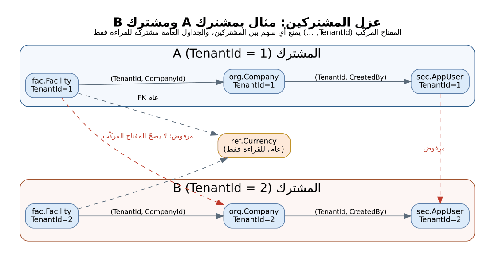

### 3.2 سياق الجلسة وربط الهوية
التصميم المعتمد في ADR 0002 (`docs/adr/0002-login-and-session-bound-context.md`) وADR 0003 (`docs/adr/0003-account-security-in-the-database.md`)، والمنفّذ في `db/static/030_session_context.sql` و`db/static/035_account_security.sql`؛ يحل O-9 وO-11 (20-database-design) وO-17 وO-18 وO-19 وO-24 (erd_open_items).
- **الدخول داخل القاعدة:** `sec.usp_GetPasswordParams` يعيد معاملات Argon2id المخزّنة دون التجزئة؛ يحسب التطبيق التجزئة من كلمة المرور؛ `sec.usp_StartSession` يقارنها داخل القاعدة، ويطبّق القفل (BR-PLT-005)، ويسجّل كل محاولة في `sec.LoginAttempt`، وينشئ جلسة في `sec.UserSession` بتجزئة SHA-256 لرمز الجلسة (خمول 30 دقيقة، مطلق 12 ساعة). كل فشل قبل إثبات كلمة المرور يرفع الخطأ نفسه `50005` فلا يكشف وجود البريد؛ ومن أثبت كلمة مروره ورفضته حالة المشترك يأخذ `50006` (DQ-F03-11). MFA إلزامي لكل مستخدم غير خدمي: `sec.usp_ConfirmMfa` يسجّل نتيجة رمز TOTP وخطوته الزمنية، والخطوة المكررة والرمز الخاطئ يُعدّان في عداد القفل، و`sec.usp_CompleteMfaEnrolment` يسجّل أول تسجيل، و`sec.usp_UseRecoveryCode` يستهلك رمز الاسترداد داخل القاعدة.
- **الربط لكل اتصال:** `sec.usp_SetSessionContext(@TenantId, @SessionToken, @ClientIp, @CorrelationId)` يُستدعى عند فتح كل اتصال من المجمّع وقبل أي استعلام. يأخذ المستخدم من الجلسة لا من التطبيق، ويرفض: مدخلات ناقصة (`50001`)، مشتركًا مجهولًا أو مؤرشفًا أو مغلقًا منذ أكثر من 30 يومًا (`50002`)، جلسة منتهية أو مستخدمًا غير نشط أو خدميًا أو جلسة بلا MFA أو مستخدمًا لا تقبله حالة المشترك (`50003`؛ المعلّق والمغلق لمدير الحساب TA وحده، O-18)، واتصالًا مربوطًا من قبل (`50004`). ثم يكتب صف `sec.SessionBinding` لـ`@@SPID` ويضبط المفاتيح بـ`@read_only = 1`، ودوال RLS في 010 تشترط تطابق السياق وصف الربط ورمزه.
- **السحب الفوري:** قوادح على `sec.AppUser` و`sec.UserSession` و`plat.Tenant` تحذف صف الربط عند تعطيل المستخدم أو حذفه، أو إنهاء الجلسة، أو خروج المشترك من `TRIAL/ACTIVE`.
- **التنفيذ بصفة `tp_auth_exec`** (عضو `tp_auth`، بلا تسجيل دخول): يتجاوز RLS داخل الإجراءات والقوادح فقط (`IS_MEMBER(N'tp_auth')`). منحه في 020: قراءة `sec.AppUser` و`plat.Tenant` و`sec.UserRole` و`sec.Role`، وتعديل `sec.AppUser`، وكامل `sec.SessionBinding`، وقراءة `sec.UserSession` وإدراجها وتعديلها، وإدراج `sec.LoginAttempt`، وما تحتاجه إجراءات 035 على `sec.UserToken` و`sec.MfaRecoveryCode` و`sec.UserPasswordHistory`.
- **حسابات المستخدمين (035، ADR 0003):** الدعوة وإعادة التعيين وتغيير كلمة المرور بقاعدة السجل، وروابط البريد (دعوة 48 ساعة، إعادة تعيين 30 دقيقة، إعادة تسجيل MFA 24 ساعة) تُخزَّن ببصمة SHA-256 فقط، وفك القفل وتصفير MFA وتغيير حالة المستخدم وإنهاء الجلسة وتمديد الخمول: كلها إجراءات بصفة `tp_auth_exec`.
- **حدود `tp_app`:** لا يقرأ `PasswordHash` ولا `MfaSecretEnc` ولا تجزئات السجل ورموز الاسترداد، ولا ينشئ جلسة ولا يعدّلها، ولا يعدّل أعمدة كلمة المرور وMFA والقفل والحالة، ولا يصدر رابطًا (DENY في 030 و035 بعد المنح المولّدة 007؛ الاختباران T35 وT45). ينشئ مستخدمًا بحالة INVITED فقط بلا بيانات اعتماد (قادح، 50012). ولأن بعض الأعمدة محجوبة يسمّي التطبيق أعمدته: `SELECT *` و`COUNT(*)` على هذه الجداول يرفضان بالخطأ 230.
- **الفشل:** عند أي خطأ يجب على التطبيق ألا يستعمل الاتصال، و`sp_reset_connection` من المجمّع يمسح السياق قبل إعادة الاستعمال.
- **حساب الخدمة (`IsSystemUser`):** مستخدم خدمة لكل مشترك بلا كلمة مرور ولا MFA (قيد `CHECK`). لا يربط بـ `usp_SetSessionContext` لأن الربط يتطلب جلسة متحققة بـ MFA لمستخدم غير خدمي، ولا يُقفل بمحاولات خاطئة لأنها لا تُعدّ له؛ وتربط به المهام الخلفية عبر `sec.usp_SetJobContext` (037، ADR 0004) لمهمة من القائمة المغلقة `cfg.JobDefinition` وبحالة مشترك تسمح بها، فيقرأ ويكتب بصلاحيات `tp_app` في مشترك واحد، ولا يستعمل إجراءات المدير (`sec.fn_BoundAsUser`).
- **المخاطر المتبقية داخل المشترك الواحد (ADR 0003):** التطبيق يرى رمز الرابط الخام لأنه يرسل البريد، وفحص TOTP في التطبيق لأن المفتاح عنده (مع فحص التكرار وحد الإخفاقات في القاعدة). لا يعبر أي منها حدود المشترك. وأُغلق R6: حذف `tp_app` صفوف `sec.LoginAttempt` لم يعد يمحو الأثر، لأن كل محاولة تُنسخ إلى `aud.AuditLog` (ADR 0007، DQ-F03-10).

### 3.3 أنواع النطاق
| النوع | علامة النموذج | الجداول | القراءة (tp_app) | الكتابة (tp_app) | الكتابة (tp_platform) |
|---|---|---|---|---|---|
| مملوك للمشترك | (افتراضي) | 199 | صفوف مشتركه | صفوف مشتركه | **لا وصول مباشر** |
| عالمي | `global` | 33 | الكل (ما عدا `noapp`) | **لا** | نعم |
| عالمي محجوب | `global noapp` | 5 (`plat.Tenant`، `plat.PlatformOperator`، `plat.ReservedSubdomain`، `plat.TenantModule`، `cfg.JobDefinition`) | **لا وصول** (يُقرأ صف المشترك عبر §3.6، ووحدات الاشتراك عبر `plat.v_TenantModule`) | لا | نعم، والإنشاء والحالة وحسابات المشغّلين بإجراءات فقط (ADR 0004) |
| داخلي | `global noapp noplat` | 3 (`sec.SessionBinding`، `plat.OperatorSession`، `plat.OperatorToken`) | **لا وصول** | لا | لا: تكتبها إجراءات بعينها فقط (030، 036) |
| مختلط | `mixed` | 3 (`aud.AuditLog`، `cfg.NonWorkingDay`، `ref.UcpArticle`) | صفوف المنصة (`TenantId IS NULL`) + صفوف مشتركه | صفوف مشتركه فقط | صفوف المنصة وغيرها |

قيدان بنيويان يفرضهما المولّد: لا جدول عالمي أو مختلط يشير إلى جدول مملوك (يُرفض عند التوليد)، والمراجع نحو العالمي/المختلط مفاتيح بسيطة.

### 3.4 سياسة خاصة لـ `aud.AuditLog`
`aud.AuditLog` جدول مختلط بسياسة خاصة (BR-PLT-001/009):
- **القراءة:** المشترك يرى صفوفه فقط. صفوف `TenantId IS NULL` (أحداث المنصة) **لأعضاء `tp_platform` فقط**.
- **الكتابة (إدراج فقط):** `TenantId` الخاص بالمشترك أو `NULL` لحدث منصة؛ لا تعديل ولا حذف (`UPDATE` ممنوع لكل الأدوار بالمنح والـ`DENY`).
- الدوال: `rls.fn_AuditRead` و`rls.fn_AuditWrite`، والسياسة `rls.TP_aud_AuditLog`.

### 3.5 مشغّلو المنصة والدعم
- **`tp_platform` لا يملك وصولًا مباشرًا لجداول المشتركين** (C-4). يكتب على الجداول العالمية (بما فيها `plat` المحجوبة) وعلى صفوف المنصة في الجداول المختلطة الثلاثة (§3.3)، ويقرأ/يكتب سجلات المنصة في `aud`. هذا يعني أن التعديل على بيانات مشترك لا يُمكن إلا عبر **إجراءات مُراجَعة** للمنصة (O-12): إنشاء المشترك `plat.usp_CreateTenant` وتغيير حالته `plat.usp_SetTenantStatus` (038، ADR 0004)، ولا يدرج المشترك ولا يعدّل رمزه وحالته مباشرة. المشغّلون يدخلون بإجراءات داخل القاعدة على نمط ADR 0002 (`plat.usp_StartOperatorSession` وTOTP إلزامي، 036)، وحساباتهم لا تتغير إلا بإجراءات: تمهيد أول مدير عند النشر، والدعوة، والإعداد، والإعادة، والحالة مع بقاء مديرَين نشطين.
- **وصول الدعم** إلى بيانات مشترك يمر عبر `plat.SupportAccessGrant`: يفعّله مستخدم من المشترك لمشغّل محدد، بنافذة زمنية (ساعة إلى 72 ساعة، الافتراضي 4) وسبب إلزامي، ويُلغى بـ`RevokedAt/By`، ويُسجَّل في `aud.AuditLog` بشدة عالية (BR-PLT-009). **الإجراء منفّذ (036، ADR 0004):** اتصال الدعم عضو في `tp_support` (ضمن `tp_readonly`، بلا أعمدة مقيّدة ولا كتابة)، ويربطه `sec.usp_SetSupportContext` بمشترك واحد بجلسة مشغّل متحققة بـ MFA ومنحة فعّالة له لا تزيد على 72 ساعة، وفي المشترك المعلّق بمنحة أقدم من التعليق فقط؛ وتسحب القوادح الربط عند إلغاء المنحة أو انتهاء جلسة المشغّل أو تعطيله.
- دور `tp_platform` **يتجاوز RLS** لكنه لا يملك جداول مشتركين يتجاوزها؛ التجاوز يبقى في دوال السياسات للكتالوجات المختلطة، وفي سجل التدقيق للكتابة فقط: قراءته محصورة في أحداث المنصة (`TenantId IS NULL`، `rls.fn_AuditRead`، الاختبار T38).

### 3.6 قراءة صف المشترك للتطبيق
`plat.Tenant` محجوب عن `tp_app` (`noapp`). يقرأ التطبيق صف مشتركه من العرض `plat.v_CurrentTenant` الذي يرشّح بـ`SESSION_CONTEXT('TenantId')`، فلا يرى أي مشترك آخر ولا قائمة المشتركين. العرض يملكه نفس مالك الجدول الأساسي، فتعمل سلسلة الملكية دون منح للجدول. وكذلك وحدات الاشتراك `plat.TenantModule` (مملوكة للمنصة ويكتبها مشغّلوها فقط، DR-01) تُقرأ عبر العرض المماثل `plat.v_TenantModule` بالترشيح نفسه.

---

### 3.7 العلاقات الأساسية: المشترك والمستخدمون والصلاحيات

يوضح المخطط كيف يرتبط `plat.Tenant` بالمستخدمين والأدوار والصلاحيات ومفتاح تشفيره وشركاته ووحداته. كل خط **مفتاح أجنبي فعلي** ويحمل اسم عمود الربط، والجداول مرسومة بمفاتيحها (`PK` و`FK` و`UK`) فقط. عمود `TenantId` الذي تحمله جداول المشترك كلها وإشارته إلى `plat.Tenant` **لم يُرسم في كل جدول** لتفادي الازدحام، وترد كاملة في جداول المواصفات (§10). الروابط إلى جداول خارج المجموعة لا تُرسم، وتظهر في جدول العلاقات بعمود «مرسوم: لا».

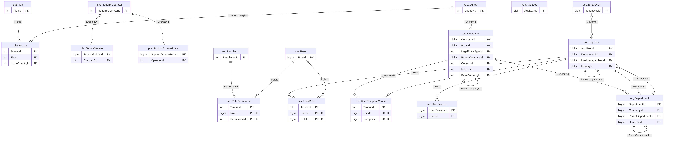

## 4. الاتفاقيات (Conventions)

| الموضوع | الاتفاق |
|---|---|
| **المفاتيح** | `<Table>Id BIGINT IDENTITY` (و`INT` للكتالوجات الصغيرة بعلامة `int`، 75 جدولًا)؛ المفتاح الأساسي مجمّع على المعرّف وحده؛ الفرادة المركّبة `(TenantId, Id)` هدفًا للمراجع |
| **المعرّف العام** | `PublicId UNIQUEIDENTIFIER DEFAULT NEWSEQUENTIALID()` على جذور التجميعات المعرَّضة (علامة `public`)، فريد على مستوى القاعدة؛ **لا يُعرَّض `BIGINT` عبر API** |
| **التدقيق** | `CreatedAt/CreatedBy/UpdatedAt/UpdatedBy` (UTC `DATETIME2(3)`) + `RowVersion ROWVERSION` للتزامن المتفائل (167 جدولًا) |
| **للإضافة فقط** | علامة `append`: بلا `UpdatedAt/By` وبلا `RowVersion`؛ **تُفرض بالمنح** (`INSERT` و`SELECT` فقط) و**`DENY UPDATE`** — §9 |
| **الحذف** | **لا حذف فعلي** إلا على الجداول المعلَّمة `deletable` (41 جدولًا: وسطاء وجلسات ورموز مؤقتة…)؛ الباقي بالحالة (أرشفة/إلغاء/استبدال) |
| **المبالغ** | `DECIMAL(19,4)` + عمود `CurrencyId` مجاور؛ لا مبلغ بلا عملة. أسعار الصرف `DECIMAL(19,8)` |
| **النسب** | `DECIMAL(9,6)` بنقاط مئوية (1.5 = 1.5%) |
| **القوائم المغلقة** | `VARCHAR` + `CHECK ... IN (...)` (لا جداول بحث لقيم منطق ثابت)؛ القوائم القابلة للتخصيص لكل مشترك في `cat.LookupList/LookupItem` أو كتالوجات مسمّاة |
| **القوائم المتعددة القيم** | جدول وسيط؛ `set{}` (نص مفصول بفواصل) لقوائم صغيرة جدًا ثابتة فقط |
| **التواريخ** | ميلادي `DATE`؛ الهجري نص `NVARCHAR(20)` حيث تفرضه المستندات |
| **الأسماء** | مخططات بحروف صغيرة (`fac`)، جداول `PascalCase` مفرد، قيود `PK_/UQ_/IX_/FK_/CK_/DF_<Table>_…` ≤ 128 حرفًا (ومن 60 حرفًا يُقصَّر بلاحقة تجزئة في PostgreSQL) |
| **الكتالوجات** | علامة `catalog`: `Code, NameAr, NameEn, Description, IsActive, IsSystem, IsLocked, SortOrder, SeedKey, ExternalCode` + فرادة `(Tenant,Code)` و`(Tenant,SeedKey)`؛ `SeedKey` يربط صف البذرة عبر الإصدارات |
| **حقول الربط الخارجي** | `ExternalCode`/`ExternalRef` نصية عامة لربط ERP والبنوك لاحقًا دون تغيير بنيوي |

---

## 5. التاريخ والمراجعات ومصدر القيمة

### 5.1 الصفوف المراجَعة `rev` (13 جدولًا)
الأعمدة: `FromRevision`, `ToRevision` (NULL = الجاري), `SupersedesId`. التعديل **يُنشئ صفًا جديدًا** ويغلق السابق. الفرادة تُصفّى على الجاري (`WHERE ToRevision IS NULL`). التسهيل يملك رأسًا واحدًا + `fac.FacilityRevision` (مسودة/تقديم/رفض/اعتماد؛ مراجعة مفتوحة واحدة لكل تسهيل عبر فهرس فريد مصفّى).
- **المعتمد نهائي في القاعدة (044، ADR 0015):** لكل جدول من الـ13 قادح مبني من أعمدته: صف `FromRevision <= Facility.ApprovedRevisionNo` لا يُدرج ولا يُحذف ولا يتغير، إلا `ToRevision` بين NULL ومراجعة بعد المعتمدة (50049). صف `FacilityRevision` المعتمد نهائي إلا أعمدة التدقيق، وروابط الالتزام أو التعهد المعتمد تتبعه، وصف التسهيل يُقرأ بقفل تحديث. أي تغيير على المعتمد مراجعة جديدة.

### 5.2 ختم المصدر `src` (11 جدولًا)
كل قيمة ائتمانية مقروءة من اتفاقية تحمل: `SourceDocumentId`, `SourcePage`, `ReadFromScan`, `OriginalText`, `NoSourceReason`, `Confidence` (`ENTERED_NO_DOCUMENT` / … / `CONFIRMED_AGAINST_ORIGINAL`), `VerifiedBy/On`, `ConflictId → fac.ValueConflict`.
- قيد `CHECK`: إما مستند وصفحة، وإما `ENTERED_NO_DOCUMENT` — فلا قيمة بلا أصل أو إقرار بغيابه.
- وقيد يولّده المولِّد على كل جدول `src`: قيمة بلا `SourceDocumentId` تحمل `NoSourceReason` غير فارغ (ADR 0015).
- «مؤكَّد مقابل الأصل» يستلزم مدققًا وتاريخًا.
- التعارض بين مستندين يُسجَّل في `fac.ValueConflict` ولا يُحلّ بالتخمين.

### 5.3 التدقيق وحدوده
- `aud.AuditLog`: من/متى/ماذا (`BeforeJson/AfterJson` مع إخفاء الحقول المقيَّدة)/من أي عنوان وارتباط (`IpAddress`, `CorrelationId`)؛ إدراج فقط، بتصنيف (`Category`) وشدة (`Severity`) ونتيجة (`Result`).
- **من يكتب التدقيق (ADR 0007):** إجراءات القاعدة تكتب صفوف أحداثها في معاملة التغيير نفسها عبر الإجراء الداخلي `aud.usp_WriteEvent` (029): كل محاولة دخول بقادح على `sec.LoginAttempt`، وتغييرات الحسابات والجلسات (035)، ودخول المشغّلين وحساباتهم وربط الدعم (036)، وربط المهام (037)، والتهيئة وحالة المشترك (038). صفوف المشترك يراها عارض تدقيقه، وصفوف المنصة (`TenantId` فارغ) للمشغّلين وحدهم، ولا صف يحمل بريدًا أو تجزئة أو رمزًا. ويكتب التطبيق ما يفعله هو: بيانات الخزينة والكشف والتصدير وعرض التدقيق.
- **سلسلة البصمات** اختيارية لكل مشترك (`ChainSeq`, `PrevHash`, `RowHash` = SHA-256 للسابق مع تمثيل قانوني للصف) (FR-PLT-025). **حدّها:** السلسلة وحدها **لا تكشف العبث**؛ من يملك تعديل السجل يستطيع إعادة حساب البصمات كلها. لذلك يلزم **تثبيت جذر السلسلة خارج القاعدة** دوريًا (مرساة في تخزين غير قابل للتعديل أو تجزئة منشورة)، ومراقبة انقطاع التسلسل. موقع المرساة قرار مفتوح (O-13).
- `aud.SensitiveAccessLog`: كل كشف أو تصدير أو عرض صورة هوية، مسموحًا أو مرفوضًا، مع حدثه في `aud.AuditLog` للمشترك نفسه (مرجع إلزامي، DR-12). السبب اختياري يفعّله المشترك (Q-PTY-05).
- `wfl.RequestAction`: سجل إجراءات الطلب (الخط الزمني للمستخدم) — **غير** سجل التدقيق الأمني.
- `sec.KeyEvent`: دورة حياة المفاتيح.

---

## 6. حماية البيانات الحساسة

### 6.1 ما يُخزَّن
| الجدول | العمود المشفّر | مفتاح البيانات (المرجع + الغرض) | مفتاح الفهرسة HMAC (المرجع + الغرض) |
|---|---|---|---|
| `pty.IdentityDocument` | `NumberEnc` | `EncKeyPurpose` = `DATA` → `EncKeyId` | `HashKeyPurpose` = `BLIND_INDEX` → `HashKeyId` ← `NumberHash` |
| `pty.PartyCustomField` | `ValueEnc` (للحقل المقيَّد) | `EncKeyPurpose` = `DATA` → `EncKeyId` | — |
| `acc.BankAccount` | `AccountNoEnc`، `IbanEnc` | `EncKeyPurpose` = `DATA` → `EncKeyId` | `HashKeyPurpose` = `BLIND_INDEX` → `HashKeyId` ← `AccountNoHash`، `IbanHash` |
| `lc.LcTerms` | `BeneficiaryAccountIbanEnc` | `EncKeyPurpose` = `DATA` → `EncKeyId` | `HashKeyPurpose` = `BLIND_INDEX` → `HashKeyId` ← `BeneficiaryAccountIbanHash` |
| `sec.AppUser` | `MfaSecretEnc` | `MfaKeyPurpose` = `DATA` → `MfaKeyId` | — |
| `doc.DocumentVersion` | ملف الهوية في مخزن خارجي (`StorageKey`، `Sha256`) | `KeyPurpose` = `FILE` → `KeyId` | — |
| `plat.PlatformOperator` | `MfaSecretEnc` | `MfaKeyRef` (مفتاح المنصة في KMS وإصداره) | — |
| `sec.TenantKey` | `WrappedKey` | مغلَّف بمفتاح رئيسي خارج القاعدة (`MasterKeyRef`) | — |

أرقام الهوية والإقامة والجواز **لا تُعرض ولا تُخزَّن صريحة**؛ القناع `NumberMask` (آخر 4) للعرض، والبصمة `NumberHash` للبحث بالتطابق وكشف التكرار دون فك التشفير.

### 6.2 شكل الغلاف المشفّر (إلزامي لطبقة التطبيق)
كل قيمة مشفّرة في عمود `bin` تُخزَّن بهذه الصيغة:

| الجزء | الحجم | المحتوى |
|---|---|---|
| إصدار الصيغة | 1 بايت | `0x01` |
| الـnonce | 12 بايت | عشوائي، **فريد لكل عملية تشفير** (لا عداد يُعاد استخدامه) |
| النص المشفّر | متغيّر | AES-256-GCM بمفتاح `DATA` المُشار إليه بعمود المفتاح في الصف |
| الوسم (tag) | 16 بايت | وسم GCM للتحقق من السلامة |

- **أدنى طول للغلاف = 29 بايت**، ويفرضه `CHECK DATALENGTH(...) >= 29` على كل عمود مشفّر.
- **AAD** (البيانات المصادَقة غير المشفّرة): `TenantId` (4 بايت، big-endian) ‖ اسم الجدول ‖ اسم العمود ‖ **المعرّف الثابت للصف**. هذا يمنع نقل نص مشفّر من مشترك إلى آخر أو من عمود إلى آخر. المعرّف الثابت يُحدَّد لكل جدول في S0 (إن لم يكن للجدول `PublicId` يُستعمل المفتاح الأساسي بعد الإدراج، فتُكتب القيمة المشفّرة في المعاملة نفسها).
- **إصدار المفتاح:** عمود المفتاح في الصف (`EncKeyId`/`MfaKeyId`/`MfaKeyRef`) يحدد نسخة المفتاح التي شُفِّر بها الصف. القيد `CHECK` يفرض وجود عمود المفتاح عند وجود القيمة المشفّرة.
- **غرض المفتاح:** بجانب كل مفتاح عمود ثابت للغرض (`EncKeyPurpose = DATA`، `HashKeyPurpose = BLIND_INDEX`، `MfaKeyPurpose = DATA`، `KeyPurpose = FILE`)، والمفتاح الأجنبي إليه **مركّب** `(TenantId، الغرض، معرّف المفتاح)` إلى `sec.TenantKey(TenantId, Purpose, TenantKeyId)`. لا يمكن بذلك ربط مفتاح فهرسة بعمود تشفير، ولا مفتاح مشترك آخر (DR-02).
- **الطول والصيغة يتحقق منهما التطبيق**؛ القاعدة تفرض الحد الأدنى فقط.

### 6.3 التدوير وإعادة التشفير
1. إنشاء صف `sec.TenantKey` جديد بحالة `PENDING` ثم `ACTIVE` (فرادة `ACTIVE` لكل غرض).
2. الصفوف الجديدة تُشفَّر بالمفتاح `ACTIVE`، والقديم يصير `RETIRING`.
3. مهمة خلفية تعيد تشفير كل صف، فيتغير `EncKeyId` إلى المفتاح الجديد داخل المعاملة نفسها التي تكتب الغلاف.
4. تقدّم الإعادة = عدد الصفوف التي ما زالت تشير إلى المفتاح `RETIRING`؛ عند الصفر يصير `RETIRED`.
5. **فهرس HMAC** (`HashKeyId`) يتطلب إعادة حساب البصمات ثم إعادة بناء الفهرس؛ لا يُدار بالتشفير المعتاد.

### 6.4 مفاتيح وأغلفة أخرى
| العنصر | التصميم |
|---|---|
| **المفاتيح** | `sec.TenantKey`: لكل مشترك مفاتيح بأغراض `DATA` / `BLIND_INDEX` / `FILE` وإصدارات؛ `WrappedKey` **ملفوف بمفتاح رئيسي خارج القاعدة**؛ مفتاح `ACTIVE` واحد لكل غرض؛ التدوير بحالة `RETIRING` |
| **كلمات المرور والرموز** | تُخزَّن **بصمات** فقط (`PasswordHash`, `TokenHash`, `CodeHash`) وأسرار MFA مشفّرة؛ `sec.UserPasswordHistory` لمنع إعادة الاستخدام |
| **حجب عن التقارير** | `DENY SELECT` على كل عمود موسوم `sens=restricted` (31، §1) للدور `tp_readonly` (`006`)، والدوال الداخلية محجوبة عنه أيضًا (`090`، §7.2) |
| **صور الهوية** | ملفات في مخزن خارج القاعدة: `doc.DocumentVersion` بـ`StorageKey` معزول لكل مشترك، و`Sha256` يحسبه الخادم، و`KeyId → sec.TenantKey` بمفتاح `FILE`، وفحص `ScanStatus` — لا يُنزَّل إلا `CLEAN`. عرضها بصلاحية `party.identity.image.view` وسبب |
| **من يرى الأرقام كاملة** | مدير الخزينة وموظف التسهيلات فقط (`04` §9.4)؛ غيرهما يرى `NumberMask`. يُطبَّق بالصلاحيات في طبقة التطبيق، والقاعدة تضمن أن لا شيء يُقرأ نصًّا صريحًا |

⚠ لا أسرار في النماذج: لا مفاتيح، ولا قيم افتراضية لكلمات مرور. البيانات الشخصية المقروءة من الاتفاقيات المرفوعة **لا تدخل الوثائق ولا البذور**.

---

## 7. استراتيجية سلامة البيانات

| المستوى | ما يضمنه | أين |
|---|---|---|
| **مرجعي** | كل مرجع مفتاح أجنبي (§1)، والمركّب يمنع العبور بين المشتركين والتجميعات | `002_foreign_keys.sql` |
| **حالة** | قيم الحالات والأنواع `CHECK IN` | `001_tables.sql` |
| **تناسق الحقول** | مبلغ مطلق أو نسبة من الأب (حسب `AmountBasis`)، ترتيب التواريخ، `ExposureAmount >= Amount`، `LcClass` يقيّد الحقول، **لا إكمال طلب بلا إقفال من الخزينة** (§11)، وأطوال الأغلفة المشفّرة | `CHECK` على الجداول |
| **فرادة** | رموز الكتالوج، الرقم الداخلي، **فريد بين الجاري فقط** (`WHERE ToRevision IS NULL`)، **حجز فعّال واحد لكل طلب**، **تحويل حجز واحد لكل استخدام**، وإعادة إرسال أمر الحجز لا تكرّره (`IdempotencyKey` فريد)، و**دورة عمل واحدة مفتوحة** بالفهرس المصفّى | `UNIQUE` وفهارس فريدة مصفّاة |
| **تزامن** | `RowVersion` + مقارنة في التحديث | طبقة التطبيق |
| **لا حذف متتالي على بيانات الائتمان والتدقيق وKYC** | حذف متتالي واحد فقط في القاعدة: شروط بند ملف الاكتمال مع بندها، والبنود لا تتغير إلا في نسخة مسودة (`DRAFT`)؛ والنسخة الفعّالة أو المسحوبة لا تعود مسودة (50033). القاعدة R11 ترفض أي حذف متتالي آخر في النموذج (O-13 في erd_open_items، ADR 0006) | `041_kyc_profile_versions.sql` و`check_grants.py` |
| **ترقيم بلا فجوات** | رقم الطلب والبروفورما يؤخذ داخل معاملة الكتابة نفسها بقفل صف العدّاد (`UPDLOCK, HOLDLOCK`)، فالتراجع يعيد الرقم والطلب المتزامن ينتظر الالتزام؛ والملغى يبقى «ملغى» بسبب ولا يُعاد؛ وتعريفا `req:<TypeCode>` و`PROFORMA` لا يقبلان غير `GAP_FREE` (O-12 في erd_open_items، Q-PLT-08) | `cfg.usp_AllocateNumber` و`cfg.usp_VoidNumber` (039، ADR 0005) |
| **منطق معقّد يبقى في التطبيق** (مذكور برمز `BR-…` في تعليق العمود) | عمق شجرة الحدود ≤ 6 وبلا حلقات · سقف الابن ≤ الأب · حساب المتاح `Available` · إعادة حساب `EffectiveAmount` · صلاحيات التفويض · فحص التعارض بين المفوّضين · **معاملة الحجز** (§7.1) | خدمات `fac.*` وخدمات التطبيق |

### 7.1 الحجز الذري للحدود (شرط في طبقة التطبيق)
الحجز والتحويل والتحرير عمليات مالية، والقيود وحدها لا تمنع التجاوز تحت التزامن:
- كل عملية في **معاملة قصيرة واحدة** تبدأ بقفل صف الحد (`UPDLOCK, ROWLOCK` على `fac.Limit`) ثم تحسب المتاح وتكتب `LimitReservation` و`LimitMovement` و`OutboxEvent` معًا.
- مفتاح `IdempotencyKey` يضمن أن إعادة الإرسال لا تكرر الحجز.
- **مستوى العزل:** `READ_COMMITTED` مع القفل الصريح؛ لا يُعتمد `SERIALIZABLE` عامًّا لأنه يخنق الأداء.
- **المتاح لا يُخزَّن وحده:** `reconciliation` دوري يعيد حسابه من `LimitMovement`.
- **الاختبار المطلوب:** 100 طلب متزامن على الحد نفسه، بنجاح واحد أو نتائج محددة بدقة (S2).
- أخطاء الأعمال تُعاد كرموز ثابتة للـ API لا كنصوص SQL.

### 7.2 حراس المراجعة الذاتية (ADR 0015)
كل حارس يقرأ صف الأب بـ`UPDLOCK, HOLDLOCK`، فلا تتداخل موافقة مع كتابة على صفوفها.

| الحارس | ما يمنعه | أين |
|---|---|---|
| **تجميد المراجعة المعتمدة** | تعديل صفوف مراجعة معتمدة أو صف اعتمادها (§5.1) | `044`، 50049؛ SR1 |
| **قاعدة الحد** | تقييم تعهّد بحد غير حدّه أو مُعامِل غير مُعامِله، أو «بلا حد» على تعهد له حد، أو حكم على تعهد بلا حد | `044`، 50054؛ SR2 |
| **تنقية الحقول المقيّدة** | نسخ قيمة حقل اعتماد `RESTRICTED` في تعديل بأي مفتاح أعلى وبأي حالة أحرف أو طول؛ ورفع حقل إلى `RESTRICTED` يمحو قيمه من النسخ المكتوبة | `044`، 50058؛ SR3 |
| **حجب الدوال عن التقارير** | تنفيذ `tp_readonly` دوال `rls` و`sec` و`plat` و`cfg` و`lc.BeneficiaryIbanChange`؛ مرشّحات الصفوف تعمل بلا إذنه | `090_readonly_denies.sql`؛ SR7 |
| **فحص القوادح المتكررة** | النشر على قاعدة `RECURSIVE_TRIGGERS ON`، فقوادح النسخ في 044 تكتب جداولها | `deploy_preflight.sql`، 50145؛ PF6 |

---

## 8. الفهرسة

| النوع | الاستخدام |
|---|---|
| **تلقائي لكل مفتاح أجنبي** | يُنشأ ما لم يغطّه مفتاح/فهرس أو وُسم `noidx` — يمنع الأقفال الطويلة عند الحذف/التحديث ويُسرّع الربط. أعمدة المفاتيح ومراجع الغلاف `noidx` لأنها لا تُبحث |
| **`TenantId` أولًا** في كل فهرس لجداول المشترك | توافق مع مرشّح RLS |
| **مصفّاة (229)** | استحقاقات وتنبيهات على الحالات الحية فقط |
| **`INCLUDE` (51)** | لوحات التوفر وتقارير الاستحقاق دون رجوع للجدول |
| **بحث نصي كامل** | `wfl.Request.SearchText` — اختياري `db/static/040_fulltext_optional.sql` (يتطلب ميزة Full-Text Search) |

قيود SQL Server التي فُحصت آليًا: لا مفتاح فهرس يتجاوز **1,700 بايت** ولا 16 عمودًا؛ المسندات المصفّاة تستعمل `=` و`<>` و`IN` و`IS [NOT] NULL` و`AND` فقط (**لا `OR`**)؛ مفتاح واحد فقط بـ`ON DELETE CASCADE` (§7) فلا مسارات تعاقب متعددة. `check_fk_indexes.py` (الخطوة 3 في CI) يشترط لكل مفتاح أجنبي من أعمدة النموذج فهرسًا يبدأ بأعمدته أو علامة `noidx`: 578 مفهرسًا و111 `noidx` وصفر بلا فهرس.

> ملاحظة التنفيذ: الفهارس المصفّاة والأعمدة المحسوبة المخزَّنة تتطلب `QUOTED_IDENTIFIER ON` وخيارات ANSI. أدوات `sqlcmd` تفترضها `OFF`؛ لذلك يبدأ كل ملف مولَّد وثابت بضبطها ويُشغَّل النشر بالخيار `-I`.

---

## 9. الأدوار والصلاحيات (على مستوى القاعدة)

### 9.1 الأدوار
| الدور | الغرض | الصلاحيات (ملخص؛ التفصيل الجدولي في 007) |
|---|---|---|
| `tp_app` | حساب تشغيل تطبيق المشترك | **المشترك والمختلط:** `SELECT, INSERT, UPDATE` (RLS يقصر الصفوف على المشترك) · **العالمي:** `SELECT` فقط · **للإضافة فقط:** `SELECT, INSERT` · **`noapp`:** لا شيء · **`plat.v_CurrentTenant` و`plat.v_TenantModule`:** `SELECT` · الحذف الفعلي على `deletable` فقط · `EXECUTE` على الإجراءات العامة في 030 (`usp_GetPasswordParams` و`usp_StartSession` و`usp_ConfirmMfa` و`usp_SetSessionContext`) و035 (خمسة عشر إجراءً، ADR 0003) و039 (`cfg.usp_AllocateNumber` و`cfg.usp_VoidNumber`، ADR 0005) و042 (`cfg.usp_RequestDataExport` و`cfg.usp_ApproveDataExport`، ADR 0008) فقط · `SELECT` على عروض القوائم المالية ودالة أداء التدفقات في 045 (ADR 0016)، و`EXECUTE` على `fin.usp_ComputeCreditAssessment` و`SELECT` على عروض التقييم الثلاثة عشر في 047 (ADR 0017 و0018) · لا يكتب نتائج التقييم ولا عوامله ولا ملاحظاته ولا إعادة تبويبه ولا لقطة تسهيلاته ولا علاجاته وسيناريوهاته وخططه ومحفّزاته (`DENY` في 047) · لا يكتب `obl.CovenantTestStatement` (`DENY` في 045) · لا يدرج طلب تصدير ولا يعدّله مباشرة (`DENY` في 042) · لا يكتب العدّادات ولا الأرقام المصدرة مباشرة (`DENY` في 039)، ويربط الرقم بكيانه فقط · لا `REFERENCES` · لا منح على مستوى المخطط |
| `tp_platform` | مشغّلو المنصة | **العالمي والمختلط:** `SELECT, INSERT, UPDATE` (للإضافة فقط: `SELECT, INSERT`) · **جداول المشتركين: لا شيء** · لا حذف · `DENY UPDATE` على جداول الإضافة فقط · `EXECUTE` على إجراءات المشغّلين والتهيئة وحالة المشترك (036، 038)، و`DENY` على إدراج المشترك والمشغّل وعلى أعمدة الرمز والحالة وبيانات الاعتماد (ADR 0004) |
| `tp_auth` | داخلي بلا تسجيل دخول (عبر المستخدم `tp_auth_exec`) | منح 020 على `sec.AppUser` و`plat.Tenant` و`sec.SessionBinding` و`sec.UserSession` و`sec.LoginAttempt` فقط؛ تُنفَّذ به إجراءات 030 الأربعة وقوادحها فقط (`EXECUTE AS`) · ومنح 028 و036 إلى 038 (الإعدادات، المشغّلون وجلساتهم وروابطهم، منح الدعم، قائمة المهام، التهيئة)، ADR 0004 |
| `tp_readonly` | تقارير/تحليل | `SELECT` على كل المخططات دون الأعمدة الحساسة (`006`)؛ `DENY SELECT` على `plat.PlatformOperator` كليًا؛ ولا دوال `rls` و`sec` و`plat` و`cfg` ولا `lc.BeneficiaryIbanChange` (`090`، ADR 0015)، وتبقى عروض التقارير مقروءة |
| `tp_support` | الدعم المؤقت (FR-PLT-007) | عضو في `tp_readonly`؛ `EXECUTE` على `sec.usp_SetSupportContext` فقط، فيقرأ مشتركًا واحدًا بمنحة فعّالة (036، ADR 0004) |
| `tp_jobs` | عامل المهام الخلفية (FR-PLT-044) | عضو في `tp_app`؛ `EXECUTE` على `sec.usp_SetJobContext` و`plat.usp_ListTenantsForJobs` و`plat.usp_RunTenantTransitions` و`sec.usp_InviteFirstAdministrator` (037، 038)، وإجراءات مهمتي التصدير في 042 (`cfg.usp_StartDataExport` و`usp_FinishDataExport` و`usp_FailDataExport` و`usp_ExpireDataExports`، ADR 0008) |
| `tp_migrator` | النشر والترحيل | يُنشأ الدور فقط؛ **لا منح تشغيلية له هنا** (تُحدَّد مع أداة الترحيل O-2)، ويُستعمل حساب مالك القاعدة أثناء النشر |

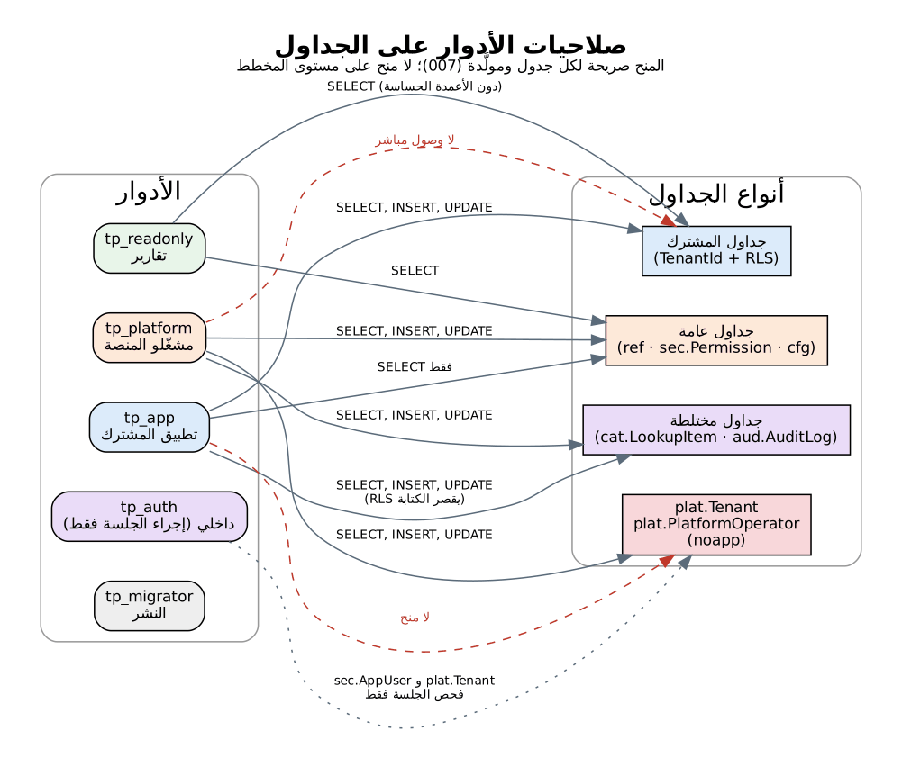

### 9.2 من أين تأتي المنح
| الملف | المحتوى |
|---|---|
| `db/static/020_roles_and_grants.sql` | إنشاء الأدوار، `tp_auth`، قراءة `tp_readonly`، الحجب عن `PlatformOperator` |
| `db/generated/tsql/005_delete_grants.sql` | الحذف على الجداول `deletable` لـ`tp_app`، و`DENY UPDATE` على جداول الإضافة فقط |
| `db/generated/tsql/006_sensitive_columns.sql` | `DENY SELECT` على الأعمدة المقيّدة (31) لـ`tp_readonly` |
| `db/generated/tsql/007_table_grants.sql` | **المنح الجدولية الصريحة لـ`tp_app` و`tp_platform`** (226 عبارة `GRANT`) |
| `db/static/025_tenant_views.sql` | عرض `plat.v_CurrentTenant` لـ`tp_app` |
| `db/static/030_session_context.sql` | إجراءات الدخول والربط الأربعة وقوادح السحب و`DENY` الخاصة بـ`tp_app` (ADR 0002) |
| `db/static/045_financial_statements.sql` | قراءة عروض القوائم المالية ودالة الأداء لـ`tp_app`، و`DENY` كتابة `obl.CovenantTestStatement` (ADR 0016) |
| `db/static/046_credit_assessment.sql` | حراس دورة حياة التقييم وتجميد مدخلاته ونتائجه (ADR 0017 و0018) |
| `db/static/047_credit_engine.sql` | `EXECUTE` على إجراء الحساب و`SELECT` على العروض الثلاثة عشر ودالة تحليل البنود لـ`tp_app`، و`DENY` كتابة جداول النتائج التسعة وأعمدة النتيجة (ADR 0018) |
| `db/static/090_readonly_denies.sql` | آخر سكربت ثابت: `DENY` على الدوال الداخلية لـ`tp_readonly`، فتشمل كل دالة أنشأها ما قبله (ADR 0015) |

### 9.3 التحقق الثابت من الصلاحيات
`tools/dbgen/check_grants.py` يقرأ النموذج والملفات المولَّدة والثابتة ويفشل عند المخالفة. القواعد:
- **R1** لا كتابة لـ`tp_app` على جدول عالمي. **R2** لا منح لـ`tp_app` على `noapp`.
- **R3** لا منح مباشر لـ`tp_platform` على جدول مشترك. **R4** لا `REFERENCES` لدور تطبيقي.
- **R5** لا منح على مستوى المخطط لـ`tp_app`/`tp_platform` (استثناء موثَّق: مخطط `rls` للقراءة).
- **R6** `tp_auth` لا يملك منحًا إلا على الجداول الخمسة التي تحتاجها إجراءات 030. **R7** عدد أعمدة `sens=restricted` = عدد عبارات `DENY` لـ`tp_readonly`.
- **R8** كل جدول فيه عمود مشفّر يملك مفتاح بيانات، وكل بصمة فهرسة مفتاح HMAC. **R9** لا `UPDATE` على جدول للإضافة فقط.
- **R10** كل ملف في `deploy.sql` موجود، ومنح مخطط `rls` يأتي بعد إنشائه في `010` (وقد كان هذا خطأ في الترتيب قبل المراجعة فاكتُشف وصُحِّح).
- **R11** لا حذف متتالي (`cascade`) في النموذج إلا على الروابط المسموحة في `CASCADE_ALLOWED`، وهي اليوم شروط بند ملف الاكتمال وحدها (O-13، ADR 0006).

**اختباره:** حُقنت ثلاث مخالفات متعمدة في `007` (كتابة على `ref.Currency`، ومنح على `plat.Tenant`، ومنح مباشر لـ`tp_platform` على `org.Company`) فاكتشفها الفحص كلها ثم أُزيلت. الفحص الثابت **لا يثبت** أن المحرك ينفّذ المنح كما هي؛ ذلك في S0.

### 9.4 قواعد عامة
- **لا يملك `tp_app` حذفًا** على أي جدول غير مصرَّح به.
- `DENY` يقيّد الأعضاء بالدور؛ مالكو القاعدة (`db_owner`/`sysadmin`) خارج هذا النموذج ويُحصرون تشغيليًا.
- حساب خدمة واحد للتطبيق (`tp_app`)، وحساب منفصل لمهام المنصة (`tp_platform`)، ولا يُشارَك بيانات الاعتماد.
- التطبيق لا يملك `ALTER` على السياسات أو المخططات.

---

## 10. خريطة المخططات والجداول

| المخطط | الجداول | الوحدة |
|---|---:|---|
| `plat` | 9 — Plan, PlanModule, Tenant, ReservedSubdomain, PlatformOperator, TenantModule, SupportAccessGrant, OperatorToken, OperatorSession | م0 |
| `sec` | 15 — AppUser, Role, Permission, RolePermission, UserRole, UserCompanyScope, LoginAttempt, SessionBinding, UserSession, MfaRecoveryCode, UserToken, UserPasswordHistory, ExternalIdentity, TenantKey, KeyEvent | م0 |
| `aud` | 2 — AuditLog, SensitiveAccessLog | م0 |
| `doc` | 3 — Document, DocumentVersion, DocumentLink | م0 |
| `cfg` | 14 — SettingDefinition, TenantSetting, NumberSequenceDefinition, NumberSequence, NumberIssue, ExpiryAlertRule, ExpiryAlertRuleRole, ExpiryAlertLog, DataExportJob, NonWorkingDay, OutboxEvent, JobDefinition, JobRun, SeedRun | م0 |
| `org` | 14 — Company, CompanyTaxRate, Department, Shareholding, GoverningBody, BodyMember, AuthorityGrant, CompanyProfile, CompanyBranch, CompanyKycFinancialProfile, CompanyExpectedFlow, CompanyWealthSource, CompanyDisclosure, CompanyKeyRelation | م1 |
| `pty` | 11 — Party, IdentityDocument, Address, ContactMethod, CustomFieldDefinition, PartyCustomField, KycProfile, KycProfileItem, KycProfileItemLegalForm, PartyCompliance, TaxIdentity | م1 |
| `ref` | 5 — Country, Currency, Incoterm, UcpArticle, **Industry** (الأقسام والفروع والأنشطة التفصيلية) | مرجعي |
| `cat` | 26 — TenantCurrency, InstitutionType, AccountType, LegalEntityType, DocumentType, Position, PowerType, OperationType, OperationTypePowerType, ProductCategory, Product, FeeType, FinancingType, ProductFeeType, ProductFinancingType, FacilityType, LimitType, LimitTypeProduct, CollateralType, CollateralTypeAttribute, ObligationType, BaseRate, BaseRateAlias, BaseRateValue, LookupList, LookupItem | م4 |
| `ins` | 6 — Institution, InstitutionUnit, Contact, Relationship, RelationshipContact, RelationshipProduct | م2 |
| `acc` | 6 — BankAccount, FacilityAccount, Signatory, SignatoryAuthority, SignatoryAuthorityJointClass, AuthorityConflict | م3 |
| `fac` | 14 — Facility, FacilityRevision, FacilityDocument, FacilityLender, OutstandingSnapshot, FacilityLenderDecision, Limit, LimitProductLine, LimitCompanyRule, ProductLineTerm, Utilization, LimitReservation, LimitMovement, ValueConflict | م5 |
| `prc` | 5 — TariffSchedule, TariffItem, TariffTier, PricingRule, PricingTier | م5 |
| `cmp` | 2 — TermType, TermValue | م5 |
| `col` | 7 — Collateral, CollateralLink, Guarantee, PromissoryNote, PromissoryNoteSigner, InsurancePolicyAssignment, ValuationSchedule | م5 |
| `obl` | 9 — Obligation, ObligationCompany, ReportingObligation, ReportingInstance, Covenant, CovenantAccount, CovenantTest, **CovenantTestStatement**, ObligationBreach | م5 |
| `fin` | 52 — LineCatalogItem, LineCatalogItemAlias, FinancialStatement, StatementLine, ConsolidationMember, StatementRatio, RevenueEstimate, AccountMonthlyStat, BankFlowEntry, MeasureFormula, **RatingGrade**, **CreditMetric**, **Scorecard**, **ScorecardMetric**, **ScorecardItemRule**, **ScorecardAdjustment**, **ScorecardParameter**, **ScorecardSubfactor**, **StandardLine**, **StandardLineTotal**, **IndustryProfile**, **ProductCategory**, **ShockDriver**, **MacroScenario**, **MacroScenarioIntensity, MacroScenarioCountry, PresentationVersion, PresentationVersionStep**, **IndustrySensitivity**, **CountryRiskProfile**, **CountryRegion**, **RiskAnchor**, **CreditRemedy**, **CreditRemedyTrigger**, **CreditRemedyStep**, **StrengtheningPlan**, **StrengtheningPlanMember**, **CreditText**, **CreditAssessment**, **CreditAssessmentInput**, **CreditAssessmentFactor**, **CreditAssessmentFinding**, **CreditAssessmentGuarantor**, **CreditAssessmentBureau**, **CompanyProductLine**, **CreditAssessmentReclass**, **CreditAssessmentFacility**, **CreditAssessmentRemedy**, **CreditAssessmentScenario**, **CreditAssessmentPlan**, **CreditAssessmentPlanStep**, **CreditAssessmentTrigger** | م5 |
| `wfl` | 19 — RequestType, RequestTypeAudience, ExternalPhase, WorkflowTemplate, WorkflowStage, StageApprover, WorkflowTransition, WorkflowStageHook, TemplateField, TemplateAttachmentRule, Request, RequestComment, RequestAttachment, RequestExternalRef, RequestStageInstance, RequestApproval, RequestAction, HookExecution, UserDelegation | م6 |
| `ntf` | 7 — NotificationEventType, NotificationRule, NotificationTemplate, NotificationPreference, DigestBatch, Notification, NotificationDelivery | م6 |
| `lc` | 21 — LcFieldDefinition, LcFieldUcpRef, Counterparty, LcDocumentClause, LcDocumentClauseUcpRef, LcTerms, LcTermsDocument, LcChargesMatrix, LcFormTemplate, LcFormFieldMap, LetterOfCredit, LcExternalRef, LcAmendment, LcDrawing, LcSalesOrder, LcDrawingAllocation, LcDiscrepancy, ProformaInvoice, ProformaLine, LcTermsComparison, LcTermsComparisonLine | م7/م8 |

مجموع العمود هو عدد الجداول في §1. بالخط العريض الأربعون جدولًا للتقييم الائتماني (ADR 0017 إلى 0019): المنهجية العالمية للمنصة (من `RatingGrade` إلى `CreditText`، ومعها `ref.Industry`)، ثم جداول المشترك (من `CreditAssessment` إلى `CreditAssessmentTrigger`).

القاموس الكامل (عمود بعمود: النوع، الإلزام، الافتراضي، المرجع، الحساسية، الوصف): [`21-data-dictionary.md`](21-data-dictionary.md). مخططات العلاقات لكل مخطط: [`22-erd-by-schema.md`](22-erd-by-schema.md).

### 10.1 تغطية المتطلبات
فُحص آليًا أن كل كيان مسمّى في القسم 6 من المواصفات (`10…14`) له جدول في النموذج؛ لم يظهر كيان ناقص. تعيين المتطلبات إلى الجداول مرجعه تعليقات النماذج (`FR-…`/`BR-…`/`V-…` في كل جدول وعمود).

### 10.2 مخططات العلاقات حسب الوحدة

تُقرأ الصور كما يلي: كل صندوق جدول، وتحته مفتاحه (`PK`) ومفاتيحه الأجنبية (`FK`) مع الجدول الذي يشير إليه، والأسهم هي المفاتيح الأجنبية الفعلية ويُكتب اسم العمود على السهم. الصورة تعرض جداول المجموعة فقط (حتى أربعة جداول)، والعلاقات إلى جداول خارجها تُقرأ من جدول العلاقات. كل جدول مملوك للمشترك يحمل `TenantId` ويشير إلى `plat.Tenant` (انظر §3.7)، ولم يُرسم ذلك في كل صورة.

#### الهوية والمشترك والصلاحيات (م0)
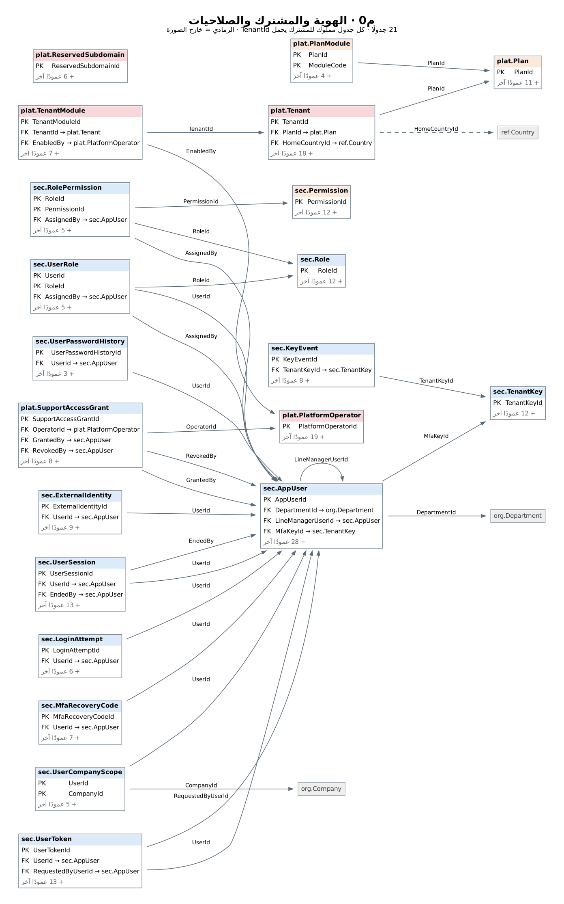

#### التدقيق والمستندات والإعدادات (م0)
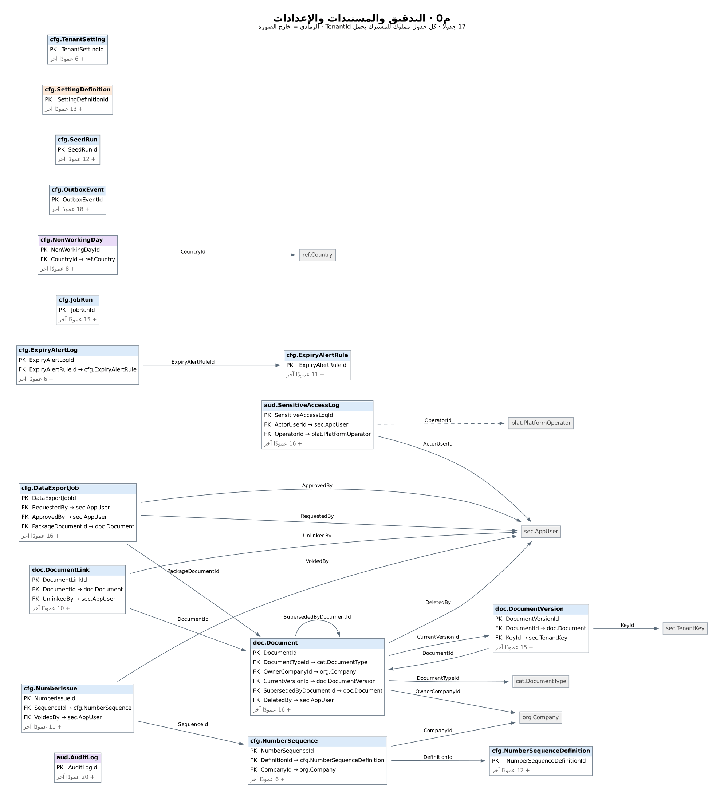

#### الهيكل المؤسسي والأشخاص (م1)
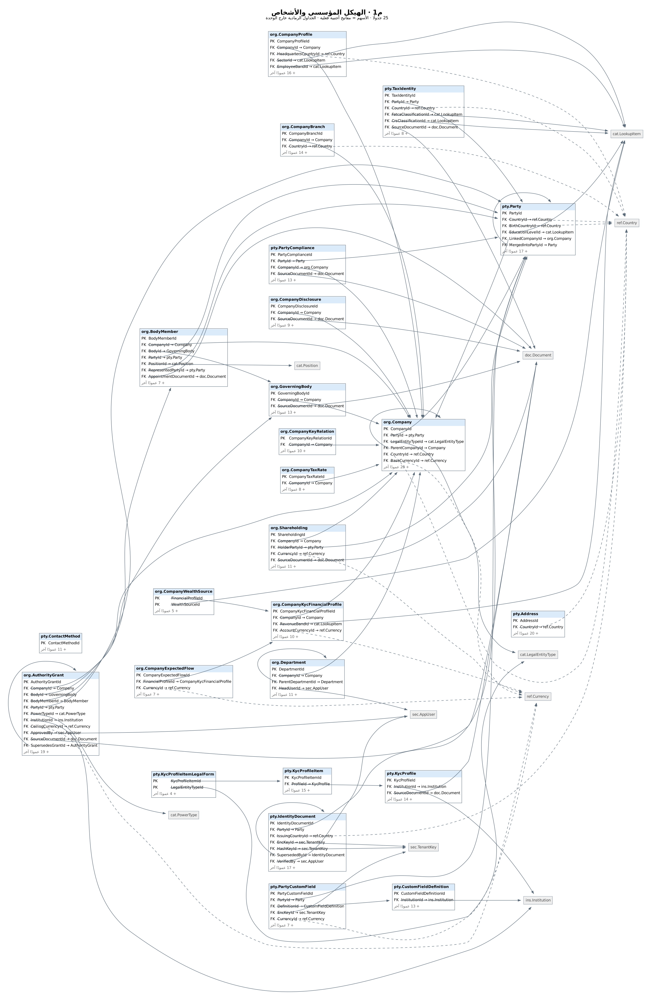

#### المنشآت والحسابات والمفوّضون (م2–م3)
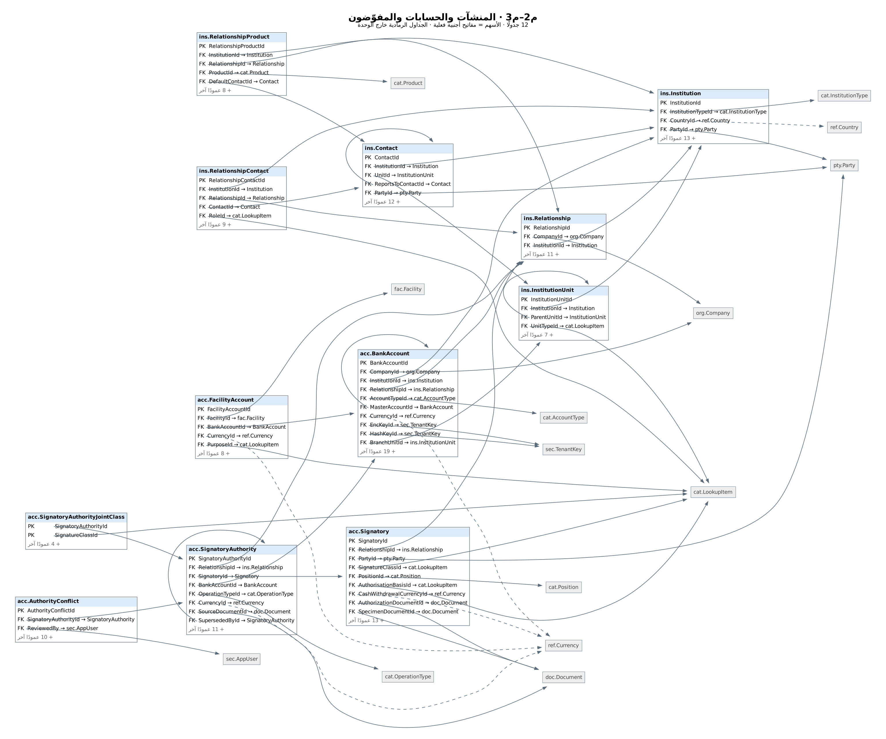

#### الكتالوجات (م4)
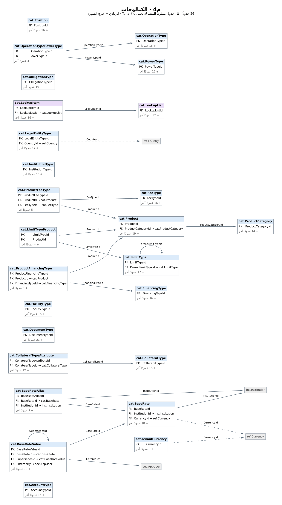

#### التسهيلات والحدود (م5)
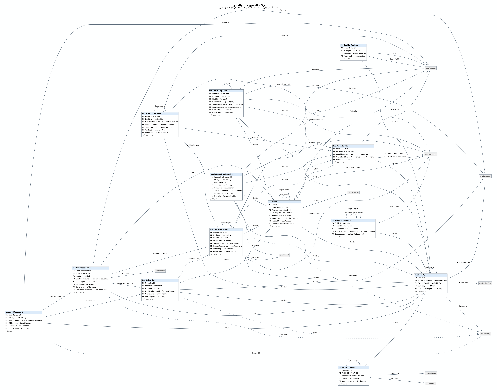

#### التسعير والتعرفة وشروط المقارنة (م5)
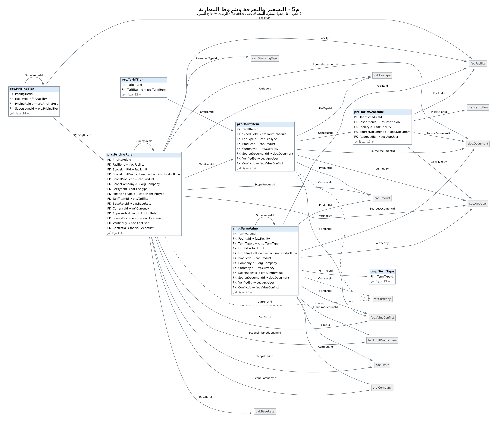

#### الضمانات (م5)
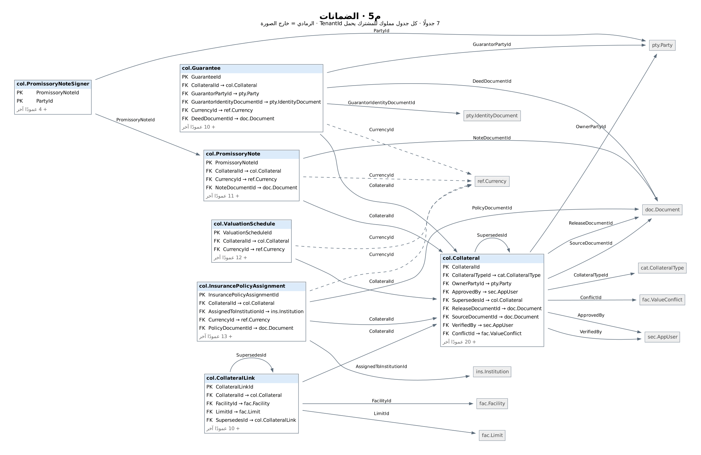

#### الالتزامات والبيانات المالية (م5)
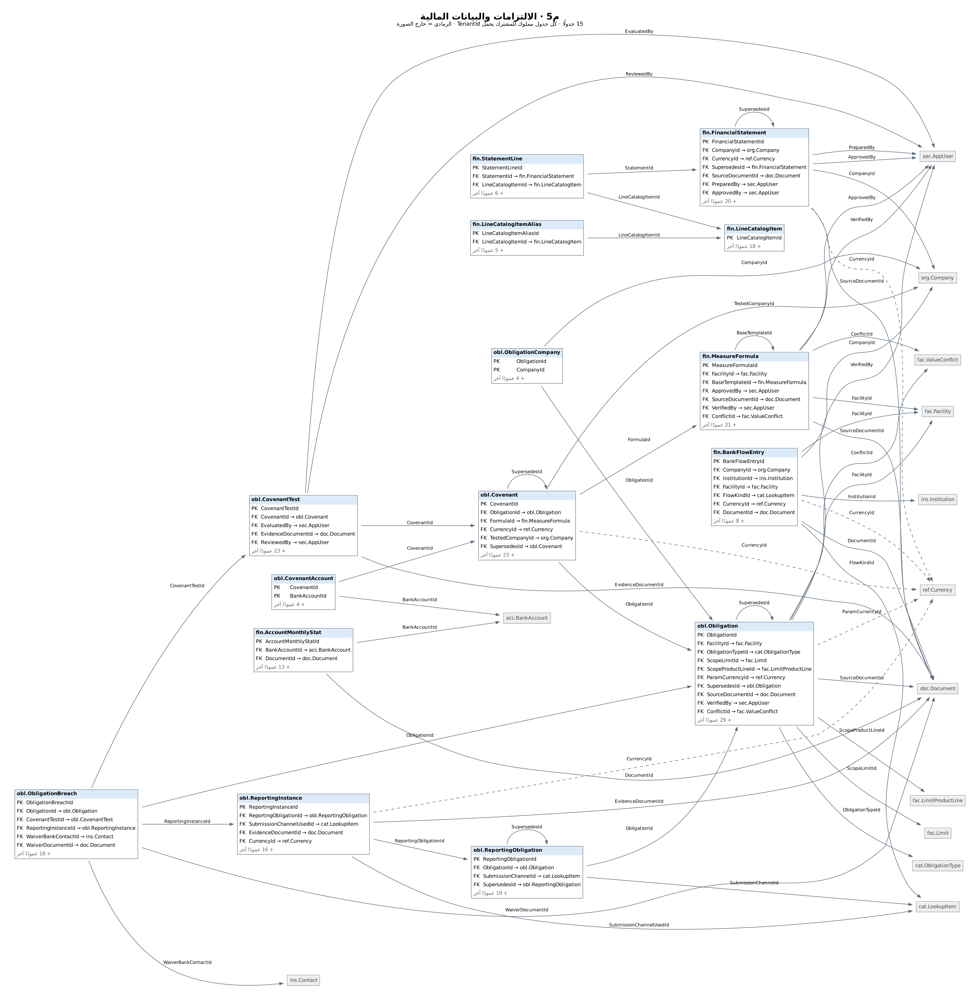

#### محرك الطلبات ودورات العمل (م6)
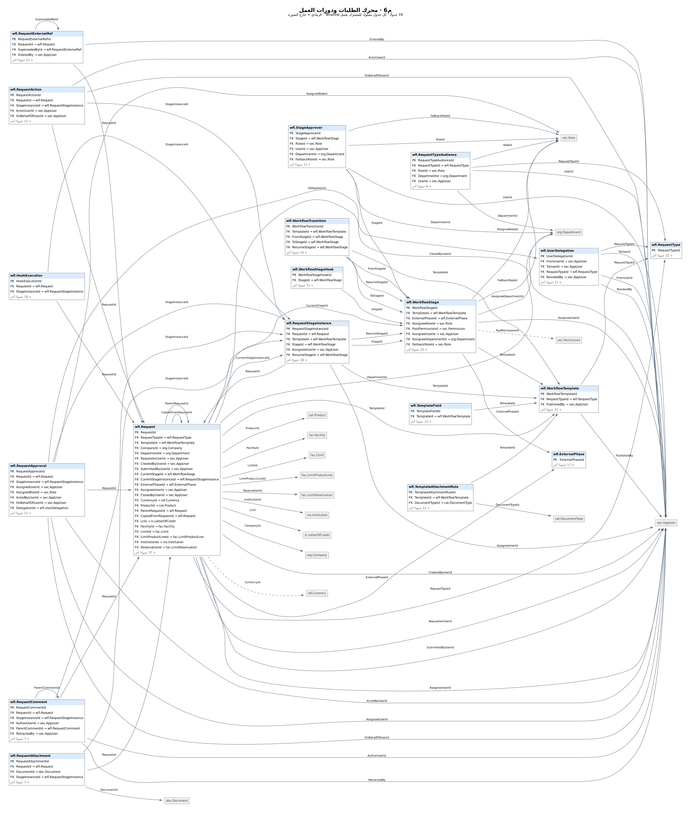

#### الإشعارات (م6)
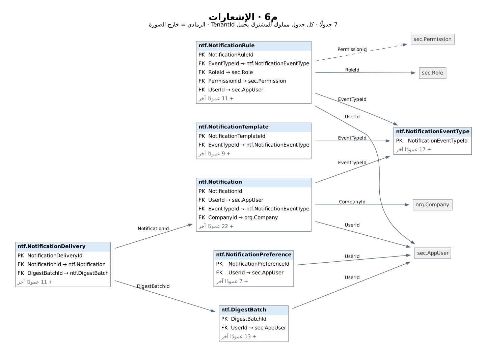

#### الاعتمادات المستندية والبروفورما (م7/م8)
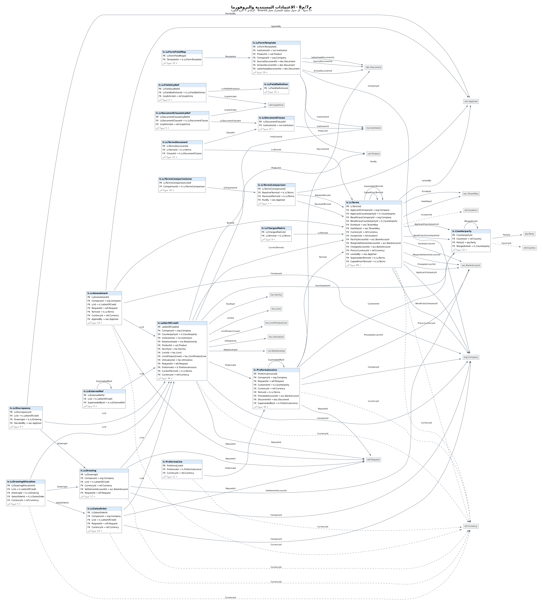

---

## 11. أنماط التصميم للمجالات الرئيسية

| المجال | النمط |
|---|---|
| **الأشخاص والجهات** | `pty.Party` موحّد (فرد/منشأة) يُعاد استخدامه: شريك، مدير، مفوّض، كفيل، جهة اتصال، مستفيد؛ الهويات والعناوين ووسائل الاتصال جداول تابعة؛ اكتمال KYC لكل بنك عبر `KycProfile/Item` (بنود بحد مالك `OwnerThresholdPct` وعمر أقصى `MaxAgeDays`) |
| **الهيكل المؤسسي** | `org.Company` (شكل قانوني منفصل عن علم «قابضة»)، `Shareholding` (ملكية متعددة الطبقات)، `GoverningBody`/`BodyMember`/`AuthorityGrant` (حوكمة وصلاحيات بسقف وتوقيع مشترك وفترة)، وجداول KYC للشركة |
| **الجهات المالية والحسابات** | `ins.Institution` ← `InstitutionUnit` ← `Contact` (طبقتان)، `Relationship` (شركة–بنك) تحمل مديري العلاقة والمنتجات؛ `acc.BankAccount` بأرقام مشفّرة؛ المفوّضون `Signatory` بحدود السلطة `SignatoryAuthority` وتعارض السلطات `AuthorityConflict` |
| **التسهيلات** | `fac.Facility` (حزمة اتفاقية) + `FacilityRevision`؛ `Limit` شجرة بأوضاع توزيع؛ `LimitProductLine` خطوط منتج؛ `ProductLineTerm` شروط؛ `FacilityLender` للتجمعات؛ `Utilization`/`LimitReservation`/`LimitMovement`؛ `OutstandingSnapshot`؛ `ValueConflict` |
| **التسعير** | `prc.TariffSchedule/Item/Tier` جداول رسوم؛ `PricingRule/Tier` قواعد تسعير؛ `cat.BaseRate/Alias/Value` أسعار مرجعية بقيم مؤرخة |
| **الضمانات** | `col.Collateral` + `CollateralLink` (ربط بحد/تسهيل بتغطية) + تخصصات: `Guarantee`, `PromissoryNote`+`Signer`, `InsurancePolicyAssignment`, `ValuationSchedule` |
| **الالتزامات** | `obl.Obligation` + `ReportingObligation/Instance` (تقويم تقارير) + `Covenant/CovenantTest/CovenantAccount` + `ObligationBreach`؛ `CheckMode` اختياري يرث افتراضي المشترك |
| **البيانات المالية** | `fin.FinancialStatement/StatementLine` ببنود كتالوج، `AccountMonthlyStat` متوسطات الأرصدة، `BankFlowEntry` المبالغ المحوَّلة (يدخلها قسم الخزينة)، `MeasureFormula`؛ ووحدة القوائم المالية (§11.4) |
| **الشروط القابلة للمقارنة** | `cmp.TermType/TermValue` — مكتبة شروط للمقارنة بين البنوك بترتيب: التسعير ثم المدد ثم الضمانات |
| **محرك الطلبات** | `wfl.RequestType` ← `WorkflowTemplate` ← `WorkflowStage/StageApprover/Transition/Hook`؛ الطلب `Request` + نسخ المراحل + الموافقات + الإجراءات + المرفقات؛ `UserDelegation`؛ أدوار المنشئ والمدقق والمعتمد بالصلاحيات، والفصل بينها `wf.sod.allow_same_person` |
| **إقفال دورة العمل** (C-7) | انظر §11.1 |
| **الإشعارات** | `NotificationEventType` + `Rule` + `Template` + `Preference` (فوري/ملخص يومي/أسبوعي/إيقاف) + `Notification` + `Delivery` + `DigestBatch` |
| **الاعتمادات** | `lc.LcTerms` + `LcFieldDefinition` وربط كل حقل بمواد UCP (`LcFieldUcpRef`) + `LetterOfCredit` (شراء/مبيعات) + تعديل/سحب/مخالفات + `LcSalesOrder` + `LcChargesMatrix` + `LcFormTemplate/FieldMap` لنماذج البنوك + `LcTermsComparison` |
| **الوظائف الخلفية** | `cfg.OutboxEvent` (بريد صادر لأحداث متسقة مع المعاملة)، `JobRun`، `ExpiryAlertRule/Log`، `DataExportJob`، `SeedRun`؛ تعمل بحساب الخدمة `IsSystemUser` لكل مشترك (§3.2) |

### 11.1 إقفال دورة العمل بيد إدارة الخزينة (C-7)
**القاعدة (BR-WFL-027):** انتهاء المراحل بنجاح **لا يُكمل الطلب**. الطلب ينتقل إلى `AWAITING_CLOSE` ويُسجَّل `ReadyToCloseAt`، ثم لا يصير `COMPLETED` إلا **بإقفال من إدارة الخزينة** (صلاحية `req.treasury.close`)، فيُسجَّل `ClosedByUserId` و`ClosedAt`.

| البند | التصميم في القاعدة | الفرض |
|---|---|---|
| الحالة | `Status` ∈ {`DRAFT`, `ACTIVE`, `AWAITING_CLOSE`, `COMPLETED`, `REJECTED`, `CANCELLED`} | قيد `CHECK` على القيم |
| دخول `AWAITING_CLOSE` | يلزم `ReadyToCloseAt` و`CurrentStageInstanceId` | قيد `CHECK` |
| `COMPLETED` | يلزم `ClosedByUserId` و`ClosedAt` و`ClosedAt = CompletedAt`، ولا يُكتب `ClosedByUserId` في غير `COMPLETED` | قيدان `CHECK` |
| من يقفل | مستخدم يحمل `req.treasury.close`، ولا يقفل منشئ الطلب أو مُعتمِده إلا باستثناء فصل المهام المسجَّل (`wf.sod.allow_same_person`) | **التطبيق** (القاعدة لا تملك الأدوار) |
| الحالات النهائية الأخرى | `REJECTED` و`CANCELLED` تبقيان فوريتين كما في المواصفة | — (قرار المالك 2026-10-12، DQ-F08-2) |
| أثر الإقفال | يُكتب `RequestAction` بـ`CLOSED`، ويُرسَل `REQ.COMPLETED` للطالب **عند الإقفال لا عند انتهاء المراحل** | التطبيق |
| الواجهة للطالب | `AWAITING_CLOSE` يظهر كـ«تحت الإجراء» (`IN_PROGRESS`) حتى الإقفال (DQ-F08-5) | التطبيق |

**أثر على الموجود:** تعديل قاعدة الانتقال إلى `COMPLETED` (مرحلة `COMPLETE ← ISSUANCE` في `13` و`14`) يصير إلى `AWAITING_CLOSE`. **عُدّلت المواصفة 13** بعد اعتماد المالك (2026-10-12، DQ-F08-1؛ O-10 محلول): BR-WFL-027 وFR-WFL-042 والصلاحية `req.treasury.close` ومخطط الحالات والحدث `REQ.READY_TO_CLOSE`، وصار `CLOSE` إجراء خروج للمثيل النهائي في `wfl.RequestStageInstance` (DQ-F08-6).

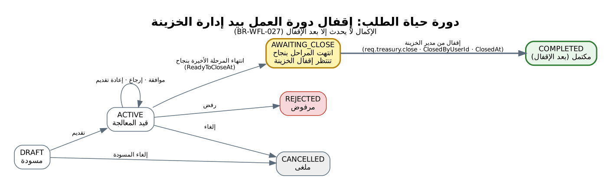

### 11.2 الملكية المتعددة والمراجع المركّبة (DR-04 · DR-06 · DR-09 · DR-10)

| المشكلة (قبل الإصلاح) | النمط المعتمد |
|---|---|
| عنوان أو جهة اتصال مالكها متعدد الأشكال (`OwnerType` + `OwnerId`) لا يحميه مفتاح أجنبي (DR-04) | أقواس خارجية: `PartyId` و`InstitutionId` و`UnitId` و`ContactId` مفاتيح أجنبية فعلية اختيارية، و`CHECK` يفرض **عمودًا واحدًا فقط** غير فارغ، وفرادة مصفّاة لكل قوس |
| `PricingRule.ScopeLimitProductLineId` و`TermValue.LimitProductLineId` تُربط بخط المنتج وحده، فيجوز أن يخص خط منتج حدًا آخر (DR-06) | مركّبة بالتسهيل والحد: `via=FacilityId,ScopeLimitId>LimitId` و`via=FacilityId,LimitId` |
| `wfl.RequestStageInstance.StageId` لا يربط المرحلة بقالب الطلب الذي تنتمي إليه (DR-09) | `TemplateId` إلزامي، و`StageId` و`ResumeStageId` مركّبان به: لا تُنفَّذ مرحلة من قالب آخر |
| `wfl.Request.LcId` و`RequestId` في `lc.LcSalesOrder` و`LcDrawing` و`LcAmendment` لا تربط الطلب بخطاب الاعتماد أو بالطلب الآخر في الشركة نفسها (DR-10) | مركّبة بـ`CompanyId`، فلا يُربط طلب شركة بخطاب اعتماد أو بتعديل لشركة أخرى |

### 11.3 الكتالوجات المملوكة للمشترك (DR-03 · DR-05 · DR-07)

كان `cat.LookupList` و`cat.LookupItem` جدولين مختلطين، تشير إليهما 13 عمودًا من جداول المشترك، وتشترك فيهما قيم المنصة بين المشتركين بلا نسخة يملكها كل مشترك. بعد الإصلاح:

- الجدولان **مملوكان للمشترك** (`TenantId` إلزامي) ولا صفوف مختلطة في الكتالوجات.
- `Scope = SYSTEM` قائمة من قالب المنصة تُنسخ لكل مشترك عند التهيئة (`IsSystem = 1`)، و`Scope = TENANT` قائمة يعرّفها المشترك (`IsSystem = 0`)، وقيد `CHECK` يفرض ذلك.
- كل مرجع إلى بند قائمة مركّب `(TenantId, LookupItemId)`، فلا يشير مشترك إلى بند يخص مشتركًا آخر.
- ثمن ذلك نسخ متعددة لقيم النظام بعدد المشتركين. تحديث القالب لاحقًا يُطبَّق على النسخ بمطابقة `SeedKey`، ولا يكتب فوق تعديلات المشترك (§13).

### 11.4 القوائم المالية والتعهدات (ADR 0016، `045_financial_statements.sql`)

| البند | التصميم | الفرض |
|---|---|---|
| القائمة | مستقلة للشركة، وموحّدة للقابضة وحدها (`org.Company.IsHolding`)؛ تُكتب مسودة، ولا يتغير رأسها وبنودها ووحداتها إلا مسودة؛ الحالة `DRAFT → SUBMITTED → APPROVED → SUPERSEDED` أو `SUBMITTED → REJECTED → DRAFT`؛ المدققة تسمّي مدققها ورأيه، ومعتمدها غير معدّها | قوادح 045 (50060، 50061) وقيود `CHECK` |
| `fin.ConsolidationMember` | وحدات القائمة الموحّدة: القابضة وحدة `PARENT` واحدة، وكل تابعة وزميلة ومشروع مشترك بطريقته ونسبته وتاريخ دخوله أو خروجه وقائمتها المستقلة إن وُجدت | مفتاح مركّب على أساس القائمة؛ التقديم بلا `PARENT` ووحدة أخرى يُرفض (50061) |
| `fin.StatementRatio` | مقياس تحليل واحد لكل قائمة وصيغة (`MeasureFormula.Scope = ANALYSIS`، ووحدة `DAYS` للتحليل وحده) بلقطته أو سبب تعذّر حسابه | النموذج |
| `obl.CovenantTestStatement` | القوائم التي قرأها تقييم آلي، تكتبها القاعدة من لقطة الاختبار عند `EVALUATED` بقادح يعمل أخيرًا بعد فحوص 044 | `DENY` لـ`tp_app`؛ الاختبار المرتبط لا يُحذف |
| `fin.RevenueEstimate` | تقدير الإيرادات المعتمد لسنة مالية، لتعهد حصة الإيرادات بلا قائمة سنوية (Q-FIN-05) | النموذج |
| `fin.BankFlowEntry` | نوعه من قائمة `FLOW_KIND` بمفتاح مركّب، وحالته `DRAFT/CONFIRMED` يؤكدها غير مُدخلها (`fin.stats.confirm`)، ويُدخل للشهر على مستوى البنك أو لكل تسهيل لا الاثنين | 50062 |
| `fin.v_StatementBreachReport` | كل مخالفة أو إنذار مبكر لآخر تقييم في كل فترة تعهد قرأ قوائم: القائمة وإصدارها وأساسها، والتعهد وبنده، والتسهيل وبنكه، وسجل المخالفة | عرض يقرؤه `tp_app` و`tp_readonly` بمرشّحات جداوله |
| `fin.fn_BankFlowPerformance(@AsOf)` | أداء كل تعهد تدفق أو حصة إيرادات سارٍ في التاريخ: النافذة، والمؤكَّد والمنتظر، والباقي والمعدل الشهري اللازم، والإنجاز والحالة | دالة تحسب عند القراءة |
| `fin.v_ConsolidationUnits` | كل وحدة بقائمتها المعتمدة ونسبة الملكية المسجّلة | عرض |

الربط مع نظام التقييم الائتماني الخارجي مرحلة لاحقة لم تُبنَ (المواصفة 12 §11).

### 11.5 التقييم الائتماني على سلّم موديز (ADR 0017 إلى 0019، `046_credit_assessment.sql` و`047_credit_engine.sql`، `docs/35`)

| البند | التصميم | الفرض |
|---|---|---|
| المنهجية | `fin.RatingGrade` (21 درجة) و`StandardLine`/`StandardLineTotal` (157 بندًا معياريًا ومجاميعها) و`CreditMetric` (112 مقياسًا بنمط حسابها وحالاتها الحدية) و`Scorecard` بإصداراتها و`ScorecardMetric` و`ScorecardSubfactor` و`ScorecardParameter` و`ScorecardItemRule` و`ScorecardAdjustment`، و`ref.Industry` بالأقسام والفروع والأنشطة التفصيلية و`IndustryProfile` و`IndustrySensitivity` (86 فرعًا و282 نشاطًا بمخاطرها وحساسيتها لسبعة محركات)، و`ShockDriver` و`MacroScenario` و`MacroScenarioIntensity` و`MacroScenarioCountry` (سبعة محركات وسبعة سيناريوهات ومضاعف كل بلد فيها)، و`CountryRiskProfile` و`CountryRegion` و`RiskAnchor` (22 بلدًا عربيًا وصف افتراضي بمخاطرها وتصنيفها السيادي وسقفها وتعرضها، و127 مدينة ومنطقة، ومرتكز المخاطر) و`ProductCategory` (15 فئة)، و`CreditRemedy` بمحفّزاتها وخطواتها (39 علاجًا)، و`StrengtheningPlan` وأعضاؤها (10 خطط)، و`CreditText`: **عالمية تملكها المنصة**، تبذرها `seed/104` المولَّدة من `tools/dbgen/credit_scorecard.json` | البطاقة تُعتمد كاملة ثم لا تتغير، ولا ما تستعمله من درجات ومقاييس ومعاملات وعوامل فرعية (50066، 50065) |
| `fin.CreditAssessment` | تقييم قائمة معتمدة على بطاقة عائلة قطاعية: قائمة المقارنة والتاريخ والسعر وطلب خطط التقوية (`StrengtheningRequested`) وبلد السوق ومدينته (`MarketCountryId`، `MarketRegionCode`)، والنتائج (التغطية والاكتمال، والدرجات المالية والمؤشرة والمنفردة والنهائية ودرجة التسهيل، والسيولة، والصمود، ومخاطر البلد والنشاط ومرتكزهما وسقف البلد، والنظرة المستقبلية وقواعدها وهوامشها، والخلاصة، واللقطة، وبصمة المدخلات) | النتائج يكتبها الإجراء وحده (`DENY UPDATE` على أعمدتها لـ`tp_app`)؛ المسودة تُحسب، وتُقدَّم محسوبة على ما تحمله، ويعتمدها غير مُعِدّها، وبعدها لا تتغير (50063) |
| المدخلات | `CreditAssessmentInput` (النوعي والعوامل الفرعية والدعم والتجاوز والمستندات وحجم السوق)، و`CreditAssessmentGuarantor`، و`CreditAssessmentBureau` (تقرير سمة)، و`fin.CompanyProductLine` (مزيج منتجات الشركة لسنتها) | في المسودة وحدها؛ والإخضاع أو قرار رأس المال أو التنازل لا يغيّر القراءة إلا بمستند (`EVIDENCE`) |
| النتائج | `CreditAssessmentFactor` و`Finding` و`Reclass` (إعادة التبويب بسببها) و`Facility` (لقطة التسهيلات والضمانات على تاريخ التقييم) و`Remedy` و`Scenario` و`Plan` و`PlanStep` و`Trigger` | `DENY` كتابتها لـ`tp_app`، ولا تتغير بعد المسودة (قوادح `TR_<table>_DraftOnly`) |
| المحرك (047) | `fin.usp_CreditCore` (تقييم واحد لقائمة في جداول مؤقتة) و`usp_CreditEvaluate` (القائمة، والسيناريوهات الستة بضغطها من النشاط والبلد والمدينة، وكل علاج، وكل خطوة من خطط التقوية، ثم المحفّزات والنظرة) و`usp_ComputeCreditAssessment` (يقرأ الجداول ويكتب النتائج) | يعمل باسم المستدعي: مرشّحات الصفوف تحصره في المشترك، وسلسلة الملكية تكتب ما يُحجب عن التطبيق؛ ويطابقه `credit_reference.py` في 138 حالة (الخطوة 19d)؛ وكل خطوة علاج أو خطة قيد مزدوج يُفحص بعده توازن الميزانية |
| العروض | `v_CreditAssessmentReport` و`Factors` و`Findings` و`ItemRegister` و`Items` (والدالة `fn_StatementItemAnalysis`) و`Reclass` و`Remedies` و`Scenarios` و`Facilities` و`Plans` و`Triggers` و`Covenants` و`GroupUnits` | تقرؤها `tp_app` و`tp_readonly` بمرشّحات جداولها |

---

## 12. النشر وإدارة التغيير

### 12.1 ترتيب النشر (`db/deploy.sql`، وضع SQLCMD)
```
# Production (Ubuntu 24.04 LTS, ADR 0001) and CI (ADR 0010, ADR 0012): an administrator starts the server audit and
# prepares the database once, then opens the window; the deployment login (db_owner only) runs the wrapper, which
# changes to db/ and runs deploy.sql. Each step declares itself in the audit with BANKFAS_CHANGE_REF.
tools/deploy/server_audit.sh apply                  # first time: SQL Server Audit before anything else (ADR 0012)
tools/deploy/prepare_database.sh prepare            # first time: empty BankFas, owner bankfas_owner, login bankfas_migrator
tools/deploy/prepare_database.sh open
SQL_SERVER=<server> SQL_USER=bankfas_migrator SQLCMDPASSWORD="$(cat <secret file>)" tools/deploy/deploy.sh
#   deploy.sh first runs db/ops/deploy_preflight.sql (ADR 0014, ADR 0015): not sa, no server role or server-wide right
#   (50140), the SQL Server build and Ubuntu release of versions.json (gate G4), BankFas present in its collation and
#   holding only what prepare_database.sh leaves (50142), RECURSIVE_TRIGGERS OFF (50145); nothing runs otherwise
tools/deploy/server_audit.sh apply                  # the database audit specification, inside the window
tools/deploy/provision_logins.sh                    # the service logins (ADR 0009), inside the window
tools/deploy/provision_monitor.sh                   # the monitoring login bankfas_monitor, view rights only (ADR 0013)
tools/deploy/prepare_database.sh close
SQL_USER=bankfas_monitor tools/dbgen/check_deployed.py --server <server>   # the post-deployment check (DOC-S11 section 8.2)
# No tool trusts the server certificate by itself; only CI sets SQLCMD_OPTS=-C (DQ-S05-7, ADR 0013). Every tool refuses
# -C, and the administrator scripts refuse sa, unless CI's allowances are set (DQ-S11-6, ADR 0014).
# deploy.sql does not run by hand: without the preflight's mark in the same session it stops at once (50146).
# Windows host (kept, not run yet): tools\deploy\deploy.ps1 -Server <server>
```
1. لا ينشئ القاعدة: يتوقف (50146) ما لم يسبقه الفحص التمهيدي في الجلسة نفسها، و(50141) ما لم تكن `BankFas` موجودة؛ ينشئها المدير بـ`prepare_database.sh prepare` بـ`Arabic_100_CI_AS_SC`
2. `000_schemas` → `001_tables` → `002_foreign_keys` → `003_indexes` (مولَّدة)
3. `004_rls_tables` (جدول مؤقت بالجداول الخاضعة لـ RLS، في **الجلسة نفسها** حتى 010)
4. `020_roles_and_grants` (أدوار و`tp_auth` وقراءة `tp_readonly`)
5. `005_delete_grants` → `006_sensitive_columns` → `007_table_grants` (المنح الجدولية)
6. `010_rls` (الدوال والسياسات وجدول الربط)
7. `025_tenant_views` (عرض صف المشترك؛ يحتاج دوال 010)
8. `028_tenant_settings` (إعدادات المشترك ضمن حدود المنصة، ADR 0004) → `029_audit_writer` (كاتب التدقيق وقادح محاولات الدخول، ADR 0007)
9. `030_session_context` (إجراءات الدخول والربط بـ`EXECUTE AS tp_auth_exec`، وقوادح السحب، وكل `DENY` تزيله منح 007 لو سبقتها)
10. `035_account_security` → `036_operator_and_support` → `037_job_context` → `038_tenant_onboarding` (ADR 0003 و0004) → `039_numbering` (الترقيم، ADR 0005) → `041_kyc_profile_versions` (نسخ ملفات الاكتمال، ADR 0006) → `042_data_export` (التصدير في كل حالة تسمح به، ADR 0008) → `043_review_guards` (حراس الدفعة أ، ADR 0011) → `044_entry_guards` (شروط دخول الشرائح S1-ب إلى S4، ADR 0011، وحراس المراجعة الذاتية §7.2، ADR 0015) → `045_financial_statements` (القوائم المالية، ADR 0016) → `046_credit_assessment` (حراس التقييم الائتماني، ADR 0017) → `047_credit_engine` (محرك التقييم وعروضه، ADR 0018)
11. `050_fac_share_rule` (قاعدة حصص المقرضين) → `090_readonly_denies` (حجب الدوال الداخلية عن `tp_readonly`؛ آخر سكربت ثابت لأنه يحجب كل دالة أنشأها ما قبله، ADR 0015)
12. البذور العالمية: `seed/100_platform_global` (الإعدادات والمهام والباقة والعناوين المحجوزة) → `seed/101_iso_reference` (الدول والعملات) → `seed/102_permissions` (الصلاحيات) → `seed/103_lc_reference` (Incoterms ومواد UCP 600) → `seed/104_credit_scorecard` (منهجية التقييم الائتماني، مولَّدة من `tools/dbgen/credit_scorecard.json`)؛ إدراج فقط، وتعيد الخطوة 4b في CI تشغيلها وتشترط ألا يتغير شيء
13. اختياري: `040_fulltext_optional`
14. بعد النشر وداخل النافذة، بحساب مدير شخصي: `tools/deploy/server_audit.sh apply` يضيف مواصفة تدقيق القاعدة على جداول التدقيق، بعد أن شغّله المدير مرة قبل النشر الأول فبدأ تدقيق الخادم (SQL Server Audit) وسُجّل النشر نفسه. وكل سكربت في `tools/deploy` يعلن عمله في التدقيق، فتنبيهات AL-18 لا تنطلق إلا لما يقع خارج نافذة معلنة (`server_audit.sh alerts`؛ ADR 0012، DOC-S08 §10). ولا تُحسب النافذة إلا إذا فعّل معلنها حساب النشر خلال دقيقة، ولا يُسكت تنبيه AUDIT لحساب النشر أبدًا، وأُضيفت القاعدتان SERVER_CONFIG وLOGINS (ADR 0015)
15. داخل النافذة أيضًا، بحساب مدير شخصي يملك إنشاء الحسابات: `tools/deploy/provision_logins.sh` ينشئ حسابات الخدمة الأربعة (`bankfas_app` و`bankfas_jobs` و`bankfas_platform` و`bankfas_support`، كلٌّ بزوج a/b للتدوير) ويربط كلًا بدوره وحده، وأسرارها من ملفات خاصة لا من سطر الأوامر (ADR 0009، DOC-S08)

**الفحص:** `tools/dbgen/check_grants.py` يفحص الملفات (لا القاعدة) في الخطوة 3 من `tools/ci/db_ci.sh` قبل النشر، ثم اختبارات S0 على SQL Server الفعلي (§14). الملفات تحوي `GO` وتُنفَّذ بالترتيب نفسه عند كل نشر؛ **لا يوجد بعدُ مسار ترحيل بين الإصدارات** (O-2).

### 12.2 تغيير النموذج
عدِّل `db/model/*.model` ← `python3 tools/dbgen/dbgen.py check db/model/*.model` ← `build … --out db/generated --docs docs/` ← `tools/dbgen/pg_validate.sh db/generated/pg/000_all.sql` ← `python3 tools/dbgen/check_grants.py` ← `python3 tools/dbgen/ddl_metrics.py` (يطبع أرقام §1 و§4 لتُحدَّث منها) ← `python3 tools/dbgen/build_erd_doc.py` لإعادة بناء `20-database-design-and-erd.md`. لا تُعدَّل الملفات المولَّدة يدويًا. صيغة النموذج في `tools/dbgen/README.md`.

### 12.3 النسخ الاحتياطي والاستعادة (توصيات للتشغيل 🟡)
- نسخ كامل ليلي + تفاضلي + سجل المعاملات كل 15 دقيقة (نموذج الاسترداد `FULL`)، ونسخ إلى موقع منفصل.
- **المفاتيح الرئيسية (خارج القاعدة) في نسخ احتياطي منفصل**؛ فقدانها يعني فقدان البيانات المشفّرة.
- اختبار استعادة دوري، مع فك تشفير عيّنة بعد كل استعادة.
- استرجاع مشترك واحد يتم بتصدير/استيراد صفوفه بترتيب التبعيات من استعادة بنسخة مؤقتة.
- `READ_COMMITTED_SNAPSHOT ON` (توصية تشغيل؛ لم يُضمَّن في السكربتات).
- **أرقام RPO/RTO** لم تُحدَّد بعد (O-14).

### 12.4 الأداء والحمل
الحمل المتوقع منخفض؛ التصميم لا يعتمد على Partitioning. إن نمت `aud.AuditLog` و`wfl.RequestAction` و`ntf.NotificationDelivery` فهي أول مرشحة للتقسيم/الأرشفة بالتاريخ.

---

## 13. البذور وتهيئة المشترك

| المرحلة | المحتوى | الآلية |
|---|---|---|
| **عالمي** | `ref.Country/Currency/Incoterm` وصفوف المنصة في `ref.UcpArticle`، `plat.Plan/PlanModule`، `sec.Permission` (بما فيها `req.treasury.close`)، `cfg.SettingDefinition`، `cfg.JobDefinition`، `plat.ReservedSubdomain` | سكربتات بذور عند النشر (`db/seed/100` إلى `103`) بإدراج آمن لإعادة التشغيل تتحقق منه الخطوة 4b في CI. هذه الجداول **يكتبها `tp_platform` فقط**، وصفوف المنصة في الجداول المختلطة يكتبها السكربت بمستخدم مؤقت من `tp_platform` يُحذف بعده. أنواع الأحداث `ntf.NotificationEventType` وتعريفات حقول الاعتماد مملوكة للمشترك في النموذج، فتُبذر في حزمتي المشترك NTF.BASE وLC.BASE لا هنا (DOC-B05 §5.1). **منفّذ:** `db/seed/100` (تسعة إعدادات: سبعة أمنية وبداية يوم العمل ونهايته؛ 32 مهمة؛ الباقة STANDARD بوحداتها التسع؛ 23 عنوانًا محجوزًا)، و`101` (249 دولة و157 عملة بإصدار ISO مسجَّل، DQ-B05-5)، و`102` (142 صلاحية منها `fin.stats.confirm` لتأكيد التدفقات، ADR 0016، و`fin.credit.assess` و`fin.credit.approve` للتقييم الائتماني، ADR 0017؛ خمس منها مقفلة على TM وFO، DQ-F07-1 وDQ-F09-1)؛ المولِّدان `tools/dbgen/gen_iso_seed.py` و`gen_permission_seed.py`، و`103` (16 قاعدة Incoterms منها 5 قديمة LEGACY، ومواد UCP 600 الـ39 صفوفَ منصة بحالة UNVERIFIED حتى يتحقق مختص، O-06) (ADR 0005)، و`104` (سلّم موديز بـ21 درجة، و157 بندًا معياريًا، و112 مقياسًا، و16 بطاقة عائلة قطاعية معتمدة بأوزانها وشبكاتها و134 قاعدة بنود لكل منها و45 تعديلًا، و86 فرعًا و282 نشاطًا تفصيليًا بحساسيتها لسبعة محركات، و22 بلدًا عربيًا بمدنها ومرتكز المخاطر، وستة سيناريوهات اقتصادية، و15 فئة منتجات، و39 علاجًا، و10 خطط تقوية، ADR 0017 إلى 0019). البذر العالمي في الوثائق مكتمل؛ والعطل الرسمية يدخلها المشغّل (FR-PLT-035) |
| **إجراء تهيئة المشترك** (إجراء منصة واحد) | ينشئ داخل معاملة واحدة: صف المشترك، **حساب الخدمة `IsSystemUser`**، **مستخدم المدير الأول**، ونسخ كتالوجات النظام لهذا المشترك (§11.3)، والأدوار القياسية وربطها بالصلاحيات، وقوالب دورات العمل، وتعريفات الترقيم (`req:<TypeCode>` و`PROFORMA` بلا فجوات)، وملفات KYC المسبقة، وقواعد الإشعارات، ووحدات الاشتراك في `plat.TenantModule` | **منفّذ بمرحلتين (ADR 0004):** `plat.usp_CreateTenant` ينشئ المشترك ووحداته وحساب الخدمة والمدير الأول المدعو في معاملة واحدة، ثم تبذر مهمة التهيئة الحزم في التطبيق وتدعو المدير الأول (`sec.usp_InviteFirstAdministrator`) |
| **مفتاح مفقود** | قائمة `AUTHORISATION_BASIS` في `cat.LookupList` لأسس التفويض (طلبها مؤلفو النماذج) | تُضاف لبذور المشترك |

⚠ UCP: أرقام المواد في `lc.LcFieldUcpRef` **مراجع هندسية غير موثَّقة قانونيًا** إلى أن يتحقق منها مختص (عمود `VerifiedBy/On` في `ref.UcpArticle`).

---

## 14. أدلة التحقق وحدودها (بصراحة)

| الفحص | النتيجة | ملاحظة |
|---|---|---|
| فحص النموذج (`dbgen check`) | **OK** — 247 جدولًا / 4,095 عمودًا؛ لا مراجع معلّقة؛ لا مخالفة لقواعد النطاق | التسمية والمراجع والمفاتيح المركّبة والأعمدة المطلوبة |
| تنفيذ PostgreSQL 16 | **تشغيل سابق** — 194 جدولًا / 763 مفتاحًا أجنبيًا / 691 قيد فريد أو أساسي، قبل إضافة `sec.SessionBinding`؛ لم يُعَد على النموذج الحالي، ولا يدخل CI | يثبت **البنية المنطقية** فقط. **لا** يثبت صحة T-SQL |
| التحقق الثابت من الصلاحيات (`check_grants.py`) | **OK** — 247 جدولًا، 331 منحة مولّدة، 127 منحة ثابتة، 31 عمودًا مقيّدًا، القواعد R1–R11؛ يعمل في الخطوة 3 من `db_ci.sh` | حُقنت ثلاث مخالفات متعمدة فاكتُشفت كلها (§9.3). **لا يثبت** أن المحرك ينفّذ المنح كما هي |
| التحقق من الإصلاحات (`check_review_fixes.py`) | **OK** — 75 من 75، في الخطوة 3 من `db_ci.sh` | يفحص أن كل إصلاح من DR-01 إلى DR-50 موجود في DDL المولَّد أو في الحارس الثابت (043، 044)، لا في الوثيقة وحدها |
| فهرسة المفاتيح الأجنبية (`check_fk_indexes.py`) | **OK** — 578 مفهرسًا، 111 `noidx`، صفر بلا فهرس؛ الخطوة 3 | §8 |
| تحليل T-SQL بـ `sqlglot` | الملفات `000–004`، `007`، `010`، `025`، `030`، `040`: **بلا أخطاء**؛ `005` و`006` و`020`: خطأ واحد لكل ملف عند عبارة `DENY` | المحلّل لا يدعم عبارة `DENY` بصيغتها الكاملة؛ الصيغة صحيحة في T-SQL. التحليل نحوي جزئي |
| فحوص آلية لمحاذير SQL Server | لا `OR` في الفهارس المصفّاة · مفاتيح الفهارس ≤ 1,700 بايت و≤ 16 عمودًا · لا مسارات `CASCADE` متعددة · خيارات `SET` ضُمّنت | فحوص نصّية على المخرجات |
| **التنفيذ على SQL Server 2025** | **OK** — نشر كامل لـ `db/deploy.sql` على قاعدة جديدة في كل تشغيل لـ `tools/ci/db_ci.sh`، بحساب النشر `bankfas_migrator` وصلاحية `db_owner` وحدها كما في الإنتاج (ADR 0010) (صورة Ubuntu 24.04، ومرّ أيضًا على صورة RHEL؛ ADR 0001) ثم يطابق `check_deployed.py` بحساب المراقبة 14 بندًا مع DDL المولَّد والسكربتات الثابتة: الجداول والمخططات والمفاتيح والقيود والفهارس والسياسات، والوحدات المنفّذة بصفة `tp_auth_exec`، و78 قادحًا بلا معطَّل، ولا دالة مفتوحة لـ`tp_readonly`، وحساب النشر معطَّل، والترتيب `Arabic_100_CI_AS_SC` (الخطوة 5)؛ والخطوة 23 تشترط ألا يبقى بعد الاختبارات مفتاح أو قيد غير موثوق ولا قادح أو سياسة معطّلة ولا مستخدم اختبار ولا مشترك | يثبت أن المحرك يقبل النص وترتيب النشر والمنح كما هي. صفحة الدعم الرسمية لـ Ubuntu 24.04 لم تُراجَع من بيئة العمل (O-23) |
| **اختبارات السلوك** (RLS، ربط الهوية، الصلاحيات، الحراس، التدفق المالي) | **جزئي** — بالخطوات 6 إلى 22 و19b من `db_ci.sh`: `db/tests/fac_share_rule_tests.sql` 7 فحوص (T1–T6 وT2b) · `tenant_isolation_tests.sql` 48 حالة (العزل، قراءة المنصة للتدقيق، ربط الاتصال، الدخول والقفل وMFA، حالة المشترك، حدود `tp_app`) · `auth_flow_tests.sql` 20 (حسابات المستخدمين وإعدادات المشترك، ADR 0003 و0004) · `operator_support_tests.sql` 11 · `job_context_tests.sql` 7 · `tenant_onboarding_tests.sql` 5 (ADR 0004) · `numbering_tests.sql` 8 و`tools/ci/numbering_concurrency.sh` 2 (C1: ستة اتصالات متزامنة، 114 رقمًا من 1 إلى 114 بلا تكرار ولا فجوة بعد 36 تراجعًا؛ C2: خارج معاملة، ADR 0005) · `kyc_history_tests.sql` 4 (ADR 0006) · `reference_data_tests.sql` 4 · `audit_trail_tests.sql` 7 (ADR 0007) · `data_export_tests.sql` 7 (X1–X7، ADR 0008) · `tools/ci/service_logins_check.sh` 6 (ADR 0009) · `review_fixes_tests.sql` 43 (RF1–RF34 لإصلاحات المراجعة وشروط دخول الشرائح، ADR 0011؛ وSR1–SR9 للمراجعة الذاتية، ADR 0015) · `financial_statements_tests.sql` 11 (FS1–FS11، ADR 0016) · `credit_assessment_tests.sql` 16 (CA1–CA16، ADR 0017 إلى 0019؛ ويمرر `credit_stress.py` حالات الضغط الإحدى والخمسين في الخطوة 3) · `credit_engine_cases.sql` 138 (69 حالة مولَّدة يطابق فيها محرك T-SQL مرجع Python رقمًا برقم، الخطوة 19d) · `tools/ci/server_audit_check.sh` 9 (SA1–SA9، ADR 0012 و0015) · `tools/ci/monitor_login_check.sh` 6 (ADR 0013) · `tools/ci/deploy_preflight_check.sh` 8 (PF1–PF8، ADR 0014 و0015)؛ وكلها تمر في CI، ويفشل البناء إن اختلف عدد أي منها عن المتوقع | لم تُكتب بعد: التدفق المالي (الحجز والاستغلال) خارج قاعدة الحصص |

---

## 15. القرارات المتخذة (تُعتمد ما لم تعترض)

| # | الموضوع | القرار |
|---|---|---|
| DB-1 | `ErpCompanyCode` | فريد بين الشركات غير المؤرشفة (أشدّ من تحذير BR-ORG-001 وتحققه القاعدة) |
| DB-2 | `pty.KycProfile.InstitutionId` | اختياري؛ علم «أساسي» للملفات غير المرتبطة ببنك |
| DB-3 | قوالب دورات العمل | عائلة قوالب لكل نوع طلب؛ البذور المشتركة تُكرَّر لكل نوع |
| DB-4 | رأس التسهيل | صف واحد + `FacilityRevision.HeaderChanges`؛ لا نسخ رأس لكل مراجعة |
| DB-5 | `fac.Limit` عقد النسخ | نسخ الشجرة الفرعية عند المراجعة عقدٌ في التطبيق (`[R]`) |
| DB-6 | `ref.UcpArticle` | نطاق مختلط؛ `VerifiedBy → plat.PlatformOperator` |
| DB-7 | `ref.Incoterm` | عالمي (Incoterms 2020) |
| DB-8 | `fac.ValueConflict` | المرشّحون مسطَّحون (أعمدة) لا جدول فرعي |
| DB-9 | `fac.LimitMovement` | مفاتيح أجنبية مكتوبة (حجز/استخدام/…) لا مرجع عام متعدد الأشكال |
| DB-10 | الملخص الأسبوعي | أُضيفت `DIGEST_WEEKLY` إلى `ntf.NotificationPreference.Mode` |
| DB-11 | `wfl.RequestAction.ActionType` | أُضيفت: `RESERVATION_LOST`, `DRAFT_ARCHIVED`, `DRAFT_RESTORED`, `CHANNEL_CHANGED`, `SOD_EXCEPTION_USED`, `DELEGATION_CREATED`, `DELEGATION_REVOKED`، وفي 0.2: `READY_TO_CLOSE`, `CLOSED` |
| DB-12 | جهات اتصال المدير العام/المالي | عبر `org.BodyMember` + `pty.ContactMethod` (لا جدول مستقل) |
| DB-13 | الإضافة فقط | تُفرض بالمنح (`SELECT, INSERT`) و`DENY UPDATE` لـ`tp_app` و`tp_platform` على جداول `append` خارج `aud` |
| DB-14 | **المنح الجدولية** (C-2) | صريحة لكل جدول ومولَّدة؛ لا منح على مستوى المخطط؛ `REFERENCES` محذوف |
| DB-15 | **الجداول العالمية** (C-2) | للقراءة فقط لتطبيق المشترك؛ يكتبها `tp_platform` فقط |
| DB-16 | **الجداول المحجوبة** `noapp` (C-3) | `plat.Tenant` و`PlatformOperator` و`ReservedSubdomain`؛ يقرأ التطبيق صف مشتركه عبر `plat.v_CurrentTenant`؛ القائمة الحالية في §3.3 |
| DB-17 | **ربط الهوية بالمشترك** (C-1) | الدخول داخل القاعدة وربط الاتصال برمز الجلسة (ADR 0002)؛ إجراءات 030 تعمل بصفة `tp_auth_exec` |
| DB-18 | **حساب الخدمة** (C-8) | `sec.AppUser.IsSystemUser` لكل مشترك للمهام، بلا كلمة مرور ولا MFA |
| DB-19 | **مفاتيح الصفوف المشفّرة** (C-5) | `EncKeyId` / `HashKeyId` / `MfaKeyId` / `MfaKeyRef` في كل جدول فيه غلاف؛ `CHECK` لطول الغلاف |
| DB-20 | **إقفال دورة العمل** (C-7) | `AWAITING_CLOSE` ثم `COMPLETED` بإقفال الخزينة؛ الحقول `ReadyToCloseAt` و`ClosedByUserId` و`ClosedAt` |
| DB-21 | **الإصلاحات الحرجة العشرة** (DR-01 إلى DR-10، C-12) | مُعتمدة ومُطبَّقة: كتالوجات مملوكة للمشترك بنسخ لكل مشترك (§11.3)، ومفتاح الغرض في مفاتيح التشفير، وأقواس المالك الخارجية والمراجع المركّبة (§11.2)، و`plat.TenantModule` مملوك للمنصة |

---

## 16. حدود معروفة ونقاط مفتوحة

| # | البند | الأثر | المقترح |
|---|---|---|---|
| O-1 | **التنفيذ على SQL Server** (§14) | **محلول في بيئة التطوير:** النشر الكامل على SQL Server 2025 يمر في `db_ci.sh` بخطواته من 0 إلى 23 مع 4b و19b و19c و19d، واختباراته كلها (§14) | يمر أيضًا على GitHub (`.github/workflows/treasury-db-ci.yml` في جذر المستودع)؛ يبقى النشر على خادم الإنتاج (O-02، erd_open_items) |
| O-2 | لا سكربتات ترحيل بين الإصدارات | تغيير النموذج يعيد توليد DDL كاملًا | أداة ترحيل (DbUp أو Flyway) عند أول نشر فعلي على بيانات حقيقية |
| O-3 | البذور (§13) | **البذر العالمي منفّذ (2026-10-13):** الإعدادات والمهام والباقة والعناوين المحجوزة والدول والعملات والصلاحيات وIncoterms ومواد UCP 600 (ADR 0004 و0005) | باقٍ: حزم المشترك في التطبيق (DOC-B05 §5)، والتحقق من مواد UCP على النص الرسمي (O-06) |
| O-4 | أسئلة مفتوحة بقيم افتراضية في `90-consolidated-open-questions.md` | أثرها على الشرائح اللاحقة؛ المتعلق منها بـ S3: Q-WFL-02, Q-WFL-09, Q-WFL-11, Q-LCT-01/02, Q-LCI-01/02 | تُراجع عند بدء S3 |
| O-5 | الأعمدة المحسوبة محدودة (21 مخزّنة، أغلبها للمفاتيح والفرادة: `RootId` للعقد المراجَعة، و`ErpCodeNormalized` وأمثاله) | بقية المشتقات (المتاح، الرصيد) تُحسب في التطبيق/العروض | عروض/دوال لاحقًا عند الحاجة لتقارير |
| O-6 | سياسات الاحتفاظ والأرشفة (جداول التدقيق والإشعارات) غير محدَّدة | نمو الجداول الكبيرة | قرار احتفاظ لكل جدول مع بدء التشغيل |
| O-7 | نموذج استرداد القاعدة والنسخ المتعدد المشتركين | استعادة مشترك واحد معقّدة (§12.3) | نقل صفوف مشترك كبير إلى قاعدة مستقلة لاحقًا ممكن لأن البنية تحمل `TenantId` |
| O-8 | نوع JSON الأصلي في SQL Server 2025 | غير مستعمل (T-4) | تقييمه عند الحاجة إلى استعلام داخل JSON |
| **O-9** | **مسار ما قبل المصادقة** (تسجيل الدخول والدعوة واستعادة كلمة المرور): لا يوجد مستخدم بعد لضبط السياق | لا يستطيع التطبيق تسجيل الدخول بالمسار الحالي | **محلول (2026-10-12):** إجراءات ضيقة بصفة `tp_auth_exec` بلا `usp_SetAuthContext` (ADR 0002 وADR 0003، DQ-F03-1): `usp_ResolveTenant` والدخول وMFA والدعوة وإعادة التعيين في 030 و035 |
| **O-10** | **تعديل المواصفة 13** لإقفال دورة العمل (C-7) | المواصفة كانت تجعل الإكمال تلقائيًا عند المرحلة الأخيرة | **محلول (2026-10-13):** اعتمد المالك النموذج الموحّد (DQ-F08-1، والرفض والإلغاء فوريان DQ-F08-2)، وعُدّلت المواصفة 13 (BR-WFL-027، FR-WFL-042، مخطط الحالات، `REQ.READY_TO_CLOSE`)، وأُضيف `CLOSE` إلى `ExitAction` (DQ-F08-6) |
| **O-11** | **الهوية تُصدَّق من التطبيق** (§3.2) | **محلول (2026-10-12):** الربط برمز جلسة يصدره الدخول داخل القاعدة (ADR 0002، O-17 erd_open_items)؛ ومخاطر داخل المشترك (O-24) أُغلقت بـ ADR 0003 عدا ما يذكره | — |
| **O-12** | **إجراءات المنصة على بيانات المشترك** | بلا وصول مباشر لـ`tp_platform`، يلزم إجراء مُراجَع لكل عملية منصة (تهيئة، دعم، إصلاح) | **محلول للتهيئة والحالة والدعم (2026-10-12، ADR 0004):** `plat.usp_CreateTenant` و`plat.usp_SetTenantStatus` و`sec.usp_SetSupportContext`؛ إجراءات الإصلاح تُكتب عند الحاجة، كل منها بإجراء مُراجَع |
| **O-13** | **موقع مرساة سلسلة التدقيق** (§5.3) | بلا مرساة خارجية، السلسلة لا تكشف العبث | تخزين غير قابل للتعديل أو تجزئة منشورة دوريًا؛ قرار تشغيلي |
| **O-14** | أرقام RPO/RTO | لا خطة استعادة مُقاسة بعد | تُحدَّد مع الاعتماد التشغيلي (§12.3) |
| **O-15** | **36 نتيجة رئيسية و4 طفيفة** من المراجعة (`docs/review/design-review-2026-10-11.json`) | بعضها يغيّر أعمدة أو قيودًا | **محلول (2026-10-13، ADR 0011):** اعتمد المالك سجل `docs/32-review-findings-decisions.md` وأجوبته العشرة. الدفعة (أ) مُطبَّقة في 33 نتيجة كلها أو جزئيًا (المولّد والنموذج و`043_review_guards.sql`، الاختبارات RF1 إلى RF18، و`check_review_fixes.py` في CI)؛ والدفعة (ب)، شروط دخول الشرائح S1 إلى S4، منفّذة كلها في اليوم نفسه (النموذج و`044_entry_guards.sql`، الاختبارات RF19 إلى RF34؛ 75 إصلاحًا يفحصها `check_review_fixes.py`)؛ وDR-20 محلولة بـ DR-02، ويبقى مؤجلًا مرساة البصمة الخارجية (مع O-13) وفحص المفاتيح المتقاعدة (DR-20) |
| **O-16** | **ما بقي من المراجعة الذاتية ووحدة القوائم المالية** (ADR 0015، ADR 0016) | تغطية جزئية لبعض فروع الحراس، واختباران يعتمدان التوقيت، وسماحات CI يضبطها أي مشغّل (`34-self-review-2026-10-18.md` §7)؛ وفي القوائم: التدفق المخصّص لتسهيل يُحسب له وحده، والتدفق على مستوى البنك يُحسب لكل تعهدات تسهيلاته (BR-FIN-016، اعتمده المالك 2026-10-18)، والأداء يُحسب عند القراءة بلا لقطة يومية | اللقطة اليومية مع مهام S2-ب؛ والربط بالتقييم الائتماني مرحلة لاحقة |
| **O-17** | **معايرة التقييم الائتماني** (ADR 0017 إلى 0019، `docs/35`) | الحدود والأوزان وقواعد البنود ومخاطر الأنشطة والبلدان والسيناريوهات معايرة بالخبرة صاغها وراجعها وكلاء ذكاء اصطناعي في دور محللين أوائل، لا محللون بشريون، بلا بيانات تعثر؛ ولم يُنقل شيء من وثائق موديز التي أرفقها المالك لأنها تمنع استعمالها في بناء نموذج أو قاعدة بيانات (`docs/35` §23)؛ وحدود أخرى في `docs/35` §25 | أسئلة المالك في `docs/35` §24؛ وتتحقق إدارة الخزينة في الشركة (إدارة المخاطر، قرار المالك 2026-10-19) من المعايرة قبل استعمال الدرجة في قرار، ويتحقق مشغّل المنصة من التصنيفات السيادية؛ واستعمال أرقام موديز نفسها يحتاج ترخيصًا |

---

## 17. الخطوة التالية

1. **تقييمك** لهذا الإصدار، خاصة القرارات DB-14 إلى DB-21 والنقاط O-9 إلى O-13 و O-15، وما بقي من البنود المفتوحة في §16. تعديل المواصفة 13 (O-10) ونتائج المراجعة الـ40 (O-15) حُسما وطُبّقا (DQ-F08-1، ADR 0011)، وكذلك إصلاحات المراجعة الذاتية (ADR 0015) ووحدة القوائم المالية (ADR 0016)، وما بقي منهما في O-16، والتقييم الائتماني (ADR 0017 و0018) وما بقي منه في O-17.
2. النشر على SQL Server 2025 تم في بيئة التطوير ويمر CI (O-1)؛ ويمر على GitHub أيضًا (`.github/workflows/treasury-db-ci.yml`)؛ يبقى النشر على خادم الإنتاج (O-02، erd_open_items).
3. ثم الواجهات والشريحة الرأسية S0. O-9 وO-11 محلولان بـ ADR 0002 وADR 0003، وO-12 للتهيئة والدعم بـ ADR 0004.
