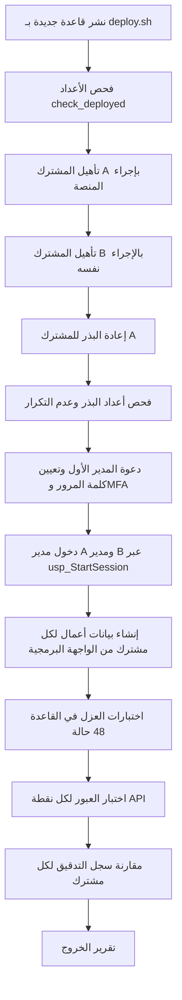

# DOC-B01 — استراتيجية الاختبار وخطته

| البند | القيمة |
|---|---|
| المعرّف | DOC-B01 (docs/30-readiness-documents.md) |
| الإصدار | 0.1 — مسودة للمراجعة — 2026-10-12 |
| المالك المقترح | مدير ضمان الجودة (QA lead) مع قائد قاعدة البيانات |
| الأولوية | P0 قبل S0 |
| يغطي | FR-PLT-036، FR-PLT-008، FR-PLT-045، FR-PLT-041، BR-PLT-001، X-SEC-4، X-SEC-5، O-09 وO-03 (erd_open_items)، 00 §8 |
| يعتمد على | DOC-B02، DOC-B03، DOC-B06، DOC-B08، DOC-B11، DOC-S13، DOC-F05 |
| المصادر | docs/10-detailed-analysis/00-overview-and-cross-cutting.md، docs/10-detailed-analysis/10-m0-m1-platform-organization.md، tools/ci/db_ci.sh، ../.github/workflows/treasury-db-ci.yml (جذر المستودع)، db/tests/tenant_isolation_tests.sql، db/tests/fac_share_rule_tests.sql، tools/dbgen/check_grants.py، tools/dbgen/check_review_fixes.py، tools/dbgen/check_fk_indexes.py، tools/dbgen/check_deployed.py، docs/20-database-design.md، tools/dbgen/erd_open_items.py |

## 1. الغرض والنطاق

تحدد هذه الوثيقة مستويات الاختبار وأدواتها وبيئاتها، ومعايير الدخول والخروج لكل شريحة من S0 إلى S2، وتصنيف العيوب وفرزها، وقواعد بيانات الاختبار، وإجراء اختبار خروج S0.

- تبني على ما هو موجود اليوم: اختبارات قاعدة البيانات والتحقق الثابت في CI.
- لا يوجد كود تطبيق في المستودع بعد (docs/30-readiness-documents.md:338)، فكل ما يخص اختبار التطبيق مقترح 🟡.
- تفاصيل الاختبار الأمني (ASVS واختبار الاختراق) في DOC-S13، وسيناريوهات القبول في DOC-B02، وأهداف الأداء والأمن القابلة للقياس في DOC-B03، والبيئات وخط البناء في DOC-B11.

## 2. ما يوجد اليوم

### 2.1 خط CI لقاعدة البيانات

ملف الخط في جذر المستودع، ../.github/workflows/treasury-db-ci.yml، لأن GitHub يقرأ الخطوط من الجذر فقط. يعمل على كل دفع إلى main وclaude/** وعلى كل طلب دمج، ولكن فقط عند تغيّر treasury-platform/db/ أو tools/dbgen/ أو tools/ci/ أو tools/deploy/ أو versions.json أو مستندات الجاهزية والتحليل التفصيلي التي تُولَّد منها بذرة الصلاحيات، أو ملف الخط نفسه، ويمكن تشغيله يدويًا، وينفّذ أوامره داخل treasury-platform/، على ubuntu-24.04 مع حاوية mcr.microsoft.com/mssql/server:2025-CU9-GDR1-ubuntu-24.04 مثبّتة ببصمتها (sha256، من versions.json؛ تطابقها الخطوة 3)، والإجراءات مثبّتة بإيداعاتها، والسحب بلا حفظ بيانات الاعتماد (المراجعة الذاتية E13). يثبّت Pillow (pillow==12.3.0) لأن check_fk_indexes.py يستورد erd_layout.py الذي يستورد PIL. **يعمل على GitHub ويمر** 🟢: أول تشغيل أخضر في 2026-10-12 (https://github.com/thawrasy/smartlines/actions/runs/38283663041) نفّذ الخطوات الثماني يومها، 6 حالات للمشغّلات و41 حالة عزل؛ والتشغيل الذي سبقه، قبل خطوة Pillow، فشل في الخطوة 3 (التشغيل 38267525934) (O-02، tools/dbgen/erd_open_items.py:22؛ docs/adr/0001-schema-work-on-linux.md:11). واليوم 34 خطوة (0 إلى 24 و4b و19b إلى 19d و22b إلى 22e، الجدول أدناه)، والسكربت tools/ci/db_ci.sh نفسه يمر كاملًا في حاوية التطوير أيضًا. وتُطابق كل خطوة سطور PASS وFAIL في أي موضع من السطر، وتعدّ كل حالة مرة واحدة (المراجعة الذاتية C9).

| الخطوة | ما تفعله | الموضع |
|---|---|---|
| 0 | انتظار استجابة SQL Server حتى 180 ثانية | tools/ci/db_ci.sh:45-56 |
| 1 | فحص النموذج `dbgen.py check` | tools/ci/db_ci.sh:58-59 |
| 2 | مطابقة DDL المولَّد للنموذج، وبذرة الصلاحيات، والحزمة CORE.ROLES و057، وبذرة المنهجية الائتمانية وجداول docs/35، وحالات محرك التقييم | tools/ci/db_ci.sh:61-100 |
| 3 | كل مفتاح أجنبي مفهرس أو موسوم noidx، وقواعد المنح R1-R11، و`check_review_fixes.py`، والحزمة NTF.BASE، وحالات الضغط الائتماني، ولا ثقة بالشهادة افتراضيًا ولا أوامر sqlcmd خطرة، وصورة CI مقابل versions.json | tools/ci/db_ci.sh:102-147 |
| 4 | نشر db/deploy.sql على قاعدة جديدة عبر deploy.sh بحساب bankfas_migrator | tools/ci/db_ci.sh:149-189 |
| 4b | البذر العالمي كامل ويُعاد بلا تغيير، والنص العربي كما كُتب | tools/ci/db_ci.sh:191-223 |
| 5 | مطابقة الكائنات المنشورة مع DDL المولَّد والسكربتات الثابتة بحساب المراقبة | tools/ci/db_ci.sh:225-227 |
| 6 | اختبارات المشغّلات: 7 حالات PASS بالضبط (T1 إلى T6 وT2b) | tools/ci/db_ci.sh:229-245 |
| 7 | اختبارات العزل: 48 حالة PASS بالضبط | tools/ci/db_ci.sh:246-264 |
| 8 إلى 18 | أمن الحساب (23)، المشغّل والدعم (14)، ربط المهام (7، J1 إلى J7)، تهيئة المشترك (7)، الترقيم (8، ومع اتصالات متزامنة 2)، تاريخ KYC (4)، البيانات المرجعية (8)، التدقيق (7)، التصدير (7، X1 إلى X7)، دخولات الخدمة (6) | tools/ci/db_ci.sh:265-467 |
| 19 | إصلاحات المراجعة: RF1 إلى RF34 وSR1 إلى SR9 (43) | db/tests/review_fixes_tests.sql؛ tools/ci/db_ci.sh:468-491 |
| 19b | القوائم المالية: FS1 إلى FS11 (11) | db/tests/financial_statements_tests.sql؛ tools/ci/db_ci.sh:492-511 |
| 19c | التقييم الائتماني: CA1 إلى CA31 (31) | db/tests/credit_assessment_tests.sql؛ tools/ci/db_ci.sh:512-541 |
| 19d | محرك T-SQL يطابق مرجع Python: CE وCV (148) | db/tests/credit_engine_cases.sql؛ tools/ci/db_ci.sh:542-556 |
| 20 إلى 22 | SQL Server Audit (SA1 إلى SA9)، دخول المراقبة (MN1 إلى MN6)، فحوص ما قبل النشر (PF1 إلى PF8) | tools/ci/*_check.sh؛ tools/ci/db_ci.sh:557-619 |
| 22b | حارس المفاتيح وسلسلة التدقيق: KG1 إلى KG7 وAC1 إلى AC10 (17) | db/tests/integrity_tests.sql؛ tools/ci/db_ci.sh:622-642 |
| 22c | مراسي سلسلة التدقيق خارج القاعدة، والمخزن هو الحَكَم: AA1 إلى AA7 | tools/ci/audit_anchor_check.sh؛ tools/ci/db_ci.sh:643-662 |
| 22d | الترحيلات المتزايدة بحساب النشر داخل نافذة: MG1 إلى MG12 | tools/ci/migration_check.sh؛ tools/ci/db_ci.sh:663-685 |
| 22e | أدوار الحزمة CORE.ROLES: CR1 إلى CR9 | db/tests/core_roles_tests.sql؛ tools/ci/db_ci.sh:686-705 |
| 22f | الفاعلون في السجلات المالية وما تجمّده الفترة المغلقة: FC1 إلى FC14 | db/tests/finance_controls_tests.sql؛ tools/ci/db_ci.sh:706-726 |
| 23 | لا مستخدم اختبار متروك (يُعدّ قبل الحذف)، ولا قيد غير موثوق ولا مشغّل معطّل ولا مرشح صفوف معطّل ولا مشترك متروك | tools/ci/db_ci.sh:727-742 |
| 24 | سكربتات القياس بأحجام صغيرة: 18 نتيجة، والسلسلة سليمة بعد الكتّاب المتزامنين (ADR 0036) | tools/perf/run_perf.sh؛ tools/ci/db_ci.sh:701-718 |

### 2.2 اختبارات قاعدة البيانات

- db/tests/tenant_isolation_tests.sql: 48 حالة (T1 إلى T38 مع T8b وT16b وT16c، وT40 إلى T46؛ لا T39). تُنفَّذ بصفة الدورين tp_app وtp_readonly عبر EXECUTE AS، والتشغيل كله معاملة واحدة تُلغى في النهاية (db/tests/tenant_isolation_tests.sql:2-11).
- db/tests/fac_share_rule_tests.sql: 7 حالات لقاعدة حصص المقرضين V-FAC-02، كل حالة في معاملتها: T1 إلى T6، وT2b للقاعدة نفسها والتجميد معطّل داخل المعاملة؛ فمنذ المراجعة الذاتية A1 يرفض تجميد المراجعة المعتمدة (50049، db/static/044_entry_guards.sql) إضافة مقرض إليها قبل القاعدة (T2).

| مجموعة حالات العزل | ما تثبته | الموضع |
|---|---|---|
| T1-T8b | لا قراءة ولا إدراج ولا تعديل ولا حذف عبر المشتركين | db/tests/tenant_isolation_tests.sql:114-243 |
| T9-T12 | الصف العام في جدول مختلط يُقرأ ولا يُكتب | db/tests/tenant_isolation_tests.sql:248-297 |
| T13-T15، T38 | التدقيق للإدراج فقط ولمشتركه فقط، والمنصة تقرأ أحداثها لا أحداث المشتركين | db/tests/tenant_isolation_tests.sql:302-356 |
| T16-T16c، T28 | تغيير TenantId يدويًا أو رمز خاطئ لا يكشف صفًا | db/tests/tenant_isolation_tests.sql:360-424 |
| T17-T20، T32-T37 | إجراء الربط والدخول والقفل وMFA والجلسات | db/tests/tenant_isolation_tests.sql:429-562 و643-689 |
| T25-T27، T30، T31 | سحب الربط عند تعطيل المستخدم أو حذفه أو إغلاق المشترك أو تعليقه | db/tests/tenant_isolation_tests.sql:565-640 |
| T21-T23، T29 | دور التقارير لا يقرأ المقيَّد ولا سجل المشتركين | db/tests/tenant_isolation_tests.sql:693-731 |
| T24 | كل جدول فيه TenantId مُرشَّح وكل سياسة مفعّلة | db/tests/tenant_isolation_tests.sql:735-753 |

### 2.3 التحقق الثابت

| الأداة | ما تفحصه | في CI؟ |
|---|---|---|
| tools/dbgen/dbgen.py check | النموذج والمراجع والمفاتيح المركّبة | نعم، الخطوة 1 |
| tools/dbgen/check_fk_indexes.py | فهرسة المفاتيح الأجنبية (السطور 1-9) | نعم، الخطوة 3 |
| tools/dbgen/check_deployed.py | أعداد الكائنات المنشورة مقابل DDL (السطور 1-9) | نعم، الخطوة 5 |
| tools/dbgen/check_grants.py | القواعد R1-R11 للمنح والتشفير (السطور 4-16) | نعم، الخطوة 3 (tools/ci/db_ci.sh:104) |
| tools/dbgen/check_review_fixes.py | الإصلاحات الحرجة DR-01 إلى DR-10 (السطر 2) | نعم، الخطوة 3 (tools/ci/db_ci.sh:105) |
| tools/dbgen/pg_validate.sh | البنية على PostgreSQL فقط، لا T-SQL (السطر 2) | لا |

### 2.4 الفجوات

1. لا اختبارات وحدات ولا تكامل ولا API ولا واجهة، لأن كود التطبيق غير موجود.
2. ~~check_review_fixes.py لا يعمل في CI~~ ✅ مسدودة: يعمل في الخطوة 3 (tools/ci/db_ci.sh:105، DQ-B01-3).
3. لا اختبار لكتابة tp_app على كتالوج عالمي مثل ref.Currency (docs/20-database-design.md:493).
4. لا اختبار للمخاطر المفتوحة O-19 وO-20 وO-21 (erd_open_items، tools/dbgen/erd_open_items.py:121-138) لأن قراراتها لم تُتخذ.
5. معرّفات الحالات متصادمة: T1 إلى T6 موجودة في الملفين بمعنيين مختلفين.
6. عدّاد CI ثابت (6 و41)، فإضافة حالة تتطلب تعديل tools/ci/db_ci.sh:71 و88 يدويًا.
7. خط CI لا يعمل عند تغيّر كود التطبيق، لأن مرشّح المسارات يقتصر على ملفات القاعدة (../.github/workflows/treasury-db-ci.yml:10-14 و16-20).
8. ✅ صُحّح (2026-10-12): يعمل على GitHub من ../.github/workflows/treasury-db-ci.yml (جذر المستودع)، وأول تشغيل أخضر https://github.com/thawrasy/smartlines/actions/runs/38283663041 (O-02، tools/dbgen/erd_open_items.py:22). يبقى أن تشترطه حماية الفرع main قبل الدمج (DOC-B11 §4.1).

## 3. مستويات الاختبار

| المستوى | ما يغطيه | الأداة | أين يعمل | المالك |
|---|---|---|---|---|
| تحقق ثابت | النموذج، DDL، المنح، الإصلاحات، فهرسة المفاتيح | سكربتات tools/dbgen 🟢 | CI | قائد قاعدة البيانات |
| سلوك القاعدة | RLS والربط والدخول والمشغّلات والمنح الفعلية | سكربتات sqlcmd في db/tests 🟢 | CI | قائد قاعدة البيانات |
| وحدات | قواعد BR الخالصة: الترقيم، أيام العمل، التطبيع، الحجز، التسعير | xUnit 🟡 | المطوّر وCI | قائد التطبيق |
| تكامل | الخدمات مع قاعدة حقيقية: الربط لكل طلب، الحجز، التأهيل، المهام | xUnit مع Testcontainers وصورة SQL Server 2025 🟡 | المطوّر وCI | قائد التطبيق |
| API | العقد مع OpenAPI، الحالات 401 و403 و404، عبور المشتركين لكل نقطة | xUnit مع WebApplicationFactory 🟡 | CI | قائد الواجهات البرمجية |
| واجهة | تدفقات الشاشات، المحليّة RTL التجريبية، إمكانية الوصول | Playwright لـ .NET مع axe-core 🟡 | بيئة الاختبار | قائد الواجهة الأمامية |
| أمان | IDOR وASVS المستوى 2، فحص الحزم، فحص TLS، اختبار الاختراق | DOC-S13 | CI وبيئة الاختبار | مهندس الأمن |
| أداء | NFR-PERF في DOC-B03، ومنها 100 حجز متزامن | k6 لطبقة API 🟡، واختبار تكامل للتزامن | بيئة الاختبار | معماري الحلول |
| قبول المستخدم | سيناريوهات DOC-B02 على بيانات مجهّلة | يدوي بقائمة فحص | UAT | مالك المنتج |

قواعد عامة 🟡:
- كل اختبار تكامل يبدأ بقاعدة منشورة بالمسار نفسه الذي يستعمله الإنتاج (tools/deploy/deploy.sh، docs/adr/0001-schema-work-on-linux.md:19)، لا بمخطط مختصر.
- كل اختبار تكامل أو API يعمل بحساب tp_app عبر sec.usp_StartSession وsec.usp_SetSessionContext، لا بحساب sa. حساب sa يُستعمل للنشر والبذر فقط، كما في db/tests/tenant_isolation_tests.sql:3-5.
- صورة SQL Server في الاختبارات هي الصورة نفسها في CI، بوسم مثبّت في سجل الإصدارات (DQ-B01-2).
- اختبارات API لعبور المشتركين تُولَّد من وثيقة OpenAPI (FR-PLT-041)، فنقطة جديدة بلا اختبار عبور تفشل البناء. هذا ما يطلبه O-09 (erd_open_items، tools/dbgen/erd_open_items.py:65) وdocs/10-detailed-analysis/14-m7-m8-letters-of-credit.md:666.

## 4. بيئات الاختبار

| البيئة | ما يُختبر فيها | البيانات | من يصل |
|---|---|---|---|
| جهاز المطوّر | الوحدات والتكامل بحاوية SQL Server | اصطناعية تُنشأ وتُلغى | المطوّر |
| CI (مؤقتة) | التحقق الثابت، سلوك القاعدة، الوحدات، التكامل، API | اصطناعية داخل معاملة تُلغى | الخط آليًا |
| الاختبار | الواجهة، الأداء، الفحص الديناميكي، اختبار خروج الشريحة | اصطناعية دائمة لمشتركين وهميين | فريق المشروع |
| UAT | قبول المستخدم وتمرين الترحيل | مجهّلة وفق DOC-B06 | ممثلو العميل والفريق |
| الإنتاج | فحص دخان بعد النشر فقط | حقيقية، بلا أي بيانات اختبار | المشغّل |

تعريف البيئات واستضافتها وأسرارها في DOC-B11.

## 5. معايير الدخول والخروج

### 5.1 الشريحة S0

| النوع | المعيار |
|---|---|
| دخول | اعتماد وثائق P0: DOC-F01 إلى F05، DOC-S01 إلى S09، DOC-B01 إلى B05، DOC-B11 (docs/30-readiness-documents.md:446) |
| دخول | حسم O-18 (erd_open_items، tools/dbgen/erd_open_items.py:115-120) لأنه يحدد النتيجة المتوقعة لدخول مشترك SUSPENDED |
| دخول | تصميم إجراء التأهيل وفق O-12 (20-database-design، docs/20-database-design.md:540) |
| دخول | قرار O-24 (erd_open_items، tools/dbgen/erd_open_items.py:151-156) قبل كتابة كود الدخول، وإضافة حالاته إلى اختبارات القاعدة |
| دخول | خط CI للقاعدة أخضر على main، وهيكل خط التطبيق مع بوابة FR-PLT-045 قائم (DOC-B11) |
| خروج | نجاح اختبار خروج S0 في §6 (docs/10-detailed-analysis/00-overview-and-cross-cutting.md:194) |
| خروج | كل متطلب Must في S0 (32 متطلبًا، docs/10-detailed-analysis/91-requirements-index.md:21) له سيناريو قبول ناجح في DOC-B02 |
| خروج | كل Should إما ناجح أو مؤجل بقرار مكتوب |
| خروج | صفر عيوب مفتوحة من Sev1 وSev2 |
| خروج | بنود NFR-SEC الخاصة بـ S0 في DOC-B03 ناجحة |

### 5.2 الشريحة S1

| النوع | المعيار |
|---|---|
| دخول | خروج S0، وشاشات S1 في DOC-B07، وحزم بذر الكتالوجات في DOC-B05 |
| خروج | «إدخال بنك بمعالج واحد، وإدخال شركة بمستنداتها» (docs/10-detailed-analysis/00-overview-and-cross-cutting.md:195): AC-INS-1 وAC-ORG-6 في DOC-B02 |
| خروج | «كتالوجات مزروعة»: AC-CAT-1 |
| خروج | T24 يمر بعد إضافة جداول S1، أي كل جدول جديد فيه TenantId مُرشَّح (db/tests/tenant_isolation_tests.sql:735-753) |
| خروج | اختبار عبور المشتركين لكل نقطة API جديدة، وNFR-PERF-02 (بحث أقل من ثانيتين على 5,000 جهة) |

### 5.3 الشريحة S2

| النوع | المعيار |
|---|---|
| دخول | اعتماد DOC-B06 وتجهيز الاتفاقيات الأربع والنماذج الثلاثة مجهّلة في بيئة الاختبار (docs/10-detailed-analysis/00-overview-and-cross-cutting.md:216) |
| دخول | تجهيز أداة اختبار التزامن للحجز |
| خروج | «إدخال الاتفاقيات الأربع الفعلية بلا قيد خارج النموذج، وإنذار الانتهاء يعمل» (docs/10-detailed-analysis/00-overview-and-cross-cutting.md:196) |
| خروج | 100 طلب حجز متزامن على الحد نفسه بنتائج محددة (docs/20-database-design.md:241، NFR-PERF-03) |
| خروج | الشاشات الرئيسية ضمن NFR-PERF-01 |
| خروج | فحص سلسلة التدقيق FR-PLT-025 إن نُفِّذ في S2، بعد قرار المرساة O-13 (20-database-design، docs/20-database-design.md:541) |

## 6. اختبار خروج S0

ينص شرط الخروج على «اختبار عزل ناجح بين مشتركين، وتأهيل مشترك جديد آليًا» (docs/10-detailed-analysis/00-overview-and-cross-cutting.md:194). اختبارات العزل الحالية تبذر المشتركين بحساب sa مع تعطيل القيود (db/tests/tenant_isolation_tests.sql:29-34 و69-112)، فلا تثبت التأهيل. لذلك يُبنى اختبار الخروج على مسار الإنتاج نفسه 🟡:

| الخطوة | النتيجة المتوقعة | المرجع |
|---|---|---|
| التأهيل | المشترك بحالة TRIAL، ووحداته من الباقة، وحساب الخدمة IsSystemUser، والمدير الأول، في معاملة واحدة | FR-PLT-001، FR-PLT-008، docs/20-database-design.md:475 |
| فشل مصطنع في البذر | لا يبقى صف للمشترك | DOC-F05 |
| إعادة البذر | لا صف جديد في الكتالوجات والأدوار | FR-PLT-008، AC-PLT-5 |
| الدعوة | رسالة تصل إلى ملتقِط SMTP في بيئة الاختبار، والرابط صالح 48 ساعة | FR-PLT-013 |
| العزل في القاعدة | 41 PASS | tools/ci/db_ci.sh:87-88 |
| العبور في API | معرّف من B بجلسة A يعيد 404، وبلا جلسة 401، ولا صف من B في أي قائمة أو بحث | FR-PLT-020، FR-PLT-021، AC-PLT-1 |
| التدقيق | أحداث A لا تظهر في عارض B وبالعكس | FR-PLT-022، T13، T14 |

يُعاد هذا الاختبار في كل إصدار لاحق بوصفه اختبار انحدار، ويُضاف إليه كل جدول ونقطة جديدان.

## 7. شدة العيوب وفرزها

| الشدة | التعريف | أمثلة | الأثر على الإصدار |
|---|---|---|---|
| Sev1 حرج | كسر عزل أو سرية أو سلامة مالية أو تدقيق | صف من مشترك آخر، كشف رقم هوية لغير TM وFO، فقد صف تدقيق، تجاوز المتاح في الحجز | يوقف الإصدار والدمج، بلا استثناء |
| Sev2 عالٍ | متطلب Must معطّل بلا بديل، أو ضابط أمني داخل المشترك يفشل | فشل التأهيل، قفل لا يعمل، تجاوز من النوع O-24 (erd_open_items) | يوقف خروج الشريحة إلا باستثناء موقّع |
| Sev3 متوسط | خلل له بديل، أو في متطلب Should أو Could | رسالة خطأ خاطئة، تصفية ناقصة | يُصلح في الشريحة نفسها أو التالية |
| Sev4 منخفض | شكلي | محاذاة، نص، ترجمة | لا يوقف |

إجراء الفرز 🟡:
- يُسجَّل كل عيب في متتبع المشروع بوسوم: الشدة، الشريحة، FR، AC، والمستوى الذي اكتشفه.
- يفرز فريق من QA lead وقائد التطبيق ومالك المنتج مرتين أسبوعيًا، وفورًا لأي Sev1.
- أي عيب يُشتبه أنه Sev1 أمني يُشرك مهندس الأمن، وإن ظهر في الإنتاج يُعامل حادثًا وفق DOC-S15.
- لا يُخفَّض تصنيف Sev1 إلا بقرار مكتوب من مالك المنتج ومهندس الأمن معًا.
- مهلة الفرز: Sev1 خلال 4 ساعات عمل، وSev2 خلال يوم عمل، والباقي في الفرز التالي.

## 8. قواعد بيانات الاختبار

المواصفة الكاملة لبيانات الاختبار والتجهيل في DOC-B06 (P1، قبل S2). القواعد الملزمة من الآن:

1. لا بيانات حقيقية في أي بيئة غير الإنتاج. رأس اختبارات العزل يشترط قاعدة «لا تحوي بيانات حقيقية» (db/tests/tenant_isolation_tests.sql:7).
2. الأمثلة افتراضية: لا أسماء أشخاص ولا شركات ولا أرقام هويات أو سجلات حقيقية، كما في صف «خصوصية الوثيقة» (docs/10-detailed-analysis/10-m0-m1-platform-organization.md:11).
3. أرقام الهوية في الاختبار تُولَّد بنمط صحيح الشكل فقط، وأرقام IBAN من أمثلة التوثيق كما في AC-ACC-1.
4. كل اختبار تكامل ينشئ بياناته ويلغيها، على نمط المعاملة الواحدة في db/tests/tenant_isolation_tests.sql:10-11.
5. يحمل كل اختبار مشتركين على الأقل حين يمس جدولًا مملوكًا للمشترك.
6. الاتفاقيات الأربع والنماذج الثلاثة لا تدخل بيئة الاختبار إلا مجهّلة بعد اعتماد DOC-B06.
7. لا تُنسخ نسخة احتياطية من الإنتاج إلى أي بيئة أخرى (DOC-B11).

## 9. تسجيل النتائج والتتبع

- يُحفظ ناتج كل تشغيل في CI ملفًا مرفقًا بالتشغيل، كما يحفظ db_ci.sh الناتج ويعرضه (tools/ci/db_ci.sh:60-65).
- معرّفات الحالات 🟡: ISO-Tn لحالات العزل وFSR-Tn لحالات الحصص، لإزالة التصادم.
- كل اختبار تطبيق يحمل وسم AC وFR الذي يغطيه، فتولّد DOC-B08 مصفوفة التتبع منها آليًا.
- العدّاد المتوقع في db_ci.sh يُشتق من عدد الحالات في الملف بدل الرقم الثابت 🟡.
- تقرير خروج الشريحة: قائمة AC بنتائجها، والعيوب المفتوحة بشدتها، ونتائج NFR، والاستثناءات الموقّعة.

## 10. جدول الاختبار لكل شريحة

| الشريحة | ما يُضاف من اختبارات | بوابة الخروج |
|---|---|---|
| S0 | خط التطبيق، وحدات PLT، تكامل الربط لكل طلب، API لنقاط S0 وعبورها، واجهة الدخول وMFA والمستخدمين، فحص RTL التجريبي، حالات قاعدة جديدة للمخاطر بعد حسمها | §5.1 و§6 |
| S1 | تكامل التأهيل مع بذر الكتالوجات، API لنقاط ORG وPTY وINS وACC وCAT وNTF، واجهة معالج البنك والشركة ومستنداتها، NFR-PERF-02 | §5.2 |
| S1-ب | الملكية والحوكمة والمفوّضون: AC-ORG-1 وAC-ORG-2 وAC-ACC-2 إلى AC-ACC-4 | سيناريوهات S1-ب ناجحة |
| S2 | وحدات الحدود والتسعير، تزامن الحجز، إدخال الاتفاقيات الأربع، أداء الشاشات الرئيسية | §5.3 |
| S2-ب | البيانات المالية والتحقق من التعهدات | لوحة الالتزام (docs/10-detailed-analysis/00-overview-and-cross-cutting.md:197) |
| S3 | محرك الطلبات، اعتماد المشتريات، الحجز والتحويل، تزامن السحب من الطابور | طلب اعتماد حقيقي يمر كل مراحله (السطر 199) |
| S4 | البروفورما واعتمادات التصدير والمطابقة | رصيد اعتماد التصدير يطابق الحساب اليدوي (السطر 200) |
| S5 | انحدار كامل، اختبار اختراق، UAT، تمرين استعادة | إطلاق تجريبي لمشترك واحد (السطر 201)، وDOC-B12 |

## 11. القرارات المطلوبة

| المعرّف | السؤال | الافتراض المقترح | من يقرر | ما يعطّله |
|---|---|---|---|---|
| DQ-B01-1 | أدوات اختبار التطبيق | xUnit، وTestcontainers مع صورة SQL Server 2025، وPlaywright لـ .NET مع axe-core 🟡 | قائد التطبيق مع QA lead | أول كود في S0 |
| DQ-B01-2 | وسم صورة SQL Server في CI والاختبارات | تثبيت وسم تحديث تراكمي محدد يطابق سجل الإصدارات بدل 2025-latest. ✅ منفّذ (2026-10-13، ADR 0014): `2025-CU9-GDR1-ubuntu-24.04`، تفحص CI تطابقه مع `versions.json` | DevOps lead | بوابة FR-PLT-045 |
| DQ-B01-3 | إضافة check_review_fixes.py إلى db_ci.sh | نعم، في الخطوة 3 بجانب check_grants.py | قائد قاعدة البيانات | دخول S0 |
| DQ-B01-4 | بادئات معرّفات الحالات | ISO-Tn وFSR-Tn، ووسم AC وFR لكل اختبار تطبيق | QA lead | DOC-B08 |
| DQ-B01-5 | تشغيل خط القاعدة عند تغيّر كود التطبيق | تشغيله على كل طلب دمج إلى main | DevOps lead | S0 |
| DQ-B01-6 | أداة اختبار الأداء | k6 لطبقة API، واختبار تكامل بالكود لتزامن الحجز 🟡 | معماري الحلول | خروج S1 وS2 |
| DQ-B01-7 | مقياس «تغطية القواعد الحرجة» (docs/10-detailed-analysis/00-overview-and-cross-cutting.md:171) | كل BR في الحدود والحجز والتسعير والعزل له اختبار آلي واحد على الأقل، وتغطية أسطر 80% لنواة المجال 🟡 | QA lead | خروج S2 |
| DQ-B01-8 | مهل فرز العيوب | Sev1 خلال 4 ساعات عمل، وSev2 خلال يوم عمل | مدير المشروع | §7 |
| DQ-B01-9 | ملتقِط البريد في بيئة الاختبار | خادم SMTP محلي يلتقط الرسائل ولا يرسلها خارج البيئة 🟡 | DevOps lead | اختبار خروج S0 |
| DQ-B01-10 | الحالات الجديدة للمخاطر المفتوحة | حالة لكتابة tp_app على ref.Currency الآن، وحالات O-19 وO-20 وO-21 بعد قراراتها | قائد قاعدة البيانات | خروج S0 |

## 12. تعارضات وفجوات في المصادر

1. docs/30-readiness-documents.md:312 و339 يذكر 34 حالة عزل وأن db_ci.sh يتحقق من 34، والعدد الفعلي 41.
2. docs/10-detailed-analysis/00-overview-and-cross-cutting.md:352 ما زال يقول إن وثيقة القاعدة «لم تُنفَّذ على SQL Server بعد»، بينما docs/20-database-design.md:492 يثبت النشر في كل تشغيل لـ db_ci.sh، وO-1 فيها (:529) صار «محلول في بيئة التطوير».
3. رأس tools/ci/db_ci.sh:2-3 يذكر اختبارات المشغّلات فقط، والسكربت يشغّل اختبارات العزل أيضًا (السطر 75).
4. AC-PLT-1 يفترض صفًا عامًا في LookupItem (docs/10-detailed-analysis/10-m0-m1-platform-organization.md:651)، والقاعدة تجعل LookupItem مملوكًا للمشترك (docs/20-database-design.md:425)، فالحالات T9-T12 تختبر الصف العام على cfg.NonWorkingDay (db/tests/tenant_isolation_tests.sql:107). التفصيل في DOC-B02.
5. 00 §8 (docs/10-detailed-analysis/00-overview-and-cross-cutting.md:209-219) يعدّد المستويات بوسم 🟡 دون أدوات أو معايير خروج؛ هذه الوثيقة تكمله.

## 13. التتبع

| البند في هذه الوثيقة | المتطلب أو القاعدة أو القرار | المصدر |
|---|---|---|
| §2، §6 | FR-PLT-036، BR-PLT-001، X-SEC-4 | docs/10-detailed-analysis/10-m0-m1-platform-organization.md:138، 227؛ docs/10-detailed-analysis/00-overview-and-cross-cutting.md:139 |
| §3 اختبار العبور لكل نقطة | O-09 (erd_open_items)، FR-PLT-021، FR-PLT-041 | tools/dbgen/erd_open_items.py:62-66؛ docs/10-detailed-analysis/10-m0-m1-platform-organization.md:123، 143 |
| §5.1، §6 | خروج S0، FR-PLT-008، FR-PLT-013 | docs/10-detailed-analysis/00-overview-and-cross-cutting.md:194؛ docs/10-detailed-analysis/10-m0-m1-platform-organization.md:110، 115 |
| §5.2 | خروج S1، AC-INS-1 | docs/10-detailed-analysis/00-overview-and-cross-cutting.md:195؛ docs/10-detailed-analysis/11-m2-m4-institutions-accounts-catalogs.md:646 |
| §5.3 | خروج S2، اختبار التزامن | docs/10-detailed-analysis/00-overview-and-cross-cutting.md:196؛ docs/20-database-design.md:241 |
| §7 | R4 تسريب بين المشتركين | docs/01-preliminary-analysis.md:359 |
| §8 | خصوصية الأمثلة، DOC-B06 | docs/10-detailed-analysis/10-m0-m1-platform-organization.md:11؛ db/tests/tenant_isolation_tests.sql:7 |
| DQ-B01-2 | FR-PLT-045 | docs/10-detailed-analysis/10-m0-m1-platform-organization.md:147؛ ../.github/workflows/treasury-db-ci.yml:37 |
| DQ-B01-3 | الإصلاحات الحرجة DR-01 إلى DR-10 | tools/dbgen/check_review_fixes.py:2 |
| DQ-B01-10 | O-19، O-20، O-21 (erd_open_items) | tools/dbgen/erd_open_items.py:121-138 |
