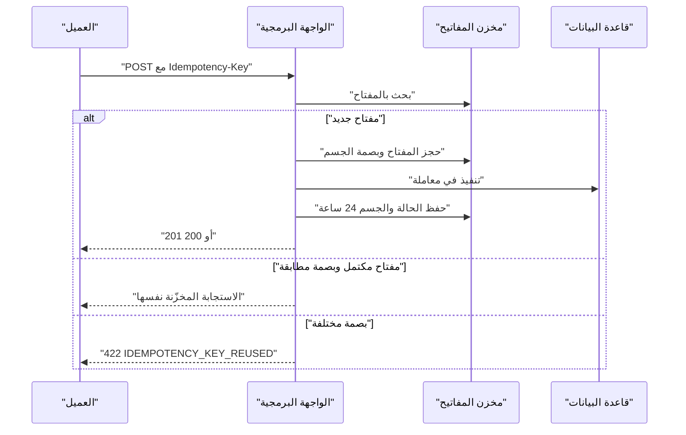
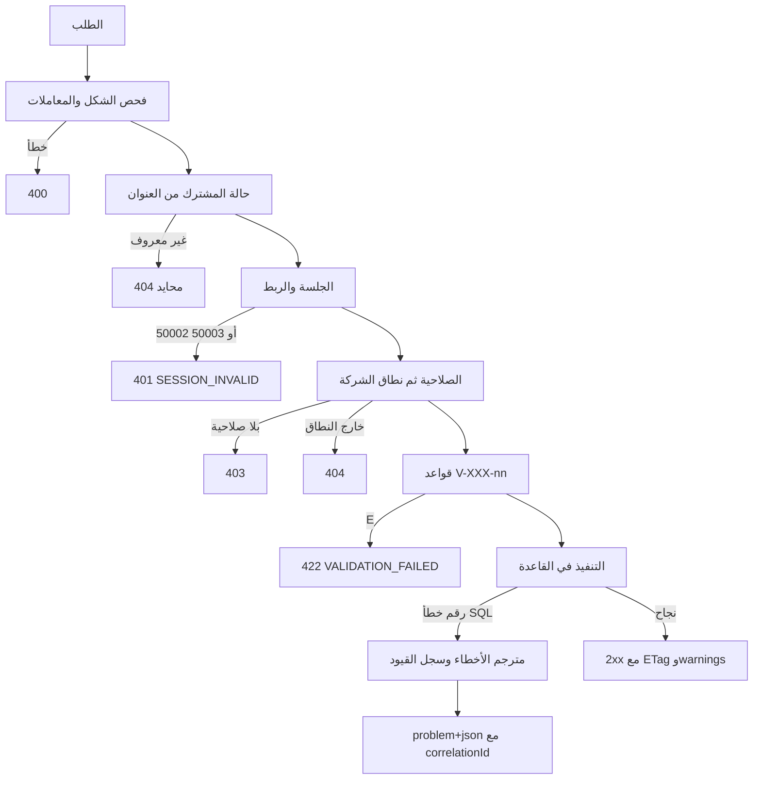

# DOC-B04 — عقد الواجهة البرمجية ونموذج الأخطاء

| البند | القيمة |
|---|---|
| المعرّف | DOC-B04 (docs/30-readiness-documents.md) |
| الإصدار | 0.1 — مسودة للمراجعة — 2026-10-12 |
| المالك المقترح | قائد الواجهات البرمجية مع قائد التطبيق (docs/30-readiness-documents.md:50) |
| الأولوية | P0 قبل S0 |
| يغطي | FR-PLT-041، FR-PLT-003، FR-PLT-012، FR-PLT-013، FR-PLT-016، FR-PLT-019، FR-PLT-020، FR-PLT-021، FR-PLT-032، FR-WFL-035، BR-WFL-023، FR-LCI-031، O-21 وO-22 (erd_open_items) |
| يعتمد على | DOC-F03، DOC-F04، DOC-F05، DOC-S03، DOC-B03، DOC-B10، DOC-B11 |
| المصادر | docs/10-detailed-analysis/10-m0-m1-platform-organization.md، 11-m2-m4…، 12-m5…، 13-m6…، 14-m7-m8…، docs/20-database-design.md، db/model/10-platform.model، db/generated/tsql/001_tables.sql، db/static/010_rls.sql، db/static/030_session_context.sql، db/static/050_fac_share_rule.sql، db/tests/tenant_isolation_tests.sql، tools/dbgen/README.md، tools/dbgen/erd_open_items.py، docs/adr/0002-login-and-session-bound-context.md |

## 1. الغرض والنطاق

تضع هذه الوثيقة عقدًا واحدًا لكل نقاط REST في كل الوحدات. تحدد الإصدار، وتسمية الموارد، والمعرّفات العامة، والترقيم والترشيح والفرز، والتزامن المتفائل، ومفتاح التكرار، ومغلف الخطأ، وجدول تحويل الأخطاء إلى حالات HTTP. وتنتهي بهيكل OpenAPI 3.1 لنقاط S0.

خارج النطاق: شكل رمز الجلسة وملف تعريف الارتباط وCSRF وCSP (DOC-S03)، وتسلسل الدخول وMFA والاسترداد (DOC-F03)، وأرقام حدود المعدل والأداء (DOC-B03)، وخط البناء الذي يولّد وثيقة OpenAPI (DOC-B11).

## 2. ما يوجد اليوم

| الموضوع | الموجود | المصدر |
|---|---|---|
| المتطلب الأم | كل وظيفة عبر REST موثّق، بمعرّفات GUID خارجية وإصدار للواجهة، ووثيقة OpenAPI تُولَّد في البناء 🟢 | docs/10-detailed-analysis/10-m0-m1-platform-organization.md:143 |
| موارد M0/M1 | users · roles · companies · parties · authority-grants · documents · audit-events؛ Idempotency-Key على الإنشاء وRowVersion للتزامن وتحديد معدل لكل مشترك | docs/10-detailed-analysis/10-m0-m1-platform-organization.md:568 |
| موارد الوحدات الأخرى | قوائم مسارات فقط بلا أنواع ولا أخطاء | 11-m2-m4…:567، 12-m5…:581، 13-m6…:675، 14-m7-m8…:654 |
| RowVersion | 9 ورودات في 13 و14: 13-m6…:156، :238، :254، :349، :550، :675؛ 14-m7-m8…:187، :339، :654 | docs/10-detailed-analysis/ |
| Idempotency | 14 ورودًا في 13 و14 (Idempotency-Key وIdempotencyKey): 13-m6…:156، :249، :254، :309، :310، :344، :675؛ 14-m7-m8…:187، :278، :313، :654 | docs/10-detailed-analysis/ |
| حالة التعارض | «التعارض 409 مع الحالة الحالية»، والمفتاح يُخزَّن 24 ساعة ويعيد الاستجابة نفسها 🟢 | 13-m6…:156، :254، :550؛ 14-m7-m8…:187 |
| PublicId | يضيفه المولّد لكل جدول بعلامة public؛ 38 جدولًا؛ لا يُعرَّض BIGINT عبر API | tools/dbgen/README.md:39؛ docs/20-database-design.md:137 |
| RowVersion في القاعدة | عمود ROWVERSION لكل جدول مملوك للمشترك إلا append وnorv وnoaudit؛ 159 جدولًا في DDL (2026-10-18) | tools/dbgen/dbgen.py:493؛ db/generated/tsql/001_tables.sql |
| رموز التحقق | 95 رمزًا V-XXX-nn بشدة E أو W؛ لا رموز لـ PLT وORG وPTY | §9 في 11-m2-m4…:488، 12-m5…:481، 13-m6…:542، 14-m7-m8…:549؛ 10-m0-m1…:497 |
| أخطاء القاعدة | 50001 إلى 50005 في 030، و50071 و50072 في 050، و33504 من RLS | db/static/030_session_context.sql:54-202؛ db/static/050_fac_share_rule.sql:57، :92؛ db/tests/tenant_isolation_tests.sql:152-164 |
| مبدأ عام | أخطاء الأعمال تُعاد رموزًا ثابتة للـ API لا نصوص SQL 🟢 | docs/20-database-design.md:242 |

لا يوجد ملف OpenAPI، ولا مغلف خطأ، ولا قواعد إصدار أو ترقيم صفحات في أي وثيقة.

## 3. المبادئ العامة

### 3.1 العناوين والإصدار

| البند | القاعدة |
|---|---|
| واجهة المشترك | https://{tenant}.bankfas.com/api/v1 🟢 للنطاق (FR-PLT-046، 10-m0-m1…:148) و🟡 للمسار |
| تحديد المشترك | من العنوان الفرعي فقط. لا يقبل أي طلب TenantId في المسار أو الجسم أو الاستعلام 🟢 (BR-PLT-001، 10-m0-m1…:227) |
| واجهة المشغّل | https://admin.bankfas.com/api/v1/platform 🟡؛ admin عنوان محجوز (FR-PLT-046) |
| الإصدار | رقم رئيسي في المسار (v1). التغيير الإضافي داخل v1 مسموح: حقل اختياري جديد، مورد جديد، قيمة تعداد جديدة يعلنها سجل التغييرات 🟡 |
| التغيير الكاسر | إصدار v2 بجانب v1، وv1 يبقى ستة أشهر على الأقل مع ترويستي Deprecation وSunset 🟡 |
| عنوان غير معروف | صفحة محايدة و404 بلا كشف لوجود المشترك 🟢 (FR-PLT-046) |

### 3.2 تسمية الموارد وشكل البيانات

- المجموعات أسماء جمع بحروف صغيرة وشرطات: `/users`، `/roles`، `/request-types` 🟢 (13-m6…:675). الموارد الفرعية متداخلة: `/users/{userId}/sessions`.
- الإجراءات التي لا تناسب CRUD تُرسل `POST /{collection}/{id}/actions/{action}` 🟢 على نمط `/requests/{id}/actions/{action}` (13-m6…:675).
- أسماء الحقول camelCase 🟡. قيم التعداد كما في القاعدة بأحرف كبيرة، مثل `ACTIVE` و`LOCKED` 🟢 (db/model/10-platform.model:122).
- التواريخ `YYYY-MM-DD`. الأوقات ISO 8601 بالتوقيت العالمي ولاحقة Z 🟢 للتخزين (FR-PLT-034) و🟡 للصيغة.
- المبلغ سلسلة عشرية بأربع خانات على الأكثر مع `currencyCode` 🟡، لأن القاعدة DECIMAL(19,4) (docs/20-database-design.md:141) والعدد العائم يفقد الدقة.
- التاريخ الهجري المُدخل من وثيقة حقل نصي مستقل بجانب الميلادي 🟢 (X-DAT-2، 00-overview…:156).
- الحقل المقيّد يعود مقنَّعًا دائمًا، والكشف نقطة مستقلة مدقَّقة 🟢 (X-SEC-3، 00-overview…:138).

### 3.3 الارتباط والتتبع

يولّد الخادم `X-Correlation-Id` (UUID) لكل طلب، ولا يقبله من المتصفح (DOC-S03، DQ-S12-7، DQ-S13-11). يعود في ترويسة الاستجابة وفي حقل `correlationId` للخطأ. يمرّره التطبيق إلى `sec.usp_SetSessionContext` في `@CorrelationId` (db/static/030_session_context.sql:169)، فيُحفظ في `aud.AuditLog.CorrelationId` (db/model/10-platform.model:317) 🟡 للربط و🟢 للأعمدة.

## 4. المعرّفات العامة والمفاتيح الداخلية

القاعدة: المسار والجسم يحملان PublicId (UUID) أو رمزًا ثابتًا. المفتاح BIGINT أو INT لا يخرج من الخادم أبدًا 🟢 (docs/20-database-design.md:137).

| الكيان في S0 | المعرّف الخارجي | ملاحظة | المصدر |
|---|---|---|---|
| plat.Tenant | PublicId؛ والرمز Code للعنوان الفرعي | للمشغّل فقط | db/generated/tsql/001_tables.sql:58 |
| plat.PlatformOperator | PublicId | للمشغّل فقط | db/generated/tsql/001_tables.sql:108 |
| sec.AppUser | PublicId | | db/generated/tsql/001_tables.sql:198 |
| sec.Role | PublicId؛ والرمز Code للعرض | | db/generated/tsql/001_tables.sql:237 |
| sec.Permission | Code (مثل party.identity.reveal) | جدول عالمي بلا PublicId | db/model/10-platform.model:169-180 |
| cfg.TenantSetting | Key | | db/model/10-platform.model:438-441 |
| cfg.NumberSequenceDefinition | SequenceKey | | db/model/10-platform.model:443-446 |
| sec.UserSession | لا يوجد | فجوة: DQ-B04-4 | db/model/10-platform.model:219-234 |
| aud.AuditLog | لا PublicId؛ EntityId من نوع BIGINT | فجوة: DQ-B04-10 | db/model/10-platform.model:304، :313 |
| الكتالوجات | Code | فريد لكل مشترك | tools/dbgen/README.md:40 |

PublicId يولّده الخادم دائمًا (NEWSEQUENTIALID). لا يقبل الإنشاء PublicId من العميل. هذا يغلق جزءًا من مسرّب الفرادة في O-21 (erd_open_items)، لأن العميل لا يستطيع تجربة PublicId يخص مشتركًا آخر (tools/dbgen/erd_open_items.py:135). وTenantId يأتي من الربط لا من الطلب، فلا تكشف فرادة (TenantId, Email) شيئًا خارج المشترك.

## 5. الترقيم والترشيح والفرز 🟡

| البند | القاعدة |
|---|---|
| الترقيم | مؤشر معتم: `?limit=50&cursor=...`. الافتراضي 50 والأقصى 200 |
| الاستجابة | `{ "items": [...], "nextCursor": "..." }`؛ غياب nextCursor يعني النهاية |
| العدد الكلي | لا يُحسب إلا بطلب `includeTotal=true`، ويعود في `total` |
| المؤشر | يحمل قيم مفتاح الفرز الأخيرة ومعرّفًا داخليًا، مشفّرًا وموقّعًا بالخادم؛ مؤشر معدَّل يعطي 400 INVALID_CURSOR |
| الترشيح | معاملات مسمّاة من قائمة مسموحة لكل نقطة. تكرار المعامل يعني «أو»: `status=ACTIVE&status=LOCKED`. المدى بلاحقتي From وTo. البحث الحر `q` |
| معامل غير معروف | 400 UNKNOWN_PARAMETER، فلا يُتجاهل خطأ إملائي بصمت |
| الفرز | `sort=-createdAt,nameEn` من قائمة مسموحة؛ الإشارة السالبة تنازلي؛ مفتاح ثانوي ثابت يضيفه الخادم |
| النطاق | كل قائمة تحترم نطاق الشركات؛ ما خارج النطاق لا يظهر ولا يُعدّ 🟢 (FR-PLT-020، 10-m0-m1…:122) |

## 6. التزامن المتفائل (RowVersion وETag وIf-Match)

- قراءة مورد مفرد تعيد ترويسة `ETag` قوية من RowVersion بترميز base64url 🟡. RowVersion عمود ROWVERSION في الجدول 🟢 (db/generated/tsql/001_tables.sql:203).
- PATCH وPUT وDELETE والإجراءات على مورد قائم تشترط `If-Match` 🟢 للمبدأ (FR-WFL-035، 13-m6…:156) و🟡 للترويسة.
- غياب If-Match يعطي 428 PRECONDITION_REQUIRED 🟡.
- عدم التطابق يعطي 409 VERSION_CONFLICT مع الحالة الحالية في الجسم 🟢 (BR-WFL-023، 13-m6…:254؛ V-WFL-05، 13-m6…:550). المعيار العام يقترح 412؛ الوثائق اختارت 409، فيبقى 409 (DQ-B04-2).
- التحديث في القاعدة شرطي: `WHERE PublicId = @id AND RowVersion = @v`، وصفر صفوف متأثرة يعني تعارضًا 🟢 للنمط (BR-WFL-007، 13-m6…:238).
- جدول بلا RowVersion (norv أو append أو عالمي) يأخذ ETag من الجذر. تعديل صلاحيات دور (sec.RolePermission بعلامة norv، db/model/10-platform.model:182) يحدّث صف sec.Role في المعاملة نفسها، فيتغير RowVersion الدور 🟡.
- plat.Tenant عالمي بلا RowVersion (db/generated/tsql/001_tables.sql:41-76)، فلا تزامن متفائل لإجراءات المشغّل عليه اليوم (DQ-B04-5).

## 7. مفتاح التكرار (Idempotency-Key)

| البند | القاعدة |
|---|---|
| النطاق | إلزامي في كل POST ينشئ موردًا أو ينفّذ إجراءً 🟢 (10-m0-m1…:568؛ FR-WFL-035؛ FR-LCI-031). غيابه يعطي 400 IDEMPOTENCY_KEY_REQUIRED 🟡 |
| الاستثناء | نقاط /auth لا تقبله ولا تخزّن استجابتها، لأنها تحمل رمز جلسة 🟡 |
| الشكل | UUID نصي، 100 حرف ASCII على الأكثر 🟡، يطابق ascii(100) في db/model/15-workflow-notifications.model:471 |
| المفتاح الفريد | (المشترك، المستخدم، المسار، Idempotency-Key) 🟡 |
| المدة | 24 ساعة، والتكرار يعيد الاستجابة المخزّنة نفسها بحالتها وجسمها 🟢 (BR-WFL-023، 13-m6…:254) |
| جسم مختلف بالمفتاح نفسه | 422 IDEMPOTENCY_KEY_REUSED 🟡، ويُقارن ببصمة SHA-256 للجسم |
| طلب أول لم ينته | 409 IDEMPOTENCY_IN_PROGRESS مع Retry-After 🟡 |
| التخزين اليوم | موجود لإجراءات الطلب (wfl.RequestAction، db/model/15-workflow-notifications.model:471-473)، وللخطافات (wfl.HookExecution، :480-490)، وللحجز (db/model/13-facilities-pricing-terms.model:289-290، :316-319). لا مخزن عام لنقاط S0 (DQ-B04-3) |



## 8. مغلف الخطأ (application/problem+json)

نقترح RFC 9457 🟡 مع امتدادات ثابتة. نوع المحتوى `application/problem+json`.

| الحقل | النوع | المعنى |
|---|---|---|
| type | URI | `https://bankfas.com/problems/{code}` بحروف صغيرة؛ صفحة تشرح الرمز 🟡 |
| title | نص | عنوان قصير ثابت للرمز، من ملف الموارد |
| status | عدد | حالة HTTP نفسها |
| detail | نص | شرح للمستخدم بلغته؛ بلا نص SQL ولا أسماء قيود ولا قيم مقيّدة |
| instance | نص | مسار الطلب |
| code | نص | الرمز الآلي الثابت، مثل VALIDATION_FAILED أو INSUFFICIENT_AVAILABLE |
| correlationId | UUID | قيمة X-Correlation-Id |
| errors | مصفوفة | لكل خطأ: code (V-XXX-nn)، severity (E)، pointer (JSON Pointer)، messageKey، message، params |
| warnings | مصفوفة | البنية نفسها بشدة W؛ وتظهر أيضًا في الاستجابات الناجحة |
| retryable | منطقي | يجوز تكرار الطلب نفسه لاحقًا |
| current | كائن | في 409 VERSION_CONFLICT: الحالة الحالية وETag الجديد 🟢 للمبدأ (13-m6…:254) |

```json
{
  "type": "https://bankfas.com/problems/validation-failed",
  "title": "Validation failed",
  "status": 422,
  "code": "VALIDATION_FAILED",
  "detail": "One field is invalid.",
  "instance": "/api/v1/users",
  "correlationId": "7b0e2f7a-0000-4000-8000-000000000001",
  "errors": [
    { "code": "V-PLT-07", "severity": "E", "pointer": "/email",
      "messageKey": "V-PLT-07", "message": "This e-mail is already used in this account.", "params": {} }
  ],
  "warnings": [],
  "retryable": false
}
```

الاستجابة الناجحة التي تحمل تحذيرًا غير مانع تضيف `warnings` إلى جسمها بالبنية نفسها 🟡.

## 9. جداول التحويل إلى HTTP

### 9.1 دليل الحالات

| الحالة | متى | أمثلة الرمز |
|---|---|---|
| 400 | طلب غير صالح الشكل | MALFORMED_REQUEST، UNKNOWN_PARAMETER، INVALID_CURSOR، IDEMPOTENCY_KEY_REQUIRED |
| 401 | لا جلسة صالحة أو فشل الدخول | INVALID_CREDENTIALS، SESSION_INVALID، MFA_INVALID، REAUTH_REQUIRED |
| 403 | صلاحية أو سياسة تمنع | FORBIDDEN، MODULE_DISABLED، PERMISSION_LOCKED، TENANT_READ_ONLY، SOD_VIOLATION |
| 404 | غير موجود أو خارج النطاق أو لمشترك آخر | NOT_FOUND |
| 409 | تعارض مع الحالة الحالية | VERSION_CONFLICT، DUPLICATE، IN_USE، INSUFFICIENT_AVAILABLE، LAST_ACCOUNT_ADMIN، IDEMPOTENCY_IN_PROGRESS |
| 413 / 415 | ملف أكبر من الحد أو نوع غير مسموح | PAYLOAD_TOO_LARGE، UNSUPPORTED_MEDIA_TYPE |
| 422 | بيانات سليمة الشكل تخالف قاعدة | VALIDATION_FAILED (مع V-XXX-nn)، WARNINGS_REQUIRE_ACK، IDEMPOTENCY_KEY_REUSED |
| 428 | تعديل بلا If-Match | PRECONDITION_REQUIRED |
| 429 | تجاوز حد المعدل، مع Retry-After | RATE_LIMITED |
| 500 | خطأ داخلي، مع تنبيه تشغيلي | INTERNAL_ERROR |
| 503 | مؤقت، يُعاد لاحقًا، مع Retry-After | TRY_AGAIN، CONCURRENT_RETRY |

قاعدتا 403 و404 مقرّرتان: بلا صلاحية 403، وخارج النطاق 404 🟢 (FR-PLT-021، 10-m0-m1…:123؛ AC-PLT-1، :650-653). ترتيب الفحص: حالة المشترك، ثم المصادقة، ثم الصلاحية، ثم نطاق الشركة، ثم قواعد السجل 🟢 (FR-PLT-021).

### 9.2 رموز التحقق V-XXX-nn

| الشدة | السلوك | HTTP |
|---|---|---|
| E | يمنع الحفظ؛ كل الأخطاء معًا في errors | 422 VALIDATION_FAILED |
| W عادي | يحفظ ويعيد warnings في الجسم | 200 أو 201 |
| W يتطلب إقرارًا | يرفض حتى يعيد العميل الطلب مع `acknowledgedWarnings` تحمل الرموز؛ الإقرار يُسجَّل | 422 WARNINGS_REQUIRE_ACK |
| E / W في صف واحد | الحقل severity يحدد الحالة الفعلية | بحسب الشدة |
| V-WFL-05 | تعارض RowVersion أو سحب سابق | 409 VERSION_CONFLICT 🟢 (13-m6…:550) |

الإقرار المسجَّل مقرّر لتحذيرات شروط العملية عند CheckMode=WARN 🟢 (V-REQ-05، 13-m6…:556؛ BR-REQ-010، :272؛ قرار 00-overview…:322). يمرّره الخادم إلى خدمات الحدود في `AcknowledgedWarnings` 🟢 (13-m6…:306).

عدد الرموز الموجودة 95: ACC 7، CAT 3، CMP 1، COL 1، FAC 12، FIN 2، INS 7، LCE 13، LCI 10، LCT 21، NTF 3، OBL 1، PRC 2، REQ 6، WFL 6. لا رموز لوحدات S0، فقواعد 10-m0-m1…:497-515 مكتوبة «منع» و«تحذير» بلا معرّف. نقترح لنقاط S0 القائمة التالية 🟡، ويثبّت مالك المواصفة 10 أرقامها (DQ-B04-6):

| الرمز | القاعدة | الشدة | المصدر |
|---|---|---|---|
| V-PLT-01 | رمز المشترك مخالف للصيغة أو مكرر أو محجوز | E | FR-PLT-001، FR-PLT-046 |
| V-PLT-02 | انتقال حالة مشترك غير مسموح | E | FR-PLT-002 |
| V-PLT-03 | تعطيل CORE أو وحدة يعتمد عليها غيرها | E | FR-PLT-003 |
| V-PLT-04 | كلمة مرور دون السياسة أو مسرّبة | E | FR-PLT-010، BR-PLT-004 |
| V-PLT-05 | كلمة مرور من الخمس الأخيرة | E | BR-PLT-004 |
| V-PLT-06 | رابط دعوة أو إعادة تعيين مستعمل أو منتهٍ | E | FR-PLT-013 |
| V-PLT-07 | بريد مستخدم مكرر داخل المشترك | E | FR-PLT-016، UQ_AppUser_Email |
| V-PLT-08 | قيمة إعداد أضعف من حد المنصة | E | FR-PLT-043، BR-PLT-018 |
| V-PLT-09 | ساعات العمل أقل من 4 أو أكثر من 12 | E | FR-PLT-043 |
| V-PLT-10 | صيغة ترقيم غير صالحة أو إلغاء رقم بلا سبب | E | FR-PLT-026 |
| V-PLT-11 | تجاوز 90% من حد ناعم في الباقة | W | FR-PLT-004 |

### 9.3 رموز الأعمال

| الرمز | المصدر | HTTP |
|---|---|---|
| PERMISSION_LOCKED | FR-PLT-019 (10-m0-m1…:121)؛ BR-PLT-019 (:245)؛ AC-PTY-1 (:668) | 403 🟡 |
| MODULE_DISABLED | FR-PLT-003 «تُرجع 403» (10-m0-m1…:105) | 403 🟢 للحالة |
| TENANT_READ_ONLY | BR-PLT-002 (10-m0-m1…:228)؛ rls.fn_BoundWrite (db/static/010_rls.sql:36-42) | 403 🟡 |
| SOD_VIOLATION | FR-WFL-009 «تُرفض 403» (13-m6…:130) | 403 🟢 للحالة |
| LAST_ACCOUNT_ADMIN | FR-PLT-016 (10-m0-m1…:118)؛ الاسم مقترح | 409 🟡 |
| INSUFFICIENT_AVAILABLE | FR-FAC-018 (12-m5…:125)؛ BR-FAC-015 (:253)؛ 13-m6…:306 | 409 مع params المطلوب والمتاح 🟡 |
| LIMIT_NOT_ACTIVE، RESERVATION_NOT_ACTIVE | 12-m5…:253 | 409 🟡 |
| VALIDITY_UNCONFIRMED، PRODUCT_NOT_ALLOWED، COMPANY_EXCLUDED، CURRENCY_NO_RATE، COVENANT_STOP_POLICY | 12-m5…:253؛ 13-m6…:306 | 422 🟡 |
| OVERRIDE_NOT_ALLOWED | 12-m5…:253 | 403 🟡 |
| OVERRIDE_REASON_REQUIRED | 12-m5…:253 | 422 🟡 |
| CONCURRENT_RETRY | 12-m5…:125 | 503 مع retryable 🟡 |

قيم مثل NOT_COMPARABLE وNO_GRANT وCEILING_EXCEEDS نتائج مقارنة تعود في جسم 200، لا أخطاء (11-m2-m4…:231-232).

### 9.4 أخطاء قاعدة البيانات

| الخطأ | المصدر | المعنى | HTTP والرمز |
|---|---|---|---|
| 50001 | db/static/030_session_context.sql:54، :174 | معامل ناقص أو رمز جلسة أقصر من 32 بايت | 500 INTERNAL_ERROR (خلل في التطبيق) |
| 50002 | 030:188 | مشترك غير معروف أو مغلق عند الربط | 401 SESSION_INVALID، كما 50003 (O-22) |
| 50003 | 030:157، :199 | لا جلسة صالحة: منتهية أو منهاة أو مستخدم غير ACTIVE أو MFA غير مسجَّل | 401 SESSION_INVALID |
| 50004 | 030:202 | الاتصال مربوط سابقًا | 500؛ يُعاد ضبط الاتصال ويُنبَّه التشغيل |
| 50005 | 030:140 | أي فشل دخول | 401 INVALID_CREDENTIALS برسالة واحدة |
| 50071، 50072 | db/static/050_fac_share_rule.sql:57، :92 | حصص المقرضين لا تساوي 100 أو أكثر من وكيل | 422 مع V-FAC-02 |
| 33504 | محمولات الحجب في db/static/010_rls.sql:45-50؛ الاختبارات T4 وT7 وT10 وT11 وT14 وT27 وT31 | كتابة يرفضها RLS | 403 TENANT_READ_ONLY إن لم يكن المشترك TRIAL أو ACTIVE؛ وإلا 500 مع تنبيه أمني |
| 229، 230 | db/static/020_roles_and_grants.sql؛ 030:237-239؛ الاختبارات T15 وT21 وT35 | صلاحية كائن أو عمود مرفوضة | 500 مع تنبيه أمني؛ لا تحدث في تشغيل سليم |
| 547 (مفتاح أجنبي) | قيود FK_ في 002 | مرجع غير موجود عند الكتابة، أو صف مستعمل عند الحذف | 422 REFERENCE_INVALID، أو 409 IN_USE عند الحذف |
| 547 (CHECK) | قيود CK_ في 001 | قيمة تخالف قيدًا | 422 مع رمز V من سجل القيود، وإلا CONSTRAINT_VIOLATION |
| 2627، 2601 | قيود UQ_ والفهارس الفريدة | تكرار | 422 مع رمز V من سجل القيود، وإلا 409 DUPLICATE |
| 1205 | ضحية قفل متبادل | | يعيد الخادم المعاملة كلها حتى 3 مرات، ثم 503 TRY_AGAIN مع Retry-After 🟡 |

قواعد مشتركة 🟡:

- لا يظهر رقم الخطأ ولا نص SQL ولا اسم القيد للعميل. يُسجَّل كاملًا في سجل التطبيق مع correlationId.
- «سجل القيود» ملف يولّده البناء من النموذج، يربط اسم القيد برمز V والحقل. القيد بلا ربط يعطي الرمز العام.
- 50002 و50003 يعطيان الاستجابة نفسها، فلا تكشف الواجهة حالة مشترك لأي متصل (CTX-5 في O-22، tools/dbgen/erd_open_items.py:141).
- 547 على جدول مختلط قد يكشف وجود صف لمشترك آخر (O-20، tools/dbgen/erd_open_items.py:129). الواجهة تحل كل مرجع من المعرّف العام داخل المشترك قبل الكتابة، فلا تصل قيمة أجنبية إلى القيد.

### 9.5 أخطاء الدخول

فشل الدخول لا يكشف وجود البريد. كل فشل يعيد 401 INVALID_CREDENTIALS بالرسالة نفسها «Invalid e-mail or password»: بريد غير موجود، أو كلمة خاطئة، أو حساب مقفل، أو معطّل، أو مدعو لم يكمل 🟢 (FR-PLT-012، 10-m0-m1…:114؛ 030:139-140؛ ADR 0002، docs/adr/0002-login-and-session-bound-context.md:20، :33). ويجب على التطبيق 🟡:

- أن يحسب Argon2id بمعاملات ثابتة حين يعيد `usp_GetPasswordParams` قيمة NULL، فيتساوى زمن الاستجابة.
- أن يعيد طلب إعادة التعيين 202 دائمًا (FR-PLT-013، 10-m0-m1…:115).
- أن يستعمل حد المعدل لكل IP ولكل بريد (sec.LoginAttempt، db/model/10-platform.model:199-209)، وأرقامه في DOC-S04 وDOC-B03.
- أن يحدّ محاولات رمز MFA لكل جلسة في الواجهة، لأن `sec.usp_ConfirmMfa` بلا حد للفشل اليوم، والفشل المتكرر يعيد 401 MFA_INVALID ثم ينهي الجلسة 🟡 (O-24، tools/dbgen/erd_open_items.py:153-155).

## 10. توطين الرسائل

- الإنجليزية لغة الأساس 🟢 (FR-PLT-032، 10-m0-m1…:134). نصوص title وdetail وmessage تُقرأ من ملفات الموارد بالمفتاح messageKey، ولا تُكتب في الكود.
- الرمز code وأسماء الحقول لا تُترجم أبدًا.
- تُضاف العربية لاحقًا بملف موارد. يختار الخادم اللغة بالترتيب: AppUser.PreferredLanguage، ثم Accept-Language، ثم Tenant.DefaultLanguage 🟡 (db/model/10-platform.model:39، :120).
- القيم المتغيرة تأتي في params منظَّمة، ويُنسّقها العميل بتفضيل المستخدم (FR-PLT-034). لا تحمل الرسالة رقم هوية ولا IBAN ولا قيمة مقيّدة 🟢 للمبدأ (FR-PLT-023، 10-m0-m1…:125).
- مصطلحات الرسائل الإنجليزية تتبع DOC-B10.

## 11. مسار ترجمة الخطأ



## 12. وثيقة OpenAPI

- تُولَّد وثيقة OpenAPI 3.1 من الكود في كل بناء 🟢 (FR-PLT-041، 10-m0-m1…:143). الهيكل أدناه عقد مرجعي يُقارن به الناتج.
- البناء يفشل إن تغيّر ملف الناتج تغييرًا كاسرًا داخل v1 دون رفع الإصدار 🟡، وموقع هذا الفحص في DOC-B11.
- كل نقطة تعلن: الصلاحية المطلوبة بنصها الحرفي من sec.Permission في امتداد `x-permission` 🟡، والرموز التي قد تعيدها.
- النقاط أدناه تغطي الدخول والجلسة والمستخدمين والأدوار وقراءة الصلاحيات وإدارة المشغّل للمشتركين في S0 (10-m0-m1…:373-381). تفاصيل خطوات الدخول في DOC-F03، وتسلسل التهيئة في DOC-F05.

```yaml
openapi: 3.1.0
info:
  title: BankFas API (S0 skeleton)
  version: 1.0.0-draft
  description: Contract draft for S0. The build generates the real document from code (FR-PLT-041).
servers:
  - url: https://{tenant}.bankfas.com/api/v1
    variables: {tenant: {default: example}}
security: [{sessionCookie: []}]
paths:
  /auth/login:
    post:
      operationId: login
      tags: [auth]
      security: []
      requestBody: {$ref: '#/components/requestBodies/Login'}
      responses: {'200': {$ref: '#/components/responses/LoginResult'}, default: {$ref: '#/components/responses/Problem'}}
  /auth/mfa:
    post:
      operationId: confirmMfa
      tags: [auth]
      requestBody: {$ref: '#/components/requestBodies/Mfa'}
      responses: {'204': {description: MFA recorded.}, default: {$ref: '#/components/responses/Problem'}}
  /auth/logout:
    post:
      operationId: logout
      tags: [auth]
      responses: {'204': {description: Session ended.}}
  /auth/session:
    get:
      operationId: getSession
      tags: [auth]
      responses: {'200': {$ref: '#/components/responses/SessionInfo'}, default: {$ref: '#/components/responses/Problem'}}
  /auth/password-reset-requests:
    post:
      operationId: requestPasswordReset
      tags: [auth]
      security: []
      requestBody: {$ref: '#/components/requestBodies/Email'}
      responses: {'202': {description: Always 202. Never says whether the e-mail exists.}}
  /auth/password-resets:
    post:
      operationId: resetPassword
      tags: [auth]
      security: []
      requestBody: {$ref: '#/components/requestBodies/TokenPassword'}
      responses: {'204': {description: Password changed. Sessions end.}, default: {$ref: '#/components/responses/Problem'}}
  /auth/invitations/accept:
    post:
      operationId: acceptInvitation
      tags: [auth]
      security: []
      requestBody: {$ref: '#/components/requestBodies/TokenPassword'}
      responses: {'204': {description: Password set. MFA enrolment follows.}, default: {$ref: '#/components/responses/Problem'}}
  /users:
    get:
      operationId: listUsers
      tags: [users]
      x-permission: sec.user.manage
      parameters:
        - $ref: '#/components/parameters/limit'
        - $ref: '#/components/parameters/cursor'
        - $ref: '#/components/parameters/sort'
        - {name: status, in: query, schema: {type: array, items: {$ref: '#/components/schemas/UserStatus'}}}
        - {name: q, in: query, schema: {type: string, maxLength: 100}}
      responses: {'200': {$ref: '#/components/responses/UserPage'}, default: {$ref: '#/components/responses/Problem'}}
    post:
      operationId: inviteUser
      tags: [users]
      x-permission: sec.user.manage
      parameters: [{$ref: '#/components/parameters/idempotencyKey'}]
      requestBody: {$ref: '#/components/requestBodies/UserInvite'}
      responses: {'201': {$ref: '#/components/responses/User'}, default: {$ref: '#/components/responses/Problem'}}
  /users/{userId}:
    parameters: [{$ref: '#/components/parameters/userId'}]
    get:
      operationId: getUser
      tags: [users]
      responses: {'200': {$ref: '#/components/responses/User'}, default: {$ref: '#/components/responses/Problem'}}
    patch:
      operationId: updateUser
      tags: [users]
      parameters: [{$ref: '#/components/parameters/ifMatch'}]
      requestBody: {$ref: '#/components/requestBodies/UserPatch'}
      responses: {'200': {$ref: '#/components/responses/User'}, default: {$ref: '#/components/responses/Problem'}}
  /users/{userId}/actions/{action}:
    post:
      operationId: userAction
      tags: [users]
      parameters:
        - $ref: '#/components/parameters/userId'
        - $ref: '#/components/parameters/ifMatch'
        - $ref: '#/components/parameters/idempotencyKey'
        - name: action
          in: path
          required: true
          schema: {enum: [disable, enable, unlock, reset-mfa, resend-invitation, archive]}
      responses: {'200': {$ref: '#/components/responses/User'}, default: {$ref: '#/components/responses/Problem'}}
  /users/{userId}/roles:
    put:
      operationId: setUserRoles
      tags: [users]
      parameters: [{$ref: '#/components/parameters/userId'}, {$ref: '#/components/parameters/ifMatch'}]
      requestBody: {$ref: '#/components/requestBodies/IdList'}
      responses: {'204': {description: Roles replaced.}, default: {$ref: '#/components/responses/Problem'}}
  /users/{userId}/sessions:
    delete:
      operationId: endUserSessions
      tags: [users]
      parameters: [{$ref: '#/components/parameters/userId'}]
      responses: {'204': {description: All sessions end.}, default: {$ref: '#/components/responses/Problem'}}
  /roles:
    get:
      operationId: listRoles
      tags: [roles]
      parameters: [{$ref: '#/components/parameters/limit'}, {$ref: '#/components/parameters/cursor'}]
      responses: {'200': {$ref: '#/components/responses/RolePage'}, default: {$ref: '#/components/responses/Problem'}}
    post:
      operationId: createRole
      tags: [roles]
      parameters: [{$ref: '#/components/parameters/idempotencyKey'}]
      requestBody: {$ref: '#/components/requestBodies/RoleInput'}
      responses: {'201': {$ref: '#/components/responses/Role'}, default: {$ref: '#/components/responses/Problem'}}
  /roles/{roleId}:
    parameters: [{$ref: '#/components/parameters/roleId'}]
    get:
      operationId: getRole
      tags: [roles]
      responses: {'200': {$ref: '#/components/responses/Role'}, default: {$ref: '#/components/responses/Problem'}}
    patch:
      operationId: updateRole
      tags: [roles]
      parameters: [{$ref: '#/components/parameters/ifMatch'}]
      requestBody: {$ref: '#/components/requestBodies/RoleInput'}
      responses: {'200': {$ref: '#/components/responses/Role'}, default: {$ref: '#/components/responses/Problem'}}
  /roles/{roleId}/permissions:
    put:
      operationId: setRolePermissions
      tags: [roles]
      description: A locked permission on a role other than TM or FO gives 403 PERMISSION_LOCKED.
      parameters: [{$ref: '#/components/parameters/roleId'}, {$ref: '#/components/parameters/ifMatch'}]
      requestBody: {$ref: '#/components/requestBodies/CodeList'}
      responses: {'204': {description: Permissions replaced.}, default: {$ref: '#/components/responses/Problem'}}
  /permissions:
    get:
      operationId: listPermissions
      tags: [roles]
      responses: {'200': {$ref: '#/components/responses/PermissionList'}, default: {$ref: '#/components/responses/Problem'}}
  /platform/tenants:
    servers: [{url: 'https://admin.bankfas.com/api/v1'}]
    get:
      operationId: listTenants
      tags: [platform]
      security: [{operatorCookie: []}]
      parameters:
        - $ref: '#/components/parameters/limit'
        - $ref: '#/components/parameters/cursor'
        - {name: status, in: query, schema: {type: array, items: {$ref: '#/components/schemas/TenantStatus'}}}
      responses: {'200': {$ref: '#/components/responses/TenantPage'}, default: {$ref: '#/components/responses/Problem'}}
    post:
      operationId: createTenant
      tags: [platform]
      security: [{operatorCookie: []}]
      parameters: [{$ref: '#/components/parameters/idempotencyKey'}]
      requestBody: {$ref: '#/components/requestBodies/TenantCreate'}
      responses: {'202': {description: Onboarding started (DOC-F05).}, default: {$ref: '#/components/responses/Problem'}}
  /platform/tenants/{tenantId}:
    servers: [{url: 'https://admin.bankfas.com/api/v1'}]
    get:
      operationId: getTenant
      tags: [platform]
      security: [{operatorCookie: []}]
      parameters: [{$ref: '#/components/parameters/tenantId'}]
      responses: {'200': {$ref: '#/components/responses/Tenant'}, default: {$ref: '#/components/responses/Problem'}}
  /platform/tenants/{tenantId}/actions/{action}:
    servers: [{url: 'https://admin.bankfas.com/api/v1'}]
    post:
      operationId: tenantAction
      tags: [platform]
      security: [{operatorCookie: []}]
      parameters:
        - $ref: '#/components/parameters/tenantId'
        - $ref: '#/components/parameters/idempotencyKey'
        - name: action
          in: path
          required: true
          schema: {enum: [activate, suspend, reactivate, close, extend-trial]}
      requestBody: {$ref: '#/components/requestBodies/TenantAction'}
      responses: {'200': {$ref: '#/components/responses/Tenant'}, default: {$ref: '#/components/responses/Problem'}}
components:
  securitySchemes:
    sessionCookie: {type: apiKey, in: cookie, name: bf_session, description: Placeholder. DOC-S03 fixes it.}
    operatorCookie: {type: apiKey, in: cookie, name: bf_operator_session, description: Placeholder. DQ-B04-7.}
  parameters:
    idempotencyKey: {name: Idempotency-Key, in: header, required: true, schema: {type: string, maxLength: 100}}
    ifMatch: {name: If-Match, in: header, required: true, schema: {type: string}}
    limit: {name: limit, in: query, schema: {type: integer, minimum: 1, maximum: 200, default: 50}}
    cursor: {name: cursor, in: query, schema: {type: string}}
    sort: {name: sort, in: query, schema: {type: string}}
    userId: {name: userId, in: path, required: true, schema: {type: string, format: uuid}}
    roleId: {name: roleId, in: path, required: true, schema: {type: string, format: uuid}}
    tenantId: {name: tenantId, in: path, required: true, schema: {type: string, format: uuid}}
  requestBodies:
    Login: {required: true, content: {application/json: {schema: {$ref: '#/components/schemas/LoginRequest'}}}}
    Mfa: {required: true, content: {application/json: {schema: {$ref: '#/components/schemas/MfaRequest'}}}}
    Email: {required: true, content: {application/json: {schema: {$ref: '#/components/schemas/EmailOnly'}}}}
    TokenPassword: {required: true, content: {application/json: {schema: {$ref: '#/components/schemas/TokenPassword'}}}}
    UserInvite: {required: true, content: {application/json: {schema: {$ref: '#/components/schemas/UserInvite'}}}}
    UserPatch: {required: true, content: {application/merge-patch+json: {schema: {$ref: '#/components/schemas/UserPatch'}}}}
    IdList: {required: true, content: {application/json: {schema: {$ref: '#/components/schemas/IdList'}}}}
    RoleInput: {required: true, content: {application/json: {schema: {$ref: '#/components/schemas/RoleInput'}}}}
    CodeList: {required: true, content: {application/json: {schema: {$ref: '#/components/schemas/CodeList'}}}}
    TenantCreate: {required: true, content: {application/json: {schema: {$ref: '#/components/schemas/TenantCreate'}}}}
    TenantAction: {content: {application/json: {schema: {$ref: '#/components/schemas/TenantAction'}}}}
  responses:
    Problem:
      description: Any error. The code field names it (section 9).
      content: {application/problem+json: {schema: {$ref: '#/components/schemas/Problem'}}}
    LoginResult: {description: Password accepted., content: {application/json: {schema: {$ref: '#/components/schemas/LoginResult'}}}}
    SessionInfo: {description: Current session., content: {application/json: {schema: {$ref: '#/components/schemas/SessionInfo'}}}}
    User:
      description: One user. ETag carries RowVersion.
      headers: {ETag: {schema: {type: string}}}
      content: {application/json: {schema: {$ref: '#/components/schemas/User'}}}
    UserPage: {description: One page., content: {application/json: {schema: {$ref: '#/components/schemas/UserPage'}}}}
    Role:
      description: One role. ETag carries RowVersion.
      headers: {ETag: {schema: {type: string}}}
      content: {application/json: {schema: {$ref: '#/components/schemas/Role'}}}
    RolePage: {description: One page., content: {application/json: {schema: {$ref: '#/components/schemas/RolePage'}}}}
    PermissionList:
      description: Platform permission catalogue, read only.
      content: {application/json: {schema: {type: array, items: {$ref: '#/components/schemas/Permission'}}}}
    Tenant: {description: One tenant., content: {application/json: {schema: {$ref: '#/components/schemas/Tenant'}}}}
    TenantPage: {description: One page., content: {application/json: {schema: {$ref: '#/components/schemas/TenantPage'}}}}
  schemas:
    Problem:
      type: object
      required: [type, title, status, code, correlationId]
      properties:
        type: {type: string, format: uri}
        title: {type: string}
        status: {type: integer}
        detail: {type: string}
        instance: {type: string}
        code: {type: string}
        correlationId: {type: string, format: uuid}
        errors: {type: array, items: {$ref: '#/components/schemas/FieldIssue'}}
        warnings: {type: array, items: {$ref: '#/components/schemas/FieldIssue'}}
        retryable: {type: boolean}
        current: {type: object}
    FieldIssue:
      type: object
      required: [code, severity]
      properties:
        code: {type: string, examples: [V-PLT-07]}
        severity: {enum: [E, W]}
        pointer: {type: string}
        messageKey: {type: string}
        message: {type: string}
        params: {type: object}
    LoginRequest:
      type: object
      required: [email, password]
      properties: {email: {type: string, format: email, maxLength: 254}, password: {type: string, writeOnly: true}}
    LoginResult:
      type: object
      properties: {nextStep: {enum: [MFA_REQUIRED, MFA_ENROLMENT_REQUIRED, DONE]}}
    MfaRequest:
      type: object
      oneOf: [{required: [totpCode]}, {required: [recoveryCode]}]
      properties: {totpCode: {type: string, pattern: '^[0-9]{6}$'}, recoveryCode: {type: string, maxLength: 32}}
    EmailOnly:
      type: object
      required: [email]
      properties: {email: {type: string, format: email, maxLength: 254}}
    TokenPassword:
      type: object
      required: [token, newPassword]
      properties: {token: {type: string}, newPassword: {type: string, writeOnly: true}}
    SessionInfo:
      type: object
      properties:
        user: {$ref: '#/components/schemas/User'}
        tenantCode: {type: string}
        modules: {type: array, items: {type: string}}
        permissions: {type: array, items: {type: string}}
    UserStatus: {enum: [INVITED, ACTIVE, LOCKED, DISABLED, ARCHIVED]}
    User:
      type: object
      properties:
        id: {type: string, format: uuid}
        email: {type: string, format: email}
        displayNameEn: {type: string}
        displayNameAr: {type: string}
        status: {$ref: '#/components/schemas/UserStatus'}
        mfaEnabled: {type: boolean}
        companyScopeMode: {enum: [ALL, SELECTED]}
        lastLoginAt: {type: string, format: date-time}
    UserInvite:
      type: object
      required: [email]
      properties:
        email: {type: string, format: email, maxLength: 254}
        displayNameEn: {type: string, maxLength: 200}
        roleIds: {type: array, items: {type: string, format: uuid}}
    UserPatch:
      type: object
      properties: {displayNameEn: {type: string, maxLength: 200}, companyScopeMode: {enum: [ALL, SELECTED]}}
    UserPage:
      type: object
      properties: {items: {type: array, items: {$ref: '#/components/schemas/User'}}, nextCursor: {type: string}}
    IdList:
      type: object
      required: [ids]
      properties: {ids: {type: array, items: {type: string, format: uuid}}}
    CodeList:
      type: object
      required: [codes]
      properties: {codes: {type: array, items: {type: string, maxLength: 100}}}
    Role:
      type: object
      properties:
        id: {type: string, format: uuid}
        code: {type: string}
        nameEn: {type: string}
        isSystem: {type: boolean}
        isActive: {type: boolean}
        permissionCodes: {type: array, items: {type: string}}
    RoleInput:
      type: object
      properties: {code: {type: string, maxLength: 50}, nameEn: {type: string, maxLength: 200}, isActive: {type: boolean}}
    RolePage:
      type: object
      properties: {items: {type: array, items: {$ref: '#/components/schemas/Role'}}, nextCursor: {type: string}}
    Permission:
      type: object
      properties:
        code: {type: string}
        moduleCode: {type: string}
        isSensitive: {type: boolean}
        lockedToRoleCodes: {type: array, items: {type: string}}
    TenantStatus: {enum: [TRIAL, ACTIVE, SUSPENDED, CLOSED, ARCHIVED_READ_ONLY]}
    Tenant:
      type: object
      properties:
        id: {type: string, format: uuid}
        code: {type: string}
        nameEn: {type: string}
        status: {$ref: '#/components/schemas/TenantStatus'}
        planCode: {type: string}
        trialEndsOn: {type: string, format: date}
        userCount: {type: integer}
    TenantCreate:
      type: object
      required: [code, nameEn, nameAr, planCode, homeCountryIso2, timeZone, firstAdminEmail]
      properties:
        code: {type: string, maxLength: 30, pattern: '^[A-Za-z0-9]([A-Za-z0-9-]*[A-Za-z0-9])?$'}
        nameEn: {type: string, maxLength: 200}
        nameAr: {type: string, maxLength: 200}
        planCode: {type: string, maxLength: 30}
        homeCountryIso2: {type: string, pattern: '^[A-Z]{2}$'}
        timeZone: {type: string, maxLength: 64}
        firstAdminEmail: {type: string, format: email, maxLength: 254}
    TenantAction:
      type: object
      properties: {reason: {type: string, maxLength: 2000}, trialEndsOn: {type: string, format: date}}
    TenantPage:
      type: object
      properties: {items: {type: array, items: {$ref: '#/components/schemas/Tenant'}}, nextCursor: {type: string}}
```

ملاحظات على الهيكل:

- رموز الصلاحيات في `x-permission` تتبع الجدول المقترح في DOC-F07 (مثل `sec.user.manage`) 🟡. الرموز الحرفية تأتي من كتالوج sec.Permission بعد اعتمادها (DQ-F07-1، FR-PLT-017، 10-m0-m1…:119)، وفحص البناء يرفض رمزًا غير موجود فيه.
- PATCH يستعمل `application/merge-patch+json` 🟡 (RFC 7396) لأن حقوله بسيطة.
- إنشاء المشترك يعيد 202 لأن التهيئة قد تطول وتفشل وتُعاد (DOC-F05).

## 13. القرارات المطلوبة

| المعرّف | السؤال | الافتراض المقترح | من يقرر | ما يعطّله |
|---|---|---|---|---|
| DQ-B04-1 | شكل مغلف الخطأ | RFC 9457 مع الامتدادات في §8 | معماري الحلول | كل نقاط S0 |
| DQ-B04-2 | حالة تعارض RowVersion: 409 أم 412 | 409 كما في FR-WFL-035 وBR-WFL-023، و428 لغياب If-Match | معماري الحلول مع محلل الأعمال | نقاط التعديل |
| DQ-B04-3 | مخزن عام لـ Idempotency-Key لنقاط S0 | جدول مملوك للمشترك (المستخدم، المسار، المفتاح، بصمة الجسم، الحالة، الاستجابة، الانتهاء) يُضاف إلى db/model/10-platform.model | معماري قاعدة البيانات | POST في S0 |
| DQ-B04-4 | sec.UserSession بلا PublicId، وFR-PLT-014 يطلب عرض الجلسات وإنهاء جلسة بعينها | إضافة علامة public للجدول؛ وحتى ذلك إنهاء كل الجلسات فقط | معماري قاعدة البيانات | شاشة المستخدمين (DOC-B07) |
| DQ-B04-5 | plat.Tenant بلا RowVersion لأن المولّد لا يضيفه للجداول العالمية | إضافة RowVersion لجدولي plat.Tenant وplat.PlatformOperator | معماري قاعدة البيانات | إجراءات المشغّل |
| DQ-B04-6 | رموز تحقق لوحدات PLT وORG وPTY | اعتماد V-PLT-01 إلى V-PLT-11 في §9.2، وإضافة V-ORG وV-PTY قبل S1 | محلل الأعمال مع مالك المواصفة 10 | رسائل S0 وS1 |
| DQ-B04-7 | دخول المشغّل: لا إجراء ولا جدول جلسات للمشغّل في القاعدة | جدول جلسات للمشغّل وإجراء مماثل لـ usp_StartSession، والواجهة على admin.bankfas.com | مسؤول الأمن مع معماري قاعدة البيانات (DOC-F03، DOC-S03) | لوحة المشغّل وتهيئة المشترك |
| DQ-B04-8 | توحيد 50002 و50003 في الاستجابة | نعم، 401 SESSION_INVALID لكليهما | مسؤول الأمن | O-22 (erd_open_items) |
| DQ-B04-9 | أسلوب الترقيم وحدوده | مؤشر معتم، 50 افتراضيًا و200 أقصى | معماري الحلول | كل القوائم |
| DQ-B04-10 | aud.AuditLog.EntityId من نوع BIGINT | الواجهة تعيد PublicId الكيان إن كان عامًا، وتحذف المعرّف إن لم يكن | معماري الحلول مع مسؤول الأمن | عارض التدقيق FR-PLT-024 |
| DQ-B04-11 | سجل أرقام أخطاء القاعدة | 50001 إلى 50069 للمنصة والأمن، 50070 إلى 50099 للتسهيلات (50071 و50072 قائمان)، و51000 فما فوق بكتل من 100 لكل وحدة | معماري قاعدة البيانات | كل خطأ جديد في db/static |
| DQ-B04-12 | أسماء رموز الأعمال غير المسمّاة في المواصفات | LAST_ACCOUNT_ADMIN، TENANT_READ_ONLY، MODULE_DISABLED، SOD_VIOLATION، REAUTH_REQUIRED | محلل الأعمال | رسائل S0 |
| DQ-B04-13 | حالة PERMISSION_LOCKED: 403 أم 422 | 403 لأنها سياسة منصة لا خطأ بيانات | معماري الحلول | شاشة الأدوار |

## 14. تعارضات وفجوات في المصادر

1. السجل ينسب INSUFFICIENT_AVAILABLE إلى 10-m0-m1 سطر 668 (docs/30-readiness-documents.md:365)، والرمز غير موجود في ذلك الملف. مواضعه: 12-m5…:125، :253، 13-m6…:306.
2. docs/20-database-design.md:85 ما زال يقول إن هوية المستخدم «تبقى مصدوقة من التطبيق»، وقد أغلقه ADR 0002؛ والسطر :83 يصف الطبقة 4 بفحص المستخدم لا الجلسة. ✅ صُحّح §3.2 (docs/20-database-design.md:89-98، التحقق عند bef5722): التوقيع فيه صار `usp_SetSessionContext(@TenantId, @SessionToken, @ClientIp, @CorrelationId)`، و50003 «جلسة منتهية أو مستخدم غير نشط أو MFA غير مكتمل»، كما في db/static/030_session_context.sql:165-199.
3. docs/20-database-design.md:138 يذكر RowVersion في 161 جدولًا، وDDL المولّد فيه 160 (db/generated/tsql/001_tables.sql). الفرق متسق مع نقل plat.TenantModule إلى جدول عالمي (DR-01).
4. المواصفات تحدد 409 للتعارض (13-m6…:156، :254، :550؛ 14-m7-m8…:187)، والمعيار العام للترويسة If-Match هو 412. اخترنا 409 ولم نغيّر المواصفات (DQ-B04-2).
5. قواعد التحقق في 10-m0-m1…:497-515 بلا معرّفات V، خلافًا للوحدات الأربع الأخرى.
6. plat.Tenant عالمي بلا RowVersion (db/generated/tsql/001_tables.sql:41-76)، والمولّد يقصر RowVersion على جداول المشترك (tools/dbgen/dbgen.py:493).
7. sec.UserSession بلا PublicId (db/model/10-platform.model:219)، وFR-PLT-014 يطلب إنهاء الجلسات من الواجهة (10-m0-m1…:116).
8. لا إجراء دخول للمشغّل: 030 يغطي sec.AppUser وحده (db/static/030_session_context.sql:23-141)، وplat.PlatformOperator يحمل PasswordHash وMFA (db/model/10-platform.model:64-87).
9. مخزن Idempotency موجود لإجراءات الطلب والحجز فقط (db/model/15-workflow-notifications.model:471، :480؛ db/model/13-facilities-pricing-terms.model:289)، بينما 10-m0-m1…:568 يطلبه على كل إنشاء.

## 15. التتبع

| البند في هذه الوثيقة | المتطلب أو القاعدة أو القرار | المصدر |
|---|---|---|
| §3.1 العناوين والإصدار | FR-PLT-041، FR-PLT-046، BR-PLT-001 | docs/10-detailed-analysis/10-m0-m1-platform-organization.md:143، :148، :227 |
| §3.3 الارتباط | usp_SetSessionContext @CorrelationId؛ aud.AuditLog.CorrelationId | db/static/030_session_context.sql:169؛ db/model/10-platform.model:317 |
| §4 المعرّفات | اتفاق PublicId؛ O-21 | docs/20-database-design.md:137؛ tools/dbgen/erd_open_items.py:133-138 |
| §5 النطاق في القوائم | FR-PLT-020، FR-PLT-021 | 10-m0-m1…:122-123 |
| §6 التزامن | FR-WFL-035، BR-WFL-023، BR-WFL-007، V-WFL-05، FR-LCI-031 | 13-m6…:156، :238، :254، :550؛ 14-m7-m8…:187 |
| §7 مفتاح التكرار | BR-WFL-023؛ موارد M0 | 13-m6…:254؛ 10-m0-m1…:568 |
| §8 مغلف الخطأ | أخطاء الأعمال رموز ثابتة | docs/20-database-design.md:242 |
| §9.2 V-codes والإقرار | V-REQ-05، BR-REQ-010، قرار التحذير بإقرار | 13-m6…:556، :272؛ 00-overview…:322 |
| §9.3 رموز الأعمال | FR-PLT-003، FR-PLT-016، FR-PLT-019، FR-FAC-018، BR-FAC-015، FR-WFL-009 | 10-m0-m1…:105، :118، :121؛ 12-m5…:125، :253؛ 13-m6…:130 |
| §9.4 أخطاء القاعدة | 030، 050، RLS، O-20، O-22 | db/static/030_session_context.sql؛ db/static/050_fac_share_rule.sql؛ db/static/010_rls.sql؛ tools/dbgen/erd_open_items.py:127-144 |
| §9.5 أخطاء الدخول | FR-PLT-012، FR-PLT-013، ADR 0002 | 10-m0-m1…:114-115؛ docs/adr/0002-login-and-session-bound-context.md:18-33 |
| §10 التوطين | FR-PLT-032، FR-PLT-034، FR-PLT-023 | 10-m0-m1…:134-136، :125 |
| §12 OpenAPI | FR-PLT-041؛ شاشات S0 | 10-m0-m1…:143، :373-381 |
