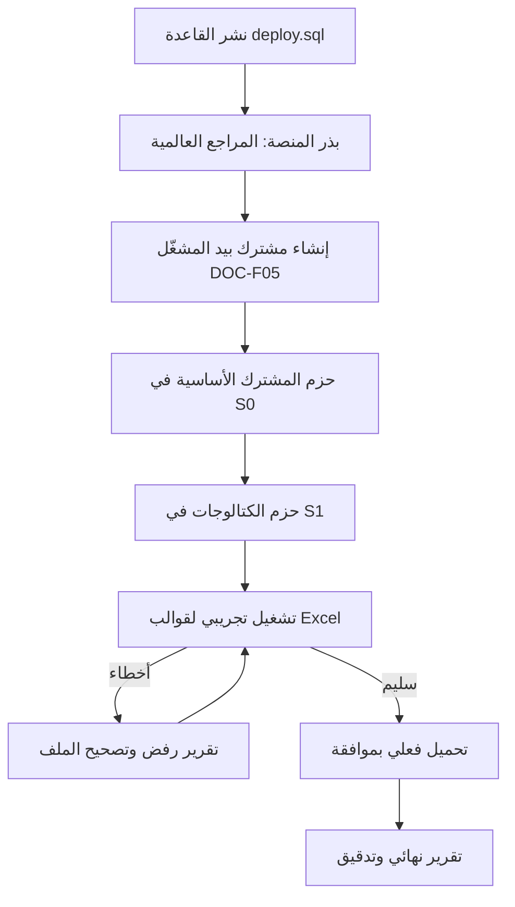
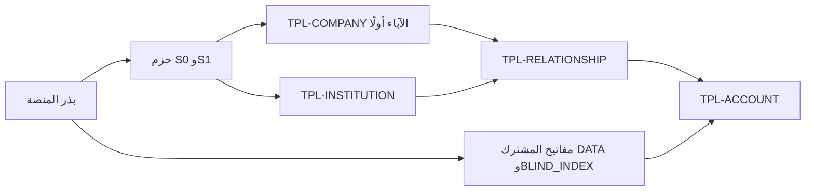

# DOC-B05 — خطة البذر والترحيل الأولي

| البند | القيمة |
|---|---|
| المعرّف | DOC-B05 (docs/30-readiness-documents.md) |
| الإصدار | 0.1 — مسودة للمراجعة — 2026-10-12 |
| المالك المقترح | قائد قاعدة البيانات مع مالك الكتالوجات (docs/30-readiness-documents.md:51) |
| الأولوية | P0 قبل S0 |
| يغطي | FR-PLT-008، FR-PLT-017، FR-PLT-043، FR-CAT-002، FR-CAT-018، FR-CAT-019، FR-CAT-021، FR-CAT-026، BR-CAT-002، BR-CAT-015، BR-CAT-018، Q-CAT-01، Q-CAT-03، Q-ORG-10، Q-INS-01، O-3 وO-2 (20-database-design) |
| يعتمد على | DOC-F05، DOC-S02، DOC-S06، DOC-S07، DOC-S08، DOC-B01، DOC-B04، DOC-B09، DOC-B11 |
| المصادر | db/deploy.sql، db/model/10-platform.model، 11-organization-party.model، 12-institutions-accounts-catalogs.model، 14-…، 15-…، 16-…، db/generated/tsql/001_tables.sql، db/static/010_rls.sql، db/tests/tenant_isolation_tests.sql، docs/10-detailed-analysis/00-overview-and-cross-cutting.md، 10-m0-m1…، 11-m2-m4…، docs/20-database-design.md |

> **تحديث التنفيذ (2026-10-12):** بدأ بذر المنصة في db/seed/100_platform_global.sql ضمن ترتيب النشر (§4.3)، وهو آمن لإعادة التشغيل وتتحقق منه الخطوة 4b في CI: مفاتيح الإعدادات الأمنية الست، وقائمة المهام (30، ثم 31 بإضافة JOB-PLT-EXPORT في ADR 0008)، والباقة STANDARD بكل الوحدات (DQ-B05-4)، و23 عنوانًا محجوزًا. وأول مشغّل يُنشأ بإجراء التمهيد `plat.usp_BootstrapOperator` بدعوة (DQ-B05-7، DQ-F07-3). وبُذرت بعدها (ADR 0005): قوائم الدول والعملات في db/seed/101_iso_reference.sql (249 دولة و157 عملة فعّالة، بإصدار ISO مسجَّل في رأس الملف: iso-codes 4.16.0-1 مع تعديلات ISO 4217 اللاحقة، والأسماء العربية من CLDR، والكسور من وحدات ISO 4217؛ دون العملات الملغاة والمعادن ووحدات الحساب والعملتين ذواتي الخانات الأربع؛ ورمز الاتصال وعطلة الأسبوع لدول الخليج الست فقط، DQ-B05-5)، ورموز الصلاحيات الـ138 في db/seed/102_permissions.sql بأسمائها ووحداتها، خمس منها مقفلة على TM وFO (DQ-F07-1، DQ-F09-1). الملفان مولَّدان (tools/dbgen/gen_iso_seed.py وgen_permission_seed.py)، والخطوة 2 في CI تعيد توليد الصلاحيات من المستندات وتطابقها. وبُذرت أخيرًا (2026-10-13) في db/seed/103_lc_reference.sql: قواعد Incoterms الـ16 (11 نشطة و5 قديمة LEGACY) ومواد UCP 600 الـ39 صفوفَ منصة بحالة UNVERIFIED حتى يتحقق مختص (O-06)، والأسماء العربية ترجمة عمل يؤكدها TRM. فاكتمل البذر العالمي في §4.1 عدا العطل الرسمية التي يدخلها المشغّل. باقٍ: رموز الاتصال لغير الخليج من مصدر ITU، وتأكيد عطلات الخليج (Q-CAT-12، O-25).

## 1. الغرض والنطاق

تحدد الوثيقة ثلاث طبقات للبيانات الأولى:

1. بذر المنصة: المراجع العالمية التي تُنشر مع القاعدة.
2. بذر المشترك: الحزم التي تُنسخ لكل مشترك عند التهيئة.
3. الترحيل الأولي: تحميل الشركات والبنوك والعلاقات والحسابات من قوالب Excel.

لكل قائمة: مصدرها، ومن يقرّ محتواها، وشريحتها، وكيف تبقى إعادة التشغيل آمنة. تسلسل التهيئة نفسه وفشلها وتراجعها في DOC-F05. المفاتيح التي يحتاجها تشفير الحسابات في DOC-S02. رموز الأدوار في عمود المالك معرّفة في DOC-B09 (OWN مالك المنتج، TRM مدير الخزينة، SEC الأمن، DBA قاعدة البيانات، OPS التشغيل، LEG القانوني ومسؤول حماية البيانات).

## 2. ما يوجد اليوم

| الحقيقة | المصدر |
|---|---|
| لا توجد بيانات بذر في المستودع. عبارات INSERT الوحيدة تملأ الجدول المؤقت #rls_tables | db/generated/tsql/004_rls_tables.sql:9-18 |
| ترتيب النشر لا يحوي خطوة بذر | db/deploy.sql:22-34 |
| اختبارات العزل تعطّل المفاتيح الأجنبية لأن المراجع غير مبذورة، وتستعمل PlanId=1 وHomeCountryId=1 غير موجودين | db/tests/tenant_isolation_tests.sql:29-34، :69-73 |
| DDL غير قابل لإعادة التشغيل (CREATE TABLE بلا حراسة)، فالنشر لقاعدة جديدة فقط ولا مسار ترحيل | db/generated/tsql/001_tables.sql:8؛ docs/20-database-design.md:530 (O-2) |
| علامة catalog تضيف SeedKey وفرادة (Tenant, SeedKey) | tools/dbgen/README.md:40 |
| SeedKey موجود أيضًا في: sec.Role، cfg.NumberSequenceDefinition، cfg.ExpiryAlertRule، org.Department، pty.CustomFieldDefinition، pty.KycProfile، pty.KycProfileItem، wfl.RequestType، wfl.WorkflowTemplate، ntf.NotificationEventType، ntf.NotificationRule، lc.LcFieldDefinition، lc.LcDocumentClause، ref.UcpArticle | db/model/10-platform.model:163، :451، :489؛ 11-organization-party.model:66، :388، :418، :439؛ 15-workflow-notifications.model:37، :84، :540، :561؛ 16-letters-of-credit.model:55، :81، :141 |
| سجل تشغيل البذر cfg.SeedRun مملوك للمشترك (TenantId NOT NULL) | db/model/10-platform.model:572-584؛ db/generated/tsql/001_tables.sql:933-934 |
| 11 جدولًا عالميًا بلا RLS، و3 مختلطة. صف المنصة في الجدول المختلط لا يكتبه إلا عضو tp_platform | db/generated/tsql/001_tables.sql؛ db/static/010_rls.sql:70-75؛ db/tests/tenant_isolation_tests.sql:107-110 |
| الكتالوجات كلها مملوكة للمشترك بعد DR-03، بما فيها الأشكال القانونية وقوائم القيم | docs/20-database-design.md:421-428؛ db/model/12-institutions-accounts-catalogs.model:61-79 |
| خطة البذر في وثيقة القاعدة «لم تُنفَّذ بعد» | docs/20-database-design.md:470-478 |
| قوالب Excel مذكورة في استراتيجية الاختبار دون أي متطلب FR | docs/10-detailed-analysis/00-overview-and-cross-cutting.md:219 |

## 3. طبقات التحميل

## 4. بذر المنصة (عالمي)

### 4.1 الجداول والمحتوى

| الجدول | المحتوى | المصدر | يقرّه | الشريحة |
|---|---|---|---|---|
| ref.Country | قائمة ISO 3166-1 كاملة؛ IsGcc وWeekendDays وDialCode للدول الست فقط، والعطلة الأسبوعية للتحقق 🟡 | 11-m2-m4…:342؛ BR-CAT-018 (:256)؛ FR-CAT-026 (:189) | OWN، ويستشير LEG للعطل | S0، لأن Tenant.HomeCountryId إلزامي (db/model/10-platform.model:38) |
| ref.Currency | قائمة ISO 4217 كاملة بعدد الخانات العشرية | 11-m2-m4…:341؛ db/model/12-institutions-accounts-catalogs.model:29-44 | TRM | S0 |
| ref.Incoterm | 11 قاعدة نشطة (2020) و5 قديمة LEGACY | 11-m2-m4…:343؛ db/model/16-letters-of-credit.model:32-43 | TRM | S0 للنشر، والاستعمال في S3 |
| ref.UcpArticle (صفوف المنصة) | مواد UCP 600 بحالة UNVERIFIED | db/model/16-letters-of-credit.model:45-62؛ O-06 (erd_open_items) | LEG يتحقق | S3 |
| plat.Plan وplat.PlanModule | لا قائمة باقات في الوثائق. نقترح باقة واحدة STANDARD بكل الوحدات وبلا حدود 🟡 | db/model/10-platform.model:14-29؛ Q-PLT-11 | OWN | S0 |
| plat.ReservedSubdomain | www وadmin وapi وapp وغيرها | FR-PLT-046 (10-m0-m1…:148)؛ db/model/10-platform.model:58-62 | OPS مع SEC | S0 |
| sec.Permission | كل رموز الصلاحيات بنصها الحرفي من مصفوفات §2، وLockedToRoleCodes للصلاحيات الأربع المقفلة على TM وFO | FR-PLT-017 (10-m0-m1…:119)؛ FR-PLT-019 (:121)؛ BR-PLT-019 (:245) | SEC مع OWN | S0 لرموز CORE، ثم رموز كل وحدة مع شريحتها |
| cfg.SettingDefinition | مفاتيح الإعداد وقيمها الافتراضية وحدودها: سياسة كلمة المرور، المهل، work.start وwork.end، العتبات | FR-PLT-043 (10-m0-m1…:145)؛ BR-PLT-018 (:244)؛ db/model/10-platform.model:426-436 | SEC للأمنية، TRM للتشغيلية | S0 |
| cfg.NonWorkingDay (صفوف المنصة) | العطل الرسمية لكل دولة؛ يدخلها المشغّل من الشاشة ولا تُبذر من المستودع 🟡 | Q-PLT-09 (90-consolidated…:19)؛ شاشة 4 (10-m0-m1…:376) | OPS بصفة مشغّل | S2 (FR-PLT-035) |
| plat.PlatformOperator | لا يُبذر. أول مشغّل يُنشأ بإجراء تمهيد لمرة واحدة يصدر دعوة، فلا كلمة مرور في أي سكربت 🟡 | FR-PLT-006 (10-m0-m1…:108) | SEC | S0 |

### 4.2 ما لا يُبذر على مستوى المنصة

- **دليل البنوك:** الافتراض الموصى به لـ Q-INS-01، وهو غير محسوم: لا دليل مشترك في S1، وكل مشترك يدخل منشآته، ويبقى DirectoryRef محجوزًا (90-consolidated…:48؛ db/model/12-institutions-accounts-catalogs.model:288). نعتمده هنا 🟡. تُحمَّل البنوك بالقالب TPL-INSTITUTION (§7).
- **الأشكال القانونية والمناصب وأنواع الصلاحيات:** جداول مملوكة للمشترك (db/model/12-institutions-accounts-catalogs.model:61، :95، :101). المنصة تحفظ محتواها حزمةً في المستودع، وكل مشترك يأخذ نسخة (§5).
- **الأدوار:** sec.Role مملوك للمشترك. قوالب الأدوار حزمة مشترك (§5).

### 4.3 الموقع في ترتيب النشر (منفّذ)

| الخطوة | الملف المقترح | يُشغَّل بصفة | السبب |
|---|---|---|---|
| بعد 050 | db/seed/100_platform_global.sql و101_iso_reference.sql و102_permissions.sql | منفّذ النشر (مالك المخطط) | الجداول العالمية بلا RLS |
| بعدها | db/seed/103_lc_reference.sql | منفّذ النشر لـ ref.Incoterm؛ ولصفوف المنصة في ref.UcpArticle مستخدم مؤقت بلا تسجيل دخول عضو في tp_platform، عبر EXECUTE AS، يُحذف في آخر الملف | محمول الكتابة يقبل صف المنصة من tp_platform فقط (db/static/010_rls.sql:70-75) |
| قبل الاختبارات | الخطوة 4b في tools/ci/db_ci.sh تشغّل الملفات مرة ثانية وتشترط أن يبقى العدد كما هو وألا يُعدَّل صف | CI | إثبات التكرار الآمن |

السطران يُضافان إلى db/deploy.sql بعد السطر 34 بصيغة `:r seed/...`. ولأن DDL لا يُعاد تشغيله، يُشغَّل الملفان أيضًا وحدهما عند تحديث المراجع على قاعدة قائمة. الحساب الذي يشغّل الملف الثاني تحدده DOC-S08.

## 5. بذر المشترك عند التهيئة

### 5.1 الحزم

الحزمة وحدة إصدار. لكل حزمة PackKey ورقم SeedVersion، وتسجّل كل تشغيل في cfg.SeedRun 🟢 (FR-PLT-008، 10-m0-m1…:110). أسماء الحزم أدناه مقترحة 🟡.

| الحزمة | الجداول | المحتوى والعدد | المصدر | الشريحة |
|---|---|---|---|---|
| CORE.ROLES | sec.Role، sec.RolePermission | أدوار النظام TA وTM وFO وTE وFA وRQ وAU وRK (مسؤول المخاطر، قرار المالك 35)، بـ IsSystem=1 وSeedKey. ✅ **مبنية (2026-10-21، ADR 0035):** تُولَّد من مصفوفات الأدوار (`tools/dbgen/core_roles_pack.py`) إلى `db/seed/packs/CORE.ROLES/v1`، وفيها 393 ربطًا، ويطبّقها في القاعدة `sec.usp_SeedCoreRoles` (057) أثناء التهيئة. الاختبارات CR1 إلى CR6 | 12-m5…:46؛ 10-m0-m1…:39-70؛ db/model/10-platform.model:156-167 | S0 |
| CORE.NUMBERING | cfg.NumberSequenceDefinition | REQUEST وPROFORMA وغيرهما، بـ GapPolicy، وغير مفعّلة حتى يفعّلها TA 🟡 | db/model/10-platform.model:443-453؛ BR-ORG-001 | S0 |
| CAT.DOCTYPES | cat.DocumentType | 42 نوعًا بأعلامها، ويُضاف النوع النظامي `DATA_EXPORT_PACKAGE` (عام، حساس، مقفل) لحزم التصدير، فتصير 43 (ADR 0008). ✅ وحزمة نوعٍ حساس تُكتب RESTRICTED ولو خلت من البيانات المقيّدة، كما يشترط 043 لوثائق الأنواع الحساسة (db/static/042_data_export.sql، المراجعة الذاتية A10، X7) | 11-m2-m4…:330؛ FR-CAT-018 (:181) | S0، لأن مخزن المستندات FR-PLT-028 في S0 |
| CORE.DEPARTMENTS | org.Department | إدارة لكل Function: TREASURY وPROCUREMENT وSALES وFINANCE 🟡 | FR-PLT-008؛ FR-ORG-014 (10-m0-m1…:168)؛ 11-organization-party.model:56-68 | S1 |
| CORE.EXPIRY | cfg.ExpiryAlertRule | قواعد الجدول §9.2 | 10-m0-m1…:517-526؛ db/model/10-platform.model:482-491 | S1 |
| CAT.ORG | cat.LegalEntityType، cat.Position، cat.PowerType | 7 أشكال (5 🟢 و2 🟡)، 12 منصبًا، 10 أنواع صلاحية | 11-m2-m4…:326، :328-329، :351-380؛ Q-CAT-03؛ Q-ORG-10 | S1 |
| CAT.BANKING | cat.InstitutionType، AccountType، OperationType، OperationTypePowerType، ProductCategory، Product، FeeType، FinancingType، FacilityType، LimitType، CollateralType، ObligationType، BaseRate | 5، 8، 11، 13 صفًا، 8، 22، 19، 6، 6، 9، 9، 30، 9 | 11-m2-m4…:319-340 | S1 |
| CAT.LOOKUPS | cat.LookupList، cat.LookupItem | UNIT_TYPE وCONTACT_ROLE وACCOUNT_PURPOSE وSIGNATURE_CLASS وAUTHORISATION_BASIS، ثم قوائم الاعتماد في S3 | 11-m2-m4…:320-349؛ docs/20-database-design.md:476 | S1، وقوائم LC في S3 |
| CAT.CURRENCY | cat.TenantCurrency | SAR وUSD وEUR وGBP وAED مفعّلة | 11-m2-m4…:341؛ Q-CAT-08 | S1 |
| NTF.BASE | ntf.NotificationEventType، ntf.NotificationRule، ntf.NotificationTemplate | رموز الأحداث في 13 §9.2 ومنها رموز 10-m0-m1…:539؛ الإصدار v1 في `db/seed/packs/NTF.BASE/v1/` (2026-10-20، ADR 0028): حدثا الإنذار المبكر وقواعدهما وثمانية قوالب بالعربية والإنجليزية، يفحصها `tools/dbgen/ntf_pack.py`؛ واعتمدها المالك افتراضًا (القرار 35)، والخزينة تعدّل نصها أو تبقيه؛ والإنذار الأحمر يصل أيضًا حاملي `fin.credit.endorse` | db/model/15-workflow-notifications.model:527-570 | S1 |
| FIN.PROVISION | fin.ReceivableLossRate | نسب خسارة افتراضية لمصفوفة مخصص الذمم: 1 و5 و20 و50%، و10% للحكومي فوق سنة، بحالة مسودة تعتمدها الخزينة؛ في `db/seed/packs/FIN.PROVISION/v1/` (ADR 0030) | القرار 35 (D4) | S2-ب |
| PTY.KYC | pty.KycProfile، pty.KycProfileItem | ملفات KYC المسبقة من 05 §3؛ يُكتب كل ملف مسودة ثم بنوده ثم يُفعَّل، لأن بنود النسخة الفعّالة لا تتغير (ADR 0006) | db/model/11-organization-party.model:407-441 | S2 |
| CMP.TERMS | cmp.TermType | مفاتيح الشروط القابلة للمقارنة | db/model/13-facilities-pricing-terms.model:542 | S2 |
| FIN.LINES | fin.LineCatalogItem | 39 بندًا | db/model/14-collateral-obligations-financials.model:383 | S2-ب |
| WFL.BASE | wfl.ExternalPhase، wfl.RequestType، wfl.WorkflowTemplate | 8 مراحل ظاهرة وأنواع الطلبات وقوالبها | db/model/15-workflow-notifications.model:20-96 | S3 |
| LC.BASE | lc.LcFieldDefinition، lc.LcDocumentClause | تعريفات الحقول و13 بندًا | db/model/16-letters-of-credit.model:64-83، :123-143 | S3 |

عناصر التهيئة التي ليست حزمًا وتملكها DOC-F05: صف المشترك، وحساب الخدمة IsSystemUser (db/model/10-platform.model:123)، ومفاتيح sec.TenantKey (DOC-S02)، وصفوف plat.TenantModule من باقة المشترك (FR-PLT-003)، ودعوة مدير الحساب الأول.

خروج S0 يطلب «تأهيل مشترك جديد آليًا» (00-overview…:194). يكفي له بناء الآلية والحزم المعلَّمة S0. كل شريحة لاحقة تضيف حزمها، وتُطبَّق على المشتركين القائمين بتشغيل UPGRADE.

### 5.2 مصادر القوائم ومالكوها

| القائمة | المصدر | يقرّها (A) | يعدّها (R) |
|---|---|---|---|
| الدول والعملات | معياران ISO بإصدار مسجَّل في الحزمة | OWN | DBA |
| العطلة الأسبوعية ورموز الاتصال للخليج | مقترح يُراجع (BR-CAT-018) | LEG | DBA |
| رموز الصلاحيات وقوالب الأدوار | مصفوفات §2 في 10 إلى 14 | SEC | BA |
| الأشكال القانونية والمناصب وأنواع الصلاحيات | 01 §3 مع مراجعة قانونية (Q-CAT-03، Q-ORG-10) | LEG | BA |
| أنواع المستندات ومدد الاحتفاظ | 11 §6.4؛ Q-CAT-06؛ Q-PLT-04 | LEG | BA |
| المنتجات والرسوم والحدود والضمانات والالتزامات وأسعار الأساس | 11 §6.4 من الاتفاقيات والنماذج | TRM | BA |
| ربط العمليات بأنواع الصلاحيات | 11 §6.4 (Q-ACC-05) | LEG | BA |
| تعريفات الترقيم | Q-PLT-08؛ O-12 (erd_open_items) | OWN | DBA |
| الإعدادات وحدودها | FR-PLT-043 | SEC | SA |
| العناوين المحجوزة | FR-PLT-046 | SEC | OPS |
| الباقات ووحداتها | Q-PLT-11 | OWN | PM |
| مواد UCP 600 | نص ICC الرسمي (O-06، Q-LCT-01) | LEG | BA |

المُعِدّ لا يقرّ قائمته بنفسه (X-SEC-7، 00-overview…:142؛ القاعدة في DOC-B09).

## 6. قواعد التكرار الآمن والإصدار

1. **المصدر ملف لا كود 🟡.** كل حزمة مجلد `db/seed/packs/<PackKey>/v<N>/`، فيه ملف CSV بترميز UTF-8 لكل جدول بأسماء الأعمدة كما في النموذج، وملف manifest.json (PackKey، SeedVersion، الشريحة، المعتمد، المراجع). بذر المنصة يُولَّد منه سكربت MERGE. حزم المشترك يقرؤها ITenantSeeder لكل وحدة (FR-PLT-008).
2. **مفتاح المطابقة.** SeedKey في الجداول التي تحمله. ومعه CountryId في cat.LegalEntityType (db/model/12-institutions-accounts-catalogs.model:77)، وLookupListId في cat.LookupItem (:270)، وRequestTypeId وSourceSeedVersion في wfl.WorkflowTemplate (db/model/15-workflow-notifications.model:88). في الجداول العالمية المفتاح الطبيعي: Iso2، Code، Key، Subdomain.
3. **التشغيل الأول INITIAL:** يدرج الصفوف الناقصة فقط. **الإعادة RERUN:** لا يدرج شيئًا إن لم تتغير الحزمة 🟢 (BR-CAT-002، 11-m2-m4…:240).
4. **الترقية UPGRADE:** يدرج المفاتيح الجديدة، ويحدّث الصف الذي لم يعدّله المشترك، ويتخطى المعدَّل ويعدّه في SkippedModifiedCount ويكتب الفرق في DiffJson 🟢 (FR-PLT-008؛ db/model/10-platform.model:572-584).
5. **كشف تعديل المشترك.** لا يوجد عمود له إلا IsTenantModified في wfl.WorkflowTemplate (db/model/15-workflow-notifications.model:82). نقترح عمودي SeedVersion وSeedHash في أساس الكتالوج (DQ-B05-3).
6. **الحذف ممنوع.** صف أُزيل من الحزمة يصير IsActive=0 إن لم يُستعمل ولم يُعدَّل، ويبقى كما هو في غير ذلك 🟡. الصف المقفل IsLocked لا يُعطَّل 🟢 (BR-CAT-003).
7. **معاملة لكل حزمة.** فشل حزمة يلغي صفوفها ويكتب SeedRun بحالة FAILED خارج المعاملة. التراجع الكامل للتهيئة في DOC-F05.
8. **سجل المنصة.** cfg.SeedRun مملوك للمشترك، فلا يسجّل بذر المنصة. يلزم سجل عالمي (DQ-B05-1).

## 7. الترحيل الأولي من Excel

### 7.1 القوالب

أربعة قوالب، كل منها ورقة واحدة بصف عناوين ثابت وورقة تعليمات. يشير كل قالب إلى الكيانات الأخرى بالرمز لا بالمعرّف 🟡. القوالب 🟡 كلها؛ الحقول من النموذج 🟢.

**TPL-COMPANY → org.Company** (db/model/11-organization-party.model:12-43)

| العمود | إلزامي | التحقق |
|---|---|---|
| CompanyCode | نعم | فريد في المشترك وفي الملف (BR-ORG-001) |
| NameAr، NameEn | نعم | 200 حرف |
| LegalEntityTypeCode | نعم | موجود ونشط في كتالوج المشترك ومتوافق مع الدولة (BR-ORG-016) |
| CountryIso2 | نعم | موجود في ref.Country |
| ParentCompanyCode | لا | في القاعدة أو في الملف؛ بلا حلقة؛ العمق 10 على الأكثر (BR-ORG-002) |
| IsHolding | لا | TRUE أو FALSE (BR-ORG-003) |
| CrNumber، CrDate، CrDateHijriText | لا | فريد ضمن الدولة لغير المؤرشفة؛ تاريخ هجري صالح |
| ErpCompanyCode (الرقم الضريبي في `pty.TaxIdentity`، DR-25) | لا | تكرار ERP ممنوع دائمًا (BR-ORG-001، قرار المالك 2026-10-13) |
| FiscalYearEndMonth، FiscalYearEndDay | الشهر نعم | 1 إلى 12، و1 إلى 31 (BR-ORG-004) |
| BaseCurrencyCode | لا | عملة مفعّلة للمشترك |

يُنشئ التحميل Party المرآة لكل شركة 🟢 (FR-PTY-003، 10-m0-m1…:193)، وOwnershipStatus=UNDOCUMENTED.

**TPL-INSTITUTION → ins.Institution** (db/model/12-institutions-accounts-catalogs.model:278-297)

| العمود | إلزامي | التحقق |
|---|---|---|
| InstitutionCode | نعم | أحرف كبيرة بلا مسافات، فريد (V-INS-01) |
| NameAr | نعم | NameEn اختياري |
| InstitutionTypeCode | نعم | من الكتالوج؛ INDIVIDUAL يُرفض في القالب لأنه يتطلب Party (BR-INS-003) 🟡 |
| CountryIso2 | نعم | موجود في ref.Country |
| SwiftBic | لا | 8 أو 11 خانة (BR-INS-001)؛ التكرار تحذير (V-INS-02) |
| Website، Notes | لا | |

**TPL-RELATIONSHIP → ins.Relationship** (:328-342)

| العمود | إلزامي | التحقق |
|---|---|---|
| CompanyCode، InstitutionCode | نعم | الزوج فريد بأي حالة (V-INS-05 E، BR-INS-007) |
| Status | نعم | PROSPECT أو ACTIVE فقط في القالب 🟡 |
| CustomerNoAtBank | لا | تكراره في المنشأة تحذير (V-INS-05 W) |
| StartedOn | لا | تاريخ |

**TPL-ACCOUNT → acc.BankAccount** (:378-417)

| العمود | إلزامي | التحقق |
|---|---|---|
| CompanyCode، InstitutionCode | نعم | توجد علاقة بينهما |
| AccountTypeCode | نعم | من الكتالوج؛ VIRTUAL مستبعد من القالب الأول 🟡 |
| CurrencyCode | نعم | عملة مفعّلة |
| AccountNo | نعم | مقيّد؛ يُشفَّر ويُفهرس ولا يتكرر في المنشأة (V-ACC-01) |
| Iban | لا | مقيّد؛ الطول وmod 97 (BR-ACC-002)؛ فريد في المشترك |
| Nickname، SigningRuleText | لا | |
| MinSignatures | لا | 1 افتراضيًا، ولا يقل عن 1 (V-ACC-03) |
| OpenedOn | لا | الحساب المغلق لا يُحمَّل 🟡 |

### 7.2 ترتيب التحميل

- داخل ملف الشركات يرتّب المحمّل الصفوف ترتيبًا طوبولوجيًا بالأم 🟡.
- قالب الحسابات لا يعمل قبل وجود مفتاحي DATA وBLIND_INDEX فعّالين، لأن الرقم وIBAN يُخزَّنان مشفّرين مع فهرس أعمى (db/model/12-institutions-accounts-catalogs.model:385-396).
- ولا يُحمَّل رقم حساب حقيقي قبل حسم حفظ المفتاح الرئيسي وإقامة البيانات والنسخ الاحتياطي 🟢 (docs/adr/0001-schema-work-on-linux.md:26).

### 7.3 التشغيل التجريبي والتحقق والرفض 🟡

| البند | القاعدة |
|---|---|
| الوضع الافتراضي | تشغيل تجريبي: يتحقق من كل الصفوف داخل معاملة ثم يلغيها، ويصدر التقرير نفسه |
| التحميل الفعلي | يشترط تشغيلًا تجريبيًا سليمًا على الملف نفسه (بصمة SHA-256) خلال 24 ساعة |
| الذرية | الملف كله أو لا شيء: أي خطأ E يمنع تحميل الملف كله |
| التحذيرات | صفوف W تُحمَّل بعد إقرار مسجَّل في التشغيل، على نمط DOC-B04 §9.2 |
| تقرير الرفض | لكل صف: رقم الصف، والعمود، والرمز (V-XXX-nn أو BR)، والشدة، ورسالة إنجليزية؛ ويُصدَّر CSV |
| حماية المقيّد | التقرير لا يكرر رقم الحساب ولا IBAN، بل آخر 4 خانات فقط (X-SEC-3) |
| الملف الأصلي | يُرفع عبر الواجهة إلى مخزن المستندات المشفّر (FR-PLT-027)، ويُحذف بعد انقضاء مدة تقررها DOC-S07 |
| الصلاحية | الشركات والبنوك والعلاقات لـ TA أو TM. الحسابات لمن يرى الأرقام كاملة: TM وFO وTE (Q-ACC-02) |
| فصل المهام | من يرفع الملف لا يعتمد التحميل الفعلي للحسابات (X-SEC-7) |
| السجل | تشغيل في cfg.JobRun (db/model/10-platform.model:554) وحدث تدقيق بعدد الصفوف وبصمة الملف |
| الواجهة | نقطة POST /api/v1/imports بمفتاح Idempotency-Key وإجابة 202، وفق DOC-B04 |

## 8. الاختبارات (تُنقل إلى DOC-B01)

| المعرّف | الاختبار | يثبت |
|---|---|---|
| T-SEED-1 | نشر ثم بذر المنصة مرتين؛ العدد والبصمة متطابقان | التكرار الآمن |
| T-SEED-2 | تهيئة مشترك ثم إعادة الحزم؛ CreatedCount=0 في الثانية | FR-PLT-008، BR-CAT-002 |
| T-SEED-3 | الأعداد بعد التهيئة: 22 منتجًا و19 نوع رسوم و42 نوع مستند و7 أشكال و12 منصبًا و10 أنواع صلاحية و11 نوع عملية | FR-CAT-002 (11-m2-m4…:165) |
| T-SEED-4 | صف عدّله المشترك لا يتغير عند UPGRADE، ويظهر في DiffJson | FR-PLT-008 |
| T-SEED-5 | اتصال المشترك لا يكتب جدولًا عالميًا مثل ref.Currency | docs/20-database-design.md:493 (اختبار غير مكتوب) |
| T-IMP-1 | التشغيل التجريبي لا يترك صفًا | §7.3 |
| T-IMP-2 | ملف فيه خطأ E واحد لا يحمّل أي صف، والتقرير يسمّي الصف والعمود | §7.3 |
| T-IMP-3 | تقرير الحسابات لا يحوي رقمًا كاملًا | X-SEC-3 |

## 9. القرارات المطلوبة

| المعرّف | السؤال | الافتراض المقترح | من يقرر | ما يعطّله |
|---|---|---|---|---|
| DQ-B05-1 | سجل لبذر المنصة، وcfg.SeedRun مملوك للمشترك | جدول عالمي جديد cfg.PlatformSeedRun بالأعمدة نفسها | DBA | §4.3، T-SEED-1 |
| DQ-B05-2 | أين يعيش محتوى الحزم | ملفات CSV وmanifest في db/seed/packs؛ سكربت MERGE مولَّد للمنصة، وITenantSeeder للمشترك | SA مع DBA | كل الحزم |
| DQ-B05-3 | كشف تعديل المشترك لصف مبذور | عمودا SeedVersion وSeedHash في أساس الكتالوج وكل جدول بـ SeedKey | DBA | UPGRADE وT-SEED-4 |
| DQ-B05-4 | الباقات الأولى | ✅ معتمد من المالك (2026-10-12): باقة واحدة STANDARD بكل الوحدات وبلا حدود | OWN | إنشاء مشترك في S0 |
| DQ-B05-5 | قوائم الدول والعملات كاملة أم جزئية | ✅ معتمد من المالك (2026-10-12): كاملة بعلم IsActive، وإصدار ISO مسجَّل | OWN | S0 |
| DQ-B05-6 | اعتماد الأشكال القانونية والمناصب وأنواع الصلاحيات (Q-CAT-03، Q-ORG-10) | ✅ معتمد من المالك (2026-10-12): 5 أشكال 🟢 تُبذر، وPARTNERSHIP وFOREIGN_BRANCH بعد إقرار LEG | LEG مع TRM | حزمة CAT.ORG في S1 |
| DQ-B05-7 | تمهيد أول مشغّل منصة | إجراء لمرة واحدة يشغّله OPS ويصدر دعوة، بلا كلمة مرور في سكربت | SEC (DOC-S08، DOC-F03) | لوحة المشغّل |
| DQ-B05-8 | لا متطلب FR لقوالب Excel | ✅ معتمد من المالك (2026-10-12): إضافة متطلبات استيراد للشركات (10) وللمنشآت والعلاقات والحسابات (11) بأولوية Should في S1 | OWN مع BA | §7 |
| DQ-B05-9 | سجل تشغيل الاستيراد | cfg.JobRun للتشغيل، والتقرير مستند في doc.Document، بلا جدول جديد | SA | §7.3 |
| DQ-B05-10 | أداة ترحيل المخطط بين الإصدارات (O-2 في 20-database-design) | تُختار قبل أول نشر على بيانات حقيقية؛ المذكور في الوثيقة DbUp أو Flyway | DBA مع OPS | أول بيانات حقيقية |
| DQ-B05-11 | حزم الدول (Q-CAT-01) | ✅ معتمد من المالك (2026-10-12): حزمة واحدة للسعودية والخليج | TRM | CAT.ORG وCAT.BANKING |
| DQ-B05-12 | قوائم أدوار النظام ورموزها الموحدة | ✅ معتمد من المالك (2026-10-12): TA وTM وFO وTE وFA وRQ وAU كما في 12-m5…:46، وتُثبَّت في 10 §2؛ وأضاف المالك RK مسؤول المخاطر في 2026-10-20 (القرار 35) | OWN مع SEC | CORE.ROLES في S0 |

## 10. تعارضات وفجوات في المصادر

1. docs/20-database-design.md:474 يضع ntf.NotificationEventType و«تعريفات حقول الاعتماد» في البذر العالمي. النموذج يجعلهما مملوكين للمشترك (db/model/15-workflow-notifications.model:527؛ db/model/16-letters-of-credit.model:64). **محلول (2026-10-13):** صُحّحت وثيقة التصميم §13 لتتبع النموذج، فهما في الحزمتين NTF.BASE وLC.BASE (§5.1).
2. docs/20-database-design.md:474 يقول إن cfg.SeedRun يسجّل البذر العالمي، والجدول مملوك للمشترك (db/generated/tsql/001_tables.sql:933-934).
3. BR-PLT-001 (10-m0-m1…:227) يعدّ LookupList وLookupItem وIncoterm وLC_TYPE مختلطة، ويقصر العالمية على Country وCurrency وPermission وPlan وPlatformOperator. النموذج: قوائم القيم مملوكة للمشترك (DR-03، docs/20-database-design.md:421-428)، وref.Incoterm عالمي (db/model/16-letters-of-credit.model:32)، والعالمية 11 جدولًا منها ReservedSubdomain وPlanModule وSettingDefinition.
4. 11-m2-m4…:344-345 تصف LC_TYPE وLC_CONFIRMATION بأنها «عالمي»، وهما قائمتا قيم صارتا مملوكتين للمشترك بعد DR-03.
5. FR-PLT-008 في S0 (10-m0-m1…:110) يبذر الإدارات والأشكال القانونية والمناصب والكتالوجات، بينما متطلباتها في S1: FR-ORG-014 (:168)، FR-CAT-002 (11-m2-m4…:165)، FR-CAT-019 (:182). الحل هنا: الآلية والحزم الأساسية في S0، والمحتوى مع شريحته.
6. قوالب Excel في 00-overview…:219 بلا أي متطلب FR، وFR-CAT-024 (11-m2-m4…:187) يغطي الكتالوجات فقط في S5.
7. افتراض Q-CAT-01 «للسعودية/الخليج» (90-consolidated…:63)، وفي 00-overview…:311 «حزمة واحدة (السعودية)».
8. FR-CAT-026 (11-m2-m4…:189) يربط إضافة الدول بصلاحية `cat.global.manage`، والمشغّل لا يحمل صلاحيات sec.Permission بل دورًا في plat.PlatformOperator.Role (db/model/10-platform.model:67).

## 11. التتبع

| البند في هذه الوثيقة | المتطلب أو القاعدة أو القرار | المصدر |
|---|---|---|
| §2 غياب البذر | O-3 (20-database-design) | docs/20-database-design.md:531 |
| §4.1 المراجع العالمية | FR-CAT-021، FR-CAT-026، BR-CAT-015، BR-CAT-018 | 11-m2-m4…:184، :189، :253، :256 |
| §4.1 الصلاحيات | FR-PLT-017، FR-PLT-019، BR-PLT-019 | 10-m0-m1…:119، :121، :245 |
| §4.1 الإعدادات | FR-PLT-043، BR-PLT-018 | 10-m0-m1…:145، :244 |
| §4.2 دليل البنوك | Q-INS-01، FR-INS-020 | 90-consolidated…:48؛ db/model/12-institutions-accounts-catalogs.model:288 |
| §4.3 ترتيب النشر | deploy.sql، RLS للمختلط | db/deploy.sql:22-34؛ db/static/010_rls.sql:70-75 |
| §5.1 الحزم | FR-PLT-008، FR-CAT-002، FR-CAT-018، FR-CAT-019 | 10-m0-m1…:110؛ 11-m2-m4…:165، :181، :182 |
| §5.2 الملكية | Q-CAT-03، Q-ORG-10، X-SEC-7 | 90-consolidated…:65، :32؛ 00-overview…:142 |
| §6 التكرار الآمن | BR-CAT-002، BR-CAT-003، cfg.SeedRun | 11-m2-m4…:240-241؛ db/model/10-platform.model:572-584 |
| §7 قوالب Excel | 00-overview §8 | docs/10-detailed-analysis/00-overview-and-cross-cutting.md:219 |
| §7.1 القواعد | BR-ORG-001 إلى BR-ORG-004، V-INS-01، V-INS-02، V-INS-05، V-ACC-01، V-ACC-03 | 10-m0-m1…:251-254؛ 11-m2-m4…:491-500 |
| §7.2 المفاتيح | ADR 0001 (العواقب)، FR-PLT-037 | docs/adr/0001-schema-work-on-linux.md:26؛ 10-m0-m1…:139 |
| §7.3 حماية المقيّد | X-SEC-3، Q-ACC-02 | 00-overview…:138؛ 90-consolidated…:56 |
