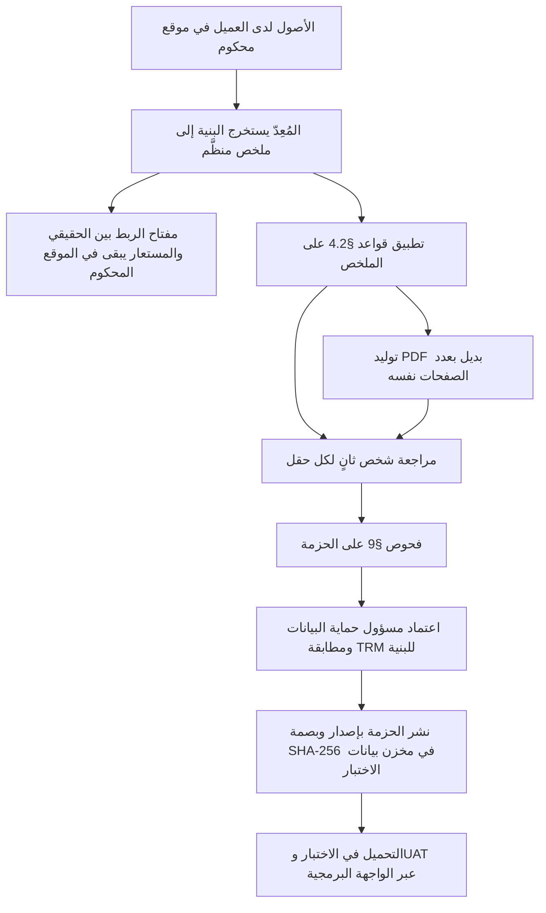
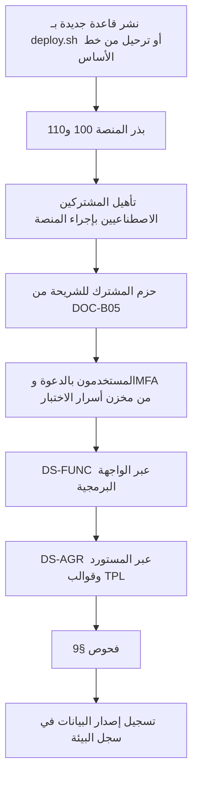

# DOC-B06 — مواصفة بيانات الاختبار والتجهيل

| البند | القيمة |
|---|---|
| المعرّف | DOC-B06 (docs/30-readiness-documents.md) |
| الإصدار | 0.1 — مسودة للمراجعة — 2026-10-12 |
| المالك المقترح | قائد ضمان الجودة مع مسؤول الامتثال لحماية البيانات (docs/30-readiness-documents.md:52) |
| الأولوية | P1 قبل S2 |
| يغطي | X-SEC-2، X-SEC-3، X-AUD-4، FR-PLT-037، FR-PTY-006، FR-ACC-004، FR-ACC-009، BR-PLT-015، BR-PTY-008، NFR-SCL-01، NFR-SCL-02، NFR-SEC-14، خروج S2، 00 §8 |
| يعتمد على | DOC-S06 (التصنيف)، DOC-S07 (الخصوصية)، DOC-S02 (المفاتيح)، DOC-B05 (حزم البذر)، DOC-B01، DOC-B11، DOC-B12، DOC-S13 |
| المصادر | docs/10-detailed-analysis/00-overview-and-cross-cutting.md، docs/04-facility-agreements-analysis.md، docs/02-forms-analysis-ucp600.md، docs/05-kyc-forms-analysis.md، docs/adr/0001-schema-work-on-linux.md، db/tests/tenant_isolation_tests.sql، db/generated/tsql/006_sensitive_columns.sql، db/model/*.model |

## 1. الغرض والنطاق

تحدد الوثيقة من أين تأتي بيانات كل بيئة غير إنتاجية، وكيف تُولَّد أو تُجهَّل، ومن يطّلع عليها، وكيف يُثبت أن أي قيمة مقيّدة حقيقية لم تصل إليها.

- **داخل النطاق:** مجموعات البيانات لكل مستوى اختبار، وقواعد كل مستوى تصنيف، والمولّدات، وتجهيز الاتفاقيات الأربع والنماذج الثلاثة، وما لا يغادر الإنتاج، وتهيئة البيئات، والتحقق.
- **خارج النطاق:** مستويات التصنيف نفسها (DOC-S06)، والأساس النظامي ومدد الاحتفاظ (DOC-S07)، والمفاتيح (DOC-S02)، ومحتوى حزم البذر (DOC-B05)، وتعريف البيئات (DOC-B11).
- **«الإنتاج» هنا** يعني كل مصدر حقيقي: قاعدة الإنتاج ونسخها بعد الإطلاق، وقبله الملفات الأصلية لدى العميل: الاتفاقيات الممسوحة، والنماذج، وجداول Excel للشركات والبنوك والحسابات.

## 2. ما يوجد اليوم

| الحقيقة | المصدر |
|---|---|
| البيئات: تطوير ← اختبار ← UAT ← إنتاج، «بيانات تجريبية مجهّلة» 🟢 | docs/10-detailed-analysis/00-overview-and-cross-cutting.md:127 |
| الاتفاقيات الأربع والنماذج الثلاثة اختبار قبول لـ S2 وS3 وS4، تحت بند «بيانات حقيقية» 🟢 | docs/10-detailed-analysis/00-overview-and-cross-cutting.md:216 |
| UAT مع الخزينة والمشتريات والمبيعات «على بيانات مجهّلة» 🟢 | docs/10-detailed-analysis/00-overview-and-cross-cutting.md:218 |
| خروج S2: «إدخال الاتفاقيات الأربع الفعلية بلا قيد خارج النموذج» 🟢 | docs/10-detailed-analysis/00-overview-and-cross-cutting.md:196 |
| لا تُحمَّل بيانات حقيقية قبل حسم حفظ المفاتيح وإقامة البيانات والنسخ 🟢 | docs/adr/0001-schema-work-on-linux.md:26 |
| اختبارات العزل تشترط قاعدة «لا تحوي بيانات حقيقية»، ومشتركوها TST-A وTST-B وTST-C وبريدهم على النطاق test.invalid | db/tests/tenant_isolation_tests.sql:7، :67-70، :78 |
| قاعدة بيانات الاختبار في التصنيف: العامة تُنسخ، والداخلية مجهّلة 🟡، والسرّية والمقيّدة اصطناعية | docs/30-readiness/DOC-S06-data-classification-standard.md §4 |
| 29 عمودًا مقيّدًا لها DENY لدور التقارير | db/generated/tsql/006_sensitive_columns.sql:7-35 |
| الاتفاقيات صور ممسوحة بلا نص (81 صفحة)، ولا يُدخل رقم مالي قبل مطابقته بالأصل 🟢 | docs/04-facility-agreements-analysis.md:7، :13 |
| تحليل الاتفاقيات لا ينقل أسماء الأشخاص ولا أرقام الهويات والسجلات ولا أسماء الشركات، ويسمّيها A إلى D 🟢 | docs/04-facility-agreements-analysis.md:14 |
| لا مولّد بيانات ولا مجموعة مجهّلة ولا قواعد تجهيل في المستودع | docs/30-readiness-documents.md:383 |

## 3. مجموعات البيانات

| المعرّف | الغرض | المصدر | البيئة | العمر |
|---|---|---|---|---|
| DS-UNIT | الوحدات والتكامل وحالات القاعدة | اصطناعية ينشئها الاختبار | التطوير وCI | معاملة تُلغى (db/tests/tenant_isolation_tests.sql:10-11) |
| DS-SEC | العزل والعبور وIDOR | اصطناعية: المشتركون A وB ومشترك مغلق | CI والاختبار | لكل تشغيل (DOC-S13 §5.1) |
| DS-FUNC | الواجهة وسيناريوهات DOC-B02 واختبار خروج الشريحة | المولّدات في §5 | الاختبار | يُعاد بناؤها مع كل إصدار مرشح |
| DS-PERF | الأداء والحجم | المولّدات بحجم NFR-SCL-01 وNFR-SCL-02 | بيئة قياس الأداء (DQ-B03-9) | لكل حملة قياس |
| DS-AGR | قبول S2 وS3 وS4 | حزم مجهّلة للاتفاقيات A إلى D والنماذج الثلاثة (§6) | الاختبار وUAT | بإصدار وبصمة |
| DS-UAT | قبول المستخدم | DS-AGR مع بيانات اصطناعية للأشخاص والحسابات (§6.5) | UAT | دورة UAT (DOC-B12) |
| DS-PEN | اختبار الاختراق | اصطناعية فقط | النسخة المعزولة (DOC-S13 §9) | تُحذف بعد الاختبار |

القاعدة الأولى 🟡: **الأصل اصطناعي.** التجهيل استثناء لحالتين فقط: حزم الاتفاقيات والنماذج DS-AGR، وما يقرّه مسؤول حماية البيانات لـ UAT (DQ-B06-1).

## 4. القواعد بحسب التصنيف

### 4.1 لكل مستوى

المستويات من DOC-S06 §2. «اصطناعي» قيمة تولَّد دون أي مدخل حقيقي. «مجهّل» قيمة مشتقة من مصدر حقيقي بتحويل لا يُعكس دون مفتاح الربط.

| المستوى | DS-UNIT وDS-SEC وDS-FUNC وDS-PERF | DS-AGR وDS-UAT | ممنوع دائمًا |
|---|---|---|---|
| عامة | تُنسخ: ISO للدول والعملات، وIncoterms، ومواد UCP بحالة UNVERIFIED | تُنسخ | — |
| داخلية | اصطناعية | مجهّلة بالقواعد في §4.2 | نسخ مباشر من مصدر حقيقي |
| سرّية | اصطناعية | اصطناعية؛ والمبالغ والتواريخ مجهّلة بالقواعد في §4.2 | الأسماء والعناوين ووسائل الاتصال وتواريخ الميلاد الحقيقية |
| مقيّدة | اصطناعية | اصطناعية فقط | أي قيمة حقيقية أو مشتقة منها، ولو كانت بصمة |

البصمة ليست تجهيلًا: رقم هوية من عشر خانات يُستخرج من بصمته بالتجربة. لذلك لا يدخل أي اختبار بصمة لقيمة حقيقية.

### 4.2 لكل نوع حقل

| الحقل | أمثلة الأعمدة | القاعدة 🟡 |
|---|---|---|
| أسماء الأشخاص | pty.Party.NameAr وNameEn، sec.AppUser.DisplayNameEn | أسماء مركّبة من قائمتي كلمات عربية وإنجليزية يقرّهما مسؤول حماية البيانات، بلا أسماء من المصادر؛ تتضمن صيغ همزة مختلفة لاختبار البحث (AC-PTY-4) |
| أرقام الهوية والإقامة والجواز | pty.IdentityDocument.NumberEnc وNumberMask وNumberHash | مولَّدة بطول النمط المعرَّف، ببادئة اختبار محجوزة حتى يُحسم Q-PTY-06 (DQ-B06-7)؛ تمر بالتشفير والقناع والفهرس كأي قيمة |
| صور الوثائق | doc.DocumentVersion بروابط IMAGE_FRONT وIMAGE_BACK | صور PNG مولَّدة تحمل كلمة TEST وبصمة المولّد، بلا وجوه |
| أرقام الحسابات وIBAN | acc.BankAccount.AccountNo* وIban*، lc.LcTerms.BeneficiaryAccountIban* | أرقام عشوائية بطول الحساب، وIBAN بطول الدولة ورقمي تحقق صحيحين (BR-ACC-002)؛ والتوثيق يستعمل مثال AC-ACC-1 (docs/10-detailed-analysis/11-m2-m4-institutions-accounts-catalogs.md:652) |
| أسرار الدخول | PasswordHash، MfaSecretEnc، TokenHash، CodeHash | كلمات مرور ومفاتيح TOTP يولّدها التجهيز وتُحفظ في مخزن أسرار الاختبار فقط |
| إقرارات الامتثال | pty.PartyCompliance | أعلام عشوائية بنسب يحددها السيناريو، و Details نص ثابت |
| البريد | sec.AppUser.Email، pty.ContactMethod.Value، lc.Counterparty.Email | النطاق test.invalid أو نطاق فرعي منه لكل مشترك، كما في db/tests/tenant_isolation_tests.sql:78 |
| الهاتف والفاكس | pty.ContactMethod، lc.Counterparty.Phone | أرقام من نطاق اختبار محجوز يحدده DQ-B06-7 |
| أسماء الشركات ورموزها وسجلاتها | org.Company.NameEn وCode وCrNumber وErpCompanyCode، وpty.TaxIdentity.TaxNumber وVatNumber | رموز بنمط XX01 كما في أمثلة المواصفات (docs/10-detailed-analysis/10-m0-m1-platform-organization.md:236)، وأسماء مولَّدة، وأرقام سجلات ببادئة محجوزة |
| أسماء البنوك المقرضة | ins.Institution.NameAr وNameEn وSwiftBic | أسماء مستعارة BNK-A إلى BNK-D في DS-AGR، وBNK1 فما بعد في غيرها؛ رمز BIC اصطناعي يبدأ بـ TST |
| المبالغ | fac.Facility.TotalAmount، حدود وخطوط، fin.StatementLine | في الاصطناعية: عشوائية في مدى السيناريو. في DS-AGR: ضرب كل مبالغ الاتفاقية في معامل سري واحد ثم التقريب إلى ألف، فتبقى المساواة والنسب (DQ-B06-3) |
| النسب | هوامش الربح، والرسوم، ونسب التعهدات | الهوامش والرسوم اصطناعية؛ مهل التقارير ونسب التعهدات وفراغها تبقى، لأنها منطق الاختبار (DQ-B06-5) |
| التواريخ | السريان والانتهاء والتوقيع | إزاحة كل تواريخ الاتفاقية بعدد صحيح من السنوات، ومواعيد التنبيه تُولَّد نسبة إلى يوم التشغيل (DQ-B06-4) |
| النص الحر | OriginalText، Notes، الملاحظات | نص مولَّد يحاكي البند بلا اقتباس من الأصل؛ لا نسخ أبدًا، لأن النص قد يحمل IBAN (DR-31 في DOC-S06 §7.1) |
| مراجع الصفحات | مصدر القيمة (X-DAT-4) | رقم الصفحة يبقى، والمستند المرفق ملف PDF مولَّد بالعدد نفسه من الصفحات |
| عناوين IP ووكيل المتصفح | sec.LoginAttempt، aud.AuditLog | ينتجها تشغيل الاختبار نفسه؛ لا تُنسخ من سجل حقيقي |

## 5. المولّدات

مولّد واحد لكل كيان، ببذرة عشوائية ثابتة فيعيد الناتج نفسه في كل تشغيل 🟡 (DQ-B06-8). كل صف يحمل علامة اختبار يقرؤها فحص §9.

| الكيان | القواعد 🟡 | العلامة |
|---|---|---|
| المشترك | رمز tst-{كلمة}{رقمين}، مثل tst-alpha01؛ الدولة SA والتوقيت Asia/Riyadh كما في الاختبارات القائمة (db/tests/tenant_isolation_tests.sql:67-70)؛ الباقة STANDARD (DQ-B05-4)؛ الحالة حسب السيناريو؛ ينشأ بإجراء التأهيل نفسه (DOC-F05) | البادئة tst- |
| المستخدمون | مستخدم لكل دور نظام TA وTM وFO وTE وFA وRQ وAU (DOC-B05 CORE.ROLES)، ومستخدم بنطاق شركة واحدة، ومستخدم بلا صلاحيات؛ الدعوة عبر ملتقِط SMTP (DQ-B01-9) | البريد على test.invalid |
| الشركات | 3 إلى 6 لكل مشترك بعمق 3 وشركة قابضة؛ نهاية سنة مالية 31 ديسمبر أو 30 يونيو (AC-ORG-5)؛ مستندات بعضها ينتهي خلال 30 يومًا (AC-ORG-6) | رمز يبدأ بـ XX |
| الأشخاص | كفلاء ومالكون ومفوّضون وجهات اتصال؛ مواطن ومقيم وخليجي وغير مقيم (AC-PTY-4)؛ إقامة تنتهي خلال 25 يومًا لاختبار التنبيه | NameEn ينتهي بـ (T) |
| البنوك | 4 إلى 8 منشآت بأنواع الكتالوج، ووحدات حتى 4 مستويات (AC-INS-5)، وجهات اتصال، وعلاقة لكل زوج شركة وبنك | الرمز BNK والـ BIC يبدأ بـ TST |
| الحسابات | حساب رئيسي لكل علاقة وحساب افتراضي، وعملات SAR وUSD | IBAN من سجل المولّد |
| التسهيلات | من نماذج A إلى D في §6.3: شجرة الحدود ونمط التوزيع، وخطوط المنتجات، والتسعير، والضمانات، وأجندة التقارير، وتعهد بلا قيمة؛ وتسهيل ينتهي خلال 30 يومًا (AC-FAC-6) | FacilityNo يبدأ بـ TST |
| الاعتمادات المستندية | من النماذج الثلاثة في §6.4: طلب بروفورما، وطلب اعتماد استيراد، وبروفورما صادرة بالصيغة {seq:000}-{erp}-{yy}؛ أطراف مقابلة اصطناعية؛ مبالغ بـ USD وEUR وSAR | الطرف المقابل على test.invalid |

أحجام DS-PERF: 300 مشترك (NFR-SCL-01) و50,000 سجل لكل جدول رئيسي لكل مشترك (NFR-SCL-02)، بالتوزيع نفسه للحالات والعملات.

## 6. الاتفاقيات الأربع والنماذج الثلاثة

### 6.1 ما هي

| المرجع | الوصف دون أسماء | ما يختبره في النظام | المصدر |
|---|---|---|---|
| A | تجديد لاتفاقية سابقة بحزمة ملاحق؛ خطوط منتجات كلٌّ بمبلغ الحد العام، دوارة غير جامعة؛ قوائم مدققة خلال 210 أيام ونصف سنوية خلال 45 يومًا | سقف مشترك، وأجندة تقارير | docs/04-facility-agreements-analysis.md:22، :43، :69 |
| B | تسهيلات مع اتفاقية مرابحة إطارية ومذكرة تجديد؛ حدّان فرعيان كلٌّ يساوي الحد الكلي | سلسلة التجديد، والحد الفرعي المساوي للأب | :23، :70 |
| C | اتفاقية إطارية بملاحق؛ حد صرف أجنبي خارج المجموع؛ تعهد إيداع نسبة من الإيرادات؛ للبنك تمديد السريان منفردًا | نمط «خارج المجموع»، وتعهد رقمي | :24، :57، :72 |
| D | تجديد مع اتفاقية تمويل إسلامي؛ فرعان بنسبة 95% من الأب؛ بنود نسب مالية بقيم فارغة في النسخة الموقعة | تعهد بلا قيمة (FR-PRC-017، AC-FAC-10) | :25، :35، :71 |
| F-a | طلب إصدار بروفورما من المبيعات (Excel) | M8 والبروفورما | docs/02-forms-analysis-ucp600.md:7 |
| F-b | نموذج طلب ووعد بالشراء لاعتماد استيراد بالمرابحة (PDF) | M7 وشروط الاعتماد | المصدر نفسه |
| F-c | البروفورما الصادرة فعليًا (DOCX) | مخرج دورة البروفورما | المصدر نفسه |

### 6.2 الإجراء

قواعد 🟡:

1. المُعِدّ (QA) غير المراجع، والمعتمد مسؤول حماية البيانات، ومطابقة البنية من مدير الخزينة TRM. لا يعتمد أحد ما أعدّه (X-SEC-7).
2. الملفات الأصلية لا تدخل المستودع ولا بيئة الاختبار ولا UAT، ولا مخزن المستندات في أي منها.
3. الملخص يحفظ لكل قيمة مرجعها: الاتفاقية والصفحة والبند، كما يطلب X-DAT-4 (docs/10-detailed-analysis/00-overview-and-cross-cutting.md:158).
4. القيم المقروءة من مسح ضعيف تحمل علامة «قُرئت من مسح» كما في الأصل (docs/04-facility-agreements-analysis.md:13).
5. صيغة الحزمة كصيغة DOC-B05 §6: مجلد بإصدار، وملف CSV لكل كيان، وmanifest.json بالمُعِدّ والمعتمد والبصمات.

### 6.3 ما يبقى وما يُستبدل في حزم الاتفاقيات

| يبقى كما هو | يُستبدل |
|---|---|
| عدد الحدود والخطوط وشجرتها، ونمط التوزيع (مشترك، تجزئة، خارج المجموع) | أسماء البنوك والشركات والأشخاص (§4.2) |
| أنواع المنتجات وطرق التسعير (مرابحة، تورق، عمولة) | قيم الهوامش والرسوم |
| مهل التقارير بالأيام والأشهر، ومراسيها | المبالغ بمعامل سري واحد لكل اتفاقية |
| نسب التعهدات، والقيم الفارغة فارغة | التواريخ بإزاحة سنوات كاملة |
| عدد الصفحات ومرجع كل قيمة | النصوص الحرفية بنص مولَّد |
| علامات «قُرئت من مسح» والتعارضات | أرقام السجلات والحسابات والهويات |

### 6.4 النماذج الثلاثة

- F-a وF-c تحملان رموز شركات من ERP وعملاء وبنود بضائع (docs/02-forms-analysis-ucp600.md:25-30). تُستبدل الرموز بـ XX01 فما بعد، والعملاء بأطراف مقابلة اصطناعية، والبنود بقائمة بضائع مولَّدة، وتبقى الحقول والصيغ والضريبة.
- F-b نموذج بنك فارغ الحقول بطبيعته؛ تُعبَّأ نسخة الاختبار ببيانات اصطناعية، ويبقى ترتيب الحقول ووسومها.
- الرقم المطبوع على البروفورما يتبع الصيغة {seq:000}-{erp}-{yy} برمز ERP اصطناعي (BR-PLT-010).

### 6.5 قبول S2 بالاتفاقيات الأربع

شرط الخروج «إدخال الاتفاقيات الأربع الفعلية» (docs/10-detailed-analysis/00-overview-and-cross-cutting.md:196) يصطدم بمنع البيانات الحقيقية قبل حسم المفاتيح والإقامة والنسخ (docs/adr/0001-schema-work-on-linux.md:26). الاقتراح 🟡 (DQ-B06-2):

| المرحلة | ما يُدخل | أين | ما يثبته |
|---|---|---|---|
| خروج S2 | حزم DS-AGR A إلى D كاملة بنيةً | بيئة الاختبار | أن كل بند يجد مكانه في النموذج «بلا قيد خارج النموذج»، وأن إنذار الانتهاء يعمل |
| خروج S3 وS4 | DS-AGR مع F-a إلى F-c | الاختبار وUAT | طلب اعتماد يمر كل مراحله، ورصيد اعتماد التصدير |
| التجربة (S5) | الاتفاقيات بقيمها الحقيقية يدخلها المستخدمون | الإنتاج فقط، بعد بوابات DOC-S02 وDOC-S07 وDOC-S09 | مطابقة كل رقم بالأصل (docs/04-facility-agreements-analysis.md:13) |

## 7. ما لا يغادر الإنتاج أبدًا

1. أي قيمة من الأعمدة المقيّدة التسعة والعشرين أو مشتقة منها (db/generated/tsql/006_sensitive_columns.sql:7-35)، وأي صورة وثيقة أو ملف من المخزن.
2. النسخ الاحتياطية وسجلات المعاملات ونسخ القاعدة، ولو بلا المفتاح الرئيسي، لأن الأسماء والمبالغ غير مشفّرة (docs/30-readiness/DOC-B11-environments-build-release.md §10).
3. المفاتيح الرئيسية ومفاتيح المشترك ومفاتيح الفهرس الأعمى (BR-PLT-015، DOC-S02).
4. سجل التدقيق وسجل الوصول الحساس، لأنهما يحملان قيمًا قبل وبعد وعناوين IP (DOC-S07 P-15 وP-16).
5. محاولات الدخول والجلسات والرموز وبريد المستخدمين (DOC-S07 P-12 إلى P-14).
6. سجلات التطبيق والوكيل.
7. حزم التصدير (cfg.DataExportJob).
8. قبل الإطلاق: الاتفاقيات الممسوحة والنماذج وجداول Excel الأصلية ومفتاح الربط في §6.2.

الاستثناء الوحيد ناتج إجراء §6.2 بعد اعتماده. ولا يُنسخ أي شيء من UAT إلى الاختبار أو التطوير إن أدخل فيه مستخدم بيانات حقيقية خطأً؛ يُعامل ذلك حادثًا (DOC-S15) وتُعاد البيئة.

## 8. تهيئة بيئات الاختبار

| البيئة | البذر | البيانات | إعادة البناء |
|---|---|---|---|
| التطوير وCI | بذر المنصة والحزم من المستودع | DS-UNIT وDS-SEC | كل تشغيل |
| الاختبار | كالإنتاج: بذر المنصة ثم التأهيل والحزم | DS-FUNC وDS-AGR | مع كل إصدار مرشح |
| قياس الأداء | كالاختبار | DS-PERF بمحمّل جماعي يعمل بصفة tp_app المربوط لكل مشترك، لا بصفة sa | لكل حملة |
| UAT | كالإنتاج تمامًا، بمفاتيح مستقلة (DOC-B11 §9) | DS-UAT | بداية كل دورة UAT |

قواعد 🟡:

- تمر البيانات بالمسار الذي يمر به المستخدم: التأهيل والواجهة البرمجية والمستورد، فتُطبق التحققات والتشفير والتدقيق. الاستثناء DS-UNIT في القاعدة، الذي يعطّل القيود داخل معاملة تُلغى (db/tests/tenant_isolation_tests.sql:29-34).
- إصدار الحزم المطبقة يُسجَّل في cfg.SeedRun كما في الإنتاج (DOC-B05 §6)، وإصدار DS-AGR وبصمته في سجل البيئة.
- كلمات مرور حسابات الاختبار وأسرار TOTP في مخزن أسرار البيئة، لا في المستودع (DOC-B11 §9).

## 9. التحقق من غياب القيم الحقيقية

| الفحص | ما يفعله | أين ومتى | الفشل |
|---|---|---|---|
| V-1 العلامات | يعدّ صفوف الجداول الرئيسية بلا علامة اختبار (§5)، عدا الصفوف العامة | CI بعد التوليد، والاختبار وUAT بعد التهيئة | أي صف بلا علامة |
| V-2 قائمة المنع | يقارن بصمات القيم في البيئة ببصمات القيم الحقيقية: الأسماء، وأرقام الهويات والسجلات، والحسابات وIBAN | في الموقع المحكوم على تصدير من البيئة، لأن قائمة البصمات نفسها حساسة | أي تطابق |
| V-3 الأنماط | يبحث عن أنماط IBAN والهوية والبريد والهاتف، ويقبل فقط ما في سجل قيم المولّد | CI والاختبار وUAT | قيمة خارج السجل |
| V-4 الملفات | كل ملف في المخزن يحمل بصمة المولّد، وبصمة SHA-256 لا تطابق أي ملف أصلي | مع V-2 | أي ملف أصلي |
| V-5 السجلات | مسح سجلات التطبيق بأنماط المنع (NFR-SEC-14) | بعد كل حملة اختبار | أي تطابق |
| V-6 الاعتماد | توقيع مسؤول حماية البيانات على إصدار الحزمة وبصمتها | قبل نشر DS-AGR أو DS-UAT | لا نشر بلا توقيع |

نتائج V-1 إلى V-5 تُحفظ مع تقرير خروج الشريحة (DOC-B01 §9).

## 10. من يطّلع على ماذا

| المادة | من يطّلع | أين |
|---|---|---|
| الأصول ومفتاح الربط | TRM والمُعِدّ ومسؤول حماية البيانات | الموقع المحكوم لدى العميل فقط |
| حزم DS-AGR | فريق المشروع وممثلو UAT | مخزن بيانات الاختبار بصلاحيات، لا المستودع (DQ-B06-6) |
| DS-UAT | مستخدمو UAT بحساباتهم وMFA، وQA | بيئة UAT |
| المولّدات وبذورها وقوائم الكلمات | كل المطورين | المستودع |
| قائمة بصمات المنع | مسؤول حماية البيانات والمُعِدّ | الموقع المحكوم |
| مخرجات V-1 إلى V-6 | QA ومسؤول حماية البيانات | تقرير الخروج |

يُتلف مفتاح الربط بعد اعتماد التجربة بقرار مسؤول حماية البيانات، وتُحذف حزم DS-AGR بانتهاء الحاجة إليها 🟡.

## 11. القرارات المطلوبة

| المعرّف | السؤال | الافتراض المقترح | من يقرر | ما يعطّله |
|---|---|---|---|---|
| DQ-B06-1 | هل تُستعمل بيانات العميل الرئيسية مجهّلة في UAT؟ | ✅ معتمد من المالك (2026-10-12): لا افتراضيًا؛ DS-AGR مع بيانات اصطناعية، والتجهيل لغيرها باعتماد LEG فقط | LEG مع OWN | DS-UAT |
| DQ-B06-2 | كيف يتحقق خروج S2 بالاتفاقيات «الفعلية» | ✅ معتمد من المالك (2026-10-12): ببنيتها كاملة مجهّلة في الاختبار، وبقيمها الحقيقية في الإنتاج عند التجربة (§6.5) | OWN مع TRM | خروج S2 |
| DQ-B06-3 | تحويل المبالغ | ✅ معتمد من المالك (2026-10-12): معامل سري واحد لكل اتفاقية بين 0.5 و2.0 ثم التقريب إلى ألف | LEG مع TRM | DS-AGR |
| DQ-B06-4 | تحويل التواريخ | إزاحة بسنوات كاملة لكل اتفاقية؛ مواعيد التنبيه تُولَّد نسبة إلى يوم التشغيل | QA | DS-AGR، AC-FAC-6 |
| DQ-B06-5 | ما يبقى من النسب | ✅ معتمد من المالك (2026-10-12): مهل التقارير ونسب التعهدات وفراغها تبقى؛ الهوامش والرسوم تُستبدل | TRM مع LEG | §6.3 |
| DQ-B06-6 | مكان حزم DS-AGR ومفتاح الربط | الحزم في مخزن بيانات اختبار بصلاحيات خارج المستودع؛ المفتاح والأصول لدى العميل | LEG مع OPS | §10 |
| DQ-B06-7 | بادئات ونطاقات القيم الاصطناعية | بادئة محجوزة لأرقام الهوية والسجلات تُحدد مع Q-PTY-06، ونطاق هاتف للاختبار يقرّه LEG | LEG مع BA | المولّدات |
| DQ-B06-8 | مكان المولّدات ولغتها | مجلد tools/testdata في المستودع لبيانات القاعدة والحزم، ومشروع اختبار .NET لبيانات التطبيق، ببذور ثابتة | QA مع APP | DS-FUNC، DS-PERF |
| DQ-B06-9 | سلسلة الاعتماد للحزم | ✅ معتمد من المالك (2026-10-12): QA يعدّ، وشخص ثانٍ يراجع، وTRM يطابق البنية، وLEG يعتمد | OWN | V-6 |
| DQ-B06-10 | مكان تشغيل V-2 | في الموقع المحكوم على تصدير من البيئة؛ قائمة البصمات لا تغادره | LEG | §9 |

## 12. تعارضات وفجوات في المصادر

1. docs/10-detailed-analysis/00-overview-and-cross-cutting.md:216 يضع الاتفاقيات والنماذج تحت «بيانات حقيقية» لقبول S2 إلى S4، والسطر 127 يجعل بيانات البيئات «مجهّلة»، وdocs/adr/0001-schema-work-on-linux.md:26 يمنع البيانات الحقيقية قبل حسم المفاتيح والإقامة والنسخ (DQ-B06-2).
2. docs/04-facility-agreements-analysis.md:22-25 يذكر البنك المقرض لكل اتفاقية مع حدها وتاريخها وسريانها. مجموع هذه القيم يكفي لتعريف المجموعة المقترضة، مع أن ملاحظة الخصوصية في السطر 14 تقتصر على الأشخاص والشركات والأرقام. هذه الوثيقة تستبدل أسماء البنوك في بيانات الاختبار (§4.2).
3. docs/02-forms-analysis-ucp600.md:7 يذكر أسماء ملفات النماذج الأصلية، وفيها أسماء شركات، خلافًا لقاعدة «خصوصية الوثيقة» (docs/10-detailed-analysis/10-m0-m1-platform-organization.md:11).
4. DOC-S06 §4 يجعل الداخلية «مجهّلة 🟡» في الاختبار، وهذه الوثيقة تجعلها اصطناعية إلا في DS-AGR وDS-UAT. لا تعارض في المعنى، لكن DOC-S06 يُحدَّث ليحيل إلى §4.1 هنا.
5. اختبارات العزل تبذر بمراجع غير موجودة (PlanId=1 وHomeCountryId=1) مع تعطيل القيود (db/tests/tenant_isolation_tests.sql:29-34، :67-70). مقبول في DS-UNIT، لكنه لا يصلح لـ DS-FUNC؛ والمولّدات تبدأ من بذر حقيقي للمنصة (DOC-B05).

## 13. التتبع

| البند في هذه الوثيقة | المتطلب أو القاعدة أو القرار | المصدر |
|---|---|---|
| §2، §3 | البيئات، 00 §8 | docs/10-detailed-analysis/00-overview-and-cross-cutting.md:127، :216، :218 |
| §4 | X-SEC-2، X-SEC-3، تصنيف DOC-S06 | docs/10-detailed-analysis/00-overview-and-cross-cutting.md:137-138؛ docs/30-readiness/DOC-S06-data-classification-standard.md §4 |
| §4.2 IBAN | FR-ACC-004، BR-ACC-002 | docs/10-detailed-analysis/11-m2-m4-institutions-accounts-catalogs.md:140، :219 |
| §4.2 الهوية | FR-PTY-006، BR-PTY-008، Q-PTY-06 | docs/10-detailed-analysis/10-m0-m1-platform-organization.md:196، :279، :640 |
| §5 | NFR-SCL-01، NFR-SCL-02، DOC-B05 | docs/30-readiness/DOC-B03-nfr-specification.md §6؛ docs/30-readiness/DOC-B05-seed-and-initial-migration-plan.md §5 |
| §6 | خروج S2 وS3 وS4، الاتفاقيات A إلى D، النماذج | docs/10-detailed-analysis/00-overview-and-cross-cutting.md:196-200؛ docs/04-facility-agreements-analysis.md:22-25؛ docs/02-forms-analysis-ucp600.md:7 |
| §6.5 | ADR 0001 (العواقب) | docs/adr/0001-schema-work-on-linux.md:26 |
| §7 | BR-PLT-015، DOC-B11 §10، DOC-S07 §4 | docs/10-detailed-analysis/10-m0-m1-platform-organization.md:241 |
| §9 | NFR-SEC-14 | docs/30-readiness/DOC-B03-nfr-specification.md §5 |
| §10 | X-AUD-4، X-SEC-7 | docs/10-detailed-analysis/00-overview-and-cross-cutting.md:142، :150 |
