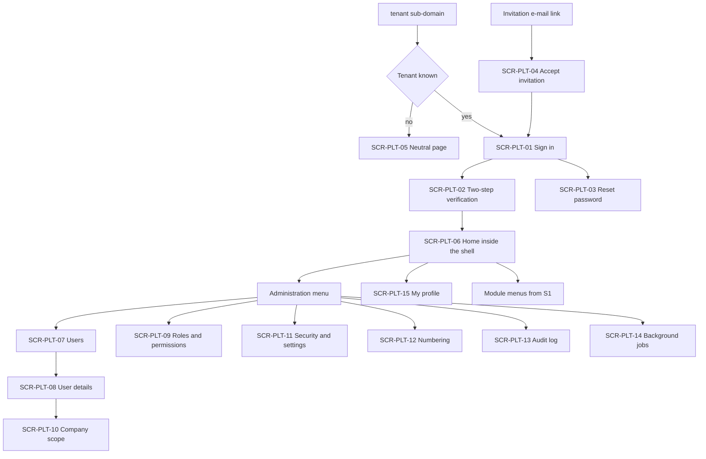
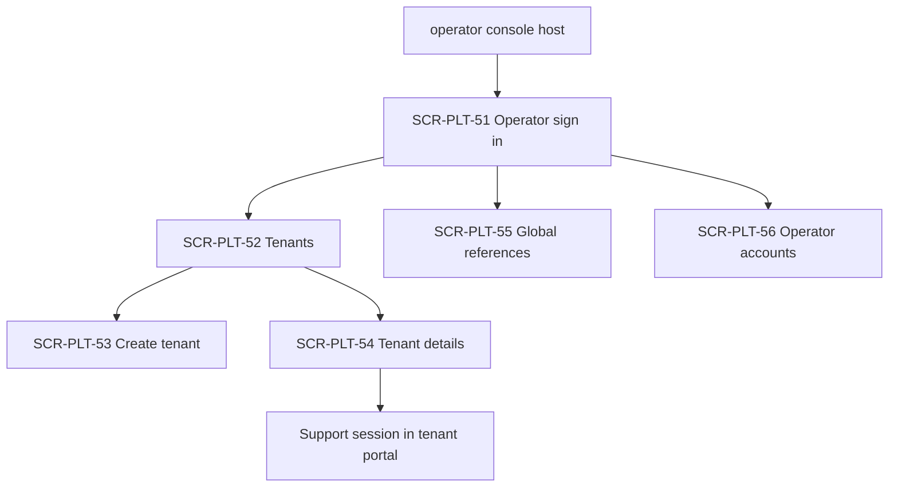

# DOC-B07 — قائمة شاشات S0 وخريطة التنقل والنماذج الأولية

| البند | القيمة |
|---|---|
| المعرّف | DOC-B07 (docs/30-readiness-documents.md) |
| الإصدار | 0.1 — مسودة للمراجعة — 2026-10-12 |
| المالك المقترح | مصمم تجربة المستخدم (UX lead) مع قائد الواجهة الأمامية |
| الأولوية | P0 قبل S0 لشاشات S0 وقشرة التنقل؛ P1 لما بعدها |
| يغطي | FR-PLT-003، FR-PLT-004، FR-PLT-005، FR-PLT-006، FR-PLT-007، FR-PLT-009…014، FR-PLT-016…020، FR-PLT-022…024، FR-PLT-026، FR-PLT-032، FR-PLT-034، FR-PLT-043، FR-PLT-044، FR-PLT-046، BR-PLT-019 |
| يعتمد على | DOC-F07 (حالات الاستخدام ورموز الصلاحيات)، DOC-F03، DOC-S03، DOC-B02، DOC-B04، DOC-B10 |
| المصادر | docs/10-detailed-analysis/10-m0-m1-platform-organization.md:369-398، docs/10-detailed-analysis/00-overview-and-cross-cutting.md:232-246، db/model/10-platform.model، db/static/025_tenant_views.sql |

## 1. الغرض والنطاق

تعطي الوثيقة كل شاشة في S0 معرّفًا موحّدًا SCR-PLT-nn، وتربطها بحالة استخدام من DOC-F07 وبسيناريو قبول حين يوجد، وترسم قشرة التنقل، وتقدم نماذج أولية منخفضة الدقة لخمس شاشات.

- 🟢 الواجهة إنجليزية (LTR) أولًا، والعربية لاحقًا بملفات الموارد دون تعديل الكود (FR-PLT-032، docs/10-detailed-analysis/10-m0-m1-platform-organization.md:134). كل التسميات أدناه إنجليزية مع مقابل عربي للمراجعة؛ المقابلات المعتمدة في DOC-B10.
- 🟡 ترقيم الشاشات: SCR-PLT-01 إلى SCR-PLT-49 لبوابة المشترك، وSCR-PLT-51 إلى SCR-PLT-99 للوحة المشغّل (DQ-B07-2).
- عمود «صف §7.1» يشير إلى رقم الصف في docs/10-detailed-analysis/10-m0-m1-platform-organization.md:371-398؛ «جديد» يعني شاشة لا يذكرها ذلك الجدول.
- الشاشة لا تمنح صلاحية: إخفاء الزر لا يغني عن رفض الخادم (403 أو 404، FR-PLT-021).
- سيناريوهات القبول AC-PLT-1 إلى AC-PLT-4 وAC-ORG وAC-PTY من 10-m0-m1 §15؛ وAC-PLT-5 وما بعدها مقترحة في DOC-B02.

## 2. شاشات بوابة المشترك في S0

| المعرّف | الشاشة | الغرض والحقول والإجراءات | الصلاحية | حالة الاستخدام · القبول | صف §7.1 |
|---|---|---|---|---|---|
| SCR-PLT-01 | Sign in · الدخول | Email، Password؛ Sign in، Forgot password | عامة | UC-PLT-09 · AC-PLT-2، AC-PLT-10، AC-PLT-21 | 1 |
| SCR-PLT-02 | Two-step verification · التحقق بخطوتين | رمز TOTP من 6 أرقام؛ Use a recovery code | جلسة تنتظر MFA | UC-PLT-09 · AC-PLT-2 | 1 |
| SCR-PLT-03 | Reset password · إعادة تعيين كلمة المرور | Email ثم New password مرتين | عامة؛ ثم رمز الرابط | UC-PLT-10 · AC-PLT-11 | 1 |
| SCR-PLT-04 | Accept invitation · قبول الدعوة | كلمة المرور، رمز QR، رمز التأكيد، رموز الاسترداد العشرة | رمز الدعوة | UC-PLT-08 · AC-PLT-11 | جديد |
| SCR-PLT-05 | Neutral page · الصفحة المحايدة | عنوان فرعي غير معروف؛ نص عام بلا كشف | عامة | UC-PLT-09 (1أ) · AC-PLT-21 | جديد |
| SCR-PLT-06 | Home · الرئيسية | قائمة البدء بنسبة الإنجاز لمدير الحساب، واختصارات | مستخدم مصادق؛ قائمة البدء `sec.user.manage` 🟡 | UC-PLT-25 · AC-PLT-9 | جديد |
| SCR-PLT-07 | Users · المستخدمون | بحث، الحالة، الأدوار، الإدارة، المدير المباشر، آخر دخول؛ Invite، Disable، Unlock، Reset MFA، End sessions | `sec.user.manage` 🟡 | UC-PLT-12، UC-PLT-13 · AC-PLT-13، AC-PLT-2 | 5 |
| SCR-PLT-08 | User details · بطاقة المستخدم | تبويبات Profile، Roles، Company scope، Sessions، Activity | `sec.user.manage` 🟡 | UC-PLT-13، UC-PLT-14 · AC-PLT-13، AC-PLT-12 | 5، 6 |
| SCR-PLT-09 | Roles and permissions · الأدوار والصلاحيات | مصفوفة دور × صلاحية بالوحدات المفعّلة؛ علامة حساسة؛ خانة 🔒 معطّلة بسبب القفل؛ Create role، Copy role | `sec.role.manage` 🟡 | UC-PLT-15 · AC-PLT-13، AC-PTY-1 | 6 |
| SCR-PLT-10 | Company scope · نطاق الشركات | All أو Selected؛ شجرة الشركات؛ Include subsidiaries | `sec.user.manage` 🟡 | UC-PLT-16 · AC-PLT-1 | 7 |
| SCR-PLT-11 | Security and settings · الأمان والإعدادات | سياسة كلمة المرور، MFA، المهل، مدة إعادة الإخفاء، العتبات، Work start/end، Support access | `cfg.settings.manage` 🟡؛ وصول الدعم `sec.support.grant` 🟡 | UC-PLT-17، UC-PLT-07 · AC-PLT-19، AC-PLT-8 | 8 |
| SCR-PLT-12 | Numbering · الترقيم | التعريفات، معاينة الصيغة، الأرقام الصادرة والملغاة؛ Define، Void number | `cfg.numbering.manage` 🟡 | UC-PLT-18 · AC-PLT-3، AC-ORG-3 | 9 |
| SCR-PLT-13 | Audit log · سجل التدقيق | مرشحات الفاعل والكيان والفترة والنوع والشركة والشدة؛ قبل وبعد؛ Export | `audit.view` أو `audit.view.treasury`؛ التصدير `audit.export` 🟡 | UC-PLT-20 · AC-PLT-14 | 11 |
| SCR-PLT-14 | Background jobs · المهام الخلفية | المهمة، آخر تشغيل، المدة، النتيجة | `cfg.jobs.view` 🟡 | UC-PLT-24 · AC-PLT-20 | جديد |
| SCR-PLT-15 | My profile · ملفي | Language، Number format، رموز الاسترداد، جلساتي | مستخدم مصادق | UC-PLT-23، UC-PLT-11 · AC-PLT-16، AC-PLT-12 | جديد |
| SCR-PLT-16 | Document panel · مكوّن المستند | مكوّن مشترك: النوع، الملف، البيانات، الإصدارات، Download | صلاحية الكيان المالك | UC-PLT-21، UC-PLT-22 · AC-PLT-15 | جديد |

شاشات M0 بعد S0 (P1، تُفصَّل لاحقًا): SCR-PLT-17 Expiry alert rules (صف 10، S1)، وSCR-PLT-18 Export and retention (صف 12، S5). وشاشات الصفوف 13 إلى 26 تأخذ SCR-ORG-nn وSCR-PTY-nn في تحديث S1 لهذه الوثيقة.

## 3. شاشات لوحة المشغّل في S0

| المعرّف | الشاشة | الغرض والحقول والإجراءات | الصلاحية | حالة الاستخدام · القبول | صف §7.1 |
|---|---|---|---|---|---|
| SCR-PLT-51 | Operator sign in · دخول المشغّل | Email، Password، ثم TOTP | حساب مشغّل | UC-PLT-01 · AC-PLT-7 | جديد |
| SCR-PLT-52 | Tenants · المشتركون | الرمز، الاسم، الباقة، الحالة، عدّادات المستخدمين والشركات والتخزين، نهاية التجربة؛ Create، Activate، Extend trial، Suspend، Reactivate، Close | OPERATOR_ADMIN؛ القراءة OPERATOR_SUPPORT | UC-PLT-05، UC-PLT-03 · AC-PLT-7، AC-PLT-6 | 2 |
| SCR-PLT-53 | Create tenant · إنشاء مشترك | الرمز مع معاينة العنوان الفرعي، الاسمان، الباقة، الدولة الأم، اللغة، التوقيت، الوحدات، بريد المدير الأول | OPERATOR_ADMIN | UC-PLT-02 · AC-PLT-5 | 2 (إجراء) |
| SCR-PLT-54 | Tenant details · تفاصيل المشترك | الوحدات، المدير الأول، إصدارات البذور، جلسات الدعم؛ Enable module، Resend invitation، Re-seed | OPERATOR_ADMIN | UC-PLT-04، UC-PLT-02، UC-PLT-07 · AC-PLT-5، AC-PLT-8 | 3 |
| SCR-PLT-55 | Global references · المراجع العالمية | الباقات، الدول وعطلة الأسبوع، العملات، العطل، كتالوج الصلاحيات للعرض | OPERATOR_ADMIN | UC-PLT-06 · AC-PLT-7 | 4 |
| SCR-PLT-56 | Operator accounts · حسابات المشغّلين | البريد، الدور، الحالة؛ Invite، Disable، Reset MFA | OPERATOR_ADMIN | UC-PLT-01 · AC-PLT-7 | جديد (DQ-F07-3) |

لا شاشة لتدوير المفاتيح 🟡: التدوير بأداة تشغيل موثّقة (UC-PLT-27، DOC-S02).

## 4. خريطة التنقل

### 4.1 العناوين والفصل بين البوابتين

- 🟢 بوابة المشترك على `{tenant}.bankfas.com` بصفحة دخول واحدة لكل عنوان (FR-PLT-046). العنوان غير المعروف يعرض SCR-PLT-05.
- 🟡 لوحة المشغّل على عنوان محجوز منفصل، مثل `admin.bankfas.com` من قائمة الأسماء المحجوزة (FR-PLT-046، plat.ReservedSubdomain في db/model/10-platform.model:58)، وهي حد الثقة TB-2 في DOC-F01. جلسة المشغّل لا تصلح في بوابة مشترك ولا العكس (FR-PLT-006). القرار في DQ-F01-2 وDQ-S03-7، وشكل ملف تعريف الارتباط في DOC-S03.





### 4.2 قشرة بوابة المشترك

```text
+----------------------------------------------------------------------+
| [BankFas] <Tenant name>   Company: [All companies in my scope v]     |
|                                              [Help]  [User name v]   |
+------------------+---------------------------------------------------+
| Home             |                                                   |
| Companies    (S1)|                                                   |
| Parties      (S1)|              <screen content>                     |
| Institutions (S1)|                                                   |
| ...              |                                                   |
| Administration   |                                                   |
|   Users          |                                                   |
|   Roles          |                                                   |
|   Settings       |                                                   |
|   Numbering      |                                                   |
|   Audit log      |                                                   |
|   Jobs           |                                                   |
+------------------+---------------------------------------------------+
```

- الشريط العلوي: اسم المشترك، مبدّل الشركة، المساعدة، قائمة المستخدم (My profile، Sign out).
- القائمة الجانبية تتبع اتجاه اللغة: يسار في الإنجليزية، ويمين في العربية بالخصائص المنطقية (FR-PLT-032).
- 🟡 شريط تنبيه دائم أعلى المحتوى في ثلاث حالات: مشترك ARCHIVED_READ_ONLY (قراءة فقط، وتُخفى أزرار الكتابة)، ومشترك SUSPENDED (السلوك رهن O-18 (erd_open_items))، وجلسة دعم من المشغّل مع وقت انتهائها (BR-PLT-017). DQ-B07-4.

### 4.3 إظهار عناصر القائمة

يظهر العنصر إذا تحقق الشرطان معًا: وحدته مفعّلة في plat.TenantModule ويقرؤها التطبيق من العرض plat.v_TenantModule (db/static/025_tenant_views.sql:22)، والمستخدم يملك صلاحية العرض باتحاد أدواره (BR-PLT-007). الوحدة المعطّلة تختفي ويعيد الخادم 403 (FR-PLT-003).

| عنصر القائمة | المقابل العربي | ModuleCode | الصلاحية اللازمة للظهور | الشريحة |
|---|---|---|---|---|
| Home | الرئيسية | CORE | مستخدم مصادق | S0 |
| Users | المستخدمون | CORE | `sec.user.manage` 🟡 | S0 |
| Roles and permissions | الأدوار والصلاحيات | CORE | `sec.role.manage` 🟡 | S0 |
| Security and settings | الأمان والإعدادات | CORE | `cfg.settings.manage` 🟡 | S0 |
| Numbering | الترقيم | CORE | `cfg.numbering.manage` 🟡 | S0 |
| Audit log | سجل التدقيق | CORE | `audit.view` أو `audit.view.treasury` | S0 |
| Background jobs | المهام الخلفية | CORE | `cfg.jobs.view` 🟡 | S0 |
| Companies | الشركات | CORE | `org.company.view` 🟡 | S1 |
| Parties | الأشخاص والجهات | CORE | `party.view` 🟡 | S1 |
| Institutions · Accounts | المنشآت المالية · الحسابات البنكية | INSTITUTIONS | `ins.view` · `acc.view` | S1 |
| Facilities | التسهيلات | FACILITIES | `fac.view` | S2 |
| Covenants | الالتزامات والتعهدات | COVENANTS | `obl.view` | S2 |
| Requests | الطلبات | REQUESTS | `req.view.own` | S3 |
| Letters of credit | الاعتمادات المستندية | LC_PURCHASE أو LC_SALES | `lc.view.own` أو `lc.view.all` | S3، S4 |

مجموعة Administration تظهر إن ظهر عنصر واحد منها على الأقل.

### 4.4 مبدّل الشركة 🟡 (DQ-B07-1)

- يعرض «All companies in my scope» ثم شركات النطاق الفعلي للمستخدم (sec.UserCompanyScope، أو كل الشركات إن كان النمط ALL).
- يضيّق القوائم واللوحات إلى شركة واحدة، ولا يوسّع النطاق أبدًا؛ الخادم يطبق النطاق في كل طلب (FR-PLT-020).
- لا يغيّر الجلسة ولا ربط سياق المشترك (DOC-F04).
- يُخفى في S0 لأن الشركات تبدأ في S1، ويُعرض اسمًا ثابتًا إن كان في النطاق شركة واحدة.
- الاختيار يُحفظ في المتصفح للراحة فقط، وليس ضابطًا أمنيًا.

## 5. النماذج الأولية منخفضة الدقة

الأسماء والعناوين في الأمثلة افتراضية.

### 5.1 الدخول (SCR-PLT-01)

```text
+--------------------------------------------------------------+
|                         [BankFas]                            |
|                  Sign in to <Tenant name>                    |
|                                                              |
|  Email                                                       |
|  [__________________________________________________]        |
|  Password                                                    |
|  [__________________________________________] [Show]         |
|                                                              |
|  [ Sign in ]                           Forgot password?      |
|                                                              |
|  (!) Invalid email or password.                              |
+--------------------------------------------------------------+
```

| التسمية | المقابل العربي |
|---|---|
| Sign in | تسجيل الدخول |
| Email · Password | البريد الإلكتروني · كلمة المرور |
| Forgot password? | نسيت كلمة المرور؟ |
| Invalid email or password. | البريد الإلكتروني أو كلمة المرور غير صحيحة. |

رسالة الخطأ واحدة لكل فشل، ومنه الحساب المقفل والبريد غير المسجّل (FR-PLT-012، الخطأ 50005 في db/static/030_session_context.sql:140). لا تظهر عبارة «الحساب مقفل» في هذه الشاشة.

### 5.2 التحقق بخطوتين (SCR-PLT-02)

```text
+--------------------------------------------------------------+
|                  Two-step verification                       |
|  Enter the 6-digit code from your authenticator app.         |
|                                                              |
|  Verification code                                           |
|  [ _ _ _ _ _ _ ]                                             |
|                                                              |
|  [ Verify ]                                                  |
|                                                              |
|  Use a recovery code instead                                 |
|  Back to sign in                                             |
+--------------------------------------------------------------+
|  Recovery code mode:                                         |
|  Recovery code [______________]  [ Verify ]                  |
|  Each code works once. Codes left after use are shown.       |
+--------------------------------------------------------------+
```

| التسمية | المقابل العربي |
|---|---|
| Two-step verification | التحقق بخطوتين |
| Verification code | رمز التحقق |
| Authenticator app | تطبيق المصادقة |
| Use a recovery code instead | استخدام رمز استرداد بدلًا من ذلك |
| Recovery code | رمز الاسترداد |

### 5.3 قائمة المستخدمين (SCR-PLT-07)

```text
+----------------------------------------------------------------------+
| Users                                              [ Invite user ]   |
| [Search name or email___]  Status [All v]  Role [All v]  Dept [All v]|
+----------------------------------------------------------------------+
| Name         | Email            | Status   | Roles    | Last sign-in |
|--------------|------------------|----------|----------|--------------|
| User One     | u1@example.com   | Active   | TM       | 2026-10-11   |
| User Two     | u2@example.com   | Locked   | TE       | 2026-10-09   |
| User Three   | u3@example.com   | Invited  | TA       | -            |
+----------------------------------------------------------------------+
| Row actions: Open | Disable | Unlock | Reset MFA | End sessions      |
| Showing 1-3 of 3                                         < 1 >       |
+----------------------------------------------------------------------+
```

| التسمية | المقابل العربي |
|---|---|
| Invite user | دعوة مستخدم |
| Status: Invited · Active · Locked · Disabled · Archived | مدعو · فعّال · مقفل · معطّل · مؤرشف |
| Last sign-in | آخر دخول |
| Unlock · Reset MFA · End sessions | فك القفل · إعادة تعيين MFA · إنهاء الجلسات |

Disable وReset MFA يطلبان سببًا وتأكيدًا (UC-PLT-13). تعطيل آخر مدير حساب فعّال يُرفض برسالة واضحة.

### 5.4 بطاقة المستخدم: تبويب الأدوار (SCR-PLT-08)

```text
+----------------------------------------------------------------------+
| < Users    User Two (u2@example.com)               Status: Locked    |
| [Unlock] [Reset MFA] [End sessions] [Disable]                        |
+----------------------------------------------------------------------+
| Profile | Roles | Company scope | Sessions | Activity                |
+----------------------------------------------------------------------+
| Roles                                                                |
|  [x] Treasury employee (TE)                                          |
|  [ ] Treasury manager (TM)       (!) sensitive - extra confirmation  |
|  [ ] Facilities officer (FO)     (!) sensitive - extra confirmation  |
|  [ ] Tenant administrator (TA)                                       |
|  [ ] Auditor (AU)                                                    |
|                                                                      |
|  Effective permissions = union of roles            [View list]       |
|                                                                      |
|  [ Save ]  [ Cancel ]                                                |
+----------------------------------------------------------------------+
| Profile tab: Display name (EN), Display name (AR), Department,       |
| Line manager, Preferred language                                     |
+----------------------------------------------------------------------+
```

| التسمية | المقابل العربي |
|---|---|
| Treasury manager (TM) | مدير الخزينة |
| Facilities officer (FO) | مسؤول التسهيلات |
| Treasury employee (TE) | موظف الخزينة |
| Tenant administrator (TA) | مدير حساب المشترك |
| Effective permissions | الصلاحيات الفعلية |
| Line manager | المدير المباشر |

إسناد TM أو FO يطلب تأكيدًا ثانيًا ويُدقَّق بشدة عالية (UC-PLT-14). صلاحية مقفلة 🔒 لا تُمنح هنا لأي دور آخر (BR-PLT-019).

### 5.5 قائمة المشتركين في لوحة المشغّل (SCR-PLT-52)

```text
+----------------------------------------------------------------------+
| BankFas Operator console                    [Operator v] [Sign out]  |
+----------------------------------------------------------------------+
| Tenants                                         [ Create tenant ]    |
| [Search code or name___]  Status [All v]  Plan [All v]               |
+----------------------------------------------------------------------+
| Code    | Name     | Plan   | Status    | Users  | Cos | Trial ends  |
|---------|----------|--------|-----------|--------|-----|-------------|
| demo-a  | Demo A   | Plan 1 | Trial     | 4      | 2   | 2026-11-09  |
| demo-b  | Demo B   | Plan 2 | Active    | 46 (!) | 9   | -           |
| demo-c  | Demo C   | Plan 1 | Suspended | 3      | 1   | -           |
+----------------------------------------------------------------------+
| Row actions: Open | Activate | Extend trial | Suspend | Reactivate   |
|              | Close                                                 |
| (!) soft limit at 90% or more. No business data is shown.            |
+----------------------------------------------------------------------+
```

| التسمية | المقابل العربي |
|---|---|
| Operator console | لوحة المشغّل |
| Tenants · Create tenant | المشتركون · إنشاء مشترك |
| Plan | الباقة |
| Trial · Active · Suspended · Closed · Archived (read-only) | تجريبي · فعّال · معلّق · مغلق · مؤرشف (قراءة فقط) |
| Extend trial · Suspend · Reactivate · Close | تمديد التجربة · تعليق · إعادة تفعيل · إغلاق |
| Cos (Companies) | الشركات |

Suspend يطلب سببًا (db/model/10-platform.model:53). العدّادات تحتاج إجراء تجميع مُراجَعًا لأن tp_platform لا يقرأ جداول المشترك (UC-PLT-05).

## 6. قواعد مشتركة للشاشات

- كل نص مرئي من ملف موارد بمفتاح إنجليزي؛ لا نص ثابت في الكود (FR-PLT-032). اختبار آلي يبدّل إلى RTL ولا يكسر أي صفحة.
- الأرقام الغربية افتراضيًا، وتفضيل المستخدم يغيّر العرض لا التخزين (FR-PLT-034). التاريخ الهجري يُعرض بحسب Tenant.CalendarDisplay (db/model/10-platform.model:41).
- الأفعال الحساسة بتأكيد مضاعف، والتصدير الحساس بإعادة مصادقة (FR-PLT-014).
- خانة الصلاحية المقفلة معطّلة مع سبب: «Locked by the platform to TM and FO» (BR-PLT-019).
- الأخطاء بنموذج DOC-B04؛ وبلا صلاحية 403، وخارج النطاق 404 (FR-PLT-021).
- لوحة المفاتيح وقارئ الشاشة مدعومان (docs/10-detailed-analysis/00-overview-and-cross-cutting.md:172).

## 7. القرارات المطلوبة

| المعرّف | السؤال | الافتراض المقترح | من يقرر | ما يعطّله |
|---|---|---|---|---|
| DQ-B07-1 | سلوك مبدّل الشركة | ✅ معتمد من المالك (2026-10-12): تضييق فقط، و«All companies in my scope» افتراضيًا، ومخفي في S0 | مالك المنتج مع UX | القشرة في S1 |
| DQ-B07-2 | اصطلاح ترقيم الشاشات | 01 إلى 49 للبوابة، و51 إلى 99 للوحة المشغّل | محلل الأعمال | DOC-B08 |
| DQ-B07-3 | ضم الشاشات الجديدة إلى §7.1 في 10-m0-m1 | تُضم SCR-PLT-04، 05، 06، 14، 15، 16، 51، 53، 56 | محلل الأعمال | اكتمال S0 |
| DQ-B07-4 | شريط التنبيه للمشترك المؤرشف والمعلّق وجلسة الدعم | ✅ معتمد من المالك (2026-10-12): يُعرض دائمًا، والسلوك في SUSPENDED بعد حسم O-18 (erd_open_items) | مالك المنتج | القشرة |

## 8. تعارضات وفجوات في المصادر

1. المعمارية في 00 ترسم «واجهة ويب RTL عربي/إنجليزي» (docs/10-detailed-analysis/00-overview-and-cross-cutting.md:107)، وهدف الوصول «عربية RTL كاملة» (:172)، والخطوة التالية «تصميم الواجهات (RTL)» (:353)؛ وكلها تخالف FR-PLT-032 (الإنجليزية LTR أولًا) وقرار 2026-10-10 (:320).
2. افتراض Q-PLT-05 في 00 «عربية كاملة؛ الإنجليزية للأسماء والمطبوعات فقط» (docs/10-detailed-analysis/00-overview-and-cross-cutting.md:303) قديم، والقرار في :320.
3. §7.1 بلا شاشات لقبول الدعوة وتسجيل MFA ودخول المشغّل وحسابات المشغّلين والمهام (docs/10-detailed-analysis/10-m0-m1-platform-organization.md:371-398).
4. نمط النطاق الافتراضي SELECTED (db/model/10-platform.model:119)، ولا شركات في S0، فشاشة النطاق ومبدّل الشركة بلا محتوى في S0 (DQ-F07-2).
5. عدّادات قائمة المشتركين تحتاج بيانات المشترك، وtp_platform بلا وصول إليها (docs/20-database-design.md:24).

## 9. التتبع

| الشاشة | حالة الاستخدام | المتطلب أو القاعدة | القبول |
|---|---|---|---|
| SCR-PLT-01، 02 | UC-PLT-09 | FR-PLT-010، FR-PLT-011، FR-PLT-012، FR-PLT-046، BR-PLT-005 | AC-PLT-2 |
| SCR-PLT-03 | UC-PLT-10 | FR-PLT-013، BR-PLT-004 | AC-PLT-11 |
| SCR-PLT-04 | UC-PLT-08 | FR-PLT-013، FR-PLT-011، BR-PLT-006 | AC-PLT-11 |
| SCR-PLT-05 | UC-PLT-09 | FR-PLT-046 | AC-PLT-21 |
| SCR-PLT-06 | UC-PLT-25 | FR-PLT-009 | AC-PLT-9 |
| SCR-PLT-07، 08 | UC-PLT-12، 13، 14 | FR-PLT-016، FR-PLT-018، FR-PLT-019، BR-PLT-008 | AC-PLT-13، AC-PLT-12، AC-PLT-2 |
| SCR-PLT-09 | UC-PLT-15 | FR-PLT-017، FR-PLT-018، FR-PLT-019، BR-PLT-019 | AC-PLT-13، AC-PTY-1 |
| SCR-PLT-10 | UC-PLT-16 | FR-PLT-020، BR-PLT-007 | AC-PLT-1 |
| SCR-PLT-11 | UC-PLT-17، UC-PLT-07 | FR-PLT-043، FR-PLT-007، BR-PLT-018 | AC-PLT-19، AC-PLT-8 |
| SCR-PLT-12 | UC-PLT-18 | FR-PLT-026، BR-PLT-010 | AC-PLT-3، AC-ORG-3 |
| SCR-PLT-13 | UC-PLT-20 | FR-PLT-022، FR-PLT-024 | AC-PLT-14 |
| SCR-PLT-14 | UC-PLT-24 | FR-PLT-044 | AC-PLT-20 |
| SCR-PLT-15 | UC-PLT-23 | FR-PLT-034، FR-PLT-032 | AC-PLT-16 |
| SCR-PLT-16 | UC-PLT-21، UC-PLT-22 | FR-PLT-027…030 | AC-PLT-15 |
| SCR-PLT-51 | UC-PLT-01 | FR-PLT-006 | AC-PLT-7 |
| SCR-PLT-52، 53، 54 | UC-PLT-02، 03، 04، 05 | FR-PLT-001…005، FR-PLT-008 | AC-PLT-5، AC-PLT-6، AC-PLT-7 |
| SCR-PLT-55 | UC-PLT-06 | FR-PLT-017، BR-PLT-001 | AC-PLT-7 |
| SCR-PLT-56 | UC-PLT-01 | FR-PLT-006 | AC-PLT-7 |
| القشرة §4 | — | FR-PLT-003، FR-PLT-020، FR-PLT-032، FR-PLT-046 | AC-PLT-16، AC-PLT-21 |

## 10. ملحق S2-ب: شاشات البيانات المالية والتحقق والتقييم (2026-10-23)

كتبه وكيل ذكاء اصطناعي مع بناء S2-ب (`docs/46`). المواصفة 12 لا تذكر شاشة للمتطلبات FR-FIN-020 إلى 049 (12m:500-512)، فأضاف الموجز SCR-FIN-06 إلى 09 (S2B-GAP-18). كل الشاشات بالعربية واتجاه اليمين إلى اليسار، والأرقام والتواريخ والرموز باتجاه اليسار إلى اليمين. ونصوصها في `app/web/src/ar.ts`.

| الشاشة | المسار | تظهر في القائمة لمن يحمل | ما فيها |
|---|---|---|---|
| SCR-FIN-01 | `/financial-statements` | إحدى `fin.stmt.enter` أو `fin.stmt.approve` أو `fin.verify.run` أو `fin.credit.assess` | القوائم، والرأس، وشبكة البنود بالإجماليات الحية، واللصق بمعاينة، والوحدات، والإصدارات، ومقاييس التحليل |
| SCR-FIN-02 | `/monthly-figures` | `fin.view` | شبكة الأرصدة الشهرية، والتحويلات، والتأكيد وإعادة الفتح، وإغلاق الفترات |
| SCR-FIN-03 | `/formulas` | `fin.view` | مكتبة الصيغ، والتحقق الحي بالموضع، والمعاينة على قائمة، والإصدار والاعتماد والنسخ |
| SCR-FIN-05 | `/reports/statement-breaches` | كما في SCR-FIN-01 | R-FIN-05: الخروقات والإنذارات الناشئة عن القوائم |
| SCR-FIN-06 | `/assessments`، `/assessments/:id` | إحدى `fin.credit.assess` أو `approve` أو `endorse` | التقييم الذاتي: الدرجات النوعية بمبرراتها، والحساب، والعوامل، والملاحظات، والمعالجات، والتقديم والاعتماد والإعادة |
| SCR-FIN-07 | `/presentation-versions` | إحدى `fin.stmt.enter` أو `fin.stmt.approve` | نسخ العرض: المعالجات بخطواتها، والبناء، والاختيار بسبب |
| SCR-FIN-08 | `/assessments/:id/readiness`، `/lender-ratings` | إحدى صلاحيات التقييم الثلاث | ملف الجاهزية، والتصديق مع أسباب المنع، وحزمة الأدلة وبصمتها، وتصنيفات البنوك والفرق ومواضع الافتراق والمعايرة |
| SCR-FIN-09 | `/provision` | إحدى `fin.formula.manage` أو `fin.formula.approve` أو `fin.credit.assess` | نسب الخسارة واعتمادها، وفحص المخصص لكل قائمة |
| SCR-OBL-03 | بطاقة التسهيل | `obl.view` | اختبارات التعهدات ونتائجها و«لماذا هذه النتيجة؟» |
| SCR-OBL-04 | بطاقة التسهيل، و`/reports/compliance` | `obl.view` | لوحة الامتثال بالقاعدة BR-OBL-010 في تاريخ: اللون وأسبابه، والعائلات، والمقاييس وتقييماتها ومخالفاتها؛ وR-OBL-05 للمجموعة بحسب اللون |

ملاحظتان:
- **الشاشات تفحص الصلاحية للعرض فقط.** الواجهة البرمجية هي التي تفرضها، ورسائلها تُترجم من `ar.ts`.
- **التقييم استرشادي داخلي.** تعرض شاشته في رأسها أنه درجة داخلية على سلّم يحمل رموز موديز، وليس تصنيفًا من الوكالة (`docs/35`).

## 11. ملحق S3: شاشات الطلبات والاعتمادات (2026-10-23)

كتبه وكيل ذكاء اصطناعي مع بناء S3 (`docs/48`). الشاشات بالعربية واتجاه اليمين إلى اليسار، والأرقام والتواريخ والرموز والأرقام المرجعية باتجاه اليسار إلى اليمين، ونصوصها في `app/web/src/ar.ts`. بُنيت على افتراضات موجز S3 بانتظار اعتماد المالك.

| الشاشة | المسار | تظهر في القائمة لمن يحمل | ما فيها |
|---|---|---|---|
| SCR-REQ-01 إلى 03 | `/requests`، `/requests/:id` | إحدى `req.view.own` أو `req.view.all` | قائمة الطلبات، وإنشاء طلب من قالب منشور، وبطاقة الطلب بمرحلته المرئية وإجراءاته ومرفقاته وتعليقاته؛ ورابط محرر الشروط إن كان في القالب حقل `lc.terms` |
| SCR-REQ-04 | `/inbox` | إحدى `req.view.own` أو `req.view.all` أو `req.approve` أو `req.claim` | صندوق المهام: ما ينتظرني، والطابور، والمفوَّض إليّ، والمهل |
| SCR-REQ-05 | `/delegations` | إحدى `req.delegate.own` أو `req.delegate.manage` | التفويضات وإلغاؤها |
| SCR-REQ-10 إلى 12 | `/dashboards` | إحدى `req.view.own` أو `req.claim` أو `req.execute` أو `req.dashboard.manager` | لوحة مقدّم الطلب (المفتوح، وما ينتظرني، والمعاد، وما انتهى مؤخرًا)؛ ولوحة موظف الخزينة (مهامي، والطابور، والمتأخر، وما في البنك)؛ ولوحة مدير الخزينة (الموافقات بالمتاح على الخط، وتجاوزات المهل، وقِدم الطابور، وحمل كل موظف، والحجوزات القديمة). ويختار المستخدم اللوحة إن حمل أكثر من صلاحية |
| SCR-LCT-01 | `/requests/:id/terms` | من يفتح الطلب (الواجهة البرمجية تفرض التعديل) | محرر الشروط بأقسامه: الحقول بقوائمها، واختيار المستفيد، ورقم IBAN (يُعرض مقنّعًا)، والمستندات المطلوبة من مكتبة البنود، ونموذج الرسوم، والملاحظات، ورابط الطباعة |
| SCR-LCT-05 | `/api/v1/requests/:id/terms/print` | `lc.print` | صفحة الشروط المطبوعة: مراجع UCP، ونجمة على المادة غير المحققة وحاشيتها، وشريط «لم يُراجَع قانونيًا» على البند، والمبلغ كتابة، والبصمة |
| SCR-LCT-08 | `/lc-form-templates`، `/lc-form-templates/:id` | إحدى `lc.print` أو `lc.template.manage` | قوالب نماذج البنوك بإصداراتها وحالاتها، وربط حقول القالب (الهدف والمصدر والتحويل والإلزام). للقراءة فقط؛ والكتابة والتفعيل عبر الواجهة البرمجية |
| SCR-LCI-13 و14 | `/lcs`، `/lcs/:id` | إحدى `lc.view.all` أو `lc.view.own` | سجل الاعتمادات بالبحث والحالة، وبطاقة الاعتماد بالتقديمات وقرارها وسدادها، والتعديلات، والإغلاق اليدوي. والتسهيل والهامش والاستخدام لحامل `lc.view.internal` وحده |

ملاحظات:
- **الشاشات تفحص الصلاحية للعرض فقط.** الواجهة البرمجية هي التي تفرضها.
- **الصفحة المطبوعة لها سياسة CSP خاصة** تسمح بنمطها المضمَّن ببصمته وحدها، ولا تحمّل نصًا برمجيًا.
- **لم تُبنَ بعد:** شاشة كتابة قالب نموذج البنك وربط حقوله (تُكتب عبر الواجهة البرمجية الآن)، وشاشة القوالب المرئية لنماذج البنوك بتخطيطها.
