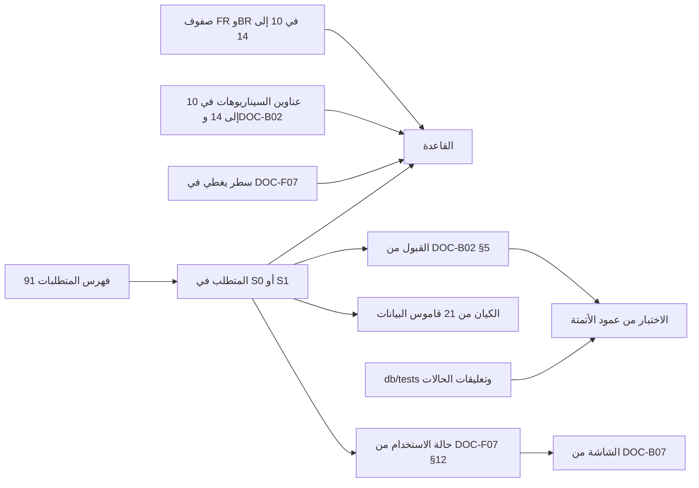

# DOC-B08 — مصفوفة التتبع: المتطلب والقاعدة والقبول والكيان والاختبار والشاشة

| البند | القيمة |
|---|---|
| المعرّف | DOC-B08 (docs/30-readiness-documents.md) |
| الإصدار | 0.1 — مسودة للمراجعة — 2026-10-12 |
| المالك المقترح | محلل الأعمال (BA lead) مع قائد ضمان الجودة (docs/30-readiness-documents.md:54) |
| الأولوية | P1 قبل S2 |
| يغطي | كل FR في S0 وS1 (146 متطلبًا)، FR-PLT-036، BR-PLT-001، FR-PLT-041، X-SEC-4، O-09 (erd_open_items) |
| يعتمد على | DOC-B01، DOC-B02، DOC-B07، DOC-F07، DOC-S13، DOC-F09 (للشرائح التالية) |
| المصادر | docs/10-detailed-analysis/91-requirements-index.md، docs/10-detailed-analysis/10-m0-m1-platform-organization.md، 11-m2-m4-institutions-accounts-catalogs.md، 12-m5-facilities-pricing-collateral-obligations.md، 13-m6-workflow-engine-notifications.md، 14-m7-m8-letters-of-credit.md، docs/30-readiness/DOC-B02-acceptance-criteria-register-s0-s1.md، docs/30-readiness/DOC-B07-s0-screen-inventory-navigation.md، docs/30-readiness/DOC-F07-use-case-catalogue-m0-m1.md، docs/21-data-dictionary.md، db/tests/tenant_isolation_tests.sql، db/tests/fac_share_rule_tests.sql، tools/gen_indexes.py |

## 1. الغرض والنطاق

تربط المصفوفة كل متطلب وظيفي بقواعده وسيناريوهات قبوله وجداوله في القاعدة واختباراته وشاشاته، وتكشف ما ينقص كل حلقة.

- **النطاق:** متطلبات S0 وS1. العدد 146: 38 في S0 و108 في S1، كما في DOC-B02 §1. والـ 108 هي 107 في الفهرس (منها FR-NTF-010 وFR-NTF-019 بشريحة «S1 للتطبيق وS5 للبريد») وFR-NTF-016 بشريحة S1/S3 (docs/10-detailed-analysis/91-requirements-index.md:21-24، :407، :413، :416).
- **خارج النطاق:** S1-ب وما بعدها، وتُضاف حين تُكتب حالات الاستخدام في DOC-F09 والشاشات في تحديث DOC-B07 (§5.1). وتتبع القرارات إلى مواضع تنفيذها في docs/10-detailed-analysis/00-overview-and-cross-cutting.md:274 (DQ-B08-9).
- المصفوفة مولَّدة بسكربت من المصادر، لا مكتوبة يدويًا. كل خلية فارغة فجوة في مصدرها، لا في هذه الوثيقة.

## 2. طريقة التوليد

### 2.1 السلسلة

### 2.2 قاعدة كل عمود

| العمود | المصدر | القاعدة |
|---|---|---|
| المتطلب | docs/10-detailed-analysis/91-requirements-index.md | صفوف FR التي أول كلمة في شريحتها S0 أو S1 أو S1/S3، بالتطبيع نفسه في tools/gen_indexes.py:14. Must لا يُكتب؛ غيره بين قوسين |
| القاعدة | صفوف FR وBR في الملفات 10 إلى 14؛ عناوين سيناريوهات §15 وDOC-B02 §3؛ أسطر «يغطي» وصفوف M1 في DOC-F07 | (أ) مباشر: معرّف BR في صف المتطلب، أو معرّف FR في صف القاعدة. (ب) ورودهما معًا في عنوان سيناريو. (ج) ورودهما معًا في حالة استخدام. تُفك الصيغ FR-PLT-003/004 وFR-PLT-010…012 وFR-ACC-001..009 و«FR-ORG-001 إلى FR-ORG-004» |
| القبول | DOC-B02 §5 | أزواج المتطلب والسيناريو كما هي |
| الكيان | docs/21-data-dictionary.md | كل قسم جدول «### `schema.Table`» يذكر المتطلب في عنوانه أو ملاحظات أعمدته، بفك الصيغ نفسها. تُعرض جدولان ثم «+n» |
| الاختبار | عمود الأتمتة في DOC-B02 §2؛ db/tests/*.sql | (أ) حالات T-n في أتمتة سيناريوهات المتطلب، والمدى بالترتيب العددي: T1-T16c يضم T8b وT16b وT16c. (ب) حالة يذكر تعليقها الافتتاحي المتطلب، أو قاعدة مرتبطة به بالقاعدة (أ) أو (ب). (ج) بعد « · » أنواع الاختبار المخطط: API، واجهة، CI، يدوي، أداء |
| الشاشة | DOC-F07 §12؛ DOC-B07 §2 و§3 | المتطلب ← حالة الاستخدام ← الشاشة. متطلب حالته الوحيدة «§9» في DOC-F07 يُكتب «عرضي». لا ربط عبر السيناريو، لأنه ربط مثلًا الكشف عن الهوية بشاشة الأدوار |

قيود القراءة:

- الربطان (ب) و(ج) في عمود القاعدة على مستوى السيناريو أو حالة الاستخدام، فقد يربطان قاعدة بمتطلب لا تخصه. مثال: UC-PLT-09 يغطي FR-PLT-046 وBR-PLT-004، فيظهر ربطهما. يراجع محلل الأعمال هذه الروابط (DQ-B08-3).
- عمود الاختبار لا يعدّ إلا حالات القاعدة اختبارًا قائمًا. «API» وغيرها خطة من DOC-B02، لا اختبار موجود، لأن كود التطبيق غير موجود.
- حالات FSR-T1 إلى FSR-T6 لا تظهر، لأنها تخص V-FAC-02 في S2 (db/tests/fac_share_rule_tests.sql:2).

### 2.3 المدخلات والأعداد

استُعمل في كتابة هذه المسودة سكربت Python للقراءة فقط بالقواعد أعلاه، على المستودع في 2026-10-12. لم يُضف السكربت إلى المستودع؛ مكانه المقترح tools/gen_traceability.py (DQ-B08-1).

| المدخل | ما قُرئ | العدد |
|---|---|---|
| 91-requirements-index.md | صفوف FR | 470، منها 146 في النطاق |
| الملفات 10 إلى 14 | صفوف FR وصفوف BR | 470 و285 |
| DOC-B02 | أزواج المتطلب والسيناريو في §5، وصفوف السيناريوهات في §2 | 154 زوجًا، و61 سيناريو |
| DOC-F07 §12 | متطلبات مربوطة بحالة استخدام | 107 (الملف 10 كله) |
| DOC-B07 | شاشات بحالة استخدام أو سيناريو | 22 شاشة |
| 21-data-dictionary.md | جداول تذكر متطلبًا | 167 جدولًا من 195، تذكر 326 متطلبًا |
| db/tests | حالات PASS | 41 عزل و6 حصص؛ 5 حالات يذكر تعليقها معرّف FR أو BR |

روابط عمود القاعدة للمتطلبات الـ 146: 24 رابطًا مباشرًا لعشرين متطلبًا، و39 من عناوين السيناريوهات، و137 من حالات الاستخدام، فالمجموع 200.

### 2.4 التغطية

| الشريحة والوحدة (المتطلبات) | بقاعدة | بسيناريو | بكيان | بحالة قاعدة | بشاشة |
|---|---|---|---|---|---|
| S0 PLT (38) | 32 | 38 | 29 | 19 | 37 (منها 5 عرضي) |
| S1 PLT (2) | 1 | 2 | 2 | 0 | 1 (عرضي) |
| S1 ORG (14) | 13 | 14 | 11 | 0 | 0 |
| S1 PTY (23) | 21 | 23 | 17 | 4 | 0 |
| S1 INS (21) | 5 | 21 | 15 | 0 | 0 |
| S1 ACC (10) | 2 | 10 | 10 | 0 | 0 |
| S1 CAT (23) | 3 | 23 | 17 | 6 | 0 |
| S1 NTF (15) | 3 | 15 | 10 | 0 | 0 |
| المجموع (146) | 80 | 146 | 111 | 29 | 38 |

## 3. المصفوفة

الرموز: «—» لا رابط في المصدر. «عرضي» متطلب عام لا شاشة له. أرقام T حالات db/tests/tenant_isolation_tests.sql.

### S0 — PLT (38)

| المتطلب | القاعدة | القبول | الكيان | الاختبار | الشاشة |
|---|---|---|---|---|---|
| FR-PLT-001 | BR-PLT-002، BR-PLT-003 | AC-PLT-5 | plat.Tenant | API | SCR-PLT-53، SCR-PLT-54 |
| FR-PLT-002 | BR-PLT-002 | AC-PLT-6 | plat.Tenant | T17، T26، T31 · API | SCR-PLT-52 |
| FR-PLT-003 | BR-PLT-002، BR-PLT-003 | AC-PLT-5 | plat.Plan | API | SCR-PLT-53، SCR-PLT-54 |
| FR-PLT-004 (Should) | — | AC-PLT-7 | plat.Plan | T38 · API، CI | SCR-PLT-07، SCR-PLT-52 |
| FR-PLT-005 | BR-PLT-002 | AC-PLT-7 | — | T38 · API، CI | SCR-PLT-52 |
| FR-PLT-006 | BR-PLT-005 | AC-PLT-7 | plat.PlatformOperator | T38 · API، CI | SCR-PLT-51، SCR-PLT-56 |
| FR-PLT-007 (Should) | BR-PLT-009، BR-PLT-017 | AC-PLT-8 | plat.SupportAccessGrant، aud.SensitiveAccessLog | API | SCR-PLT-11، SCR-PLT-54 |
| FR-PLT-008 | BR-PLT-002، BR-PLT-003 | AC-PLT-5 | sec.Role، cfg.SeedRun | API | SCR-PLT-53، SCR-PLT-54 |
| FR-PLT-009 (Could) | — | AC-PLT-9 | — | واجهة | SCR-PLT-06 |
| FR-PLT-010 | BR-PLT-004، BR-PLT-005، BR-PLT-006 | AC-PLT-10 | plat.PlatformOperator، sec.AppUser | T33، T35 · API | SCR-PLT-01، SCR-PLT-02، SCR-PLT-04، +1 |
| FR-PLT-011 | BR-PLT-004، BR-PLT-005، BR-PLT-006 | AC-PLT-2 | sec.AppUser، sec.MfaRecoveryCode | T33، T36 · API | SCR-PLT-01، SCR-PLT-02، SCR-PLT-04، +1 |
| FR-PLT-012 | BR-PLT-004، BR-PLT-005، BR-PLT-006، +1 | AC-PLT-2 | sec.AppUser | T33، T36 · API | SCR-PLT-01، SCR-PLT-02، SCR-PLT-05، +2 |
| FR-PLT-013 | BR-PLT-002، BR-PLT-003، BR-PLT-004، +1 | AC-PLT-5، AC-PLT-11 | sec.AppUser، sec.UserToken | API | SCR-PLT-03، SCR-PLT-04، SCR-PLT-07 |
| FR-PLT-014 (Should) | BR-PLT-004، BR-PLT-005، BR-PLT-006، +1 | AC-PLT-12 | sec.AppUser، sec.UserSession | T32، T35، T37 · API | SCR-PLT-07، SCR-PLT-08، SCR-PLT-15 |
| FR-PLT-016 | BR-PLT-006، BR-PLT-008 | AC-PLT-13 | sec.AppUser | T25، T30 · API، CI | SCR-PLT-07، SCR-PLT-08 |
| FR-PLT-017 | BR-PLT-001، BR-PLT-008، BR-PLT-014، +1 | AC-PLT-13 | sec.Permission | T25، T30 · API، CI | SCR-PLT-09، SCR-PLT-55 |
| FR-PLT-018 | BR-PLT-007، BR-PLT-008، BR-PLT-019 | AC-PLT-13 | sec.Role، sec.UserRole | T25، T30 · API، CI | SCR-PLT-08، SCR-PLT-09 |
| FR-PLT-019 | BR-PLT-007، BR-PLT-008، BR-PLT-019، +2 | AC-PTY-1 | — | T21 · API، واجهة | SCR-PLT-08، SCR-PLT-09 |
| FR-PLT-020 | BR-PLT-001، BR-PLT-007 | AC-PLT-1 | sec.UserCompanyScope | T1-T16c، T24، T28 · API | SCR-PLT-10 |
| FR-PLT-021 | BR-PLT-007 | AC-PLT-13 | sec.AppUser | T25، T30 · API، CI | عرضي |
| FR-PLT-022 | BR-PLT-008، BR-PLT-009 | AC-PLT-14 | — | T13-T15 · API | SCR-PLT-13 |
| FR-PLT-023 | BR-PLT-008، BR-PLT-009 | AC-PLT-14 | aud.AuditLog | T13-T15 · API | SCR-PLT-13 |
| FR-PLT-024 | BR-PLT-008، BR-PLT-009 | AC-PLT-14 | — | T13-T15 · API | SCR-PLT-13 |
| FR-PLT-026 | BR-FAC-001، BR-LCE-002، BR-ORG-001، +1 | AC-ORG-3، AC-PLT-3 | cfg.NumberSequenceDefinition، cfg.NumberIssue، +1 | API | SCR-PLT-12 |
| FR-PLT-027 | BR-PLT-011 | AC-PLT-15 | doc.Document، doc.DocumentVersion | API | SCR-PLT-16 |
| FR-PLT-028 | BR-PLT-011 | AC-PLT-15 | doc.Document، doc.DocumentLink، +1 | API | SCR-PLT-16 |
| FR-PLT-029 | BR-PLT-011 | AC-PLT-15 | doc.DocumentVersion | API | SCR-PLT-16 |
| FR-PLT-030 | BR-PTY-010 | AC-PLT-15 | — | API | SCR-PLT-16 |
| FR-PLT-032 | — | AC-PLT-16 | plat.Tenant | API، واجهة | SCR-PLT-15 |
| FR-PLT-033 | — | AC-PLT-16 | plat.Tenant | API، واجهة | عرضي |
| FR-PLT-034 (Should) | BR-PLT-018 | AC-NTF-4، AC-PLT-16 | plat.Tenant | API، واجهة | SCR-PLT-11، SCR-PLT-15 |
| FR-PLT-036 | BR-PLT-001 | AC-PLT-1 | — | T1-T16c، T24، T28 · API | عرضي |
| FR-PLT-037 | BR-PLT-015 | AC-PLT-17 | sec.TenantKey، sec.KeyEvent | API، يدوي | — |
| FR-PLT-041 | — | AC-PLT-18 | — | CI، واجهة | عرضي |
| FR-PLT-043 | BR-PLT-018، BR-WFL-012 | AC-PLT-19 | cfg.SettingDefinition، cfg.TenantSetting | API | SCR-PLT-11 |
| FR-PLT-044 (Should) | BR-NTF-010، BR-PLT-002 | AC-PLT-20 | cfg.JobRun | API | SCR-PLT-14 |
| FR-PLT-045 | — | AC-PLT-4 | — | CI | عرضي |
| FR-PLT-046 | BR-PLT-002، BR-PLT-003، BR-PLT-004، +2 | AC-PLT-21 | plat.Tenant، plat.ReservedSubdomain | T18 · API | SCR-PLT-01، SCR-PLT-02، SCR-PLT-05، +2 |

### S1 — PLT (2)

| المتطلب | القاعدة | القبول | الكيان | الاختبار | الشاشة |
|---|---|---|---|---|---|
| FR-PLT-038 | BR-PLT-013 | AC-ORG-6 | cfg.ExpiryAlertRule، cfg.ExpiryAlertLog | API، واجهة | — |
| FR-PLT-042 (Should) | — | AC-PLT-22 | cfg.OutboxEvent | API | عرضي |

### S1 — ORG (14)

| المتطلب | القاعدة | القبول | الكيان | الاختبار | الشاشة |
|---|---|---|---|---|---|
| FR-ORG-001 | BR-ORG-001، BR-ORG-002، BR-ORG-003، +2 | AC-ORG-4 | org.Company | API | — |
| FR-ORG-002 | BR-ORG-016 | AC-ORG-4 | org.Company، cat.LegalEntityType | API | — |
| FR-ORG-003 | BR-ORG-001، BR-ORG-002، BR-ORG-003، +2 | AC-ORG-4 | org.Company | API | — |
| FR-ORG-004 | BR-ORG-001، BR-ORG-002، BR-ORG-003، +2 | AC-ORG-4 | org.Company | API | — |
| FR-ORG-005 | BR-ORG-001، BR-ORG-002، BR-ORG-003، +2 | AC-ORG-3 | org.Company | API | — |
| FR-ORG-006 | BR-OBL-005، BR-ORG-001، BR-ORG-002، +3 | AC-ORG-5 | org.Company | API | — |
| FR-ORG-007 | BR-ORG-005، BR-PRC-009 | AC-ORG-5 | org.Company، org.CompanyTaxRate | API | — |
| FR-ORG-008 (Should) | BR-ORG-001، BR-ORG-002، BR-ORG-003، +2 | AC-ORG-4 | org.Company | API | — |
| FR-ORG-009 (Should) | BR-ORG-001، BR-ORG-002، BR-ORG-003، +2 | AC-ORG-7 | org.Company | API | — |
| FR-ORG-010 (Should) | — | AC-ORG-7 | org.Company | API | — |
| FR-ORG-011 | BR-ORG-015 | AC-ORG-6 | — | API، واجهة | — |
| FR-ORG-012 | BR-ORG-015 | AC-ORG-6 | — | API، واجهة | — |
| FR-ORG-013 | BR-ORG-015 | AC-ORG-6 | — | API، واجهة | — |
| FR-ORG-014 | BR-ORG-016 | AC-ORG-8 | org.Department | API | — |

### S1 — PTY (23)

| المتطلب | القاعدة | القبول | الكيان | الاختبار | الشاشة |
|---|---|---|---|---|---|
| FR-PTY-001 | BR-PTY-002، BR-PTY-003، BR-PTY-004، +1 | AC-PTY-4 | pty.Party | API | — |
| FR-PTY-002 | — | AC-PTY-4 | pty.Party | API | — |
| FR-PTY-003 | BR-ORG-001، BR-ORG-002، BR-ORG-003، +2 | AC-ORG-4 | org.Company، pty.Party | API | — |
| FR-PTY-004 | BR-PTY-006، BR-PTY-008 | AC-PTY-4 | pty.IdentityDocument | API | — |
| FR-PTY-005 | BR-PTY-002، BR-PTY-003، BR-PTY-004، +1 | AC-PTY-4 | pty.IdentityDocument | API | — |
| FR-PTY-006 | BR-PTY-006، BR-PTY-008 | AC-PTY-5 | pty.IdentityDocument | T21 · API | — |
| FR-PTY-007 | BR-PLT-019، BR-PTY-008، BR-PTY-009، +1 | AC-PTY-1 | pty.IdentityDocument | T21 · API، واجهة | — |
| FR-PTY-008 | BR-PLT-019، BR-PTY-008، BR-PTY-009، +1 | AC-PTY-1 | pty.IdentityDocument | T21 · API، واجهة | — |
| FR-PTY-009 | BR-PTY-006، BR-PTY-008، BR-PTY-009، +1 | AC-PTY-5 | pty.IdentityDocument | T21 · API | — |
| FR-PTY-010 (Should) | BR-PTY-002، BR-PTY-003، BR-PTY-004، +1 | AC-PTY-6 | — | API | — |
| FR-PTY-011 | BR-PTY-014، BR-PTY-015 | AC-PTY-6 | pty.Address | API | — |
| FR-PTY-012 | BR-PTY-014، BR-PTY-015 | AC-PTY-6 | pty.ContactMethod | API | — |
| FR-PTY-013 | BR-PTY-014، BR-PTY-015، BR-PTY-019 | AC-PTY-7 | pty.CustomFieldDefinition، pty.PartyCustomField | API | — |
| FR-PTY-014 (Should) | BR-PTY-014، BR-PTY-015 | AC-PTY-7 | pty.CustomFieldDefinition، pty.PartyCustomField | API | — |
| FR-PTY-015 | BR-PTY-001، BR-PTY-002، BR-PTY-003، +3 | AC-PTY-2 | — | API | — |
| FR-PTY-016 (Should) | BR-INS-014، BR-PTY-001، BR-PTY-002، +3 | AC-INS-3، AC-PTY-2 | col.PromissoryNoteSigner | API | — |
| FR-PTY-017 | BR-PTY-001 | AC-PTY-8 | — | API | — |
| FR-PTY-018 (Should) | BR-PTY-017 | AC-PTY-8 | — | API | — |
| FR-PTY-019 | — | AC-PTY-8 | — | API | — |
| FR-PTY-020 (Should) | BR-PTY-006، BR-PTY-008 | AC-PTY-9 | pty.IdentityDocument | API | — |
| FR-PTY-021 | BR-PTY-007، BR-PTY-012 | AC-PTY-3 | pty.IdentityDocument | API | — |
| FR-PTY-022 | BR-PTY-006، BR-PTY-008 | AC-PTY-9 | pty.IdentityDocument | API | — |
| FR-PTY-028 (Should) | BR-PTY-001 | AC-PTY-8 | — | API | — |

### S1 — INS (21)

| المتطلب | القاعدة | القبول | الكيان | الاختبار | الشاشة |
|---|---|---|---|---|---|
| FR-INS-001 | — | AC-INS-4 | cat.InstitutionType، ins.Institution | API | — |
| FR-INS-002 | — | AC-INS-4 | ins.Institution | API | — |
| FR-INS-003 | — | AC-INS-4 | ins.Institution | API | — |
| FR-INS-004 | — | AC-INS-4 | ins.Institution | API | — |
| FR-INS-005 | — | AC-INS-5 | ins.InstitutionUnit | API | — |
| FR-INS-006 | — | AC-INS-5 | ins.InstitutionUnit | API | — |
| FR-INS-007 | BR-INS-014 | AC-INS-3 | ins.Contact | API | — |
| FR-INS-008 | BR-INS-005 | AC-INS-2 | ins.Contact | API | — |
| FR-INS-009 | — | AC-INS-6 | ins.Relationship | API | — |
| FR-INS-010 | — | AC-INS-6 | ins.RelationshipContact | API | — |
| FR-INS-011 | — | AC-INS-6 | ins.RelationshipProduct | API | — |
| FR-INS-012 | BR-INS-009 | AC-INS-6 | ins.RelationshipProduct | API | — |
| FR-INS-013 | — | AC-INS-1، AC-INS-6 | ins.RelationshipProduct | API، واجهة | — |
| FR-INS-014 | BR-INS-013 | AC-INS-1 | — | API، واجهة | — |
| FR-INS-015 (Could) | — | AC-INS-7 | — | API، واجهة | — |
| FR-INS-016 | — | AC-INS-2، AC-INS-7 | — | API، واجهة | — |
| FR-INS-017 (Should) | — | AC-INS-8 | — | API، أداء | — |
| FR-INS-018 (Should) | — | AC-INS-8 | — | API، أداء | — |
| FR-INS-019 (Should) | — | AC-INS-8 | — | API، أداء | — |
| FR-INS-020 (Could) | — | AC-INS-8 | ins.Institution | API، أداء | — |
| FR-INS-021 | BR-INS-014، BR-PTY-001 | AC-INS-3 | ins.Institution | API | — |

### S1 — ACC (10)

| المتطلب | القاعدة | القبول | الكيان | الاختبار | الشاشة |
|---|---|---|---|---|---|
| FR-ACC-001 | — | AC-ACC-5 | cat.AccountType، acc.BankAccount | API | — |
| FR-ACC-002 | — | AC-ACC-1 | acc.BankAccount | API، واجهة | — |
| FR-ACC-003 | — | AC-ACC-5 | acc.BankAccount | API | — |
| FR-ACC-004 | BR-ACC-002 | AC-ACC-1 | acc.BankAccount | API، واجهة | — |
| FR-ACC-005 | — | AC-ACC-1 | acc.BankAccount | API، واجهة | — |
| FR-ACC-006 | — | AC-ACC-1 | acc.BankAccount | API، واجهة | — |
| FR-ACC-007 | — | AC-ACC-5 | acc.BankAccount | API | — |
| FR-ACC-008 | — | AC-ACC-1، AC-ACC-5 | acc.BankAccount | API، واجهة | — |
| FR-ACC-009 | BR-ACC-016 | AC-ACC-1 | acc.BankAccount | API، واجهة | — |
| FR-ACC-022 (Could) | — | AC-ACC-6 | acc.Signatory | يدوي | — |

### S1 — CAT (23)

| المتطلب | القاعدة | القبول | الكيان | الاختبار | الشاشة |
|---|---|---|---|---|---|
| FR-CAT-001 | — | AC-CAT-4 | — | API، واجهة | — |
| FR-CAT-002 | — | AC-CAT-1 | — | T24 · API | — |
| FR-CAT-004 | — | AC-CAT-1 | — | T24 · API | — |
| FR-CAT-005 | — | AC-CAT-4 | — | API، واجهة | — |
| FR-CAT-006 (Should) | — | AC-CAT-1 | — | T24 · API | — |
| FR-CAT-007 | — | AC-CAT-5 | cat.ProductCategory، cat.Product | API | — |
| FR-CAT-008 | — | AC-CAT-5 | cat.FeeType | API | — |
| FR-CAT-009 | — | AC-CAT-5 | cat.FinancingType | API | — |
| FR-CAT-010 | — | AC-CAT-5 | cat.ProductFeeType، cat.ProductFinancingType | API | — |
| FR-CAT-011 | — | AC-CAT-6 | cat.FacilityType | API | — |
| FR-CAT-012 | — | AC-CAT-6 | cat.LimitType | API | — |
| FR-CAT-013 | — | AC-CAT-6 | cat.CollateralType، col.Collateral | API | — |
| FR-CAT-014 | — | AC-CAT-6 | cat.ObligationType | API | — |
| FR-CAT-015 | BR-CAT-011 | AC-CAT-3 | cat.BaseRate، cat.BaseRateAlias | API | — |
| FR-CAT-016 | BR-CAT-013 | AC-CAT-2 | cat.BaseRateValue | API | — |
| FR-CAT-018 | — | AC-CAT-1، AC-PLT-15 | cat.DocumentType | T24 · API | — |
| FR-CAT-019 | — | AC-CAT-1 | cat.Position، cat.PowerType، +1 | T24 · API | — |
| FR-CAT-020 | — | AC-CAT-7 | cat.LookupList، cat.LookupItem | API | — |
| FR-CAT-021 | — | AC-CAT-7 | ref.Currency، ref.Incoterm | API | — |
| FR-CAT-022 | — | AC-CAT-5 | cat.Product | API | — |
| FR-CAT-023 (Could) | — | AC-CAT-7 | cat.TenantCurrency | API | — |
| FR-CAT-025 | — | AC-CAT-4 | — | API، واجهة | — |
| FR-CAT-026 | BR-PTY-005، BR-PTY-015 | AC-CAT-1 | ref.Country | T24 · API | — |

### S1 — NTF (15)

| المتطلب | القاعدة | القبول | الكيان | الاختبار | الشاشة |
|---|---|---|---|---|---|
| FR-NTF-001 | BR-NTF-006، BR-WFL-012 | AC-WFL-10 | ntf.NotificationEventType | API، CI | — |
| FR-NTF-002 | — | AC-NTF-1 | ntf.Notification | API، CI | — |
| FR-NTF-003 | — | AC-NTF-2 | ntf.NotificationRule | API، واجهة | — |
| FR-NTF-004 | BR-NTF-001، BR-NTF-002، BR-NTF-003 | AC-WFL-8 | — | API | — |
| FR-NTF-005 | — | AC-NTF-2 | ntf.Notification | API، واجهة | — |
| FR-NTF-006 | — | AC-NTF-2 | ntf.Notification | API، واجهة | — |
| FR-NTF-008 | BR-NTF-001، BR-NTF-002، BR-NTF-003، +1 | AC-WFL-8 | — | API | — |
| FR-NTF-010 S1 وS5 | — | AC-NTF-2 | ntf.NotificationEventType، ntf.NotificationPreference | API، واجهة | — |
| FR-NTF-012 | — | AC-NTF-1 | ntf.NotificationTemplate | API، CI | — |
| FR-NTF-016 S1/S3 | — | AC-PLT-20 | — | API | — |
| FR-NTF-018 | — | AC-NTF-3 | — | API | — |
| FR-NTF-019 S1 وS5 | — | AC-NTF-3 | ntf.NotificationDelivery | API | — |
| FR-NTF-021 | — | AC-NTF-1 | ntf.Notification | API، CI | — |
| FR-NTF-022 | — | AC-NTF-3 | — | API | — |
| FR-NTF-024 (Should) | — | AC-NTF-4 | sec.AppUser، ntf.Notification | API | — |
## 4. الفجوات التي تكشفها المصفوفة

| # | الفجوة | الأثر | العلاج المقترح |
|---|---|---|---|
| G-1 | القواعد غير مربوطة في INS وACC وCAT وNTF: 13 من 69 متطلبًا فقط | لا يُعرف أي قاعدة يثبتها اختبار المتطلب | عمود «القواعد» في جداول FR (DQ-B08-2)، وحالات الاستخدام في DOC-F09 |
| G-2 | لا شاشة مربوطة لأي متطلب غير عرضي في S1 | لا يُتحقق أن كل متطلب له موضع في الواجهة | تحديث DOC-B07 لـ S1 بمعرّفات SCR-ORG وSCR-PTY، وربط SCR-INS وSCR-ACC وSCR-CAT بحالات الاستخدام (DQ-B08-6) |
| G-3 | اختبار قائم لـ 29 متطلبًا فقط، وكله في القاعدة | 19 متطلبًا في S0 لا تُثبت إلا باختبارات API أو واجهة لم تُكتب | الوسوم في §5، وبوابة الخروج في §5.4 |
| G-4 | 35 متطلبًا بلا جدول يذكرها في القاموس | الأثر في القاعدة غير ظاهر، مثل FR-ORG-011 إلى FR-ORG-013 التي تخدمها جداول doc | ذكر المتطلب في ملاحظة الجدول في النموذج، أو تصنيفه عرضيًا (DQ-B08-7) |
| G-5 | روابط القاعدة بالمشاركة تزيد عن الحقيقة | ربط قاعدة بمتطلب لا تخصه | مراجعة 176 رابطًا مشاركًا عند خروج S1 (DQ-B08-3) |
| G-6 | السيناريوهات الجديدة في DOC-B02 لم تنتقل إلى §15 في المواصفات | مصدران للنص نفسه | DQ-B02-6 |

متطلبات S0 بلا حالة قاعدة: FR-PLT-001، 003، 007، 008، 009، 013، 026، 027، 028، 029، 030، 032، 033، 034، 037، 041، 043، 044، 045. وهي متطلبات تطبيق في الأساس (التأهيل والمستندات والتوطين والمفاتيح والبناء)، فاختبارها في API والواجهة وCI.

## 5. قواعد إبقاء المصفوفة حديثة

### 5.1 المولّد 🟡

- **المكان:** tools/gen_traceability.py بجانب tools/gen_indexes.py، يقرأ المصادر في §2.2 ولا يكتب غير ناتجه.
- **الناتج:** ملف مولَّد docs/10-detailed-analysis/92-traceability-matrix.md لا يُعدَّل يدويًا، وملف CSV بالقوائم الكاملة بلا اختصار «+n». تبقى في هذه الوثيقة الطريقة والفجوات وآخر لقطة.
- **في CI:** خطوة تعيد التوليد وتقارن بالملف المودَع، على نمط الخطوة 2 في tools/ci/db_ci.sh:39-45، فتفشل إن كان قديمًا.
- **التوسع:** المصادر الجديدة تُضاف إلى المولّد لا إلى الجدول: DOC-F09 لحالات M2 إلى M8، وتحديثات DOC-B07، وسيناريوهات S2 فما بعد في DOC-B02، واختبارات التطبيق.

### 5.2 الوسوم في المصادر

| المصدر | الوسم المطلوب 🟡 |
|---|---|
| جداول FR في المواصفات 10 إلى 14 | عمود «القواعد» بمعرّفات BR، يقرؤه tools/gen_indexes.py أيضًا (DQ-B08-2) |
| حالات SQL في db/tests | التعليق الافتتاحي لكل حالة يذكر FR وBR وTHR، كما تفعل T34 وT36 وT37 اليوم (db/tests/tenant_isolation_tests.sql:499، :546، :643) |
| اختبارات التطبيق | وسم FR وAC وTHR لكل اختبار، مثل خاصية Trait في xUnit ووسم في Playwright (DQ-B08-4) |
| اختبارات العبور المولَّدة | تأخذ FR من امتداد x-fr في كل عملية OpenAPI (DQ-B08-8، DOC-S13 §5.2) |
| الشاشات | معرّف SCR لكل شاشة وحالة استخدامها في DOC-B07 |
| النموذج | ذكر FR في ملاحظة الجدول أو العمود، كما في docs/21-data-dictionary.md اليوم |

### 5.3 الفحوص الآلية

1. وسم يشير إلى FR أو AC أو BR غير موجود يفشل البناء.
2. متطلب جديد في المواصفات يظهر في المصفوفة آليًا؛ وبلا سيناريو قبول يظهر فجوة في تقرير المولّد.
3. تقرير الفجوات يُطبع في كل تشغيل بأعداد الجدول في §2.4.

### 5.4 بوابة الشريحة 🟡

- **أثناء البناء:** تحذير في طلب الدمج فقط، لأن المتطلب بلا اختبار حالة طبيعية قبل اكتماله.
- **عند وسم إصدار خروج الشريحة:** يفشل الخط إن بقي متطلب Must في الشريحة بلا اختبار قائم ناجح موسوم به. وShould يحتاج تأجيلًا مكتوبًا، وCould لا يوقف (DQ-B02-5، DOC-B01 §5).
- **تقرير الخروج:** تُرفق لقطة المصفوفة بتقرير خروج الشريحة (DOC-B01 §9).

### 5.5 الملكية والمراجعة

| الحلقة | المسؤول |
|---|---|
| المتطلب والقاعدة والسيناريو والشاشة | محلل الأعمال |
| الاختبار ووسومه | قائد ضمان الجودة |
| الكيان وملاحظات النموذج | معماري قاعدة البيانات |
| المولّد وخطوة CI | مهندس DevOps |

تُراجع المصفوفة عند خروج كل شريحة، وقبل بدء الشريحة التالية تُوسَّع إلى متطلباتها.

## 6. القرارات المطلوبة

| المعرّف | السؤال | الافتراض المقترح | من يقرر | ما يعطّله |
|---|---|---|---|---|
| DQ-B08-1 | مكان المولّد وناتجه | tools/gen_traceability.py، وناتج 92-traceability-matrix.md وCSV، وفحص الحداثة في CI | QA مع BA | §5.1 |
| DQ-B08-2 | ربط القاعدة بالمتطلب في المصدر | عمود «القواعد» في كل جدول FR بدل الربط بالمشاركة | BA | G-1، توسيع المصفوفة إلى S2 |
| DQ-B08-3 | الروابط المشاركة الزائدة | يراجعها BA عند خروج S1، والمحذوف يُسجَّل في ملف استثناءات يقرؤه المولّد | BA | G-5 |
| DQ-B08-4 | صيغة وسوم الاختبارات | وسوم FR وAC وTHR، وبادئات ISO-Tn وFSR-Tn (DQ-B01-4) | QA | عمود الاختبار |
| DQ-B08-5 | قاعدة بوابة الخروج | ✅ معتمد من المالك (2026-10-12): §5.4 | QA مع OWN | خروج كل شريحة |
| DQ-B08-6 | معرّفات شاشات S1 وربطها | تحديث DOC-B07 قبل بناء S1، وربط شاشات 11-m2-m4 §7.1 بحالات DOC-F09 | UX مع BA | G-2 |
| DQ-B08-7 | متطلبات بلا جدول في القاموس | ذكرها في ملاحظات الجداول التي تخدمها، أو وسمها عرضية في المولّد | DBA | G-4 |
| DQ-B08-8 | امتداد x-fr في OpenAPI | قائمة FR لكل عملية، يقرؤها مولّد العبور ومولّد التتبع | APP | DOC-S13 §5.2 |
| DQ-B08-9 | تتبع القرارات في 00 §10.3 | خارج هذه المصفوفة؛ جدول قرار ← موضع تنفيذ يضيفه المولّد لاحقًا | BA | docs/30-readiness-documents.md:397 |

## 7. تعارضات وفجوات في المصادر

1. docs/30-readiness-documents.md:399 يقول إن 386 متطلبًا من 470 بلا سيناريو. لمتطلبات S0 وS1 صار لكل متطلب سيناريو في DOC-B02 §5، لكنها مقترحة ولم تنتقل إلى §15 في المواصفات (DQ-B02-6).
2. docs/30-readiness-documents.md:398 يذكر حالات T1 إلى T31، وملاحظة التحقق في :401 تذكر T1 إلى T37 (40 حالة). العدد الفعلي 41: T1 إلى T38 مع T8b وT16b وT16c (tools/ci/db_ci.sh:87-88).
3. docs/30-readiness-documents.md:398 يذكر 306 مراجع FR على مستوى الجدول في القاموس. قواعد §2.2 تجد 326 متطلبًا مختلفًا في 167 قسم جدول، لأنها تقرأ ملاحظات الأعمدة وتفك الصيغ المختصرة.
4. docs/20-database-design.md:9 و:486 يذكران 194 جدولًا و3,280 عمودًا، وtools/dbgen/erd_open_items.py:22 يذكر 194 جدولًا منشورًا. وdocs/21-data-dictionary.md:5 يذكر 195، وفي db/generated/tsql/001_tables.sql 195 عبارة CREATE TABLE، و`dbgen.py check` يطبع 195 جدولًا و3,285 عمودًا، وdocs/20-database-design.md:488 يذكر 195.
5. شاشات 11-m2-m4 §7.1 تحمل معرّفات SCR (docs/10-detailed-analysis/11-m2-m4-institutions-accounts-catalogs.md:391-408) بلا متطلب ولا حالة استخدام، وشاشات S1 في 10-m0-m1 §7.1 بلا معرّفات (docs/10-detailed-analysis/10-m0-m1-platform-organization.md:385-398).
6. حالات العزل تحمل أرقامًا لا معرّفات متطلبات؛ خمس حالات فقط يذكر تعليقها FR أو BR (db/tests/tenant_isolation_tests.sql:340، :499، :546، :593، :643).

## 8. التتبع

| البند في هذه الوثيقة | المتطلب أو القاعدة أو القرار | المصدر |
|---|---|---|
| §1 النطاق | شرائح S0 وS1 | docs/10-detailed-analysis/91-requirements-index.md:21-24 |
| §2.2 القبول | سجل السيناريوهات | docs/30-readiness/DOC-B02-acceptance-criteria-register-s0-s1.md §5 |
| §2.2 الشاشة | حالات الاستخدام والشاشات | docs/30-readiness/DOC-F07-use-case-catalogue-m0-m1.md §12؛ docs/30-readiness/DOC-B07-s0-screen-inventory-navigation.md §2، §3 |
| §2.2 الاختبار | O-09 (erd_open_items)، X-SEC-4 | db/tests/tenant_isolation_tests.sql؛ tools/dbgen/erd_open_items.py:62-66 |
| §3 S0 | FR-PLT-036، BR-PLT-001، خروج S0 | docs/10-detailed-analysis/00-overview-and-cross-cutting.md:194 |
| §5.1 | المولّد القائم للفهرس | tools/gen_indexes.py:1-3 |
| §5.4 | معايير الخروج | docs/30-readiness/DOC-B01-test-strategy-and-plan.md §5 |
