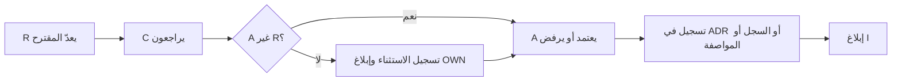
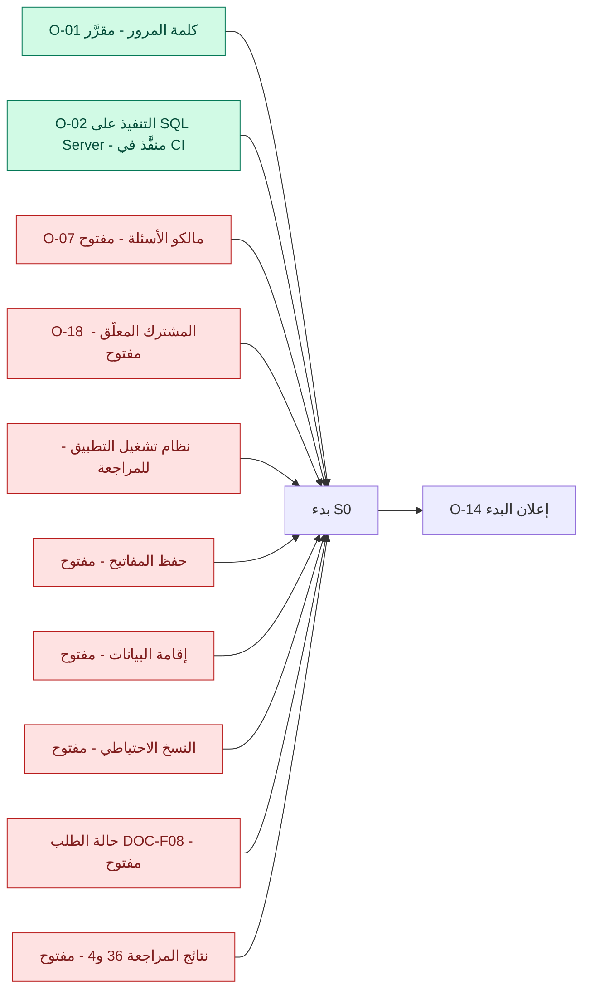

# DOC-B09 — مصفوفة المسؤوليات وسجل ملكية القرارات

| البند | القيمة |
|---|---|
| المعرّف | DOC-B09 (docs/30-readiness-documents.md) |
| الإصدار | 0.1 — مسودة للمراجعة — 2026-10-12 |
| المالك المقترح | مدير المشروع مع مدير الخزينة لدى العميل بصفته صاحب القرار (docs/30-readiness-documents.md:55) |
| الأولوية | P0 قبل S0 |
| يغطي | O-01 إلى O-24 (erd_open_items)، O-1 إلى O-15 (20-database-design)، X-SEC-7، Q-FAC-08، Q-CAT-03، الأسئلة الـ155 |
| يعتمد على | كل وثائق P0 في السجل؛ DOC-B04 وDOC-B05 للقرارات التي تثيرها |
| المصادر | docs/30-readiness-documents.md، tools/dbgen/erd_open_items.py، docs/20-database-design.md، docs/10-detailed-analysis/00-overview-and-cross-cutting.md، 90-consolidated-open-questions.md، 91-requirements-index.md، tools/gen_indexes.py، docs/adr/0001-schema-work-on-linux.md، docs/adr/0002-login-and-session-bound-context.md |

## 1. الغرض والنطاق

تحدد الوثيقة لكل وثيقة P0 ولكل قرار مفتوح: من يعتمد (A)، ومن ينفّذ (R)، ومن يُستشار (C)، ومن يُبلَّغ (I)، ومتى يلزم القرار، وحالته. وتحدد بوابة S0: القرارات التي يجب إقفالها قبل بدء الشريحة. وتقترح عمود مالك لسجل الأسئلة الـ155.

الأدوار هنا أدوار لا أسماء. يجوز أن يشغل شخص واحد أكثر من دور، بشرط القاعدة في §3. سلطات الأدوار في §2 مقترحة 🟡، عدا سلطة OWN في قبول ADR فهي ثابتة في المصدر 🟢.

## 2. الأدوار

| الرمز | الدور | سلطته في القرار | المصدر |
|---|---|---|---|
| OWN | مالك المنتج لدى العميل | النطاق والأولويات والمخاطر المقبولة وقبول ADR | docs/adr/0001-schema-work-on-linux.md:3؛ docs/adr/0002-login-and-session-bound-context.md:3 |
| TRM | مدير الخزينة لدى العميل | قواعد العمل الخزينية والكتالوجات المصرفية | 00-overview…:60؛ docs/30-readiness-documents.md:55 |
| SEC | مسؤول الأمن | سياسات الأمن، وقبول المخاطر التقنية المنخفضة والمتوسطة | السجل: DOC-S01 إلى DOC-S06 |
| SA | معماري الحلول | المعمارية والعقود بين الطبقات | السجل: DOC-F01، DOC-S03، DOC-B03 |
| DBA | معماري قاعدة البيانات | النموذج والمخطط والصلاحيات داخل القاعدة | السجل: DOC-F04، DOC-S08، DOC-B05 |
| OPS | مهندس DevOps والتشغيل | البيئات والنشر والخوادم والنسخ | السجل: DOC-S05، DOC-S09، DOC-B11 |
| QA | قائد ضمان الجودة | استراتيجية الاختبار وبوابات الخروج | السجل: DOC-B01 |
| PM | مدير المشروع | سجل القرارات ومهله ومتابعته والتصعيد | السجل: DOC-B09 |
| LEG | المستشار القانوني ومسؤول حماية البيانات | الامتثال والاحتفاظ والإقامة والمحتوى القانوني | السجل: DOC-S07 |
| BA | محلل الأعمال (دور مساند) | صياغة المقترحات والقواعد ومعايير القبول | السجل: DOC-F07، DOC-B02، DOC-B10 |
| APP | قائد التطبيق والواجهات البرمجية (دور مساند) | عقد الواجهة وتنفيذ الخلفية | السجل: DOC-B04 |
| UX | قائد تجربة المستخدم (دور مساند) | الشاشات والتنقل | السجل: DOC-B07 |

## 3. قواعد الملكية

1. **معتمِد واحد.** لكل بند A واحد فقط. يجوز تعدد R وC وI.
2. **لا يعتمد المرء مقترحه.** من أعدّ المقترح (R) لا يكون معتمِده (A) 🟢 للمبدأ: «فصل المهام: المُعِدّ ≠ المعتمِد» (X-SEC-7، docs/10-detailed-analysis/00-overview-and-cross-cutting.md:142). والمبدأ نفسه في المنتج: «الموافِق غير المنشئ» (10-m0-m1…:54)، و«لا يوافق TM على طلب أنشأه» (FR-WFL-009، 13-m6…:130)، و«المُعِدّ ≠ المعتمِد دائمًا» (12-m5…:46).
3. **الاستثناء مسجَّل.** إن لم يوجد غير شخص واحد للدورين، يُسجَّل الاستثناء بسببه في سجل القرارات ويُبلَّغ OWN. هذا مطابق لإعداد `wf.sod.allow_same_person`: الأصل ممنوع والاستثناء مسجَّل 🟢 (BR-WFL-026، 13-m6…:257؛ FR-WFL-041، :162). ولا يُستثنى OWN من القاعدة حين يكون هو مُعِدّ المقترح: يعتمده عندئذ TRM أو SEC بحسب الموضوع 🟡.
4. **القرار المقرَّر له سجل.** قرار معماري في ADR تحت docs/adr. وقرار القاعدة في حالة البند في tools/dbgen/erd_open_items.py، ويسمّي الملف المنفِّذ (tools/dbgen/erd_open_items.py:4-6). وقرار الأعمال بعلامة ✅ في §14 من مواصفة الوحدة، فينقلها المولّد إلى السجل الموحّد (tools/gen_indexes.py:8-11).
5. **المهلة شريحة.** «مطلوب قبل» هو بدء الشريحة المذكورة. البند المتأخر يُصعَّد إلى OWN. الافتراض الموصى به يسري حتى يُحسم 🟢 (90-consolidated…:3)، إلا بنود بوابة S0 فلا بداية بافتراض.
6. **الترقيم المتصادم.** يُكتب السجل دائمًا: «O-18 (erd_open_items)» أو «O-11 (20-database-design)».

## 4. بوابة S0

البنود التالية تُقفل قبل بدء S0. الأساس: «Start S0 once O-01, O-02 and O-07 are decided» (tools/dbgen/erd_open_items.py:101)، وترتيب السجل «قرارات أولًا» (docs/30-readiness-documents.md:445)، وعواقب ADR 0001 (docs/adr/0001-schema-work-on-linux.md:26).

| البند | A | R | الحالة اليوم | ما يلزم لإغلاقه |
|---|---|---|---|---|
| O-01 (erd_open_items) كلمة المرور | OWN | SEC | مقرَّر: Argon2id (ADR 0002) | لا شيء للبوابة |
| O-02 (erd_open_items) التنفيذ على SQL Server 2025 | SA | DBA | منفَّذ: tools/ci/db_ci.sh يمر كاملًا على حاوية SQL Server 2025 (Ubuntu 24.04) في بيئة التطوير (tools/ci/db_ci.sh:51-93)، وعلى GitHub من ../.github/workflows/treasury-db-ci.yml (جذر المستودع)، وأول تشغيل أخضر 2026-10-12 (https://github.com/thawrasy/smartlines/actions/runs/38283663041؛ tools/dbgen/erd_open_items.py:22) | قبول التنفيذ في CI للبوابة، ونقل تشغيل الإنتاج إلى O-23 (DQ-B09-3) |
| O-07 (erd_open_items) الأسئلة المفتوحة | OWN | PM | مفتوح | مالك وموعد لكل سؤال، وحسم أسئلة S0 التسعة (§7.4) |
| O-14 (erd_open_items) بدء الشرائح | OWN | PM | مفتوح | إقفال بقية البنود ثم قرار البدء |
| O-18 (erd_open_items) دخول المشترك المعلّق | OWN | DBA | مفتوح | اختيار (أ) أو (ب)، ثم مواءمة 030 والاختبار T27 |
| نظام تشغيل طبقة التطبيق | OWN | SA | Windows Server وفق 01 §13 «قائم ومطروح للمراجعة بعد ADR 0001» (00-overview…:126، :226؛ 10-m0-m1…:147)؛ ADR 0001 غيّر مضيف القاعدة وحده (docs/adr/0001-schema-work-on-linux.md:3، :10) | تأكيد Windows Server أو تغييره في ADR، ثم DOC-B11 |
| حفظ المفتاح الخارجي وشهادة TDE | OWN | SEC | مفتوح (ADR 0001:26؛ Q-PLT-12) | DOC-S02 معتمدة |
| إقامة البيانات | OWN | LEG | الاستضافة مقرَّرة، والمراجعة القانونية مفتوحة (Q-PLT-03، 90-consolidated…:13) | DOC-S07 معتمدة |
| النسخ الاحتياطي وRPO وRTO | OWN | OPS | مفتوح (O-14 في 20-database-design، :542) | DOC-S09 معتمدة |
| نموذج حالة الطلب الموحّد | OWN | BA | مفتوح (O-10 في 20-database-design، :538) | DOC-F08: قرار قبل S0 وتنفيذ قبل S3 |
| نتائج مراجعة التصميم 36 و4 | SA | DBA | مفتوح (O-15 في 20-database-design، :543) | قرار لكل نتيجة: تُطبَّق قبل S0 أو تؤجَّل بسبب مكتوب |

بنود تلزم أثناء S0 وقبل خروجه، لا قبل بدئه: O-08 وO-09 وO-12 وO-19 وO-21 وO-22 وO-24 (erd_open_items)، وO-3 وO-12 (20-database-design).

## 5. مصفوفة RACI لوثائق P0

الحالة من السجل عند 42056ac (docs/30-readiness-documents.md:11-55). R هو المالك المقترح في السجل، وA غيره وفق §3.

| الوثيقة | A | R | C | I | الشريحة · الحالة |
|---|---|---|---|---|---|
| DOC-F01 السياق وحدود الثقة | SEC | SA | DBA | QA، OPS | S0 · ناقص |
| DOC-F02 تدفقات البيانات الحساسة | SA | SEC | DBA، LEG | QA | S0 · ناقص |
| DOC-F03 الدخول وMFA والاسترداد | SA | SEC | DBA، APP، UX | QA | S0 · جزئي |
| DOC-F04 ربط سياق المشترك | SEC | DBA | SA، APP | QA، OPS | S0 · جزئي |
| DOC-F05 تهيئة المشترك ودورة حياته | OWN | SA | DBA، SEC، OPS | QA، PM | S0 · ناقص |
| DOC-F06 حالات المستخدم | SA | SEC | DBA، BA | QA | S0 · جزئي |
| DOC-F07 حالات استخدام M0 وM1 | OWN | BA | TRM، SA | QA، UX | S0 لـ M0، S1 لـ M1 · ناقص |
| DOC-F08 حالة الطلب الموحّد | OWN | BA | TRM، SA، DBA | QA، PM | قرار قبل S0 · ناقص |
| DOC-S01 نموذج التهديدات | OWN | SEC | SA، DBA | QA، OPS | S0 · ناقص |
| DOC-S02 المفاتيح والتشفير | OWN | SEC | DBA، OPS، LEG | SA | S0 · ناقص |
| DOC-S03 معمارية الأمن والجلسات | SEC | SA | DBA، APP | QA، OPS | S0 · جزئي |
| DOC-S04 كلمات المرور وMFA والاسترداد | OWN | SEC | SA، DBA | QA، BA | S0 · جزئي |
| DOC-S05 سياسة TLS | SEC | OPS | SA | QA، APP | S0 · ناقص |
| DOC-S06 تصنيف البيانات | SEC | DBA | LEG، SA | QA | S0 · ناقص |
| DOC-S07 الخصوصية وحماية البيانات | OWN | LEG | SEC، DBA | SA، PM | S0 · ناقص |
| DOC-S08 حسابات القاعدة وأسرارها | SEC | DBA | OPS، SA | QA | S0 · جزئي |
| DOC-S09 النسخ والاستعادة والتعافي | OWN | OPS | DBA، SEC | PM، QA | S0 · ناقص |
| DOC-B01 استراتيجية الاختبار | PM | QA | DBA، SA | OWN | S0 · ناقص |
| DOC-B02 معايير القبول S0 وS1 | OWN | BA | QA، TRM | SA، PM | S0 · ناقص |
| DOC-B03 المتطلبات غير الوظيفية | OWN | SA | OPS، SEC، DBA | QA، PM | S0 · ناقص |
| DOC-B04 عقد الواجهة ونموذج الأخطاء | SA | APP | SEC، DBA، QA، UX | PM | S0 · مسودة 0.1 |
| DOC-B05 البذر والترحيل الأولي | OWN | DBA | TRM، LEG، SA | QA، OPS | S0 · مسودة 0.1 |
| DOC-B07 الشاشات والتنقل لـ S0 | OWN | UX | APP، BA، TRM | QA | S0 · ناقص |
| DOC-B09 هذه الوثيقة | OWN | PM | TRM، SA | الجميع عبر PM | S0 · مسودة 0.1 |
| DOC-B10 المسرد ثنائي اللغة | OWN | BA | TRM، UX | APP، QA | S0 · ناقص |
| DOC-B11 البيئات والبناء والإصدار | SA | OPS | DBA، SEC | QA، PM | S0 · ناقص |

## 6. سجل ملكية القرارات

### 6.1 القرارات في tools/dbgen/erd_open_items.py

رقم السطر بين القوسين موضع البند في الملف.

| القرار | A | R | C | I | الشريحة · الحالة |
|---|---|---|---|---|---|
| O-01 خوارزمية كلمة المرور (:14) | OWN | SEC | DBA، APP | QA | S0 · مقرَّر 2026-10-12؛ مكتبة .NET مفتوحة (R: APP، A: SEC) |
| O-02 التنفيذ على SQL Server 2025 (:20) | SA | DBA | OPS | PM، QA | S0 · منفَّذ بـ db_ci.sh في بيئة التطوير وعلى GitHub منذ 2026-10-12 (:22)؛ الإنتاج ضمن O-23 |
| O-03 حصص المقرضين (:26) | TRM | DBA | SA، BA | QA | S2 · القادح منفَّذ؛ تغيير المقرض بعد الاعتماد مفتوح |
| O-04 دافع SHARED في الرسوم (:32) | SA | DBA | TRM | QA | S3 · مقرَّر ومنفَّذ |
| O-05 اكتمال صفوف رسوم الاعتماد (:38) | TRM | BA | DBA، LEG | QA | S3 · مفتوح |
| O-06 أرقام مواد UCP 600 (:44) | OWN | LEG | TRM | BA، QA | S3 · مفتوح (Q-LCT-01) |
| O-07 الأسئلة الـ155 (:50) | OWN | PM | TRM، SA، BA | QA | S0 · مفتوح؛ §7 تقترح المالكين |
| O-08 سياسة TLS (:56) | SEC | OPS | SA | QA، APP | S0 · مفتوح (DOC-S05) |
| O-09 العزل على مستوى الواجهة (:62) | SEC | QA | APP، DBA | PM | خروج S0 · جزئي: القاعدة مختبرة والواجهة لم تُبنَ |
| O-10 فهارس wfl.Request (:68) | SA | DBA | QA | PM | S3 · مقرَّر؛ مراجعة لاحقة بـ Query Store |
| O-11 القيم المشتقة (:74) | SA | DBA | TRM | QA | بعد S3 · مؤجَّل |
| O-12 الترقيم بلا فجوات (:80) | OWN | DBA | LEG، TRM | QA | S0 · مفتوح (Q-PLT-08) |
| O-13 الحذف المتتالي في org (:86) | SA | DBA | LEG | QA | S1 · مفتوح |
| O-14 بدء الشرائح (:98) | OWN | PM | SA، QA | TRM | S0 · مفتوح؛ هو البوابة |
| O-15 عيوب التنفيذ الأربعة (:92) | SA | DBA | QA | PM | مغلق |
| O-16 ربط الاتصال بالمشترك (:104) | SEC | DBA | SA | QA | مغلق |
| O-17 المستخدم في الربط (:110) | OWN | DBA | SEC | QA | مغلق (ADR 0002) |
| O-18 دخول المشترك المعلّق (:116) | OWN | DBA | SEC، TRM | QA، APP | قبل S0 · مفتوح |
| O-19 تدقيق بلا مشترك من اتصال المشترك (:122) | SEC | DBA | SA | QA | S0 · مفتوح |
| O-20 مراجع إلى جداول مختلطة (:128) | SEC | DBA | SA | QA | S3 · مفتوح؛ أول مرجع في lc (db/model/16-letters-of-credit.model:91) |
| O-21 تسرّب الفرادة (:134) | SEC | DBA | APP | OWN | S0 · مفتوح؛ DOC-B04 §4 يخفف جزءًا |
| O-22 المؤشرات ورموز الخطأ (:140) | SEC | APP | DBA | QA | S0 · مفتوح، منخفض؛ DOC-B04 يوحّد 50002 و50003 |
| O-23 Ubuntu 24.04 للإنتاج (:146) | OWN | OPS | DBA، SEC | PM | S0 · مقرَّر؛ متابعات مفتوحة: صفحة الدعم والخادم والمفاتيح |
| O-24 مخاطر داخل المشترك (:152) | SEC | DBA | APP | OWN | S0 · مفتوح، متوسط؛ يُقفل قبل كتابة كود الدخول (:155) |

### 6.2 البنود في docs/20-database-design.md §16

البنود في §16 (السطور 525-543)، لا في §15 الذي يحوي القرارات المتخذة DB-1 إلى DB-21.

| البند | A | R | الحالة | ما يقابله |
|---|---|---|---|---|
| O-1 التنفيذ على SQL Server (:529) | SA | DBA | محلول في بيئة التطوير ويمر على GitHub؛ يبقى النشر على الإنتاج | O-02 (erd_open_items) |
| O-2 أداة الترحيل (:530) | SA | DBA | مفتوح؛ قبل أول بيانات حقيقية | DQ-B05-10 |
| O-3 البذور (:531) | OWN | DBA | مفتوح؛ S0 | DOC-B05 |
| O-4 الأسئلة المفتوحة (:532) | OWN | PM | مفتوح | O-07 (erd_open_items) |
| O-5 الأعمدة المحسوبة (:533) | SA | DBA | مؤجَّل | O-11 (erd_open_items) |
| O-6 الاحتفاظ والأرشفة (:534) | OWN | LEG | مفتوح؛ قبل البيانات الحقيقية | DOC-S07 |
| O-7 استعادة مشترك واحد (:535) | OWN | OPS | مفتوح | DOC-S09 |
| O-8 نوع JSON الأصلي (:536) | SA | DBA | مؤجَّل | — |
| O-9 ما قبل المصادقة (:537) | SA | SEC | الدخول مغلق بـ ADR 0002؛ الدعوة والإعادة مفتوحتان | DOC-F03؛ O-24 (erd_open_items) |
| O-10 إقفال دورة العمل في المواصفة 13 (:538) | OWN | BA | مفتوح؛ قرار قبل S0 | DOC-F08 |
| O-11 الهوية من التطبيق (:539) | OWN | DBA | مغلق: «محلول (2026-10-12)» بـ ADR 0002 | O-17 (erd_open_items) |
| O-12 إجراءات المنصة على بيانات المشترك (:540) | SEC | DBA | مفتوح؛ S0 | DOC-F05 |
| O-13 مرساة سلسلة التدقيق (:541) | SEC | OPS | مفتوح؛ S2 (FR-PLT-025) | — |
| O-14 RPO وRTO (:542) | OWN | OPS | مفتوح؛ بوابة S0 | DOC-S09 |
| O-15 نتائج المراجعة 36 و4 (:543) | SA | DBA | مفتوح؛ بوابة S0 | docs/review/design-review-2026-10-11.json |

## 7. الأسئلة المفتوحة الـ155

### 7.1 الاقتراح

السجل الموحّد مولَّد من §14 في المواصفات 10 إلى 14 بأعمدة المعرّف والسؤال والافتراضي فقط (docs/10-detailed-analysis/90-consolidated-open-questions.md:1-5؛ tools/gen_indexes.py:8-11). نقترح 🟡:

1. إضافة ثلاثة أعمدة إلى جدول §14 في كل مواصفة: «المالك (A)» و«مطلوب قبل» و«موعد المراجعة».
2. تعديل tools/gen_indexes.py لينقل الأعمدة الجديدة، ويطبع عدد المفتوح لكل شريحة في رأس السجل.
3. عدّ «مغلق» مثل ✅. السجل يعدّ ✅ وحدها، فيذكر 7 محسومة، بينما Q-PLT-10 مكتوب «مغلق» (90-consolidated…:20). المحسوم فعلًا 8، والمفتوح 147.

طريقة الحساب أدناه: المفتوح = كل سؤال بلا ✅ ولا «مغلق». الشريحة = أبكر شريحة بين متطلبات FR المذكورة في صف السؤال، وإن لم يذكر متطلبًا فأبكر شريحة لمتطلبات بادئته في 91-requirements-index.md. هي نقطة بداية يصححها المالك.

### 7.2 العدد بحسب الوحدة

| الوحدة في السجل | المجموع | المحسوم | المفتوح | A المقترح |
|---|---|---|---|---|
| م0/م1 المنصة والهيكل والأشخاص | 32 | 4 | 28 | OWN للمنصة (والأمنية SEC)، TRM للهيكل والأشخاص |
| م2–م4 المنشآت والحسابات والكتالوجات | 27 | 0 | 27 | TRM |
| م5 التسهيلات والتسعير والضمانات والالتزامات | 32 | 2 | 30 | TRM |
| م6 محرك الطلبات والإشعارات | 29 | 2 | 27 | OWN |
| م7/م8 الاعتمادات المستندية | 35 | 0 | 35 | TRM، ويستشير LEG |
| المجموع | 155 | 8 | 147 | |

المحسوم: Q-PLT-01 وQ-PLT-03 وQ-PLT-05 وQ-PLT-10 وQ-FAC-02 وQ-FAC-08 وQ-WFL-07 وQ-REQ-07.

### 7.3 العدد بحسب الشريحة (المفتوح)

| الشريحة | المفتوح | التوزيع |
|---|---|---|
| S0 | 9 | م0/م1: 8 (Q-PLT)؛ م6: 1 (Q-WFL-06) |
| S1 | 52 | م0/م1: 20 (ORG وPTY)؛ م2–م4: 26؛ م6: 6 (NTF) |
| S2 | 25 | م5: 25 (FAC وPRC وCOL وOBL وCMP) |
| S2-ب | 5 | م5: 5 (FIN) |
| S3 | 44 | م6: 20 (WFL وREQ)؛ م7/م8: 24 (LCT وLCI) |
| S4 | 11 | م7/م8: 11 (LCE) |
| S5 | 1 | م2–م4: 1 (Q-CAT-02) |
| المجموع | 147 | |

### 7.4 أسئلة S0 التسعة

| السؤال | A | R | ملاحظة |
|---|---|---|---|
| Q-PLT-02 طرق MFA (90-consolidated…:12) | SEC | SA | DOC-S04 |
| Q-PLT-04 مدد الاحتفاظ (:14) | OWN | LEG | DOC-S07؛ O-6 (20-database-design) |
| Q-PLT-06 وصول الدعم المؤقت (:16) | SEC | SA | FR-PLT-007 |
| Q-PLT-07 شكل الأرقام (:17) | OWN | UX | FR-PLT-034 |
| Q-PLT-08 الترقيم بلا فجوات (:18) | OWN | DBA | يقابله O-12 (erd_open_items) |
| Q-PLT-09 مصدر العطل (:19) | TRM | OPS | DOC-B05 §4.1 |
| Q-PLT-11 حدود الباقة (:21) | OWN | PM | DQ-B05-4 |
| Q-PLT-12 حفظ المفتاح الرئيسي (:22) | OWN | SEC | بوابة S0؛ DOC-S02 |
| Q-WFL-06 مهل SLA وساعات العمل (:122) | TRM | BA | يذكر FR-PLT-043 (S0) |

### 7.5 المالك المقترح لكل بادئة

| البادئة | المفتوح | الشريحة | A | R |
|---|---|---|---|---|
| PLT | 8 | S0 | OWN، والأمنية SEC | SA |
| ORG | 10 | S1 | TRM | BA، ويستشير LEG |
| PTY | 10 | S1 | TRM | BA، ويستشير LEG |
| INS | 7 | S1 | TRM | BA |
| ACC | 8 | S1 | TRM | BA |
| CAT | 12 | S1 (وواحد S5) | TRM | BA |
| NTF | 6 | S1 | OWN | SA |
| FAC | 10 | S2 | TRM | BA |
| PRC | 5 | S2 | TRM | BA |
| COL | 4 | S2 | TRM | BA |
| OBL | 4 | S2 | TRM | BA |
| CMP | 2 | S2 | TRM | BA |
| FIN | 5 | S2-ب | TRM | BA |
| WFL | 15 | S3 (وواحد S0) | OWN | BA |
| REQ | 6 | S3 | OWN | BA |
| LCT | 12 | S3 | TRM | BA، ويستشير LEG |
| LCI | 12 | S3 | TRM | BA |
| LCE | 11 | S4 | TRM | BA |

## 8. القرارات المطلوبة

| المعرّف | السؤال | الافتراض المقترح | من يقرر | ما يعطّله |
|---|---|---|---|---|
| DQ-B09-1 | هل OWN وTRM شخص واحد لدى العميل؟ السجل يسمّي مدير الخزينة صاحب القرار (docs/30-readiness-documents.md:55) | دوران منفصلان. إن شغلهما شخص واحد يعتمد SEC أو SA ما يقترحه هذا الشخص تقنيًا، ويُسجَّل الاستثناء لغيره | OWN | كل خانات A |
| DQ-B09-2 | عمود المالك في سجل الأسئلة | ثلاثة أعمدة في §14 لكل مواصفة وتعديل tools/gen_indexes.py (§7.1) | OWN، وR: PM | O-07 (erd_open_items) |
| DQ-B09-3 | إغلاق O-02 (erd_open_items) للبوابة | يكفي التنفيذ في CI؛ تشغيل الإنتاج ينتقل إلى متابعات O-23 | SA | بوابة S0 |
| DQ-B09-4 | إيقاع مراجعة القرارات | مراجعة أسبوعية يقودها PM، والمتأخر عن بدء شريحته يُصعَّد إلى OWN | OWN | §3 |
| DQ-B09-5 | فك تصادم الترقيم | تُسمّى بنود 20-database-design §16 بـ DB-O-n عند التعديل القادم للوثيقة | DBA | §6.2 |
| DQ-B09-6 | تحديث النصوص القديمة في سجل القرارات | تحديث حالة O-02 وO-03 في erd_open_items، وO-1 وO-9 وO-11 في 20-database-design | DBA | §9 |

## 9. تعارضات وفجوات في المصادر

1. ✅ صُحّح (2026-10-12): يعمل على GitHub. كان O-02 يقول إن أول تشغيل على GitHub «معلّق» وADR 0001 يقول إن CI مرّ على مشغّل GitHub قبل أن يمر، وملف الخط يومها تحت treasury-platform/.github/workflows/ وGitHub يقرأ الجذر وحده. الخط الآن ../.github/workflows/treasury-db-ci.yml (جذر المستودع)، وأول تشغيل أخضر https://github.com/thawrasy/smartlines/actions/runs/38283663041، ويقول الاثنان ذلك (tools/dbgen/erd_open_items.py:22؛ docs/adr/0001-schema-work-on-linux.md:11، :18).
2. tools/dbgen/erd_open_items.py:101 (O-14) يشترط O-01 وO-02 وO-07 فقط لبدء S0، بينما السجل يضع O-18 وحالة الطلب ونظام تشغيل التطبيق أولًا (docs/30-readiness-documents.md:445)، وADR 0001 يشترط المفاتيح والإقامة والنسخ قبل البيانات الحقيقية (:26).
3. 00-overview…:352 ما زال يقول إن وثيقة القاعدة «لم تُنفَّذ على SQL Server بعد». ✅ صُحّح (بعد bef5722) في docs/20-database-design.md: O-1 (:529) صار «محلول في بيئة التطوير» ويمر على GitHub أيضًا، ويُبقي النشر على الإنتاج، والرأس (:5) والخطوة التالية (:550) يقولان إنه نُشر في بيئة التطوير، كما في §14 (:492).
4. docs/20-database-design.md:537 (O-9) مفتوح في النص ويقترح sec.usp_SetAuthContext، وقد أغلق ADR 0002 و030 مسار الدخول (usp_GetPasswordParams وusp_StartSession). ✅ صُحّح O-11 (:539) فصار «محلول (2026-10-12)» بإحالة إلى ADR 0002.
5. docs/20-database-design.md:543 (O-15) يحيل إلى §18.2، ولا يوجد §18 في الوثيقة (آخر قسم §17 في :547).
6. 90-consolidated…:5 يذكر 7 محسومة، وQ-PLT-10 مغلق نصًا (:20)، فالعدد بعد احتسابه 8 محسومة و147 مفتوحة. ✅ صُحّح السجل (docs/30-readiness-documents.md:406) فصار يقول 147.
7. جدول 00-overview §10.4 ما زال يعرض افتراض Q-PLT-05 «عربية كاملة» (:303) وQ-FAC-08 القديم (:310)، وقد حُسما في §10.4-ب (:320، :323).

## 10. التتبع

| البند في هذه الوثيقة | المتطلب أو القاعدة أو القرار | المصدر |
|---|---|---|
| §3 قاعدة المُعِدّ والمعتمِد | X-SEC-7، FR-WFL-009، BR-WFL-026، FR-WFL-041 | 00-overview…:142؛ 13-m6…:130، :162، :257؛ 10-m0-m1…:54 |
| §3 سجل القرار | ADR، erd_open_items، §14 | docs/adr؛ tools/dbgen/erd_open_items.py:4-6؛ tools/gen_indexes.py:8-11 |
| §4 البوابة | O-01، O-02، O-07، O-14، O-18، O-23 (erd_open_items)؛ O-10 وO-14 (20-database-design) | tools/dbgen/erd_open_items.py:14-120، :146-150؛ docs/20-database-design.md:538، :542 |
| §4 نظام تشغيل التطبيق | قرار مفتوح | 00-overview…:226؛ docs/adr/0001-schema-work-on-linux.md:10 |
| §5 وثائق P0 | سجل الوثائق الناقصة | docs/30-readiness-documents.md:13-58 |
| §6.1 القرارات | O-01 إلى O-24 | tools/dbgen/erd_open_items.py:12-157 |
| §6.2 بنود القاعدة | O-1 إلى O-15 | docs/20-database-design.md:525-543 |
| §7 الأسئلة | O-07؛ السجل الموحّد؛ فهرس المتطلبات | 90-consolidated…:1-185؛ 91-requirements-index.md |
