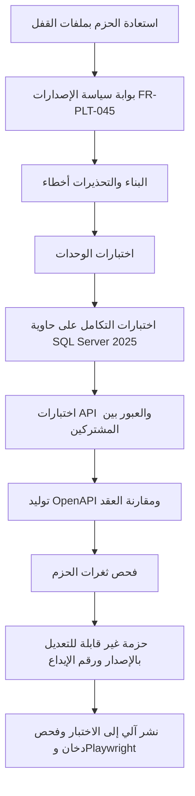
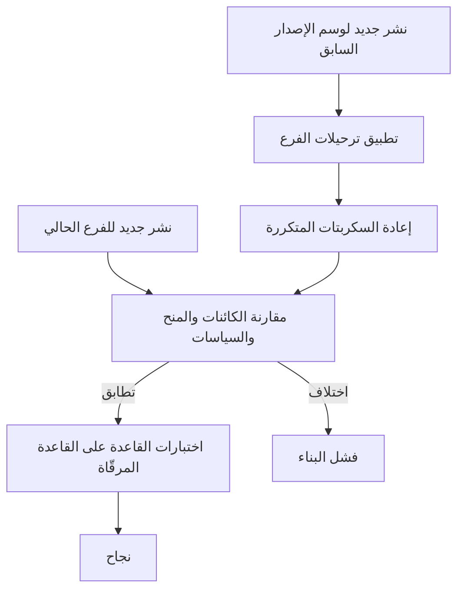

# DOC-B11 — مواصفة البيئات والبناء والإصدار

| البند | القيمة |
|---|---|
| المعرّف | DOC-B11 (docs/30-readiness-documents.md) |
| الإصدار | 0.1 — مسودة للمراجعة — 2026-10-12 |
| المالك المقترح | مهندس البنية التحتية والنشر (DevOps lead) |
| الأولوية | P0 قبل S0 |
| يغطي | FR-PLT-045، FR-PLT-046، FR-PLT-047، FR-PLT-041، FR-PLT-013، AC-PLT-4، O-23 (erd_open_items)، O-2 (20-database-design) |
| يعتمد على | DOC-S08، DOC-S02، DOC-S05، DOC-S09، DOC-S10، DOC-S11، DOC-B01، DOC-B05، DOC-B06، DOC-B09 |
| المصادر | docs/10-detailed-analysis/00-overview-and-cross-cutting.md، docs/10-detailed-analysis/10-m0-m1-platform-organization.md، docs/adr/0001-schema-work-on-linux.md، docs/01-preliminary-analysis.md، db/deploy.sql، db/generated/tsql/، db/static/، tools/deploy/deploy.sh، tools/deploy/deploy.ps1، tools/ci/db_ci.sh، ../.github/workflows/treasury-db-ci.yml (جذر المستودع)، docs/20-database-design.md، tools/dbgen/erd_open_items.py |

## 1. الغرض والنطاق

تعرّف هذه الوثيقة البيئات الأربع وما يعمل في كل منها، ونموذج التفرّع والإصدارات، وخط البناء، واستراتيجية ترحيل القاعدة، وبوابات الإصدار، والتراجع، والإعدادات والأسرار لكل بيئة، وقواعد البيانات في البيئات غير الإنتاجية.

- القرارات الثابتة: الإنتاج VPS خاص لدى مزوّد استضافة على `bankfas.com` بعنوان فرعي لكل مشترك (docs/10-detailed-analysis/00-overview-and-cross-cutting.md:126، FR-PLT-046)؛ قاعدة البيانات SQL Server 2025 على Ubuntu 24.04 LTS (docs/adr/0001-schema-work-on-linux.md:16)؛ النشر بـ tools/deploy/deploy.sh (السطر 19)؛ ASP.NET Core على آخر .NET GA (01 §13) 🟢.
- غير محسوم نهائيًا: طبقة التطبيق على Windows Server وفق 01 §13 «قائمة ومطروحة للمراجعة بعد ADR 0001» (docs/10-detailed-analysis/00-overview-and-cross-cutting.md:126 و226، docs/10-detailed-analysis/10-m0-m1-platform-organization.md:147). لذلك يُصمَّم خط البناء هنا مستقلًا عن نظام مضيف التطبيق، والمراجعة في DQ-B11-1 🟡.
- خارجها: تجهيز الخادم وتقويته (DOC-S10)، ودليل تشغيل deploy.sh على الخادم (DOC-S11)، وحسابات القاعدة وأسرارها (DOC-S08)، والنسخ والاستعادة (DOC-S09).

## 2. البيئات

مسار البيئات المعتمد: تطوير ← اختبار ← تجريبي (UAT) ← إنتاج، مع بيانات تجريبية مجهّلة (docs/10-detailed-analysis/00-overview-and-cross-cutting.md:127) 🟢. ويُضاف CI بيئةً مؤقتة لكل تغيير.

| البيئة | الغرض | الاستضافة | البيانات | كيف يصلها الإصدار |
|---|---|---|---|---|
| تطوير | كتابة الكود والاختبار المحلي | جهاز المطوّر مع حاوية SQL Server 2025 🟡 | اصطناعية | يدويًا |
| CI | التحقق من كل تغيير | مشغّل ubuntu-24.04 وحاوية خدمة تعيش للمهمة فقط كما يعرّفهما الخط في جذر المستودع (../.github/workflows/treasury-db-ci.yml:3-5، 32-37) 🟢؛ يعمل على GitHub ويمر منذ 2026-10-12 (https://github.com/thawrasy/smartlines/actions/runs/38283663041)، وtools/ci/db_ci.sh يمر كاملًا في حاوية التطوير أيضًا (O-02، tools/dbgen/erd_open_items.py:22) | اصطناعية داخل معاملة تُلغى | آليًا عند الدفع وطلب الدمج |
| اختبار | التكامل والواجهة والأداء والفحص الديناميكي واختبار خروج الشريحة | خادم مشترك لدى مزوّد الاستضافة نفسه 🟡 | اصطناعية دائمة لمشتركين وهميين | آليًا من main بعد نجاح CI 🟡 |
| UAT | قبول المستخدم وتمرين الترحيل والتراجع | خادم بمواصفات الإنتاج 🟡 | مجهّلة وفق DOC-B06 | إصدار مرشح موسوم بموافقة QA lead 🟡 |
| إنتاج | المشتركون | VPS خاص لدى مزوّد استضافة، القاعدة على Ubuntu 24.04 LTS 🟢 | حقيقية | الحزمة نفسها المعتمدة في UAT بعد بوابات §7 |

## 3. ما يعمل أين

| المكوّن | تطوير وCI | اختبار وUAT | إنتاج |
|---|---|---|---|
| SQL Server 2025 | حاوية mcr.microsoft.com/mssql/server بوسم مثبّت 🟡 | Ubuntu 24.04 مثل الإنتاج 🟡 | Ubuntu 24.04 LTS على VPS (ADR 0001) 🟢 |
| تطبيق ASP.NET Core على .NET 10 (docs/01-preliminary-analysis.md:455) | تشغيل محلي، وبناء واختبار في CI | الحزمة المبنية نفسها | الحزمة نفسها على Windows Server القائم حتى المراجعة (DQ-B11-1) |
| المهام الخلفية (FR-PLT-044) | داخل عملية التطبيق 🟡 | كذلك | كذلك، بحساب الخدمة IsSystemUser لكل مشترك |
| مخزن الملفات المشفّر (FR-PLT-027) | مجلد مؤقت | مجلد مشفّر على خادم البيئة 🟡 | مجلد مشفّر على خادم التطبيق مع نسخ منفصل 🟡 (DQ-B11-9) |
| البريد المعاملاتي (FR-PLT-013) | ملتقِط محلي لا يرسل | ملتقِط في الاختبار؛ مرحّل بقائمة مستلمين مسموحة في UAT 🟡 | مرحّل SMTP تهيّئه الاستضافة (docs/10-detailed-analysis/10-m0-m1-platform-organization.md:115) 🟢 |
| إنهاء TLS والوكيل العكسي | لا يلزم | كما في الإنتاج | وفق DOC-S05 |
| مخزن المفاتيح الرئيسية | مفاتيح اختبار تُولَّد لكل تشغيل | تسلسل مفاتيح مستقل لكل بيئة | وفق DOC-S02 |
| نشر القاعدة | deploy.sh في CI (tools/ci/db_ci.sh:54) | deploy.sh ثم الترحيلات | deploy.sh ثم الترحيلات؛ deploy.ps1 ليس مسار الإنتاج (docs/adr/0001-schema-work-on-linux.md:20) |

## 4. التفرّع والإصدارات

### 4.1 التفرّع 🟡

- main محمي: لا دفع مباشر، والدمج بطلب دمج تمر فيه كل فحوص CI.
- فروع قصيرة لكل عمل، ويبقى نمط `claude/**` الذي يسمّيه ملف الخط (../.github/workflows/treasury-db-ci.yml:9، جذر المستودع).
- إصلاح عاجل: فرع من وسم الإصدار المنشور، ثم دمجه في main.

### 4.2 ترقيم الإصدارات 🟡

- صيغة MAJOR.MINOR.PATCH. قبل الإطلاق يكون MAJOR صفرًا وMINOR رقم الشريحة: 0.0.x لـ S0، و0.1.x لـ S1، وهكذا؛ والإطلاق 1.0.0.
- الوسم `vX.Y.Z` على main يحدد إصدار التطبيق والقاعدة معًا، فلا يُنشر تطبيق مع قاعدة من إصدار آخر.
- كل حزمة مبنية تحمل الإصدار ورقم الإيداع، ولا تُعاد كتابتها بعد نشرها.

### 4.3 سجل الإصدارات (FR-PLT-045، البند 1)

يطلب FR-PLT-045 سجل إصدارات في المستودع (docs/10-detailed-analysis/10-m0-m1-platform-organization.md:147). المقترح 🟡:

- ملف `versions.json` في جذر المستودع يثبّت: إصدار .NET SDK والإطار المستهدف، وإصدار SQL Server بتحديثه التراكمي، ووسم صورة SQL Server، وإصدار Ubuntu لمضيف القاعدة، ونظام مضيف التطبيق بعد حسمه، والحزم الرئيسية.
- ملف `global.json` يثبّت SDK بالإصدار نفسه.
- لكل تغيير في السجل سجل مراجعة بتاريخه وقراره («ترقية» أو «تأجيل بسبب»)، كما يطلب البند 3.
- ✅ **منفّذ لمضيف القاعدة (2026-10-13، docs/adr/0014-deployment-preflight.md):** `treasury-platform/versions.json`، في جذر هذا المنتج لأن المستودع يضم منتجات أخرى. يسجّل:
  - Ubuntu 24.04؛
  - SQL Server 2025 CU9 GDR1 (KB5126967، البناء 17.0.5015.4)؛
  - صورة CI بالوسم نفسه، ومراجعة أولى بقرار «ترقية».

  ويُضاف مضيف التطبيق و.NET و`global.json` حين تُحسم.

## 5. خط البناء

### 5.1 خط القاعدة القائم

الخطوات 0 إلى 7 في tools/ci/db_ci.sh، وتفصيلها في DOC-B01 §2.1. ملف الخط في جذر المستودع لأن GitHub يقرأ الخطوط من هناك فقط، ويعمل فقط عند تغيّر treasury-platform/db/ أو tools/dbgen/ أو tools/ci/ أو الملف نفسه، وينفّذ أوامره داخل treasury-platform/ (../.github/workflows/treasury-db-ci.yml:10-20، 26-28). يعمل على GitHub ويمر: أول تشغيل أخضر في 2026-10-12 (https://github.com/thawrasy/smartlines/actions/runs/38283663041) بالخطوات الثماني و6 حالات للمشغّلات و41 للعزل. التشغيل الذي سبقه (38267525934) فشل في الخطوة 3 لأن check_fk_indexes.py يستورد erd_layout.py الذي يستورد PIL، فصار الخط يثبّت pillow==12.3.0 (السطور 57-59) (O-02، tools/dbgen/erd_open_items.py:22؛ docs/adr/0001-schema-work-on-linux.md:11، :18). الإضافات المقترحة 🟡:

1. تشغيل tools/dbgen/check_review_fixes.py في الخطوة 3، بجانب check_grants.py الذي يعمل فيها الآن (tools/ci/db_ci.sh:49؛ DQ-B01-3).
2. فحص تكافؤ الترقية والنشر الجديد (§6.3) على كل طلب دمج يغيّر db/.
3. تثبيت وسم الصورة بدل `2025-latest` (../.github/workflows/treasury-db-ci.yml:37) ليطابق سجل الإصدارات. ✅ منفّذ (ADR 0014): `2025-CU9-GDR1-ubuntu-24.04`، والخطوة 3 تفشل إن اختلف عن `versions.json`.
4. تشغيل الخط على كل طلب دمج إلى main بعد وجود كود التطبيق.

### 5.2 خط التطبيق 🟡

| المرحلة | ما تفحصه | يفشل البناء إذا |
|---|---|---|
| بوابة الإصدارات | ملفات القفل، والإطار المستهدف لكل مشروع، وglobal.json، ووسوم الصور | حزمة أو SDK أو صورة بوسم preview أو rc أو beta أو alpha؛ مشروع يستهدف إطارًا أقدم من السجل؛ تغيير السجل بلا سجل مراجعة (AC-PLT-4) |
| التكامل | القاعدة منشورة بـ deploy.sh مع الترحيلات، والاتصال بحساب tp_app | أي اختبار يفشل |
| العقد | وثيقة OpenAPI المولَّدة (FR-PLT-041) | نقطة بلا توثيق أو تغيير كاسر بلا رفع إصدار الواجهة |
| فحص الحزم | الحزم المباشرة والمتعدية | ثغرة عالية أو حرجة بلا استثناء موقّع (NFR-SEC-16) |

### 5.3 المهمة الأسبوعية (FR-PLT-045، البند 3)

خط مجدول أسبوعيًا 🟡 يقارن `versions.json` بآخر إصدار GA منشور لـ .NET وSQL Server، وينبّه فريق تشغيل المنصة إذا مر 30 يومًا على إصدار جديد بلا سجل مراجعة. هذا ما يختبره AC-PLT-4 (docs/10-detailed-analysis/10-m0-m1-platform-organization.md:695-698).

## 6. استراتيجية ترحيل القاعدة

### 6.1 الوضع اليوم

- db/deploy.sql ينشئ القاعدة إن لم تكن موجودة (السطران 17-18) ثم ينفّذ الملفات بالترتيب (22-34) ويتوقف عند أول خطأ (السطر 16).
- الملفات المولَّدة تنشئ الجداول بلا فحص وجود، مثل db/generated/tsql/001_tables.sql:8، فتشغيل deploy.sql على قاعدة قائمة يتوقف عند أول جدول. لذلك يحذف CI القاعدة قبل كل نشر (tools/ci/db_ci.sh:52). أي أن deploy.sql نشر كامل لقاعدة جديدة فقط.
- الملفات الثابتة مكتوبة لتُعاد: CREATE OR ALTER (db/static/025_tenant_views.sql:9، db/static/030_session_context.sql:23، db/static/050_fac_share_rule.sql:26)، وأدوار محمية بفحص وجود (db/static/020_roles_and_grants.sql:23 و35)، وسياسات RLS تُحذف ثم تُنشأ (db/static/010_rls.sql:96-99 و112-118). لكن إعادة تشغيلها على قاعدة قائمة لم تُختبر، لأن CI يبدأ دائمًا من قاعدة جديدة.
- وثيقة القاعدة تقر بأنه «لا يوجد بعدُ مسار ترحيل بين الإصدارات» (docs/20-database-design.md:452)، وتقترح أداة ترحيل مثل DbUp أو Flyway عند أول نشر على بيانات حقيقية (O-2 في 20-database-design، السطر 530).
- الدور tp_migrator موجود بلا منح (db/static/020_roles_and_grants.sql:9 و17)، والنشر يتم بحساب مالك القاعدة (docs/20-database-design.md:271)، وCI ينشر بحساب sa (tools/ci/db_ci.sh:54).
- البذور غير مكتوبة بعد (O-3 في 20-database-design، السطر 531)، وخطتها في DOC-B05.

### 6.2 المقترح 🟡

1. **خط الأساس:** أول إصدار يحمل بيانات يجب الاحتفاظ بها (UAT بالبيانات المجهّلة، ثم الإنتاج) يُنشر بـ deploy.sql على قاعدة جديدة، ويُسجَّل في دفتر الترحيلات إصدارًا أساسًا.
2. **ترحيلات مرقّمة للأمام فقط:** كل تغيير بعد خط الأساس = تعديل النموذج + إعادة توليد DDL (يبقى مصدر النشر الجديد) + سكربت ترحيل مكتوب يدويًا في `db/migrations/Vnnnn__وصف.sql` يحوّل القاعدة القائمة. توليد سكربت الفرق آليًا من النموذج قرار لاحق (DQ-B11-5).
3. **سكربتات متكررة:** الملفات الثابتة 010 و020 و025 و030 و050 وملفات المنح 005 إلى 007 تُعاد بعد الترحيلات في كل إصدار، بالترتيب نفسه في deploy.sql، وفي جلسة واحدة لأن 010 يقرأ الجدول المؤقت الذي ينشئه 004 (db/deploy.sql:13-14). منحة حُذفت من النموذج لا تسحبها إعادة GRANT، فيسحبها سكربت الترحيل صراحة.
4. **المنفّذ:** DbUp 🟡 من الخيارين في O-2 (20-database-design)، لأنه مكتبة .NET تعمل في خط التطبيق نفسه. يسجّل كل سكربت منفَّذ في جدول دفتر يملكه tp_migrator.
5. **الحساب:** دخول ترحيل مرتبط بالدور tp_migrator بصلاحيات DDL يحددها DOC-S08، لا sa ولا حساب التطبيق.
6. **التوسيع ثم التقليص:** التغيير الكاسر يُقسَّم على إصدارين: إضافة العمود أو الجدول الجديد مع بقاء القديم، ثم حذف القديم في إصدار لاحق. فيعمل الإصدار السابق من التطبيق مع القاعدة الأحدث، وهذا شرط التراجع في §8.
7. **ترحيل البيانات:** سكربتات منفصلة على دفعات، قابلة للإعادة دون أثر مكرر.
8. **قبل كل ترحيل إنتاجي:** نسخة احتياطية كاملة وفحص استعادتها (DOC-S09).

### 6.3 فحص التكافؤ في CI 🟡

- المقارنة تبدأ بأعداد check_deployed.py (tools/dbgen/check_deployed.py:1-9)، وتضيف بصمة لتعريفات الأعمدة والقيود والفهارس والسياسات والمنح من كتالوج النظام.
- حالات العزل الإحدى والأربعون وحالات الحصص الست تُشغَّل على القاعدة المرقّاة أيضًا.
- بهذا تُختبر إعادة تشغيل الملفات الثابتة على قاعدة قائمة، وهو ما لم يُختبر حتى الآن.

### 6.4 ما بُني في 2026-10-21 (ADR 0034) ✅

بُني المقترح في §6.2 و§6.3 إلا فحص التكافؤ بين قاعدة جديدة وقاعدة مرقّاة، فهو ينتظر أول سكربت مرقّم.

| البند | ما بُني | الدليل |
|---|---|---|
| دفتر الترحيلات (§6.2 البند 1 و4) | الجدول `plat.SchemaMigration`: سطر لكل خطوة (BASELINE، وكل سكربت مرقّم، وكل تشغيل R للسكربتات المتكررة)، ومعه بصمة SHA-256 للملف، وبصمة المخطط بعد الخطوة، ومن نفّذ، ومتى، وكم استغرق. لا يقرؤه ولا يكتبه أي دور | db/model/10-platform.model؛ ADR 0034 |
| بصمة المخطط (§6.3) | `plat.fn_SchemaFingerprint` على ثمانية أجزاء مرتبة ثنائيًا: المخططات، والأعمدة، والمفاتيح والقيود، والفهارس، وتعريفات الكائنات البرمجية، والسياسات، والأدوار، ومنح الأدوار. ولا تدخلها حسابات المستخدمين ولا العضوية، لأن حسابات الخدمة تُنشأ بعد النشر وتختلف بين الخوادم عمدًا | db/static/056_schema_fingerprint.sql |
| المنفّذ (§6.2 البند 4) | `tools/deploy/migrate.sh` بثلاثة أوامر: `baseline` (يستدعيه deploy.sh بعد النشر الجديد)، و`status`، و`apply`. كل سكربت مرقّم يُنفَّذ في معاملة واحدة مع سطره في الدفتر، والسكربتات المتكررة (أسطر deploy.sql من 004 فصاعدًا) في معاملة واحدة بعدها. واختير سكربت shell بدل DbUp لأن DbUp يحتاج طبقة الخدمة غير المبنية، ويمكنه أن يحلّ محله على المجلد والدفتر نفسيهما | tools/deploy/migrate.sh؛ db/migrations/README.md |
| الرفض دون تغيير | لا خط أساس؛ أو بصمة المخطط غير بصمة الدفتر (تغيير خارج الدفتر)؛ أو سكربت طُبّق ثم عُدّل أو حُذف؛ أو سكربت جديد رقمه قبل سكربت مطبَّق؛ أو اسم ملف مخالف | MG5 وMG7 |
| إعادة تشغيل الملفات الثابتة (§6.1) | **كانت لا تُعاد:** توقف 010 لأن دوال المرشّحات مربوطة بالمخطط ببعضها وبالسياسات. صار 010 يحذف السياسات ودواله أولًا ثم ينشئها، ولا ترى أي جلسة جدولًا بلا سياسة لأن التشغيل كله في معاملة واحدة. وأثبت CI أن التشغيل الثاني لا يغيّر البصمة | db/static/010_rls.sql؛ MG3 |
| الاختبارات | MG1 إلى MG7 في CI على القاعدة التي ينشرها: تسجيل خط الأساس، ولا شيء معلّق، والإعادة بلا تغيير، وسكربت تجريبي مرة واحدة، والرفض، والتراجع عند الفشل، وإيقاف التغيير خارج الدفتر | tools/ci/migration_check.sh |

**ما بقي:** فحص التكافؤ في §6.3 (قاعدة جديدة من وسم الإصدار السابق، ثم الترحيلات، ثم المقارنة ببصمة نشر جديد للفرع). يدخل CI مع أول سكربت في db/migrations، والمجلد فارغ اليوم. وبنود §6.2 من 5 إلى 8 (حساب الترحيل، والتوسيع ثم التقليص، وترحيل البيانات، والنسخة قبل الترحيل) قواعد عمل لا أدوات: يطبّقها كاتب كل سكربت.

## 7. بوابات الإصدار

| البوابة | الشرط | الدليل |
|---|---|---|
| G1 | CI للقاعدة والتطبيق أخضر على الوسم نفسه | تشغيل CI |
| G2 | FR-PLT-045 البندان 1 و2: لا حزمة غير GA، والإطار مطابق للسجل | بوابة الإصدارات، AC-PLT-4 |
| G3 | FR-PLT-045 البند 3: كل إصدار GA جديد من .NET أو SQL Server له سجل مراجعة خلال 30 يومًا من صدوره | `versions.json` والمهمة الأسبوعية |
| G4 | FR-PLT-045 البند 4: إصدار SQL Server ونظام التشغيل على خادم الهدف مطابقان للسجل؛ يقرؤهما سكربت النشر قبل التنفيذ ويرفض عند الاختلاف. ✅ منفّذ (ADR 0014): `deploy.sh` يقارن البناء ونسخة Ubuntu بـ `versions.json` ويرفض بالخطأ 50143 | ناتج سكربت النشر (`preflight passed`) |
| G5 | العزل: 41 حالة قاعدة واختبار العبور لكل نقطة API | DOC-B01 §6 |
| G6 | تمرين الترحيل في UAT: التكافؤ ناجح، والزمن داخل نافذة الصيانة (NFR-AVL-02) | تقرير التمرين |
| G7 | صفر عيوب Sev1 وSev2 مفتوحة، ومعايير خروج الشريحة إن كان الإصدار خروج شريحة | DOC-B01 §5 و§7 |
| G8 | نسخة احتياطية قبل الترحيل وفحص استعادتها | DOC-S09 |
| G9 | توقيع QA lead ومالك المنتج على الإصدار، والمشغّل على النشر 🟡 | DOC-B09 |

## 8. التراجع

| الحالة | الإجراء |
|---|---|
| خلل في التطبيق بعد النشر | إعادة نشر الحزمة السابقة بإعداداتها؛ ممكن لأن القاعدة تتبع «التوسيع ثم التقليص» (§6.2) |
| فشل سكربت ترحيل أثناء التنفيذ | كل سكربت في معاملة حيث يسمح المحرك 🟡؛ يتوقف الترحيل ويبقى التطبيق على الإصدار السابق ويُصلح الخلل بترحيل جديد |
| خلل في القاعدة بعد اكتمال الترحيل | ترحيل تصحيحي للأمام؛ لا سكربتات رجوع 🟡 |
| تلف بيانات بسبب الترحيل | استعادة نسخة ما قبل الترحيل وسجلاتها إلى نقطة قبل البدء (DOC-S09)؛ ولأن الكتابة متوقفة في نافذة الصيانة لا تُفقد بيانات مستخدمين |

قرار التراجع للمشغّل مع مالك المنتج، ويُسجَّل سببه وأثره.

## 9. الإعدادات والأسرار لكل بيئة

القاعدة: لا سر في المستودع، والإعدادات غير السرية في ملفات لكل بيئة، والأسرار تُحقن عند التشغيل 🟡. حسابات القاعدة وأسرارها في DOC-S08، والمفاتيح في DOC-S02، وTLS في DOC-S05.

| البند | تطوير وCI | اختبار وUAT | إنتاج | المرجع |
|---|---|---|---|---|
| كلمة sa | كلمة مؤقتة لحاوية CI فقط (../.github/workflows/treasury-db-ci.yml:41-46) | لا يستعملها التطبيق ولا النشر 🟡 | كذلك | DOC-S08 |
| دخول التطبيق tp_app | سر محلي | دخول مستقل لكل بيئة في مخزن أسرار | دخول مستقل مع تدوير | DOC-S08 |
| دخول الترحيل tp_migrator | sa في CI حاليًا | دخول مستقل | دخول مستقل يُستعمل وقت النشر فقط | DOC-S08 |
| شهادة SQL Server | `-C` مقبول (tools/deploy/deploy.sh:10-11 و19) | شهادة موثوقة بلا `-C` | شهادة موثوقة بلا `-C` | DOC-S05، O-08 (erd_open_items) |
| النطاق | localhost | نطاق فرعي مستقل لكل بيئة 🟡 (DQ-B11-3) | `{tenant}.bankfas.com` | FR-PLT-046 |
| البريد | ملتقِط | ملتقِط، ومرحّل بقائمة مسموحة في UAT | مرحّل الاستضافة | FR-PLT-013 |
| المفاتيح الرئيسية | مولَّدة للاختبار | تسلسل مستقل، ولا مفتاح إنتاجي أبدًا | مخزن مفاتيح خارج القاعدة | DOC-S02 |
| معاملات Argon2id | الحد الأدنى نفسه | الحد الأدنى نفسه | m=65536 وt=3 وp=4 حدًا أدنى | docs/adr/0002-login-and-session-bound-context.md:14 |
| أسرار خط النشر | — | أسرار مشفّرة في منصة CI 🟡 | أسرار مشفّرة ببيئة محمية تتطلب موافقة 🟡 | DOC-S08 |

## 10. البيانات في البيئات غير الإنتاجية

المواصفة الكاملة في DOC-B06. القواعد هنا:

1. لا تُنسخ بيانات الإنتاج ولا نسخه الاحتياطية إلى التطوير أو CI أو الاختبار.
2. UAT يأخذ مجموعة مجهّلة وفق DOC-B06 فقط. أي استخراج من الإنتاج للتجهيل يتم في بيئة معزولة وبموافقة مسؤول حماية البيانات (DOC-S07).
3. نسخة إنتاجية تُستعاد بلا المفتاح الرئيسي تبقى أعمدتها المشفّرة غير مقروءة (FR-PLT-037، docs/10-detailed-analysis/10-m0-m1-platform-organization.md:139)، لكن الأسماء والمبالغ غير المشفّرة تبقى مقروءة، فلا يُعد ذلك تجهيلًا.
4. المفاتيح الإنتاجية لا تغادر مخزنها إلى أي بيئة أخرى.
5. بيانات الاختبار اصطناعية وتُلغى بعد كل اختبار (DOC-B01 §8).

## 11. حزمة النشر القابلة للنقل

FR-PLT-047 (Should، S5) يطلب حزمة تنشر على خادم محلي لمشترك يطلبها بإعدادات بيئية فقط (docs/10-detailed-analysis/10-m0-m1-platform-organization.md:149). يتحقق ذلك من الآن إذا التزمت البيئات بالقاعدة نفسها: حزمة تطبيق واحدة، وdeploy.sh مع الترحيلات، وإعدادات وأسرار تُحقن. ويُعاد تقييم deploy.ps1 حين يطلب مشترك خادمًا محليًا بنظام Windows (DQ-B11-8).

## 12. القرارات المطلوبة

| المعرّف | السؤال | الافتراض المقترح | من يقرر | ما يعطّله |
|---|---|---|---|---|
| DQ-B11-1 | مراجعة نظام طبقة التطبيق بعد ADR 0001 | ✅ معتمد من المالك (2026-10-12): يبقى Windows Server حتى المراجعة، وحزمة .NET تُبنى لتعمل على النظامين؛ والمراجعة تقارن به Ubuntu 24.04 LTS الذي يوحّد المضيفين ويعمل عليه الفريق (docs/adr/0001-schema-work-on-linux.md:7) | المالك مع معماري الحلول | تجهيز بيئة الاختبار، بوابة G4 |
| DQ-B11-2 | خادم واحد للتطبيق والقاعدة أم خادمان | ✅ معتمد من المالك (2026-10-12): خادم مستقل للقاعدة وآخر للتطبيق | المالك مع مدير التشغيل | التجهيز، NFR-AVL |
| DQ-B11-3 | استضافة الاختبار وUAT ونطاقاهما | ✅ معتمد من المالك (2026-10-12): خادم لكل منهما لدى المزوّد نفسه، ونطاقان فرعيان مثل `{tenant}.test.bankfas.com` و`{tenant}.uat.bankfas.com` بشهادتين شاملتين مستقلتين | المالك مع DevOps lead | DOC-S05، اختبار خروج S0 |
| DQ-B11-4 | منفّذ الترحيلات | DbUp، ويُعتمد قبل أول نشر على UAT | قائد قاعدة البيانات | أول نشر يحمل بيانات |
| DQ-B11-5 | كتابة سكربتات الترحيل | يدويًا مع فحص التكافؤ في CI، وتوليد الفرق من النموذج لاحقًا | قائد قاعدة البيانات | أول تغيير بعد خط الأساس |
| DQ-B11-6 | نموذج التفرّع وترقيم الإصدارات | main محمي وفروع قصيرة؛ 0.S.x قبل الإطلاق | DevOps lead | S0 |
| DQ-B11-7 | مكان سجل الإصدارات وصيغته | `versions.json` و`global.json` في الجذر. ✅ `versions.json` منفّذ في جذر المنتج `treasury-platform/` لمضيف القاعدة (ADR 0014)؛ و`global.json` مع كود التطبيق | DevOps lead | AC-PLT-4 |
| DQ-B11-8 | مصير deploy.ps1 | ✅ معتمد من المالك (2026-10-12): يبقى خارج مسار الإنتاج بلا اختبار حتى يطلب مشترك خادم Windows | المالك | FR-PLT-047 |
| DQ-B11-9 | موقع مخزن الملفات المشفّر ونسخه | مجلد مشفّر على خادم التطبيق ونسخ منفصل عن نسخ القاعدة | معماري الحلول مع DOC-S02 وDOC-S09 | FR-PLT-027 |
| DQ-B11-10 | من يوقّع الإصدار والنشر | QA lead ومالك المنتج للإصدار، والمشغّل للنشر | مدير المشروع (DOC-B09) | G9 |
| DQ-B11-11 | تثبيت وسم صورة SQL Server | وسم التحديث التراكمي المسجَّل في `versions.json`. ✅ منفّذ (ADR 0014) | DevOps lead | G2، DQ-B01-2 |

## 13. تعارضات وفجوات في المصادر

1. وسم الصورة `2025-latest` في ../.github/workflows/treasury-db-ci.yml:37 متحرك، والبند 4 من FR-PLT-045 يمنع النشر بإصدار SQL Server مخالف للسجل؛ فما يختبره CI قد يختلف عما يُنشر.
2. docs/30-readiness-documents.md:425 يقول إنه لا يُحدَّد أي سكربت نشر هو المرجعي، وdocs/adr/0001-schema-work-on-linux.md:19-20 يحدده: deploy.sh.
3. ✅ صُحّح (التحقق عند bef5722): docs/adr/0001-schema-work-on-linux.md:3 صار يقول إن نصي FR-PLT-045 و01 §13 حُدِّثا لمضيف القاعدة (O-23)، وإن طبقة التطبيق تبقى على Windows Server وفق 01 §13 حتى المراجعة، كما في docs/10-detailed-analysis/10-m0-m1-platform-organization.md:147. لكن docs/30-readiness-documents.md:425 ما زال يقول إن ADR يقرّ بأن نص FR-PLT-045 يحتاج تحديثًا.
4. ✅ صُحّح (2026-10-12): يعمل على GitHub، فوصف docs/30-readiness-documents.md:424 للخط بأنه «يعمل على main وclaude/**» صار صحيحًا (O-02، tools/dbgen/erd_open_items.py:22). والسجل يسمّي الآن الملف الصحيح ../.github/workflows/treasury-db-ci.yml (جذر المستودع).

## 14. التتبع

| البند في هذه الوثيقة | المتطلب أو القاعدة أو القرار | المصدر |
|---|---|---|
| §2 | مسار البيئات، الاستضافة | docs/10-detailed-analysis/00-overview-and-cross-cutting.md:126-127 |
| §3 | ADR 0001، 01 §13، FR-PLT-013، FR-PLT-027، FR-PLT-044 | docs/adr/0001-schema-work-on-linux.md:16-20؛ docs/01-preliminary-analysis.md:455-456؛ docs/10-detailed-analysis/10-m0-m1-platform-organization.md:115، 129، 146 |
| §4.3، §5.3، §7 G2-G4 | FR-PLT-045، AC-PLT-4 | docs/10-detailed-analysis/10-m0-m1-platform-organization.md:147، 695-698 |
| §5.1 | خط القاعدة القائم | tools/ci/db_ci.sh؛ ../.github/workflows/treasury-db-ci.yml (جذر المستودع) |
| §5.2 | FR-PLT-041 | docs/10-detailed-analysis/10-m0-m1-platform-organization.md:143 |
| §6 | O-2 وO-3 (20-database-design)، tp_migrator | docs/20-database-design.md:452، 530-531، 271؛ db/static/020_roles_and_grants.sql:9 |
| §7 G5 | FR-PLT-036، خروج S0 | docs/10-detailed-analysis/10-m0-m1-platform-organization.md:138؛ docs/10-detailed-analysis/00-overview-and-cross-cutting.md:194 |
| §9 | FR-PLT-046، O-08 (erd_open_items)، ADR 0002 | docs/10-detailed-analysis/10-m0-m1-platform-organization.md:148؛ tools/dbgen/erd_open_items.py:56-60؛ tools/deploy/deploy.sh:10-11 |
| §10 | FR-PLT-037، DOC-B06 | docs/10-detailed-analysis/10-m0-m1-platform-organization.md:139 |
| §11 | FR-PLT-047 | docs/10-detailed-analysis/10-m0-m1-platform-organization.md:149 |
| DQ-B11-1 | O-23 (erd_open_items) | tools/dbgen/erd_open_items.py:145-150 |
