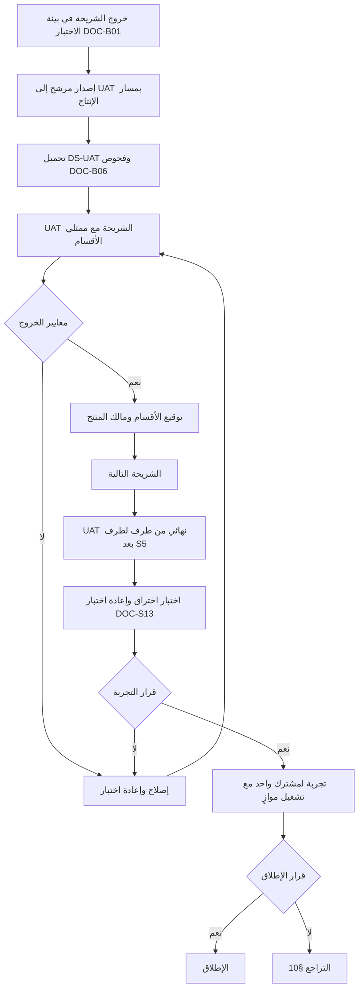

# DOC-B12 — خطة قبول المستخدم والإطلاق التجريبي

| البند | القيمة |
|---|---|
| المعرّف | DOC-B12 (docs/30-readiness-documents.md) |
| الإصدار | 0.1 — مسودة للمراجعة — 2026-10-12 |
| المالك المقترح | مدير ضمان الجودة مع ممثلي الخزينة والمشتريات والمبيعات لدى العميل (docs/30-readiness-documents.md:58) |
| الأولوية | P2 قبل الإطلاق |
| يغطي | خروج S0 إلى S5، 00 §8 (UAT واختبار الاختراق)، X-SEC-5، NFR-SEC-18، NFR-AVL-01، NFR-REC-01 إلى NFR-REC-06، FR-PLT-002، FR-PLT-039، FR-PLT-045، BR-PLT-002 |
| يعتمد على | DOC-B01 (العيوب والبوابات)، DOC-B02 (السيناريوهات)، DOC-B06 (البيانات)، DOC-B11 (البيئات والتراجع)، DOC-S13 (اختبار الاختراق)، DOC-S02، DOC-S07، DOC-S09، DOC-S10، DOC-S11، DOC-S12، DOC-S15، DOC-B09 |
| المصادر | docs/10-detailed-analysis/00-overview-and-cross-cutting.md، docs/10-detailed-analysis/10-m0-m1-platform-organization.md، 11-m2-m4…، 12-m5…، 13-m6…، 14-m7-m8…، docs/10-detailed-analysis/91-requirements-index.md، docs/04-facility-agreements-analysis.md، docs/adr/0001-schema-work-on-linux.md |

## 1. الغرض والنطاق

تحدد الخطة كيف يقبل ممثلو العميل كل شريحة، ثم الإطلاق التجريبي لمشترك واحد، ثم قرار الإطلاق ومسار التراجع.

- **داخل النطاق:** نطاق UAT لكل خروج شريحة، والمشاركون، والبيانات، والسيناريوهات، ومعايير الدخول والخروج، ومعالجة العيوب، والتجربة لمشترك واحد، وقائمة قرار الإطلاق، والتراجع.
- **خارج النطاق:** اختبار الاختراق ونطاقه (DOC-S13 §9)، وشدة العيوب وفرزها (DOC-B01 §7)، وتفاصيل البيئات والنشر (DOC-B11)، والاستجابة للحوادث (DOC-S15).
- كل المدد والأعداد في هذه الخطة مقترحة 🟡 ما لم يُذكر مصدرها.

## 2. الأساس في المصادر

| الحقيقة | المصدر |
|---|---|
| UAT «مع الخزينة والمشتريات والمبيعات على بيانات مجهّلة» 🟢 | docs/10-detailed-analysis/00-overview-and-cross-cutting.md:218 |
| اختبار اختراق قبل الإطلاق، ومراجعة ضوابط الهويات 🟢 | docs/10-detailed-analysis/00-overview-and-cross-cutting.md:217 |
| اختبار اختراق ومراجعة أمنية قبل التجربة (S5) 🟢 | docs/10-detailed-analysis/10-m0-m1-platform-organization.md:591 |
| خروج S5: «إطلاق تجريبي لمشترك واحد» 🟢 | docs/10-detailed-analysis/00-overview-and-cross-cutting.md:201 |
| شروط خروج S0 إلى S4 🟢 | docs/10-detailed-analysis/00-overview-and-cross-cutting.md:194-200 |
| الأدوار: مدير الخزينة، مسؤول التسهيلات، موظف الخزينة، مقدّم الطلب ومدير المشتريات، مقدّم الطلب ومدققه ومعتمده في المبيعات، المحلل المالي، المدقق 🟢 | docs/10-detailed-analysis/00-overview-and-cross-cutting.md:56-67 |
| لا بيانات حقيقية قبل حسم المفاتيح والإقامة والنسخ 🟢 | docs/adr/0001-schema-work-on-linux.md:26 |
| لا يُدخل رقم مالي قبل مطابقته بالأصل 🟢 | docs/04-facility-agreements-analysis.md:13 |
| تعليق المشترك: لا دخول إلا لمدير الحساب للقراءة والتصدير؛ الإغلاق: تصدير 30 يومًا ثم أرشفة للقراءة فقط 🟢 | BR-PLT-002 (docs/10-detailed-analysis/10-m0-m1-platform-organization.md:228) |
| تصدير بيانات المشترك FR-PLT-039 بأولوية Should في S5 🟢 | docs/10-detailed-analysis/91-requirements-index.md:75 |

## 3. المسار من UAT إلى الإطلاق

## 4. نطاق UAT لكل خروج شريحة

| الشريحة | شرط الخروج (00 §7) | ما يقبله المستخدمون | السيناريوهات | البيانات |
|---|---|---|---|---|
| S0 | عزل بين مشتركين، وتأهيل مشترك آليًا | الدخول وMFA والاسترداد، والمستخدمون والأدوار والنطاق، والتدقيق، والإعدادات، والترقيم | AC-PLT-2، AC-PLT-3، AC-PLT-10 إلى AC-PLT-14، AC-PLT-16، AC-PLT-19، AC-PLT-21 | DS-UAT اصطناعي |
| S1 | بنك بمعالج واحد، وشركة بمستنداتها، وكتالوجات مزروعة | الشركات ومستنداتها، والأشخاص والكشف، ومعالج البنك، والحسابات، والكتالوجات | AC-INS-1، AC-ORG-6، AC-CAT-1، AC-ORG-4، AC-PTY-1، AC-PTY-4، AC-ACC-1، AC-ACC-5 | DS-UAT |
| S1-ب | تقرير تعارض الصلاحيات | الملكية والهيئات والمنح والمفوّضون | AC-ORG-1، AC-ORG-2، AC-ACC-2 إلى AC-ACC-4 | DS-UAT |
| S2 | الاتفاقيات الأربع بلا قيد خارج النموذج، وإنذار الانتهاء | التسهيل وحدوده وتسعيره وضماناته وأجندته | AC-FAC-1، AC-FAC-3 إلى AC-FAC-6، AC-FAC-8، AC-FAC-10، وإدخال A إلى D | DS-AGR (DOC-B06 §6.5) |
| S2-ب | لوحة التزام لتسهيل واحد | القوائم والأرصدة والتحويلات والتحقق والخروقات | AC-FAC-7؛ لا سيناريوهات FIN أو OBL بعد (§12) | DS-AGR |
| S3 | طلب اعتماد يمر كل مراحله ويظهر في الحدود | محرك الطلبات، واعتماد المشتريات، والحجز | AC-WFL-1 إلى AC-WFL-10، AC-LCT-1 إلى AC-LCT-5، AC-LCI-1، AC-LCI-2، AC-FAC-2، AC-FAC-9 | DS-AGR مع النموذج F-b |
| S4 | رصيد اعتماد التصدير يطابق الحساب اليدوي | البروفورما، واعتمادات التصدير، وأوامر البيع والتحصيل | AC-LCE-1 إلى AC-LCE-3 | DS-AGR مع F-a وF-c |
| S5 | تجربة لمشترك واحد | الطلبات العامة، والتقارير، والبريد، واللوحات، وUAT نهائي من طرف لطرف | لا سيناريوهات S5 بعد (§12)؛ وإعادة كل ما سبق | DS-UAT كاملة |

مصادر السيناريوهات: DOC-B02 لـ S0 وS1؛ و§15 في المواصفات للباقي: docs/10-detailed-analysis/10-m0-m1-platform-organization.md:650-698، 11-m2-m4…:646-664، 12-m5…:662-671، 13-m6…:746-791، 14-m7-m8…:734-779.

قواعد 🟡:

- UAT الشريحة أسبوع واحد بعد خروجها في بيئة الاختبار. S0 يقبله مدير حساب المشترك ومدير الخزينة والمدقق فقط، لأنه بلا وظائف أعمال.
- UAT النهائي بعد S5 ثلاثة أسابيع: سيناريوهات من طرف لطرف عبر الوحدات، وإعادة سيناريوهات Must من كل الشرائح.
- يكتب محلل الأعمال لكل سيناريو نصًا للمستخدم بالخطوات والبيانات والنتيجة المتوقعة، بالإنجليزية لغة الواجهة (FR-PLT-032).

## 5. المشاركون

| الدور في UAT | من القسم | العدد 🟡 | المسؤولية |
|---|---|---|---|
| مدير حساب المشترك TA | الخزينة أو تقنية المعلومات لدى العميل | 1 | المستخدمون والأدوار والإعدادات |
| مدير الخزينة TM | الخزينة | 1 | قائد الأعمال لـ UAT؛ يعتمد سيناريوهات الخزينة؛ الكشف |
| مسؤول التسهيلات FO | الخزينة | 1 أو 2 | إدخال الاتفاقيات والحدود والتسعير والالتزامات |
| موظف الخزينة TE | الخزينة | 2 | سحب الطلبات وتنفيذها |
| مقدّم الطلب ومدير المشتريات | المشتريات | 2 و1 | طلب اعتماد الاستيراد وموافقته |
| مقدّم الطلب ومدققه ومعتمده | المبيعات | 2 و1 و1 | البروفورما وأوامر البيع والتحصيل |
| المحلل المالي FA | المالية | 1 | القوائم المالية والتحقق في S2-ب |
| المدقق AU | التدقيق الداخلي | 1 | عرض التدقيق وتصديره |
| منسّق UAT | QA lead | 1 | الخطة والجدول والفرز والتقرير |
| داعم تقني | فريق التطبيق وOPS | 2 | البيئة والإصلاح والنشر |

| البند | A | R | C | I |
|---|---|---|---|---|
| خطة UAT ونصوص السيناريوهات | QA | BA | TRM، ممثلو الأقسام | OWN |
| توقيع UAT لكل شريحة | OWN | ممثلو الأقسام المعنية | QA | PM |
| قرار التجربة وقرار الإطلاق | OWN | QA وSEC وOPS | LEG، TRM | كل الفريق |
| بيانات UAT | LEG | QA | TRM | OWN |

الرموز من DOC-B09 §2. لا يوقّع المُعِدّ على ما أعدّه (DOC-B09 §3).

## 6. البيانات

- UAT يستعمل DS-UAT وDS-AGR فقط، بعد نجاح الفحوص V-1 إلى V-6 (DOC-B06 §9).
- لا يُدخل المشاركون أي بيانات حقيقية في UAT. إن حدث ذلك يُعامل حادثًا (DOC-S15) وتُعاد البيئة (DOC-B06 §7).
- البيانات تُعاد إلى إصدارها المعتمد في بداية كل دورة UAT (DOC-B06 §8).
- الاتفاقيات الأربع بقيمها الحقيقية لا تُدخل إلا في الإنتاج أثناء التجربة (§8).

## 7. معايير الدخول والخروج ومعالجة العيوب

### 7.1 دخول دورة UAT

| المعيار | الدليل |
|---|---|
| خروج الشريحة في بيئة الاختبار وفق DOC-B01 §5 | تقرير الخروج |
| إصدار مرشح موسوم منشور إلى UAT بمسار الإنتاج، والبوابات G1 إلى G5 ناجحة | DOC-B11 §7 |
| DS-UAT محمّلة والفحوص V-1 إلى V-6 ناجحة | DOC-B06 §9 |
| حساب بـ MFA لكل مشارك، وجلسة تدريب، ونصوص السيناريوهات موزعة | منسّق UAT |
| صفر Sev1 مفتوح، وقائمة Sev2 المعروفة منشورة للمشاركين | DOC-B01 §7 |

### 7.2 خروج دورة UAT

| المعيار | الدليل |
|---|---|
| كل سيناريو Must نفّذه ممثل القسم ونجح | تقرير UAT |
| كل سيناريو Should ناجح أو مؤجل بقرار مكتوب؛ Could لا يوقف (DQ-B02-5) | تقرير UAT |
| صفر Sev1 وSev2 مفتوح؛ ولكل Sev3 تاريخ إصلاح | المتتبع |
| توقيع ممثل كل قسم مشارك ومالك المنتج | محضر التوقيع |

### 7.3 معالجة العيوب

1. يُسجَّل كل عيب في المتتبع بالوسوم في DOC-B01 §7: الشدة والشريحة وFR وAC، ومصدر الاكتشاف «UAT».
2. يقترح المشارك الشدة، ويثبتها منسّق UAT في الفرز.
3. الفرز مرتان أسبوعيًا، ويوميًا في UAT النهائي، وفورًا لأي Sev1 بالمهل في DQ-B01-8.
4. يُفصل العيب عن طلب التغيير: ما يخالف متطلبًا أو سيناريو عيب؛ وما يطلب سلوكًا جديدًا طلب تغيير يقرره OWN ولا يوقف الخروج.
5. لا إصلاح مباشر في قاعدة UAT. الإصلاح إصدار مرشح جديد عبر الخط (DOC-B11 §2)، ويعيد المبلِّغ اختباره.
6. أي عيب أمني يُشرك SEC. كسر عزل أو كشف قيمة مقيّدة Sev1 بلا استثناء (DOC-B01 §7).

## 8. الإطلاق التجريبي لمشترك واحد

### 8.1 الشكل

| البند | القيمة المقترحة 🟡 |
|---|---|
| المشترك | مجموعة العميل التي زوّدت الاتفاقيات والنماذج (DQ-B12-3) |
| البيئة | الإنتاج على VPS (ADR 0001) بعد قائمة §9 |
| المدة | ثمانية أسابيع، لتغطي دورتي تقارير شهريتين ودورة طلبات كاملة |
| التشغيل الموازي | العملية اليدوية الحالية تبقى السجل الرسمي طوال التجربة، وتُقارن نتائج النظام بها أسبوعيًا |
| المستخدمون | المشاركون في §5 بحساباتهم الإنتاجية الجديدة؛ لا تُنقل حسابات UAT |
| الدعم | قناة دعم بساعات العمل، ومهلة استجابة لـ Sev1 كما في DQ-B01-8 |

### 8.2 المراحل

| الأسبوع | المرحلة | ما يحدث | المسؤول |
|---|---|---|---|
| 1 | التأهيل | إنشاء المشترك بإجراء المنصة (AC-PLT-5)، ودعوة مدير الحساب الأول وتسجيل MFA، والمستخدمون والأدوار | OPS وTA |
| 1-2 | البيانات الرئيسية | الشركات والبنوك والعلاقات والحسابات بقوالب TPL وتشغيل تجريبي ثم فعلي (DOC-B05 §7) | TM وFO |
| 2-3 | الاتفاقيات | إدخال A إلى D بقيمها الحقيقية، ومطابقة كل رقم بالأصل، ومراجعة TM ثم اعتماد المراجعة (X-SEC-7) | FO ثم TM |
| 3-8 | التشغيل | طلبات الاعتماد والبروفورما الحقيقية بالتوازي مع العملية اليدوية؛ مقارنة أسبوعية للمتاح والمحجوز | المستخدمون وQA |
| 8 | المراجعة | تقرير التجربة وقرار الإطلاق (§9) | OWN |

### 8.3 مقاييس التجربة وخروجها 🟡

| المقياس | حد الخروج |
|---|---|
| الاتفاقيات الأربع | مدخلة كاملة بلا قيد خارج النموذج، وكل رقم مطابق للأصل |
| طلبات الاعتماد الحقيقية | عشرة على الأقل من البداية إلى النهاية، تظهر في حدود التسهيل (شرط S3) |
| المطابقة الأسبوعية | المتاح والمحجوز يطابقان الحساب اليدوي، وكل فرق له تفسير مسجّل |
| الإنذارات | إنذار انتهاء واحد على الأقل وصل في موعده (شرط S2) |
| العيوب | صفر Sev1 وSev2 مفتوح؛ صفر حادث عزل أو كشف |
| التوفر | لا يقل عن NFR-AVL-01 في فترة التجربة |
| النسخ | تمرين استعادة ناجح أثناء التجربة (NFR-REC-04) |
| رضا المستخدمين | توقيع ممثلي الأقسام على تقرير التجربة |

## 9. قائمة قرار التجربة والإطلاق

القرار لمالك المنتج بتوصية QA وSEC وOPS، ولـ LEG رفض أي بند حماية بيانات (DQ-B12-6). البند غير المستوفى يمنع القرار إلا باستثناء موقّع.

| # | البند | الدليل | المرجع |
|---|---|---|---|
| 1 | خروج كل الشرائح S0 إلى S5 وتوقيعات UAT | تقارير الخروج والتوقيعات | §7 |
| 2 | صفر Sev1 وSev2 مفتوح | المتتبع | DOC-B01 §7 |
| 3 | اختبار الاختراق بلا حرج أو عالٍ مفتوح بعد إعادة الاختبار | التقرير وخطاب إعادة الاختبار | NFR-SEC-18؛ DOC-S13 §9 |
| 4 | قائمة ASVS المستوى 2 مكتملة | القائمة | DOC-S13 §6 |
| 5 | حفظ المفتاح الرئيسي ونسخته وتمرين استعادته | محضر التمرين | ADR 0001:26؛ DOC-S02؛ AC-PLT-17 |
| 6 | قرار إقامة البيانات ومراجعة الامتثال القانونية | القرار المكتوب | DQ-S07-1؛ X-AUD-4 |
| 7 | النسخ والاستعادة وأرقام RPO وRTO معتمدة ومقاسة | تقرير التمرين | NFR-REC-01 إلى NFR-REC-06؛ DOC-S09 |
| 8 | الخادم مقوّى ومرقّع، والنشر مُتمرَّن في UAT | قائمة DOC-S10، وتقرير G6 | DOC-S10؛ DOC-S11؛ DOC-B11 §7 |
| 9 | المراقبة والتنبيه ولوحة الصحة تعمل | لوحة المشغّل | DOC-S12؛ NFR-OPS-02؛ NFR-AVL-03 |
| 10 | إجراء الاستجابة للحوادث وجهات الاتصال | الإجراء المعتمد | DOC-S15 |
| 11 | TLS وHSTS وسجلات SPF وDKIM وDMARC | نتيجة الفحص | NFR-SEC-09؛ THR-51 |
| 12 | بوابات الإصدار G1 إلى G9 على الوسم نفسه | سجل الإصدار | DOC-B11 §7 |
| 13 | تصدير بيانات المشترك يعمل، لأنه أساس التراجع | تشغيل تجريبي للتصدير | FR-PLT-039؛ DQ-B12-7 |
| 14 | التدريب ودليل المستخدم وقناة الدعم | الحضور والدليل | DQ-B12-10 |
| 15 | فحص دخان على الإنتاج قبل فتح الدخول | نتيجة الفحص | DOC-B11 §2 |

## 10. التراجع

### 10.1 أثناء النشر

يتبع DOC-B11 §8: إعادة نشر الحزمة السابقة، وترحيل تصحيحي للأمام، واستعادة نسخة ما قبل الترحيل عند تلف البيانات. القرار للمشغّل مع مالك المنتج، ويُسجَّل سببه.

### 10.2 أثناء التجربة

| المحفّز 🟡 | الإجراء | من يقرر |
|---|---|---|
| حادث أمني: عبور مشتركين أو كشف قيمة مقيّدة | تعليق المشترك فورًا (BR-PLT-002، T27 وT31)، ثم DOC-S15 | OPS فورًا، ثم OWN |
| خلل في سلامة الحدود أو الحجز | إيقاف الطلبات الجديدة، والاعتماد على العملية اليدوية، وإصلاح للأمام | OWN مع TRM |
| توفر دون NFR-AVL-01 أسبوعين متتاليين | مراجعة الاستضافة، وتمديد التجربة أو إيقافها | OWN مع OPS |
| قرار قانوني أو قرار المالك بالإيقاف | إيقاف التجربة بالمسار في §10.3 | OWN مع LEG |

### 10.3 إيقاف التجربة

لأن العملية اليدوية تبقى السجل الرسمي (§8.1)، لا يفقد العميل عمله بالإيقاف. الخطوات 🟡:

1. يعلّق المشغّل المشترك بسبب مكتوب، فتُرفض الكتابة ويبقى لمدير الحساب القراءة والتصدير (BR-PLT-002).
2. يصدّر مدير الحساب بيانات المشترك (FR-PLT-039)، وتُسلَّم الحزمة للعميل.
3. إن تقرر عدم الاستئناف يُغلق المشترك: تصدير 30 يومًا، ثم أرشفة للقراءة فقط، ولا إتلاف إلا بسير FR-PLT-040 بعد مدد الاحتفاظ (BR-PLT-002).
4. تُسجَّل الأسباب والدروس في تقرير التجربة.

## 11. القرارات المطلوبة

| المعرّف | السؤال | الافتراض المقترح | من يقرر | ما يعطّله |
|---|---|---|---|---|
| DQ-B12-1 | UAT لكل شريحة أم UAT نهائي فقط؟ | أسبوع لكل شريحة من S1، وثلاثة أسابيع نهائية بعد S5 | OWN مع QA | جدول المشروع |
| DQ-B12-2 | مدة التجربة وشكلها | ثمانية أسابيع بتشغيل موازٍ والعملية اليدوية سجل رسمي | OWN مع TRM | §8 |
| DQ-B12-3 | من المشترك التجريبي | مجموعة العميل التي زوّدت الاتفاقيات | OWN | §8 |
| DQ-B12-4 | أعداد المشاركين لكل دور | كما في §5 | TRM مع مديري المشتريات والمبيعات | جدول UAT |
| DQ-B12-5 | حدود خروج التجربة | كما في §8.3، ومنها عشرة طلبات اعتماد حقيقية | OWN مع TRM | قرار الإطلاق |
| DQ-B12-6 | سلطة قرار التجربة والإطلاق | OWN بتوصية QA وSEC وOPS، ولـ LEG رفض في بنود حماية البيانات | OWN | §9 |
| DQ-B12-7 | التصدير FR-PLT-039 بأولوية Should في S5، والتراجع يعتمد عليه | رفعه إلى Must للتجربة، أو إجراء تصدير بيد DBA موثّق | OWN مع DBA | §9 البند 13، §10.3 |
| DQ-B12-8 | سيناريوهات S5 وFIN وOBL | يضيفها DOC-B02 قبل بدء S2-ب وS5 | BA | §4 |
| DQ-B12-9 | مشاركة المالية في UAT | تُضاف المالية إلى الأقسام الثلاثة لأجل S2-ب | OWN | §5 |
| DQ-B12-10 | التدريب ودليل المستخدم | جلسة لكل دور قبل UAT، ودليل بالإنجليزية لكل شاشة في DOC-B07 | BA مع UX | §9 البند 14 |
| DQ-B12-11 | لغة نصوص السيناريوهات للمشاركين | الإنجليزية مع شرح عربي في جلسة التدريب، حتى تصدر الواجهة العربية | OWN | §4 |

## 12. تعارضات وفجوات في المصادر

1. توقيت اختبار الاختراق: docs/10-detailed-analysis/00-overview-and-cross-cutting.md:217 «قبل الإطلاق»، وdocs/10-detailed-analysis/10-m0-m1-platform-organization.md:591 «قبل التجربة (S5)». تعتمد الخطة الأبكر، كما في DOC-S13 §9.
2. لا سيناريوهات قبول لمتطلبات S5، ولا بادئات AC لـ COL وOBL وFIN وCMP (docs/30-readiness-documents.md:348)، فقبول S2-ب وS5 بلا نصوص اليوم (DQ-B12-8).
3. docs/10-detailed-analysis/00-overview-and-cross-cutting.md:218 يسمّي الخزينة والمشتريات والمبيعات، ودور المحلل المالي في المالية (السطر 66) يحتاجه قبول S2-ب (DQ-B12-9).
4. التراجع في التجربة يعتمد على FR-PLT-039 (Should، S5) وعلى سير الإتلاف FR-PLT-040 (Should، S5) (docs/10-detailed-analysis/91-requirements-index.md:75-76)، فقد لا يكونان جاهزين عند التجربة (DQ-B12-7).
5. docs/30-readiness-documents.md:430 يضع نطاق اختبار الاختراق في هذه الوثيقة؛ نطاقه وتوقيته في DOC-S13 §9، وهنا بند القرار فقط.
6. خروج S2 يطلب الاتفاقيات «الفعلية» (docs/10-detailed-analysis/00-overview-and-cross-cutting.md:196) قبل أن تُسمح البيانات الحقيقية (docs/adr/0001-schema-work-on-linux.md:26). الحل المقترح في DOC-B06 §6.5: البنية في S2، والقيم الحقيقية في التجربة.

## 13. التتبع

| البند في هذه الوثيقة | المتطلب أو القاعدة أو القرار | المصدر |
|---|---|---|
| §4 | شروط خروج الشرائح | docs/10-detailed-analysis/00-overview-and-cross-cutting.md:194-201 |
| §4 السيناريوهات | §15 في المواصفات، DOC-B02 | docs/10-detailed-analysis/10-m0-m1-platform-organization.md:650-698؛ 12-m5…:662-671؛ 13-m6…:746-791؛ 14-m7-m8…:734-779 |
| §5 | الأدوار، فصل المهام | docs/10-detailed-analysis/00-overview-and-cross-cutting.md:56-67، :142 |
| §6 | 00 §8 UAT ببيانات مجهّلة، ADR 0001 | docs/10-detailed-analysis/00-overview-and-cross-cutting.md:218؛ docs/adr/0001-schema-work-on-linux.md:26 |
| §7 | شدة العيوب وبوابات الإصدار | DOC-B01 §5، §7؛ DOC-B11 §7 |
| §8 | خروج S5، مطابقة الأرقام بالأصل | docs/10-detailed-analysis/00-overview-and-cross-cutting.md:201؛ docs/04-facility-agreements-analysis.md:13 |
| §9 | X-SEC-5، NFR-SEC-18، NFR-REC، NFR-AVL-01 | docs/10-detailed-analysis/00-overview-and-cross-cutting.md:140؛ DOC-B03 §3، §4، §5 |
| §10 | BR-PLT-002، FR-PLT-039، FR-PLT-040 | docs/10-detailed-analysis/10-m0-m1-platform-organization.md:228، :141-142 |
