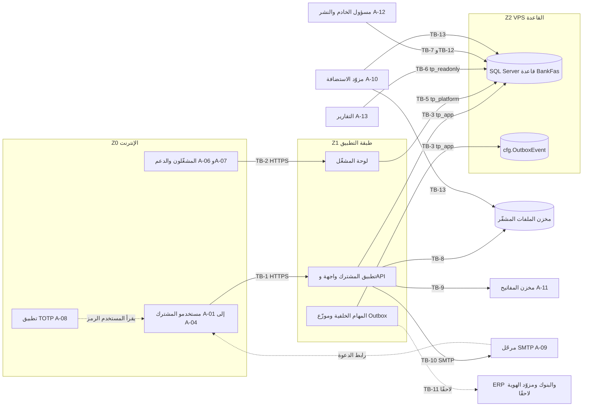
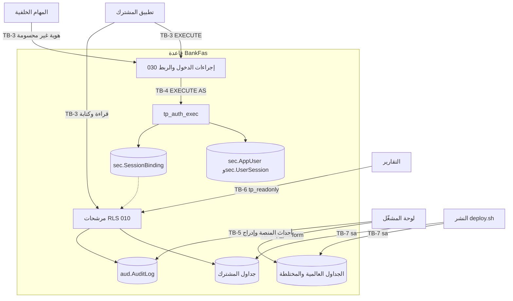

# DOC-F01 — مخطط السياق وحدود الثقة (DFD المستوى 0)

| البند | القيمة |
|---|---|
| المعرّف | DOC-F01 (docs/30-readiness-documents.md) |
| الإصدار | 0.1 — مسودة للمراجعة — 2026-10-12 |
| المالك المقترح | معماري الحلول مع مسؤول الأمن |
| الأولوية | P0 قبل S0 |
| يغطي | FR-PLT-005، FR-PLT-006، FR-PLT-007، FR-PLT-011، FR-PLT-013، FR-PLT-027، FR-PLT-036، FR-PLT-037، FR-PLT-041، FR-PLT-042، FR-PLT-046، FR-PLT-047، BR-PLT-001، BR-PLT-015، BR-PLT-017، O-16 وO-17 وO-23 (erd_open_items)، O-12 (20-database-design) |
| يعتمد على | ADR 0001، ADR 0002. لا يعتمد على وثيقة DOC أخرى؛ تعتمد عليه DOC-F02 وDOC-S01 وDOC-S03 وDOC-S05 وDOC-S08 وDOC-S10 |
| المصادر | docs/adr/0001-schema-work-on-linux.md، docs/adr/0002-login-and-session-bound-context.md، db/deploy.sql، db/static/010_rls.sql، db/static/020_roles_and_grants.sql، db/static/025_tenant_views.sql، db/static/030_session_context.sql، db/generated/tsql/005_delete_grants.sql، db/generated/tsql/006_sensitive_columns.sql، db/generated/tsql/007_table_grants.sql، db/model/10-platform.model، docs/10-detailed-analysis/00-overview-and-cross-cutting.md، docs/10-detailed-analysis/10-m0-m1-platform-organization.md، docs/20-database-design.md، tools/deploy/deploy.sh، tools/ci/db_ci.sh، ../.github/workflows/treasury-db-ci.yml (جذر المستودع) |

## 1. الغرض والنطاق

- يبيّن هذا المستند من يتصل بالمنصة، وعبر أي حد ثقة، وبأي هوية، وما تصنيف البيانات العابرة.
- يعرّف **معرّفات حدود الثقة TB-1 إلى TB-13**. تستعملها الوثائق الأخرى بنصها. لا يُعاد ترقيم حد؛ الحد الجديد يأخذ الرقم التالي، والحد الملغى يبقى رقمه محجوزًا.
- النطاق: المنصة كما تُنشر أول مرة على VPS خاص لدى مزوّد استضافة 🟢 (docs/adr/0001-schema-work-on-linux.md:8، :16)، مع حدود محجوزة لما يأتي لاحقًا (ERP، البنوك، مزوّد هوية خارجي).
- خارج النطاق، ويُحال إلى مالكه: تسلسل الدخول وMFA (DOC-F03)، ربط السياق لكل اتصال ومهمة (DOC-F04)، شكل الرمز وCSRF وCSP وعنوان IP الموثوق (DOC-S03)، TLS (DOC-S05)، المفاتيح وTDE (DOC-S02)، الحسابات وأسرارها (DOC-S08)، تدفق كل قيمة حساسة (DOC-F02)، التهديدات (DOC-S01).

**تعريفات:**
- **حد الثقة (TB):** موضع تتغير عنده الهوية أو الامتياز أو الجهة المالكة للبنية. كل تدفق يعبر حدًا يُصادَق ويُفوَّض عنده.
- **تصنيف البيانات:** أربعة مستويات 🟢 (docs/10-detailed-analysis/10-m0-m1-platform-organization.md:581): عامة، داخلية، سرّية، مقيّدة. وسوم النموذج `sens=confidential` و`sens=restricted` تقابل السرّية والمقيّدة. المعيار التفصيلي في DOC-S06.

## 2. المناطق

| المنطقة | ما فيها | المالك | الثقة |
|---|---|---|---|
| Z0 الإنترنت والأجهزة | متصفحات المستخدمين والمشغّلين، تطبيق TOTP، صناديق البريد | المستخدم | غير موثوقة |
| Z1 طبقة التطبيق | ASP.NET Core على .NET 🟢 (D-11؛ 01 §13): تطبيق المشترك (واجهة وAPI)، لوحة المشغّل، المهام الخلفية وموزّع Outbox (docs/10-detailed-analysis/00-overview-and-cross-cutting.md:106-115) | المنصة | موثوقة جزئيًا: تحمل أسرار الاتصال بالقاعدة ومفاتيح البيانات بعد فكها |
| Z2 طبقة البيانات | SQL Server 2025 على Ubuntu 24.04 LTS 🟢 (docs/adr/0001-schema-work-on-linux.md:16)، قاعدة `BankFas` (db/deploy.sql:17-18) | المنصة | موثوقة، وداخلها حد امتياز TB-4 |
| Z3 مخزن الملفات | ملفات مشفّرة خارج القاعدة (FR-PLT-027) | المنصة | موثوق للتخزين لا للسرية؛ الملف مشفّر قبل الكتابة |
| Z4 مزوّد الاستضافة | الطبقة الافتراضية والشبكة والأقراص والنسخ | المزوّد | يُوثق به في التوفر لا في السرية 🟡 |
| Z5 خدمات خارجية | مخزن المفاتيح، مرحّل SMTP، ولاحقًا ERP والبنوك ومزوّد الهوية | جهات أخرى | غير موثوقة إلا بالعقد والمصادقة |
| Z6 الإدارة | مسؤولو الخادم والنشر، وCI | المنصة | موثوقة بامتياز عالٍ |

- طبقة التطبيق على Windows Server وفق 01 §13، وهذا مطروح للمراجعة بعد ADR 0001 🟢 (docs/10-detailed-analysis/00-overview-and-cross-cutting.md:126؛ FR-PLT-045 في docs/10-detailed-analysis/10-m0-m1-platform-organization.md:147؛ docs/adr/0001-schema-work-on-linux.md:3). مكانها من VPS القاعدة غير محسوم (DQ-F01-1).
- CI (tools/ci/db_ci.sh) يمر كاملًا في حاوية التطوير وعلى GitHub: ملف المسار في جذر المستودع (../.github/workflows/treasury-db-ci.yml:30-74) لأن GitHub يقرأ المسارات من هناك فقط، وأول تشغيل أخضر في 2026-10-12 (https://github.com/thawrasy/smartlines/actions/runs/38283663041؛ O-02 في tools/dbgen/erd_open_items.py:22؛ docs/adr/0001-schema-work-on-linux.md:11). صلاحيته قراءة المحتوى فقط ولا يستعمل أسرارًا (../.github/workflows/treasury-db-ci.yml:23-24)، ولا يصل CI إلى الإنتاج.

## 3. الفاعلون الخارجيون

| المعرّف | الفاعل | الدور | الهوية | الحد |
|---|---|---|---|---|
| A-01 | مدير الحساب (TA) | إدارة المستخدمين والأدوار والإعدادات، وتفعيل وصول الدعم (docs/10-detailed-analysis/10-m0-m1-platform-organization.md:45-46، BR-PLT-017) | `sec.AppUser`، كلمة مرور وTOTP | TB-1 |
| A-02 | مدير الخزينة (TM) ومسؤول التسهيلات (FO) | حاملا الصلاحيات المقفلة للكشف والتصدير (BR-PLT-019؛ docs/10-detailed-analysis/10-m0-m1-platform-organization.md:60-62) | `sec.AppUser` | TB-1 |
| A-03 | موظف الخزينة، مدير القسم، الجهة الطالبة | عمليات بلا كشف (docs/10-detailed-analysis/10-m0-m1-platform-organization.md:41-67) | `sec.AppUser` | TB-1 |
| A-04 | المدقق | عرض التدقيق وتصديره (docs/10-detailed-analysis/10-m0-m1-platform-organization.md:47-48) | `sec.AppUser` | TB-1 |
| A-05 | مستخدم الخدمة | حساب `IsSystemUser` للمهام والتكامل بلا دخول تفاعلي (db/model/10-platform.model:123، :150) | لا كلمة مرور؛ هوية الربط غير محسومة (DOC-F04) | TB-3 |
| A-06 | مشغّل المنصة | `OPERATOR_ADMIN` و`OPERATOR_SUPPORT`: المشتركون والباقات والكتالوجات العامة (FR-PLT-005، FR-PLT-006؛ db/model/10-platform.model:64-87) | `plat.PlatformOperator`، Argon2id وTOTP إلزامي | TB-2، TB-5 |
| A-07 | الدعم المؤقت | مشغّل بمنحة `plat.SupportAccessGrant` من مدير الحساب، ساعة إلى 72 ساعة، بلا بيانات مقيّدة (FR-PLT-007؛ db/model/10-platform.model:98-108) | هوية المشغّل مع المنحة | TB-2 ثم TB-3 (DQ-F01-7) |
| A-08 | تطبيق TOTP | على جهاز المستخدم؛ لا اتصال شبكي بالمنصة. السر يُنقل إليه مرة عند التسجيل، والرمز يكتبه المستخدم (FR-PLT-011) | لا شيء | يعبر TB-1 عبر المستخدم |
| A-09 | خدمة البريد المعاملاتي | مرحّل SMTP تهيّئه الاستضافة لرسالتي الدعوة وإعادة التعيين في S0 🟢 (docs/10-detailed-analysis/10-m0-m1-platform-organization.md:115)؛ بريد الإشعارات لاحقًا في S5 (FR-NTF-013) | حساب إرسال (DOC-S08) | TB-10 |
| A-10 | مزوّد الاستضافة والنسخ الاحتياطي | يملك الطبقة الافتراضية للـVPS 🟢 (docs/adr/0001-schema-work-on-linux.md:8) | موظفو المزوّد وواجهته | TB-13 |
| A-11 | مخزن المفاتيح | يحفظ المفتاح الرئيسي الذي يلف `sec.TenantKey` (BR-PLT-015؛ db/model/10-platform.model:276-282)، ومفتاح المنصة لأسرار MFA للمشغّلين (db/model/10-platform.model:73). نوعه وموقعه غير محسومين (DOC-S02؛ docs/adr/0001-schema-work-on-linux.md:26) | هوية خدمة التطبيق | TB-9 |
| A-12 | مسؤول الخادم والنشر | SSH إلى VPS، والنشر بحساب `sa` (tools/deploy/deploy.sh:17-19، :29) | حساب نظام ودخول قاعدة | TB-12، TB-7 |
| A-13 | التقارير والتحليل | الدور `tp_readonly` (db/static/020_roles_and_grants.sql:8، :49-63) | دخول عضو في `tp_readonly` | TB-6 |
| A-14 | ERP (لاحقًا) | محوّل عبر Outbox وREST (D-10؛ docs/10-detailed-analysis/10-m0-m1-platform-organization.md:568-570) | رمز خدمة بنطاق ضيق (docs/10-detailed-analysis/10-m0-m1-platform-organization.md:574) | TB-11 |
| A-15 | البنوك (لاحقًا) | قناة «ربط مباشر» وحزمة الكفيل المنظمة (docs/10-detailed-analysis/10-m0-m1-platform-organization.md:573) | غير محددة | TB-11 |
| A-16 | مزوّد هوية OIDC أو Entra ID (لاحقًا، S5) | FR-PLT-015؛ `sec.ExternalIdentity` (db/model/10-platform.model:266-274) | مطالبات موقّعة | TB-11 |

## 4. مخازن البيانات

| المعرّف | المخزن | ما فيه | الحماية القائمة |
|---|---|---|---|
| D-01 | قاعدة SQL Server `BankFas` | 194 جدولًا (tools/dbgen/erd_open_items.py:22)؛ الأعمدة المقيّدة مشفّرة بالتطبيق (docs/20-database-design.md:174-186) | RLS (db/static/010_rls.sql)، منح جدولية (db/generated/tsql/007_table_grants.sql)، DENY (db/generated/tsql/006_sensitive_columns.sql؛ db/static/030_session_context.sql:237-239). TDE غير منفّذ: لا كائن TDE في `db/` (DOC-S02) |
| D-02 | `cfg.OutboxEvent` | أحداث للتسليم مرة على الأقل داخل القاعدة نفسها (db/model/10-platform.model:532-552) | الحمولة معرّفات بلا مقيّد (FR-PLT-042) بقاعدة تطبيق |
| D-03 | مخزن الملفات المشفّر | صور الهويات والاتفاقيات وحزم التصدير؛ المرجع في `doc.DocumentVersion` (db/model/10-platform.model:386-408) | تشفير بمفتاح `FILE` (:395)، بصمة `Sha256` (:393)، فحص `ScanStatus` (:396). الموقع غير محسوم (DQ-F01-4) |
| D-04 | سجلات التطبيق | أحداث تشغيلية | بلا أرقام هويات أو كلمات مرور أو رموز 🟢 (docs/10-detailed-analysis/10-m0-m1-platform-organization.md:586)؛ مكانها في DOC-S12 |
| D-05 | النسخ الاحتياطية | نسخ القاعدة والملفات | مشفّرة ومفتاحها منفصل 🟢 (docs/10-detailed-analysis/10-m0-m1-platform-organization.md:582)؛ التفصيل في DOC-S09 |

مخزن المفاتيح (A-11) ليس مخزنًا للمنصة، لكنه يحمل أعلى أصل: فقده يعني فقد الأعمدة المشفّرة 🟢 (BR-PLT-015).

## 5. مخطط السياق (DFD المستوى 0)

## 6. حدود الثقة

| الحد | ما يعبره | الهوية عند الحد | الضابط القائم | الضابط المطلوب | الوثيقة المالكة |
|---|---|---|---|---|---|
| TB-1 المستخدم ← تطبيق المشترك | HTTPS إلى `{tenant}.bankfas.com` (FR-PLT-046) | لا هوية قبل الدخول؛ بعده رمز جلسة عشوائي (docs/adr/0002-login-and-session-bound-context.md:20، :31) | رسالة فشل واحدة 50005 (db/static/030_session_context.sql:139-140)؛ القفل (db/static/030_session_context.sql:88-103) | TLS وHSTS (O-08)، شكل الرمز وCSRF وCSP 🟡 | DOC-F03، DOC-S03، DOC-S05 |
| TB-2 المشغّل ← لوحة المشغّل | HTTPS على عنوان مستقل 🟡 (`admin` محجوز: db/model/10-platform.model:58) | `plat.PlatformOperator` وTOTP إلزامي (db/model/10-platform.model:82) | لا إجراء دخول للمشغّل في القاعدة | DQ-F01-2، DQ-F01-3 | DOC-S03، DOC-S04 |
| TB-3 التطبيق ← القاعدة بدور `tp_app` | TDS | دخول عضو في `tp_app`، ثم ربط الاتصال برمز الجلسة (db/static/030_session_context.sql:165-227) | RLS بربط الاتصال (db/static/010_rls.sql:22-57)؛ منح جدولية (db/generated/tsql/007_table_grants.sql)؛ DENY (db/static/030_session_context.sql:237-239)؛ اختبارات العزل (41 حالة، T1-T38) | TLS للاتصال 🟡؛ هوية المهام (DOC-F04) | DOC-F04، DOC-S08 |
| TB-4 داخل القاعدة: `tp_app` ← `tp_auth_exec` | `EXECUTE AS` في الإجراءات والقوادح (db/static/030_session_context.sql:27، :48، :148، :170، :246) | `tp_auth_exec` مستخدم بلا دخول عضو في `tp_auth` (db/static/020_roles_and_grants.sql:35-36) | تجاوز RLS لـ`tp_auth` (db/static/010_rls.sql:48، :56)؛ منحه محصورة (db/static/020_roles_and_grants.sql:38-39، :59، :67-69) | لا SQL ديناميكي في وحدات `EXECUTE AS` 🟡 | DOC-F03، DOC-F04 |
| TB-5 لوحة المشغّل ← القاعدة بدور `tp_platform` | TDS | دخول عضو في `tp_platform` | منح على العالمي والمختلط فقط (db/generated/tsql/007_table_grants.sql:9-20، :29، :55)؛ تجاوز RLS (db/static/010_rls.sql:48، :56، :65، :73، :92)، عدا قراءة `aud.AuditLog`: صفوف المنصة فقط (:83؛ T38) | DQ-F01-2 | DOC-S08، DOC-F05 |
| TB-6 التقارير ← القاعدة بدور `tp_readonly` | TDS | دخول عضو في `tp_readonly` | قراءة المخططات (db/static/020_roles_and_grants.sql:49) مع DENY لـ29 عمودًا مقيّدًا (db/generated/tsql/006_sensitive_columns.sql:7-35) | مسار ربط للتقارير (DQ-F01-5) | DOC-S08 |
| TB-7 النشر ← القاعدة | `sqlcmd` بحساب `sa` وخيار `-C` (tools/deploy/deploy.sh:17-19، :29) | مالك القاعدة؛ `tp_migrator` دور بلا منح (db/static/020_roles_and_grants.sql:9) | CI يقارن المنشور بالمولَّد (tools/ci/db_ci.sh:56-57) | حساب نشر منفصل وشهادة موثوقة 🟡 | DOC-S08، DOC-S11، DOC-B11 |
| TB-8 التطبيق ← مخزن الملفات | غير محدد 🟡 | هوية خدمة التطبيق | تشفير بمفتاح `FILE` ومسار لكل مشترك (FR-PLT-027) | DQ-F01-4 | DOC-S02، DOC-S09 |
| TB-9 التطبيق ← مخزن المفاتيح | غير محدد 🟡 | هوية خدمة التطبيق | `WrappedKey` و`MasterKeyRef` (db/model/10-platform.model:281-282) | اختيار المخزن والحفظ | DOC-S02 |
| TB-10 المنصة ← البريد الخارجي | SMTP عبر مرحّل الاستضافة (FR-PLT-013) | حساب إرسال | الرابط مجزّأ ولا يحمل مقيّدًا (db/model/10-platform.model:247) | SPF وDKIM وDMARC 🟡 | DOC-F03، DOC-S05 |
| TB-11 المنصة ↔ المحوّلات المستقبلية | REST وOutbox وخطافات ويب بتوقيع HMAC (docs/10-detailed-analysis/10-m0-m1-platform-organization.md:568-575) | رموز خدمة بنطاق ضيق (docs/10-detailed-analysis/10-m0-m1-platform-organization.md:574) | لا شيء منفّذ | يُصمَّم مع أول محوّل | DOC-F17 |
| TB-12 المسؤولون ← VPS | SSH وإدارة SQL Server | حسابات نظام 🟡 | لا شيء موثّق | DQ-F01-6 | DOC-S10، DOC-S08 |
| TB-13 المزوّد ↔ VPS والنسخ | طبقة المزوّد الافتراضية والأقراص | موظفو المزوّد | تشفير الأعمدة المقيّدة والملفات (docs/10-detailed-analysis/10-m0-m1-platform-organization.md:582) | TDE ونسخ مشفّرة بمفتاح خارج المزوّد | DOC-S02، DOC-S09 |

## 7. حدود القاعدة بالتفصيل (TB-3 إلى TB-7)

- **الربط شرط كل صف:** المرشح يُظهر الصف حين يطابق `TenantId` سياق الاتصال **و**يوجد ربط في `sec.SessionBinding` بالرمز نفسه (db/static/010_rls.sql:22-31). لا يكتب الربط إلا `sec.usp_SetSessionContext`، ولا يقبل إلا جلسة صالحة للمشترك (db/static/030_session_context.sql:186-199).
- **الكتابة تحتاج مشتركًا مفتوحًا:** `TRIAL` أو `ACTIVE` فقط (db/static/010_rls.sql:35-41).
- **`tp_platform` و`tp_auth` يتجاوزان المرشحات** (db/static/010_rls.sql:48، :56، :65، :73، :84، :92)، عدا أن `tp_platform` يقرأ من `aud.AuditLog` صفوف المنصة فقط (`TenantId` فارغ؛ db/static/010_rls.sql:83؛ T38؛ صُحّح في 1f0f0af). `tp_platform` بلا منح على جداول المشترك (db/generated/tsql/007_table_grants.sql؛ docs/20-database-design.md:117)، لكنه يقرأ ويكتب صفوف كل المشتركين في الجدولين المختلطين الآخرين `cfg.NonWorkingDay` و`ref.UcpArticle` (db/generated/tsql/007_table_grants.sql:83، :363)، ويُدرج صف تدقيق بأي `TenantId` (db/generated/tsql/007_table_grants.sql:55؛ db/static/010_rls.sql:92). يعالجه DOC-S01.
- **`tp_readonly` لا يرى صف مشترك اليوم:** لا يملك تنفيذ إجراء الربط (db/static/030_session_context.sql:229-232)، فيرفضه المرشح (db/static/010_rls.sql:52-57). مساره قرار مفتوح (DQ-F01-5).
- **الإبطال فوري:** تعطيل المستخدم أو حذفه، وإنهاء الجلسة، وتغيير حالة المشترك عن `TRIAL` و`ACTIVE` تحذف الربط (db/static/030_session_context.sql:245-296)؛ الاختبارات T25 وT26 وT30 وT37.

## 8. التدفقات

المدة بين قوسين حيث تنطبق.

| المعرّف | التدفق | البروتوكول | الهوية | التصنيف | الحد |
|---|---|---|---|---|---|
| DF-01 | المتصفح ← التطبيق: البريد وكلمة المرور | HTTPS | لا هوية بعد | مقيّدة | TB-1 |
| DF-02 | التطبيق ← المتصفح: رمز الجلسة | HTTPS، ملف تعريف ارتباط 🟡 | الجلسة (خمول 30 د، مطلق 12 س؛ db/static/030_session_context.sql:117-118) | مقيّدة | TB-1 |
| DF-03 | المتصفح ← التطبيق: رمز TOTP أو رمز استرداد | HTTPS | جلسة غير مكتملة MFA | مقيّدة | TB-1 |
| DF-04 | التطبيق ← المتصفح: سر TOTP عند التسجيل مرة واحدة | HTTPS، رمز QR | جلسة المستخدم | مقيّدة | TB-1 |
| DF-05 | المتصفح ↔ التطبيق: طلبات الأعمال وردودها (FR-PLT-041) | HTTPS، REST | رمز الجلسة | داخلية، سرّية؛ المقيّد مقنَّع | TB-1 |
| DF-06 | المتصفح ↔ التطبيق: كشف رقم هوية أو IBAN (FR-PTY-007) | HTTPS | الجلسة وصلاحية الكشف (60 ث عرض) | مقيّدة | TB-1 |
| DF-07 | المتصفح ↔ التطبيق: رفع الملفات وتنزيلها (FR-PLT-029، FR-PLT-030) | HTTPS | الجلسة وصلاحية النوع | سرّية، مقيّدة | TB-1 |
| DF-08 | التطبيق ← المتصفح: حزمة تصدير (FR-PLT-039) | HTTPS | الجلسة وموافقة الكشف (7 أيام) | مقيّدة إن شملت المقيّد | TB-1 |
| DF-09 | المتصفح ← التطبيق: فتح رابط دعوة أو إعادة تعيين | HTTPS | رمز لمرة واحدة (48 س أو 30 د) | مقيّدة | TB-1 |
| DF-10 | متصفح المشغّل ← لوحة المشغّل: الدخول | HTTPS | `PlatformOperator` وTOTP | مقيّدة | TB-2 |
| DF-11 | لوحة المشغّل ↔ التطبيق: المشتركون والباقات والوحدات والكتالوجات | HTTPS | جلسة المشغّل | داخلية | TB-2 |
| DF-12 | المشغّل ← بيانات مشترك بجلسة دعم | HTTPS ثم TDS | المشغّل والمنحة (1-72 س) | سرّية بلا مقيّد | TB-2، TB-3 |
| DF-13 | التطبيق ← القاعدة: `usp_GetPasswordParams` و`usp_StartSession` و`usp_ConfirmMfa` | TDS | دخول `tp_app`، تنفيذ `tp_auth_exec` | مقيّدة (PHC، الرمز) | TB-3، TB-4 |
| DF-14 | التطبيق ← القاعدة: `usp_SetSessionContext(TenantId, SessionToken, ClientIp, CorrelationId)` لكل طلب | TDS | رمز الجلسة | مقيّدة | TB-3، TB-4 |
| DF-15 | التطبيق ↔ القاعدة: بيانات المشترك تحت RLS؛ المقيّد نص مشفّر | TDS | الاتصال المربوط | داخلية، سرّية، مقيّدة مشفّرة | TB-3 |
| DF-16 | التطبيق ← القاعدة: التدقيق والوصول الحساس | TDS | الاتصال المربوط | سرّية | TB-3 |
| DF-17 | التطبيق ← القاعدة: حدث Outbox في معاملة الحفظ نفسها (FR-PLT-042) | TDS | الاتصال المربوط | داخلية، معرّفات فقط | TB-3 |
| DF-18 | المهام وموزّع Outbox ↔ القاعدة | TDS | مستخدم الخدمة؛ الربط غير محسوم (DOC-F04) | داخلية، سرّية | TB-3 |
| DF-19 | لوحة المشغّل ↔ القاعدة: الجداول العالمية و`plat` وأحداث المنصة | TDS | دخول `tp_platform` | داخلية | TB-5 |
| DF-20 | التقارير ← القاعدة | TDS | دخول `tp_readonly` | داخلية، سرّية بلا مقيّد | TB-6 |
| DF-21 | النشر ← القاعدة: `db/deploy.sql` | TDS عبر `sqlcmd -C` | `sa` | داخلية (المخطط) | TB-7 |
| DF-22 | التطبيق ↔ مخزن الملفات: كتابة الملف المشفّر وقراءته | غير محدد 🟡 | هوية خدمة التطبيق | مقيّدة مشفّرة | TB-8 |
| DF-23 | التطبيق ↔ مخزن المفاتيح: فك لف مفاتيح المشترك ومفتاح المنصة | غير محدد 🟡 | هوية خدمة التطبيق | مقيّدة | TB-9 |
| DF-24 | التطبيق ← مرحّل SMTP ← المستخدم: الدعوة وإعادة التعيين | SMTP | حساب الإرسال | مقيّدة (رابط لمرة واحدة) | TB-10 |
| DF-25 | المهام ← البريد: الإشعارات (S5، FR-NTF-013) | SMTP | حساب الإرسال | داخلية بلا مقيّد | TB-10 |
| DF-26 | المنصة ↔ ERP والبنوك: أحداث وواجهات (لاحقًا) | HTTPS 🟡 | رمز خدمة | داخلية، معرّفات | TB-11 |
| DF-27 | مزوّد الهوية ← التطبيق: مطالبات OIDC (لاحقًا) | HTTPS | مطالبات موقّعة | سرّية | TB-11 |
| DF-28 | المسؤول ← VPS: إدارة النظام والقاعدة | SSH 🟡 | حساب نظام مسمّى 🟡 | كل المستويات | TB-12 |
| DF-29 | VPS ← تخزين المزوّد: النسخ الاحتياطية | غير محدد 🟡 | حساب النسخ | كل المستويات، المقيّد مشفّر | TB-13 |
| DF-30 | المزوّد ← أقراص VPS ولقطاتها | طبقة افتراضية | موظفو المزوّد | كل المستويات | TB-13 |

## 9. قواعد استعمال الحدود

1. كل تدفق جديد يسمّي حده من هذا المستند، وكل حد جديد يُضاف هنا قبل التنفيذ.
2. لا يحمل مكوّن واحد في Z1 أسرار حدين بامتيازين مختلفين: تطبيق المشترك لا يحمل دخول `tp_platform`، ولوحة المشغّل لا تحمل دخول `tp_app` إلا لمسار الدعم (DQ-F01-2، DQ-F01-7) 🟡.
3. كل عبور لـ TB-1 وTB-2 يحمل معرّف ارتباط ينتقل إلى `@CorrelationId` (db/static/030_session_context.sql:169) ثم إلى التدقيق (db/model/10-platform.model:317).
4. عنوان IP العميل يُؤخذ عند TB-1 من مصدر موثوق ثم يُمرَّر في `@ClientIp` (db/static/030_session_context.sql:168). المصدر يحدده DOC-S03.
5. لا قيمة مقيّدة تعبر TB-10 أو TB-11 🟢 (FR-PLT-042، FR-NTF-013). DOC-F02 يتتبع ذلك.
6. عند TB-13 يُفترض أن المزوّد يقرأ الأقراص والنسخ؛ لذلك يُشفَّر المقيّد قبل الكتابة 🟢 (docs/20-database-design.md:174-186)، ويلزم TDE للبقية 🟢 (docs/10-detailed-analysis/10-m0-m1-platform-organization.md:582).
7. قبل تحميل أي بيانات حقيقية تُحسم المفاتيح والإقامة والنسخ 🟢 (docs/adr/0001-schema-work-on-linux.md:26).

## 10. التثبيت المحلي لاحقًا

حزمة النشر قابلة للنقل إلى خادم محلي لمن يطلبه 🟢 (FR-PLT-047). الحدود نفسها تبقى، ويتغير مالكها: TB-12 وTB-13 عند المشترك لا عند المزوّد، وTB-9 يلزمه مخزن مفاتيح لدى المشترك 🟡. يُعاد تقييم DOC-S01 لكل تثبيت محلي.

## 11. فجوات يكشفها المخطط

| المعرّف | الفجوة | الدليل | المالك |
|---|---|---|---|
| G-01 | لا مسار قبل الدخول يحوّل العنوان الفرعي إلى `TenantId`: `plat.Tenant` محجوب عن `tp_app`، والعرض يتطلب ربطًا، و`usp_GetPasswordParams` يأخذ `@TenantId` رقمًا | db/generated/tsql/007_table_grants.sql:13-14؛ db/static/025_tenant_views.sql:14؛ db/static/030_session_context.sql:23-26 | DOC-F03 |
| G-02 | لا مسار ربط للمهام الخلفية: مستخدم الخدمة بلا كلمة مرور، و`usp_StartSession` يرفض من لا تجزئة له | db/model/10-platform.model:150؛ db/static/030_session_context.sql:85-86 | DOC-F04 |
| G-03 | وصول الدعم غير منفّذ: لا إجراء يتحقق من `plat.SupportAccessGrant` | docs/20-database-design.md:118 | DOC-F04 (O-12 في 20-database-design) |
| G-04 | `tp_readonly` بلا مسار ربط، فلا تقارير على بيانات المشترك | db/static/030_session_context.sql:229-232؛ db/static/010_rls.sql:52-57 | DQ-F01-5 |
| G-05 | دخول المشغّل لا يمر بإجراء في القاعدة، و`tp_platform` يقرأ `PasswordHash` للمشغّلين | db/generated/tsql/007_table_grants.sql:18؛ db/generated/tsql/006_sensitive_columns.sql:7 يحجبه عن `tp_readonly` فقط | DQ-F01-3 |
| G-06 | `tp_platform` يكتب صف تدقيق لأي مشترك. ✅ القراءة صُحّحت (1f0f0af): يقرأ صفوف المنصة فقط (T38) | db/static/010_rls.sql:83، :92؛ db/generated/tsql/007_table_grants.sql:55 | DOC-S01 |
| G-07 | التحقق من TOTP قبل الربط يحتاج قراءة `MfaSecretEnc`، والاتصال غير المربوط لا يرى صف المستخدم | db/static/030_session_context.sql:198؛ db/static/010_rls.sql:52-57 | DOC-F03، DOC-F02 |

## 12. القرارات المطلوبة

| المعرّف | السؤال | الافتراض المقترح | من يقرر | ما يعطّله |
|---|---|---|---|---|
| DQ-F01-1 | أين تعمل طبقة التطبيق نسبة إلى VPS القاعدة؟ | خادم أو آلة افتراضية منفصلة 🟡؛ المنفذ 1433 لا يُفتح للإنترنت؛ شبكة خاصة بين الطبقتين؛ TLS للاتصال (DOC-S05) | معماري الحلول مع مهندس DevOps | DOC-B11، DOC-S05، DOC-S10 |
| DQ-F01-2 | هل تُفصل لوحة المشغّل عن تطبيق المشترك؟ | عملية مستقلة على `admin.bankfas.com` 🟡 بدخول `tp_platform` خاص بها؛ تطبيق المشترك لا يحمل هذا الدخول | معماري الحلول | DOC-S03، DOC-S08 |
| DQ-F01-3 | هل يمر دخول المشغّل بإجراءات في القاعدة كما في ADR 0002؟ | نعم 🟡: إجراءات بصفة `tp_auth_exec`، وجدول جلسات للمشغّل، وDENY على `plat.PlatformOperator.PasswordHash` لـ`tp_platform` | مسؤول الهوية والأمن | DOC-F03، DOC-S04، DOC-S08 |
| DQ-F01-4 | أين يقع مخزن الملفات؟ | قرص منفصل على VPS نفسه 🟡؛ الملف مشفّر بمفتاح `FILE` قبل الكتابة؛ يُنسخ مع النسخ الاحتياطي | مهندس DevOps | DOC-S09، DOC-S10 |
| DQ-F01-5 | كيف تقرأ التقارير بيانات المشترك؟ | لا دخول إنتاجي لـ`tp_readonly` حتى يُقرَّر 🟡؛ تقارير المشترك تمر عبر TB-3 باتصال مربوط؛ تقارير المشغّل عدّادات فقط (FR-PLT-005) | معماري قاعدة البيانات | DOC-S08، DOC-B03 |
| DQ-F01-6 | كيف يصل المسؤولون إلى VPS؟ | SSH بالمفاتيح فقط عبر VPN أو مضيف وسيط 🟡، حسابات مسمّاة، لا دخول مباشر لـroot، وحساب نشر منفصل عن `sa` | مهندس DevOps مع مسؤول الأمن | DOC-S10، DOC-S11، DOC-S08 |
| DQ-F01-7 | من أين يقرأ الدعم المؤقت بيانات المشترك؟ | عبر TB-3 (`tp_app`) بجلسة دعم يتحقق إجراؤها من `plat.SupportAccessGrant`، لا عبر `tp_platform` 🟡 | معماري الأمن مع مالك المنتج | DOC-F04، FR-PLT-007 |

## 13. تعارضات وفجوات في المصادر

1. docs/20-database-design.md:267 يقول إن `tp_app` ينفّذ إجراء الربط وحده، وdb/static/030_session_context.sql:229-232 تمنحه أربعة إجراءات. وتعليقا db/static/020_roles_and_grants.sql:7 و:32 ما زالا يحصران `tp_auth` في إجراء السياق وقراءة جدولين، والمنح في :59 و:67-69 أوسع (وصف `tp_auth` في docs/20-database-design.md:94 و:269 صُحّح في 1f0f0af).
2. ✅ القراءة صُحّحت (1f0f0af): `rls.fn_AuditRead` يقصر `tp_platform` على صفوف `TenantId IS NULL` (db/static/010_rls.sql:83؛ T38)، كما يقول docs/20-database-design.md:112. يبقى: docs/20-database-design.md:117 يقول إن `tp_platform` يكتب سجلات المنصة في `aud`، وdb/static/010_rls.sql:92 يتيح له إدراج صف تدقيق بأي `TenantId` (G-06).
3. ✅ صُحّح (2026-10-12): O-09 في tools/dbgen/erd_open_items.py وdocs/20-database-design.md §14 يذكران الآن 41 حالة عزل (T1-T38).

## 14. التتبع

| البند في هذه الوثيقة | المتطلب أو القاعدة أو القرار | المصدر |
|---|---|---|
| Z2، TB-7 | ADR 0001 (Ubuntu 24.04، SQL Server 2025) | docs/adr/0001-schema-work-on-linux.md:16، :19 |
| TB-1، DF-01 إلى DF-03، DF-13، DF-14 | ADR 0002، FR-PLT-010 إلى FR-PLT-014 | docs/adr/0002-login-and-session-bound-context.md:17-22؛ db/static/030_session_context.sql:23-227 |
| TB-1، DF-05 | FR-PLT-041، FR-PLT-046 | docs/10-detailed-analysis/10-m0-m1-platform-organization.md:143، :148 |
| TB-2، A-06، A-07، DF-12 | FR-PLT-005، FR-PLT-006، FR-PLT-007، BR-PLT-017 | docs/10-detailed-analysis/10-m0-m1-platform-organization.md:107-109؛ db/model/10-platform.model:64-108 |
| TB-3، TB-4، §7 | FR-PLT-036، BR-PLT-001، O-16 وO-17 (erd_open_items) | db/static/010_rls.sql؛ tools/dbgen/erd_open_items.py:104-113 |
| TB-5، G-06 | FR-PLT-005، O-12 (20-database-design) | db/static/010_rls.sql:79-93؛ docs/20-database-design.md:540 |
| TB-6، G-04 | الأدوار (20-database-design §9.1) | db/static/020_roles_and_grants.sql:49-63 |
| TB-8، D-03 | FR-PLT-027، FR-PLT-029 | db/model/10-platform.model:386-408 |
| TB-9، A-11 | FR-PLT-037، BR-PLT-015 | db/model/10-platform.model:276-301 |
| TB-10، A-09 | FR-PLT-013، FR-NTF-013 | docs/10-detailed-analysis/10-m0-m1-platform-organization.md:115 |
| TB-11، A-14 إلى A-16 | D-10، FR-PLT-015، FR-PLT-042 | docs/10-detailed-analysis/10-m0-m1-platform-organization.md:562-575 |
| TB-12، TB-13 | Q-PLT-03، O-23 (erd_open_items) | docs/10-detailed-analysis/10-m0-m1-platform-organization.md:615؛ tools/dbgen/erd_open_items.py:146-150 |
| §10 | FR-PLT-047 | docs/10-detailed-analysis/10-m0-m1-platform-organization.md:149 |
| التصنيف | الأمن والتدقيق §12 | docs/10-detailed-analysis/10-m0-m1-platform-organization.md:581 |
