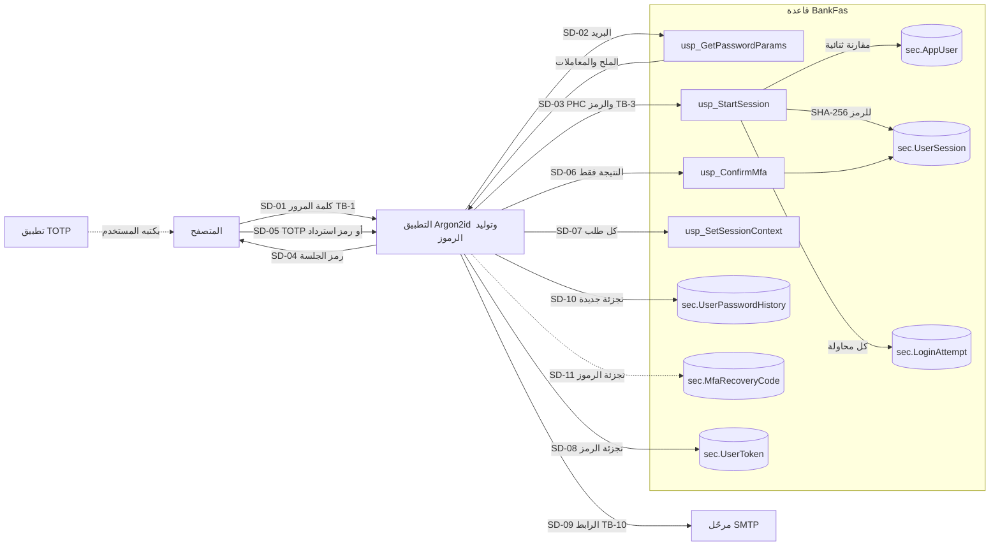
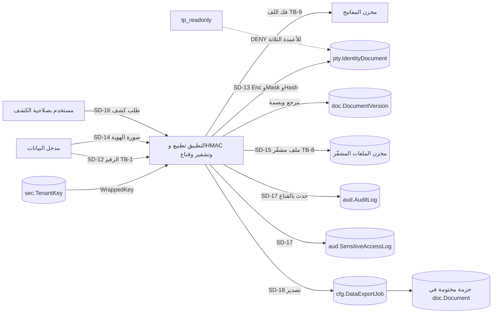
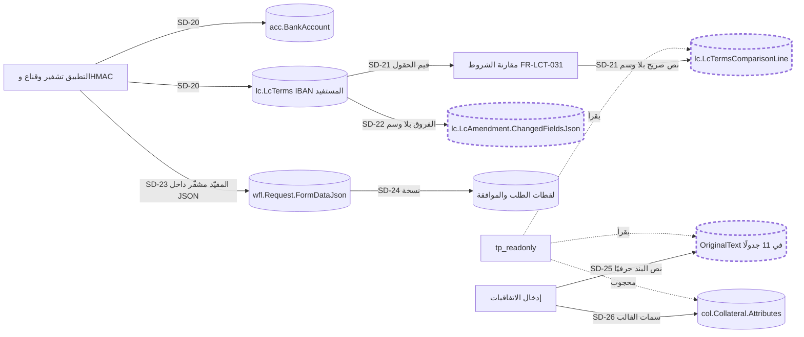
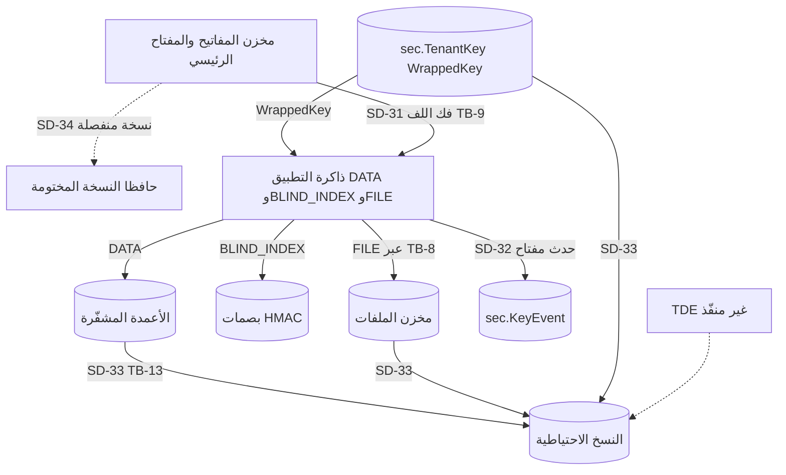

# DOC-F02 — تدفقات البيانات الحساسة (DFD المستوى 1)

| البند | القيمة |
|---|---|
| المعرّف | DOC-F02 (docs/30-readiness-documents.md) |
| الإصدار | 0.1 — مسودة للمراجعة — 2026-10-12 |
| المالك المقترح | مسؤول الأمن مع معماري قاعدة البيانات |
| الأولوية | P0 قبل S0 |
| يغطي | FR-PLT-010، FR-PLT-011، FR-PLT-013، FR-PLT-014، FR-PLT-022، FR-PLT-023، FR-PLT-027، FR-PLT-030، FR-PLT-037، FR-PLT-039، FR-PLT-042، FR-PTY-006 إلى FR-PTY-009، FR-PTY-026، FR-PTY-027، FR-REQ-024، BR-PLT-004، BR-PLT-006، BR-PLT-009، BR-PLT-015، BR-PLT-016، BR-PTY-002، BR-PTY-008، BR-PTY-009، BR-REQ-003، O-24 (erd_open_items)، DR-08، DR-11، DR-13، DR-18، DR-25، DR-31، DR-46 |
| يعتمد على | DOC-F01 (معرّفات TB والفاعلين والمخازن). يُستكمل بـDOC-S02 (المفاتيح) وDOC-S06 (التصنيف) وDOC-S07 (الخصوصية) |
| المصادر | db/model/*.model، db/generated/tsql/006_sensitive_columns.sql، db/generated/tsql/005_delete_grants.sql، db/generated/tsql/007_table_grants.sql، db/static/010_rls.sql، db/static/020_roles_and_grants.sql، db/static/030_session_context.sql، tools/dbgen/dbgen.py، tools/dbgen/check_grants.py، docs/20-database-design.md، docs/10-detailed-analysis/10-m0-m1-platform-organization.md، docs/10-detailed-analysis/13-m6-workflow-engine-notifications.md، docs/review/design-review-2026-10-11.json، tools/dbgen/erd_open_items.py |

## 1. الغرض والنطاق

- يتتبع هذا المستند كل قيمة سرّية أو مقيّدة: أين تُنشأ، وأين تُنسخ وتُخزَّن وتُصدَّر وتُسجَّل وتُحذف.
- الهدف إثبات أن كل نسخة من قيمة مقيّدة مشفّرة أو مقنَّعة أو مجزّأة، أو تسمية النسخة التي لا تحقق ذلك ومعالجتها.
- معرّفات الحدود (TB) والفاعلين (A) والمخازن (D) من DOC-F01. معرّفات التدفقات هنا SD-nn.
- مستويات التصنيف 🟢 (docs/10-detailed-analysis/10-m0-m1-platform-organization.md:581): عامة، داخلية، **سرّية** (`sens=confidential`)، **مقيّدة** (`sens=restricted`).
- خارج النطاق: قيم التصنيف التفصيلية (DOC-S06)، سلسلة المفاتيح وتدويرها (DOC-S02)، مدد الاحتفاظ القانونية (DOC-S07)، تسلسل الدخول (DOC-F03).

## 2. جرد القيم الحساسة

| القيمة | الإنشاء | التخزين | النسخ والتصدير | السجلات | الحذف |
|---|---|---|---|---|---|
| V-01 كلمة المرور | يكتبها المستخدم (SD-01) | لا تُخزَّن؛ تبقى في ذاكرة التطبيق لحساب Argon2id | لا شيء | ممنوعة في سجلات التطبيق 🟢 (docs/10-detailed-analysis/10-m0-m1-platform-organization.md:586) | تُمحى من الذاكرة بعد الحساب 🟡 |
| V-02 تجزئة كلمة المرور (PHC) | التطبيق (docs/adr/0002-login-and-session-bound-context.md:19) | `sec.AppUser.PasswordHash`، `sec.UserPasswordHistory.PasswordHash`، `plat.PlatformOperator.PasswordHash` (db/model/10-platform.model:124، :262، :69) | الملح والمعاملات تعود من `usp_GetPasswordParams` بلا التجزئة (db/static/030_session_context.sql:34) | لا تُسجَّل | آخر 5 في السجل (BR-PLT-004)؛ `tp_app` يحذف من السجل (db/generated/tsql/005_delete_grants.sql:15) |
| V-03 رمز الجلسة | التطبيق، 32 بايت على الأقل (db/static/030_session_context.sql:53) | SHA-256 في `sec.UserSession.TokenHash` (db/static/030_session_context.sql:116-118) | الأصل في ملف تعريف الارتباط (DOC-S03) | لا يُسجَّل | الإنهاء يحذف الربط (db/static/030_session_context.sql:269-283)؛ `tp_app` يحذف الصف (db/generated/tsql/005_delete_grants.sql:12) |
| V-04 سر TOTP | التطبيق عند التسجيل | `sec.AppUser.MfaSecretEnc` بمفتاح DATA للمشترك (db/model/10-platform.model:127-129)؛ `plat.PlatformOperator.MfaSecretEnc` بمفتاح المنصة (:72-73) | يُعرض مرة للمستخدم (DF-04) | لا يُسجَّل | إعادة تعيين MFA تصفّره (BR-PLT-006) |
| V-05 رموز الاسترداد | التطبيق، 10 رموز (FR-PLT-011) | `sec.MfaRecoveryCode.CodeHash` (db/model/10-platform.model:238) | تُعرض مرة للمستخدم | الاستهلاك يُسجَّل `UsedAt` و`UsedIp` | `tp_app` يحذف (db/generated/tsql/005_delete_grants.sql:13) |
| V-06 رمز الدعوة أو إعادة التعيين | التطبيق | `sec.UserToken.TokenHash` (db/model/10-platform.model:247) | الأصل في رابط البريد (SD-09، TB-10) | `SentTo` و`RequestIp` و`SendError` (:251-255) | 48 ساعة أو 30 دقيقة (FR-PLT-013)؛ `tp_app` يحذف (db/generated/tsql/005_delete_grants.sql:14) |
| V-07 مفاتيح المشترك | خدمة المفاتيح (FR-PLT-037) | `sec.TenantKey.WrappedKey` ملفوف بمفتاح رئيسي خارجي (db/model/10-platform.model:276-289) | المفتاح المفكوك في ذاكرة التطبيق | `sec.KeyEvent` (:291-301) | `RETIRED` أو `REVOKED`؛ لا حذف |
| V-08 رقم الهوية | المستخدم (SD-12) | `pty.IdentityDocument`: `NumberEnc` و`NumberMask` و`NumberHash` (db/model/11-organization-party.model:294-296) | الكشف (SD-16)، حزمة الكفيل، التصدير | التدقيق بالقناع فقط (FR-PLT-023) | لا حذف؛ إخفاء الهوية بعد الاحتفاظ (FR-PTY-029) |
| V-09 صور الهويات والمستندات المقيّدة | المستخدم (SD-14) | مخزن الملفات مشفّرًا بمفتاح FILE؛ المرجع `doc.DocumentVersion` (db/model/10-platform.model:386-408) والدور `IMAGE_FRONT` وأمثاله (:414) | العرض والتنزيل (FR-PLT-030)، الحزمة | `aud.SensitiveAccessLog` (:332-355) | حذف منطقي؛ الإتلاف بالاحتفاظ (BR-PLT-011) |
| V-10 رقم الحساب وIBAN | المستخدم | `acc.BankAccount` (db/model/12-institutions-accounts-catalogs.model:386-392)؛ IBAN المستفيد في `lc.LcTerms` (db/model/16-letters-of-credit.model:186-188) | نسخ صريحة في المقارنة والنص الأصلي (§8) | القناع فقط | لا حذف للحساب |
| V-11 بيانات الامتثال | المستخدم | `pty.PartyCompliance` (db/model/11-organization-party.model:465) | الحزمة والتصدير | التدقيق | لا حذف؛ سجل مؤرخ |
| V-12 الحقل المخصص المقيّد | المستخدم | `pty.PartyCustomField.ValueEnc` و`ValueMask` (db/model/11-organization-party.model:397-400) | الكشف `CUSTOM_FIELD_REVEAL` | `aud.SensitiveAccessLog` | مع الشخص |
| V-13 سمات الضمان | المستخدم من الاتفاقية | `col.Collateral.Attributes` JSON موسوم مقيّدًا وغير مشفّر (db/model/14-collateral-obligations-financials.model:32) | لا شيء | التدقيق | لا حذف |
| V-14 بيانات شخصية سرّية | المستخدم | 23 عمودًا موسومًا سرّيًا، مثل تاريخ الميلاد (db/model/11-organization-party.model:267-273) والرقم الضريبي (:470-471) | التصدير والحزمة | التدقيق | الاحتفاظ (FR-PLT-040) |
| V-15 أحداث التدقيق والوصول | التطبيق | `aud.AuditLog` (db/model/10-platform.model:304-330)، `aud.SensitiveAccessLog` (:332-355) | عارض التدقيق وتصديره (FR-PLT-024) | هي السجل | لا حذف ولا تعديل (db/static/020_roles_and_grants.sql:65) |
| V-16 بيانات التتبع الشخصية | الطلب | عنوان IP ووكيل المستخدم في `sec.LoginAttempt` و`sec.UserSession` و`aud.AuditLog`؛ البريد المكتوب في `LoginName` (db/model/10-platform.model:201-204، :226-227، :318-319) | لا شيء | هي السجل | غير محدد (DQ-F02-6) |
| V-17 حزمة التصدير | مهمة التصدير (FR-PLT-039) | `cfg.DataExportJob` ومستند الحزمة (db/model/10-platform.model:502-521) | تنزيل المستخدم (DF-08) | `DATA_EXPORT` في `aud.SensitiveAccessLog` | `EXPIRED` بعد 7 أيام؛ حذف الملف غير محدد (DQ-F02-5) |

## 3. وسوم الحساسية في النموذج

- **المقيّد:** 29 عمودًا. لكل منها `DENY SELECT` لـ`tp_readonly` (db/generated/tsql/006_sensitive_columns.sql:7-35). الفحص R7 يطابق العددين (tools/dbgen/check_grants.py:92-96)، والاختبار T21 يثبت الرفض (db/tests/tenant_isolation_tests.sql:704-711).
- **السرّي:** 23 عمودًا موسومًا، **بلا DENY** لأي دور. `tp_readonly` يقرؤها متى رأى الصف (DQ-F02-3).
- **التطبيق `tp_app` يقرأ كل المقيّد في جداول المشترك عدا `sec.AppUser.PasswordHash`** (db/static/030_session_context.sql:237؛ الاختبار T35)، ولا يصل إلى `plat.PlatformOperator` لأنه `noapp`. القيم المقيّدة في الأعمدة نص مشفّر أو تجزئة، فالقراءة وحدها لا تكشفها دون مفتاح البيانات.
- **استثناء خطر:** `tp_app` يقرأ `sec.UserPasswordHistory.PasswordHash` (db/generated/tsql/007_table_grants.sql:46) بلا DENY. إن كتب التطبيق التجزئة الحالية في السجل، أمكن اتصالًا مربوطًا قراءتها وتمريرها إلى `usp_StartSession`، فيسقط شرط «لا إعادة تشغيل للتجزئة» في docs/adr/0002-login-and-session-bound-context.md:24. المعالجة مع O-24 (erd_open_items) في DOC-S01.

| الجدول | الأعمدة المقيّدة | الحماية |
|---|---|---|
| `plat.PlatformOperator` | `PasswordHash`، `MfaSecretEnc` | تجزئة؛ تشفير بمفتاح المنصة |
| `sec.AppUser` | `PasswordHash`، `MfaSecretEnc` | تجزئة؛ تشفير بمفتاح DATA |
| `sec.UserSession`، `sec.UserToken`، `sec.MfaRecoveryCode` | `TokenHash`، `TokenHash`، `CodeHash` | تجزئة |
| `sec.UserPasswordHistory` | `PasswordHash` | تجزئة |
| `sec.TenantKey` | `WrappedKey` | لف بمفتاح رئيسي خارجي |
| `pty.IdentityDocument` | `NumberEnc`، `NumberMask`، `NumberHash` | تشفير وقناع وHMAC |
| `pty.PartyCustomField` | `ValueEnc` | تشفير |
| `pty.PartyCompliance` | `IsPep`، `IsRelatedToPep`، `IsSanctioned`، `IsUnderInvestigation`، `HasImmunity`، `Details` | حجب عن التقارير فقط |
| `acc.BankAccount` | `AccountNoEnc/Mask/Hash`، `IbanEnc/Mask/Hash` | تشفير وقناع وHMAC |
| `col.Collateral` | `Attributes` | حجب عن التقارير فقط (DR-08) |
| `lc.LcTerms` | `BeneficiaryAccountIbanEnc/Mask/Hash` | تشفير وقناع وHMAC |

شكل الغلاف المشفّر وAAD والتدوير في docs/20-database-design.md:188-209 🟢، ويملكه DOC-S02.

## 4. DFD-1: بيانات الدخول (V-01 إلى V-06)

| التدفق | ما يعبر | الحماية | الملاحظة |
|---|---|---|---|
| SD-01 | كلمة المرور نصًا عبر TB-1 | TLS 🟡 (DOC-S05) | لا تصل إلى القاعدة أبدًا |
| SD-02، SD-03 | البريد، ثم سلسلة PHC ورمز الجلسة | تنفيذ بصفة `tp_auth_exec` (db/static/030_session_context.sql:27، :48)؛ مقارنة ثنائية (:85-86) | البريد غير الموجود يعيد NULL (:31-36)، والتطبيق يجيب كما للكلمة الخاطئة 🟢 (docs/adr/0002-login-and-session-bound-context.md:33) |
| SD-03 | تسجيل المحاولة | `sec.LoginAttempt` مع البريد المكتوب لمجهول (db/static/030_session_context.sql:124-129) | البريد يُخزَّن في المشترك الذي كُتب عنده، وقد يكون بريد مستخدم مشترك آخر (DQ-F02-6) |
| SD-04 | رمز الجلسة الأصلي | لا يُخزَّن إلا SHA-256 (db/static/030_session_context.sql:117) | شكل ملف تعريف الارتباط في DOC-S03 |
| SD-05، SD-06 | رمز TOTP، ثم النتيجة `@Passed` | القاعدة تسجل النتيجة فقط (db/static/030_session_context.sql:159-162) | التحقق في التطبيق لأن السر مشفّر بمفاتيحه (:11-12). الاتصال غير مربوط قبل MFA (:198)، فلا يرى `MfaSecretEnc` ولا `sec.MfaRecoveryCode` تحت RLS (db/static/010_rls.sql:52-57). لا مسار قراءة اليوم (DQ-F02-4) |
| SD-07 | رمز الجلسة في كل ربط | يُجزَّأ ويُقارن (db/static/030_session_context.sql:195) | لا يُخزَّن الرمز في سياق الاتصال؛ يُخزَّن `BindingToken` عشوائي جديد (:177، :218) |
| SD-08، SD-09 | رمز الدعوة أو الإعادة | التجزئة في القاعدة والأصل في البريد فقط | الرابط لا يحمل بيانات مقيّدة 🟢 (FR-PLT-013) |
| SD-10 | تجزئة كلمة جديدة | CHECK لصيغة Argon2id (db/model/10-platform.model:154، :264) | `tp_app` يكتب `PasswordHash` مباشرة (db/generated/tsql/007_table_grants.sql:24) ويقرأ سجل التجزئات (:46)؛ الخطر في O-24 (erd_open_items) وDOC-S01 |
| SD-11 | تجزئة رموز الاسترداد | `CodeHash` من نوع `bin(32)` | المصادر لا تحدد الخوارزمية ولا الملح (DQ-F02-7) |

## 5. DFD-2: أرقام الهويات وصورها (V-08، V-09)

| التدفق | ما يعبر | الحماية | نقطة التقنيع |
|---|---|---|---|
| SD-12 | الرقم نصًا عبر TB-1 | TLS 🟡 | لا يُخزَّن صريحًا 🟢 (docs/20-database-design.md:186) |
| SD-13 | نص مشفّر وقناع وبصمة HMAC | AES-256-GCM بمفتاح DATA؛ HMAC بمفتاح BLIND_INDEX مستقل (BR-PLT-015، BR-PTY-002)؛ أدنى طول للغلاف 29 بايت (docs/20-database-design.md:198) | القناع يُحسب عند الكتابة (BR-PTY-008)، فالعرض لا يفك التشفير |
| SD-14، SD-15 | ملف الصورة | تشفير بمفتاح FILE (db/model/10-platform.model:395)؛ بصمة الخادم (:393)؛ لا تنزيل قبل `CLEAN` (:396) | لا مصغّرات لغير المخوَّل (FR-PLT-030) |
| SD-16 | الرقم المفكوك عبر TB-1 | صلاحية مقفلة على TM وFO (BR-PLT-019) ونطاق الشركة | يُخفى بعد 60 ثانية ولا يُخزَّن في المتصفح (BR-PTY-009) |
| SD-17 | حدث الكشف | `IDENTITY_REVEAL` في `aud.AuditLog` وصف في `aud.SensitiveAccessLog` | القيم في التدقيق مقنَّعة 🟢 (FR-PLT-023، db/model/10-platform.model:315) |
| SD-18 | حزمة التصدير | مختومة بكلمة لا تُخزَّن (db/model/10-platform.model:514)؛ موافقة إلزامية للمقيّد (:519) | بلا صلاحية الكشف: بلا أرقام كاملة ولا صور (BR-PLT-016) |

ثغرات هذا المسار:
- الموافِق على تصدير مقيّد قد يكون الطالب نفسه، ومستند الحزمة يأخذ الافتراضي `CONFIDENTIAL` لا `RESTRICTED` (DR-13؛ db/model/10-platform.model:370).
- `StorageKey` فريد داخل المشترك فقط، ومحتوى الإصدار قابل للتعديل من `tp_app` (DR-11؛ db/generated/tsql/007_table_grants.sql:61).
- حساسية المستند نسخة لا تُفرض من `cat.DocumentType.IsSensitive` (DR-18).

## 6. DFD-3: أرقام الحسابات وIBAN ونسخها (V-10، V-13)

الإطار المتقطع يعني نسخة غير محمية اليوم.

| التدفق | ما يعبر | الحماية اليوم | الحالة |
|---|---|---|---|
| SD-20 | رقم الحساب وIBAN | تشفير وقناع وHMAC (db/model/12-institutions-accounts-catalogs.model:386-392؛ db/model/16-letters-of-credit.model:186-188) | محمي |
| SD-21 | `BaselineValue` و`ReceivedValue` لكل `FieldKey` | لا وسم ولا تشفير (db/model/16-letters-of-credit.model:691-692؛ db/generated/tsql/001_tables.sql:6359-6360)؛ `tp_app` يكتبها (db/generated/tsql/007_table_grants.sql:405) | **فجوة DR-46**: IBAN المستفيد قد يُنسخ نصًا |
| SD-22 | الفروق بمفاتيح الحقول | لا وسم (db/model/16-letters-of-credit.model:493) | **فجوة DR-46** |
| SD-23 | النموذج بمفاتيح الحقول | العمود سرّي (db/model/15-workflow-notifications.model:283)، والمقيّد مشفّر داخله بقاعدة تطبيق (BR-REQ-003) | محمي بقاعدة تطبيق فقط |
| SD-24 | لقطات النموذج | `SnapshotJson` و`AvailabilitySnapshotJson` سرّيان (db/model/15-workflow-notifications.model:469، :438) | يرث تشفير المقيّد إن نُسخ كما هو 🟡 |
| SD-25 | نص البند كما في الاتفاقية | `OriginalText` بلا وسم في 11 جدولًا يضيفها المولّد (tools/dbgen/dbgen.py:207-209؛ db/generated/tsql/001_tables.sql:3000، :3051، :3101)، و`CandidateAOriginalText` و`CandidateBOriginalText` (db/model/13-facilities-pricing-terms.model:335، :341) | **فجوة DR-31** |
| SD-26 | سمات الضمان | موسوم مقيّدًا ومحجوب عن التقارير (db/model/14-collateral-obligations-financials.model:32؛ db/generated/tsql/006_sensitive_columns.sql:32)، لكنه غير مشفّر | جزئي (DR-08 مطبّق) |

## 7. DFD-4: المفاتيح والنسخ الاحتياطية (V-07)

- **SD-31:** المفتاح الرئيسي لا يغادر مخزنه 🟡؛ التطبيق يرسل `WrappedKey` ويستلم المفتاح المفكوك. مكان المخزن ونوعه غير محسومين (docs/adr/0001-schema-work-on-linux.md:26؛ docs/20-database-design.md:183). يملكه DOC-S02.
- **SD-32:** كل إنشاء وتدوير وفشل فك يُسجَّل في `sec.KeyEvent`، وهو للإضافة فقط (db/model/10-platform.model:291-301؛ db/generated/tsql/005_delete_grants.sql:46).
- **SD-33:** النسخة الاحتياطية تحمل النص المشفّر و`WrappedKey` معًا، ولا تحمل المفتاح الرئيسي 🟢 (BR-PLT-015). البيانات السرّية غير المقيّدة نص صريح في النسخة ما دام TDE غير منفّذ (لا كائن TDE في `db/`).
- **SD-34:** نسخة مختومة من المفتاح الرئيسي لدى مسؤولَين مستقلين 🟢 (docs/10-detailed-analysis/10-m0-m1-platform-organization.md:624). الإجراء نفسه غير مكتوب (DOC-S02).
- `tp_app` يقرأ ويكتب `sec.TenantKey` (db/generated/tsql/007_table_grants.sql:50). تعديل `Status` أو `WrappedKey` يعطّل فك التشفير؛ يعالجه DOC-S01.

## 8. النسخ الجانبية: الإثبات

| النسخة | العمود | ما قد تحمله | الحماية اليوم | الحالة | المعالجة |
|---|---|---|---|---|---|
| مقارنة الشروط | `lc.LcTermsComparisonLine.BaselineValue/ReceivedValue` | IBAN المستفيد | لا شيء | فجوة | DQ-F02-1 (DR-46) |
| فروق التعديل | `lc.LcAmendment.ChangedFieldsJson` | IBAN المستفيد | لا شيء | فجوة | DQ-F02-1 (DR-46) |
| نص الاتفاقية | `OriginalText` و`CandidateA/BOriginalText` وحقول `Reason` و`Notes` الحرة | أرقام حسابات وIBAN | لا شيء | فجوة | DQ-F02-2 (DR-31) |
| الرقم الضريبي للشركة | `org.Company.TaxNumber` (db/model/11-organization-party.model:26) | رقم ضريبي | لا وسم؛ نسخته في `pty.TaxIdentity` سرّية (:470) | فجوة | DQ-F02-8 (DR-25) |
| الحقل المخصص | `pty.PartyCustomField.ValueText` و`ValueMask` (db/model/11-organization-party.model:396، :400) | قيمة غير مقيّدة وقناع | القيد يمنع اجتماع النص والمشفّر (:403) | جزئي | التطبيق يختار `ValueEnc` للحقل المقيّد 🟡 |
| النموذج ولقطاته | `wfl.Request.FormDataJson`، `SnapshotJson` | حقول مقيّدة | تشفير داخل JSON بقاعدة تطبيق | جزئي | اختبار يمسح JSON بحثًا عن نمط IBAN ورقم هوية 🟡 |
| نص البحث | `wfl.Request.SearchText` (db/model/15-workflow-notifications.model:282) | نص مطبَّع | المقيّد لا يدخله (BR-REQ-003) | جزئي | الاختبار نفسه 🟡 |
| التدقيق | `aud.AuditLog.BeforeJson/AfterJson` (db/model/10-platform.model:315-316) | قيم الكيان | التقنيع قاعدة تطبيق (FR-PLT-023) | جزئي | DQ-F02-9 |
| Outbox | `cfg.OutboxEvent.PayloadJson` (db/model/10-platform.model:537) | معرّفات | قاعدة تطبيق (FR-PLT-042) | جزئي | مخطط حمولة بقائمة سماح 🟡 |
| الإشعار | `ntf.Notification.Body` و`PayloadJson` (db/model/15-workflow-notifications.model:609، :622) | نص الرسالة | بلا مقيّد (FR-NTF-013؛ docs/10-detailed-analysis/13-m6-workflow-engine-notifications.md:690) | جزئي | عناصر نائبة من قائمة بيضاء (db/model/15-workflow-notifications.model:571) |
| رسائل الأخطاء | `cfg.OutboxEvent.LastError`، `cfg.JobRun.ErrorMessage` و`DetailJson`، `sec.UserToken.SendError` (db/model/10-platform.model:545، :564-565، :253) | نص استثناء قد يحوي قيمة | لا شيء | فجوة | منقّح للرسائل قبل الكتابة 🟡 |
| سجلات التطبيق | D-04 | أي قيمة | قاعدة «بلا أسرار» (docs/10-detailed-analysis/10-m0-m1-platform-organization.md:586) | جزئي | المنقّح نفسه وفحص دوري (DOC-S12) |
| الدخول | `sec.LoginAttempt.LoginName` (db/model/10-platform.model:201) | بريد شخص | لا وسم | فجوة | DQ-F02-6 |
| النسخ الاحتياطية | D-05 | كل ما سبق | المقيّد مشفّر؛ الباقي صريح | فجوة | TDE ونسخ مشفّرة (DOC-S02، DOC-S09) |

## 9. الحذف والاحتفاظ

| الفئة | الحذف اليوم | الضابط |
|---|---|---|
| التدقيق | لا حذف ولا تعديل لـ`tp_app` و`tp_platform` (db/static/020_roles_and_grants.sql:65؛ الاختبار T15) | الاحتفاظ المقترح 10 سنوات 🟢 (docs/10-detailed-analysis/10-m0-m1-platform-organization.md:616) |
| أرقام الهويات وصورها | لا صلاحية حذف (الجدول ليس `deletable`) | إخفاء الهوية بعد الاحتفاظ بموافقة (FR-PTY-029)؛ 5 سنوات مقترحة (docs/10-detailed-analysis/10-m0-m1-platform-organization.md:616) |
| المستندات | حذف منطقي بسبب وصلاحية (BR-PLT-011) | الإتلاف الفعلي بسير الاحتفاظ (FR-PLT-040) |
| الجلسات ومحاولات الدخول ورموز الاسترداد والدعوات وسجل كلمات المرور | `tp_app` يحذف الصف (db/generated/tsql/005_delete_grants.sql:11-15) | لا مدة محددة؛ الحذف يمحو دليل الدخول (DQ-F02-6؛ DOC-S01) |
| Outbox | `tp_app` يحذف (db/generated/tsql/005_delete_grants.sql:17) | الأحداث الميتة تُفقد (DR-14) |
| المشترك المغلق | تصدير 30 يومًا ثم قراءة فقط؛ لا إتلاف تلقائي 🟢 (BR-PLT-002) | الإتلاف بموافقة المشترك الخطية (FR-PLT-040) |
| المفاتيح | `RETIRED` أو `REVOKED`، لا حذف | إلغاء مفاتيح مشترك بعد الاحتفاظ يجعل بياناته المشفّرة غير مقروءة حتى في النسخ 🟡 (DOC-S02) |

## 10. قواعد ملزمة للتنفيذ

1. لا قيمة مقيّدة تُكتب في عمود غير موسوم `sens=restricted`. أي عمود ينسخ قيمة حقل يأخذ أعلى تصنيف بين الحقول التي قد يحملها 🟡.
2. نقطة التقنيع واحدة: خدمة التشفير والتقنيع المشتركة (FR-PLT-037). التدقيق والإشعار والتصدير والسجلات تستدعيها ولا تبني القناع بنفسها 🟡.
3. لا قيمة مقيّدة في حمولة Outbox أو الإشعار أو البريد أو رابط 🟢 (FR-PLT-042، FR-NTF-013، FR-PLT-013).
4. كل كشف أو عرض صورة أو تصدير مقيّد يكتب حدثين: `aud.AuditLog` و`aud.SensitiveAccessLog` 🟢 (BR-PTY-009؛ db/model/10-platform.model:332).
5. رسالة الاستثناء تمر بمنقّح قبل أي عمود خطأ أو سجل 🟡.
6. اختبار آلي في CI يقارن كل عمود نصي أو JSON في جداول تنسخ قيم حقول بقائمة الأعمدة الموسومة، ويفشل عند نسخة بلا وسم 🟡 (DOC-B01).

## 11. القرارات المطلوبة

| المعرّف | السؤال | الافتراض المقترح | من يقرر | ما يعطّله |
|---|---|---|---|---|
| DQ-F02-1 | كيف تُعامل القيم المقيّدة في المقارنة وفروق التعديل؟ (DR-46) | ✅ معتمد (O-15، ADR 0011) بصيغة DQ-F12-11: لا يُنسخ شيء، وقيد يمنع قيمة IBAN في سطور المقارنة، والأعمدة الثلاثة موسومة سرّية؛ خدمة المقارنة قبل S3. المقترح الأصلي: لا تُنسخ القيمة: يُخزَّن القناع وHMAC للحقل المقيّد فقط؛ ويوسم العمودان `sens=confidential` على الأقل. بديل في DOC-F12 §8.3 (DQ-F12-11): لا نسخ للقناع ولا للبصمة لأنهما مقيّدان، والحكم من بصمة المصدر؛ يُحسمان معًا | معماري قاعدة البيانات مع مالك M7 وM8 | FR-LCT-031 (S4)، DOC-S06 |
| DQ-F02-2 | كيف يُحمى `OriginalText` والنص الحر في جداول المصدر؟ (DR-31) | ✅ منفّذ جزئيًا (ADR 0011): الوسم السرّي ومنع القراءة عن `tp_readonly` على النص الأصلي ونصي التعارض و`ClauseText`؛ الحجب عند الإدخال قبل S2 (DQ-S06-7). المقترح: وسم `sens=confidential` وDENY لـ`tp_readonly`؛ حجب نمط IBAN ورقم الحساب عند الإدخال؛ الأصل يبقى في مخزن المستندات | معماري قاعدة البيانات مع مالك M5 | S2 (إدخال الاتفاقيات) |
| DQ-F02-3 | هل يُحجب السرّي عن `tp_readonly` كالمقيّد؟ | نعم للبيانات الشخصية السرّية 🟡؛ التقارير تقرأها عبر عروض مقنَّعة | مسؤول الأمن مع معماري البيانات | DOC-S06، DQ-F01-5 |
| DQ-F02-4 | كيف يقرأ التطبيق سر TOTP ورموز الاسترداد قبل الربط؟ | إجراء بصفة `tp_auth_exec` يعيد `MfaSecretEnc` و`MfaLastUsedStep` لجلسة صالحة غير مكتملة MFA فقط، وإجراء يستهلك رمز استرداد بتجزئته | مسؤول الهوية والأمن | DOC-F03، FR-PLT-011 |
| DQ-F02-5 | من يحذف ملف حزمة التصدير بعد انتهائها؟ | مهمة يومية تتلف الملف عند `EXPIRED` وتسجّل الحدث؛ الحزمة `RESTRICTED` إن شملت المقيّد | مهندس الخلفية مع مسؤول الأمن | FR-PLT-039 (S5) |
| DQ-F02-6 | ما مدة الاحتفاظ ببيانات التتبع (IP، وكيل المستخدم، البريد المكتوب) وبمحاولات الدخول؟ | 90 يومًا لمحاولات الدخول والجلسات المنتهية 🟡، بحذف بمهمة لا بـ`tp_app`؛ الأثر الدائم في `aud.AuditLog` | مسؤول حماية البيانات | DOC-S07، DOC-S12 |
| DQ-F02-7 | ما خوارزمية تجزئة رموز الاسترداد؟ | HMAC-SHA-256 بمفتاح منصة سري 🟡، أو Argon2id إن كان الرمز قصيرًا | مسؤول الهوية والأمن | DOC-S04 |
| DQ-F02-8 | هل يبقى `org.Company.TaxNumber`؟ (DR-25) | ✅ معتمد (O-15، ADR 0011): الوسم السرّي منفّذ، والحذف والقراءة من `pty.TaxIdentity` شرط دخول S1. المقترح: يُحذف ويُقرأ من `pty.TaxIdentity` عبر عرض؛ وإن بقي يوسم سرّيًا | معماري قاعدة البيانات | S1 |
| DQ-F02-9 | هل يُفرض تقنيع التدقيق في مكان واحد؟ | مُسلسِل واحد للتدقيق يستبدل كل عمود موسوم مقيّدًا بقناعه، تولّد قائمته من النموذج 🟡 | مهندس الخلفية | FR-PLT-023، DOC-B01 |

## 12. تعارضات وفجوات في المصادر

1. docs/20-database-design.md:166 يجعل السبب إلزاميًا لكل كشف وتصدير، وQ-PTY-05 (docs/10-detailed-analysis/10-m0-m1-platform-organization.md:639) لا يطلبه، والعمود `Reason` اختياري (db/model/10-platform.model:344). سجلته DR-12.
2. docs/20-database-design.md:218 يقول إن الأرقام الكاملة لمدير الخزينة و«موظف التسهيلات»، وBR-PLT-019 (docs/10-detailed-analysis/10-m0-m1-platform-organization.md:245) يقفلها على TM و«مسؤول التسهيلات (FO)».
3. مراجعة التصميم تشير إلى db/model/16 السطور 686-687 و490 (docs/review/design-review-2026-10-11.json، DR-46)؛ الأعمدة اليوم في db/model/16-letters-of-credit.model:691-692 و:493.
4. db/model/10-platform.model:199 يقول إن الأثر الدائم للدخول في `aud.AuditLog`، لكن `sec.usp_StartSession` يكتب `sec.LoginAttempt` فقط (db/static/030_session_context.sql:124-129)، و`tp_app` يحذف منه (db/generated/tsql/005_delete_grants.sql:11). سجّلته O-24 (tools/dbgen/erd_open_items.py:153).
5. docs/10-detailed-analysis/10-m0-m1-platform-organization.md:582 يذكر TDE للقاعدة، ولا كائن TDE في `db/`. ليس تعارضًا في القرار، لكنه غير منفّذ قبل البيانات الحقيقية (docs/adr/0001-schema-work-on-linux.md:26).

## 13. التتبع

| البند في هذه الوثيقة | المتطلب أو القاعدة أو القرار | المصدر |
|---|---|---|
| V-01 إلى V-03، SD-01 إلى SD-04، SD-07 | FR-PLT-010، FR-PLT-014، ADR 0002 | db/static/030_session_context.sql:23-227 |
| V-04، V-05، SD-05، SD-06، DQ-F02-4، DQ-F02-7 | FR-PLT-011، BR-PLT-006، O-24 (erd_open_items) | tools/dbgen/erd_open_items.py:151-156 |
| V-06، SD-08، SD-09 | FR-PLT-013 | db/model/10-platform.model:244-258 |
| V-07، §7 | FR-PLT-037، BR-PLT-015، Q-PLT-12 | db/model/10-platform.model:276-301 |
| V-08، V-09، §5 | FR-PTY-006 إلى FR-PTY-009، BR-PTY-002، BR-PTY-008، BR-PTY-009، FR-PLT-030 | db/model/11-organization-party.model:288-305 |
| V-10، §6، DQ-F02-1 | FR-REQ-024، FR-LCT-031، DR-46 | db/model/16-letters-of-credit.model:186-188، :688-697 |
| SD-25، DQ-F02-2 | DR-31 | tools/dbgen/dbgen.py:207-209 |
| SD-26 | DR-08 | db/model/14-collateral-obligations-financials.model:32 |
| §3 | R7، T21، T35 | db/generated/tsql/006_sensitive_columns.sql:7-35 |
| V-15، §8 التدقيق | FR-PLT-022، FR-PLT-023، BR-PLT-009 | db/model/10-platform.model:304-355 |
| V-17، DQ-F02-5 | FR-PLT-039، BR-PLT-016، DR-13، DR-18 | db/model/10-platform.model:502-521 |
| §8 Outbox والإشعار | FR-PLT-042، FR-NTF-013 | db/model/10-platform.model:532-552 |
| §9 | FR-PLT-040، FR-PTY-029، BR-PLT-002، Q-PLT-04 | docs/10-detailed-analysis/10-m0-m1-platform-organization.md:616 |
| DQ-F02-8 | DR-25 | db/model/11-organization-party.model:26 |
