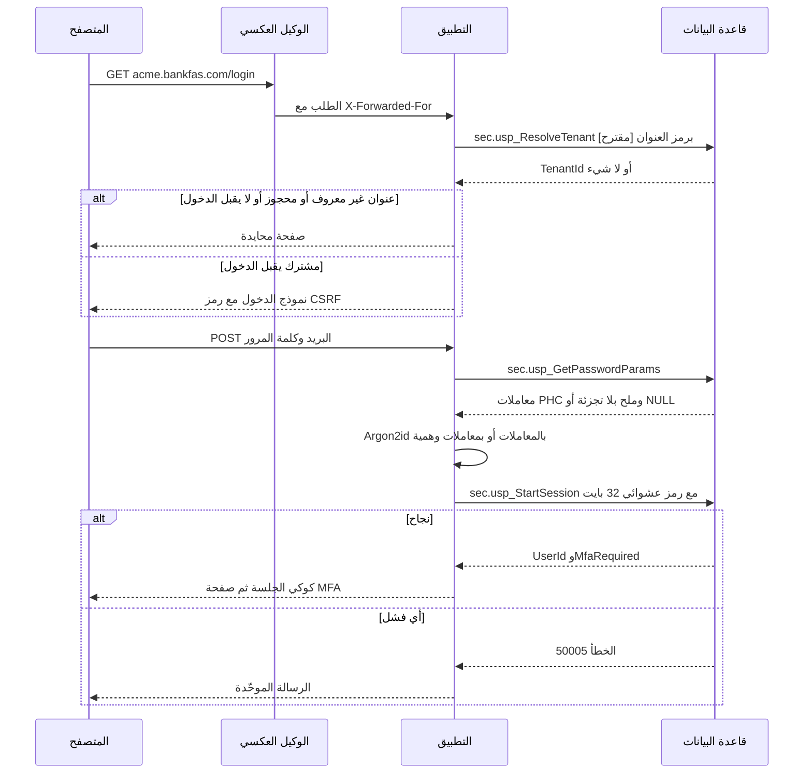
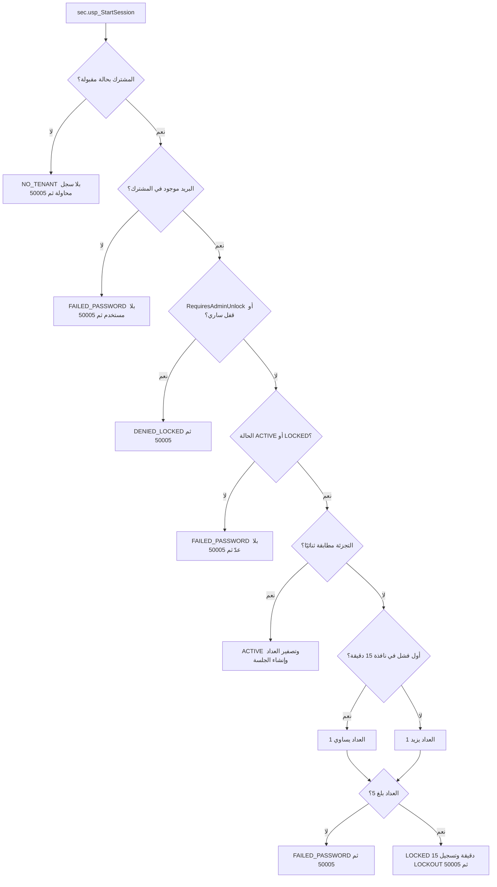
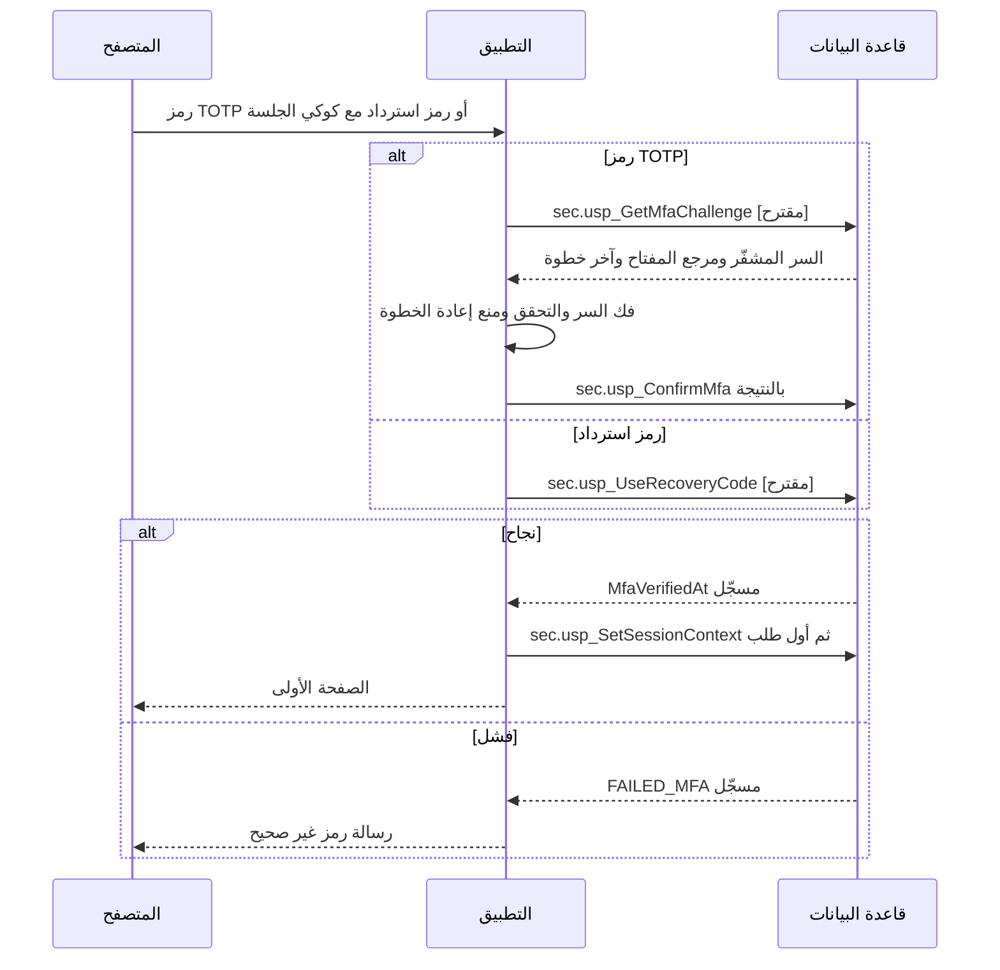
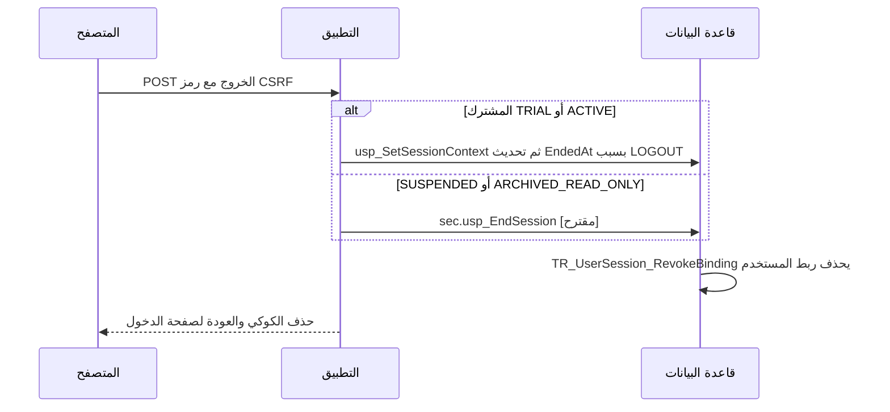
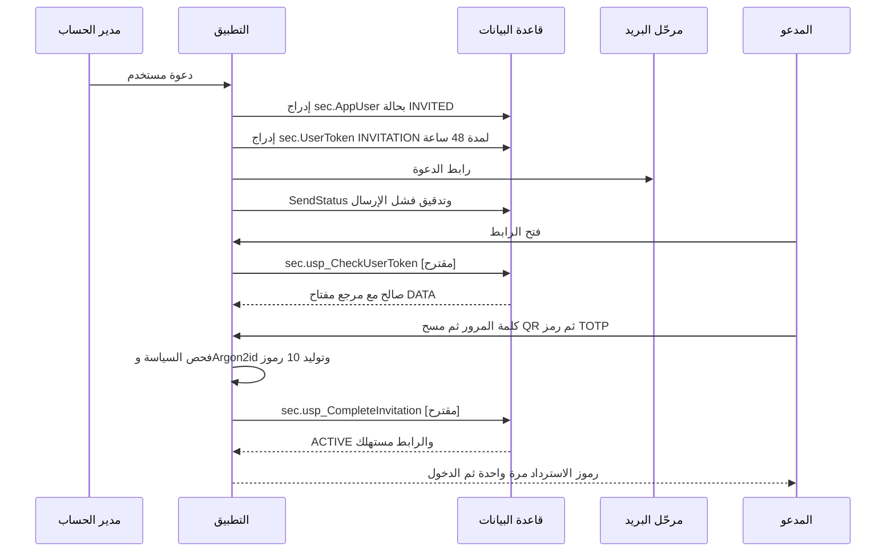
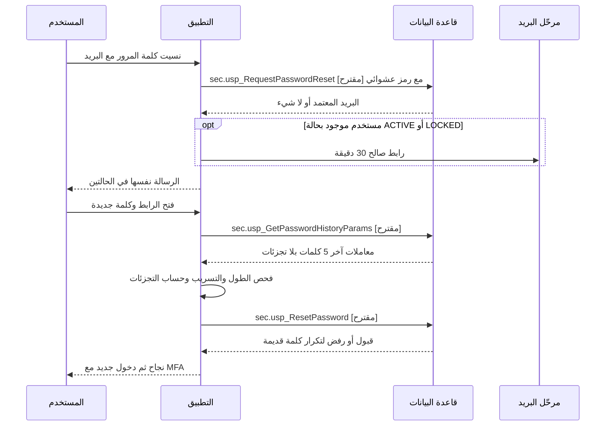
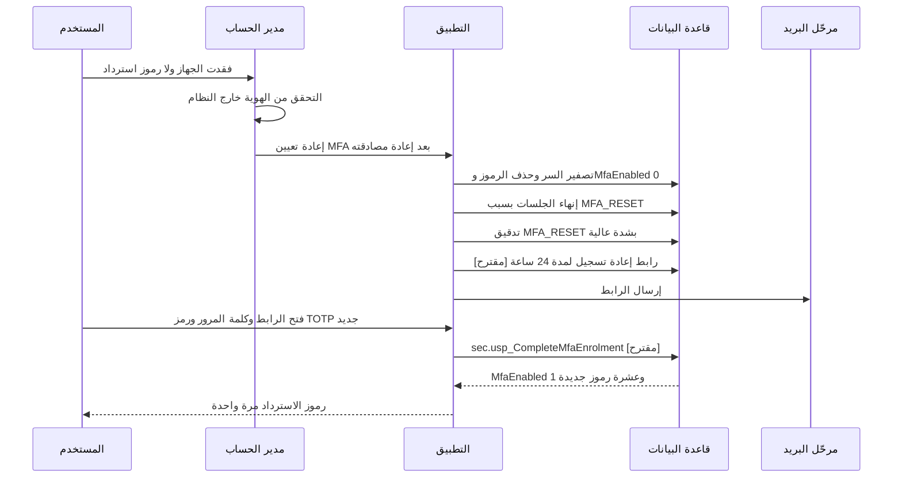
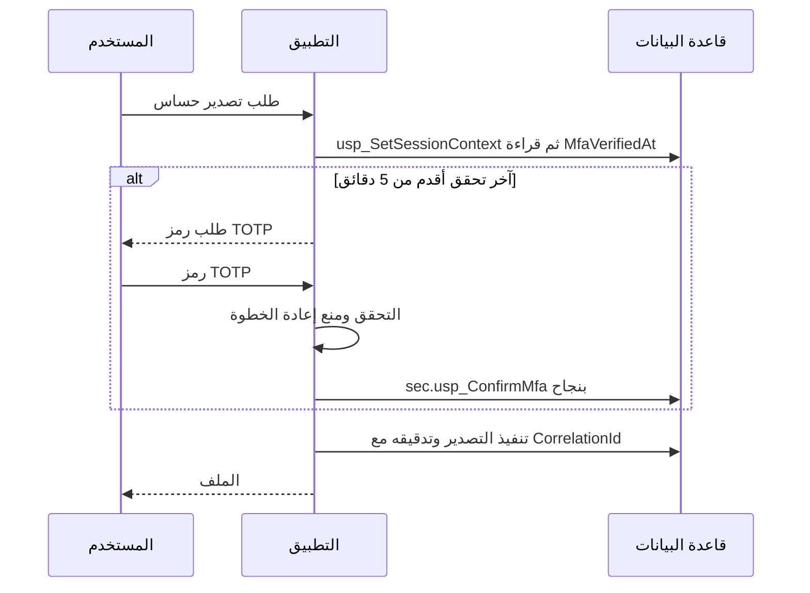

# DOC-F03 — تسلسل الدخول وMFA والاسترداد

| البند | القيمة |
|---|---|
| المعرّف | DOC-F03 (docs/30-readiness-documents.md) |
| الإصدار | 0.1 — مسودة للمراجعة — 2026-10-12 |
| المالك المقترح | مسؤول الهوية والأمن مع معماري قاعدة البيانات |
| الأولوية | P0 قبل S0 |
| يغطي | FR-PLT-010 إلى FR-PLT-014، FR-PLT-046، BR-PLT-004 إلى BR-PLT-006، AC-PLT-2، O-9 (20-database-design)، O-24 (erd_open_items) |
| يعتمد على | DOC-S03 (شكل الرمز والكوكي)، DOC-S04 (قيم السياسة)، DOC-F04 (ربط الاتصال ومصفوفة حالة المشترك)، DOC-F06 (حالات المستخدم)، DOC-S02 (المفاتيح) |
| المصادر | docs/adr/0002-login-and-session-bound-context.md، db/static/030_session_context.sql، db/static/010_rls.sql، db/static/020_roles_and_grants.sql، db/model/10-platform.model، db/generated/tsql/007_table_grants.sql، db/tests/tenant_isolation_tests.sql، docs/10-detailed-analysis/10-m0-m1-platform-organization.md، docs/20-database-design.md |

> **تحديث التنفيذ (2026-10-12):** نُفّذت قرارات المالك لبوابة S0 في القاعدة (docs/adr/0003-account-security-in-the-database.md، db/static/030_session_context.sql، db/static/035_account_security.sql) وتمر في CI (48 حالة عزل و14 حالة حسابات في db/tests/auth_flow_tests.sql). أرقام الأسطر المذكورة لملف 030 في هذه الوثيقة تسبق هذا التحديث.
>
> ما يخص هذه الوثيقة: MFA إلزامي ولا ربط قبله (DQ-F03-4)؛ مسار ما قبل الدخول بإجراءات ضيقة (DQ-F03-1): `usp_ResolveTenant` و`usp_GetMfaChallenge` و`usp_CompleteMfaEnrolment` و`usp_UseRecoveryCode` و`usp_CompleteInvitation` و`usp_RequestPasswordReset` و`usp_ResetPassword` و`usp_ChangePassword` و`usp_EndSession`؛ رابط إعادة تسجيل MFA لمدة 24 ساعة (DQ-F03-8)؛ الخطأ 50006 بعد إثبات كلمة المرور فقط (DQ-F03-11). لم يُبنَ بعد: `usp_CheckUserToken` (DQ-F03-5) وحد الدقائق الخمس للجلسة المنتظرة MFA (DQ-F03-2) والتدقيق في aud.AuditLog لمحاولات الدخول (DQ-F03-10).

## 1. الغرض والنطاق

تصف الوثيقة كل خطوة من فتح عنوان المشترك الفرعي حتى إصدار رمز جلسة صالح للربط، ثم الخروج. وتغطي الدعوة وإعادة تعيين كلمة المرور وفقدان جهاز MFA وإعادة المصادقة قبل التصدير الحساس.

- **داخل النطاق:** ما يجري قبل المصادقة، ومن ينفّذ كل خطوة (التطبيق أم إجراء في القاعدة)، وما هو موجود اليوم وما هو مقترح.
- **خارج النطاق:** ربط الاتصال لكل طلب بعد الدخول ومصفوفة حالة المشترك والدور (DOC-F04)، وشكل الكوكي وCSRF وCSP (DOC-S03)، وقيم السياسة الرقمية (DOC-S04)، وانتقالات حالة المستخدم (DOC-F06)، وتهيئة المدير الأول للمشترك (DOC-F05).

**مفتاح الوسوم:** 🟢 موجود في المستودع أو مقرر في الوثائق، مع الملف والسطر. 🟡 اقتراح لم يُصمَّم بعد. داخل المخططات يُكتب الاقتراح «[مقترح]».

**اختصارات المراجع:** «030» هو db/static/030_session_context.sql، و«007_table_grants.sql» في db/generated/tsql، و«010_rls.sql» و«025_tenant_views.sql» في db/static، و«10-m0-m1-platform-organization.md» في docs/10-detailed-analysis. أرقام T هي حالات db/tests/tenant_isolation_tests.sql.

## 2. الفاعلون والمكوّنات

| المكوّن | دوره في هذا التسلسل | حد الثقة (DOC-F01) | المرجع |
|---|---|---|---|
| المتصفح | يحمل كوكي الجلسة فقط، ولا يحسب أي تجزئة | TB-1 | DOC-S03 |
| الوكيل العكسي | ينهي TLS ويضيف X-Forwarded-For | TB-1 | DOC-S03، DOC-S05 |
| التطبيق (ASP.NET Core) | يحسب Argon2id، ويتحقق من TOTP، ويولّد رمز الجلسة، ويرسل البريد المعاملاتي | TB-1، TB-3، TB-9 | 🟢 docs/adr/0002-login-and-session-bound-context.md:19 و:21 |
| إجراءات القاعدة | تعمل بصفة tp_auth_exec فترى صفوف المشترك قبل الربط | TB-4 | 🟢 db/static/030_session_context.sql:4-14 |
| مرحّل البريد | يرسل رسالتي الدعوة وإعادة التعيين فقط | TB-10 | 🟢 FR-PLT-013 (10-m0-m1-platform-organization.md:115) |

تعريف الحدود في DOC-F01، وتهديداتها في DOC-S01.

## 3. ما هو موجود وما هو مقترح

| الخطوة | الحالة | المرجع أو الاقتراح |
|---|---|---|
| تحديد المشترك من العنوان الفرعي | 🟡 غير مصمم | tp_app لا يقرأ plat.Tenant (noapp، db/model/10-platform.model:31) والعرض plat.v_CurrentTenant يشترط ربطًا (db/static/025_tenant_views.sql:14). المقترح sec.usp_ResolveTenant |
| فحص حالة المشترك عند الدخول | 🟢 موجود | db/static/030_session_context.sql:67-69 |
| جلب معاملات كلمة المرور | 🟢 موجود | sec.usp_GetPasswordParams، db/static/030_session_context.sql:23-37 |
| حساب Argon2id | 🟢 في التطبيق | docs/adr/0002-login-and-session-bound-context.md:19 |
| المقارنة والقفل وإنشاء الجلسة والخطأ 50005 | 🟢 موجود ومختبر | db/static/030_session_context.sql:39-141، T33 وT34 |
| جلب سر TOTP قبل الربط | 🟡 غير مصمم | sec.AppUser محمي بالتصفية حتى الربط (db/static/010_rls.sql:51-57)، والربط يشترط MFA (030:198). المقترح sec.usp_GetMfaChallenge |
| تسجيل نتيجة TOTP | 🟢 موجود ومختبر | sec.usp_ConfirmMfa، 030:143-163، T36 |
| استهلاك رمز استرداد | 🟡 غير مصمم | sec.MfaRecoveryCode محمي بالتصفية قبل الربط. المقترح sec.usp_UseRecoveryCode |
| ربط الاتصال بعد MFA | 🟢 موجود | sec.usp_SetSessionContext، 030:165-227 (التفصيل في DOC-F04) |
| الخروج | 🟢 جزئي | تحديث EndedAt مسموح لـ tp_app (007_table_grants.sql:40) والمحفّز يسحب الربط (030:269-283، T37). يرفضه fn_BoundWrite في مشترك SUSPENDED (010_rls.sql:40) |
| الدعوة: الإصدار | 🟢 ممكن بالمنح | INSERT على sec.AppUser وsec.UserToken (007_table_grants.sql:24 و44) |
| الدعوة: القبول | 🟡 غير مصمم | المدعو بلا جلسة، فلا يكتب التطبيق صفه. المقترح sec.usp_CheckUserToken وsec.usp_CompleteInvitation |
| إعادة تعيين كلمة المرور | 🟡 غير مصمم | المقترح sec.usp_RequestPasswordReset وsec.usp_ResetPassword |
| فقدان جهاز MFA | 🟡 غير مصمم | التصفير ممكن بالمنح لمدير الحساب، وإعادة التسجيل غير مصممة |
| إعادة المصادقة قبل التصدير | 🟡 غير مصمم | تُبنى على MfaVerifiedAt دون تغيير في المخطط |

## 4. حل التعارض مع O-9 (20-database-design)

**التعارض.** docs/20-database-design.md:41 يستثني «مسار ما قبل المصادقة» من وثيقة القاعدة، وdocs/20-database-design.md:537 يؤجل O-9 إلى S1 باقتراح sec.usp_SetAuthContext(@TenantId). لكن الدخول وMFA من مخرجات S0 (docs/10-detailed-analysis/00-overview-and-cross-cutting.md:194).

**ما تغيّر.** ADR 0002 (مقبول 2026-10-12، docs/adr/0002-login-and-session-bound-context.md:3) نفّذ مسار الدخول بإجراءات تعمل بصفة tp_auth_exec دون سياق مشترك جزئي (db/static/030_session_context.sql:23-163). فجزء الدخول من O-9 محلول فعلًا.

**القرار المقترح 🟡 (DQ-F03-1):**

1. يدخل O-9 (20-database-design) في نطاق S0 لا S1.
2. لا يُنشأ sec.usp_SetAuthContext. السياق المقتصر على المشترك يعرض صفوف sec كلها لاتصال غير مصدَّق، ولا يتسق مع الربط الذي يشترط مستخدمًا (BoundUserId إلزامي، db/model/10-platform.model:215).
3. كل خطوة قبل المصادقة إجراء ضيق بصفة tp_auth_exec على نمط ADR 0002، يأخذ رمزًا لا معرّف مستخدم، ويعيد أقل ما يلزم.
4. الإجراءات المقترحة في هذه الوثيقة هي القائمة الكاملة لإغلاق O-9. تُسجَّل في ADR جديد، وتُحدَّث docs/20-database-design.md:41 و:537 و:551.
5. هذه الإجراءات تحتاج منح tp_auth على sec.UserToken وsec.MfaRecoveryCode وsec.UserPasswordHistory وsec.TenantKey وaud.AuditLog. القاعدة R6 تحصر منحه اليوم في خمسة جداول (tools/dbgen/check_grants.py:81-85)، فتُوسَّع بالقائمة نفسها مع منح db/static/020_roles_and_grants.sql:66-69.

## 5. تحديد المشترك والدخول بكلمة المرور

### 5.1 التسلسل

### 5.2 قواعد الخطوات

1. **تحديد المشترك 🟡.** يأخذ التطبيق رمز المشترك من اسم المضيف فقط، لا من معامل في الطلب (FR-PLT-046). يعيد sec.usp_ResolveTenant المقترح TenantId للحالات التي تقبل الدخول، ولا شيء لغيرها. القرار نفسه مسجّل في DOC-F04 (DQ-F04-5) ولا يتكرر هنا. العنوان غير المعروف والمحجوز والمغلق يعطي الصفحة المحايدة نفسها (10-m0-m1-platform-organization.md:148). أي حالة تقبل الدخول ولأي دور يحددها DOC-F04 (O-18 (erd_open_items)).
2. **المعاملات 🟢.** يعيد sec.usp_GetPasswordParams سلسلة PHC بلا الجزء الأخير (030:32-36)، وNULL لبريد غير موجود أو لمستخدم بلا كلمة مرور.
3. **التجزئة 🟢 مع شرط 🟡.** يحسب التطبيق Argon2id (docs/adr/0002-login-and-session-bound-context.md:19)، ويكون ذلك في الخادم لا في المتصفح 🟡. عند NULL يحسب تجزئة بمعاملات وملح وهميين بالكلفة نفسها، ثم يستدعي usp_StartSession كالمعتاد. بذلك يتساوى زمن الاستجابة ولا يُكشف وجود البريد (FR-PLT-012).
4. **رمز الجلسة 🟢.** يولّد التطبيق 32 بايتًا عشوائية على الأقل لكل محاولة (030:43 و53-54). لا يقبل رمزًا من المتصفح أبدًا، فلا يمكن تثبيت الجلسة مسبقًا. الشكل والكوكي في DOC-S03.
5. **المقارنة والقفل 🟢.** يقارن الإجراء التجزئتين ثنائيًا (030:84-86) ويطبق القفل (030:88-109) ويسجّل كل محاولة (030:123-129) ثم يرفع 50005 بعد الالتزام (030:138-140). المنطق في الشكل 5.3.
6. **إنشاء الجلسة 🟢.** عند النجاح يعيد المستخدم إلى ACTIVE ويصفّر العداد (030:113-115)، ويدرج الجلسة بتجزئة SHA-256 للرمز وخمول 30 دقيقة ومطلقة 12 ساعة (030:116-118). لا تُربط الجلسة قبل MFA (030:198).
7. **بعد النجاح 🟡.** إن كانت معاملات Argon2id المخزنة أضعف من السياسة الحالية تُعاد التجزئة في الطلب نفسه (DOC-S04 §3).

### 5.3 منطق sec.usp_StartSession كما هو منفّذ

ملاحظتان على المنفَّذ:

- محاولة على مشترك غير مقبول لا تُسجَّل في sec.LoginAttempt لأن الإدراج داخل فرع المشترك الموجود (030:67-69 و123-129). 🟡 يسجّلها التطبيق في سجل التطبيق مع عنوان IP لتقييد المعدل.
- حساب الخدمة (IsSystemUser) بلا كلمة مرور، فيدخل فرع العدّ عند 030:85 ويُقفل بعد خمس محاولات. 🟡 يُعامَل كحالة لا تدخل بلا عدّ (DQ-F03-9، DOC-F06).

## 6. خطوة MFA وإصدار الجلسة

### 6.1 التسلسل

### 6.2 قواعد الخطوة

| القاعدة | الحالة | المرجع |
|---|---|---|
| الجلسة موجودة لكنها لا تُربط حتى يُسجَّل MFA | 🟢 | 030:198، T36 |
| التطبيق يتحقق من TOTP ويسجّل النتيجة فقط | 🟢 مخاطرة متبقية مقبولة، ومعها اليوم فحص تكرار الخطوة وحد الإخفاقات في القاعدة | ADR 0003، الاختباران A5 وA6 |
| جلب السر قبل الربط بإجراء يقبل جلسة غير متحقَّقة عمرها 5 دقائق على الأكثر | 🟡 | DQ-F03-2 |
| منع إعادة استعمال خطوة TOTP بمقارنة MfaLastUsedStep داخل الإجراء | 🟡 | العمود في db/model/10-platform.model:131 |
| رمز الاسترداد يُقارن ويُستهلك داخل القاعدة ويُعاد عدد الباقي | 🟡 | DQ-F03-3، BR-PLT-006 |
| خمس رموز خاطئة في الجلسة الواحدة تنهيها | 🟡 | DOC-S04 §8 |
| مستخدم MfaEnabled = 0 تُربط جلسته بلا MFA | ✅ أُغلقت (ADR 0003) | الربط يشترط MfaVerifiedAt؛ الاختباران T43 وA14 |

**سجل الدخول.** يسجّل usp_StartSession الحدث LOGIN_SUCCESS عند قبول كلمة المرور، أي قبل MFA (030:119 و124-126). هذا يطابق عدّ الأحداث التسعة في AC-PLT-2 (10-m0-m1-platform-organization.md:655). 🟡 يضاف حدث MFA_VERIFIED في aud.AuditLog عند اكتمال الدخول.

### 6.3 الجلسة المصدرة

| الخاصية | القيمة | الحالة والمرجع |
|---|---|---|
| مهلة الخمول | 30 دقيقة من آخر نشاط | 🟢 030:117-118، FR-PLT-014 |
| المهلة المطلقة | 12 ساعة من الإنشاء، ولا يغيّرها التطبيق | 🟢 030:118 و239، T35 |
| تمديد الخمول | `sec.usp_TouchSession` (035) | ✅ أُغلقت (ADR 0003)؛ الاختبار A12 |
| المخزَّن | SHA-256 للرمز في sec.UserSession.TokenHash | 🟢 030:117، db/model/10-platform.model:221 |
| الربط لكل طلب | sec.usp_SetSessionContext | 🟢 030:165-227؛ التفصيل في DOC-F04 |

## 7. الخروج وانتهاء الجلسة

- 🟢 إنهاء الجلسة بيد المدير (TERMINATED_BY_ADMIN) يسحب الربط فورًا (030:269-283، T37).
- 🟢 المحفّز يسحب كل روابط المستخدم في المشترك لا ربط الجلسة وحدها (030:276-282)، لأن sec.SessionBinding بلا عمود جلسة (db/model/10-platform.model:212-217). أثره طلب جارٍ واحد في الجلسات الأخرى، ثم تُربط من جديد.
- 🟢 فجوة: التحديث المباشر مرفوض في مشترك SUSPENDED أو ARCHIVED_READ_ONLY لأن الكتابة تشترط TRIAL أو ACTIVE (010_rls.sql:34-41، T27). 🟡 sec.usp_EndSession بصفة tp_auth_exec (DQ-F03-6).
- 🟡 لا شيء يكتب IDLE_TIMEOUT أو ABSOLUTE_TIMEOUT اليوم؛ الربط يرفض الجلسة المنتهية بالوقت (030:196، T32). مهمة تنظيف دورية تكتب السبب، وهويتها في DOC-F04.

## 8. الدعوة (48 ساعة)

| القاعدة | الحالة | المرجع |
|---|---|---|
| الإصدار بيد مدير الحساب في جلسة مربوطة | 🟢 ممكن بالمنح | 007_table_grants.sql:24 و44؛ المصفوفة 10-m0-m1-platform-organization.md:45 |
| دعوة المدير الأول بيد المشغّل | 🟡 | DOC-F05 وO-12 (20-database-design) |
| الرابط لمرة واحدة، والقاعدة تخزّن تجزئته | 🟢 تصميم | db/model/10-platform.model:244-258 |
| إعادة الإرسال تلغي الرابط السابق (RevokedAt) | 🟡 | DOC-F06 |
| الإكمال ذري: كلمة المرور وسجلها وسر MFA والرموز العشرة والحالة ACTIVE واستهلاك الرابط | 🟡 | DQ-F03-5 |
| المدعو لا يدخل قبل الإكمال | 🟢 | 030:82-83 |
| رابط منتهٍ أو مستعمل يعطي رسالة واحدة | 🟡 | FR-PLT-013 |

## 9. إعادة تعيين كلمة المرور (30 دقيقة)

- 🟡 الطلب لا يكشف وجود البريد في الاستجابة ولا في زمنها (FR-PLT-013).
- 🟡 الطلب الجديد يلغي الروابط السابقة غير المستعملة للمستخدم.
- 🟡 الإكمال ينهي كل جلسات المستخدم بسبب PASSWORD_CHANGED، ولا يرفع RequiresAdminUnlock (DOC-S04 §7).
- 🟡 الإعادة لا تتجاوز MFA: بعدها دخول كامل بكلمة المرور وTOTP.
- 🟢 الحالة الراهنة: tp_app يملك إدراج sec.UserToken وتحديث PasswordHash لكن بعد الربط فقط (007_table_grants.sql:24 و44، 010_rls.sql:43-49)، والمستخدم الناسي بلا جلسة. لذا يلزم الإجراء (DQ-F03-7).

## 10. فقدان جهاز MFA وإعادة التسجيل

- 🟡 المستخدم الذي يملك رمز استرداد لا يحتاج المدير: يدخل به ثم يسجّل جهازًا جديدًا من إعداداته بعد إعادة المصادقة.
- 🟢 الإعادة بيد مدير الحساب وتُسجَّل بشدة عالية (BR-PLT-006، 10-m0-m1-platform-organization.md:232) ويُشعَر المستخدم والمديرون (10-m0-m1-platform-organization.md:534).
- 🟡 شروط التحقق من الهوية ومهلة إعادة التسجيل في DOC-S04 §10.
- 🟡 الرابط رسالة ثالثة في البريد المعاملاتي، وFR-PLT-013 يحصره في رسالتين. يلزم قرار (DQ-F03-8).
- 🟡 مدير الحساب الوحيد لا يعيد تعيين نفسه: يمر الطلب بمسار المشغّل (DOC-F06، O-12 (20-database-design)).

## 11. إعادة المصادقة قبل التصدير الحساس

- 🟢 الأساس موجود: usp_ConfirmMfa يحدّث MfaVerifiedAt عند كل نجاح (030:159-160)، وtp_app يقرأ العمود ولا يكتبه (030:239).
- 🟡 حداثة التحقق 5 دقائق، وقائمة التصديرات الحساسة في DOC-S04 §11. طلب كلمة المرور مع TOTP بديل مفتوح (DQ-S04-15).
- 🟡 الفحص في نقطة التصدير بالتطبيق، ويُسجَّل الرفض في التدقيق.

## 12. ما يُسمح به قبل المصادقة

| نقطة الدخول | تقبل بلا جلسة | تقبل بجلسة قبل MFA |
|---|---|---|
| صفحة الدخول وPOST الدخول | نعم | — |
| POST رمز MFA أو رمز الاسترداد | لا | نعم، 5 دقائق |
| طلب إعادة التعيين وفتح رابطها | نعم | — |
| فتح رابط الدعوة وإكمالها | نعم | — |
| الملفات الثابتة للواجهة | نعم | — |
| أي نقطة أخرى | لا | لا |

كل نقطة بلا جلسة تخضع لتقييد المعدل لكل عنوان IP (DOC-S04 §7). الاستجابات الموحّدة ورموز HTTP في DOC-B04.

## 13. القرارات المطلوبة

| المعرّف | السؤال | الافتراض المقترح | من يقرر | ما يعطّله |
|---|---|---|---|---|
| DQ-F03-1 | كيف يُغلق O-9 (20-database-design)؟ | ✅ معتمد من المالك (2026-10-12): في S0، بإجراءات ضيقة بصفة tp_auth_exec على نمط ADR 0002، بلا usp_SetAuthContext، في ADR جديد | المالك مع معماري القاعدة | الدعوة وإعادة التعيين وMFA في S0 |
| DQ-F03-2 | كيف يحصل التطبيق على سر TOTP ومفتاحه قبل الربط؟ | sec.usp_GetMfaChallenge لجلسة غير متحقَّقة عمرها 5 دقائق على الأكثر؛ المفتاح حسب DOC-S02 | معماري الأمن | MFA كله |
| DQ-F03-3 | أين يُستهلك رمز الاسترداد؟ | داخل القاعدة بـ sec.usp_UseRecoveryCode، ثم DENY SELECT على CodeHash لـ tp_app | معماري القاعدة | FR-PLT-011 |
| DQ-F03-4 | هل يُربط مستخدم MfaEnabled = 0؟ | ✅ معتمد من المالك (2026-10-12): لا: الربط يشترط MfaVerifiedAt لكل مستخدم غير خدمي، والتسجيل بإجراء؛ يتفق مع DQ-S01-3 ومع خطوة O-24 التالية (tools/dbgen/erd_open_items.py:155) | المالك | BR-PLT-006 |
| DQ-F03-5 | قبول الدعوة | sec.usp_CheckUserToken ثم sec.usp_CompleteInvitation ذريًا | معماري القاعدة | FR-PLT-013، خروج S0 |
| DQ-F03-6 | الخروج في مشترك معلّق | sec.usp_EndSession بصفة tp_auth_exec لكل أسباب الإنهاء؛ جزء من DQ-F04-8 | معماري القاعدة | FR-PLT-014 |
| DQ-F03-7 | إعادة التعيين | sec.usp_RequestPasswordReset وsec.usp_GetPasswordHistoryParams وsec.usp_ResetPassword | معماري القاعدة | FR-PLT-013 |
| DQ-F03-8 | إعادة تسجيل MFA بعد التصفير | ✅ معتمد من المالك (2026-10-12): رابط 24 ساعة بغرض جديد MFA_REENROLMENT في sec.UserToken.Purpose، وتعديل FR-PLT-013 لرسالة ثالثة | المالك ومسؤول الأمن | BR-PLT-006 |
| DQ-F03-9 | حساب الخدمة يُقفل بمحاولات خاطئة | usp_StartSession يعامل IsSystemUser = 1 كحالة لا تدخل بلا عدّ | معماري القاعدة | المهام الخلفية |
| DQ-F03-10 | من يكتب aud.AuditLog لمحاولات الدخول الفاشلة قبل وجود ربط؟ | الإجراءات تكتب صف التدقيق مع LoginAttempt، ويمنح tp_auth INSERT على aud.AuditLog؛ يتفق مع tools/dbgen/erd_open_items.py:155 | معماري القاعدة | FR-PLT-022، AC-PLT-2 |
| DQ-F03-11 | خطأ المستخدم الذي أثبت كلمة مروره ورُفض بحالة المشترك | ✅ معتمد من المالك (2026-10-12): يُقبل 50006 المقترح في DQ-F04-3 بشرط رفعه بعد نجاح المقارنة فقط، مع تعديل docs/adr/0002-login-and-session-bound-context.md:20 | المالك | DOC-B04، §5.3 |

## 14. تعارضات وفجوات في المصادر

| البند | الموضع | الملاحظة |
|---|---|---|
| تأجيل ما قبل المصادقة إلى S1 | docs/20-database-design.md:41 و:537 و:551 | يناقض S0 في docs/10-detailed-analysis/00-overview-and-cross-cutting.md:194، وتجاوزه ADR 0002 جزئيًا (§4) |
| منح tp_app | docs/20-database-design.md:267 | يذكر EXECUTE على usp_SetSessionContext فقط، والمنفّذ يمنح أربعة إجراءات (030:229-232) |
| سجل الدخول قبل MFA | db/static/030_session_context.sql:119 | LOGIN_SUCCESS يعني قبول كلمة المرور لا اكتمال الدخول؛ يلزم توضيحه في FR-PLT-022 |
| المحاولة على مشترك غير مقبول | db/static/030_session_context.sql:67-69 | لا تُسجَّل في sec.LoginAttempt |
| التدقيق في AC-PLT-2 | docs/10-detailed-analysis/10-m0-m1-platform-organization.md:655 | يعدّ الأحداث في «سجل التدقيق»، والإجراء يكتبها في sec.LoginAttempt فقط (030:123-129) |
| خطوات الدخول في التحليل | docs/10-detailed-analysis/10-m0-m1-platform-organization.md:402-403 | «يُشعَر المدير» عند كل قفل، و§9.3 في السطر 532 يقصره على القفل الثالث؛ والتسليم داخل المنصة يبدأ في S1 (السطر 539) |
| الخطأ الواحد | docs/adr/0002-login-and-session-bound-context.md:20 | ✅ عُدّل ADR 0002 بعد DQ-F03-11: 50005 لكل فشل قبل إثبات كلمة المرور، و50006 بعده فقط (T42) |
| حالة المشترك عند الدخول | db/static/030_session_context.sql:67-68 | ✅ أُغلق O-18 بالخيار (أ): sec.fn_TenantLoginAllowed (T40 وT41) |

## 15. التتبع

| البند في هذه الوثيقة | المتطلب أو القاعدة أو القرار | المصدر |
|---|---|---|
| §4 | O-9 (20-database-design)، ADR 0002 | docs/20-database-design.md:537 |
| §5.1 الخطوة 1 | FR-PLT-046 | 10-m0-m1-platform-organization.md:148 |
| §5.2 الخطوات 2-6 | FR-PLT-010، FR-PLT-012، BR-PLT-005، O-01 (erd_open_items) | 030:23-141، T33، T34 |
| §5.3 | BR-PLT-005 | 030:78-121 |
| §6 | FR-PLT-011، BR-PLT-006، O-24 (erd_open_items) | 030:143-163، T36 |
| §6.3 و§7 | FR-PLT-014 | 030:116-118 و269-283، T32، T37 |
| §8 | FR-PLT-013، FR-PLT-016 | db/model/10-platform.model:244-258 |
| §9 | FR-PLT-013، BR-PLT-004 | db/model/10-platform.model:260-264 |
| §10 | BR-PLT-006، BR-PLT-009 | 10-m0-m1-platform-organization.md:232 و:534 |
| §11 | FR-PLT-014، FR-PLT-019 | 10-m0-m1-platform-organization.md:116 |
| §12 | FR-PLT-012، FR-PLT-021 | 10-m0-m1-platform-organization.md:114 و:123 |
