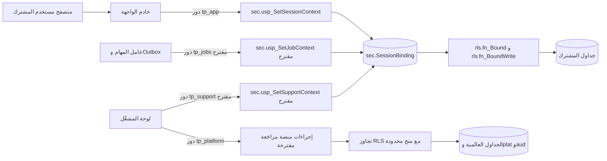
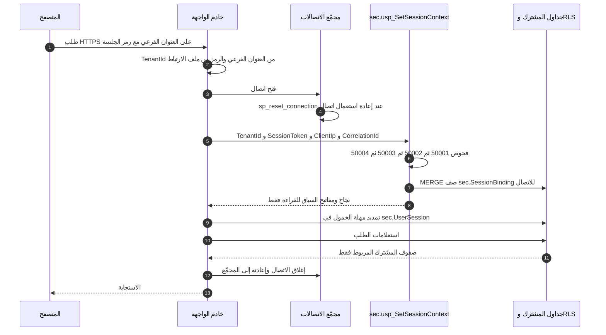
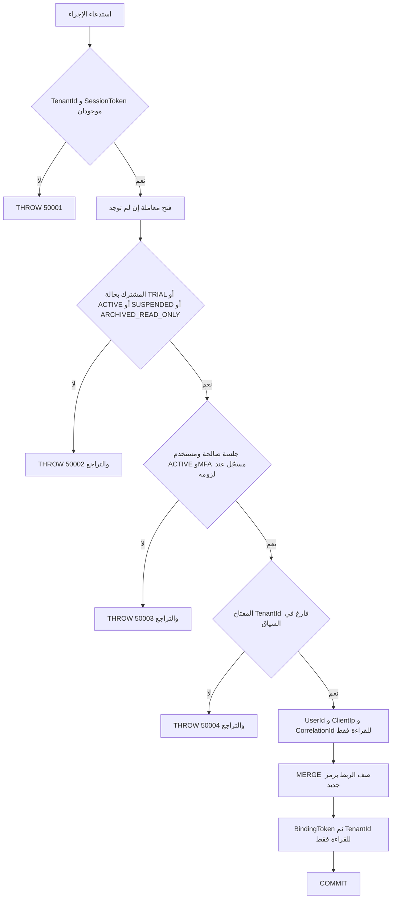
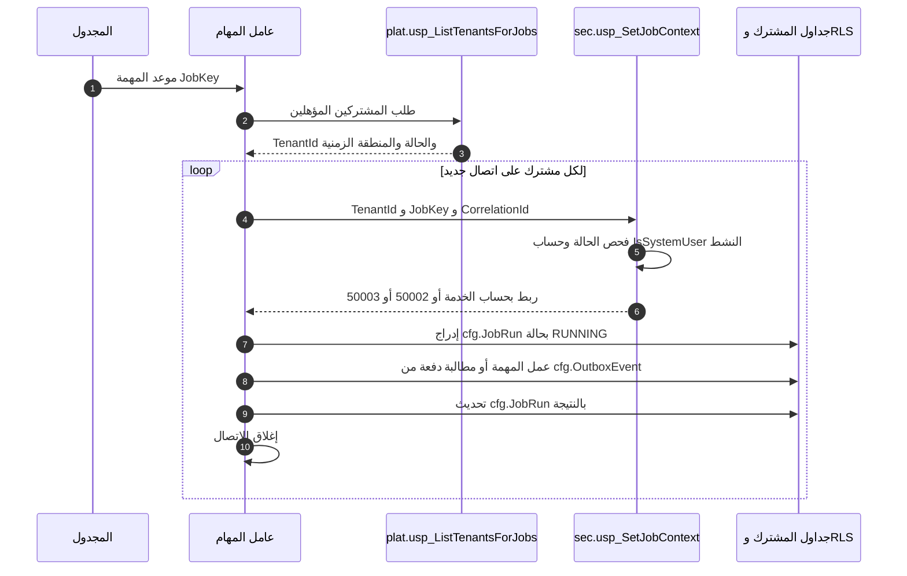

# DOC-F04 — تسلسل ربط سياق المشترك لكل اتصال ومهمة

| البند | القيمة |
|---|---|
| المعرّف | DOC-F04 (docs/30-readiness-documents.md) |
| الإصدار | 0.1 — مسودة للمراجعة — 2026-10-12 |
| المالك المقترح | معماري قاعدة البيانات مع مهندس الخلفية |
| الأولوية | P0 قبل S0 |
| يغطي | BR-PLT-001، BR-PLT-002، BR-PLT-017، FR-PLT-007، FR-PLT-014، FR-PLT-044، FR-PLT-046، O-16 وO-18 وO-22 وO-24 (erd_open_items)، O-11 وO-12 (20-database-design) |
| يعتمد على | DOC-F01 (حدود الثقة)، DOC-F03 (إصدار رمز الجلسة)، DOC-S03 (شكل الرمز وعنوان العميل الموثوق)، DOC-S08 (الحسابات والأسرار) |
| المصادر | db/static/010_rls.sql، db/static/020_roles_and_grants.sql، db/static/025_tenant_views.sql، db/static/030_session_context.sql، db/generated/tsql/007_table_grants.sql، db/tests/tenant_isolation_tests.sql، docs/adr/0002-login-and-session-bound-context.md، docs/20-database-design.md، docs/21-data-dictionary.md، docs/10-detailed-analysis/10-m0-m1-platform-organization.md، tools/dbgen/erd_open_items.py |

> **تحديث التنفيذ (2026-10-12):** نُفّذت قرارات المالك لبوابة S0 في القاعدة (docs/adr/0003-account-security-in-the-database.md، db/static/030_session_context.sql، db/static/035_account_security.sql) وتمر في CI (48 حالة عزل و14 حالة حسابات في db/tests/auth_flow_tests.sql). أرقام الأسطر المذكورة لملف 030 في هذه الوثيقة تسبق هذا التحديث.
>
> ما يخص هذه الوثيقة: O-18 مغلق بالخيار (أ) ومصفوفة §7.4 (`sec.fn_TenantOpen` و`sec.fn_TenantLoginAllowed`؛ T40 وT41)، و50006 لمن أثبت كلمة مروره ورفضته الحالة (T42)، والتحويل من العنوان الفرعي بـ `sec.usp_ResolveTenant` (DQ-F04-5)، وتمديد الخمول والخروج بإجراءين (DQ-F04-8)، وإنهاء الجلسات عند التعطيل (DQ-F04-9). لم يُبنَ بعد: ربط المهام (DQ-F04-4) وربط الدعم (DQ-F04-6).
>
> وبـ docs/adr/0004-platform-access-jobs-and-onboarding.md (ADR 0004): ربط المهام (§5.2) منفّذ في db/static/037_job_context.sql بدور `tp_jobs` وقائمة المهام المغلقة `cfg.JobDefinition` وحالات المشترك من §7.4 (الاختبارات J1 إلى J6)، وربط الدعم (§6.2) منفّذ في db/static/036_operator_and_support.sql بدور `tp_support` وجلسة مشغّل داخل القاعدة وعمودي `BindingKind` و`BoundOperatorId` (P1 إلى P10). وإجراءات المدير لا تقبل إلا ربط مستخدم، فلا يستعملها ربط مهمة أو دعم.

## 1. الغرض والنطاق

تصف هذه الوثيقة كيف يُربط كل اتصال بقاعدة البيانات بمشترك واحد قبل أي استعلام، بعد أن يملك المستخدم رمز جلسة صالحًا. وتغطي أربعة أنواع من الاتصال: طلب مستخدم المشترك، ومهمة الخلفية وعامل Outbox، ومشغّل المنصة، ووصول الدعم المؤقت. وتنتهي بمصفوفة حالة المشترك والدور التي يتتبعها O-18 (erd_open_items) واقتراح لحسمها.

خارج النطاق: الدخول وMFA حتى إصدار رمز الجلسة (DOC-F03)، وشكل الرمز وملف الارتباط وعنوان العميل الموثوق (DOC-S03)، وحسابات القاعدة وأسرارها (DOC-S08)، وتفاصيل Outbox وإعادة المحاولة (DOC-F17)، وتهيئة المشترك ودورة حياته (DOC-F05)، ونموذج أخطاء الواجهة البرمجية (DOC-B04).

الرموز: 🟢 قائم في المستودع أو مقرَّر في الوثائق، 🟡 مقترح ينتظر القرار.

## 2. ما يقرّه المستودع اليوم 🟢

1. صف جدول المشترك يُرى أو يُكتب فقط إذا اتفق أمران: `TenantId` يساوي `SESSION_CONTEXT(N'TenantId')`، وفي `sec.SessionBinding` صف لـ`@@SPID` بالمشترك نفسه وبرمز يطابق `SESSION_CONTEXT(N'BindingToken')` (db/static/010_rls.sql:5-10، db/static/010_rls.sql:22-31).
2. لا يكتب الربط إلا `sec.usp_SetSessionContext` (db/static/010_rls.sql:9-10). دور التطبيق لا يقرأ جدول الربط ولا يكتبه (db/generated/tsql/007_table_grants.sql:38، الاختبار T16b في db/tests/tenant_isolation_tests.sql:388).
3. الإجراء يأخذ رمز الجلسة لا معرّف المستخدم، ويأخذ المستخدم من الجلسة (db/static/030_session_context.sql:13-14، db/static/030_session_context.sql:190-199، docs/adr/0002-login-and-session-bound-context.md:22).
4. مفاتيح السياق تُضبط للقراءة فقط (db/static/030_session_context.sql:205-207، db/static/030_session_context.sql:218-219).
5. مجمّع الاتصالات يعيد ضبط الاتصال قبل إعادة استعماله (`sp_reset_connection`)، فيمحو السياق (db/static/030_session_context.sql:18، docs/adr/0002-login-and-session-bound-context.md:31).
6. الكتابة تحتاج مشتركًا مفتوحًا للكتابة: TRIAL أو ACTIVE (db/static/010_rls.sql:33-41).
7. أربعة قوادح تسحب الربط عند تغيّر المستخدم أو الجلسة أو المشترك (db/static/030_session_context.sql:241-296).
8. عضوا `tp_platform` و`tp_auth` يتجاوزان دوال الصفوف (db/static/010_rls.sql:11-12، db/static/010_rls.sql:48، db/static/010_rls.sql:56).

## 3. أنواع الاتصال الأربعة

| نوع الاتصال | الدور في القاعدة | طريقة الربط | الحالة اليوم |
|---|---|---|---|
| طلب مستخدم المشترك | `tp_app` | `sec.usp_SetSessionContext` برمز الجلسة | 🟢 منفّذ ومختبر: T17 إلى T20 وT25 إلى T37 (db/tests/tenant_isolation_tests.sql:427-689) |
| مهمة خلفية وعامل Outbox | `tp_app` مع دور جديد `tp_jobs` 🟡 | إجراء جديد بحساب `IsSystemUser` 🟡 | غير مبني (§5) |
| مشغّل المنصة | `tp_platform` | بلا ربط؛ يتجاوز RLS ومنحه محدودة | 🟢 الدور والمنح؛ لا إجراءات منصة بعد (§6.1) |
| الدعم المؤقت | دور جديد `tp_support` عضو في `tp_readonly` 🟡 | إجراء جديد يتحقق من `plat.SupportAccessGrant` 🟡 | غير مبني (§6.2) |

حدود الثقة بأرقام DOC-F01: طلب المستخدم يعبر TB-1 ثم TB-3 وTB-4، ولوحة المشغّل تعبر TB-2 ثم TB-5. مسارا المهام والدعم المقترحان يحتاجان حدّين جديدين في DOC-F01.

## 4. تسلسل الطلب الواحد لمستخدم المشترك

### 4.1 المخطط

### 4.2 قواعد طبقة التطبيق

| # | القاعدة | السند |
|---|---|---|
| R-1 | يُربط كل اتصال عند فتحه وقبل أول استعلام، من موضع واحد في طبقة الوصول إلى البيانات يمر به كل اتصال، ومنه أي اتصال تعيد فتحه سياسة إعادة المحاولة. | 🟡 |
| R-2 | يُؤخذ `TenantId` من العنوان الفرعي `{tenant}.bankfas.com` فقط، لا من جسم الطلب ولا من معاملاته. | 🟢 FR-PLT-046 (docs/10-detailed-analysis/10-m0-m1-platform-organization.md:148)، BR-PLT-001 (السطر 227) |
| R-3 | لا يملك `tp_app` اليوم طريقًا لتحويل رمز العنوان إلى `TenantId`: `plat.Tenant` محجوب عنه (db/generated/tsql/007_table_grants.sql:13-14) والعرض `plat.v_CurrentTenant` يشترط ربطًا قائمًا (db/static/025_tenant_views.sql:9-15). يُقترح إجراء `sec.usp_ResolveTenant(@Code)` بصفة `tp_auth_exec` يعيد المعرّف أو لا شيء، وينسَّق مع DOC-F03 (DQ-F04-5). | 🟡 |
| R-4 | يُستدعى الإجراء خارج أي معاملة. فهو يقفل صفوف المشترك والجلسة والمستخدم حتى نهاية معاملته (db/static/030_session_context.sql:184-199). إن استُدعي داخل معاملة المستدعي بقيت الأقفال حتى تنتهي، فتنتظر عمليات التعطيل والإنهاء (db/static/030_session_context.sql:178-182). | 🟢 السلوك، 🟡 القاعدة |
| R-5 | الرمز الخام يبقى في التطبيق؛ القاعدة تقارن بصمته SHA-256 (db/static/030_session_context.sql:195). لا يُكتب الرمز في أي سجل (DOC-S03). | 🟢 |
| R-6 | `ClientIp` و`CorrelationId` يُحفظان في السياق للتدقيق فقط. الإجراء لا يقارن `ClientIp` بعنوان الجلسة (db/static/030_session_context.sql:206-207). مصدر العنوان الموثوق في DOC-S03. | 🟢 |
| R-7 | الإجراء لا يمدّد مهلة الخمول؛ يقرأ الجلسة فقط (db/static/030_session_context.sql:191-198). يمدّدها التطبيق بتحديث `sec.UserSession` (db/generated/tsql/007_table_grants.sql:40)، وهذا خطر متبقٍّ في O-24 (erd_open_items). يُقترح نقله إلى إجراء (DQ-F04-8). | ✅ نُقل إلى `sec.usp_TouchSession`، ومُنع التعديل المباشر (ADR 0003) |
| R-8 | يُغلق الاتصال في نهاية كل طلب. لا يُحتفظ باتصال مربوط بين طلبين، لأن فحص صلاحية الجلسة يجري عند الربط فقط، وبه يسري الانتهاء والسحب في الطلب التالي. | 🟡 |
| R-9 | الاستعلامات المتوازية في طلب واحد تستعمل اتصالات منفصلة، ويُربط كل منها بالقاعدة R-1. | 🟡 |
| R-10 | لا يستدعي كود التطبيق `sp_set_session_context` مباشرة. ضبط `TenantId` يدويًا لا يكشف صفًّا (T16 وT28، db/tests/tenant_isolation_tests.sql:375 و:423)، ويجعل الربط اللاحق يفشل بالخطأ 50004. | 🟢 |
| R-11 | لا تُترك مؤشرات (cursors) مفتوحة بعد نهاية الطلب، لأنها تستمر في تسليم الصفوف بعد السحب (O-22 في tools/dbgen/erd_open_items.py:139-143). | 🟢 الخطر، 🟡 القاعدة |

### 4.3 ما يجري داخل `sec.usp_SetSessionContext`

| الترتيب | الفحص أو الفعل | الموضع | الخطأ |
|---|---|---|---|
| 1 | `TenantId` و`SessionToken` غير فارغين. لا يفحص طول الرمز هنا، بخلاف `usp_StartSession` (db/static/030_session_context.sql:53-54) | db/static/030_session_context.sql:174 | 50001 |
| 2 | يفتح معاملة إن لم توجد معاملة للمستدعي | db/static/030_session_context.sql:178-182 | — |
| 3 | المشترك موجود وحالته من TRIAL وACTIVE وSUSPENDED وARCHIVED_READ_ONLY، بقفل `UPDLOCK, HOLDLOCK` | db/static/030_session_context.sql:186-188 | 50002 |
| 4 | جلسة لهذا المشترك ببصمة الرمز، غير منتهية، داخل المهلتين، ومستخدمها ACTIVE، وMFA مسجّل إن كان مفعّلًا | db/static/030_session_context.sql:191-199 | 50003 |
| 5 | الاتصال غير مربوط من قبل | db/static/030_session_context.sql:201-202 | 50004 |
| 6 | يضبط `UserId` و`ClientIp` و`CorrelationId` للقراءة فقط قبل كتابة الربط (CTX-4) | db/static/030_session_context.sql:204-207 | خطأ المحرك إن كان المفتاح مقفلًا |
| 7 | يدمج صف `sec.SessionBinding` لـ`@@SPID` برمز `NEWID()` جديد | db/static/030_session_context.sql:209-215 | — |
| 8 | يضبط `BindingToken` ثم `TenantId` | db/static/030_session_context.sql:217-219 | — |
| 9 | يثبّت المعاملة إن كانت له، ويعيد رفع أي خطأ بعد التراجع | db/static/030_session_context.sql:221-226 | — |

الخطأ 50003 واحد لكل الأسباب: رمز خاطئ، جلسة منتهية أو مُنهاة، مستخدم غير نشط، MFA غير مسجّل. فلا يكشف للمستدعي سبب الرفض. يغطيه T18 وT32 وT36 (db/tests/tenant_isolation_tests.sql:451، :466، :561).

### 4.4 صف الربط ودوال RLS

صف `sec.SessionBinding` مفتاحه `SessionId` وهو `@@SPID`، ويحمل `BoundTenantId` و`BoundUserId` و`BindingToken` و`BoundAt`، ولا مفتاح أجنبي على `BoundUserId` (docs/21-data-dictionary.md:365-377). يبقى الصف بعد إغلاق الاتصال، لكنه لا يفيد اتصالًا جديدًا على الرقم نفسه لأن رمزه لا يطابق سياقه، ويُستبدل عند أول ربط على ذلك الرقم (db/static/030_session_context.sql:209-215). يقرؤه ويكتبه `tp_auth` وحده، ويُحجب عن `tp_readonly` و`tp_platform` (db/static/020_roles_and_grants.sql:59-60).

| الدالة | الموضع | تسمح عندما | تُستعمل في |
|---|---|---|---|
| `rls.fn_Bound` | db/static/010_rls.sql:22-31 | صف ربط للاتصال بمشترك الصف، والمشترك يساوي السياق، والرمز يطابق | كل الدوال أدناه، والعرضان (db/static/025_tenant_views.sql:14، :26) |
| `rls.fn_BoundWrite` | db/static/010_rls.sql:35-41 | `fn_Bound` والمشترك TRIAL أو ACTIVE | `fn_TenantWrite` و`fn_MixedWrite` |
| `rls.fn_TenantAccess` | db/static/010_rls.sql:52-57 | `tp_platform` أو `tp_auth` أو `fn_Bound` | ترشيح جداول المشترك (db/static/010_rls.sql:118) |
| `rls.fn_TenantWrite` | db/static/010_rls.sql:44-49 | `tp_platform` أو `tp_auth` أو `fn_BoundWrite` | حجب الإدراج والتعديل والحذف (db/static/010_rls.sql:119-121) |
| `rls.fn_MixedRead` و`rls.fn_MixedWrite` | db/static/010_rls.sql:60-74 | القراءة: صف عام أو تجاوز أو `fn_Bound`؛ الكتابة: تجاوز أو `fn_BoundWrite` | الجداول المختلطة الثلاثة (db/static/010_rls.sql:123-130) |
| `rls.fn_AuditRead` و`rls.fn_AuditWrite` | db/static/010_rls.sql:79-93 | القراءة: صف المنصة (`TenantId` فارغ) لـ`tp_platform`، أو `tp_auth`، أو `fn_Bound` (T38)؛ الإدراج: `TenantId` فارغ أو تجاوز أو `fn_Bound` | `aud.AuditLog` (db/static/010_rls.sql:98-101) |

ملاحظتان:
- `fn_AuditWrite` يستعمل `fn_Bound` لا `fn_BoundWrite`. فإضافة سطر تدقيق تبقى ممكنة في SUSPENDED وARCHIVED_READ_ONLY، وهذا مطلوب لتدقيق القراءة والتصدير فيهما. وقبوله `TenantId` فارغًا من اتصال المشترك هو O-19 (erd_open_items).
- الكتابة المرفوضة بالحجب تعطي الخطأ 33504 (T4 وT27، db/tests/tenant_isolation_tests.sql:163، :604).

### 4.5 الفشل وما يفعله التطبيق

السياق لا يتراجع مع المعاملة. ما ضُبط من مفاتيح قبل الخطأ يبقى في الاتصال، ولذلك رتّب الإجراء المفاتيح المساعدة قبل الربط (db/static/030_session_context.sql:204). القاعدة: لا يُكمل التطبيق على اتصال فشل ربطه. يغلقه فيعيده إلى المجمّع، والمجمّع يعيد ضبطه عند إعادة الاستعمال (db/static/030_session_context.sql:18). ثم يفتح اتصالًا جديدًا إن احتاج.

| الخطأ | المعنى | ما يفعله التطبيق 🟡 | الاستجابة |
|---|---|---|---|
| 50001 | معامل ناقص | خطأ برمجي: إغلاق الاتصال وتسجيله | خطأ خادم (DOC-B04) |
| 50002 | مشترك غير معروف أو CLOSED | إغلاق الاتصال، حذف ملف الارتباط | الصفحة المحايدة لعنوان غير معروف (FR-PLT-046، docs/10-detailed-analysis/10-m0-m1-platform-organization.md:148) |
| 50003 | لا جلسة صالحة | إغلاق الاتصال، حذف ملف الارتباط | تحويل إلى الدخول (DOC-F03) |
| 50004 | الاتصال مربوط من قبل | عيب في معالجة المجمّع: إغلاق الاتصال، تسجيل بشدة عالية، محاولة واحدة على اتصال جديد | حسب نتيجة المحاولة |
| غير ذلك | قفل ميت أو مهلة أو خطأ مفتاح مقفل | إغلاق الاتصال ومحاولة واحدة على اتصال جديد | خطأ خادم إن تكرر |

### 4.6 السحب

| الحدث | القادح | الموضع | الأثر | الاختبار |
|---|---|---|---|---|
| حالة المستخدم تصير غير ACTIVE (تعطيل، قفل، أرشفة) | `sec.TR_AppUser_RevokeBinding` | db/static/030_session_context.sql:245-256 | حذف ربوط المستخدم | T25 |
| حذف صف المستخدم | `sec.TR_AppUser_RevokeBindingOnDelete` | db/static/030_session_context.sql:258-267 | حذف ربوطه | T30 |
| إنهاء جلسة أو حذفها | `sec.TR_UserSession_RevokeBinding` | db/static/030_session_context.sql:269-283 | حذف كل ربوط المستخدم، لا ربط الجلسة وحدها | T37 |
| حالة المشترك تصير غير TRIAL وACTIVE | `plat.TR_Tenant_RevokeBinding` | db/static/030_session_context.sql:285-296 | حذف كل ربوط المشترك | T26 |

بعد السحب يبقى السياق في الاتصال، لكن `fn_Bound` يفشل فلا تظهر صفوف ولا تُقبل كتابة، ومحاولة ربط جديدة تعطي 50004 حتى يُعاد ضبط الاتصال (db/static/030_session_context.sql:241-244). ولأن كل طلب يربط من جديد، يسري السحب على الطلب الجاري فورًا وعلى ما بعده عند الربط.

ملاحظتان للمالكين الآخرين:
- قفل الحساب بعد خمس محاولات فاشلة يجعل الحالة LOCKED (db/static/030_session_context.sql:97-101)، فيسحب القادح ربوط المستخدم، ويرفض الإجراء جلساته القائمة لأنه يشترط ACTIVE (db/static/030_session_context.sql:197). أي أن من يخمّن كلمة المرور يوقف عمل صاحب الحساب. يُحسم في DOC-F06 وDOC-S04.
- القوادح تحذف الربط ولا تُنهي صف `sec.UserSession`. أسباب الإنهاء `USER_DISABLED` و`TENANT_SUSPENDED` موجودة في القاموس (docs/21-data-dictionary.md:396) ولا يكتبها أي كود اليوم (DQ-F04-9).

## 5. مهام الخلفية وعامل Outbox

### 5.1 الوضع اليوم: المسار غير مبني

- التصميم ينص على حساب خدمة لكل مشترك بعلم `IsSystemUser` للمهام والتكامل (docs/20-database-design.md:97، docs/20-database-design.md:393، docs/21-data-dictionary.md:216). 🟢
- قيد يمنع حساب الخدمة من كلمة مرور ومن MFA (db/generated/tsql/001_tables.sql:214). 🟢
- لذلك لا يستطيع إنشاء جلسة، لأن `usp_StartSession` يقارن بصمة كلمة المرور (db/static/030_session_context.sql:85-86)، ولا يستطيع الربط، لأن الربط يشترط جلسة (db/static/030_session_context.sql:191-199). ودور التطبيق ممنوع من إدراج الجلسات (db/static/030_session_context.sql:238). 🟢
- `cfg.OutboxEvent` و`cfg.JobRun` جدولا مشترك تحت RLS (docs/21-data-dictionary.md:899، :930)، فلا يقرأ العامل صفوفهما إلا بعد الربط. 🟢
- لا يقرأ `tp_app` قائمة المشتركين (db/generated/tsql/007_table_grants.sql:13-14)، فلا يعرف العامل لمن يعمل. 🟢

النتيجة: لا توجد اليوم طريقة لربط مهمة بمشترك. هذا مانع لـ FR-PLT-044 في S0 (docs/10-detailed-analysis/10-m0-m1-platform-organization.md:146)، ولبذر المشترك في DOC-F05.

### 5.2 التصميم المقترح 🟡

1. دور جديد `tp_jobs` يُمنح `EXECUTE` على إجراءين جديدين فقط، ويُعطى لحساب العامل وحده لا لحساب خادم الواجهة (DOC-S08).
2. `sec.usp_SetJobContext(@TenantId, @JobKey, @CorrelationId)` بصفة `tp_auth_exec`، بالترتيب والأخطاء نفسها:
   - 50001 إن نقص معامل.
   - 50002 إن كانت حالة المشترك لا تسمح بهذه المهمة (§7.4).
   - 50003 إن لم يوجد للمشترك حساب `IsSystemUser = 1` بحالة ACTIVE.
   - 50004 إن كان الاتصال مربوطًا.
   - ثم يضبط `UserId` لحساب الخدمة و`JobKey` و`CorrelationId` للقراءة فقط، ويدمج صف الربط، ثم `BindingToken` ثم `TenantId`.
3. `plat.usp_ListTenantsForJobs` يعيد `TenantId` والحالة والمنطقة الزمنية فقط، لأن المهام تعمل بتوقيت كل مشترك (docs/10-detailed-analysis/13-m6-workflow-engine-notifications.md:633).
4. السحب يعمل دون تغيير: تعطيل حساب الخدمة أو تغيير حالة المشترك يحذف الربط بالقوادح القائمة.
5. كل تشغيل يُسجَّل في `cfg.JobRun`، وكل ربط لمهمة يُسجَّل في `aud.AuditLog` بالمعرّف `JobKey`.
6. يُبذر لكل مشترك دور نظام لحساب الخدمة بالصلاحيات التي تحتاجها المهام (DOC-B05).

عامل Outbox حالة خاصة من هذا التسلسل: يربط بكل مشترك فيه أحداث معلّقة، ويطالب دفعة، ويسلّمها، ثم يغلق الاتصال. تفاصيل المطالبة وإعادة المحاولة في DOC-F17.

الخطر المتبقي: من يملك حساب العامل يربط أي مشترك دون جلسة مستخدم، وهذا يشبه الثغرة التي أغلقها O-17 (erd_open_items). الضوابط المقترحة: حساب منفصل وسر منفصل لا يصل إليهما خادم الواجهة (DOC-S08)، وتدقيق كل ربط مهمة، وقائمة مغلقة لقيم `JobKey`. يُقبل الخطر بمالك مسمّى (DQ-F04-4).

## 6. مشغّلو المنصة والدعم المؤقت

### 6.1 مشغّل المنصة (`tp_platform`)

ما هو قائم 🟢:
- اتصال المشغّل لا يُربط بمشترك. لا يملك `EXECUTE` على إجراءات الجلسة، فهي ممنوحة لـ`tp_app` وحده (db/static/030_session_context.sql:229-232).
- يتجاوز دوال الصفوف بـ`IS_MEMBER` (db/static/010_rls.sql:48، :56، :65، :73، :92)، عدا قراءة `aud.AuditLog` فهي لصفوف المنصة فقط (:83؛ T38)، لكن منحه محصورة في الجداول العالمية و`plat` والمختلطة و`aud` (db/generated/tsql/007_table_grants.sql:9-20، :29، :55، :66، :83). لا منح له على جداول المشترك (docs/20-database-design.md:117).
- لا يقرأ جدول الربط (db/static/020_roles_and_grants.sql:60).
- هوية المشغّل في `plat.PlatformOperator`، مستقلة عن `sec.AppUser`، وMFA إلزامي له (FR-PLT-006، docs/10-detailed-analysis/10-m0-m1-platform-organization.md:108؛ db/generated/tsql/001_tables.sql:117). لا يوجد إجراء دخول للمشغّل بعد؛ مساره عند DOC-F03 وDOC-S03.

فجوات:
- ✅ صُحّح (1f0f0af): كان `tp_platform` يقرأ صفوف `aud.AuditLog` لكل المشتركين، خلافًا لـdocs/20-database-design.md:112 ولـFR-PLT-005 (docs/10-detailed-analysis/10-m0-m1-platform-organization.md:107). دالة القراءة تقصره الآن على صفوف المنصة (db/static/010_rls.sql:83)، والاختبار T38 يثبت ذلك. يبقى من DQ-F04-7 قراءة صفوف المشترك عبر إجراء مُراجَع.
- أي تعديل على بيانات مشترك يحتاج إجراء منصة مُراجَعًا، ولم يُكتب أي إجراء (O-12 في docs/20-database-design.md:540).
- يستطيع `tp_platform` تحديث `plat.Tenant.Status` مباشرة بلا فحص للانتقال (db/generated/tsql/007_table_grants.sql:14). يقترح DOC-F05 إجراءً واحدًا للانتقال.

### 6.2 الدعم المؤقت 🟡

ما هو قائم 🟢: `plat.SupportAccessGrant` جدول مشترك يكتبه `tp_app` (db/generated/tsql/007_table_grants.sql:22)، بنافذة من ساعة إلى 72 ساعة والافتراضي 4 (docs/21-data-dictionary.md:184؛ BR-PLT-017 في docs/10-detailed-analysis/10-m0-m1-platform-organization.md:243). لا يرى المشغّل بيانات مقيّدة أبدًا (FR-PLT-007، السطر 109). والإجراء الذي يتحقق من المنحة شرط S0 (docs/20-database-design.md:118).

لماذا لا يكفي `tp_platform`: هو يتجاوز RLS، فاتصال دعم به يرى كل المشتركين.

التصميم المقترح:
1. حساب دعم منفصل يُعطى دورًا جديدًا `tp_support` عضوًا في `tp_readonly`. فيرث القراءة دون الأعمدة المقيّدة (db/static/020_roles_and_grants.sql:41-53، db/generated/tsql/006_sensitive_columns.sql:6-36) والحجب عن سجل المشتركين والمشغّلين والربط (db/static/020_roles_and_grants.sql:55-63). ولا يملك أي كتابة، ويخضع لـRLS لأنه غير معفى.
2. `sec.usp_SetSupportContext(@TenantId, @SupportAccessGrantId, @OperatorSessionToken, @ClientIp, @CorrelationId)` بصفة `tp_auth_exec`. يتحقق من جلسة المشغّل، ومن أن المنحة له، وأن `StartsAt <= now < EndsAt`، وأن `RevokedAt` فارغ، وأن حالة المشترك تسمح (§7.4). ثم يربط.
3. يُضاف إلى `sec.SessionBinding` عمودان: `BindingKind` بالقيم USER وJOB وSUPPORT، و`BoundOperatorId`. هذا تغيير في النموذج (DQ-F04-6).
4. قادح على `plat.SupportAccessGrant` يحذف ربوط الدعم عند ضبط `RevokedAt`. والانتهاء يسري عند الربط التالي، لأن كل طلب يربط من جديد.
5. تكتب لوحة المشغّل سطر تدقيق لكل صفحة بشدة عالية في `aud.AuditLog` بمعرّف المشترك (BR-PLT-009، السطر 235)، عبر اتصالها بـ`tp_platform` الذي يملك الإدراج (db/generated/tsql/007_table_grants.sql:55).

## 7. مصفوفة حالة المشترك والدور (O-18)

### 7.1 ما تطلبه BR-PLT-002 🟢

النص في docs/10-detailed-analysis/10-m0-m1-platform-organization.md:228:
- TRIAL تنتهي بعد 30 يومًا ويمدّدها المشغّل، ثم تتحول آليًا إلى SUSPENDED.
- في SUSPENDED لا دخول لمستخدمي المشترك عدا مدير الحساب، للقراءة والتصدير فقط.
- CLOSED: تصدير فقط مدة 30 يومًا، ثم ARCHIVED_READ_ONLY.
- ARCHIVED_READ_ONLY: قراءة فقط، بلا كتابة ولا حذف، ولا إتلاف آلي. ويذكر النص أن الإتلاف يوافق عليه المشغّل «لعدم وجود مدير حساب فعّال».

### 7.2 ما يفعله الكود اليوم 🟢

| الحالة | الدخول `usp_StartSession` | الربط الجديد | ربط قائم عند الانتقال | القراءة | الكتابة |
|---|---|---|---|---|---|
| TRIAL | مقبول لكل مستخدم ACTIVE (db/static/030_session_context.sql:67-69) | مقبول (db/static/030_session_context.sql:186-188) | — | نعم | نعم (db/static/010_rls.sql:41) |
| ACTIVE | مقبول | مقبول | — | نعم | نعم |
| SUSPENDED | مقبول لكل مستخدم | مقبول لكل مستخدم | يُسحب (db/static/030_session_context.sql:291-295) | نعم بعد ربط جديد (T27) | لا، ولا حذف (T27 وT31) |
| CLOSED | مرفوض بالخطأ 50005 (db/static/030_session_context.sql:140) | مرفوض 50002 (T17) | يُسحب (T26) | لا | لا |
| ARCHIVED_READ_ONLY | مقبول لكل مستخدم | مقبول لكل مستخدم | يُسحب | نعم بعد ربط جديد | لا |

مواضع الاختبارات: T17 في db/tests/tenant_isolation_tests.sql:438، T26 في :589، T27 في :604، T31 في :639.

### 7.3 الفجوة

| # | الفجوة | الأثر |
|---|---|---|
| G-1 | ✅ أُغلقت (ADR 0003): SUSPENDED يقبل مدير الحساب وحده (O-18). | — |
| G-2 | الربط القائم يُسحب عند التعليق، والربط الجديد يُقبل. | سلوك غير متسق: من كان داخلًا يُطرد ثم يعود بطلبه التالي. |
| G-3 | CLOSED يُرفض في الدخول والربط. | التصدير مدة 30 يومًا مستحيل. |
| G-4 | الكتابة مرفوضة في SUSPENDED وCLOSED، والتصدير يحتاج كتابة صف `cfg.DataExportJob` (docs/21-data-dictionary.md:847) وحفظ الحزمة في `doc.Document`. | لا تصدير حتى لمدير الحساب. |
| G-5 | الكتابة المرفوضة تشمل تمديد الخمول وتسجيل الخروج في `sec.UserSession`. | جلسة مدير الحساب في المشترك المعلّق تنتهي بعد 30 دقيقة مهما عمل، ولا يُسجَّل خروجه. |
| G-6 | ARCHIVED_READ_ONLY يقبل كل مستخدم، والقاعدة تفترض ألا مدير حساب فعّالًا فيه، ولا تحدد من يقرأ. | قراءة غير محددة الفاعل لمشترك منتهٍ. |
| G-7 | لا مهمة تنقل TRIAL إلى SUSPENDED ولا CLOSED إلى ARCHIVED_READ_ONLY. | الحالة الزمنية لا تتغير وحدها (DOC-F05). |

### 7.4 الحل المقترح (قرار DQ-F04-1) 🟡

يُعتمد الخيار (أ) في O-18: الربط يراعي الحالة والدور معًا. يُرفض الخيار (ب) لأن رفض SUSPENDED كليًا يخالف حق مدير الحساب في القراءة والتصدير.

| الحالة | مدير الحساب (TA) | مستخدمو المشترك الآخرون | حساب الخدمة (المهام) | مشغّل المنصة | الدعم المؤقت |
|---|---|---|---|---|---|
| TRIAL وACTIVE | كامل حسب صلاحياته | كامل حسب صلاحياتهم | كل المهام | تغيير الحالة وسجل المنصة | قراءة بمنحة فعّالة |
| SUSPENDED | قراءة وتصدير | مرفوض | التصدير وتنظيف الجلسات فقط | تغيير الحالة | قراءة بمنحة قائمة قبل التعليق |
| CLOSED خلال 30 يومًا من `ClosedAt` | تصدير فقط | مرفوض | التصدير وتنظيف الجلسات فقط | تغيير الحالة | مرفوض |
| CLOSED بعد 30 يومًا | مرفوض | مرفوض | مهمة الأرشفة فقط | تغيير الحالة | مرفوض |
| ARCHIVED_READ_ONLY | مرفوض | مرفوض | تقرير الاحتفاظ فقط | قراءة بإجراء مُراجَع بطلب مكتوب | مرفوض |

خطوات التنفيذ:
1. يفحص `usp_StartSession` و`usp_SetSessionContext` الحالة والدور معًا. مدير الحساب هو من له دور نظام رمزه `TA` (docs/21-data-dictionary.md:255، docs/10-detailed-analysis/10-m0-m1-platform-organization.md:41) عبر `sec.UserRole`. يحتاج `tp_auth` قراءة `sec.UserRole` و`sec.Role`، فتُضاف المنحتان في db/static/020_roles_and_grants.sql وتُحدَّث القاعدة R6 في tools/dbgen/check_grants.py:83-84.
2. في CLOSED يُقبل مدير الحساب ما دام `SYSUTCDATETIME() < DATEADD(DAY, 30, ClosedAt)`، حتى لو تأخرت مهمة الأرشفة.
3. المستخدم الذي أثبت كلمة مروره ورُفض بسبب حالة المشترك يأخذ خطأً جديدًا 50006 «المشترك غير متاح لهذا المستخدم»، لأنه عضو في المشترك فلا يُكشف له ما لا يعرفه. يُنسَّق مع DOC-F03 وDOC-B04 (DQ-F04-3).
4. يبقى `plat.TR_Tenant_RevokeBinding` كما هو: يسحب كل الربوط عند أي انتقال خارج TRIAL وACTIVE، ثم يربط مدير الحساب من جديد بطلبه التالي بالقواعد الجديدة.
5. يبقى `fn_BoundWrite` كما هو. والكتابات القليلة اللازمة في الحالات المقروءة تمر بإجراءات بصفة `tp_auth_exec`: تمديد الخمول، وتسجيل الخروج، وطلب التصدير. وتنفّذ مهمة التصدير بحساب الخدمة (DQ-F04-8).
6. تُعدَّل الاختبارات: T27 يصير «مدير الحساب يقرأ ولا يكتب، وغيره مرفوض»، ويضاف اختبار لـCLOSED داخل النافذة وخارجها، واختبار لـARCHIVED_READ_ONLY.
7. يُحدَّث بند O-18 في tools/dbgen/erd_open_items.py بالقرار.

## 8. القرارات المطلوبة

| المعرّف | السؤال | الافتراض المقترح | من يقرر | ما يعطّله |
|---|---|---|---|---|
| DQ-F04-1 | كيف يُحسم O-18 (erd_open_items)؟ | ✅ معتمد من المالك (2026-10-12): الخيار (أ) بالمصفوفة في §7.4 | مالك المنتج مع معماري قاعدة البيانات | تعديل 030 والاختبار T27، ودخول S0 |
| DQ-F04-2 | من يقرأ مشتركًا ARCHIVED_READ_ONLY؟ | ✅ معتمد من المالك (2026-10-12): لا دخول لمستخدمي المشترك؛ قراءة المشغّل بإجراء مُراجَع بطلب مكتوب | مالك المنتج مع المستشار القانوني (DOC-S07) | §7.4 وDOC-F05 |
| DQ-F04-3 | أي خطأ يأخذه مستخدم مصادَق رُفض بسبب حالة المشترك؟ | خطأ جديد 50006 | مسؤول الأمن مع قائد الواجهات (DOC-B04) | DOC-F03 وDOC-B04 |
| DQ-F04-4 | كيف ترتبط المهام بالمشترك؟ | دور `tp_jobs` وإجراء `sec.usp_SetJobContext` بحساب `IsSystemUser`، وحساب دخول مستقل للعامل، وقبول الخطر المتبقي بمالك | معماري قاعدة البيانات مع مسؤول الأمن | FR-PLT-044 وبذر DOC-F05 وOutbox |
| DQ-F04-5 | كيف يحوّل التطبيق رمز العنوان الفرعي إلى `TenantId` قبل الربط؟ | `sec.usp_ResolveTenant(@Code)` بصفة `tp_auth_exec` | معماري قاعدة البيانات مع مالك DOC-F03 | الدخول وكل طلب |
| DQ-F04-6 | كيف يربط الدعم المؤقت؟ | ✅ معتمد من المالك (2026-10-12): `tp_support` عضو في `tp_readonly`، و`sec.usp_SetSupportContext`، وعمودا `BindingKind` و`BoundOperatorId` | مسؤول الأمن مع مالك المنتج | FR-PLT-007 وBR-PLT-017 في S0 |
| DQ-F04-7 | ما الذي يقرؤه `tp_platform` من `aud.AuditLog`؟ | صفوف المنصة فقط (`TenantId` فارغ)، وصفوف المشترك عبر إجراء مُراجَع | مسؤول الأمن | FR-PLT-005 |
| DQ-F04-8 | كيف تجري الكتابات اللازمة في الحالات المقروءة؟ | إجراءات بصفة `tp_auth_exec` لتمديد الخمول وتسجيل الخروج وطلب التصدير؛ وهذا يغلق جزءًا من O-24 (erd_open_items) | معماري قاعدة البيانات | G-4 وG-5 |
| DQ-F04-9 | هل يُنهى صف الجلسة عند السحب؟ | نعم: إجراءات التعطيل وتغيير الحالة تضبط `EndedAt` و`EndReason`، والقوادح تبقى لحذف الربط | مسؤول الهوية والأمن (DOC-F06) | عرض الجلسات في FR-PLT-014 |

## 9. تعارضات وفجوات في المصادر

1. docs/20-database-design.md:267 تقول إن `tp_app` يملك `EXECUTE` على `usp_SetSessionContext` فقط، والكود يمنحه أربعة إجراءات (db/static/030_session_context.sql:229-232). وتعليقا db/static/020_roles_and_grants.sql:7 و:32 ما زالا يحصران `tp_auth` في إجراء السياق وقراءة جدولين، والكود يمنحه كتابة على الربط والجلسات والمستخدم ومحاولات الدخول (db/static/020_roles_and_grants.sql:59، :67-69)؛ وصفه في docs/20-database-design.md:269 صُحّح في 1f0f0af.
2. docs/30-readiness-documents.md:93 (غرض DOC-F04 في السجل) يذكر التوقيع القديم وثلاثة أخطاء. صحّحته ملاحظة التحقق في السطر 99.
3. db/static/010_rls.sql:34 يقول إن SUSPENDED وARCHIVED_READ_ONLY «يستمران في القراءة»، وBR-PLT-002 يقصر SUSPENDED على مدير الحساب (docs/10-detailed-analysis/10-m0-m1-platform-organization.md:228). هذا هو O-18 نفسه.
4. ✅ صُحّح (1f0f0af): كان الكود يسمح لـ`tp_platform` بقراءة صفوف تدقيق كل المشتركين خلافًا لـdocs/20-database-design.md:112؛ `rls.fn_AuditRead` يقصره الآن على صفوف المنصة (db/static/010_rls.sql:83)، والاختبار T38.
5. أسباب الإنهاء `USER_DISABLED` و`TENANT_SUSPENDED` معرّفة (docs/21-data-dictionary.md:396) ولا يكتبها القادحان (db/static/030_session_context.sql:245-256، :285-296).

## 10. التتبع

| البند في هذه الوثيقة | المتطلب أو القاعدة أو القرار | المصدر |
|---|---|---|
| §2 و§4.3 و§4.4 | O-16 وO-17 (erd_open_items)، ADR 0002 | db/static/010_rls.sql، db/static/030_session_context.sql، docs/adr/0002-login-and-session-bound-context.md |
| §4.2 R-2 وR-3 | FR-PLT-046، BR-PLT-001 | docs/10-detailed-analysis/10-m0-m1-platform-organization.md:148، :227 |
| §4.2 R-7 وDQ-F04-8 | O-24 (erd_open_items)، FR-PLT-014 | tools/dbgen/erd_open_items.py:151-156 |
| §4.2 R-11 | O-22 (erd_open_items) | tools/dbgen/erd_open_items.py:139-143 |
| §4.6 | FR-PLT-014، FR-PLT-016، BR-PLT-005 | db/static/030_session_context.sql:241-296 |
| §5 | FR-PLT-042، FR-PLT-044، C-8 وDB-18 (20-database-design) | docs/20-database-design.md:97، :518 |
| §6.1 | FR-PLT-005، FR-PLT-006، O-12 (20-database-design) | docs/20-database-design.md:117، :540 |
| §6.2 | FR-PLT-007، BR-PLT-017، BR-PLT-009 | docs/10-detailed-analysis/10-m0-m1-platform-organization.md:109، :243، :235 |
| §7 | BR-PLT-002، O-18 (erd_open_items) | docs/10-detailed-analysis/10-m0-m1-platform-organization.md:228، tools/dbgen/erd_open_items.py:115-120 |
| §7.2 | الاختبارات T17 وT26 وT27 وT31 | db/tests/tenant_isolation_tests.sql:438، :589، :604، :639 |
| خروج S0 | اختبار عزل بين مشتركين | docs/10-detailed-analysis/00-overview-and-cross-cutting.md:194 |
