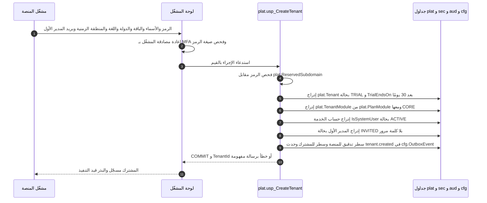
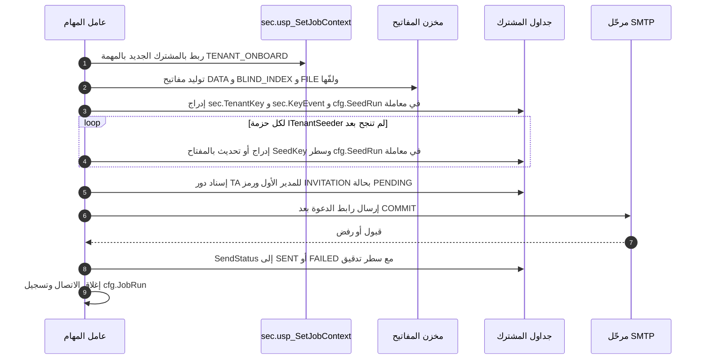
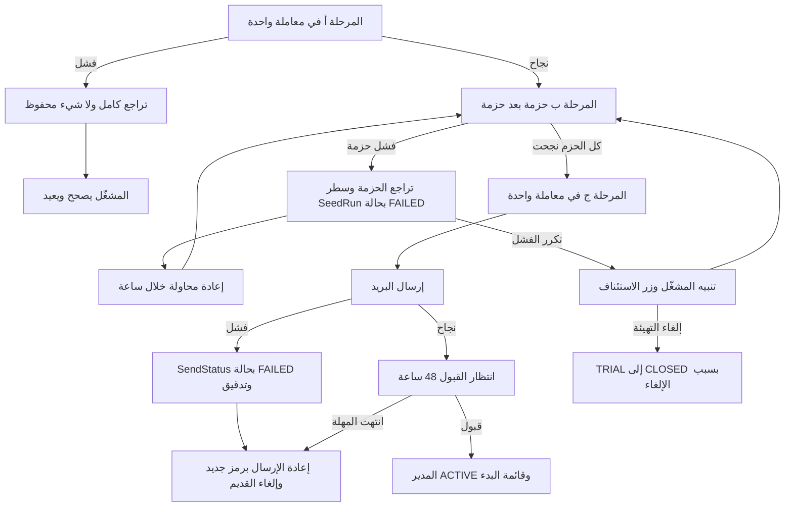
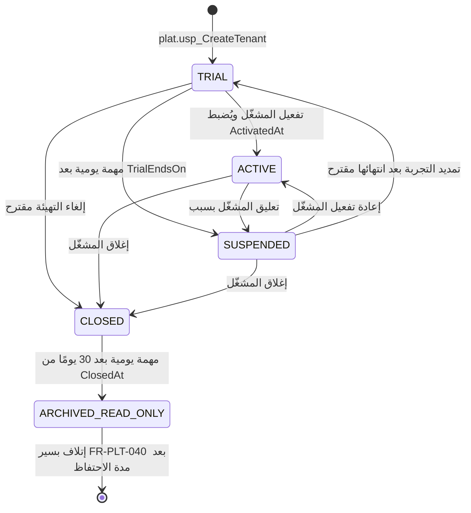

# DOC-F05 — تسلسل تهيئة المشترك ودورة حياته مع الفشل والتراجع

| البند | القيمة |
|---|---|
| المعرّف | DOC-F05 (docs/30-readiness-documents.md) |
| الإصدار | 0.1 — مسودة للمراجعة — 2026-10-12 |
| المالك المقترح | مهندس المنصة مع مدير المنتج (موافقة المشغّل) |
| الأولوية | P0 قبل S0 |
| يغطي | FR-PLT-001، FR-PLT-002، FR-PLT-003، FR-PLT-005، FR-PLT-008، FR-PLT-009، FR-PLT-013، FR-PLT-039، FR-PLT-040، FR-PLT-046، BR-PLT-002، BR-PLT-003، BR-PLT-016، O-12 (20-database-design)، O-18 (erd_open_items) |
| يعتمد على | DOC-F04 (ربط المهام بحساب الخدمة ومصفوفة الحالة)، DOC-B05 (البذور)، DOC-S02 (مفاتيح المشترك)، DOC-S05 (TLS)، DOC-F03 وDOC-F06 (الدعوة وحالات المستخدم)، DOC-S08 (حسابات القاعدة) |
| المصادر | docs/10-detailed-analysis/10-m0-m1-platform-organization.md، docs/10-detailed-analysis/00-overview-and-cross-cutting.md، docs/20-database-design.md، docs/21-data-dictionary.md، db/generated/tsql/001_tables.sql، db/generated/tsql/007_table_grants.sql، db/static/010_rls.sql، db/static/030_session_context.sql |

> **تحديث التنفيذ (2026-10-12):** نُفّذت التهيئة وانتقالات الحالة في القاعدة (docs/adr/0004-platform-access-jobs-and-onboarding.md، db/static/038_tenant_onboarding.sql) وتمر في CI (الاختبارات O1 إلى O5): المرحلة أ `plat.usp_CreateTenant` بمدير مشغّلين تحقق بـ MFA خلال 5 دقائق (DQ-F05-2) في معاملة واحدة، والمرحلة ج `sec.usp_InviteFirstAdministrator` لمهمة JOB-PLT-ONBOARD، والانتقالات بإجراء واحد مع `plat.usp_SetTenantStatus` للمشغّل و`plat.usp_RunTenantTransitions` للمهمتين اليوميتين (DQ-F05-6)، ورفض إغلاق مشترك نشط حتى يوجد التصدير (DQ-F05-7)، وإغلاق التجربة الملغاة (DQ-F05-4)، و`DENY` على كتابة الحالة مباشرة (DQ-F05-5). الباقة STANDARD والعناوين المحجوزة مبذورة. تبقى المرحلة ب (حزم البذر) في التطبيق، والتدقيق يكتبه التطبيق (O-25 في tools/dbgen/erd_open_items.py).

## 1. الغرض والنطاق

تصف الوثيقة كيف ينشئ مشغّل المنصة مشتركًا جديدًا يدويًا، بلا فوترة، حتى يصل مدير الحساب الأول إلى قائمة البدء. وتحدد لكل خطوة ما يجري داخل معاملة القاعدة وما يجري خارجها، وما يحدث عند الفشل وكيف يُعوَّض. ثم تصف دورة حياة المشترك من TRIAL إلى ARCHIVED_READ_ONLY، ونافذة التصدير، وحذف البيانات.

شرط خروج S0 يتضمن «تأهيل مشترك جديد آليًا» (docs/10-detailed-analysis/00-overview-and-cross-cutting.md:194). القسم §7 يقترح كيف يُقاس.

خارج النطاق: ما يُسمح به لكل دور في كل حالة (DOC-F04 §7)، ومحتوى البذور نفسها (DOC-B05)، وتوليد المفاتيح وحفظها (DOC-S02)، وإكمال الدعوة وتسجيل MFA (DOC-F03 وDOC-F06)، وشهادات TLS (DOC-S05).

الرموز: 🟢 قائم في المستودع أو مقرَّر، 🟡 مقترح ينتظر القرار.

## 2. الوضع اليوم في المستودع 🟢

- لا إجراء تهيئة ولا بذور. في `db/` أربعة إجراءات للدخول والربط وستة قوادح فقط (db/static/030_session_context.sql:23-296، db/static/050_fac_share_rule.sql:26، :62). وثيقة القاعدة تصف التهيئة «خطة لم تُنفَّذ بعد» (docs/20-database-design.md:470-476)، والبذور غير مكتوبة (O-3 في docs/20-database-design.md:531).
- جدول المشترك: الحالة الافتراضية TRIAL، والرمز فريد، والقيود تفرض `TrialEndsOn` في TRIAL، والسبب في SUSPENDED، و`ClosedAt` في CLOSED وما بعدها، و`ArchivedAt` في الأرشفة (db/generated/tsql/001_tables.sql:41-72).
- قاعدة البيانات بترتيب غير حساس لحالة الأحرف (db/deploy.sql:18)، فالرمز `Acme` يساوي `acme` في القيد الفريد.
- العناوين المحجوزة في `plat.Tenant` تُفحص «في التطبيق» (docs/21-data-dictionary.md:110). وتجميد الرمز بعد التفعيل «في التطبيق أو بمحفّز» (docs/21-data-dictionary.md:90)، ولا محفّز له.
- `plat.TenantModule`: وحدة CORE لا تُعطَّل (db/generated/tsql/001_tables.sql:141)، والاعتماديات تُفحص في التطبيق (docs/21-data-dictionary.md:161)، و`EnabledBy` فارغ يعني تفعيلًا آليًا من الباقة (docs/21-data-dictionary.md:163).
- `tp_platform` يكتب جداول `plat` العالمية (db/generated/tsql/007_table_grants.sql:9-20) ولا منح له على جداول المشترك (docs/20-database-design.md:117)، لكنه يتجاوز دوال الصفوف (db/static/010_rls.sql:48).
- حساب الخدمة `IsSystemUser` بلا كلمة مرور ولا MFA (db/generated/tsql/001_tables.sql:214)، ولا يستطيع الربط اليوم (DOC-F04 §5.1).
- `cfg.SeedRun` جدول مشترك: `TenantId` إلزامي (db/generated/tsql/001_tables.sql:933-934). القيد الفريد على `SeedKey` في الجداول المبذورة يمنع التكرار، مثل `sec.Role` (docs/21-data-dictionary.md:264).
- رابط الدعوة صالح 48 ساعة، ويُرسل عبر مرحّل SMTP تهيّئه الاستضافة، منفصلًا عن بريد الإشعارات (FR-PLT-013، docs/10-detailed-analysis/10-m0-m1-platform-organization.md:115). وحالة الإرسال في `sec.UserToken.SendStatus` (docs/21-data-dictionary.md:441).
- مفتاح بيانات لكل مشترك ملفوف بمفتاح رئيسي خارج القاعدة (BR-PLT-015، docs/10-detailed-analysis/10-m0-m1-platform-organization.md:241). وسر MFA يُشفَّر بمفتاح DATA للمشترك (docs/21-data-dictionary.md:222). حفظ المفتاح الرئيسي قرار مفتوح (docs/adr/0001-schema-work-on-linux.md:26).
- المخطط الحالي للتهيئة خطي بلا فشل (docs/10-detailed-analysis/10-m0-m1-platform-organization.md:405-413)، ومخطط الحالات يكتب المؤقتات نصًا على الأسهم (السطور 455-465).

## 3. المشاركون

| المشارك | الهوية | الدور في التسلسل | الوثيقة المالكة |
|---|---|---|---|
| مشغّل المنصة | `plat.PlatformOperator` بدور OPERATOR_ADMIN (FR-PLT-006) | يملأ نموذج المشترك ويعتمده | DOC-F03 لدخوله |
| لوحة المشغّل | حساب قاعدة ضمن `tp_platform` | تستدعي إجراء التسجيل | DOC-S08 |
| عامل المهام | حساب قاعدة ضمن `tp_app` و`tp_jobs` 🟡، ويربط بحساب الخدمة | يبذر ويصدر الدعوة | DOC-F04 §5 |
| مخزن المفاتيح | خارج القاعدة | يلف مفاتيح المشترك | DOC-S02 |
| مرحّل SMTP | خدمة الاستضافة | يرسل الدعوة | DOC-F02 لتدفقها |
| DNS وTLS | النطاق `bankfas.com` | يوجّه `{tenant}.bankfas.com` | DOC-S05 |
| مدير الحساب الأول | `sec.AppUser` بحالة INVITED | يكمل الدعوة | DOC-F03 وDOC-F06 |

## 4. تسلسل التهيئة 🟡

### 4.1 المراحل

يتعارض نصّان: وثيقة القاعدة تريد «إجراء منصة واحدًا داخل معاملة واحدة» (docs/20-database-design.md:475)، وFR-PLT-008 يريد بذرًا عبر عقد `ITenantSeeder` تسجّل به كل وحدة حزمتها، قابلًا للتكرار (docs/10-detailed-analysis/10-m0-m1-platform-organization.md:110). الحزم كود في التطبيق، و`tp_platform` لا يكتب جداول المشترك. لذلك يُقترح تقسيم التهيئة إلى مراحل، لكل مرحلة معاملتها، مع استئناف آمن (DQ-F05-1):

| المرحلة | ما يجري | داخل معاملة القاعدة؟ | من يكتب |
|---|---|---|---|
| أ. التسجيل | صف المشترك، الوحدات، حساب الخدمة، صف المدير الأول، التدقيق، حدث `tenant.created` | نعم، معاملة واحدة | `plat.usp_CreateTenant` يستدعيه `tp_platform` |
| ب. البذر | مفاتيح المشترك، ثم حزمة لكل وحدة | نعم، معاملة لكل حزمة | عامل المهام مربوطًا بحساب الخدمة |
| ج. الدعوة | إسناد دور TA للمدير الأول ورمز الدعوة | نعم، معاملة واحدة | عامل المهام |
| د. الإرسال | بريد الدعوة | لا | عامل المهام عبر SMTP |
| هـ. القبول | كلمة المرور وMFA وتفعيل المدير | خارج هذه الوثيقة | DOC-F03 |

هذا يحسم O-12 (20-database-design) للتهيئة: المرحلة أ لا تحتاج سياقًا لأن `tp_platform` معفى من دوال الصفوف (db/static/010_rls.sql:48)، والإجراء يملكه `dbo` مثل الجداول (db/generated/tsql/000_schemas.sql:34، :42)، فتسمح سلسلة الملكية بالإدراج كما في العروض (db/static/025_tenant_views.sql:4). والمرحلتان ب وج تربطان بالمشترك الجديد بمسار المهام نفسه (DOC-F04 §5.2).

لا يُكشف المشترك الناقص لأحد: المدير الأول INVITED بلا كلمة مرور، فلا دخول قبل المرحلة هـ (db/static/030_session_context.sql:82-83)، ولا يُرسل رابط الدعوة قبل نجاح كل الحزم.

### 4.2 المرحلة أ: التسجيل

قواعد المرحلة أ:
- يُحوَّل الرمز إلى أحرف صغيرة قبل الحفظ، لأن تسمية DNS لا تميّز الحالة. صيغته يفرضها القيد (db/generated/tsql/001_tables.sql:66). 🟡
- يُرفض الرمز إن طابق `plat.ReservedSubdomain` (FR-PLT-046، docs/10-detailed-analysis/10-m0-m1-platform-organization.md:148)، ويفحصه الإجراء نفسه لا الواجهة وحدها. 🟡
- `TrialEndsOn` = تاريخ الإنشاء بتوقيت المشترك + 30 يومًا (FR-PLT-001، docs/10-detailed-analysis/10-m0-m1-platform-organization.md:103).
- حساب الخدمة يحتاج بريدًا فريدًا واسمًا معروضًا (db/generated/tsql/001_tables.sql:207، :209). يُقترح بريد غير قابل للتوصيل بنطاق `.invalid` واسم ثابت. 🟡
- الإجراء لا يستعمل SQL ديناميكيًا، لأنه يكسر سلسلة الملكية. ويأخذ `TenantId` من الصف الذي أنشأه فقط، فلا يلمس مشتركًا آخر رغم إعفاء `tp_platform`. 🟡
- حدث `tenant.created` في المعاملة نفسها يوقظ مهمة التهيئة (نمط Outbox، FR-PLT-042 في docs/10-detailed-analysis/10-m0-m1-platform-organization.md:144). 🟡

### 4.3 المرحلتان ب وج: البذر والدعوة

ترتيب الحزم المقترح: المفاتيح أولًا، ثم الأدوار والصلاحيات (ومنها دور TA ودور حساب الخدمة)، ثم الإعدادات `cfg.TenantSetting`، ثم الإدارات وأنواع المستندات والأشكال القانونية والمناصب وأنواع الصلاحيات، ثم تعريفات الترقيم، ثم كتالوجات النظام المنسوخة (docs/20-database-design.md:421-428)، ثم قوالب دورات العمل وقواعد الإشعارات وملفات KYC. المحتوى ومصدر القوالب في DOC-B05. 🟡

قواعد المرحلتين:
- كل حزمة في معاملة واحدة، ويُكتب سطر `cfg.SeedRun` بالنتيجة. الحزمة الناجحة لا تُعاد، والصف الذي عدّله المشترك لا يُستبدل (FR-PLT-008).
- الدعوة تُنشأ بعد نجاح كل الحزم المطلوبة فقط. ترتيب المخطط الحالي (الدعوة قبل البذر) يُعكس، لأن دور TA يجب أن يوجد قبل إسناده (docs/10-detailed-analysis/10-m0-m1-platform-organization.md:409-411).
- البريد يُرسل بعد تثبيت المعاملة، لا داخلها. الرمز الخام لا يُحفظ؛ القاعدة تحفظ بصمته (docs/21-data-dictionary.md:436).
- تعرض لوحة المشغّل حالة التهيئة من إجراء منصة يعيد أسماء الحزم ونتائجها فقط، لأن `tp_platform` لا يقرأ `cfg.SeedRun`. 🟡

### 4.4 العنوان الفرعي وTLS

- كل مشترك على `{tenant}.bankfas.com`، بشهادة شاملة أو شهادة لكل عنوان (FR-PLT-046). 🟢
- المقترح: سجل DNS شامل `*.bankfas.com` وشهادة شاملة. فلا خطوة DNS ولا شهادة لكل مشترك، ويصير العنوان فعّالًا بمجرد تثبيت المرحلة أ. والعنوان غير المعروف يعطي صفحة محايدة (FR-PLT-046). 🟡 (DQ-F05-3، يؤكده DOC-S05)
- إن اختيرت شهادة لكل عنوان، تُضاف مرحلة غير متزامنة بعد أ، بإعادة محاولة، ولا تُرسل الدعوة قبل نجاحها. لا تعويض في القاعدة، لأن صفوف المشترك لا تعتمد على الشهادة.

### 4.5 تفعيل الوحدات

- تُنسخ وحدات الباقة من `plat.PlanModule` إلى `plat.TenantModule` في المرحلة أ، و`EnabledBy` فارغ (docs/21-data-dictionary.md:163). وحدة CORE دائمًا (db/generated/tsql/001_tables.sql:141).
- تغيير الوحدات لاحقًا بيد المشغّل وحده (FR-PLT-003، docs/10-detailed-analysis/10-m0-m1-platform-organization.md:105؛ الصف 1 في مصفوفة الصلاحيات، السطر 43)، مع فحص الاعتماديات (BR-PLT-003، السطر 229). يقرأ التطبيق الوحدات من `plat.v_TenantModule` (db/static/025_tenant_views.sql:22-29).
- التعطيل يخفي الوحدة دون حذف بياناتها (FR-PLT-003). 🟢
- حزم البذر لوحدة تُفعَّل لاحقًا تُشغَّل عند تفعيلها، بالمسار نفسه وبالاستئناف نفسه. 🟡 (DQ-F05-9)

## 5. الفشل والتراجع والتعويض

| الخطوة | داخل معاملة القاعدة؟ | عند الفشل | التعويض 🟡 |
|---|---|---|---|
| فحص الرمز والقيم | نعم، داخل الإجراء | خطأ ولا شيء محفوظ؛ الرمز المكرر يُرفض بالقيد الفريد | يصحح المشغّل |
| صفوف المرحلة أ | نعم، معاملة واحدة | تراجع كامل | لا حاجة |
| لف المفاتيح في المخزن | لا: نداء خارجي، والصفوف داخل المعاملة | تفشل حزمة المفاتيح وتُعاد | المفتاح الملفوف غير المحفوظ يُهمل؛ إن أنشأ المخزن كائنًا لكل مشترك يُحذف (DOC-S02) |
| كل حزمة بذر | نعم، معاملة لكل حزمة | تراجع الحزمة، `SeedRun` بحالة FAILED، و`JobRun` بإعادة محاولة خلال ساعة (FR-PLT-044) | إعادة التشغيل لا تكرر شيئًا بفضل `SeedKey` |
| إسناد TA ورمز الدعوة | نعم، معاملة واحدة | تراجع وإعادة | لا حاجة |
| إرسال البريد | لا | `SendStatus = FAILED` وسطر تدقيق (docs/21-data-dictionary.md:441) | رمز جديد ويُلغى القديم بـ`RevokedAt` |
| DNS وTLS | لا | مع الشهادة الشاملة لا خطوة | لا حاجة |
| لم يُقبل الرابط خلال 48 ساعة | — | الرمز ينتهي | يعيد المشغّل إصدار الدعوة |
| إلغاء التهيئة | — | يقرر المشغّل الإلغاء | انتقال TRIAL إلى CLOSED بسبب، ولا تصدير لأن لا بيانات أعمال؛ الرمز يبقى محجوزًا (DQ-F05-4) |

لماذا لا يُحذف المشترك الملغى: `tp_platform` لا يملك أي حذف (docs/20-database-design.md:268)، وسجل التدقيق للإضافة فقط (db/static/020_roles_and_grants.sql:65). الحذف الفعلي يمر بمسار الإتلاف في §6.5.

## 6. دورة حياة المشترك

### 6.1 مخطط الحالات

المصدر: BR-PLT-002 وFR-PLT-002 (docs/10-detailed-analysis/10-m0-m1-platform-organization.md:228، :104) ومخطط السطور 455-465. السهمان المعلّمان «مقترح» غير موجودين في المصدر (DQ-F05-4 وDQ-F05-6).

### 6.2 جدول الانتقالات

| من ← إلى | الفاعل | الشرط والأعمدة | الأثر |
|---|---|---|---|
| جديد ← TRIAL | المشغّل (§4.2) | `TrialEndsOn` إلزامي (db/generated/tsql/001_tables.sql:67) | بدء التهيئة |
| TRIAL ← ACTIVE | المشغّل | يُضبط `ActivatedAt` مرة واحدة؛ بعده لا يتغير الرمز (docs/21-data-dictionary.md:90) | لا أثر على الربط |
| TRIAL ← SUSPENDED | مهمة يومية | `TrialEndsOn` قبل تاريخ اليوم بتوقيت المشترك؛ `SuspendedReason` إلزامي (db/generated/tsql/001_tables.sql:68) | سحب كل الربوط (db/static/030_session_context.sql:285-296) |
| ACTIVE ← SUSPENDED | المشغّل | سبب إلزامي | سحب الربوط |
| SUSPENDED ← ACTIVE | المشغّل | يُفرغ `SuspendedReason` ويبقى في التدقيق 🟡 | الربط يعود بالطلب التالي |
| SUSPENDED ← TRIAL 🟡 | المشغّل | `TrialEndsOn` جديد | الربط يعود |
| TRIAL أو ACTIVE أو SUSPENDED ← CLOSED | المشغّل | يُضبط `ClosedAt` (db/generated/tsql/001_tables.sql:69) | سحب الربوط وبدء نافذة التصدير |
| CLOSED ← ARCHIVED_READ_ONLY | مهمة يومية | `ArchivedAt` = `ClosedAt` + 30 يومًا (docs/21-data-dictionary.md:92؛ db/generated/tsql/001_tables.sql:70-71) | لا وصول لمستخدمي المشترك (DOC-F04 §7.4) |
| CLOSED ← ACTIVE | مرفوض | FR-PLT-002 (docs/10-detailed-analysis/10-m0-m1-platform-organization.md:104) | — |
| ARCHIVED_READ_ONLY ← حذف | المشغّل بموافقة المشترك الخطية | بعد مدة الاحتفاظ (FR-PLT-040، السطر 142) | §6.5 |

قواعد كل انتقال 🟡:
- يمر كل انتقال بإجراء واحد `plat.usp_SetTenantStatus(@TenantId, @NewStatus, @Reason)`. يفحص أن الانتقال مسموح، ويضبط الأعمدة، ويكتب التدقيق وحدث `tenant.status_changed` في معاملة واحدة (FR-PLT-002).
- اليوم يستطيع `tp_platform` تحديث `plat.Tenant` مباشرة (db/generated/tsql/007_table_grants.sql:14). يُقترح `DENY UPDATE` على أعمدة `Status` و`ClosedAt` و`ArchivedAt` و`ActivatedAt` و`Code` لـ`tp_platform`، ويوضع في ملف يُنشر بعد 007 وفق قاعدة الترتيب (db/static/020_roles_and_grants.sql:70-71؛ DOC-S08). (DQ-F05-5)
- عند التعليق والإغلاق تُنهى الجلسات المفتوحة بسبب `TENANT_SUSPENDED` (docs/21-data-dictionary.md:396)، عدا ما تسمح به مصفوفة DOC-F04 §7.4. القادح يحذف الربط فقط اليوم.

### 6.3 المؤقتات والمهام 🟡

| المهمة | الموعد | الشرط | الفعل | مفتاح عدم التكرار |
|---|---|---|---|---|
| JOB-PLT-TRIAL-REMIND | يوميًا | TRIAL و`TrialEndsOn` بعد 7 أو 3 أو 1 أيام | تنبيه مدير الحساب والمشغّل (BR-PLT-002) | (المشترك، عدد الأيام) |
| JOB-PLT-TRIAL-EXPIRE | يوميًا | TRIAL و`TrialEndsOn` قبل اليوم بتوقيت المشترك | انتقال إلى SUSPENDED بسبب `TRIAL_EXPIRED` | (المشترك، `TrialEndsOn`) |
| JOB-PLT-ARCHIVE | يوميًا | CLOSED و`ClosedAt` + 30 يومًا انقضت | انتقال إلى ARCHIVED_READ_ONLY | المشترك |
| JOB-PLT-EXPORT-EXPIRE | يوميًا | حزمة READY انتهت مهلتها | READY إلى EXPIRED وحذف الملف | `DataExportJobId` |

- تتبع هذه المهام نمط مهام `13` (متكررة الأمان، تعوّض التوقف، docs/10-detailed-analysis/13-m6-workflow-engine-notifications.md:633).
- تعمل مهام الانتقال على مستوى المنصة، فتستدعي `plat.usp_SetTenantStatus` بصلاحية محصورة في الانتقالين الآليين. وتُسجَّل في `aud.AuditLog` لأن `cfg.JobRun` جدول مشترك. (DQ-F05-6)
- المثال في BR-PLT-002: تجربة بدأت 2026-10-10 تنتهي 2026-11-09؛ مشترك أُغلق 2026-12-01 يصير ARCHIVED_READ_ONLY في 2026-12-31 (docs/10-detailed-analysis/10-m0-m1-platform-organization.md:228).

### 6.4 نافذة التصدير بعد الإغلاق

- المدة 30 يومًا من `ClosedAt`، والتصدير وحده مسموح فيها (BR-PLT-002). 🟢
- الطلب في `cfg.DataExportJob`، والبيانات المقيّدة تحتاج موافقة حامل صلاحية الكشف، والحزمة الجاهزة تنتهي بعد 7 أيام (docs/21-data-dictionary.md:847-877، :865). 🟢
- اليوم يستحيل التصدير في CLOSED، لأن الدخول والربط مرفوضان (db/static/030_session_context.sql:67-69، :186-188) والكتابة مرفوضة (db/static/010_rls.sql:35-41). الحل في DOC-F04 §7.4 (DQ-F04-1 وDQ-F04-8).
- المقترح: يُرفض طلب تصدير جديد بعد انقضاء النافذة، وتنتهي الحزمة الجاهزة بانتهاء النافذة أو بعد 7 أيام، أيهما أسبق. 🟡
- FR-PLT-039 (التصدير) مقرر لـ S5 بأولوية Should (السطر 141)، بينما الإغلاق جزء من دورة الحياة في S0. المقترح: لا يُغلق مشترك حقيقي قبل بناء التصدير. (DQ-F05-7)

### 6.5 الإتلاف وحذف البيانات

- لا إتلاف آلي. يُقترح الإتلاف بسير FR-PLT-040 بعد مدة الاحتفاظ النظامية، بموافقة المشغّل وموافقة المشترك الخطية (BR-PLT-002، BR-PLT-016 في docs/10-detailed-analysis/10-m0-m1-platform-organization.md:242). المدد المقترحة 10 و10 و5 سنوات ويحسمها مختص. 🟢
- لا يوجد اليوم مسار حذف: لا منح حذف لـ`tp_platform`، ولا حذف على أغلب جداول المشترك حتى لـ`tp_app` (db/generated/tsql/005_delete_grants.sql:6-7). 🟢
- المقترح 🟡 (DQ-F05-8):
  1. إجراء إتلاف مُراجَع يُشغَّل بحساب الترحيل بموافقة شخصين (DOC-S08)، يحذف صفوف المشترك بترتيب التبعيات.
  2. يبقى صف `plat.Tenant` وسطور `aud.AuditLog` حتى تنقضي مدة احتفاظ التدقيق، لأن التدقيق يشير إلى المشترك.
  3. تُلغى مفاتيح المشترك (`sec.TenantKey` بحالة REVOKED) ويُتلف غلافها في المخزن، فتصير الأعمدة المشفّرة غير مقروءة حتى في النسخ الاحتياطية (BR-PLT-015). باقي البيانات يبقى في النسخ حتى تنتهي مدتها (DOC-S09).
  4. يُسجَّل حدث إتلاف للمنصة بعدد الصفوف لكل جدول، دون أي بيانات.

## 7. شرط خروج S0: تهيئة آلية قابلة للقياس 🟡

مدخل مقترح لسجل القبول (DOC-B02):

- **Given** قاعدة منشورة من جديد بالبذور العالمية فقط، ومشترك قائم A.
- **When** يعتمد مشغّل OPERATOR_ADMIN نموذج مشترك جديد B، ثم يُقطع العامل أثناء حزمة البذر الثالثة ثم يعود.
- **Then** دون أي خطوة SQL يدوية:
  - B بحالة TRIAL و`TrialEndsOn` بعد 30 يومًا، ووحداته تساوي وحدات الباقة ومعها CORE.
  - حساب الخدمة ACTIVE، وكل الحزم المطلوبة SUCCEEDED في `cfg.SeedRun`، والحزمة المقطوعة أُكملت دون تكرار.
  - المدير الأول INVITED ومعه دور TA ورمز INVITATION بحالة SENT.
  - تشغيل التهيئة مرة ثانية لا يضيف صفًّا.
  - اختبارات العزل بين A وB تنجح، وسجل التدقيق يحمل أحداث التسجيل والبذر والدعوة.

## 8. القرارات المطلوبة

| المعرّف | السؤال | الافتراض المقترح | من يقرر | ما يعطّله |
|---|---|---|---|---|
| DQ-F05-1 | معاملة واحدة للتهيئة كلها أم مراحل؟ | مراحل §4.1: التسجيل في معاملة، وكل حزمة في معاملة، مع استئناف آمن | معماري الحلول مع مهندس المنصة | إجراء التهيئة وخروج S0 |
| DQ-F05-2 | من يعتمد التهيئة؟ | ✅ معتمد من المالك (2026-10-12): مشغّل OPERATOR_ADMIN واحد بعد إعادة مصادقة MFA، مع تدقيق؛ لا موافقة ثانية في S0 | مدير المنتج | شاشة المشغّل |
| DQ-F05-3 | DNS وTLS لكل مشترك أم شامل؟ | سجل DNS شامل وشهادة شاملة، فلا خطوة خارجية لكل مشترك | مهندس البنية التحتية (DOC-S05) | §4.4 |
| DQ-F05-4 | ماذا يحدث لتهيئة ملغاة؟ | ✅ معتمد من المالك (2026-10-12): انتقال TRIAL إلى CLOSED بسبب، ويبقى الرمز محجوزًا، ولا حذف | مدير المنتج | §5 |
| DQ-F05-5 | كيف تُفرض انتقالات الحالة؟ | إجراء واحد `plat.usp_SetTenantStatus` و`DENY UPDATE` على أعمدة الحالة لـ`tp_platform` بعد 007 | معماري قاعدة البيانات | §6.2 |
| DQ-F05-6 | تمديد التجربة بعد انتهائها، ومن ينفّذ المؤقتات؟ | ✅ معتمد من المالك (2026-10-12): يُسمح بـ SUSPENDED إلى TRIAL بتاريخ جديد؛ المؤقتات مهام منصة يومية تستدعي الإجراء نفسه وتُسجَّل في التدقيق | مدير المنتج مع مهندس الخلفية | §6.1 و§6.3 |
| DQ-F05-7 | هل يُغلق مشترك حقيقي قبل بناء التصدير FR-PLT-039؟ | ✅ معتمد من المالك (2026-10-12): لا؛ يُبنى الانتقال ويُختبر في S0، ويُمنع الإغلاق الفعلي حتى يوجد التصدير | مدير المنتج | BR-PLT-002 |
| DQ-F05-8 | كيف تُحذف بيانات مشترك مؤرشف؟ | إجراء إتلاف مُراجَع بموافقة شخصين، مع إلغاء المفاتيح، وإبقاء صف المشترك والتدقيق حتى مدة التدقيق | مسؤول حماية البيانات (DOC-S07) مع مدير قاعدة البيانات | FR-PLT-040 في S5 |
| DQ-F05-9 | متى تُبذر حزم وحدة تُفعَّل لاحقًا؟ | عند تفعيلها، بالمسار نفسه | مهندس المنصة | FR-PLT-003 |
| DQ-F05-10 | أين يُسجَّل تشغيل البذر العالمي؟ | جدول منصة جديد، كما في DQ-B05-1 (`cfg.PlatformSeedRun`)، لأن `cfg.SeedRun` يشترط مشتركًا | معماري قاعدة البيانات (DOC-B05) | البذور العالمية |

## 9. تعارضات وفجوات في المصادر

1. docs/20-database-design.md:475 تريد التهيئة «داخل معاملة واحدة» بإجراء ينفّذه `tp_platform`، وFR-PLT-008 يجعل البذر حزمًا في التطبيق عبر `ITenantSeeder` (docs/10-detailed-analysis/10-m0-m1-platform-organization.md:110)، و`tp_platform` لا منح له على جداول المشترك (docs/20-database-design.md:117).
2. docs/20-database-design.md:474 تقول إن `cfg.SeedRun` يسجل البذر العالمي، والجدول يشترط `TenantId` (db/generated/tsql/001_tables.sql:934).
3. المخطط في docs/10-detailed-analysis/10-m0-m1-platform-organization.md:409-411 يدعو المدير قبل البذر، ودور TA الذي يُسند إليه يأتي من البذر.
4. docs/21-data-dictionary.md:90 تقول إن تجميد الرمز يُفرض «في التطبيق أو بمحفّز»، ولا محفّز في db/static.
5. BR-PLT-002 يتطلب تصديرًا مدة 30 يومًا بعد الإغلاق (السطر 228)، والتصدير FR-PLT-039 في S5 بأولوية Should (السطر 141)، والكود يرفض دخول المشترك المغلق (db/static/030_session_context.sql:67-69).
6. BR-PLT-002 يفترض أن المشترك المؤرشف بلا مدير حساب فعّال (السطر 228)، ولا انتقال يعطّل المستخدمين عند الإغلاق أو الأرشفة، والكود يقبل دخولهم في ARCHIVED_READ_ONLY (db/static/030_session_context.sql:67-69).
7. مخطط حالات المشترك (docs/10-detailed-analysis/10-m0-m1-platform-organization.md:455-465) لا يحوي TRIAL إلى CLOSED ولا تمديد التجربة بعد انتهائها، وكلاهما لازم لحالات واقعية.
8. تصادم الترقيم: O-12 في docs/20-database-design.md:540 هو «إجراءات المنصة على بيانات المشترك»، وO-12 في tools/dbgen/erd_open_items.py:80-84 هو الترقيم بلا فجوات.

## 10. التتبع

| البند في هذه الوثيقة | المتطلب أو القاعدة أو القرار | المصدر |
|---|---|---|
| §4.2 | FR-PLT-001، FR-PLT-046 | docs/10-detailed-analysis/10-m0-m1-platform-organization.md:103، :148 |
| §4.1 و§4.3 | FR-PLT-008، O-12 (20-database-design)، O-3 (20-database-design) | docs/10-detailed-analysis/10-m0-m1-platform-organization.md:110؛ docs/20-database-design.md:470-476، :531، :540 |
| §4.3 | FR-PLT-013، BR-PLT-015 | docs/10-detailed-analysis/10-m0-m1-platform-organization.md:115، :241 |
| §4.4 | FR-PLT-046 | docs/10-detailed-analysis/10-m0-m1-platform-organization.md:148 |
| §4.5 | FR-PLT-003، BR-PLT-003 | docs/10-detailed-analysis/10-m0-m1-platform-organization.md:105، :229 |
| §5 | FR-PLT-044، FR-PLT-013 | docs/10-detailed-analysis/10-m0-m1-platform-organization.md:146، :115 |
| §6.1 و§6.2 | FR-PLT-002، BR-PLT-002 | docs/10-detailed-analysis/10-m0-m1-platform-organization.md:104، :228، :455-465 |
| §6.2 | قيود `plat.Tenant` | db/generated/tsql/001_tables.sql:66-72 |
| §6.4 | FR-PLT-039، BR-PLT-016 | docs/10-detailed-analysis/10-m0-m1-platform-organization.md:141، :242 |
| §6.5 | FR-PLT-040، BR-PLT-015 | docs/10-detailed-analysis/10-m0-m1-platform-organization.md:142، :241 |
| §7 | شرط خروج S0 | docs/10-detailed-analysis/00-overview-and-cross-cutting.md:194 |
| مصفوفة الوصول لكل حالة | O-18 (erd_open_items) | DOC-F04 §7 |
