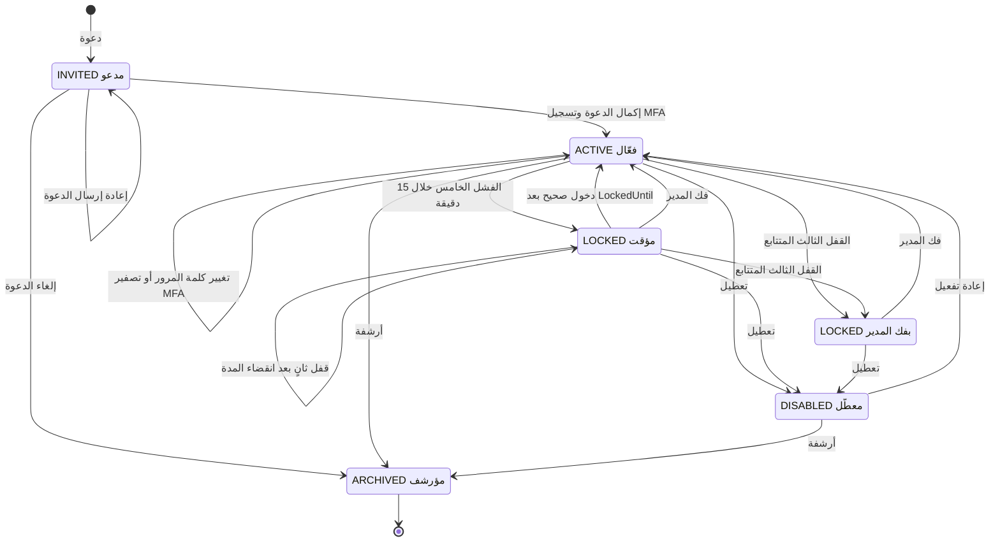

# DOC-F06 — مخطط حالات المستخدم (AppUser) مع القفل والجلسات

| البند | القيمة |
|---|---|
| المعرّف | DOC-F06 (docs/30-readiness-documents.md) |
| الإصدار | 0.1 — مسودة للمراجعة — 2026-10-12 |
| المالك المقترح | مسؤول الهوية والأمن |
| الأولوية | P0 قبل S0 |
| يغطي | FR-PLT-011، FR-PLT-012، FR-PLT-013، FR-PLT-014، FR-PLT-016، BR-PLT-005، BR-PLT-006، BR-PLT-008، O-16 وO-24 (erd_open_items) |
| يعتمد على | DOC-F03 (التسلسلات)، DOC-S04 (قيم القفل وMFA)، DOC-F04 (الربط وحالة المشترك)، DOC-F05 (المدير الأول) |
| المصادر | db/model/10-platform.model، docs/21-data-dictionary.md، db/static/030_session_context.sql، db/static/010_rls.sql، db/generated/tsql/005_delete_grants.sql، db/generated/tsql/007_table_grants.sql، db/tests/tenant_isolation_tests.sql، docs/10-detailed-analysis/10-m0-m1-platform-organization.md |

## 1. الغرض والنطاق

تحدد الوثيقة حالات sec.AppUser وانتقالاتها، ومن يملك كل انتقال، وأثره على الجلسات والربط، وحدث التدقيق الذي يسجّله. وتُختبر هذه الانتقالات آليًا قبل إعلان خروج S0.

- **داخل النطاق:** المستخدم البشري للمشترك، وحساب الخدمة (IsSystemUser) من حيث القفل فقط.
- **خارج النطاق:** حسابات المشغّل plat.PlatformOperator، فلها الحالات نفسها (db/model/10-platform.model:68) وسياستها في DOC-S04 §12. وحالة المشترك وأثرها في DOC-F04 وDOC-F05.

**الوسوم:** 🟢 موجود أو مقرر مع الملف والسطر. 🟡 اقتراح.

**اختصارات المراجع:** «030» هو db/static/030_session_context.sql، و«model» هو db/model/10-platform.model، و«005» و«007» ملفا db/generated/tsql/005_delete_grants.sql و007_table_grants.sql، و«010_rls.sql» في db/static، و«10-m0-m1-platform-organization.md» في docs/10-detailed-analysis.

## 2. الحالات وما تسمح به

القيم الخمس 🟢: INVITED وACTIVE وLOCKED وDISABLED وARCHIVED، والافتراضي INVITED (db/model/10-platform.model:122، docs/21-data-dictionary.md:215). لا توجد حالة «محذوف»: حذف الصف ليس عملية في التطبيق (§7).

| الحالة | الدخول بكلمة المرور | ربط جلسة قائمة | ما يملكه المستخدم | قيود القاعدة |
|---|---|---|---|---|
| INVITED | مرفوض بلا عدّ (030:82-83) | مرفوض (030:197) | فتح رابط الدعوة وإكمالها 🟡 | PasswordHash فارغ حتى الإكمال (model:124) |
| ACTIVE | مسموح (030:111-121) | مسموح إن سُجّل MFA (030:197-198) | كل ما تمنحه أدواره | PasswordHash إلزامي لغير حساب الخدمة (model:146) |
| LOCKED مؤقت | مرفوض DENIED_LOCKED حتى LockedUntil (030:80-81)، ثم يقبل كلمة صحيحة | مرفوض طوال بقاء الحالة (030:197) | طلب إعادة تعيين 🟡 | LockedUntil إلزامي (model:152) |
| LOCKED بفك المدير | مرفوض دائمًا حتى فك المدير (030:80) | مرفوض | طلب إعادة تعيين لا يفك القفل 🟡 | RequiresAdminUnlock = 1 (model:137) |
| DISABLED | مرفوض بلا عدّ (030:82-83) | مرفوض، والربط القائم يُسحب (030:245-256) | لا شيء | البيانات باقية |
| ARCHIVED | مرفوض بلا عدّ | مرفوض | لا شيء، نهائية | ArchivedAt إلزامي (model:151) |

ملاحظتان على المنفَّذ:

- 🟢 الحالة LOCKED لا تعود ACTIVE بمرور الوقت. تبقى حتى أول دخول صحيح بعد LockedUntil (030:113-114). فكل جلسات المستخدم المفتوحة غير قابلة للربط في هذه المدة.
- 🟢 ACTIVE مع MfaEnabled = 0 تُربط جلستها بلا MFA (030:198). تقع هذه الحالة بعد تصفير MFA، والاقتراح في DOC-F03 (DQ-F03-4).

## 3. مخطط الحالات

القفلان المؤقت وبفك المدير قيمة واحدة في العمود Status هي LOCKED، ويفرّق بينهما RequiresAdminUnlock (db/model/10-platform.model:137).

## 4. جدول الانتقالات

الفاعل TA هو مدير الحساب. صلاحية إدارة المستخدمين له وحده (10-m0-m1-platform-organization.md:45). رموز الصلاحيات وأحداث التدقيق المقترحة 🟡 في §8.

| # | الانتقال | الفاعل والصلاحية | الأثر في القاعدة | الجلسات والربط | حدث التدقيق |
|---|---|---|---|---|---|
| 1 | بداية إلى INVITED | TA بـ sec.user.manage، أو المشغّل للمدير الأول (DOC-F05) | صف بحالة INVITED ورابط INVITATION لمدة 48 ساعة 🟢 ممكن بالمنح (007:24 و44) | لا جلسات | USER_INVITED، وINVITATION_SEND_FAILED عند فشل الإرسال |
| 2 | INVITED إلى INVITED | TA بـ sec.user.manage | RevokedAt للرابط القديم ورابط جديد 🟡 | لا شيء | INVITATION_RESENT |
| 3 | INVITED إلى ACTIVE | المدعو نفسه | sec.usp_CompleteInvitation 🟡 (DOC-F03 §8) | لا جلسة قبل الدخول الأول | INVITATION_ACCEPTED وMFA_ENROLLED |
| 4 | INVITED إلى ARCHIVED | TA بـ sec.user.manage | ArchivedAt وإلغاء الروابط 🟡 | لا شيء | USER_ARCHIVED |
| 5 | ACTIVE إلى LOCKED مؤقت | النظام داخل usp_StartSession | 🟢 030:94-103 | 🟢 الربط يُسحب (030:245-256) | 🟢 LOCKOUT في sec.LoginAttempt (030:127-129)، و🟡 في aud.AuditLog |
| 6 | إلى LOCKED بفك المدير | النظام عند القفل الثالث | 🟢 RequiresAdminUnlock = 1 (030:100) | كما في 5 | LOCKOUT بشدة عالية 🟡 وإشعار SEC.LOCKOUT للمدير (10-m0-m1-platform-organization.md:532) |
| 7 | LOCKED مؤقت إلى ACTIVE | المستخدم بدخول صحيح بعد LockedUntil | 🟢 030:113-114 | الجلسات القديمة غير المنتهية تُربط من جديد | 🟢 LOGIN_SUCCESS |
| 8 | LOCKED إلى ACTIVE | TA بـ sec.user.manage | تصفير الحقول الستة في §5 🟡؛ 🟢 ممكن بالمنح (007:24) | لا أثر | ACCOUNT_UNLOCKED |
| 9 | ACTIVE أو LOCKED إلى DISABLED | TA بـ sec.user.manage | Status = DISABLED؛ مرفوض لآخر مدير حساب فعّال (FR-PLT-016) | 🟢 الربط يُسحب (030:245-256، T25)؛ 🟡 الجلسات تنتهي USER_DISABLED | USER_DISABLED وحدث user.disabled (10-m0-m1-platform-organization.md:569) |
| 10 | DISABLED إلى ACTIVE | TA بـ sec.user.manage | Status = ACTIVE؛ يشترط PasswordHash (model:146) | الجلسات القديمة تبقى منتهية 🟡 | USER_ENABLED |
| 11 | ACTIVE أو DISABLED إلى ARCHIVED | TA بـ sec.user.manage | ArchivedAt (model:151)؛ قاعدة آخر مدير | 🟢 الربط يُسحب؛ 🟡 الجلسات تنتهي USER_DISABLED | USER_ARCHIVED |
| 12 | ACTIVE إلى ACTIVE بتغيير كلمة المرور | المستخدم بإثبات الكلمة الحالية 🟡 | PasswordHash وسجل الكلمات (DOC-S04 §5) | 🟡 تنتهي الجلسات الأخرى PASSWORD_CHANGED | PASSWORD_CHANGED |
| 13 | ACTIVE إلى ACTIVE بإعادة التعيين | المستخدم برابط 30 دقيقة | sec.usp_ResetPassword 🟡 | 🟡 تنتهي كل الجلسات PASSWORD_CHANGED | PASSWORD_RESET_COMPLETED |
| 14 | ACTIVE إلى ACTIVE بتصفير MFA | TA بـ sec.user.manage بعد إعادة مصادقته | MfaEnabled = 0 وحذف السر والرموز (007:42، 005:13) | تنتهي كل الجلسات MFA_RESET | MFA_RESET بشدة عالية (BR-PLT-009) وإشعار SEC.MFA_RESET |

القفل يُسجَّل في sec.LoginAttempt، وينسخه قادح إلى aud.AuditLog منذ ADR 0007 (DQ-F03-10)، وكذلك فك القفل وتغيير الحالة وإعادة MFA التي يكتبها إجراء كل منها.

## 5. عداد القفل

| العمود | يكتبه | متى | المرجع |
|---|---|---|---|
| FailedAttempts | usp_StartSession | كل كلمة خاطئة لمستخدم ACTIVE أو LOCKED بعد انقضاء القفل؛ يُصفَّر عند القفل والنجاح | 🟢 030:90-93 و98 و114 |
| FirstFailedAt | usp_StartSession | بداية نافذة 15 دقيقة؛ فشل بعد انقضائها يبدأ نافذة جديدة | 🟢 030:90-91 |
| LockedUntil | usp_StartSession | الآن مع 15 دقيقة عند الفشل الخامس؛ يُفرَّغ عند النجاح | 🟢 030:98 و114 |
| LockoutCount | usp_StartSession | يزيد إن كان القفل السابق خلال 24 ساعة، وإلا يعود 1 | 🟢 030:96 و99 |
| LastLockoutAt | usp_StartSession | وقت كل قفل | 🟢 030:99 |
| RequiresAdminUnlock | usp_StartSession يضعه، وTA يرفعه | يصير 1 عند LockoutCount = 3 | 🟢 030:100؛ 🟡 الرفع |

ملاحظات:

- 🟢 ثالث قفل منفّذ كسلسلة: كل قفل خلال 24 ساعة من سابقه (030:96). هذا أشد من نص BR-PLT-005 لأنه قد يمتد أكثر من 24 ساعة. يقترح DOC-S04 §7 قبوله وتعديل نص القاعدة.
- 🟢 الكلمة الخاطئة لمستخدم INVITED أو DISABLED أو ARCHIVED لا تُعدّ (030:82-83).
- 🟢 حساب الخدمة بلا كلمة مرور يدخل فرع العدّ (030:85) فيُقفل، ثم يُسحب ربطه بالمحفّز (030:245-256). 🟡 يُستثنى من العدّ (DQ-F03-9).
- 🟡 فك المدير يكتب: Status = ACTIVE، LockedUntil = NULL، FailedAttempts = 0، FirstFailedAt = NULL، LockoutCount = 0، RequiresAdminUnlock = 0.

## 6. أثر الانتقالات على الجلسات والربط

### 6.1 محفّزات السحب في 030

| المحفّز | يعمل عند | يحذف | الاختبار |
|---|---|---|---|
| sec.TR_AppUser_RevokeBinding | تغيّر Status إلى غير ACTIVE | ربط هذا المستخدم | 🟢 030:245-256، T25 |
| sec.TR_AppUser_RevokeBindingOnDelete | حذف صف المستخدم | ربطه | 🟢 030:258-267، T30 |
| sec.TR_UserSession_RevokeBinding | حذف جلسة أو تعيين EndedAt | كل ربط المستخدم نفسه | 🟢 030:269-283، T37 |
| plat.TR_Tenant_RevokeBinding | حالة المشترك غير TRIAL وACTIVE | كل ربط المشترك | 🟢 030:285-296، T26 |

المحفّزات تحذف الربط ولا تنهي الجلسات. الربط يتجدد لكل طلب، فالجلسة التي لم تنتهِ تُربط من جديد متى عاد المستخدم ACTIVE.

### 6.2 أسباب إنهاء الجلسة

القيم الثماني 🟢 في db/model/10-platform.model:229 وdocs/21-data-dictionary.md:396.

| EndReason | المُطلِق | من يكتبه اليوم | الاقتراح |
|---|---|---|---|
| LOGOUT | المستخدم | التطبيق بتحديث EndedAt في مشترك TRIAL أو ACTIVE فقط | 🟡 sec.usp_EndSession لكل الحالات (DQ-F03-6) |
| IDLE_TIMEOUT | الوقت | لا أحد؛ الربط يرفض المنتهية (030:196) | 🟡 مهمة تنظيف (DOC-F04) |
| ABSOLUTE_TIMEOUT | الوقت | لا أحد | 🟡 المهمة نفسها |
| TERMINATED_BY_ADMIN | TA | التطبيق، والأثر فوري (T37) | 🟡 بصلاحية sec.user.manage |
| PASSWORD_CHANGED | المستخدم | لا أحد | 🟡 داخل إجراءات كلمة المرور (DOC-S04 §5) |
| MFA_RESET | TA | لا أحد | 🟡 داخل عملية التصفير |
| USER_DISABLED | TA | لا أحد؛ الربط وحده يُسحب | 🟡 الانتقالات 9 و11 (DQ-F06-1) |
| TENANT_SUSPENDED | المشغّل أو مهمة التجربة | لا أحد | DOC-F05 |

## 7. قواعد الحماية

| القاعدة | الحالة | المرجع |
|---|---|---|
| لا يُعطَّل ولا يُؤرشف آخر مدير حساب فعّال | 🟢 قاعدة، 🟡 تُفرض في الخدمة | FR-PLT-016 وBR-PLT-008 (10-m0-m1-platform-organization.md:118 و:234) |
| لا يعطّل المدير نفسه ولا يفك قفله ولا يصفّر MFA الخاص به | 🟡 | يمنع تجاوز التحقق |
| حساب الخدمة لا يُدعى ولا يُعطَّل من الشاشة | 🟡 | model:123 و150 |
| مدير الحساب الوحيد إذا قُفل بفك المدير أو فقد جهازه يمر بمسار المشغّل بطلب خطي من المشترك | 🟡 | O-12 (20-database-design)، DQ-F06-4 |
| حذف صف المستخدم غير متاح للتطبيق | 🟢 | sec.AppUser ليس في منح الحذف (db/generated/tsql/005_delete_grants.sql:11-15) |
| حذف الصف بيد مالك المخطط يسحب الربط | 🟢 | 030:258-267، T30 |
| كل كتابة على sec.AppUser من التطبيق تشترط مشتركًا TRIAL أو ACTIVE | 🟢 | 010_rls.sql:34-49 |

## 8. الصلاحيات وأحداث التدقيق المقترحة 🟡

لا رمز صلاحية لإدارة المستخدمين في وثائق التحليل، والكتالوج تملكه وحدة المنصة (FR-PLT-017). يقترح DOC-F07 رمزًا واحدًا sec.user.manage لدور TA يغطي الدعوة والتعطيل والأرشفة وفك القفل وتصفير MFA وإنهاء الجلسات. تتبعه هذه الوثيقة في كل الانتقالات من 1 إلى 14 التي يملكها TA، وتضيف شرطين:

- تصفير MFA وفك القفل الثالث يتطلبان إعادة مصادقة TA (DOC-S04 §11).
- فصل هذه الأفعال في رموز مستقلة قرار مفتوح (DQ-F06-3).

أحداث aud.AuditLog المقترحة (العمود Action، db/model/10-platform.model:309):

| الفئة | الأحداث | الشدة |
|---|---|---|
| IDENTITY_ACCESS | USER_INVITED، INVITATION_RESENT، INVITATION_ACCEPTED، USER_ENABLED، USER_DISABLED، USER_ARCHIVED | INFO |
| SECURITY | LOGIN_SUCCESS، MFA_VERIFIED، LOGOUT، SESSION_TERMINATED، PASSWORD_CHANGED، PASSWORD_RESET_COMPLETED، MFA_ENROLLED | INFO |
| SECURITY | LOCKOUT الثالث، ACCOUNT_UNLOCKED، MFA_RESET، INVITATION_SEND_FAILED | HIGH |

## 9. الاختبارات

| الاختبار | ما يثبته | الحالة (حالات db/tests/tenant_isolation_tests.sql بأرقامها) |
|---|---|---|
| T18 | جلسة مستخدم معطّل لا تُربط | 🟢 موجود ويمر في CI |
| T25 | التعطيل يسحب الربط | 🟢 موجود ويمر في CI |
| T30 | حذف الصف يسحب الربط | 🟢 موجود ويمر في CI |
| T34 | خمس محاولات تقفل والكلمة الصحيحة ترفض | 🟢 موجود ويمر في CI |
| T36 | لا ربط قبل تسجيل MFA | 🟢 موجود ويمر في CI |
| T37 | إنهاء الجلسة يسحب الربط | 🟢 موجود ويمر في CI |
| T-F06-1 | القفل الثالث يضع RequiresAdminUnlock، والكلمة الصحيحة بعد LockedUntil ترفض | 🟡 |
| T-F06-2 | دخول صحيح بعد LockedUntil يعيد ACTIVE ويصفّر العداد | 🟡 |
| T-F06-3 | كلمة خاطئة لمستخدم INVITED أو DISABLED لا تزيد العداد | 🟡 |
| T-F06-4 | حساب الخدمة لا يُقفل بمحاولات خاطئة | 🟡 بعد DQ-F03-9 |
| T-F06-5 | تعطيل آخر مدير حساب فعّال يُرفض | 🟡 اختبار خدمة |
| T-F06-6 | تعطيل ثم إعادة تفعيل لا يُحيي جلسة قديمة | 🟡 بعد DQ-F06-1 |

«يمر في CI» يعني tools/ci/db_ci.sh (41 حالة عزل، T1-T38) في حاوية التطوير وعلى GitHub، وأول تشغيل أخضر هناك في 2026-10-12 (O-02 في tools/dbgen/erd_open_items.py:22).

## 10. القرارات المطلوبة

| المعرّف | السؤال | الافتراض المقترح | من يقرر | ما يعطّله |
|---|---|---|---|---|
| DQ-F06-1 | هل ينهي التعطيل والأرشفة الجلسات المفتوحة؟ | نعم: EndedAt بسبب USER_DISABLED في معاملة تغيير الحالة نفسها، والمحفّزات تبقى لحذف الربط؛ يتفق مع DQ-F04-9 | مسؤول الهوية والأمن | FR-PLT-016، T-F06-6 |
| DQ-F06-2 | جلسات المستخدم المقفل | تبقى كما نُفّذ: لا تُربط أثناء LOCKED وتعود بعد دخول صحيح | مسؤول الهوية والأمن | لا شيء إن قُبل |
| DQ-F06-3 | هل تُفصل صلاحيات فك القفل وتصفير MFA وإنهاء الجلسات عن sec.user.manage؟ | ✅ معتمد من المالك (2026-10-12): لا: رمز واحد كما في DOC-F07، مع إعادة مصادقة للفعلين الحساسين | مالك المنتج | البذر (DOC-B05)، الشاشة 5 |
| DQ-F06-4 | مدير الحساب الوحيد مقفل أو فقد جهازه | ✅ معتمد من المالك (2026-10-12): إجراء منصة مُراجَع ينفّذه المشغّل بطلب خطي من المشترك | المالك | O-12 (20-database-design) |
| DQ-F06-5 | دعوة منتهية | ✅ معتمد من المالك (2026-10-12): تبقى INVITED، ويعيد المدير الإرسال أو يؤرشف؛ لا أرشفة آلية | مالك المنتج | FR-PLT-013 |
| DQ-F06-6 | إشعار القفل الثالث وتصفير MFA في S0، والتسليم داخل المنصة يبدأ في S1 | ✅ معتمد من المالك (2026-10-12): في S0 تظهر في شاشة المستخدمين وتقرير R-PLT-4 | مالك المنتج | §9.3 من 10-m0-m1 |
| DQ-F06-7 | سبب إنهاء الجلسة عند الأرشفة | يُستعمل USER_DISABLED بلا قيمة جديدة | معماري القاعدة | لا شيء |

## 11. تعارضات وفجوات في المصادر

| البند | الموضع | الملاحظة |
|---|---|---|
| أسباب الإنهاء في السجل | docs/30-readiness-documents.md:111 | يعدّ سبعة أسباب، والنموذج ثمانية مع TENANT_SUSPENDED (model:229) |
| عودة القفل تلقائيًا | docs/10-detailed-analysis/10-m0-m1-platform-organization.md:483 | «تعود Active بانقضاء المدة»، والمنفّذ يعيدها عند أول دخول صحيح فقط (030:113-114) |
| قفل حساب الخدمة | db/static/030_session_context.sql:85 | حساب بلا كلمة مرور يُعدّ ويُقفل؛ docs/20-database-design.md:97 تصفه بلا كلمة مرور ولا ربط ولا تذكر أنه قابل للقفل |
| MFA غير مفروضة في القاعدة للمستخدم | db/model/10-platform.model:146-154 | لا قيد `Status <> 'ACTIVE' OR MfaEnabled = 1` كما في المشغّل (model:82)، والربط يقبل MfaEnabled = 0 (030:198) |
| الإنهاء والربط | db/static/030_session_context.sql:241-243 | التعليق يقول إن الربط ينتهي، ولا شيء ينهي الجلسة نفسها عند التعطيل |
| الإشعار عند كل قفل | docs/10-detailed-analysis/10-m0-m1-platform-organization.md:403 و:532 | الأول يشعر عند بلوغ الحد، والثاني عند القفل الثالث فقط |

## 12. التتبع

| البند في هذه الوثيقة | المتطلب أو القاعدة أو القرار | المصدر |
|---|---|---|
| §2 و§3 | FR-PLT-016، §8 من 10-m0-m1 | db/model/10-platform.model:122، 10-m0-m1-platform-organization.md:483 |
| §4 الانتقالات 1-4 | FR-PLT-013 | db/model/10-platform.model:244-258 |
| §4 الانتقالات 5-8 و§5 | FR-PLT-012، BR-PLT-005 | 030:78-121، T34 |
| §4 الانتقال 14 | BR-PLT-006، BR-PLT-009 | 10-m0-m1-platform-organization.md:232 و:235 |
| §6 | FR-PLT-014، O-16 (erd_open_items) | 030:241-296 |
| §7 | FR-PLT-016، BR-PLT-008، BR-PLT-002 | 10-m0-m1-platform-organization.md:118 و:234، 010_rls.sql:34-49 |
| §8 | FR-PLT-017، FR-PLT-022 | 10-m0-m1-platform-organization.md:119 و:124 |
