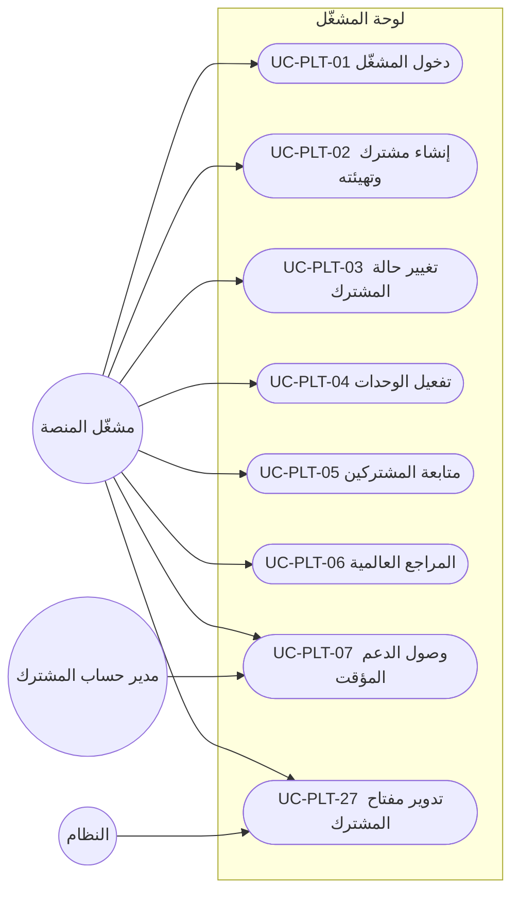
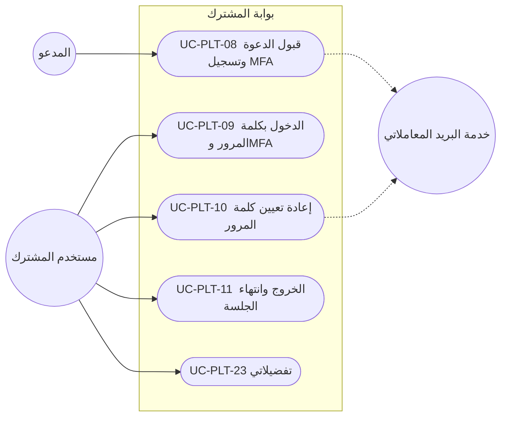
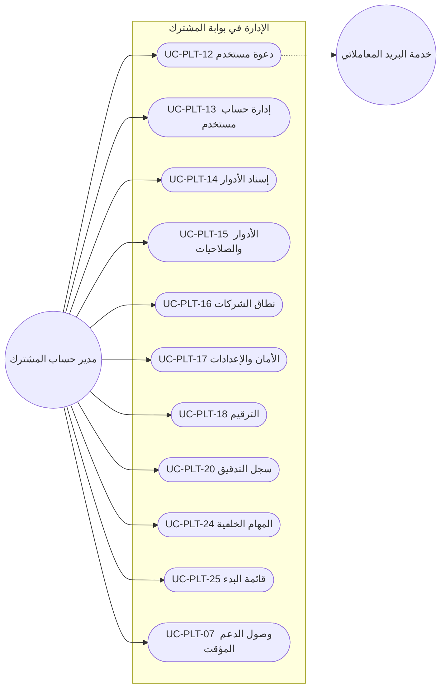
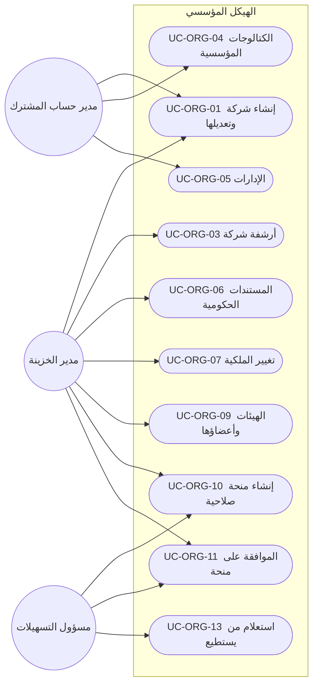
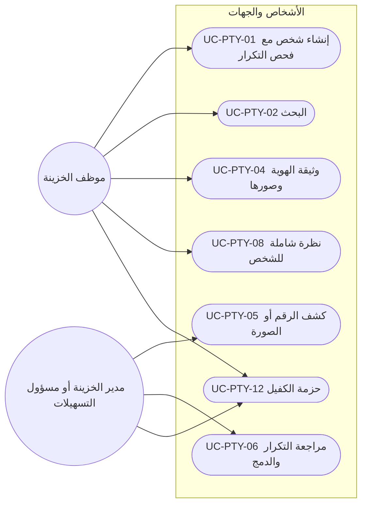
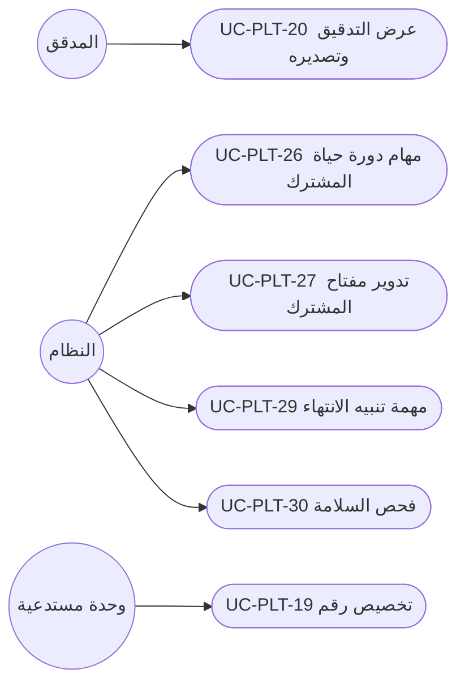

# DOC-F07 — كتالوج حالات الاستخدام: المنصة والهيكل المؤسسي والأشخاص (M0 وM1)

| البند | القيمة |
|---|---|
| المعرّف | DOC-F07 (docs/30-readiness-documents.md) |
| الإصدار | 0.1 — مسودة للمراجعة — 2026-10-12 |
| المالك المقترح | محلل الأعمال مع مالكي الوحدات |
| الأولوية | P0 قبل S0 لقسم M0، وقبل S1 لقسم M1 |
| يغطي | FR-PLT-001…047، FR-ORG-001…031، FR-PTY-001…029، BR-PLT-001…019، BR-ORG-001…016، BR-PTY-001…019 |
| يعتمد على | DOC-F01 (الفاعلون)، DOC-F03 (الدخول)، DOC-F04 (ربط السياق)، DOC-F05 (التهيئة)، DOC-F06 (حالات المستخدم)، DOC-B02، DOC-B04 |
| المصادر | docs/10-detailed-analysis/10-m0-m1-platform-organization.md، docs/10-detailed-analysis/00-overview-and-cross-cutting.md، db/model/10-platform.model، db/static/030_session_context.sql، docs/adr/0002-login-and-session-bound-context.md، docs/20-database-design.md |

> **تحديث التنفيذ (2026-10-12):** الصلاحيات في §3 مبذورة في db/seed/102_permissions.sql مع رموز DOC-F09، 138 رمزًا (DQ-F07-1). والترقيم في UC-PLT-18 وUC-PLT-19 منفّذ في القاعدة (docs/adr/0005-document-numbering-and-reference-seeds.md): `cfg.usp_AllocateNumber` داخل معاملة الكتابة بلا فجوات، و`cfg.usp_VoidNumber` بسبب إلزامي، وفحص النمط عند حفظ التعريف (50031)؛ وتمر الاختبارات N1 إلى N8 وفحص التزامن في CI.

## 1. الغرض والنطاق

يعطي هذا الكتالوج معرّفًا ثابتًا لكل حالة استخدام في M0 (المنصة) وM1 (الهيكل المؤسسي والأشخاص). تستشهد بهذه المعرّفات سيناريوهات القبول (DOC-B02) والشاشات (DOC-B07) والاختبارات.

- حالات S0 مكتملة: الفاعل، الشروط المسبقة واللاحقة، المسار الرئيسي مرقّمًا، المسارات البديلة والأخطاء، المتطلبات والقواعد، الشريحة، رمز الصلاحية.
- حالات S1 وS1-ب وما بعدها مختصرة في جداول.
- التسلسلات التفصيلية ليست هنا: الدخول وMFA والاسترداد في DOC-F03، وربط السياق في DOC-F04، والتهيئة والتراجع في DOC-F05، وحالات المستخدم في DOC-F06.

**قواعد تسري على كل حالة ولا تتكرر فيها:**

- ترتيب التقييم: حالة المشترك، ثم المصادقة، ثم الصلاحية، ثم نطاق الشركات، ثم قواعد السجل؛ والرفض هو الأصل. بلا صلاحية 403، وخارج النطاق 404 🟢 (FR-PLT-021، docs/10-detailed-analysis/10-m0-m1-platform-organization.md:123).
- كل إجراء يكتب حدث تدقيق بمحتوى FR-PLT-023، والقيم المقيّدة مقنَّعة (BR-PLT-009).
- كل وظيفة متاحة عبر REST موثّق (FR-PLT-041)، وكل جدول مملوك للمشترك معزول بـ RLS (FR-PLT-036).
- وحدة معطّلة تختفي من الواجهة وتعيد 403 (FR-PLT-003).

## 2. الفاعلون

القائمة المرجعية للفاعلين وحدود الثقة في DOC-F01 §3، وعمود DOC-F01 يذكر معرّف الفاعل هناك.

| الفاعل | الرمز | DOC-F01 | الهوية والمصدر |
|---|---|---|---|
| مشغّل المنصة | PO | A-06، وA-07 في جلسة الدعم | حساب في plat.PlatformOperator بدور OPERATOR_ADMIN أو OPERATOR_SUPPORT (db/model/10-platform.model:64-67) |
| مستخدم المشترك | — | A-01 إلى A-04 | حساب في sec.AppUser بأي دور (db/model/10-platform.model:113) |
| المدعو | — | A-01 إلى A-04 قبل التفعيل | sec.AppUser بحالة INVITED (db/model/10-platform.model:122) |
| مدير حساب المشترك | TA | A-01 | دور نظام (docs/10-detailed-analysis/10-m0-m1-platform-organization.md:41) |
| مدير الخزينة · مسؤول التسهيلات | TM · FO | A-02 | دورا نظام؛ يحملان الصلاحيات المقفلة 🔒 |
| موظف الخزينة | TE | A-03 | دور نظام |
| المدقق | AU | A-04 | دور قراءة |
| النظام | SYS | A-05 | مهام خلفية بحساب الخدمة IsSystemUser (db/model/10-platform.model:123) |
| خدمة البريد المعاملاتي | — | A-09 | فاعل ثانوي لرسالتي الدعوة وإعادة التعيين فقط (FR-PLT-013) |

## 3. رموز الصلاحيات

مصفوفة الأدوار في 10-m0-m1 تسمّي سبعة رموز فقط، وبقية الصفوف بلا رمز (docs/10-detailed-analysis/10-m0-m1-platform-organization.md:43-67). الرموز 🟡 أدناه مقترحة بنمط بقية الوحدات (`<وحدة>.<كائن>.<فعل>`) وتُسجَّل تحت ModuleCode = CORE. اعتمادها قرار DQ-F07-1.

| الرمز | الحالة | الأدوار الافتراضية | صف المصفوفة |
|---|---|---|---|
| OPERATOR_ADMIN / OPERATOR_SUPPORT | 🟢 دور مشغّل لا صلاحية مشترك (FR-PLT-006) | PO | 1، 2 |
| `sec.user.manage` | 🟡 | TA | 3 |
| `sec.role.manage` | 🟡 | TA | 3 |
| `sec.support.grant` | 🟡 | TA | — (FR-PLT-007) |
| `cfg.settings.manage` | 🟡 | TA؛ TM ◐ للعتبات | 4 |
| `cfg.numbering.manage` | 🟡 | TA | 4 |
| `cfg.alerts.manage` | 🟡 | TA، TM | 4 |
| `cfg.jobs.view` | 🟡 | TA | — (FR-PLT-044) |
| `audit.view` | 🟢 | TA، AU | 5 |
| `audit.view.treasury` | 🟢 | TM | 5 |
| `audit.export` | 🟡 | TA، AU | 6 |
| `org.company.manage` | 🟡 | TA، TM؛ FO ◐ | 7 |
| `org.company.view` | 🟡 | الجميع ضمن النطاق | 8 |
| `org.catalog.manage` | 🟡 | TA، TM | 7 |
| `org.ownership.manage` | 🟡 | TM، FO | 9 |
| `org.body.manage` | 🟡 | TM، FO | 10 |
| `org.grant.create` | 🟡 | TM، FO | 11 |
| `org.grant.approve` | 🟡 | TM، FO (غير المنشئ) | 12 |
| `org.document.manage` | 🟡 | TM، FO؛ TA وTE ◐ | 13 |
| `org.document.view` | 🟡 | ضمن النطاق | 14 |
| `party.manage` | 🟡 | TM، FO؛ TE ◐ | 15 |
| `party.field.manage` | 🟡 | TM، FO | — (FR-PTY-013) |
| `party.identity.write` | 🟡 | TM، FO؛ TE ◐ إضافة فقط (Q-PTY-10) | 16 |
| `party.view` | 🟡 | TM، FO، TE؛ AU ◐ | 17 |
| `party.identity.reveal` 🔒 | 🟢 | TM، FO | 18 |
| `party.identity.image.view` 🔒 | 🟢 | TM، FO | 19 |
| `party.pack.export` 🔒 | 🟢 | TM، FO | 20 |
| `party.pack.draft` | 🟡 | TM، FO، TE | 21 |
| `party.merge` | 🟢 | TM، FO | 22 |
| `party.kyc.manage` | 🟡 | TM، FO | 23 |
| `party.export` / `party.export.sensitive` 🔒 | 🟡 / 🟢 | TM، FO | 24 |
| `cfg.export.request` / `cfg.retention.approve` | 🟡 | TA؛ TM وFO ◐ | 25 |

## 4. مخططات حالات الاستخدام

### 4.1 المشغّل

### 4.2 مستخدم المشترك قبل الدخول وبعده

### 4.3 مدير حساب المشترك

### 4.4 الخزينة: الهيكل المؤسسي (M1 ORG)

### 4.5 الخزينة: الأشخاص والجهات (M1 PTY)

### 4.6 المدقق والنظام

## 5. حالات استخدام M0 في S0 (مكتملة)

### UC-PLT-01 — دخول المشغّل إلى لوحة المشغّل

- **الفاعل · الشريحة · الصلاحية:** مشغّل المنصة · S0 · دور OPERATOR_ADMIN أو OPERATOR_SUPPORT
- **قبل:** حساب plat.PlatformOperator بحالة ACTIVE وMFA مفعّل (قيد db/model/10-platform.model:82).
- **بعد:** جلسة مشغّل مؤكَّدة MFA؛ حدث تدقيق بـ ActorType = OPERATOR وTenantId فارغ (db/model/10-platform.model:307).
- **يغطي:** FR-PLT-006، FR-PLT-010، FR-PLT-011، FR-PLT-012، BR-PLT-005

1. يفتح المشغّل عنوان لوحة المشغّل، وهو عنوان منفصل عن عناوين المشتركين 🟡 (DQ-F01-2، DOC-B07 §4.1).
2. يُدخل البريد وكلمة المرور.
3. يتحقق النظام من كلمة المرور بتجزئة Argon2id (ADR 0002).
4. يطلب النظام رمز TOTP ويتحقق منه.
5. تُنشأ الجلسة وتفتح قائمة المشتركين (UC-PLT-05).

**بديل وخطأ:**
- 3أ. أي فشل يعيد رسالة واحدة. سياسة كلمة المرور والقفل والجلسة للمشغّل في DOC-S04 §12؛ والجدول فيه FailedAttempts وLockedUntil فقط (db/model/10-platform.model:76-77).
- 1أ. حساب مشغّل على عنوان مشترك، أو مستخدم مشترك على عنوان المشغّل: يُرفض (FR-PLT-006).
- ملاحظة: لا يوجد إجراء دخول للمشغّل في القاعدة؛ إجراءات 030 تخص sec.AppUser فقط (db/static/030_session_context.sql:3-17). القرار في DQ-S04-10 وDQ-B04-7.

### UC-PLT-02 — إنشاء مشترك وتهيئته

- **الفاعل · الشريحة · الصلاحية:** مشغّل المنصة · S0 · OPERATOR_ADMIN
- **قبل:** البذور العالمية منشورة (DOC-B05)، وباقة فعّالة في plat.Plan.
- **بعد:** مشترك بحالة TRIAL ونهاية تجربة بعد 30 يومًا، وعنوان `{code}.bankfas.com`، وحساب خدمة، ومدير حساب أول بحالة INVITED، وبذور مسجّلة في cfg.SeedRun.
- **يغطي:** FR-PLT-001، FR-PLT-003، FR-PLT-008، FR-PLT-013، FR-PLT-046، BR-PLT-002، BR-PLT-003

1. يختار المشغّل «إنشاء مشترك» ويُدخل الرمز والاسمين والباقة والدولة الأم واللغة الافتراضية (en افتراضيًا، db/model/10-platform.model:39) والتوقيت.
2. يتحقق النظام من الرمز: لاتيني وأرقام وشرطة، فريد، وغير محجوز في plat.ReservedSubdomain.
3. يراجع المشغّل الوحدات المقترحة من الباقة ويعدّلها (UC-PLT-04).
4. يُدخل بريد مدير الحساب الأول.
5. يعتمد المشغّل النموذج بعد إعادة مصادقة MFA (DQ-F05-2)، فينفّذ النظام التهيئة: صف المشترك، حساب الخدمة، المدير الأول، ثم حزم البذور لكل وحدة مفعّلة (FR-PLT-008). تقسيم المعاملات والاستئناف في DOC-F05 (DQ-F05-1).
6. يُرسل النظام الدعوة (48 ساعة) بالبريد المعاملاتي.
7. يُسجَّل الحدث في التدقيق وطابور الإرسال.

**بديل وخطأ:**
- 2أ. رمز مكرر أو محجوز: يُرفض بذكر السبب.
- 5أ. فشل أي خطوة: لا مشترك نصف مهيّأ يُتاح للدخول، وإعادة التشغيل تستأنف ولا تكرر البذر. التفصيل في DOC-F05.
- 6أ. فشل الإرسال: SendStatus = FAILED ويُسجَّل في التدقيق (db/model/10-platform.model:252)، ويعيد المشغّل الإرسال من تفاصيل المشترك.
- ملاحظة: إجراء التهيئة خطة لم تُنفَّذ (docs/20-database-design.md:470-475)، وtp_platform لا يصل إلى جداول المشترك (docs/20-database-design.md:24)، فيلزم إجراء منصة مُراجَع: O-12 (20-database-design).

### UC-PLT-03 — تغيير حالة المشترك

- **الفاعل · الشريحة · الصلاحية:** مشغّل المنصة · S0 · OPERATOR_ADMIN
- **قبل:** المشترك موجود وليس ARCHIVED_READ_ONLY.
- **بعد:** الحالة الجديدة مسجّلة بالسبب والفاعل؛ حدث `tenant.status_changed`.
- **يغطي:** FR-PLT-002، FR-PLT-005، BR-PLT-002

1. يختار المشغّل المشترك والإجراء: تفعيل، تمديد التجربة، تعليق، إعادة تفعيل، إغلاق.
2. يكتب السبب (إلزامي للتعليق، db/model/10-platform.model:53).
3. يتحقق النظام من أن الانتقال مسموح بمخطط Tenant (docs/10-detailed-analysis/10-m0-m1-platform-organization.md:454-465).
4. يحفظ الحالة بإجراء منصة واحد (DQ-F05-5)، ويسجّل ClosedAt عند الإغلاق.
5. يسحب القادح ربط الاتصالات لكل حالة غير TRIAL وACTIVE (db/static/030_session_context.sql:285).
6. يُسجَّل التدقيق والحدث.

**بديل وخطأ:**
- 3أ. انتقال غير مسموح (مثل Closed إلى Active): يُرفض.
- 5أ. من يدخل مشتركًا SUSPENDED قرار مفتوح: O-18 (erd_open_items). التفصيل في DOC-F04.

### UC-PLT-04 — تفعيل الوحدات وتعطيلها لمشترك

- **الفاعل · الشريحة · الصلاحية:** مشغّل المنصة · S0 · OPERATOR_ADMIN
- **قبل:** المشترك ليس CLOSED ولا ARCHIVED_READ_ONLY.
- **بعد:** صف plat.TenantModule محدَّث بـ EnabledBy؛ قائمة المشترك تعكسه.
- **يغطي:** FR-PLT-003، FR-PLT-008، BR-PLT-003

1. يفتح المشغّل تبويب الوحدات في تفاصيل المشترك.
2. يفعّل وحدة أو يعطّلها.
3. يتحقق النظام من الاعتماديات (docs/10-detailed-analysis/00-overview-and-cross-cutting.md:232-246).
4. يحفظ الصف، وعند التفعيل يشغّل بذرة الوحدة.
5. يقرأ تطبيق المشترك الوحدات من العرض plat.v_TenantModule (db/static/025_tenant_views.sql:22) فتظهر الوحدة أو تختفي.

**بديل وخطأ:**
- 3أ. تعطيل CORE: يُرفض (قيد db/model/10-platform.model:96).
- 3ب. تفعيل وحدة اعتمادياتها معطّلة، أو تعطيل وحدة تعتمد عليها وحدة مفعّلة: يُرفض بقائمة الوحدات المعنية.

### UC-PLT-05 — متابعة المشتركين والاستخدام

- **الفاعل · الشريحة · الصلاحية:** مشغّل المنصة · S0 · OPERATOR_ADMIN أو OPERATOR_SUPPORT
- **قبل:** جلسة مشغّل (UC-PLT-01).
- **بعد:** لا تغيير؛ القراءة لا تلمس بيانات أعمال المشترك.
- **يغطي:** FR-PLT-004، FR-PLT-005

1. يعرض النظام قائمة المشتركين: الرمز، الاسم، الباقة، الحالة، عدّادات المستخدمين والشركات والتخزين، نهاية التجربة.
2. يصفّي المشغّل بالحالة أو الباقة.
3. يفتح تفاصيل مشترك: الوحدات، المدير الأول، إصدارات البذور، جلسات الدعم.

**بديل وخطأ:**
- 1أ. بلوغ 90% من حد ناعم: علامة تنبيه للمشغّل ولمدير الحساب، ولا منع (FR-PLT-004).
- ملاحظة: العدّادات تحتاج قراءة جداول المشترك، وtp_platform لا يصل إليها (docs/20-database-design.md:24). الاقتراح 🟡: إجراء تجميع مُراجَع يعيد أعدادًا فقط، ضمن O-12 (20-database-design).

### UC-PLT-06 — إدارة المراجع العالمية

- **الفاعل · الشريحة · الصلاحية:** مشغّل المنصة · S0 · OPERATOR_ADMIN
- **قبل:** جلسة مشغّل.
- **بعد:** صفوف عالمية محدَّثة بحدث تدقيق بـ TenantId فارغ.
- **يغطي:** FR-PLT-017 (عرض الكتالوج)، FR-PLT-035 (بيانات العطل)، BR-PLT-001، BR-PLT-014

1. يختار المشغّل القائمة: الباقات، الدول وعطلة الأسبوع، العملات، العطل الرسمية، كتالوج الصلاحيات.
2. يضيف صفًا أو يعدّله.
3. يحفظ النظام عبر tp_platform وحده (docs/20-database-design.md:72).

**بديل وخطأ:**
- 2أ. كتالوج الصلاحيات للعرض فقط؛ يتحدّث مع الإصدارات (FR-PLT-017).
- 2ب. عطلة المنصة (TenantId فارغ) للقراءة فقط عند المشتركين (BR-PLT-001).

### UC-PLT-07 — منح وصول الدعم المؤقت واستعماله

- **الفاعل · الشريحة · الصلاحية:** مدير حساب المشترك ثم المشغّل · S0 (Should) · `sec.support.grant` 🟡 للمنح، وOPERATOR_SUPPORT للاستعمال
- **قبل:** وصول الدعم معطّل افتراضيًا (Q-PLT-06).
- **بعد:** صف plat.SupportAccessGrant بمدة من ساعة إلى 72 ساعة (الافتراضي 4)؛ كل صفحة يراها المشغّل مدقَّقة.
- **يغطي:** FR-PLT-007، BR-PLT-017، BR-PLT-009

1. يفتح TA شاشة الأمان ويختار «منح وصول الدعم» والمشغّل والمدة والسبب.
2. يحفظ النظام المنحة ويُشعر مديري الحساب (SEC.SUPPORT_ACCESS).
3. يفتح المشغّل المشترك من لوحة المشغّل بجلسة دعم بدور محدود بلا صلاحيات حساسة.
4. تُسجَّل كل صفحة بشدة عالية، ويرى TA سجل الجلسة.
5. ينتهي الوصول تلقائيًا عند EndsAt أو بسحب TA.

**بديل وخطأ:**
- 3أ. محاولة كشف رقم هوية من جلسة دعم: 403 وحدث مرفوض (FR-PLT-007).
- 3ب. منحة منتهية أو مسحوبة: يُرفض الدخول.
- ملاحظة: مسار ربط جلسة الدعم بالمشترك غير موجود في 030؛ O-12 (20-database-design) وDOC-F04.

### UC-PLT-08 — قبول الدعوة وتسجيل MFA

- **الفاعل · الشريحة · الصلاحية:** المدعو · S0 · رابط الدعوة (بلا صلاحية)
- **قبل:** sec.AppUser بحالة INVITED، ورمز sec.UserToken بغرض INVITATION غير مستعمل ولم تنقضِ 48 ساعة (db/model/10-platform.model:244-246).
- **بعد:** الحساب ACTIVE بكلمة مرور وسر TOTP و10 رموز استرداد مجزّأة؛ الرمز مستعمل.
- **يغطي:** FR-PLT-013، FR-PLT-010، FR-PLT-011، BR-PLT-004، BR-PLT-006

1. يفتح المدعو الرابط على عنوان مشتركه.
2. يتحقق النظام من بصمة الرمز ومدته وعدم استعماله.
3. يضع المدعو كلمة مرور (12 خانة فأكثر، غير شائعة ولا مسرّبة، BR-PLT-004).
4. يحسب النظام تجزئة Argon2id بصيغة PHC (ADR 0002).
5. يمسح المدعو رمز QR بتطبيق المصادقة ويُدخل رمزًا صحيحًا.
6. يعرض النظام رموز الاسترداد العشرة مرة واحدة، ويقرّ المدعو بحفظها.
7. يصير الحساب ACTIVE ويُعلَّم الرمز مستعملًا، ثم ينتقل إلى الدخول (UC-PLT-09).

**بديل وخطأ:**
- 2أ. رمز منتهٍ أو مستعمل: رسالة عامة وطلب إعادة الدعوة من TA.
- 3أ. كلمة ضعيفة: تُرفض بالسبب.
- 5أ. رمز TOTP خاطئ: إعادة المحاولة ولا تفعيل.
- ملاحظة: usp_StartSession يرفض المستخدم INVITED (db/static/030_session_context.sql:82)، ولا إجراء في 030 يضع أول كلمة مرور. المقترح في DQ-F03-5، والمخاطرة في O-24 (erd_open_items).

### UC-PLT-09 — الدخول بكلمة المرور وMFA

- **الفاعل · الشريحة · الصلاحية:** مستخدم المشترك · S0 · لا شيء (قبل المصادقة)
- **قبل:** حساب ACTIVE (أو LOCKED انقضت مدته) وMFA مسجّل؛ المشترك بحالة يقبلها الإجراء (db/static/030_session_context.sql:68).
- **بعد:** جلسة بمهلة خمول 30 دقيقة ومطلقة 12 ساعة، مؤكَّدة MFA؛ صف LOGIN_SUCCESS.
- **يغطي:** FR-PLT-010، FR-PLT-011، FR-PLT-012، FR-PLT-014، FR-PLT-046، BR-PLT-004، BR-PLT-005، BR-PLT-006؛ AC-PLT-2

1. يفتح المستخدم `{tenant}.bankfas.com`، فيحدد النظام المشترك من العنوان الفرعي.
2. يُدخل البريد وكلمة المرور.
3. يطلب التطبيق معاملات التجزئة (sec.usp_GetPasswordParams) ويحسب Argon2id.
4. يستدعي sec.usp_StartSession برمز جلسة عشوائي لا يقل عن 32 بايت، فتُنشأ الجلسة.
5. يطلب النظام رمز TOTP، ويتحقق منه التطبيق ويسجّله بـ sec.usp_ConfirmMfa.
6. يُربط كل طلب لاحق بـ sec.usp_SetSessionContext (DOC-F04).
7. تفتح الصفحة الرئيسية.

**بديل وخطأ:**
- 1أ. عنوان فرعي غير معروف: صفحة محايدة لا تكشف وجود المشترك (FR-PLT-046).
- 4أ. أي فشل (بريد غير موجود، كلمة خاطئة، حساب مقفل، INVITED أو DISABLED): الخطأ 50005 ورسالة واحدة (db/static/030_session_context.sql:140).
- 4ب. الفشل الخامس خلال 15 دقيقة يقفل 15 دقيقة؛ القفل الثالث خلال 24 ساعة يحتاج فك المدير ويُشعَر TA (BR-PLT-005).
- 5أ. رمز خاطئ: يُسجَّل FAILED_MFA (db/static/030_session_context.sql:162) وتبقى الجلسة غير مؤكَّدة فلا تُربط (db/static/030_session_context.sql:198).
- 5ب. رمز استرداد بدل TOTP: يُستهلك مرة واحدة ويُبلَّغ المستخدم بالعدد الباقي (BR-PLT-006). مكان الاستهلاك في DQ-F03-3.
- 1ب. مشترك SUSPENDED أو CLOSED: السلوك المطلوب في BR-PLT-002 يخالف الإجراء الحالي؛ انظر §11 وDOC-F04.

### UC-PLT-10 — إعادة تعيين كلمة المرور المنسية

- **الفاعل · الشريحة · الصلاحية:** مستخدم المشترك · S0 · لا شيء
- **قبل:** لا شيء.
- **بعد:** كلمة مرور جديدة؛ الجلسات المفتوحة منتهية بسبب PASSWORD_CHANGED (db/model/10-platform.model:229).
- **يغطي:** FR-PLT-013، BR-PLT-004

1. يختار المستخدم «نسيت كلمة المرور» ويُدخل بريده.
2. يعرض النظام الرسالة نفسها سواء كان البريد مسجّلًا أم لا.
3. إن كان الحساب ACTIVE أو LOCKED يُنشئ رمز PASSWORD_RESET لمدة 30 دقيقة ويرسله.
4. يفتح المستخدم الرابط ويضع كلمة جديدة لا تطابق آخر خمس.
5. يحفظ النظام التجزئة وينهي الجلسات ويعلّم الرمز مستعملًا.
6. يدخل المستخدم من جديد بـ MFA (UC-PLT-09).

**بديل وخطأ:**
- 4أ. رابط منتهٍ أو مستعمل: يُرفض ويُطلب رابط جديد.
- 3أ. فشل الإرسال: SendStatus = FAILED وحدث تدقيق.
- 5أ. إعادة التعيين تفك القفل المؤقت فقط، ويبقى قفل «فك المدير» (RequiresAdminUnlock) حتى يفكه TA (DQ-S04-12). الإجراءات في DQ-F03-7.

### UC-PLT-11 — الخروج وانتهاء الجلسة

- **الفاعل · الشريحة · الصلاحية:** مستخدم المشترك، والنظام · S0 · مستخدم مصادق
- **قبل:** جلسة مفتوحة.
- **بعد:** EndedAt وEndReason مسجّلان؛ الربط مسحوب بالقادح (db/static/030_session_context.sql:269).
- **يغطي:** FR-PLT-014

1. يضغط المستخدم «خروج».
2. ينهي النظام الجلسة بسبب LOGOUT ويحذف رمزها من المتصفح.
3. يعود المستخدم إلى صفحة الدخول.

**بديل وخطأ:**
- 1أ. خمول 30 دقيقة أو بلوغ 12 ساعة: يرفض الربط بالخطأ 50003، فيعيد التطبيق المستخدم إلى الدخول ويسجّل IDLE_TIMEOUT أو ABSOLUTE_TIMEOUT.
- 1ب. تصدير حساس: تُطلب إعادة المصادقة قبل التنفيذ (FR-PLT-014)؛ الطريقة والحداثة في DOC-S04 §11 (DQ-S04-15).

### UC-PLT-12 — دعوة مستخدم

- **الفاعل · الشريحة · الصلاحية:** TA · S0 · `sec.user.manage` 🟡
- **قبل:** البريد غير مستعمل في المشترك (فريد (TenantId, Email)).
- **بعد:** مستخدم INVITED ودعوة مرسلة؛ حدث `user.created`.
- **يغطي:** FR-PLT-016، FR-PLT-013، FR-PLT-004

1. يختار TA «دعوة مستخدم».
2. يُدخل البريد والاسم المعروض والإدارة والمدير المباشر.
3. يختار الأدوار (UC-PLT-14) ونمط نطاق الشركات (UC-PLT-16).
4. يتحقق النظام من تفرّد البريد.
5. يُنشئ المستخدم ورمز INVITATION لمدة 48 ساعة ويرسل الرسالة.

**بديل وخطأ:**
- 4أ. بريد مكرر: يُرفض.
- 5أ. تجاوز 90% من حد المستخدمين: تنبيه ولا منع (FR-PLT-004).
- 5ب. إعادة إرسال: يُلغى الرمز السابق (RevokedAt) ويُنشأ رمز جديد.

### UC-PLT-13 — إدارة حساب مستخدم

- **الفاعل · الشريحة · الصلاحية:** TA · S0 · `sec.user.manage` 🟡
- **قبل:** المستخدم في المشترك نفسه.
- **بعد:** حالة الحساب وجلساته وفق الإجراء؛ مخطط الحالات في DOC-F06.
- **يغطي:** FR-PLT-016، FR-PLT-012، FR-PLT-014، BR-PLT-006، BR-PLT-008

1. يفتح TA بطاقة المستخدم.
2. يختار إجراءً: تعديل البيانات، تعطيل، إعادة تفعيل، أرشفة، فك قفل، إعادة تعيين MFA، إنهاء الجلسات.
3. يؤكد ويكتب السبب للتعطيل وإعادة MFA، ويعيد المصادقة قبل تصفير MFA وفك القفل الثالث (DOC-S04 §11).
4. يطبق النظام الأثر: التعطيل ينهي الجلسات (USER_DISABLED) ويسحب الربط (db/static/030_session_context.sql:245)؛ إعادة MFA تصفّر MfaEnabled وتحذف رموز الاسترداد وتنهي الجلسات (MFA_RESET)؛ إنهاء الجلسات يسري فورًا (TERMINATED_BY_ADMIN).
5. يُسجَّل التدقيق، وإعادة MFA بشدة عالية مع إشعار المستخدم ومديري الحساب.

**بديل وخطأ:**
- 4أ. تعطيل آخر مدير حساب فعّال أو أرشفته: يُرفض (FR-PLT-016).
- 4ب. الأرشفة نهائية ولا رجوع منها.
- ملاحظة: بعد إعادة MFA يقبل الربط اليوم جلسة بلا MFA لأن MfaEnabled = 0 (db/static/030_session_context.sql:198). المقترح في DQ-F03-4 وDQ-F03-8.

### UC-PLT-14 — إسناد الأدوار لمستخدم

- **الفاعل · الشريحة · الصلاحية:** TA · S0 · `sec.user.manage` 🟡
- **قبل:** المستخدم غير مؤرشف.
- **بعد:** صفوف sec.UserRole بـ AssignedBy/At؛ الصلاحية الفعلية = اتحاد الأدوار ثم تقاطع مع النطاق (BR-PLT-007).
- **يغطي:** FR-PLT-018، FR-PLT-019، BR-PLT-007، BR-PLT-008

1. يفتح TA تبويب الأدوار في بطاقة المستخدم.
2. يضيف دورًا أو يزيله.
3. يعرض النظام تأكيدًا إضافيًا إن كان الدور TM أو FO أو يحمل صلاحية حساسة.
4. يحفظ النظام؛ الأثر في الطلب التالي.
5. إسناد TM أو FO أو سحبه يُدقَّق بشدة عالية ويُشعر مديري الحساب وحاملي الصلاحية.

**بديل وخطأ:**
- 2أ. إزالة دور TA من آخر مدير حساب فعّال: يُرفض.
- 2ب. TA يسند لنفسه دورًا حساسًا: يُقبل بشدة عالية ويُشعَر المديرون الآخرون (docs/10-detailed-analysis/10-m0-m1-platform-organization.md:69).

### UC-PLT-15 — إدارة الأدوار والصلاحيات

- **الفاعل · الشريحة · الصلاحية:** TA · S0 · `sec.role.manage` 🟡
- **قبل:** كتالوج sec.Permission مبذور.
- **بعد:** دور وروابط sec.RolePermission محدَّثة؛ الأثر في الطلب التالي.
- **يغطي:** FR-PLT-017، FR-PLT-018، FR-PLT-019، BR-PLT-008، BR-PLT-019؛ AC-PTY-1

1. يفتح TA مصفوفة الأدوار والصلاحيات مجمّعة بالوحدات المفعّلة.
2. ينشئ دورًا أو ينسخ دورًا قائمًا.
3. يمنح صلاحيات أو يسحبها؛ الحساسة تطلب تأكيدًا مضاعفًا.
4. يتحقق النظام في خدمة الربط لا في الواجهة وحدها.
5. يحفظ ويُدقِّق.

**بديل وخطأ:**
- 3أ. إضافة صلاحية مقفلة 🔒 لدور غير TM وFO أو لدور مخصص: تُرفض بالرمز PERMISSION_LOCKED وتُدقَّق بشدة عالية (BR-PLT-019).
- 3ب. لا صلاحية «منع»، ولا يضيف المشترك صلاحية جديدة (FR-PLT-017، FR-PLT-018).
- 2أ. دور نظام (IsSystem) لا يُحذف ولا يتغيّر رمزه 🟡.

### UC-PLT-16 — ضبط نطاق الشركات لمستخدم

- **الفاعل · الشريحة · الصلاحية:** TA · S0 · `sec.user.manage` 🟡
- **قبل:** المستخدم غير مؤرشف.
- **بعد:** CompanyScopeMode وصفوف sec.UserCompanyScope؛ تسري في كل استعلام وبحث وتقرير.
- **يغطي:** FR-PLT-020، FR-PLT-021، BR-PLT-007؛ AC-PLT-1

1. يفتح TA شاشة نطاق الشركات للمستخدم.
2. يختار «الكل» أو «مختارة».
3. في «مختارة» يحدد الشركات من الشجرة ويختار تضمين التابعات.
4. يحفظ النظام.

**بديل وخطأ:**
- 2أ. «مختارة» بلا شركة: المستخدم لا يرى أي بيانات شركة لأن الافتراضي SELECTED والرفض هو الأصل (db/model/10-platform.model:119)؛ يعرض النظام تحذيرًا 🟡.
- 3أ. في S0 لا توجد شركات بعد (الشركات في S1)، فالخيار الفعلي «الكل» أو «مختارة» فارغة؛ انظر DQ-F07-2.

### UC-PLT-17 — ضبط إعدادات الأمان والمشترك

- **الفاعل · الشريحة · الصلاحية:** TA (TM ◐ للعتبات) · S0 · `cfg.settings.manage` 🟡
- **قبل:** تعريفات cfg.SettingDefinition مبذورة بحدودها (db/model/10-platform.model:426-436).
- **بعد:** صفوف cfg.TenantSetting؛ تغيير مفتاح أمني يُدقَّق بالقيمتين القديمة والجديدة.
- **يغطي:** FR-PLT-043، FR-PLT-034، BR-PLT-018

1. يفتح TA شاشة الأمان والإعدادات.
2. يعدّل مفتاحًا: سياسة كلمة المرور، المهل، مدة إعادة الإخفاء، العتبات، ساعات العمل.
3. يتحقق النظام من الحد الأدنى والأقصى للمنصة.
4. يحفظ ويُدقِّق.

**بديل وخطأ:**
- 3أ. قيمة أضعف من حد المنصة (مثل إعادة إخفاء 5 ثوانٍ والحد 15): تُرفض بالسبب.
- 3ب. نافذة عمل أقل من 4 ساعات أو أكثر من 12: تُرفض (FR-PLT-043).

### UC-PLT-18 — تعريف سلسلة ترقيم وإلغاء رقم

- **الفاعل · الشريحة · الصلاحية:** TA · S0 · `cfg.numbering.manage` 🟡
- **قبل:** لا شيء.
- **بعد:** تعريف في cfg.NumberSequenceDefinition؛ أو رقم بحالة VOID بسببه.
- **يغطي:** FR-PLT-026، BR-PLT-010، BR-ORG-001؛ AC-PLT-3، AC-ORG-3

1. يفتح TA شاشة الترقيم ويختار «تعريف جديد».
2. يُدخل المفتاح والصيغة بالوسوم والمستوى (مشترك أو شركة) وأساس الفترة وسياسة الفجوات.
3. يعرض النظام معاينة الصيغة.
4. يحفظ.
5. للإلغاء: يختار رقمًا صادرًا ويكتب السبب، فيصير VOID ولا يُعاد.

**بديل وخطأ:**
- 2أ. صيغة غير صالحة: تُرفض.
- 4أ. تفعيل تعريف PROFORMA مع رمز ERP مكرر بين شركات غير مؤرشفة: يُرفض بقائمة الشركات (BR-ORG-001).
- 4ب. تعريف `PROFORMA` أو `req:<TypeCode>` بسياسة ALLOW_GAPS: يُرفض (50031)، لأن أرقام الطلبات والبروفورما بلا فجوات بقرار المالك (DQ-B02-4، O-12 في erd_open_items، ADR 0005).

### UC-PLT-19 — تخصيص رقم

- **الفاعل · الشريحة · الصلاحية:** وحدة مستدعية (نظام) · S0 · صلاحية الإجراء المستدعي
- **قبل:** تعريف فعّال للمفتاح.
- **بعد:** صف cfg.NumberIssue بحالة ISSUED داخل معاملة المستدعي.
- **يغطي:** FR-PLT-026، BR-PLT-010؛ AC-PLT-3

1. تطلب الوحدة رقمًا بالمفتاح والشركة والتاريخ.
2. يقفل النظام صف العدّاد (التعريف، الشركة، الفترة) داخل معاملة المستدعي.
3. يبني الرقم من الصيغة ويزيد العدّاد.
4. يكتب الرقم الصادر.

**بديل وخطأ:**
- 1أ. رقم من سلسلة بلا فجوات خارج معاملة: يُرفض (50029)، لأن رقمًا يلتزم وحده يترك فجوة إن فشلت كتابة الكيان بعده.
- 1ب. سلسلة على مستوى الشركة بلا شركة، أو بوسم `{erp}` لشركة بلا رمز ERP: يُرفض (50030).
- 2أ. طلبان متزامنان: يُسلسلان فلا يتكرر رقم.
- 4أ. تراجع معاملة المستدعي: يتراجع الرقم معها فلا يضيع.
- 3أ. تجاوز عرض القالب: يتسع العرض ولا يُقتطع.

### UC-PLT-20 — عرض سجل التدقيق وتصديره

- **الفاعل · الشريحة · الصلاحية:** TA أو AU؛ TM محدود · S0 · `audit.view` أو `audit.view.treasury`؛ والتصدير `audit.export` 🟡
- **قبل:** جلسة مصادقة.
- **بعد:** حدث AUDIT_VIEWED؛ والتصدير مدقَّق بشدة عالية.
- **يغطي:** FR-PLT-022، FR-PLT-023، FR-PLT-024، BR-PLT-008، BR-PLT-009

1. يفتح المستخدم سجل التدقيق فيُسجَّل AUDIT_VIEWED.
2. يصفّي بالفاعل والكيان والفترة والنوع والشركة والشدة.
3. يفتح حدثًا فيرى القيم قبل وبعد مقنَّعة.
4. يختار «تصدير».
5. يطلب النظام إعادة المصادقة ثم يولّد الملف ويُدقِّق التصدير.

**بديل وخطأ:**
- 1أ. TM يرى أحداث بيانات الخزينة وكشف الهويات فقط؛ FO بلا عرض (403).
- 2أ. أحداث المنصة (TenantId فارغ) لا تظهر لأي مستخدم مشترك (BR-PLT-001).

### UC-PLT-21 — رفع مستند أو إصدار جديد

- **الفاعل · الشريحة · الصلاحية:** مستخدم يملك صلاحية إدارة الكيان المالك · S0 (الخدمة)، وأول شاشة أعمال في S1 (DQ-F07-4) · صلاحية الكيان (مثل `org.document.manage`)
- **قبل:** نوع مستند معرّف (DocumentType من `11`).
- **بعد:** doc.Document وdoc.DocumentVersion وdoc.DocumentLink؛ بصمة SHA-256 يحسبها الخادم؛ حدث `document.uploaded`.
- **يغطي:** FR-PLT-027، FR-PLT-028، FR-PLT-029، BR-PLT-011

1. يختار المستخدم النوع والملف وبيانات المستند (الرقم، التواريخ، جهة الإصدار).
2. يفحص الخادم النوع بالمحتوى لا بالامتداد، والحجم (25 ميغابايت افتراضيًا).
3. يحسب البصمة ويحفظ الإصدار بحالة PENDING ويرسله للفحص.
4. يصير الإصدار CLEAN ويُتاح.
5. يربط المستند بالكيان مع الدور والصفحة المرجعية.

**بديل وخطأ:**
- 1أ. نوع RequiresExpiry بلا تاريخ انتهاء: يُرفض.
- 2أ. ملف تنفيذي بامتداد pdf: يُرفض.
- 3أ. بصمة مطابقة لملف سابق: تنبيه ولا منع.
- 4أ. ملف مشبوه: QUARANTINED ولا يُنزَّل.
- 1ب. إصدار جديد لمستند قائم: VersionNo + 1 والسابق ثابت.

### UC-PLT-22 — تنزيل مستند أو معاينته

- **الفاعل · الشريحة · الصلاحية:** مستخدم ضمن النطاق · S0 · صلاحية عرض الكيان، و`party.identity.image.view` 🔒 للنوع IsSensitive
- **قبل:** إصدار CLEAN.
- **بعد:** تنزيل مدقَّق؛ والمقيّد في aud.SensitiveAccessLog.
- **يغطي:** FR-PLT-030، BR-PTY-010

1. يطلب المستخدم المستند من نقطة مصرَّحة.
2. يتحقق النظام من الصلاحية والنطاق، ومن صلاحية الكشف للنوع الحساس.
3. يبث الملف بلا رابط مباشر.
4. يُسجَّل التنزيل.

**بديل وخطأ:**
- 2أ. بلا صلاحية: 403 للملف وللمصغّرة.
- 2ب. إصدار PENDING أو QUARANTINED: يُرفض.

### UC-PLT-23 — تفضيلاتي

- **الفاعل · الشريحة · الصلاحية:** مستخدم المشترك · S0 (Should) · مستخدم مصادق
- **قبل:** جلسة.
- **بعد:** AppUser.PreferredLanguage وDigitsPreference (db/model/10-platform.model:120-121).
- **يغطي:** FR-PLT-034، FR-PLT-032

1. يفتح المستخدم «تفضيلاتي».
2. يختار اللغة (الإنجليزية الآن، والعربية حين تُضاف) وشكل الأرقام.
3. يحفظ؛ العرض يتغير والتخزين لا.

**بديل وخطأ:**
- 2أ. قيمة فارغة تعني افتراضي المشترك.

### UC-PLT-24 — متابعة المهام الخلفية

- **الفاعل · الشريحة · الصلاحية:** TA · S0 (Should) · `cfg.jobs.view` 🟡
- **قبل:** جلسة.
- **بعد:** لا تغيير.
- **يغطي:** FR-PLT-044

1. يفتح TA شاشة المهام.
2. يرى لكل مهمة آخر تشغيل ومدته ونتيجته من cfg.JobRun.

**بديل وخطأ:**
- 2أ. مهمة فاشلة: تظهر بحالتها وتُعاد خلال ساعة (FR-PLT-044).

### UC-PLT-25 — قائمة البدء

- **الفاعل · الشريحة · الصلاحية:** TA · S0 (Could) · `sec.user.manage` 🟡
- **قبل:** مشترك جديد.
- **بعد:** لا تغيير؛ النسبة محسوبة من البيانات.
- **يغطي:** FR-PLT-009

1. يعرض النظام الخطوات: شركات، مستخدمون وأدوار ونطاق، منشآت مالية.
2. يحسب الإنجاز من البيانات الفعلية.
3. يفتح TA الخطوة التالية من الرابط.

**بديل وخطأ:**
- 1أ. وحدة الخطوة معطّلة (INSTITUTIONS مثلًا): تُخفى الخطوة.

### UC-PLT-26 — مهام دورة حياة المشترك

- **الفاعل · الشريحة · الصلاحية:** النظام · S0 · حساب الخدمة
- **قبل:** مهمة منصة يومية 🟡 (DQ-F05-6).
- **بعد:** انتقالات آلية مسجّلة بالفاعل SYSTEM أو JOB.
- **يغطي:** FR-PLT-002، FR-PLT-044، BR-PLT-002

1. تختار المهمة المشتركين المعنيين.
2. ترسل تنبيه نهاية التجربة قبل 7 و3 و1 أيام (PLT.TRIAL_ENDING).
3. تنقل التجربة المنتهية إلى SUSPENDED.
4. تنقل CLOSED بعد 30 يومًا إلى ARCHIVED_READ_ONLY.
5. تسجّل التشغيل في cfg.JobRun.

**بديل وخطأ:**
- 3أ. مدّد المشغّل التجربة: لا انتقال.
- 5أ. فشل: إعادة محاولة وسجل الفشل. تعريف الحدث والمهمة في DOC-F05.

### UC-PLT-27 — تدوير مفتاح بيانات المشترك

- **الفاعل · الشريحة · الصلاحية:** المشغّل أو النظام · S0 · OPERATOR_ADMIN
- **قبل:** مفتاح بيانات فعّال في sec.TenantKey.
- **بعد:** مفتاح جديد؛ إعادة تشفير تدريجية؛ حدث في sec.KeyEvent بشدة عالية.
- **يغطي:** FR-PLT-037، BR-PLT-015

1. يطلب المشغّل التدوير أو يحل موعده.
2. ينشئ النظام مفتاحًا جديدًا ملفوفًا بالمفتاح الرئيسي.
3. تعيد مهمة خلفية تشفير الأعمدة تدريجيًا.
4. تبقى البيانات القديمة والجديدة مقروءة طوال التدوير.

**بديل وخطأ:**
- 3أ. توقف المهمة: تستأنف من حيث توقفت. السياسة والحفظ في DOC-S02.

## 6. حالات M0 خارج S0 (مختصرة)

الشروط المسبقة المشتركة: جلسة مصادقة، ووحدة CORE فعّالة.

| المعرّف والاسم | الفاعل · الصلاحية | المسار المختصر | البديل والخطأ | يغطي · الشريحة |
|---|---|---|---|---|
| UC-PLT-28 قواعد تنبيه الانتهاء | TA أو TM · `cfg.alerts.manage` 🟡 | (1) اختيار نوع العنصر (2) العتبات والمستلمون بالدور (3) حفظ | عتبات غير تنازلية تُرفض 🟡 | FR-PLT-038، BR-PLT-013 · S1 |
| UC-PLT-29 مهمة تنبيه الانتهاء اليومية | النظام | (1) تقييم كل عنصر (2) حدث واحد لكل (عنصر، عتبة) (3) سجل في cfg.ExpiryAlertLog | تشغيل مكرر في اليوم نفسه لا يكرر؛ تجديد التاريخ يصفّر العتبات | FR-PLT-038، FR-ORG-013، FR-ORG-022، FR-ORG-028، FR-PTY-021 · S1 |
| UC-PLT-30 فحص سلامة التدقيق والملفات | النظام | (1) إعادة حساب سلسلة البصمات والملفات (2) تقرير (3) تنبيه عند اختلاف | المرساة الخارجية قرار O-13 (20-database-design) | FR-PLT-025، FR-PLT-031 · S2 |
| UC-PLT-31 طلب تصدير بيانات المشترك | TA · `cfg.export.request` 🟡 | (1) طلب (2) موافقة حامل الكشف للمقيّد (3) حزمة مختومة بكلمة (4) تنزيل | بلا صلاحية كشف: حزمة بلا أرقام كاملة ولا صور؛ تصدير ثانٍ قبل انتهاء الأول: يُرفض (50035)؛ جانب القاعدة منفّذ ويعمل في SUSPENDED وCLOSED خلال النافذة (ADR 0008) | FR-PLT-039، BR-PLT-016 · S5 |
| UC-PLT-32 الاحتفاظ والإتلاف | TA؛ المشغّل للمؤرشف · `cfg.retention.approve` 🟡 | (1) تقرير المستحق (2) موافقة (3) إتلاف أو إخفاء مع أثر | اقتراح لمؤرشف قبل المدة أو بلا موافقة خطية يُرفض | FR-PLT-040، BR-PLT-016 · S5 |
| UC-PLT-33 ربط هوية خارجية (SSO) | TA · `sec.user.manage` 🟡 | (1) ضبط OIDC للمشترك (2) ربط المستخدم بهوية خارجية | بلا منح تلقائي لصلاحية حساسة | FR-PLT-015 · S5 |

## 7. حالات M1: الهيكل المؤسسي (ORG)

الشروط المسبقة المشتركة: جلسة مصادقة، والشركة ضمن نطاق المستخدم. الشرط اللاحق المشترك: حدث تدقيق، وحدث طابور إرسال حيث ذُكر (docs/10-detailed-analysis/10-m0-m1-platform-organization.md:569).

| المعرّف والاسم | الفاعل · الصلاحية | المسار المختصر | البديل والخطأ | يغطي · الشريحة |
|---|---|---|---|---|
| UC-ORG-01 إنشاء شركة وتعديلها | TM أو TA؛ FO ◐ · `org.company.manage` 🟡 | (1) الرمز والاسمان والدولة والشكل القانوني وعلم القابضة (2) الأم (3) المعرّفات الرسمية ورمز ERP (4) السنة المالية والعملة (5) حفظ فتُنشأ Party المرآة؛ `company.created` | رمز مكرر يُرفض؛ أم من الأسلاف يُرفض؛ ERP مكرر خطأ أو تحذير بحسب PROFORMA | FR-ORG-001، FR-ORG-003، FR-ORG-004، FR-ORG-005، FR-ORG-006، FR-ORG-008، FR-ORG-009، FR-PTY-003، BR-ORG-001…004، BR-PTY-018 · S1 |
| UC-ORG-02 نسب الضريبة | TM · `org.company.manage` 🟡 | (1) رمز الضريبة والنسبة وتاريخ السريان (2) حفظ يغلق السابق بيوم | تداخل الفترات يُرفض | FR-ORG-007، BR-ORG-005 · S1 |
| UC-ORG-03 أرشفة شركة أو تغيير حالتها | TM أو TA · `org.company.manage` 🟡 | (1) اختيار الحالة (2) فحص الاستخدام النشط (3) حفظ؛ تُؤرشف المرآة؛ `company.archived` | تسهيل ساري أو طلب مفتوح أو مستخدم نطاقه الشركة: رفض بالسبب | FR-ORG-010، FR-ORG-001 · S1 |
| UC-ORG-04 الكتالوجات المؤسسية | TA أو TM · `org.catalog.manage` 🟡 | (1) الأشكال القانونية أو المناصب أو أنواع الصلاحيات (2) إضافة أو تعطيل | المستخدم يُعطَّل ولا يُحذف؛ شكل لدولة أخرى يُرفض | FR-ORG-002، FR-ORG-021، FR-ORG-024، BR-ORG-016 · S1 (المناصب والأنواع S1-ب) |
| UC-ORG-05 الإدارات | TA · `org.catalog.manage` 🟡 | (1) الرمز والاسمان والوظيفة وعلم الخزينة والشركة الاختيارية والرئيس (2) حفظ | تعطيل إدارة فيها مستخدمون يُرفض؛ تحذير إن لم توجد إدارة خزينة | FR-ORG-014، BR-ORG-016 · S1 |
| UC-ORG-06 المستندات الحكومية | TM أو FO؛ TA وTE ◐ · `org.document.manage` 🟡 | (1) من السجل العام أو تبويب الشركة (2) النوع والشركة والتواريخ (3) رفع (UC-PLT-21) (4) «يحل محل السابق» أو «إضافي» | نوع يشترط الانتهاء بلا تاريخ يُرفض | FR-ORG-011، FR-ORG-012، FR-ORG-013، BR-ORG-015 · S1 |
| UC-ORG-07 تغيير الملكية | TM أو FO · `org.ownership.manage` 🟡 | (1) تاريخ السريان (2) تعديل الجدول من Party قائم أو جديد (3) مجموع حي (4) مستند المصدر (5) حفظ يغلق ويفتح في معاملة واحدة؛ `ownership.changed` | مجموع ≠ 100% يُرفض بالفرق؛ تاريخ قبل آخر تغيير بلا صلاحية تصحيح يُرفض | FR-ORG-015، FR-ORG-016، FR-ORG-017، BR-ORG-006، BR-ORG-007؛ AC-ORG-1 · S1-ب |
| UC-ORG-08 عرض الملكية بتاريخ | الخزينة · `org.company.view` 🟡 | (1) اختيار التاريخ (2) الجدول والسجل (3) الملكية الفعلية غير المباشرة | الدورات تُتجاهل بتحذير | FR-ORG-018، BR-ORG-008 · S1-ب |
| UC-ORG-09 الهيئات وأعضاؤها | TM أو FO · `org.body.manage` 🟡 | (1) إنشاء هيئة بمدة ومستند (2) إضافة عضو بمنصب ومدة وممثل (3) إنهاء عضوية | هيئتان فعّالتان من النوع نفسه، أو شاغلان لمنصب أحادي، يُرفضان | FR-ORG-019، FR-ORG-020، FR-ORG-022، BR-ORG-009، BR-ORG-010 · S1-ب |
| UC-ORG-10 إنشاء منحة صلاحية | TM أو FO · `org.grant.create` 🟡 | (1) الشركة والمانَح والنوع (2) السقف والعملة والتوقيع المشترك (3) الفترة ومستند المصدر وصفحته (4) إرسال للموافقة | سقف صفر يُرفض؛ بلا مستند تبقى Draft إلا باستثناء | FR-ORG-023، FR-ORG-026، BR-ORG-011…013 · S1-ب |
| UC-ORG-11 الموافقة على منحة | TM أو FO غير المنشئ · `org.grant.approve` 🟡 | (1) مراجعة (2) موافقة فتصير Active، أو رفض بسبب فتعود Draft؛ `authority.granted` | المنشئ لا يرى زر الموافقة | FR-ORG-026، BR-ORG-014 · S1-ب |
| UC-ORG-12 سحب منحة أو استبدالها | TM أو FO · `org.grant.create` 🟡 | (1) سحب بسبب وتاريخ؛ أو تعديل جوهري ينشئ منحة جديدة (2) القديمة Superseded؛ `authority.revoked` | المسحوبة تبقى في التقارير التاريخية | FR-ORG-028، BR-ORG-014 · S1-ب |
| UC-ORG-13 استعلام «من يستطيع؟» ومصفوفة الصلاحيات | الخزينة · `org.company.view` 🟡 | (1) النوع والمبلغ والعملة والتاريخ والبنك الاختياري (2) المنح المؤهلة بشروطها (3) طباعة المصفوفة | عملة مختلفة: «يحتاج مراجعة يدوية» | FR-ORG-025، FR-ORG-027، BR-ORG-011، BR-ORG-012؛ AC-ORG-2 · S1-ب |
| UC-ORG-14 تقرير تكامل الهيكل | الخزينة · `org.company.view` 🟡 | (1) البنود بأعدادها (2) فتح السجل للمعالجة | — | FR-ORG-029 · S1-ب |
| UC-ORG-15 رسم الهيكل | الخزينة · `org.company.view` 🟡 | (1) رسم من بيانات الشجرة نفسها | — | FR-ORG-031 · S5 |

## 8. حالات M1: الأشخاص والجهات (PTY)

الشروط المسبقة المشتركة: جلسة مصادقة، وقواعد الرؤية في FR-PTY-019. الشرط اللاحق المشترك: حدث تدقيق، والأرقام مقنَّعة في كل عرض.

| المعرّف والاسم | الفاعل · الصلاحية | المسار المختصر | البديل والخطأ | يغطي · الشريحة |
|---|---|---|---|---|
| UC-PTY-01 إنشاء شخص مع فحص التكرار | TM أو FO؛ TE ◐ · `party.manage` 🟡 | (1) الاسم ونوع الوثيقة والرقم (2) تطبيع وفهرس أعمى (3) فحص التطابق والتشابه (4) حفظ واقتراح الوثيقة الأساسية؛ `party.created` | تطابق تام يحيل للقائم؛ تشابه ≥ 0.85 مع تاريخ الميلاد يحذّر؛ شكل رقم مخالف يحذّر | FR-PTY-001، FR-PTY-005، FR-PTY-010، FR-PTY-015، BR-PTY-002…005؛ AC-PTY-2 · S1 |
| UC-PTY-02 البحث | الخزينة · `party.view` 🟡 | (1) بالاسم المطبَّع أو برقم الوثيقة بتطابق تام (2) نتائج ضمن الرؤية | البحث بالرقم لا يفك التشفير | FR-PTY-002، FR-PTY-019 · S1 |
| UC-PTY-03 تعديل البيانات والعناوين والاتصال والحقول | TM أو FO؛ TE ◐ · `party.manage` 🟡 | (1) تعديل البيانات غير المقيّدة (2) عناوين ووسائل اتصال بأساسي واحد (3) قيم الحقول المخصصة | عنوان وطني بلا رمز بريدي يُرفض حين يكون النمط مفعّلًا | FR-PTY-011، FR-PTY-012، FR-PTY-013، FR-PTY-014، BR-PTY-014، BR-PTY-015 · S1 |
| UC-PTY-04 إضافة وثيقة هوية وصورها أو تجديدها | TM أو FO؛ TE ◐ · `party.identity.write` 🟡 | (1) النوع والدولة والرقم والتواريخ (2) تشفير وقناع وفهرس عند الكتابة (3) صور FRONT/BACK (4) علامة التحقق من الأصل (5) التجديد ينشئ وثيقة جديدة والقديمة Superseded | تطابق تام يُرفض؛ تعديل بعد التحقق يمسح العلامة | FR-PTY-004، FR-PTY-006، FR-PTY-009، FR-PTY-020، FR-PTY-022، BR-PTY-006، BR-PTY-008 · S1 |
| UC-PTY-05 كشف الرقم أو عرض الصورة | TM أو FO · `party.identity.reveal` 🔒 و`party.identity.image.view` 🔒 | (1) «إظهار» لوثيقة (2) فحص الصلاحية والنطاق (3) فك التشفير (4) IDENTITY_REVEAL (5) عرض 60 ثانية ثم القناع | بلا صلاحية: 403 وحدث مرفوض؛ أكثر من 20 كشفًا في ساعة: إشعار | FR-PTY-007، FR-PTY-008، FR-PTY-009، BR-PTY-009، BR-PTY-010؛ AC-PTY-1 · S1 |
| UC-PTY-06 مراجعة التكرار والدمج | TM أو FO · `party.merge` | (1) أزواج بدرجة التشابه (2) مقارنة (3) اختيار الباقي وحسم التعارض (4) دمج في معاملة واحدة؛ `party.merged` | «ليسا نفس الشخص» يغلق الزوج؛ لا دمج لنوعين مختلفين ولا لمرآة | FR-PTY-016، BR-PTY-016؛ AC-PTY-2 · S1 |
| UC-PTY-07 تعطيل شخص | TM أو FO · `party.manage` 🟡 | (1) طلب التعطيل (2) فحص الاستخدام النشط (3) إخفاء من الاختيار | استخدام نشط (كفالة سارية): رفض | FR-PTY-018، BR-PTY-017 · S1 |
| UC-PTY-08 نظرة شاملة للشخص | الخزينة · `party.view` 🟡 | (1) الأدوار المشتقة بأعدادها من المزوّدين (2) الوثائق والاكتمال والسجل | تُعرض الاستخدامات المسموحة فقط | FR-PTY-017، FR-PTY-028، BR-PTY-001 · S1 |
| UC-PTY-09 تعريف الحقول المخصصة | TM أو FO · `party.field.manage` 🟡 | (1) المفتاح والتسمية والنوع والحساسية والبنك الاختياري (2) حفظ | تعريف له قيم يُعطَّل ولا يُحذف | FR-PTY-013، BR-PTY-014، BR-PTY-019 · S1 |
| UC-PTY-10 ملفات الاكتمال (KycProfile) | TM أو FO · `party.kyc.manage` 🟡 | (1) البنك والدور (2) البنود وشروطها (3) تفعيل يسحب السابقة | بلا INSTITUTIONS لا تعمل؛ تعديل بنود نسخة فعّالة أو مسحوبة أو إعادتها مسودة: يُرفض (50033)، والتعديل نسخة جديدة (ADR 0006) | FR-PTY-023، BR-PTY-013 · S2 |
| UC-PTY-11 تقييم الاكتمال ولوحته | الخزينة · `party.view` 🟡 | (1) اختيار البنك أو التسهيل (2) حالة كل بند والنسبة و«جاهز» | — | FR-PTY-024، FR-PTY-025، BR-PTY-012؛ AC-PTY-3 · S2 |
| UC-PTY-12 حزمة بيانات الكفيل | TM أو FO؛ TE للمسودة · `party.pack.export` 🔒 أو `party.pack.draft` 🟡 | (1) البنك والملف والصور (2) كاملة أو مسودة مقنَّعة (3) توليد PDF وتدقيقه بلا تخزين | بلا الصلاحيتين: مسودة مقنَّعة فقط | FR-PTY-026، BR-PTY-011؛ AC-PTY-3 · S2 |
| UC-PTY-13 تصدير قوائم الأشخاص | TM أو FO · `party.export`؛ والمقيّد `party.export.sensitive` 🔒 | (1) اختيار الأعمدة (2) إعادة مصادقة للمقيّد (3) ملف مدقَّق | بلا صلاحية: حذف الأعمدة المقيّدة وذكر ذلك في الملف | FR-PTY-027 · S2 |
| UC-PTY-14 إخفاء هوية غير المستخدمين | TA مع TM · `cfg.retention.approve` 🟡 | (1) قائمة بعد مدة الاحتفاظ (2) موافقة (3) إزالة الأرقام والصور | لا تنفيذ بلا موافقة | FR-PTY-029 · S5 |

## 9. ما ليس حالة استخدام

| المتطلب | السبب | أين يُتحقق منه |
|---|---|---|
| FR-PLT-021 | قاعدة تقييم تسري على كل حالة | اختبار على كل نقطة API (DOC-B04) |
| FR-PLT-023 | محتوى حدث التدقيق | كل الحالات؛ ويُعرض في UC-PLT-20 |
| FR-PLT-032 | لغة الواجهة وملفات الموارد (غير وظيفي) | DOC-B03، DOC-B10؛ التفضيل في UC-PLT-23 |
| FR-PLT-033 | قاعدة إدخال التاريخ الهجري في الحقول المعلَّمة | مكوّن الحقل في الواجهة (DOC-B07) |
| FR-PLT-035 | خدمة حساب أيام العمل (S2) | اختبار وحدة؛ بيانات العطل في UC-PLT-06 |
| FR-PLT-036 | العزل وRLS | AC-PLT-1، db/tests/tenant_isolation_tests.sql |
| FR-PLT-041 | REST أولًا | DOC-B04 |
| FR-PLT-042 | طابور الإرسال (Outbox) | DOC-F17 |
| FR-PLT-045 | سياسة الإصدارات وبوابة التكامل المستمر | AC-PLT-4، DOC-B11 |
| FR-PLT-047 | قابلية نقل حزمة النشر | DOC-B11 |
| FR-ORG-030 | مؤشر إلى FR-ACC-018 في `11` | DOC-F09 |
| FR-PTY-019 | قاعدة رؤية تسري على كل حالات PTY | اختبار تكامل |

## 10. القرارات المطلوبة

| المعرّف | السؤال | الافتراض المقترح | من يقرر | ما يعطّله |
|---|---|---|---|---|
| DQ-F07-1 | اعتماد رموز الصلاحيات المقترحة في §3 | ✅ معتمد من المالك (2026-10-12): تُعتمد كما هي تحت ModuleCode = CORE، وتُضاف إلى مصفوفة 10-m0-m1 | مالك المنتج مع محلل الأعمال | بذور sec.Permission (DOC-B05)، واختبار FR-PLT-017 |
| DQ-F07-2 | نطاق شركات مدير الحساب الأول | ✅ معتمد من المالك (2026-10-12): ALL عند التهيئة 🟡، وSELECTED افتراضيًا لغيره كما في النموذج | مالك المنتج | UC-PLT-02، خروج S0 |
| DQ-F07-3 | من ينشئ حسابات المشغّلين | ✅ معتمد من المالك (2026-10-12): أول OPERATOR_ADMIN يُبذر عند النشر، ثم يديرها OPERATOR_ADMIN من لوحة المشغّل 🟡؛ والسياسة في DOC-S04 §12 | مالك المنتج مع DOC-S08 | UC-PLT-01، DOC-B07 |
| DQ-F07-4 | خدمة المستندات في S0 بلا شاشة أعمال | ✅ معتمد من المالك (2026-10-12): S0 يسلّم الخدمة والواجهة البرمجية واختباراتها ومكوّن رفع مشترك؛ أول شاشة أعمال في S1 🟡 | مالك المنتج | UC-PLT-21، UC-PLT-22 |

قرارات تمس هذا الكتالوج ويملكها غيره: دخول المشغّل (DQ-S04-10، DQ-B04-7)، قبول الدعوة (DQ-F03-5)، ربط مستخدم بلا MFA (DQ-F03-4)، فك القفل بإعادة التعيين (DQ-S04-12)، تجديد رموز الاسترداد (DOC-S04 §9 و§11)، التهيئة (DQ-F05-1، DQ-F05-2، DQ-F05-5)، الدخول في SUSPENDED (O-18 (erd_open_items)).

## 11. تعارضات وفجوات في المصادر

1. مصفوفة الأدوار بلا رموز لمعظم الصفوف (docs/10-detailed-analysis/10-m0-m1-platform-organization.md:43-67)، بينما يشترط معيار FR-PLT-017 أن يوجد كل رمز في الكتالوج (docs/10-detailed-analysis/10-m0-m1-platform-organization.md:119). المقترح في §3.
2. BR-PLT-002 يسمح بالتصدير 30 يومًا لمشترك CLOSED (docs/10-detailed-analysis/10-m0-m1-platform-organization.md:228)، والإجراءان يرفضان CLOSED (db/static/030_session_context.sql:68 و:187). يُحسم في DOC-F04.
3. BR-PLT-002 يقصر الدخول في SUSPENDED على مدير الحساب، والإجراء يقبل أي مستخدم فعّال (db/static/030_session_context.sql:68): O-18 (erd_open_items).
4. FR-PLT-011 يجعل MFA إلزاميًا (docs/10-detailed-analysis/10-m0-m1-platform-organization.md:113)، والربط يقبل جلسة بلا MFA حين MfaEnabled = 0 (db/static/030_session_context.sql:198)، وهي القيمة الافتراضية (db/model/10-platform.model:126).
5. لا مسار في القاعدة لقبول الدعوة: usp_StartSession يرفض INVITED (db/static/030_session_context.sql:82). يتبع DOC-F03.
6. لا إجراء دخول للمشغّل (db/static/030_session_context.sql:3-17 يعدّد إجراءات AppUser فقط).
7. إجراء التهيئة خطة لم تُنفَّذ (docs/20-database-design.md:470-475)، وtp_platform بلا وصول لجداول المشترك (docs/20-database-design.md:24)؛ O-12 (20-database-design) في docs/20-database-design.md:540.
8. sec.UserToken.RequestedByUserId يشير إلى sec.AppUser (db/model/10-platform.model:254)، فلا يُسجَّل المشغّل الذي دعا المدير الأول في الصف نفسه؛ يبقى في التدقيق بـ ActorType = OPERATOR.
9. قائمة الشاشات §7.1 لا تحوي قبول الدعوة ولا تسجيل MFA ولا دخول المشغّل ولا حسابات المشغّلين ولا شاشة المهام (docs/10-detailed-analysis/10-m0-m1-platform-organization.md:371-398). تكملها DOC-B07.

## 12. التتبع

كل متطلب في 10-m0-m1 (107) مربوط بحالة استخدام أو مذكور في §9.

| المتطلب | الحالة | المتطلب | الحالة | المتطلب | الحالة |
|---|---|---|---|---|---|
| FR-PLT-001 | UC-PLT-02 | FR-PLT-002 | UC-PLT-03، UC-PLT-26 | FR-PLT-003 | UC-PLT-04، UC-PLT-02 |
| FR-PLT-004 | UC-PLT-05، UC-PLT-12 | FR-PLT-005 | UC-PLT-05، UC-PLT-03 | FR-PLT-006 | UC-PLT-01 |
| FR-PLT-007 | UC-PLT-07 | FR-PLT-008 | UC-PLT-02، UC-PLT-04 | FR-PLT-009 | UC-PLT-25 |
| FR-PLT-010 | UC-PLT-09، UC-PLT-08 | FR-PLT-011 | UC-PLT-09، UC-PLT-08 | FR-PLT-012 | UC-PLT-09، UC-PLT-13 |
| FR-PLT-013 | UC-PLT-08، UC-PLT-10، UC-PLT-12 | FR-PLT-014 | UC-PLT-11، UC-PLT-13 | FR-PLT-015 | UC-PLT-33 |
| FR-PLT-016 | UC-PLT-12، UC-PLT-13 | FR-PLT-017 | UC-PLT-15، UC-PLT-06 | FR-PLT-018 | UC-PLT-14، UC-PLT-15 |
| FR-PLT-019 | UC-PLT-14، UC-PLT-15 | FR-PLT-020 | UC-PLT-16 | FR-PLT-021 | §9 |
| FR-PLT-022 | UC-PLT-20 | FR-PLT-023 | §9، UC-PLT-20 | FR-PLT-024 | UC-PLT-20 |
| FR-PLT-025 | UC-PLT-30 | FR-PLT-026 | UC-PLT-18، UC-PLT-19 | FR-PLT-027 | UC-PLT-21 |
| FR-PLT-028 | UC-PLT-21 | FR-PLT-029 | UC-PLT-21 | FR-PLT-030 | UC-PLT-22 |
| FR-PLT-031 | UC-PLT-30 | FR-PLT-032 | §9، UC-PLT-23 | FR-PLT-033 | §9 |
| FR-PLT-034 | UC-PLT-23، UC-PLT-17 | FR-PLT-035 | §9، UC-PLT-06 | FR-PLT-036 | §9 |
| FR-PLT-037 | UC-PLT-27 | FR-PLT-038 | UC-PLT-28، UC-PLT-29 | FR-PLT-039 | UC-PLT-31 |
| FR-PLT-040 | UC-PLT-32 | FR-PLT-041 | §9 | FR-PLT-042 | §9 |
| FR-PLT-043 | UC-PLT-17 | FR-PLT-044 | UC-PLT-24، UC-PLT-26 | FR-PLT-045 | §9 |
| FR-PLT-046 | UC-PLT-09، UC-PLT-02 | FR-PLT-047 | §9 | FR-ORG-001 | UC-ORG-01، UC-ORG-03 |
| FR-ORG-002 | UC-ORG-04 | FR-ORG-003 | UC-ORG-01 | FR-ORG-004 | UC-ORG-01 |
| FR-ORG-005 | UC-ORG-01 | FR-ORG-006 | UC-ORG-01 | FR-ORG-007 | UC-ORG-02 |
| FR-ORG-008 | UC-ORG-01 | FR-ORG-009 | UC-ORG-01 | FR-ORG-010 | UC-ORG-03 |
| FR-ORG-011 | UC-ORG-06 | FR-ORG-012 | UC-ORG-06 | FR-ORG-013 | UC-ORG-06، UC-PLT-29 |
| FR-ORG-014 | UC-ORG-05 | FR-ORG-015 | UC-ORG-07 | FR-ORG-016 | UC-ORG-07 |
| FR-ORG-017 | UC-ORG-07 | FR-ORG-018 | UC-ORG-08 | FR-ORG-019 | UC-ORG-09 |
| FR-ORG-020 | UC-ORG-09 | FR-ORG-021 | UC-ORG-04 | FR-ORG-022 | UC-ORG-09، UC-PLT-29 |
| FR-ORG-023 | UC-ORG-10 | FR-ORG-024 | UC-ORG-04 | FR-ORG-025 | UC-ORG-13 |
| FR-ORG-026 | UC-ORG-10، UC-ORG-11 | FR-ORG-027 | UC-ORG-13 | FR-ORG-028 | UC-ORG-12، UC-PLT-29 |
| FR-ORG-029 | UC-ORG-14 | FR-ORG-030 | §9 | FR-ORG-031 | UC-ORG-15 |
| FR-PTY-001 | UC-PTY-01 | FR-PTY-002 | UC-PTY-02 | FR-PTY-003 | UC-ORG-01 |
| FR-PTY-004 | UC-PTY-04 | FR-PTY-005 | UC-PTY-01 | FR-PTY-006 | UC-PTY-04 |
| FR-PTY-007 | UC-PTY-05 | FR-PTY-008 | UC-PTY-05 | FR-PTY-009 | UC-PTY-04، UC-PTY-05 |
| FR-PTY-010 | UC-PTY-01 | FR-PTY-011 | UC-PTY-03 | FR-PTY-012 | UC-PTY-03 |
| FR-PTY-013 | UC-PTY-03، UC-PTY-09 | FR-PTY-014 | UC-PTY-03 | FR-PTY-015 | UC-PTY-01 |
| FR-PTY-016 | UC-PTY-06 | FR-PTY-017 | UC-PTY-08 | FR-PTY-018 | UC-PTY-07 |
| FR-PTY-019 | §9، UC-PTY-02 | FR-PTY-020 | UC-PTY-04 | FR-PTY-021 | UC-PLT-29 |
| FR-PTY-022 | UC-PTY-04 | FR-PTY-023 | UC-PTY-10 | FR-PTY-024 | UC-PTY-11 |
| FR-PTY-025 | UC-PTY-11 | FR-PTY-026 | UC-PTY-12 | FR-PTY-027 | UC-PTY-13 |
| FR-PTY-028 | UC-PTY-08 | FR-PTY-029 | UC-PTY-14 | — | — |

سيناريوهات القبول لحالات S0. المعرّفات AC-PLT-5 وما بعدها مقترحة في DOC-B02.

| حالة الاستخدام | القبول | حالة الاستخدام | القبول |
|---|---|---|---|
| UC-PLT-01 | AC-PLT-7 | UC-PLT-02 | AC-PLT-5 |
| UC-PLT-03، UC-PLT-26 | AC-PLT-6 | UC-PLT-04 | AC-PLT-5 |
| UC-PLT-05 | AC-PLT-7 | UC-PLT-06 | AC-PLT-7 |
| UC-PLT-07 | AC-PLT-8 | UC-PLT-08، UC-PLT-10 | AC-PLT-11 |
| UC-PLT-09 | AC-PLT-2، AC-PLT-10، AC-PLT-21 | UC-PLT-11 | AC-PLT-12 |
| UC-PLT-12، UC-PLT-13، UC-PLT-14 | AC-PLT-13 | UC-PLT-15 | AC-PLT-13، AC-PTY-1 |
| UC-PLT-16 | AC-PLT-1 | UC-PLT-17 | AC-PLT-19 |
| UC-PLT-18، UC-PLT-19 | AC-PLT-3 | UC-PLT-20 | AC-PLT-14 |
| UC-PLT-21، UC-PLT-22 | AC-PLT-15 | UC-PLT-23 | AC-PLT-16 |
| UC-PLT-24 | AC-PLT-20 | UC-PLT-25 | AC-PLT-9 |
| UC-PLT-27 | AC-PLT-17 | — | — |

| البند في هذه الوثيقة | المتطلب أو القاعدة أو القرار | المصدر |
|---|---|---|
| §1 قواعد عامة | FR-PLT-021، FR-PLT-023، FR-PLT-036، FR-PLT-041 | docs/10-detailed-analysis/10-m0-m1-platform-organization.md:123-143 |
| §2 الفاعلون | 00 §3، مصفوفة 10-m0-m1 §2 | docs/10-detailed-analysis/00-overview-and-cross-cutting.md:54-67 |
| §3 رموز الصلاحيات | FR-PLT-017، BR-PLT-008، BR-PLT-019، DQ-F07-1 | docs/10-detailed-analysis/10-m0-m1-platform-organization.md:41-69 |
| UC-PLT-08 إلى UC-PLT-11 | ADR 0002، O-24 (erd_open_items) | docs/adr/0002-login-and-session-bound-context.md، db/static/030_session_context.sql |
| UC-PLT-02، UC-PLT-05، UC-PLT-07 | O-12 (20-database-design) | docs/20-database-design.md:540 |
| UC-PLT-03، UC-PLT-09 | O-18 (erd_open_items) | tools/dbgen/erd_open_items.py:116-120 |
| UC-PLT-18 | O-12 (erd_open_items) | tools/dbgen/erd_open_items.py:80-83 |
| §7 و§8 | سيناريوهات القبول AC-ORG-1…3، AC-PTY-1…3 | docs/10-detailed-analysis/10-m0-m1-platform-organization.md:660-693 |
