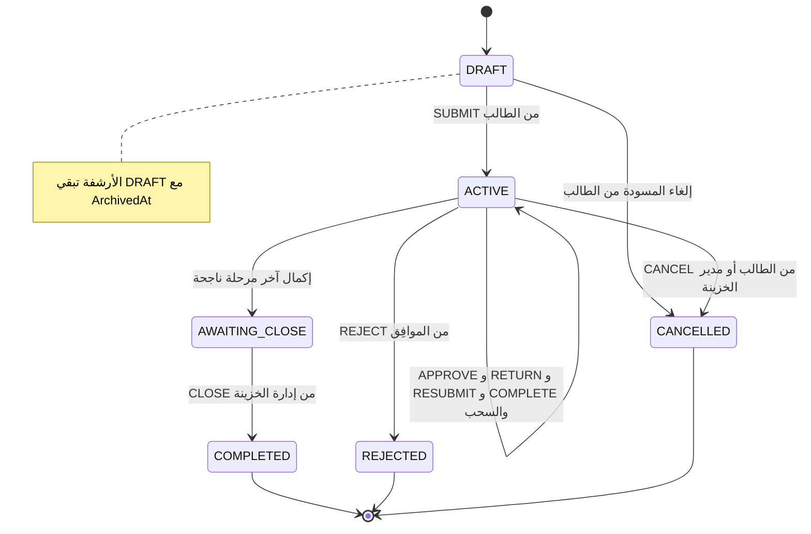
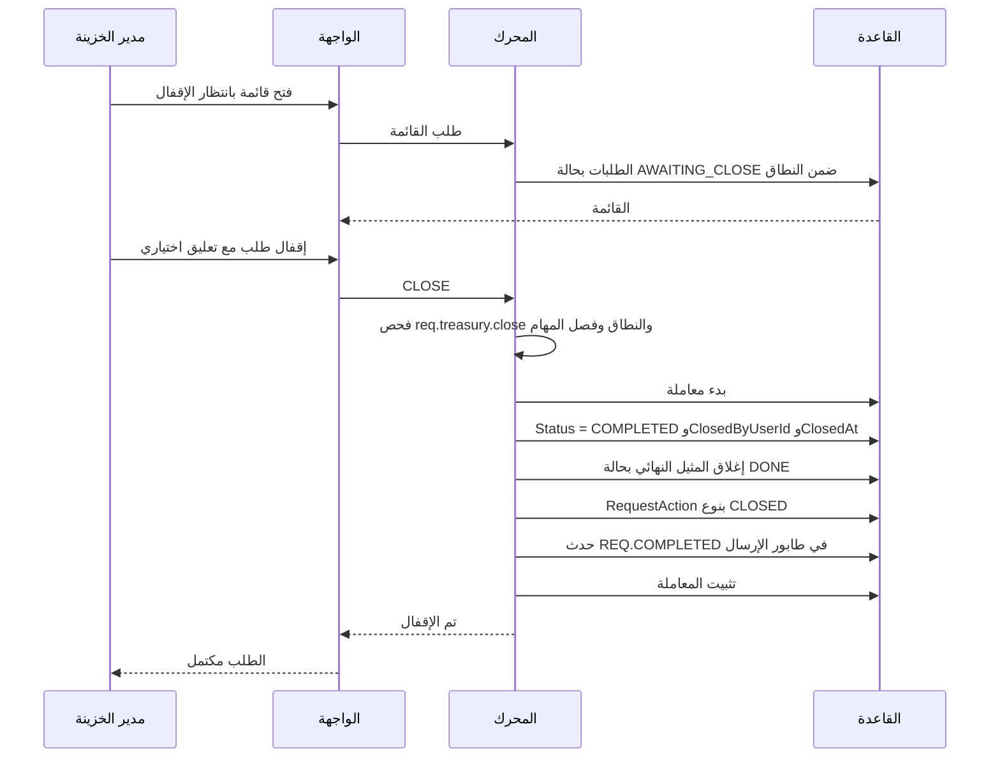

# DOC-F08 — نموذج حالة الطلب الموحّد وإقفال دورة العمل (توفيق المصادر)

| البند | القيمة |
|---|---|
| المعرّف | DOC-F08 (docs/30-readiness-documents.md) |
| الإصدار | 0.1 — مسودة للمراجعة — 2026-10-12 |
| المالك المقترح | محلل العمليات مع مالك المنتج |
| الأولوية | P0 — قرار قبل S0، وتنفيذ قبل S3 |
| يغطي | BR-WFL-027 (في وثائق القاعدة)، BR-WFL-008…011، FR-WFL-004، FR-WFL-011، FR-WFL-012، FR-WFL-015، FR-WFL-040، D-6، C-7، T-13، O-10 (20-database-design) |
| يعتمد على | DOC-F10 (سير الموافقات لكل قالب)، DOC-F11 (معاملة الحجز)، DOC-F17 (الأحداث)، DOC-F07 (نمط رموز الصلاحيات)، DOC-B09 (مالك القرار)، DOC-B10 (التسميات) |
| المصادر | docs/10-detailed-analysis/13-m6-workflow-engine-notifications.md، docs/10-detailed-analysis/14-m7-m8-letters-of-credit.md، docs/21-data-dictionary.md، db/model/15-workflow-notifications.model، docs/20-database-design.md، docs/diagrams/src/erd_03_request_lifecycle.dot |

## 1. الغرض والنطاق

هذه وثيقة قرار. تضع النماذج الثلاثة لحالة الطلب جنبًا إلى جنب، وتقترح نموذجًا واحدًا، وتحدد ما يُغلق دورة العمل ومن يطلق كل انتقال، وتربط كل قيمة قديمة بقيمتها الجديدة.

خارج النطاق: مراحل كل قالب وانتقالاتها (DOC-F10)، ومعاملة الموافقة والحجز (DOC-F11)، وتوصيل الإشعارات (DOC-F17).

اختصارات المسارات: «13-m6» = docs/10-detailed-analysis/13-m6-workflow-engine-notifications.md، و«14-m7-m8» = docs/10-detailed-analysis/14-m7-m8-letters-of-credit.md، و«erd_03_request_lifecycle.dot» = docs/diagrams/src/erd_03_request_lifecycle.dot.

**أي O-10؟** القرار المعني هو O-10 (20-database-design): «تعديل المواصفة 13 لإقفال دورة العمل» (docs/20-database-design.md:536). أما O-10 (erd_open_items) فيخص عدد المفاتيح الأجنبية في wfl.Request ولا علاقة له بالحالة (tools/dbgen/erd_open_items.py:68-71).

**القرار المسجّل:** 🟢 قرار المالك C-7: «لا تُقفل دورة العمل إلا بعد إقفال إدارة الخزينة» (docs/20-database-design.md:27)، وT-13 (docs/20-database-design.md:73).

## 2. النماذج الثلاثة جنبًا إلى جنب

| البند | النموذج A: M6 §6 و§8 | النموذج B: المرحلة الظاهرة | النموذج C: القاعدة والقاموس |
|---|---|---|---|
| ما يصفه | دورة حياة الطلب `Request.Status` | ما يراه الطالب `ExternalPhase` (D-6) | دورة حياة الطلب `wfl.Request.Status` |
| القيم | خمس: DRAFT, ACTIVE, COMPLETED, REJECTED, CANCELLED (13-m6:370) | ثماني: DRAFT, IN_APPROVAL, RETURNED, AWAITING_REQUESTER, IN_PROGRESS, COMPLETED, REJECTED, CANCELLED (13-m6:362، :89) | ست: الخمس + AWAITING_CLOSE (db/model/15-workflow-notifications.model:257؛ docs/21-data-dictionary.md:4340) |
| متى يكتمل الطلب | آليًا عند بلوغ مرحلة نهائية ناجحة (13-m6:521) | مرحلة TERMINAL ظاهرتها «مكتمل» (13-m6:334) | بإقفال من إدارة الخزينة فقط (docs/20-database-design.md:396) |
| من يكمل | المحرك | — | حامل `req.treasury.close` (docs/20-database-design.md:403) |
| ما يراه الطالب بعد آخر مرحلة | مكتمل | مكتمل | IN_PROGRESS «قيد التنفيذ» حتى الإقفال (docs/20-database-design.md:406) |
| إشعار REQ.COMPLETED | عند الإصدار (13-m6:485) | — | عند الإقفال (docs/20-database-design.md:404) |
| أرشفة المسودة | DRAFT إلى CANCELLED (13-m6:519) | — | تبقى DRAFT مع ArchivedAt (db/model/15-workflow-notifications.model:298 و:322) |
| الحالة الفرعية | SubStatusKey داخل المرحلة (13-m6:241) | لا تظهر للطالب | SubStatusKey (db/model/15-workflow-notifications.model:261) |
| أعمدة الإقفال | لا يوجد | لا يوجد | ReadyToCloseAt وClosedByUserId وClosedAt (db/model/15-workflow-notifications.model:273-275) |
| المخطط | stateDiagram بخمس حالات (13-m6:515-527) | — | المخطط الوحيد بـ AWAITING_CLOSE (docs/diagrams/src/erd_03_request_lifecycle.dot:5-17) |

**القيود المنشورة اليوم في القاعدة** (db/model/15-workflow-notifications.model، ومولَّدة في db/generated/tsql/001_tables.sql:4975-4996):

- COMPLETED يلزمه ClosedByUserId وClosedAt = CompletedAt (:325)، ولا ClosedByUserId في غير COMPLETED (:326).
- AWAITING_CLOSE يلزمه ReadyToCloseAt وCurrentStageInstanceId (:323)، وReadyToCloseAt لا يوجد إلا في AWAITING_CLOSE وCOMPLETED (:324).
- COMPLETED يلزمه RequestNo (:321).
- سجل الإجراءات يحمل READY_TO_CLOSE وCLOSED (:459).

النتيجة: كل طلب، من أي نوع، لا يبلغ COMPLETED في القاعدة إلا بإقفال مسجّل بمستخدم.

## 3. التشخيص

النموذجان A وC يصفان البعد نفسه (دورة حياة الطلب) ويختلفان في الإكمال: A يُكمل آليًا، وC يشترط الإقفال. النموذج B بُعد مختلف: ما يراه الطالب (D-6)، وليس بديلًا عن الحالة. فالتعارض الحقيقي ثلاث نقاط:

1. هل يكتمل الطلب آليًا أم بالإقفال؟ القاعدة تفرض الإقفال، والمواصفة 13 لم تُعدَّل (docs/20-database-design.md:408).
2. ما المرحلة الظاهرة أثناء انتظار الإقفال؟ لا قيمة لها في B، والقاعدة تقول IN_PROGRESS.
3. التسميات العربية متفرقة: IN_PROGRESS «تحت الإجراء» (13-m6:327) و«قيد التنفيذ» (docs/20-database-design.md:406)، وACTIVE «قيد المعالجة» (docs/diagrams/src/erd_03_request_lifecycle.dot:6).

## 4. النموذج الموحّد المقترح 🟡

### 4.1 أربع طبقات مستقلة

| الطبقة | الحقل | القيم | من يراها |
|---|---|---|---|
| حالة الدورة | `wfl.Request.Status` | DRAFT · ACTIVE · AWAITING_CLOSE · COMPLETED · REJECTED · CANCELLED | الخزينة؛ ولا تظهر للطالب مباشرة |
| المرحلة | `CurrentStageId` و`wfl.RequestStageInstance` | يعرّفها القالب (DOC-F10) | حامل `req.view.internal` |
| الحالة الفرعية | `SubStatusKey` | PREPARATION · SIGNING · BANK_COMMUNICATION · AT_BANK · FOLLOW_UP (افتراضي التنفيذ) | الخزينة فقط (FR-WFL-015) |
| المرحلة الظاهرة | `ExternalPhaseId` | الرموز الثمانية في B دون تغيير | الطالب (BR-WFL-011) |

آلات SLA والحجز والتفويض تبقى كما في 13-m6:529-538.

### 4.2 مخطط الحالات

### 4.3 جدول الانتقالات

| من | إلى | الحدث ومن يطلقه | الأثر في القاعدة | سجل الإجراء والإشعار |
|---|---|---|---|---|
| DRAFT | ACTIVE | SUBMIT؛ الطالب أو المنشئ (`req.create`) | SubmittedAt؛ تثبيت نسخة القالب؛ أول مرحلة | SUBMITTED |
| DRAFT | CANCELLED | إلغاء المسودة؛ الطالب | CompletedAt | CANCELLED |
| DRAFT | DRAFT | أرشفة بعد 90 يوم خمول؛ النظام (JOB-WFL-STALE) | ArchivedAt؛ تُسترجع (BR-REQ-012) | DRAFT_ARCHIVED |
| ACTIVE | ACTIVE | APPROVE · RETURN · RESUBMIT · COMPLETE · سحب · تحرير · حالة فرعية؛ المُسنَد بحسب قاعدة المرحلة | مثيل مرحلة جديد؛ ExternalPhaseId؛ CycleNo + 1 عند RESUBMIT (FR-WFL-011) | بحسب الإجراء |
| ACTIVE | AWAITING_CLOSE | COMPLETE أو APPROVE على آخر مرحلة غير نهائية تنتقل إلى مرحلة TERMINAL نتيجتها COMPLETED؛ المُسنَد للمرحلة الأخيرة (مثل الساحب في ISSUANCE) ويطبقه المحرك | ReadyToCloseAt؛ مثيل مفتوح للمرحلة النهائية 🟡؛ ExternalPhase = IN_PROGRESS؛ SlaState = NONE 🟡 | READY_TO_CLOSE؛ REQ.READY_TO_CLOSE 🟡 |
| ACTIVE | REJECTED | REJECT؛ الموافِق في مرحلة APPROVAL | CompletedAt؛ OutcomeReason؛ الخانات VOIDED؛ تحرير الحجز (BR-WFL-009) | REJECTED؛ REQ.REJECTED |
| ACTIVE | CANCELLED | CANCEL؛ الطالب في مراحل AllowRequesterCancel، ومدير الخزينة في أي مرحلة غير نهائية | مثل الرفض | CANCELLED؛ REQ.CANCELLED |
| AWAITING_CLOSE | COMPLETED | CLOSE؛ حامل `req.treasury.close` | ClosedByUserId؛ ClosedAt = CompletedAt؛ المثيل النهائي DONE | CLOSED؛ REQ.COMPLETED |

### 4.4 ما يُغلق دورة العمل

- 🟢 الإقفال وحده يُكمل الطلب، ويقوم به من يحمل `req.treasury.close` (docs/20-database-design.md:396-403).
- 🟡 الأثر المالي والتشغيلي لا ينتظر الإقفال. الخطافات تعمل عند خروج المرحلة الأخيرة كما هي اليوم:
  - `fac.convert_reservation` ثم `lc.record_issuance` عند الخروج من ISSUANCE، ويصدر `LC.ISSUED` (13-m6:332).
  - `lc.issue_proforma` و`lc.earmark_sales_order` و`lc.convert_earmark` و`lc.apply_amendment` (14-m7-m8:309-312).
- 🟡 الإقفال لا يعيد تشغيل أي خطاف، ولا يغيّر حجزًا أو استغلالًا.
- 🟡 شروط الإقفال: الحالة AWAITING_CLOSE؛ الطلب ضمن نطاق شركات المُقفِل؛ قاعدة فصل المهام في DQ-F08-4؛ تعليق اختياري.
- 🟡 في AWAITING_CLOSE لا إرجاع ولا إلغاء. التصحيح بعد الإصدار بطلب فرعي على الكائن (BR-WFL-009، 13-m6:240).
- 🟡 حساب الخدمة (IsSystemUser) لا يُقفل طلبًا، مع أن القاعدة تقبل أي sec.AppUser في ClosedByUserId (db/model/15-workflow-notifications.model:274).
- الرفض والإلغاء يبقيان فوريين ولا يمران بالإقفال (DQ-F08-2).

### 4.5 الربط بالمرحلة الظاهرة

القاعدة: ExternalPhaseId = المرحلة الظاهرة للمرحلة الحالية (13-m6:358)، **عدا** AWAITING_CLOSE فتكون IN_PROGRESS حتى الإقفال، ثم مرحلة TERMINAL (COMPLETED). التسميات الإنجليزية مقترحة 🟡 وتُثبَّت في DOC-B10.

| الحالة والمرحلة | ExternalPhase | English | العربية |
|---|---|---|---|
| DRAFT في الدورة الأولى | DRAFT | Draft | مسودة |
| ACTIVE في مرحلة APPROVAL (موافقة الطالب أو مديره) | IN_APPROVAL | Pending approval | قيد الموافقة |
| ACTIVE في مرحلة RETURNED | RETURNED | Returned for changes | معاد للتعديل |
| ACTIVE في مهمة مسندة للطالب (SIGNED_ORIGINAL، ERP_ENTRY) | AWAITING_REQUESTER | Action required | بانتظار إجراء منك |
| ACTIVE في مراحل الخزينة | IN_PROGRESS | In progress | تحت الإجراء |
| AWAITING_CLOSE | IN_PROGRESS | In progress | تحت الإجراء |
| COMPLETED · REJECTED · CANCELLED | بالاسم نفسه | Completed · Rejected · Cancelled | مكتمل · مرفوض · ملغى |

### 4.6 تمثيل الإقفال في القاعدة 🟡

1. عند دخول AWAITING_CLOSE يُنشئ المحرك مثيلًا لمرحلة TERMINAL ذات النتيجة COMPLETED بحالة AWAITING_APPROVAL وبلا مُسنَد. القيد db/model/15-workflow-notifications.model:408 يسمح بذلك.
2. مجموعة الإقفال المؤهلة: حاملو `req.treasury.close` ضمن نطاق الشركة.
3. عند CLOSE يُغلق المثيل بحالة DONE. العمود ExitAction لا يحوي CLOSE (db/model/15-workflow-notifications.model:392)، فيُضاف (DQ-F08-6).
4. WorkflowTransition.Action لا يتغير؛ الإقفال ليس انتقالًا في القالب بل خطوة يضيفها المحرك لكل قالب.
5. لوحة الخزينة تعرض عدّاد «بانتظار الإقفال» = Status = AWAITING_CLOSE ضمن النطاق.

## 5. الربط من القديم إلى الجديد

| المصدر | القيمة القديمة | القيمة الجديدة | ملاحظة |
|---|---|---|---|
| 13-m6:370 | Status = DRAFT | DRAFT | دون تغيير |
| 13-m6:370 | Status = ACTIVE | ACTIVE | دون تغيير |
| 13-m6:521 | ACTIVE إلى COMPLETED آليًا | ACTIVE إلى AWAITING_CLOSE، ثم COMPLETED بالإقفال | جوهر القرار |
| 13-m6:370 | REJECTED · CANCELLED | REJECTED · CANCELLED | فوريان (DQ-F08-2) |
| 13-m6:519 | أرشفة المسودة إلى CANCELLED | DRAFT مع ArchivedAt | يطابق القاعدة وBR-REQ-012 |
| 13-m6:333 | RETURNED (تُقرأ أحيانًا حالة) | Status = ACTIVE، المرحلة RETURNED، الظاهرة RETURNED | ليست حالة دورة |
| 13-m6:362 | ExternalPhase بثماني قيم | دون تغيير | في AWAITING_CLOSE تكون IN_PROGRESS |
| 13-m6:241 | الحالات الفرعية الخمس | دون تغيير داخل ACTIVE | تُفرَّغ عند مغادرة المرحلة 🟡 |
| 13-m6:485 | REQ.COMPLETED عند الإصدار | REQ.COMPLETED عند الإقفال | LC.ISSUED يبقى عند الإصدار |
| docs/20-database-design.md:406 | «قيد التنفيذ» لـ IN_PROGRESS | «تحت الإجراء» | توحيد التسمية (DOC-B10) |
| erd_03_request_lifecycle.dot:6 | ACTIVE «قيد المعالجة» | «قيد المعالجة» تسمية داخلية للخزينة | تختلف عمدًا عن الظاهرة |

## 6. تسلسل الإقفال

بديل: بلا صلاحية 403؛ طلب خارج النطاق 404؛ حالة غير AWAITING_CLOSE أو أقفله زميل قبله 409 (نموذج الأخطاء في DOC-B04).

## 7. القرارات المطلوبة

| المعرّف | السؤال | الافتراض المقترح | من يقرر | ما يعطّله |
|---|---|---|---|---|
| DQ-F08-1 | اعتماد النموذج الموحّد (ست حالات بـ AWAITING_CLOSE وأربع طبقات) وتعديل 13-m6 به؛ يُغلق O-10 (20-database-design) | يُعتمد كما في §4، ويسري على كل أنواع الطلبات لأن قيود القاعدة تفرضه | مالك المنتج (مدير الخزينة لدى العميل) مع محلل العمليات؛ المالك النهائي في DOC-B09 | تعديل 13-m6؛ DOC-F10؛ S3 |
| DQ-F08-2 | هل يبقى الرفض والإلغاء فوريين؟ (سؤال docs/20-database-design.md:536) | نعم، لا يمران بالإقفال | مالك المنتج | تعديل 13-m6 |
| DQ-F08-3 | من يحمل `req.treasury.close`؟ | TM افتراضيًا؛ ويضيفه المشترك لـ FO إن شاء | مالك المنتج | بذور الأدوار (DOC-B05) |
| DQ-F08-4 | معنى «مُعتمِده» في قاعدة فصل المهام (docs/20-database-design.md:403) | المُقفِل ليس الطالب ولا المنشئ ولا المُسنَد الذي أكمل آخر مرحلة؛ موافقة TM عند نقطة الحجز لا تمنعه؛ والاستثناء بـ `wf.sod.allow_same_person` | مالك المنتج مع مسؤول الأمن | خدمة الإقفال |
| DQ-F08-5 | ما يراه الطالب في AWAITING_CLOSE | IN_PROGRESS «تحت الإجراء» كما في docs/20-database-design.md:406 | مالك المنتج | واجهة الطالب |
| DQ-F08-6 | تمثيل الإقفال في النموذج | مثيل مفتوح للمرحلة النهائية، وإضافة CLOSE إلى RequestStageInstance.ExitAction | معماري قاعدة البيانات | تغيير db/model قبل S3 |
| DQ-F08-7 | هل يجوز إرجاع طلب أو إلغاؤه في AWAITING_CLOSE؟ | لا؛ التصحيح بطلب فرعي | مالك المنتج | المحرك |
| DQ-F08-8 | تنبيه الإقفال ومهلته | حدث جديد REQ.READY_TO_CLOSE لحاملي `req.treasury.close`، وعدّاد في اللوحة، وبلا SLA افتراضيًا | مالك المنتج مع مالك M6 | كتالوج الأحداث (13-m6 §9.2) |
| DQ-F08-9 | توحيد التسميات العربية والإنجليزية للحالات | كما في §4.5 و§5، وتُثبَّت في DOC-B10 | محلل الأعمال | ملفات الموارد |

## 8. تعارضات وفجوات في المصادر

1. خمس حالات في 13-m6 (13-m6:370، :515-527) مقابل ست في القاعدة والقاموس (db/model/15-workflow-notifications.model:257، docs/21-data-dictionary.md:4340، docs/20-database-design.md:400).
2. الإكمال الآلي (13-m6:521) يخالف قرار الإقفال (docs/20-database-design.md:396).
3. F-WFL-1 ترسم «COMPLETED + LC.ISSUED» عند الإصدار (13-m6:472، :485)، والقاعدة تجعل REQ.COMPLETED عند الإقفال (docs/20-database-design.md:404).
4. أرشفة المسودة إلى CANCELLED (13-m6:519) تخالف القيد الذي يقصر ArchivedAt على DRAFT (db/model/15-workflow-notifications.model:322) وBR-REQ-012 «المؤرشفة تُسترجع» (13-m6:274).
5. BR-WFL-027 غير موجودة في 13-m6، وآخر قاعدة فيها BR-WFL-026 (13-m6:257).
6. `req.treasury.close` في خطة البذور العالمية (docs/20-database-design.md:472) وليس في مصفوفة صلاحيات M6 (13-m6:48-78).
7. RequestStageInstance.ExitAction بلا CLOSE (db/model/15-workflow-notifications.model:392).
8. ثلاث تسميات عربية لمعنيين: «تحت الإجراء» (13-m6:327)، «قيد التنفيذ» (docs/20-database-design.md:406)، «قيد المعالجة» (docs/diagrams/src/erd_03_request_lifecycle.dot:6).
9. السجل يقول «قرار O-10» دون اسم القائمة (docs/30-readiness-documents.md:20، :129)، وO-10 (erd_open_items) موضوع آخر (tools/dbgen/erd_open_items.py:68-71).
10. السجل يحيل إلى docs/21-data-dictionary.md:4338، والسطر الصحيح للعمود Status هو 4340.

## 9. التتبع

| البند في هذه الوثيقة | المتطلب أو القاعدة أو القرار | المصدر |
|---|---|---|
| §2 النموذج A | FR-WFL-004، §6 و§8 من 13 | docs/10-detailed-analysis/13-m6-workflow-engine-notifications.md:125، :370، :515-527 |
| §2 النموذج B | BR-WFL-011، D-6 | docs/10-detailed-analysis/13-m6-workflow-engine-notifications.md:242، :362؛ docs/01-preliminary-analysis.md:397 |
| §2 النموذج C | BR-WFL-027، C-7، T-13، DB-20 | docs/20-database-design.md:27، :73، :396-408، :518 |
| §4.3 الإرجاع وإعادة التقديم | BR-WFL-008، FR-WFL-011 | docs/10-detailed-analysis/13-m6-workflow-engine-notifications.md:132، :239 |
| §4.3 الرفض والإلغاء | BR-WFL-009، FR-WFL-012 | docs/10-detailed-analysis/13-m6-workflow-engine-notifications.md:133، :240 |
| §4.1 الحالة الفرعية | BR-WFL-010، FR-WFL-015 | docs/10-detailed-analysis/13-m6-workflow-engine-notifications.md:136، :241 |
| §4.4 الخطافات | `lc.record_issuance` وخطافات المبيعات | docs/10-detailed-analysis/13-m6-workflow-engine-notifications.md:332؛ docs/10-detailed-analysis/14-m7-m8-letters-of-credit.md:308-312 |
| §4.6 التمثيل | قيود wfl.Request وRequestStageInstance | db/model/15-workflow-notifications.model:257-325، :392، :408، :459 |
| §5 أرشفة المسودة | FR-WFL-040، BR-REQ-012 | docs/10-detailed-analysis/13-m6-workflow-engine-notifications.md:161، :274 |
| §7 | O-10 (20-database-design) | docs/20-database-design.md:536 |
