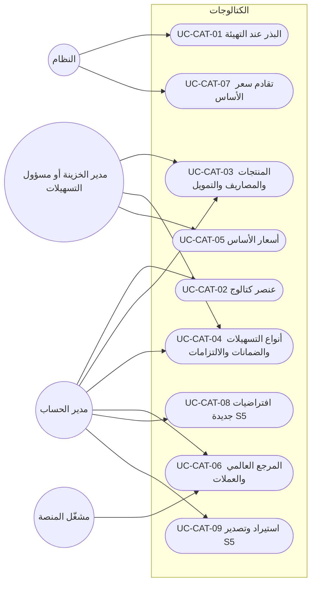
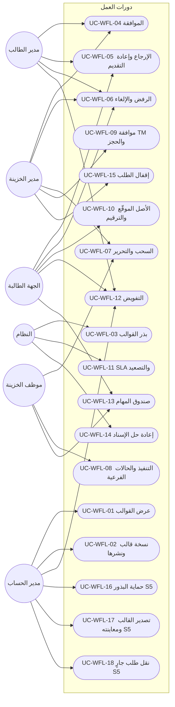
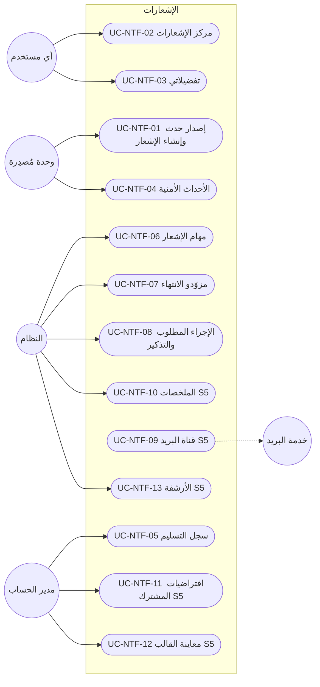
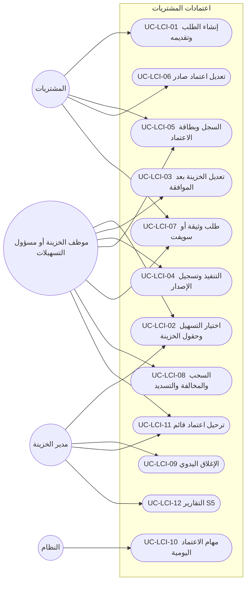

# DOC-F09 — كتالوج حالات الاستخدام: المنشآت والحسابات والكتالوجات والتسهيلات والطلبات والاعتمادات (M2 إلى M8)

| البند | القيمة |
|---|---|
| المعرّف | DOC-F09 (docs/30-readiness-documents.md) |
| الإصدار | 0.1 — مسودة للمراجعة — 2026-10-12 |
| المالك المقترح | محلل الأعمال مع مالكي الوحدات |
| الأولوية | P1 قبل S2؛ وتُراجَع حالات M2 إلى M4 (§5 إلى §7) قبل بدء S1 لأنها تعطّله (docs/30-readiness-documents.md:137) |
| يغطي | FR-INS-001…021، FR-ACC-001…023، FR-CAT-001…026، FR-FAC-001…031، FR-PRC-001…017، FR-COL-001…015، FR-OBL-001…016، FR-FIN-001…014، FR-CMP-001…008، FR-WFL-001…041، FR-REQ-001…027، FR-NTF-001…025، FR-LCT-001…037، FR-LCI-001…033، FR-LCE-001…029 (363 متطلبًا)، وقواعد BR المقابلة، وBR-WFL-027 (docs/20-database-design.md:396) |
| يعتمد على | DOC-F01 (الفاعلون)، DOC-F07 (قالب الكتالوج ورموز CORE)، DOC-F08 (حالة الطلب الموحّدة)، DOC-B02 (قبول S1)، DOC-B04 (رموز الأخطاء)، DOC-F10 إلى DOC-F17 (التسلسلات ومخططات الحالات) |
| المصادر | docs/10-detailed-analysis/11-m2-m4-institutions-accounts-catalogs.md، docs/10-detailed-analysis/12-m5-facilities-pricing-collateral-obligations.md، docs/10-detailed-analysis/13-m6-workflow-engine-notifications.md، docs/10-detailed-analysis/14-m7-m8-letters-of-credit.md، docs/10-detailed-analysis/00-overview-and-cross-cutting.md، db/model/12-institutions-accounts-catalogs.model إلى db/model/16-letters-of-credit.model، docs/20-database-design.md |

> **تحديث التنفيذ (2026-10-12):** الرموز في §3.1 و§3.2 مبذورة في db/seed/102_permissions.sql مع رموز DOC-F07، 138 رمزًا؛ `acc.signature.image.view` وصلاحيات الهوية والتصدير الحساس الأربع مقفلة على TM وFO (DQ-F09-1، BR-PLT-019). وترقيم الطلبات (BR-WFL-013) يستعمل `cfg.usp_AllocateNumber` بلا فجوات (docs/adr/0005-document-numbering-and-reference-seeds.md): يُكتب البادئ نصًا في نمط كل نوع (`LCP-{yy}-{seq:0000}`)، ويُلغى رقم الطلب الملغى بـ`cfg.usp_VoidNumber` ولا يُعاد. ومرجع الاعتمادات مبذور (db/seed/103_lc_reference.sql): قواعد Incoterms الـ16 (FR-LCT-013) ومواد UCP 600 الـ39 بحالة UNVERIFIED حتى يتحقق مختص (FR-LCT-006، O-06).

## 1. الغرض والنطاق

يعطي هذا الكتالوج معرّفًا ثابتًا لكل حالة استخدام في M2 إلى M8، بقالب DOC-F07. تستشهد بهذه المعرّفات سيناريوهات القبول والشاشات والاختبارات ومصفوفة التتبع (DOC-B08).

- حالات S1 وS1-ب وS2 وS2-ب وS3 مكتملة (§5 إلى §18): الفاعل، الشريحة، رمز الصلاحية، الشروط المسبقة واللاحقة، المسار الرئيسي، البديل والخطأ، المتطلبات والقواعد، وسيناريو القبول.
- حالات S4 وS5 مختصرة في جداول (§19).
- كل متطلب في المواصفات الأربع مربوط بحالة أو مذكور في §20، والربط مفحوص بسكربت (§23.1).
- نقطة البدء التدفقات المرقمة: F-INS-1 وF-INS-2 وF-ACC-1 إلى F-ACC-3 وF-CAT-1 إلى F-CAT-3 (docs/10-detailed-analysis/11-m2-m4-institutions-accounts-catalogs.md:411-442)، وF-FAC-1 وF-FAC-2 وF-FIN-1 وF-COL-1 وF-OBL-1 وF-CMP-1 (docs/10-detailed-analysis/12-m5-facilities-pricing-collateral-obligations.md:427-443)، وF-WFL-1 إلى F-WFL-6 (docs/10-detailed-analysis/13-m6-workflow-engine-notifications.md:459-511)، وF-LCI-1 إلى F-LCI-4 وF-LCE-1 إلى F-LCE-3 (docs/10-detailed-analysis/14-m7-m8-letters-of-credit.md:490-516).
- التسلسلات ومخططات الحالات ليست هنا: سير الموافقات لكل قالب في DOC-F10، ومعاملة الموافقة والحجز في DOC-F11، والإصدار والتعديل في DOC-F12، وإدخال التسهيل واعتماده في DOC-F13، وحالات التسهيل والحجز في DOC-F14، وحالات الالتزامات في DOC-F15، وحالات كيانات الاعتماد في DOC-F16، والأحداث غير المتزامنة في DOC-F17.

اختصارات المسارات في هذه الوثيقة: «11-m2-m4» و«12-m5» و«13-m6» و«14-m7-m8» هي الملفات الأربعة في docs/10-detailed-analysis/، و«00-overview» = docs/10-detailed-analysis/00-overview-and-cross-cutting.md.

**قواعد تسري على كل حالة ولا تتكرر فيها:**

- قواعد DOC-F07 §1 كلها: ترتيب التقييم (حالة المشترك، المصادقة، الصلاحية، نطاق الشركات، قواعد السجل)، والتدقيق، وREST أولًا، وعزل RLS، والوحدة المعطّلة 403. رموز الوحدات: INSTITUTIONS وFACILITIES وCOVENANTS وWORKFLOW وREQUESTS وLC_PURCHASE وLC_SALES (00-overview:239-245).
- الجهة الطالبة (RQ وPR وSL) لا ترى تسهيلًا ولا متاحًا ولا حجزًا ولا هامشًا؛ ترى إسقاط الطالب فقط (FR-FAC-031، BR-WFL-024، BR-LCI-014، BR-LCE-015).
- كل كتابة على طلب أو اعتماد تحمل RowVersion وIdempotency-Key، والتعارض 409 (FR-WFL-035، FR-LCI-031، DOC-B04 §6 و§7).
- كل إجراء على طلب يُسجَّل في RequestAction (FR-WFL-033) وفي التدقيق (FR-WFL-034)، وكل انتقال يكتب حدثًا في طابور الإرسال (FR-WFL-038، DOC-F17).
- حالة الطلب تتبع النموذج الموحّد المقترح في DOC-F08 §4: Status بست قيم (DRAFT وACTIVE وAWAITING_CLOSE وCOMPLETED وREJECTED وCANCELLED) والمرحلة الظاهرة بثماني. وحيث تقول 13-m6 «COMPLETED» عند آخر مرحلة، فهي هنا AWAITING_CLOSE ثم الإقفال (UC-WFL-15).
- المبلغ الوحيد الممرَّر لخدمات الحد هو ExposureAmount تحسبه 14-m7-m8، والمتاح تحسبه 12-m5 وحدها (BR-FAC-014، BR-FAC-015، BR-WFL-016، BR-LCI-004).
- كل رقم افتراضي (مهلة أو عتبة أو مدة) إعداد مشترك بحد أدنى وأقصى (BR-WFL-025، FR-PLT-043).
- البنك والمورّد والعميل خارج النظام: لا ربط حيًّا الآن (11-m2-m4:561-574، 12-m5:575-587، 14-m7-m8:648-660)، وما يصدر عنهم يُدخله موظف الخزينة يدويًا.

## 2. الفاعلون

القائمة المرجعية في DOC-F01 §3. الأدوار الجديدة هنا كلها من فئة A-03 لأنها لا تملك صلاحية كشف (DOC-F01: «موظف الخزينة، مدير القسم، الجهة الطالبة»).

| الفاعل | الرمز | DOC-F01 | الهوية والمصدر |
|---|---|---|---|
| مدير حساب المشترك | TA | A-01 | الكتالوجات العامة، الأنواع والقوالب، قواعد الإشعار |
| مدير الخزينة | TM | A-02 | الموافقة في نقطة الحجز، اعتماد المراجعات، التجاوز (13-m6:58، 12-m5:56) |
| مسؤول التسهيلات | FO | A-02 | إدخال التسهيلات والحدود والضمانات والالتزامات (00-overview:61) |
| موظف الخزينة | TE | A-03 | سحب الطلب وتنفيذه وتسجيل الإصدار والسحوبات |
| المحلل المالي 🟡 | FA | A-03 | دور مقترح لإدخال القوائم (00-overview:66، 12-m5:46) |
| الجهة الطالبة ومديرها | RQ · RQM | A-03 | 13-m6:46 |
| المشتريات | PR | A-03 | طالب اعتماد المشتريات ومديره (14-m7-m8:44) |
| المبيعات | SL | A-03 | معدّ ومدقّق وموافِق، أدوار تُبذر مع S4 (14-m7-m8:44) |
| المدقق | AU | A-04 | قراءة وتصدير بحسب المصفوفات |
| النظام | SYS | A-05 | المهام JOB-* بحساب الخدمة؛ هوية الربط في DOC-F04 |
| مشغّل المنصة | PO | A-06 | المرجع العالمي ومواد UCP (FR-CAT-021، FR-LCT-006) |
| الوحدة المستدعية | MOD | — | مكوّن داخلي يستدعي خدمة SVC-* أو خطافًا في معاملة الطلب؛ ليس فاعلًا خارجيًا |
| خدمة البريد | — | A-09 | بريد الإشعارات في S5 فقط |

## 3. رموز الصلاحيات

### 3.1 الرموز القائمة في المواصفات

الرموز التالية معرّفة 🟢 في مصفوفات الأدوار، ولا يعيد هذا الكتالوج تعريفها. كتالوج الصلاحيات نفسه ملك 10-m0-m1 (FR-PLT-017)، والجدول sec.Permission عالمي (db/model/10-platform.model:169)، ولا يوجد اليوم في db/ أي سكربت يبذر صفوفه؛ خطة البذور في docs/20-database-design.md:474.

| الوحدة | الرموز | المصدر |
|---|---|---|
| INSTITUTIONS | `ins.view` `ins.manage` `ins.contacts.manage` `ins.relationship.manage` `ins.wizard.run` `ins.deactivate` `ins.export` · `acc.view` `acc.reveal` `acc.manage` `acc.close` `acc.facility_link` · `sig.view` `sig.manage` `sig.conflict.review` | 11-m2-m4:45-59 |
| CORE (الكتالوجات) | `cat.view` `cat.manage.general` `cat.manage.financial` `cat.baserate.enter` `cat.global.manage` | 11-m2-m4:61-65 |
| FACILITIES · COVENANTS | `fac.view` `fac.edit` `fac.approve` `fac.conflict.resolve` `fac.util.manage` `fac.reserve` `fac.override_limit` · `prc.view` `prc.manage` `prc.tariff.approve` · `col.view` `col.manage` `col.approve` · `obl.view` `obl.manage` `obl.record` `obl.breach.manage` `obl.waiver.approve` · `fin.view` `fin.stmt.enter` `fin.stmt.approve` `fin.stats.enter` `fin.stats.confirm` `fin.formula.manage` `fin.formula.approve` `fin.verify.run` `fin.credit.assess` `fin.credit.approve` · `cmp.view` `cmp.manage` | 12-m5:50-72 |
| WORKFLOW · REQUESTS · CORE (الإشعارات) | `req.create` `req.view.own` `req.view.department` `req.view.all` `req.view.internal` `req.comment` `req.comment.internal` `req.approve` `req.treasury.approve` `req.facility.select` `req.claim` `req.execute` `req.reassign` `req.cancel` `req.cancel.any` `req.extref.edit` `req.create.child` `req.delegate.own` `req.delegate.manage` `req.dashboard.manager` `req.type.manage` `req.export` · `wfl.template.view` `wfl.template.manage` `wfl.template.publish` · `ntf.manage` `ntf.prefs` `ntf.log.view` | 13-m6:50-77 |
| LC_PURCHASE · LC_SALES | `lc.terms.edit` `lc.terms.treasury.edit` `lc.view.own` `lc.view.all` `lc.view.internal` `lc.export.view` `lc.export.record` `lc.issuance.record` `lc.proforma.issue` `lc.proforma.void` `lc.child.create` `lc.amendment.record` `lc.drawing.record` `lc.discrepancy.decide` `lc.close` `lc.order.release` `lc.legacy.enter` `lc.counterparty.manage` `lc.clause.manage` `lc.template.manage` `lc.field.manage` `lc.print` `lc.compare` `lc.report.view` `lc.report.export` | 14-m7-m8:48-75 |
| من خارج المواصفات الأربع | `req.treasury.close` (إقفال الطلب؛ حامله قرار DQ-F08-3) · `party.identity.reveal` 🔒 و`party.pack.export` 🔒 · `party.pack.draft` 🟡 و`cfg.settings.manage` 🟡 (DOC-F07 §3) | docs/20-database-design.md:403؛ DOC-F07 §3 |

### 3.2 رموز مقترحة

أربعة إجراءات في المواصفات بلا رمز. المقترح 🟡 بنمط `<وحدة>.<كائن>.<فعل>`، واعتمادها قرار DQ-F09-1.

| الرمز | الأدوار الافتراضية | الإجراء الذي يسده | المصدر | حالة الاستخدام |
|---|---|---|---|---|
| `fac.lifecycle.manage` | TM، FO | حسم «السريان غير المؤكد» وإنهاء التسهيل (✅ DQ-F14-1) | 12-m5:115، :451 | UC-FAC-07 |
| `fac.lifecycle.suspend` | TM | تعليق التسهيل ورفع التعليق، لمدير الخزينة وحده (✅ DQ-F14-1) | 12-m5:451 | UC-FAC-07 |
| `cmp.term.propose` | FO، TM | اقتراح مفتاح شرط جديد وترقية OTHER | 12-m5:224، :71 | UC-CMP-01 |
| `acc.signature.image.view` 🔒 | TM، FO | عرض صورة نموذج التوقيع وتنزيلها | 11-m2-m4:158، :621 | UC-ACC-04 |
| `wfl.request.migrate` | TM، TA | نقل طلب جارٍ إلى نسخة قالب أحدث | 13-m6:153 | UC-WFL-18 |

إجراءات تستعمل رمزًا قائمًا بلا رمز جديد 🟡:

- إعادة فتح علاقة مغلقة: `ins.deactivate` (11-m2-m4:50)، مع أن جدول الحالات يذكر TM وحده (11-m2-m4:451)؛ انظر DQ-F09-3.
- فك حجز يدويًا في M5: `fac.reserve` (12-m5:55) مع سبب، ويصل المحرك حدث `released_externally` فيُعلَّم الطلب LOST (13-m6:311)؛ انظر DQ-F09-4.
- إعادة محاولة تسليم فاشل: `ntf.manage` (13-m6:74)، لأن `ntf.log.view` للعرض فقط.
- التحقق من مواد UCP: دور المشغّل `cat.global.manage` (11-m2-m4:65)، لأن الجدول عالمي (FR-LCT-006).
- تفعيل `fac.override_limit.enabled` وإعدادات `lc.*` و`wf.*`: `cfg.settings.manage` (DOC-F07 §3).
- تفعيل العملات للمشترك (FR-CAT-023): `cat.manage.general` لـ TA.
- التقاط الشروط داخل مراجعة التسهيل: `fac.edit` (UC-CMP-02).

## 4. مخططات حالات الاستخدام

الخط المتصل فاعل يبدأ الحالة، والمتقطع فاعل ثانوي أو استدعاء. الحالات المختصرة (S4 وS5) تظهر في مخطط وحدتها لاكتمال الصورة.

### 4.1 المنشآت المالية (INS)

### 4.2 الحسابات والمفوّضون (ACC)

### 4.3 الكتالوجات (CAT)

### 4.4 التسهيلات والحدود (FAC)

### 4.5 التسعير والضمانات (PRC وCOL)

### 4.6 الالتزامات ومكتبة الشروط (OBL وCMP)

### 4.7 البيانات المالية والتحقق (FIN)

### 4.8 محرك دورات العمل (WFL)

### 4.9 الطلبات (REQ)

### 4.10 الإشعارات (NTF)

### 4.11 شروط الاعتماد والنماذج (LCT)

### 4.12 اعتمادات المشتريات (LCI)

### 4.13 اعتمادات المبيعات والبروفورما (LCE، S4)

## 5. M2 المنشآت المالية (INS)

الشروط المسبقة المشتركة: وحدة INSTITUTIONS مفعّلة، وجلسة مصادقة، والشركة ضمن نطاق المستخدم. الشرط اللاحق المشترك: حدث تدقيق بالقيمتين، وحدث `institution.*` أو `relationship.*` في طابور الإرسال (11-m2-m4:568). الجداول في db/model/12-institutions-accounts-catalogs.model:278-376.

### UC-INS-01 — تعريف منشأة مالية

- **الفاعل · الشريحة · الصلاحية:** TM أو FO أو TA · S1 · `ins.manage`
- **قبل:** الكتالوج InstitutionType والمرجع ref.Country مبذوران (UC-CAT-01).
- **بعد:** صف ins.Institution بحالة ACTIVE (db/model/12-institutions-accounts-catalogs.model:287)؛ المحلي والأجنبي يُشتق عند القراءة ولا يُخزَّن (db/model/12-institutions-accounts-catalogs.model:9).
- **يغطي:** FR-INS-001…004، FR-INS-020، FR-INS-021، BR-INS-001…003 · **القبول:** AC-INS-4

1. يختار المستخدم «منشأة جديدة» من SCR-INS-01 ويحدد النوع.
2. يُدخل الرمز والاسمين والدولة وBIC والموقع.
3. يطبّع النظام الرمز ويتحقق من فرادته وشكل BIC (V-INS-01)، وينبّه إلى اسم مشابه أو BIC قائم (V-INS-02).
4. إن كان النوع RequiresParty يختار المستخدم Party قائمًا أو ينشئه (UC-PTY-01)، ولا تُعرض حقول هوية في بطاقة المنشأة.
5. يحفظ النظام المنشأة ويعرض «محلي» أو «أجنبي» بمقارنة دولتها بدولة المشترك.
6. منشأة الفرد تُسجَّل مزوّد استخدام Party فتظهر شارة «ممول فرد» في بطاقته (FR-INS-021).

**بديل وخطأ:**
- 3أ. رمز مكرر أو BIC بغير 8 أو 11 خانة: رفض. دولة غير مفعّلة في المرجع: رفض.
- 4أ. نوع الفرد بلا Party، أو Party مربوط بمنشأة أخرى للمشترك: رفض (BR-INS-003).
- 4ب. نوع غير الفرد مع Party: رفض.
- ملاحظة: حقل DirectoryRef محجوز في الواجهة البرمجية ولا يظهر في الشاشة (FR-INS-020، §20).

### UC-INS-02 — هيكل المنشأة: الوحدات وبياناتها

- **الفاعل · الشريحة · الصلاحية:** TM أو FO أو TA · S1 · `ins.manage`
- **قبل:** منشأة غير INACTIVE.
- **بعد:** صفوف ins.InstitutionUnit في شجرة بعمق 4 على الأكثر، ووسائل الاتصال والعنوان بملكية UNIT في M1.
- **يغطي:** FR-INS-005، FR-INS-006، BR-INS-004 · **القبول:** AC-INS-5

1. يفتح المستخدم تبويب «الهيكل وجهات الاتصال» في SCR-INS-02.
2. يضيف وحدة بنوعها (إدارة أو قسم أو فرع) واسمها وأبيها.
3. يُدخل الهاتف والبريد والموقع والعنوان.
4. يتحقق النظام من الأب والعمق والحلقة وصيغة البريد والموقع، ثم يحفظ.

**بديل وخطأ:**
- 4أ. أب من منشأة أخرى، أو مستوى خامس، أو حلقة، أو قسم تحت قسم: رفض (V-INS-03).
- 4ب. اسم مكرر تحت الأب نفسه: رفض بقيد الفرادة.

### UC-INS-03 — جهات الاتصال وتسلسل «يتبع لـ»

- **الفاعل · الشريحة · الصلاحية:** TM أو FO أو TE أو TA · S1 · `ins.contacts.manage`
- **قبل:** منشأة غير INACTIVE.
- **بعد:** صف ins.Contact بحالة ACTIVE ووسيلة اتصال واحدة على الأقل؛ PartyId فارغ ما لم يُربط.
- **يغطي:** FR-INS-007، FR-INS-008، FR-INS-021، BR-INS-005، BR-INS-006، BR-INS-014 · **القبول:** AC-INS-2، AC-INS-3

1. يضيف المستخدم جهة اتصال بالاسمين والمسمى والوحدة.
2. يُدخل وسائل الاتصال؛ يطبّع النظام الهاتف بصيغة دولية بـ DialCode الدولة.
3. يختار اختياريًا «يتبع لـ» جهة من المنشأة نفسها.
4. يختار اختياريًا ربط الجهة ببطاقة Party قائمة (ترقية).
5. يتحقق النظام ويحفظ، ويعرض الشجرة.
6. عند الربط تُسجَّل الجهة مزوّد استخدام Party ولا يُنسخ منها شيء إلى Contact.

**بديل وخطأ:**
- 2أ. بلا هاتف ولا جوال ولا بريد: رفض (V-INS-04).
- 3أ. الذات، أو جهة من منشأة أخرى، أو حلقة: رفض (V-INS-03).
- 4أ. Party مربوط بجهة أخرى في المنشأة نفسها، أو غير موجود: رفض (V-INS-07).
- 4ب. دمج Party مربوط (UC-PTY-06): يعيد التوجيه إلى الباقي في المعاملة نفسها.

### UC-INS-04 — معالج إعداد البنك

- **الفاعل · الشريحة · الصلاحية:** TM أو FO أو TA · S1 · `ins.wizard.run`
- **قبل:** شركة نشطة واحدة على الأقل ضمن نطاق المستخدم؛ منتجات مبذورة.
- **بعد:** في معاملة واحدة: منشأة واحدة، وعلاقة لكل شركة مختارة، وRelationshipProduct لكل خلية، وصفوف التغطية (BR-INS-013)؛ أو مسودة بمنشأة DRAFT وعلاقات PROSPECT.
- **يغطي:** FR-INS-014، FR-INS-015، BR-INS-013، F-INS-1 · **القبول:** AC-INS-1، AC-INS-7

1. يُدخل المستخدم بيانات المنشأة كما في UC-INS-01.
2. يختار الشركات ويُدخل رقم العميل لكلٍّ.
3. يعلّم مصفوفة الشركات × المنتجات ويحدد القناة لكل خلية؛ الفارغ = MANUAL_FORM.
4. يضيف التغطية لكل علاقة ثم الوحدات والجهات، ويختار الجهة الافتراضية لكل (علاقة، منتج).
5. تعرض المراجعة الأعداد والتحذيرات: منتج بلا جهة، علاقة بلا مدير علاقة.
6. يضغط «إنشاء» فينفّذ النظام الكل في معاملة واحدة (`/bank-setup`، 11-m2-m4:567).

**بديل وخطأ:**
- 6أ. أي خطأ تحقق (رمز مكرر، قناة DIRECT_INTEGRATION): لا يُنشأ أي صف، وتعود الخطوة المعنية مظللة.
- 6ب. «حفظ مسودة» بدل «إنشاء»: منشأة DRAFT وعلاقات PROSPECT؛ الاستئناف يعيد إلى آخر خطوة (Could).
- 6ج. علاقة قائمة لشركة مختارة: يفتح المعالج العلاقة القائمة ولا ينشئ ثانية (BR-INS-007).

### UC-INS-05 — العلاقة ومنتجاتها وقنواتها

- **الفاعل · الشريحة · الصلاحية:** TM أو FO أو TA · S1 · `ins.relationship.manage`
- **قبل:** منشأة ACTIVE وشركة ضمن النطاق.
- **بعد:** صف ins.Relationship فريد لكل (شركة، منشأة) مهما كانت حالته، وصفوف ins.RelationshipProduct.
- **يغطي:** FR-INS-009، FR-INS-011، FR-INS-012، FR-INS-013، BR-INS-007، BR-INS-010 · **القبول:** AC-INS-6

1. يفتح المستخدم SCR-INS-04 من المنشأة أو الشركة.
2. يُدخل رقم العميل وتاريخ البدء والحالة.
3. يضيف منتجًا نشطًا ويختار جهته الافتراضية من جهات المنشأة نفسها.
4. يختار القناة المفضلة: BANK_PORTAL أو MANUAL_FORM.
5. يحفظ النظام، وتعيد UC-INS-09 القناة والجهة الفعلية للمستهلكين.

**بديل وخطأ:**
- 2أ. علاقة قائمة للزوج نفسه: يفتحها النظام بدل إنشاء ثانية.
- 2ب. رقم عميل مكرر داخل المنشأة: تحذير لا منع (V-INS-05).
- 3أ. منتج غير نشط، أو مكرر في العلاقة، أو جهة من منشأة أخرى: رفض (V-INS-06).
- 4أ. DIRECT_INTEGRATION: رفض برسالة «غير مفعّل» (BR-INS-010).

### UC-INS-06 — التغطية واستبدال مدير العلاقة

- **الفاعل · الشريحة · الصلاحية:** TM أو FO أو TA · S1 · `ins.relationship.manage`
- **قبل:** علاقة غير CLOSED؛ الجهة من منشأة العلاقة.
- **بعد:** صفوف ins.RelationshipContact بفترات لا تتداخل؛ القديم يُغلق بتاريخ ولا يُحذف؛ حدث `relationship.coverage.changed`.
- **يغطي:** FR-INS-010، BR-INS-008، F-INS-2 · **القبول:** AC-INS-6

1. يضيف المستخدم صف تغطية: الجهة والدور والرتبة والأساسي وتاريخ البدء.
2. إن تُركت الرتبة فارغة يملؤها النظام بحسب الدور (1 إلى 4).
3. للاستبدال يختار «استبدال» والجهة الجديدة وتاريخ السريان.
4. يغلق النظام الصف القديم في اليوم السابق ويفتح الجديد بالرتبة نفسها.
5. يعرض النظام الجهات الافتراضية التي كانت تشير إلى القديم ويحدّثها بعد تأكيد.

**بديل وخطأ:**
- 1أ. رتبة مكررة بين النشطة، أو صفان أساسيان للدور نفسه: رفض.
- 5أ. رفض التأكيد: تبقى الجهات الافتراضية كما هي، وتظهر في مؤشر الجودة (UC-INS-08).
- علاقة ACTIVE بلا مدير علاقة نشط تُصدر NTF-INS-01 لـ TM وFO.

### UC-INS-07 — تعطيل المنشأة أو الجهة وإغلاق العلاقة وإعادة فتحها

- **الفاعل · الشريحة · الصلاحية:** TM أو TA · S1 · `ins.deactivate`؛ وتعطيل الجهة بـ `ins.contacts.manage`
- **قبل:** الهدف ليس في الحالة المطلوبة.
- **بعد:** العلاقة CLOSED بتاريخ وسبب، وفترات تغطيتها منتهية ومنتجاتها معطّلة؛ أو المنشأة INACTIVE؛ أو الجهة INACTIVE بسبب. لا حذف.
- **يغطي:** FR-INS-016، BR-INS-005، BR-INS-011، BR-INS-012 · **القبول:** AC-INS-7، AC-INS-2

1. يختار المستخدم «إغلاق العلاقة» أو «تعطيل المنشأة» أو «تعطيل الجهة».
2. يفحص النظام الأثر: حسابات غير مغلقة، وتسهيلات نشطة (M5)، وجهات افتراضية، وتابعون.
3. يكتب المستخدم السبب وتاريخ الإغلاق.
4. للجهة الافتراضية أو المدير الذي له تابعون يحدد بديلًا، أو يترك التابعين بلا مدير بتحذير.
5. يحفظ النظام في معاملة واحدة ويصدر `relationship.closed` أو `institution.*`.

**بديل وخطأ:**
- 2أ. حساب غير مغلق أو تسهيل نشط: رفض بقائمة المراجع (BR-INS-011).
- 2ب. منشأة لها علاقة غير CLOSED: رفض (BR-INS-012).
- 1أ. إعادة فتح علاقة CLOSED بسبب: تعود ACTIVE ويبقى تاريخها. الحامل قرار DQ-F09-3.

### UC-INS-08 — البحث الموحّد وورقة التصعيد ومؤشرات الجودة

- **الفاعل · الشريحة · الصلاحية:** TM أو FO أو TE · S1 · `ins.view`؛ والطباعة `ins.export`
- **قبل:** لا شيء غير المشترك.
- **بعد:** لا تغيير؛ الطباعة مدقَّقة.
- **يغطي:** FR-INS-017، FR-INS-018، FR-INS-019، R-INS-01…04 · **القبول:** AC-INS-8

1. يكتب المستخدم جزءًا من اسم أو هاتف أو بريد أو BIC أو رقم عميل.
2. يعيد النظام المنشآت والجهات المطابقة ضمن النطاق في أقل من ثانيتين على 5000 جهة.
3. يفتح علاقة ويطبع ورقة التصعيد: صفوف الطبقة الأولى النشطة بترتيب الرتبة.
4. يفتح تقرير الجودة: علاقة بلا مدير علاقة، منتج بلا جهة، جهة بلا وسيلة، منشأة بلا علاقة نشطة.

**بديل وخطأ:**
- 3أ. بلا `ins.export`: لا يظهر زر الطباعة، والاستدعاء المباشر 403.
- ملاحظة: شاشة المصفوفة SCR-INS-05 تقرأ البيانات نفسها (R-INS-02).

### UC-INS-09 — حل الجهة الفعلية والقناة المفضلة (خدمة)

- **الفاعل · الشريحة · الصلاحية:** الوحدة المستدعية (M6 وM7) · S1، ويُستهلك من S3 · خدمة داخلية بسياق المستخدم الفاعل
- **قبل:** علاقة قائمة أو (شركة، منشأة)، ومنتج، وتاريخ.
- **بعد:** لا تغيير؛ نتيجة بمصدرها.
- **يغطي:** FR-INS-012، FR-INS-013، BR-INS-009، SVC-01، SVC-02 · **القبول:** AC-INS-1، AC-INS-2

1. تستدعي الوحدة SVC-01 بالعلاقة والمنتج والتاريخ.
2. يعيد النظام الجهة الافتراضية للمنتج إن كانت نشطة، بمصدر DEFAULT.
3. وإلا يعيد مدير العلاقة النشط ذا أقل رتبة، بمصدر RM.
4. تستدعي الوحدة SVC-02 فيعيد النظام القناة المضبوطة (CONFIGURED) أو MANUAL_FORM (DEFAULT).

**بديل وخطأ:**
- 3أ. لا جهة: النتيجة NONE ولا خطأ؛ يعرضها المستهلك «لا جهة».
- 1أ. علاقة خارج نطاق شركات المستخدم الفاعل: 404 (DOC-F07 §1).

## 6. M3 الحسابات والمفوّضون (ACC)

الشروط المسبقة المشتركة: وحدة INSTITUTIONS مفعّلة، والشركة ضمن النطاق. الشرط اللاحق المشترك: تدقيق بلا قيم سرية، وحدث `bankaccount.*` أو `signatory.*` بلا رقم حساب ولا IBAN (11-m2-m4:568). الجداول في db/model/12-institutions-accounts-catalogs.model:378-506. حالات المفوّضين (UC-ACC-05 إلى UC-ACC-10) من S1-ب.

### UC-ACC-01 — إضافة حساب بنكي

- **الفاعل · الشريحة · الصلاحية:** TM أو FO · S1 · `acc.manage`
- **قبل:** منشأة ACTIVE؛ الكتالوج AccountType مبذور.
- **بعد:** صف acc.BankAccount بحالة ACTIVE؛ الرقم وIBAN مشفّران مع قناع وفهرس أعمى (db/model/12-institutions-accounts-catalogs.model:6)؛ حدث `bankaccount.created`.
- **يغطي:** FR-ACC-001…007، BR-ACC-001…005، F-ACC-1 · **القبول:** AC-ACC-1، AC-ACC-5

1. يختار المستخدم الشركة والمنشأة.
2. إن لم توجد علاقة يعرض النظام إنشاءها، فيؤكد المستخدم فتُنشأ ACTIVE (BR-ACC-003).
3. يُدخل النوع والعملة والرقم وIBAN والاسم الداخلي والفرع.
4. يطبّع النظام الرقم ويتحقق من IBAN (الطول وباقي 97) ومن الفرادة فورًا.
5. للنوع الافتراضي يختار المستخدم الحساب الرئيسي.
6. يُدخل نص قاعدة التوقيع والحد الأدنى للتوقيعات، ثم يحفظ.

**بديل وخطأ:**
- 4أ. رقم مكرر في المنشأة بعد التطبيع، أو IBAN مكرر في المشترك أو غير صحيح، أو عملة ناقصة: رفض (V-ACC-01).
- 5أ. رئيس افتراضي أو مغلق أو مختلف الشركة أو المنشأة أو العملة: رفض (V-ACC-02).
- 6أ. MinSignatures أقل من 1: رفض (V-ACC-03). أكبر من عدد المفوّضين المؤهلين: تحذير، ويعمل بعد S1-ب (V-ACC-04).

### UC-ACC-02 — تغيير حالة الحساب وإغلاقه

- **الفاعل · الشريحة · الصلاحية:** TM للتجميد والإغلاق · S1 · `acc.close`؛ والخمول بـ `acc.manage` 🟡
- **قبل:** الحساب ليس CLOSED.
- **بعد:** الحالة الجديدة؛ CLOSED نهائي بتاريخ وسبب ويحجز رقمه (db/model/12-institutions-accounts-catalogs.model:416-417)؛ حدث `bankaccount.status_changed` أو `bankaccount.closed`.
- **يغطي:** FR-ACC-008، BR-ACC-004، BR-ACC-006 · **القبول:** AC-ACC-5، AC-ACC-1

1. يختار المستخدم الإجراء: خامل، مجمّد، إعادة تنشيط، إغلاق.
2. للإغلاق يُدخل التاريخ والسبب.
3. يفحص النظام الحسابات الافتراضية تحته، وأغراضه الافتراضية في تسهيل نشط (S2).
4. يحفظ النظام الحالة.

**بديل وخطأ:**
- 3أ. افتراضي غير مغلق تحته: رفض حتى يُغلق.
- 3ب. حساب افتراضي لغرض في تسهيل نشط: رفض حتى يُحدَّد بديل للغرض (BR-ACC-006).
- 4أ. تجميد أو إغلاق حساب مربوط بتسهيل: NTF-ACC-03 لـ TM وFO (S2).
- 4ب. تعديل حساب CLOSED عدا الملاحظات: رفض.

### UC-ACC-03 — كشف رقم الحساب أو IBAN

- **الفاعل · الشريحة · الصلاحية:** TM أو FO أو TE · S1 · `acc.reveal`
- **قبل:** الحساب ضمن نطاق المستخدم.
- **بعد:** القيمة الكاملة معروضة مؤقتًا؛ حدث تدقيق (مستخدم، وقت، حساب، سبب اختياري).
- **يغطي:** FR-ACC-009، BR-ACC-016، R-ACC-01 · **القبول:** AC-ACC-1

1. يعرض النظام الرقم مقنَّعًا: رمز الدولة وآخر 4 خانات.
2. يضغط المستخدم «كشف» ويكتب سببًا اختياريًا.
3. يتحقق النظام من الصلاحية والنطاق ثم يفك التشفير ويعرض القيمة.
4. يسجّل النظام حدث الكشف.

**بديل وخطأ:**
- 3أ. بلا الصلاحية (TA وAU افتراضيًا): 403 وحدث مرفوض.
- 2أ. تصدير R-ACC-01 كاملًا: الصلاحية نفسها وعلامة مائية 🟡 (11-m2-m4:589)، وكل تصدير مدقَّق.

### UC-ACC-04 — إرفاق صورة نموذج التوقيع وعرضها

- **الفاعل · الشريحة · الصلاحية:** TM أو FO · S1، ويعمل فعليًا مع S1-ب · `sig.manage` للإرفاق و`acc.signature.image.view` 🔒 🟡 للعرض
- **قبل:** سجل مفوّض قائم (UC-ACC-05)؛ نوع الوثيقة SIGNATURE_SPECIMEN حساس.
- **بعد:** Signatory.SpecimenDocumentId يشير إلى وثيقة مخزّنة بقيود الحساس (UC-PLT-21)؛ كل عرض مدقَّق.
- **يغطي:** FR-ACC-022، BR-CAT-016 · **القبول:** AC-ACC-6

1. يفتح المستخدم بطاقة المفوّض ويضغط «إرفاق نموذج التوقيع».
2. يرفع الملف عبر خدمة المستندات.
3. يحفظ النظام الربط.
4. لاحقًا يضغط حامل الصلاحية «عرض» فيعرض النظام الصورة ويسجّل الحدث.

**بديل وخطأ:**
- 4أ. بلا الصلاحية: 403 وحدث مرفوض.
- ملاحظة: FR-ACC-022 في S1 والحقل على سجل المفوّض في S1-ب (11-m2-m4:158)، فالتسليم مع S1-ب (DQ-F09-5).

### UC-ACC-05 — تسجيل مفوّض وتفعيله

- **الفاعل · الشريحة · الصلاحية:** TM أو FO · S1-ب · `sig.manage`
- **قبل:** علاقة ACTIVE؛ Party من نوع شخص طبيعي.
- **بعد:** صف acc.Signatory بحالة PENDING، ثم ACTIVE بإرفاق وثيقة التفويض (db/model/12-institutions-accounts-catalogs.model:449، :457)؛ مزوّد استخدام Party مسجَّل؛ حدث `signatory.activated`.
- **يغطي:** FR-ACC-012، FR-ACC-023، BR-ACC-008، BR-ACC-009، F-ACC-2 · **القبول:** AC-ACC-2 (الشارة)

1. يختار المستخدم Party أو ينشئه (UC-PTY-01).
2. يحدد العلاقة وفئة التوقيع والمنصب وفترة السريان.
3. يرفع وثيقة التفويض.
4. يحفظ النظام؛ مع الوثيقة وتاريخ البدء تصير الحالة ACTIVE.
5. يدخل المستخدم الصلاحيات (UC-ACC-06).
6. تظهر في بطاقة Party شارة «مفوَّض بنكي» بعدد علاقاته.

**بديل وخطأ:**
- 1أ. Party ليس شخصًا طبيعيًا: رفض.
- 2أ. صف مفتوح للثلاثي (علاقة، Party، فئة): رفض (BR-ACC-008).
- 3أ. بلا وثيقة: يبقى PENDING ولا يُحسب في الكفاية.
- 4أ. إيقاف أو سحب لاحق: SUSPENDED أو REVOKED بسبب؛ REVOKED نهائي.

### UC-ACC-06 — صلاحيات المفوّض: الإدخال والتعديل والتجديد

- **الفاعل · الشريحة · الصلاحية:** TM أو FO · S1-ب · `sig.manage`
- **قبل:** مفوّض غير REVOKED.
- **بعد:** صفوف acc.SignatoryAuthority؛ التعديل يغلق القديم (SupersededById) ويفتح جديدًا دون فجوة؛ حدث `signatory.authority.changed`؛ مقارنة الحوكمة تعمل (UC-ACC-08).
- **يغطي:** FR-ACC-013، FR-ACC-014، FR-ACC-017، BR-ACC-010، BR-ACC-011 · **القبول:** —، فجوة (§22)

1. يفتح المستخدم شبكة الصلاحيات (عملية × حساب أو البنك).
2. يختار العملية والنطاق والسقف ونمطه والعملة والسقف اليومي.
3. يحدد التوقيع المشترك: الفئات المطلوبة والعدد الأدنى.
4. يحفظ النظام بعد التحقق، ويشغّل مقارنة الحوكمة.
5. للتعديل يغيّر السقف فيغلق النظام الصف القديم ويفتح جديدًا.
6. للتجديد يختار «تجديد مع نسخ» بوثيقة وفترة جديدتين فيُنسخ كل صف فعّال.

**بديل وخطأ:**
- 2أ. صف بلا عملية، أو حساب من علاقة أخرى، أو LIMITED بلا مبلغ أو عملة، أو يومي أقل من سقف العملية، أو تداخل فترات: رفض (V-ACC-05).
- 2ب. عملية لا تدعم السقف: لا يُطلب مبلغ.
- 4أ. فترة تتجاوز انتهاء وثيقة التفويض: تحذير (V-ACC-06).

### UC-ACC-07 — الصلاحية الفعلية لمفوّض (خدمة)

- **الفاعل · الشريحة · الصلاحية:** الوحدة المستدعية أو مستخدم الخزينة · S1-ب · `sig.view`
- **قبل:** مفوّض وحساب أو بنك وعملية وتاريخ.
- **بعد:** لا تغيير؛ السقوف والعملة والتوقيع المشترك والمستوى ACCOUNT أو MASTER أو BANK أو NONE.
- **يغطي:** FR-ACC-015، BR-ACC-012، SVC-03، F-ACC-3 · **القبول:** AC-ACC-2

1. يستدعي المستهلك SVC-03.
2. يبحث النظام عن صف صالح للحساب في التاريخ.
3. وإلا، إن كان الحساب افتراضيًا، عن صف رئيسه.
4. وإلا عن صف مستوى البنك.
5. يعيد الأخص ولو كان سقفه أدنى.

**بديل وخطأ:**
- 4أ. لا صف: «لا صلاحية» (NONE) لا خطأ.
- 3أ. إرث الافتراضي من رئيسه افتراض 🟡 معلّق على Q-ACC-04.

### UC-ACC-08 — مراجعة تعارضات الحوكمة

- **الفاعل · الشريحة · الصلاحية:** TM أو FO؛ AU للقراءة · S1-ب · `sig.conflict.review`
- **قبل:** صلاحية مفوّض محفوظة؛ منح AuthorityGrant في M1.
- **بعد:** صف acc.AuthorityConflict بحالة OPEN أو ACKNOWLEDGED بسبب، أو RESOLVED آليًا (db/model/12-institutions-accounts-catalogs.model:498، :505)؛ حدث `authority.conflict.opened` أو `resolved`.
- **يغطي:** FR-ACC-018، BR-ACC-015، FR-ORG-030 (مؤشر) · **القبول:** AC-ACC-3

1. عند حفظ صلاحية، وليليًا (JOB-ACC-GOV)، وعند تغيّر منحة، يقارن النظام الصلاحية بالمنح غير المقيّدة ببنك أو المقيّدة ببنك العلاقة.
2. عند تعارض ينشئ مثيلًا ببصمة ورمز، ويصدر NTF-ACC-04 لـ TM وFO.
3. يفتح المراجع SCR-ACC-06 ويرى الصلاحية والمنحة.
4. يقرّ بسبب مدوَّن فتصير الحالة ACKNOWLEDGED.

**بديل وخطأ:**
- 1أ. زوال السبب: RESOLVED آليًا.
- 1ب. بصمة جديدة (تغيّر الصلاحية أو المنحة): مثيل جديد.
- 1ج. عملتان مختلفتان: NOT_COMPARABLE_CURRENCY؛ عملية بلا ربط: NOT_MAPPED.
- 4أ. الإقرار بلا سبب: رفض بقيد القاعدة.

### UC-ACC-09 — تنبيهات انتهاء المفوّض والصلاحية والوثيقة

- **الفاعل · الشريحة · الصلاحية:** النظام (JOB-ACC-EXPIRY) · S1-ب · حساب الخدمة
- **قبل:** مفوّضون ACTIVE بتواريخ انتهاء.
- **بعد:** إشعار NTF-ACC-01 واحد لكل (هدف، عتبة)؛ المفوّض EXPIRED في اليوم التالي لـ ValidTo؛ NTF-ACC-02 إن بقي حساب بلا مفوّض نشط.
- **يغطي:** FR-ACC-019، BR-ACC-009، BR-ACC-017 · **القبول:** AC-ACC-4

1. تعمل المهمة يوميًا بتوقيت المشترك.
2. تحسب أبكر تاريخ من انتهاء المفوّض والصلاحية والوثيقة.
3. عند T-30 وT-15 وT-7 ويوم الانتهاء تصدر الحدث عبر Emit (UC-NTF-01).
4. بعد ValidTo تنقل المفوّض إلى EXPIRED.

**بديل وخطأ:**
- 3أ. تشغيل ثانٍ في اليوم نفسه: لا تكرار (DedupKey).
- 3ب. تجديد يغيّر التاريخ: تُعاد العتبات للتاريخ الجديد.

### UC-ACC-10 — مصفوفة الصلاحيات وتقارير المفوّضين

- **الفاعل · الشريحة · الصلاحية:** TM أو FO أو TE؛ AU · S1-ب · `sig.view`؛ والتصدير `sig.manage`
- **قبل:** بنك وتاريخ.
- **بعد:** لا تغيير؛ التصدير مدقَّق بعلامة مائية 🟡.
- **يغطي:** FR-ACC-020، R-ACC-02…06 · **القبول:** —، فجوة (§22)

1. يختار المستخدم البنك أو الحساب والتاريخ.
2. يبني النظام المصفوفة (مفوّض × عملية × حساب) من الصلاحيات الفعلية في ذلك التاريخ (UC-ACC-07).
3. يطبع المستخدم أو يصدّر.
4. يفتح التقارير: السجل، الحسابات بلا مفوّضين، الانتهاءات خلال 90 يومًا.

**بديل وخطأ:**
- 3أ. تصدير بلا صلاحية: 403.

### UC-ACC-11 — ربط الحساب بالتسهيل وتحديد غرضه

- **الفاعل · الشريحة · الصلاحية:** TM أو FO · S2 · `acc.facility_link`
- **قبل:** تسهيل في مراجعة DRAFT (UC-FAC-01)؛ حساب نشط لشركة من شركات التسهيل.
- **بعد:** صف acc.FacilityAccount؛ حساب افتراضي واحد لكل (تسهيل، غرض، عملة)؛ SVC-FAC-07 تعيد الحسابات الثلاثة.
- **يغطي:** FR-ACC-010، FR-FAC-022، BR-ACC-007 · **القبول:** —، فجوة (§22)

1. يفتح المستخدم تبويب «الحسابات» في بطاقة التسهيل.
2. يختار الحساب والغرض ويعلّم «افتراضي» إن لزم.
3. يحفظ النظام بعد التحقق.

**بديل وخطأ:**
- 2أ. حساب مجمّد أو مغلق، أو شركة خارج شركات التسهيل: رفض.
- 2ب. منشأة الحساب ليست من المقرضين: تحذير في التمويل المشترك.
- 2ج. افتراضيان للثلاثي نفسه: رفض.
- 3أ. اعتماد مراجعة بلا حساب بغرض FACILITY: تحذير (V-FAC-12).

### UC-ACC-12 — فحص كفاية التوقيعات (خدمة)

- **الفاعل · الشريحة · الصلاحية:** الوحدة المستدعية؛ TE في مرحلة التنفيذ · S3 · خدمة داخلية؛ والعرض `sig.view`
- **قبل:** حساب وعملية ومبلغ وعملة وتاريخ.
- **بعد:** لا تغيير؛ النتيجة SUFFICIENT أو INSUFFICIENT أو NOT_COMPARABLE أو «لم يُفحص»، مع المرشحين والأسباب، وتُسجَّل مع الطلب.
- **يغطي:** FR-ACC-016، BR-ACC-013، BR-ACC-014، SVC-04 · **القبول:** AC-ACC-2

1. يستدعي المستهلك SVC-04 عند حالة «توقيع» في التنفيذ (UC-WFL-08، UC-LCI-04).
2. يحسب النظام المفوّضين النشطين الذين صلاحيتهم الفعلية تغطي المبلغ بالعملة نفسها أو UNLIMITED.
3. يبحث عن مجموعة بحجم MinSignatures يستوفي كل عضو فيها شرطه المشترك.
4. يعيد النتيجة.

**بديل وخطأ:**
- 2أ. حساب بلا مفوّضين مُدخلين: «لم يُفحص» ولا منع (FR-ACC-016).
- 2ب. عملة مختلفة أو سقف UNSPECIFIED: NOT_COMPARABLE، لا تحويل عملات.
- 4أ. INSUFFICIENT: تحذير للمنفّذ ولا يمنع إكمال التنفيذ 🟡.

## 7. M4 الكتالوجات (CAT)

الكتالوجات ضمن CORE. الشرط اللاحق المشترك: تدقيق بالقيمتين لكل تغيير (FR-CAT-025)، وحدث `catalog.item.changed`. الجداول في db/model/12-institutions-accounts-catalogs.model:14-276.

### UC-CAT-01 — بذر الكتالوجات عند تهيئة المشترك

- **الفاعل · الشريحة · الصلاحية:** النظام ضمن تهيئة المشترك (UC-PLT-02) · S1 · حساب الخدمة
- **قبل:** حزمة البذر منشورة؛ المرجع العالمي منشور (DOC-B05).
- **بعد:** صف لكل عنصر في الحزمة بـ SeedKey ومفتاح فريد (مشترك، كتالوج، SeedKey)؛ الأعداد تطابق 11-m2-m4 §6.4؛ تدقيق بالأعداد.
- **يغطي:** FR-CAT-001، FR-CAT-002، FR-CAT-019، FR-CAT-026، BR-CAT-002، BR-CAT-017، BR-CAT-018، F-CAT-1 · **القبول:** AC-CAT-1

1. تستدعي التهيئة خدمة البذر بحزمة الدولة.
2. تنسخ الخدمة صفوف كل كتالوج مملوك للمشترك بأعلام النظام والقفل.
3. تبذر Position وPowerType وLegalEntityType بقيم السمات في 11-m2-m4 §6.4-ب، وOperationTypePowerType.
4. تسجّل الأعداد في التدقيق وفي cfg.SeedRun.

**بديل وخطأ:**
- 2أ. إعادة التشغيل: لا تكرار صفوف (المفتاح الفريد).
- 2ب. فشل كتالوج: يتبع سلوك التهيئة في DOC-F05 (استئناف بلا تكرار).
- ملاحظة: إجراء البذر خطة لم تُنفَّذ (docs/20-database-design.md:470-475).

### UC-CAT-02 — إدارة عنصر كتالوج

- **الفاعل · الشريحة · الصلاحية:** TA للعامة؛ TA أو TM أو FO للمالية · S1 · `cat.manage.general` أو `cat.manage.financial`
- **قبل:** الكتالوج مملوك للمشترك، أو قائمة قيم تقبل عناصر المشترك.
- **بعد:** العنصر مضاف أو معدّل أو مرتّب أو معطّل؛ لا حذف لمستخدم أو نظام.
- **يغطي:** FR-CAT-001، FR-CAT-004، FR-CAT-005، FR-CAT-006، FR-CAT-018، FR-CAT-019، FR-CAT-020، FR-CAT-025، BR-CAT-001، BR-CAT-003، BR-CAT-016، F-CAT-3 · **القبول:** AC-CAT-4، AC-CAT-1، AC-CAT-7

1. يفتح المستخدم مركز الكتالوجات (SCR-CAT-01) ثم المحرر العام (SCR-CAT-02).
2. يضيف عنصرًا برمز واسمين ووصف، أو يعدّل الاسمين، أو يرتّب بالسحب.
3. للتعطيل يعرض النظام «أين يُستخدم» وعدد المراجع، ويؤكد المستخدم.
4. يحفظ النظام؛ المعطّل يختفي من الاختيار ويبقى في السجلات.

**بديل وخطأ:**
- 2أ. رمز بصيغة خاطئة أو مكرر، أو تغيير رمز قائم: رفض (V-CAT-01). تكرار الاسم العربي بين النشطة: تحذير.
- 3أ. حذف صف مستخدم أو نظام، أو تعطيل صف مقفل: رفض.
- 2ب. إضافة عنصر لقائمة عالمية: رفض.
- 2ج. نوع وثيقة بعلم «حساس»: يخضع ما يُرفع تحته لقيد TM وFO في M1.

### UC-CAT-03 — المنتجات والمصاريف وأنواع التمويل وروابطها

- **الفاعل · الشريحة · الصلاحية:** TA أو TM أو FO · S1 · `cat.manage.financial`
- **قبل:** تصنيفات المنتجات مبذورة.
- **بعد:** صفوف cat.Product وcat.FeeType وcat.FinancingType وروابط ProductFeeType وProductFinancingType؛ SVC-08 تعيد المسموح.
- **يغطي:** FR-CAT-007…010، FR-CAT-022، BR-CAT-004…007 · **القبول:** AC-CAT-5

1. يفتح المستخدم محرر المنتج (SCR-CAT-03).
2. يحدد التصنيف والعائلة والامتثال والأعلام ومجموعة المتغيرات.
3. يربط المصاريف المسموحة (مع «متوقع») وأنواع التمويل.
4. يحفظ النظام.

**بديل وخطأ:**
- 2أ. منتج ثالث بالامتثال نفسه في مجموعة المتغيرات: رفض.
- 2ب. تغيير «يستهلك حدًّا» أو طبيعة المصروف بعد الاستخدام: رفض إلا بتأكيد TM، ويُدقَّق بالقيمتين (V-CAT-02).
- 3أ. ربط مكرر: رفض. تعطيل ربط تستعمله قاعدة تسعير: تحذير ولا يمسها.

### UC-CAT-04 — أنواع التسهيلات والحدود والضمانات والالتزامات

- **الفاعل · الشريحة · الصلاحية:** TA أو TM أو FO · S1 · `cat.manage.financial`
- **قبل:** الكتالوجات مبذورة.
- **بعد:** صفوف FacilityType وLimitType ومنتجاتها المسموحة، وCollateralType بقالب سمات، وObligationType بعائلته.
- **يغطي:** FR-CAT-011…014، BR-CAT-008، BR-CAT-009، BR-CAT-010 · **القبول:** AC-CAT-6

1. يفتح المستخدم محرر نوع الحد أو الضمان (SCR-CAT-04) أو المحرر العام.
2. لنوع الحد: يحدد MAIN أو SUB والأب ونمط التوزيع الافتراضي والمنتجات المسموحة.
3. لنوع الضمان: يرتّب سمات القالب بمفتاح ونوع وإلزام.
4. لنوع الالتزام: العائلة والمقياس وأساس الاستحقاق الافتراضي.
5. يحفظ النظام.

**بديل وخطأ:**
- 2أ. SUB بلا أب، أو MAIN بأب: رفض.
- 2ب. قائمة منتجات فارغة: تعني «أي منتج» بعلامة ظاهرة.
- 3أ. مفتاح سمة مكرر: رفض. حذف سمة مستعملة: تُعلَّم Retired وتبقى مقروءة.

### UC-CAT-05 — أسعار الأساس وقيمها

- **الفاعل · الشريحة · الصلاحية:** TM أو FO · S1 · `cat.manage.financial` للتعريف و`cat.baserate.enter` للقيم
- **قبل:** للسعر الداخلي منشأة قائمة.
- **بعد:** صف cat.BaseRate فريد لكل (العائلة، الفترة، المنشأة)؛ قيم cat.BaseRateValue بحالة VALID أو SUPERSEDED بلا حذف (db/model/12-institutions-accounts-catalogs.model:239، :243)؛ حدث `baserate.value.recorded` أو `corrected`.
- **يغطي:** FR-CAT-015، FR-CAT-016، BR-CAT-011…013، SVC-05، F-CAT-2 · **القبول:** AC-CAT-2، AC-CAT-3

1. يعرّف المستخدم السعر: العائلة والفترة والنوع والمنشأة للداخلي والأسماء البديلة.
2. يفتح جدول القيم ويُدخل التاريخ والقيمة والمصدر.
3. إن وُجدت قيمة VALID بالتاريخ نفسه يعرض النظام «تصحيح» بسبب.
4. يحفظ النظام؛ التصحيح ينشئ صفًا جديدًا ويجعل القديم SUPERSEDED.
5. «القيمة في تاريخ» تعيد أحدث قيمة VALID لا تتجاوز التاريخ.

**بديل وخطأ:**
- 1أ. سعر سوق بمنشأة، أو داخلي بلا منشأة، أو تكرار الثلاثي: رفض (V-CAT-03).
- 2أ. قيمة صفرية أو سالبة: تُقبل.
- 5أ. لا قيمة قبل التاريخ: NO_VALUE ولا تعويض بلاحقة.

### UC-CAT-06 — المرجع العالمي والعملات المفعّلة

- **الفاعل · الشريحة · الصلاحية:** مشغّل المنصة للمرجع · S1 · `cat.global.manage`؛ وTA لتفعيل العملات بـ `cat.manage.general` 🟡
- **قبل:** جلسة مشغّل للمرجع؛ جلسة TA للعملات.
- **بعد:** المرجع العالمي (ref.Country وref.Currency وref.Incoterm) بإصدار جديد للقراءة فقط؛ أو صفوف cat.TenantCurrency للمشترك (db/model/12-institutions-accounts-catalogs.model:46).
- **يغطي:** FR-CAT-021، FR-CAT-023، FR-CAT-026، BR-CAT-015، BR-CAT-018 · **القبول:** AC-CAT-7، AC-CAT-1

1. يعدّل المشغّل دولة أو عملة أو يضع Incoterm بحالة LEGACY من لوحة المشغّل (UC-PLT-06).
2. يتحقق النظام من ISO2 وISO3 وDialCode وWeekendDays وينشر.
3. يختار TA العملات المفعّلة لمشتركه.
4. تظهر المفعّلة وحدها في الاختيار، وتبقى غيرها ظاهرة في السجلات.

**بديل وخطأ:**
- 1أ. أي محاولة كتابة من مستخدم المشترك على المرجع: رفض بصلاحيات القاعدة.
- 2أ. رمز مكرر أو بصيغة خاطئة: رفض بقيود ref.Country (db/model/12-institutions-accounts-catalogs.model:23-26).
- 4أ. Incoterm بحالة LEGACY: لا يُختار في جديد ويُعرض في القديم.

### UC-CAT-07 — تنبيه تقادم سعر الأساس

- **الفاعل · الشريحة · الصلاحية:** النظام (JOB-CAT-STALE) · S2 · حساب الخدمة
- **قبل:** سعر أساس تستعمله قاعدة تسعير نشطة (UC-PRC-02).
- **بعد:** إشعار NTF-CAT-01 لـ FO وTM مرة لكل قيمة.
- **يغطي:** FR-CAT-017 · **القبول:** —، فجوة (§22)

1. تعمل المهمة يوميًا.
2. تجد الأسعار المستعملة التي مضى على آخر قيمة لها أكثر من StaleAfterDays (35 🟡).
3. تصدر الحدث عبر Emit.

**بديل وخطأ:**
- 3أ. إدخال قيمة جديدة: لا تنبيه لاحق للقيمة القديمة.

## 8. M5 التسهيلات والحدود (FAC)

الشروط المسبقة المشتركة: وحدة FACILITIES مفعّلة، والشركة المقترضة ضمن نطاق المستخدم، ومبالغ الشركات خارج النطاق مخفية (Q-FAC-11). الجداول في db/model/13-facilities-pricing-terms.model:23-352. التسلسلات في DOC-F11 (الحجز) وDOC-F12 (الإصدار) وDOC-F13 (الإدخال والاعتماد)، والحالات في DOC-F14.

كل كتابة على بيانات التسهيل المنمّطة (UC-FAC-01 إلى UC-FAC-06، UC-PRC-02، UC-COL-01 وUC-COL-02 حين تُربط، UC-OBL-01، UC-CMP-02) تقع داخل مراجعة مفتوحة واحدة، ولا تُلزم إلا باعتمادها (BR-FAC-003، db/model/13-facilities-pricing-terms.model:85).

### UC-FAC-01 — إنشاء تسهيل: الرأس والمقرضون والوثائق

- **الفاعل · الشريحة · الصلاحية:** FO أو TM (المُعِدّ) · S2 · `fac.edit`
- **قبل:** علاقة بين الشركة والبنك (UC-INS-05)؛ FacilityType مبذور.
- **بعد:** صف fac.Facility بحالة DRAFT ومراجعة رقم 1 بحالة DRAFT (db/model/13-facilities-pricing-terms.model:44، :74)؛ رقم داخلي `FAC-YY-NNN` من التسلسل (UC-PLT-19).
- **يغطي:** FR-FAC-001…004، FR-FAC-023، BR-FAC-001، BR-FAC-002، BR-FAC-007، BR-FAC-008 · **القبول:** —، فجوة (§22)

1. يختار المستخدم «تسهيل جديد» من SCR-FAC-01.
2. يُدخل المقترض والنوع والعملة والمبلغ ومرجع البنك ورقم الهيكل ولغة الأسبقية.
3. يُدخل التواريخ بالميلادي أو الهجري، فيحسب مكوّن M1 المقابل.
4. يضيف المقرضين: واحدًا بـ 100%، أو تمويلًا مشتركًا بأدوار ونسب.
5. يرفع الوثائق بأنواعها وأسبقيتها وتاريخها ولغتها و«تعدّل وثيقة».
6. يُدخل حقوق البنك المنفردة ومهلة الإخطار.
7. يحفظ النظام المسودة.

**بديل وخطأ:**
- 2أ. حقل إلزامي ناقص أو ترتيب تواريخ خاطئ: رفض (V-FAC-01). تكرار (المقرض الرئيسي، مرجع البنك): تحذير.
- 3أ. تعديل المقابل يدويًا: يتطلب سببًا ويُعلَّم «معدَّل».
- 4أ. مجموع الحصص ليس 100، أو وكيلان، أو SOLE بأكثر من مقرض: رفض (V-FAC-02).
- 5أ. أسبقية مكررة أو نوع لا يقبل FACILITY: رفض (V-FAC-03).
- 6أ. «تعديل التسعير منفردًا» بلا مهلة أو «بلا»: رفض.

### UC-FAC-02 — الحدود والخطوط وقيود الشركات وشروط العملية

- **الفاعل · الشريحة · الصلاحية:** FO أو TM · S2 · `fac.edit`
- **قبل:** مراجعة مفتوحة للتسهيل.
- **بعد:** صفوف fac.Limit وLimitProductLine وLimitCompanyRule وProductLineTerm بنطاق المراجعة؛ نتائج فحوص السلامة محدّثة.
- **يغطي:** FR-FAC-010…014، FR-FAC-025، BR-FAC-009…012 · **القبول:** AC-FAC-1

1. يفتح المستخدم محرر الحدود (SCR-FAC-03) ويضيف حدًّا بنوعه وأبيه.
2. يحدد السقف مبلغًا أو نسبة من الأب، والنمط، والدوران، والالتزام، والتواريخ.
3. يضيف خطوط المنتجات برمز منتج البنك وسقف اختياري واستحقاق.
4. يضبط قيود الشركات: مسموح، مستثنى، تخصيص.
5. يُدخل شروط العملية لكل خط بتاريخ سريان وCheckMode.
6. يعرض النظام نتائج السلامة فورًا ويحفظ.

**بديل وخطأ:**
- 2أ. SUB بلا أب، أو عمق أكبر من 6، أو حلقة، أو نسبة خارج (0،100]: رفض (V-FAC-07).
- 2ب. SHARED_CAP أكبر من الأب: خطأ؛ مجموع PARTITION أكبر من الأب: خطأ، وخلطهما تحذير (V-FAC-04، V-FAC-05).
- 3أ. منتج غير مسموح: رفض؛ قائمة مسموحة فارغة: تحذير (V-FAC-08).
- 4أ. «مسموح» في فرع خارج مسموحات الأب، أو مسموح ومستثنى معًا: رفض (V-FAC-09).
- 5أ. نسبة خارج 0 إلى 100 أو أيام سالبة: رفض؛ الحقل الفارغ يعني «غير محدد» لا صفرًا (V-FAC-10).
- 6أ. «جرّب الفحص» بطلب افتراضي: يستدعي SVC-FAC-02 بلا أثر.

### UC-FAC-03 — تقديم مراجعة التسهيل واعتمادها

- **الفاعل · الشريحة · الصلاحية:** FO أو TM يقدّم بـ `fac.edit`؛ TM غير المُعِدّ يعتمد بـ `fac.approve` · S2
- **قبل:** مراجعة DRAFT؛ لا مراجعة SUBMITTED أخرى.
- **بعد:** المراجعة APPROVED وثابتة؛ ApprovedRevisionNo يزيد؛ التسهيل ACTIVE عند أول اعتماد (db/model/13-facilities-pricing-terms.model:67)؛ إسقاط TermValue وتوليد الأجندة والاختبارات (UC-CMP-02، UC-OBL-02)؛ NTF-FAC-03.
- **يغطي:** FR-FAC-024، FR-FAC-027، BR-FAC-003، BR-FAC-004، BR-FAC-018، F-FAC-1 · **القبول:** —، فجوة (§22)

1. يضغط المُعِدّ «تقديم» فيشغّل النظام فحوص السلامة.
2. تنتقل المراجعة إلى SUBMITTED ويُشعَر TM.
3. يفتح المعتمِد SCR-FAC-05: الفرق عن المعتمدة، والتحذيرات، والقيم المقروءة من مسح، والتعارضات المفتوحة.
4. يتحقق من كل قيمة مقروءة من مسح أو يقرّ بقبولها بسبب، ويقرّ بالتحذيرات.
5. يضغط «اعتماد» فيطبّق النظام المراجعة في معاملة واحدة ويُشعَر المُعِدّ.

**بديل وخطأ:**
- 1أ. خطأ سلامة (E): لا تقديم.
- 4أ. قيمة مالية مقروءة من مسح بلا تحقق ولا إقرار، أو تعارض مالي مفتوح: لا اعتماد (V-FAC-12، UC-FAC-04).
- 5أ. المعتمِد عدّل المراجعة أو قدّمها: رفض (BR-FAC-004).
- 5ب. «رفض» بسبب: REJECTED ثم DRAFT للتصحيح؛ أو DISCARDED بقرار المُعِدّ.
- 5ج. كفيل ناقص البيانات أو لا حساب بغرض FACILITY: تحذير يُقرّ به.

### UC-FAC-04 — حسم تعارض القيم

- **الفاعل · الشريحة · الصلاحية:** TM · S2 · `fac.conflict.resolve`
- **قبل:** صف fac.ValueConflict بحالة OPEN، واحد لكل (هدف، حقل) (db/model/13-facilities-pricing-terms.model:349).
- **بعد:** الحالة RESOLVED بالجانب المختار والسبب والحاسم والوقت (db/model/13-facilities-pricing-terms.model:351)؛ تُرفع العلامة عن القيمة.
- **يغطي:** FR-FAC-026، BR-FAC-008، BR-FAC-019 · **القبول:** —، فجوة (§22)

1. يفتح النظام التعارض تلقائيًا عند قيمتين متناقضتين من مصدرين، أو يفتحه FO يدويًا.
2. تظهر القيمة مظلَّلة وتُستبعد من المقارنة.
3. يفتح TM التعارض فيرى القيمتين ومصدريهما والقيمة المقترحة بالأسبقية.
4. يختار القيمة ويكتب السبب فيحفظ النظام القرار ويطبّق القيمة في المراجعة المفتوحة.

**بديل وخطأ:**
- 4أ. بلا سبب: رفض.
- 3أ. تعارض على قيمة نصية: يجوز اعتماد المراجعة بإقرار المعتمِد.

### UC-FAC-05 — تجديد التسهيل

- **الفاعل · الشريحة · الصلاحية:** FO أو TM · S2 · `fac.edit`
- **قبل:** تسهيل ACTIVE أو EXPIRED بلا لاحق.
- **بعد:** تسهيل لاحق DRAFT يشير إلى السابق بنسخة من كل صف فعّال؛ عند اعتماده يصير السابق SUPERSEDED من EffectiveFrom اللاحق.
- **يغطي:** FR-FAC-005، BR-FAC-006 · **القبول:** AC-FAC-6

1. يختار المستخدم «تجديد» من بطاقة التسهيل.
2. ينشئ النظام تسهيلًا مسودة وينسخ الحدود والتسعير والضمانات والالتزامات والشروط.
3. يعدّل المستخدم التواريخ والقيم ويرفع وثائق التجديد.
4. يقدّم ويعتمد كما في UC-FAC-03.
5. يعرض النظام السلسلة F1 ثم F2 ثم F3.

**بديل وخطأ:**
- 1أ. للتسهيل لاحق قائم: رفض (لاحق واحد).
- 4أ. تداخل أكثر من 31 يومًا بين السابق واللاحق: تحذير.
- 4ب. قبل EffectiveFrom اللاحق يبقى السابق صالحًا للحجز.

### UC-FAC-06 — ملحق في المدة نفسها

- **الفاعل · الشريحة · الصلاحية:** FO أو TM · S2 · `fac.edit`
- **قبل:** تسهيل ACTIVE بلا مراجعة مفتوحة.
- **بعد:** مراجعة AMENDMENT معتمدة بتاريخ نفاذ؛ المراجعة السابقة باقية كاملة.
- **يغطي:** FR-FAC-006، BR-FAC-003 · **القبول:** —، فجوة (§22)

1. يختار المستخدم «ملحق» فينشئ النظام مراجعة جديدة.
2. يرفع وثيقة الملحق ويحدد تاريخ النفاذ.
3. يعدّل السعر أو الحد أو الضمان.
4. يقدّم ويعتمد كما في UC-FAC-03.

**بديل وخطأ:**
- 4أ. مراجعة AMENDMENT بلا وثيقة ملحق: رفض عند التقديم (V-FAC-03).
- 4ب. قبل الاعتماد تُحل القيم السابقة؛ بعده تُطبَّق الجديدة من تاريخ النفاذ (BR-FAC-003).

### UC-FAC-07 — السريان: التنبيه والحسم والتعليق

- **الفاعل · الشريحة · الصلاحية:** النظام (JOB-FAC-VALIDITY)؛ FO أو TM للحسم والإنهاء بـ `fac.lifecycle.manage`، وTM وحده للتعليق ورفعه بـ `fac.lifecycle.suspend` · S2 ✅ DQ-F14-1
- **قبل:** تسهيل ACTIVE أو SUSPENDED.
- **بعد:** المؤشر محسوب يوميًا؛ أو LifecycleStatus في SUSPENDED أو EXPIRED أو TERMINATED بسبب (db/model/13-facilities-pricing-terms.model:65)، أو تمديد بمراجعة.
- **يغطي:** FR-FAC-007، FR-FAC-008، BR-FAC-005، NTF-FAC-01، NTF-FAC-02 · **القبول:** AC-FAC-6

1. تحسب المهمة المؤشر: SCHEDULED أو VALID أو EXPIRING أو NOT_CONFIRMED.
2. تصدر تنبيهات الانتهاء عند T-90 وT-60 وT-30 وT-15 وT-7 ويوم الانتهاء، مرة لكل (هدف، عتبة).
3. عند NOT_CONFIRMED تصدر NTF-FAC-02 ثم أسبوعيًا.
4. يختار FO أو TM أحد ثلاثة: تسجيل تمديد بتاريخ ووثيقة (مراجعة)، أو «منتهٍ»، أو «مُنهى» بسبب.
5. يجوز لـ TM تعليق التسهيل أو إعادته بسبب.

**بديل وخطأ:**
- 4أ. «منتهٍ»: يمنع الحجز الجديد؛ والمراجعة تعيده ACTIVE لاحقًا.
- 3أ. NOT_CONFIRMED مع سياسة المنع: يرفض الحجز VALIDITY_UNCONFIRMED (UC-FAC-12).
- 2أ. تغيير تاريخ الانتهاء: تُعاد جدولة العتبات.

### UC-FAC-08 — اللقطات المعترف بها

- **الفاعل · الشريحة · الصلاحية:** FO أو TM · S2 · `fac.util.manage`
- **قبل:** تسهيل غير DRAFT.
- **بعد:** صف fac.OutstandingSnapshot بالمبلغ والتاريخ والمصدر، تشغيلي بلا اعتماد ومدقَّق.
- **يغطي:** FR-FAC-009، BR-FAC-017، R-FAC-04 · **القبول:** —، فجوة (§22)

1. يختار المستخدم التسهيل أو الحد أو الخط ويُدخل المبلغ والتاريخ والمصدر والنسبة المنصوص عليها.
2. يحسب النظام النسبة من السقف والفرق عن المستخدم المحسوب.
3. يحفظ ويعرض الفرق.

**بديل وخطأ:**
- 2أ. فرق النسبة 0.005 نقطة أو أكثر عن المنصوص: علم مراجعة.

### UC-FAC-09 — الاستخدام اليدوي

- **الفاعل · الشريحة · الصلاحية:** FO أو TM · S2 · `fac.util.manage`
- **قبل:** تسهيل ACTIVE؛ خط أو حد.
- **بعد:** صف fac.Utilization بحالة ACTIVE، أو معدّل، أو RELEASED بتاريخ وسبب (db/model/13-facilities-pricing-terms.model:256، :269)؛ لا حذف؛ صف LimitMovement لكل تغيير.
- **يغطي:** FR-FAC-016، BR-FAC-002، BR-FAC-013 · **القبول:** —، فجوة (§22)

1. يفتح المستخدم SCR-FAC-04 ويضيف بندًا: الوصف والمرجع والشركة والحد أو الخط والمبلغ والتواريخ.
2. بعملة غير عملة التسهيل يُدخل سعر تحويل يثبَّت.
3. يحفظ النظام ويحدّث المستخدم والمتاح.
4. للتعديل أو الفك يختار البند ويكتب السبب.

**بديل وخطأ:**
- 1أ. مبلغ غير موجب: رفض (V-FAC-11).
- 4أ. تعديل مبلغ بند SourceType=LC: لا كتابة مباشرة؛ يمر بـ UC-FAC-13 بالفرق.
- 4ب. RELEASED: يخرج من المستخدم من تاريخه ولا يُعدَّل بعده.

### UC-FAC-10 — المتاح ولوحة التسهيل والتقارير

- **الفاعل · الشريحة · الصلاحية:** TM أو FO أو TE؛ AU · S2 · `fac.view`
- **قبل:** تسهيل ضمن النطاق.
- **بعد:** لا تغيير؛ AvailabilityResult بستة حقول كما تعيدها SVC-FAC-03.
- **يغطي:** FR-FAC-019، FR-FAC-028، BR-FAC-013، BR-FAC-014، SVC-FAC-03، R-FAC-01…03 · **القبول:** AC-FAC-2

1. يفتح المستخدم قائمة التسهيلات ويصفّي بالشركة والبنك والحالة والمؤشر و«ينتهي خلال N».
2. يفتح البطاقة فيعرض النظام الإجمالي والمستخدم والمحجوز والمتاح داخل المجموع وخارجه، والسريان والامتثال.
3. يفتح شجرة الحدود فيرى لكل عقدة Cap وUsed وReservedForOthers وAvail والعقدة الملزِمة.

**بديل وخطأ:**
- 2أ. تسهيل غير ACTIVE أو شركة بلا أهلية: المتاح صفر بسبب.
- 2ب. NOT_CONFIRMED: القيمة بعلم تحذير.
- 3أ. حجز متجاوز: المتاح سالب بالأحمر في التقارير، و`max(0، Avail)` في الطلب.
- ملاحظة: لا تعيد M6 ولا M7 صياغة المتاح؛ تعرضان ما تعيده الخدمة (BR-FAC-014).

### UC-FAC-11 — الخطوط المؤهلة وفحص شروط العملية (خدمة)

- **الفاعل · الشريحة · الصلاحية:** الوحدة المستدعية لمستخدم خزينة (TM أو FO أو TE) · S3 · `fac.view`
- **قبل:** شركة ومنتج يستهلك حدًّا وعملة وExposureAmount وتاريخ؛ RequestId اختياري.
- **بعد:** لا تغيير؛ خطوط مرتبة لكل منها AvailabilityResult وCheckMode ونتائج الشروط وقيود العملية وتحذيرات الامتثال وأسباب الاستبعاد.
- **يغطي:** FR-FAC-015، FR-FAC-021، FR-FAC-031، FR-OBL-009، BR-FAC-016، SVC-FAC-01، SVC-FAC-02 · **القبول:** AC-FAC-3، AC-WFL-9، AC-LCT-3

1. تستدعي مرحلة اختيار التسهيل SVC-FAC-01 (UC-LCI-02).
2. يعيد النظام الخطوط المؤهلة: الساري أولًا، ثم المتاح الكافي، ثم الأقل سعرًا إن توفر تسعير.
3. لكل خط يقيّم SVC-FAC-02 وقائع الطلب مقابل ProductLineTerm الساري وقيود العملية.
4. يعيد لكل شرط: مطابق أو مخالف أو NOT_DEFINED، والقيمتين، وCheckMode الخط.

**بديل وخطأ:**
- 1أ. استدعاء بحساب الطالب (RQ أو PR أو SL): 403 ويُدقَّق (FR-FAC-031).
- 2أ. شركة مستثناة: يظهر الخط بسبب «مستثناة».
- 4أ. CheckMode = BLOCK مع مخالفة: يمنع المستدعي SUBMIT وAPPROVE ويسمّي الشروط؛ WARN يطلب إقرارًا مسجَّلًا؛ OFF يُخفي.
- 2ب. منتج لا يستهلك حدًّا: لا فحص إتاحة ولا حجز.

### UC-FAC-12 — حجز الحد وتعديله وتحريره (خدمة)

- **الفاعل · الشريحة · الصلاحية:** محرك الطلبات في معاملة موافقة TM (UC-WFL-09) · S3 · `fac.reserve`، و`fac.override_limit` للتجاوز
- **قبل:** تخصيص (التسهيل والحد والخط) وExposureAmount تحسبه M7 (BR-LCI-004).
- **بعد:** صف fac.LimitReservation بحالة ACTIVE، حجز فعّال واحد لكل طلب (db/model/13-facilities-pricing-terms.model:291)، أو رمز رفض؛ أو CONVERTED أو RELEASED نهائيتان؛ صف LimitMovement.
- **يغطي:** FR-FAC-017، FR-FAC-018، FR-FAC-020، FR-FAC-029، BR-FAC-015، SVC-FAC-04، NTF-FAC-04 · **القبول:** AC-FAC-2، AC-WFL-3

1. يستدعي المحرك `fac.reserve_limit` بتوقيعه الثابت داخل معاملة الموافقة.
2. يقفل النظام التسهيل ثم الحدود من الجذر إلى الورقة بترتيب ثابت.
3. يعيد حساب المتاح مستثنيًا حجز الطلب نفسه.
4. إن كفى المتاح ينشئ الحجز أو يعدّله (upsert بـ RequestId) ويعيد ReservationId.
5. قبل الإصدار، عند تغيّر المبلغ، يستدعي المحرك `fac.adjust_reservation` بالفرق.
6. عند الرفض أو الإلغاء يستدعي `fac.release_reservation` (UC-WFL-06).

**بديل وخطأ:**
- 4أ. المتاح لا يكفي: INSUFFICIENT_AVAILABLE وتُلغى معاملة الموافقة كلها.
- 4ب. تجاوز بسبب مع الإعداد `fac.override_limit.enabled` والصلاحية: OverLimit = true وتنبيه فوري لـ TM وFO وTE؛ وإلا OVERRIDE_NOT_ALLOWED أو OVERRIDE_REASON_REQUIRED.
- 4ج. خرق مفتوح مع سياسة الإيقاف: COVENANT_STOP_POLICY (FR-FAC-029).
- 2أ. تعذّر القفل: CONCURRENT_RETRY ويعيد المحرك حتى 3 مرات.
- 5أ. تعديل حجز غير ACTIVE: RESERVATION_NOT_ACTIVE.
- 6أ. JOB-FAC-RESERVATION يحرر الحجز المنتهي، أو يحرره TM يدويًا بسبب (DQ-F09-4)، فيصل المحرك `fac.reservation.expired` أو `released_externally` ويُعلَّم الطلب LOST.

### UC-FAC-13 — استخدام الاعتماد بعد الإصدار (خدمة)

- **الفاعل · الشريحة · الصلاحية:** وحدة الاعتمادات (M7) أو محرك الطلبات · S3 · خدمة داخلية تُدقَّق باسم المستخدم الفاعل
- **قبل:** حجز ACTIVE للتحويل، أو Utilization ACTIVE للتعديل والفك، أو اعتماد قديم بلا حجز للإنشاء.
- **بعد:** Utilization من نوع LC؛ SourceRefId يُعبَّأ مرة واحدة من فارغ إلى LcId؛ صف LimitMovement بالمطلوب والمطبَّق لكل تعديل.
- **يغطي:** FR-FAC-030، BR-FAC-020 · **القبول:** AC-FAC-9، AC-LCI-1، AC-LCI-2

1. عند الإصدار يستدعي المحرك `fac.convert_reservation` فيُنشأ الاستخدام ويصير الحجز CONVERTED، ثم `lc.record_issuance` في المعاملة نفسها (UC-LCI-04).
2. عند زيادة بتعديل يستدعي `fac.adjust_utilization` بفرق موجب يُفحص مقابل المتاح.
3. عند تسديد أو تخفيض أو فك غير المسحوب يستدعي فرقًا سالبًا بلا فحص.
4. عند الإغلاق أو الإلغاء المؤكد يستدعي `fac.release_utilization`.
5. لاعتماد قديم يستدعي `fac.create_utilization` بلا فحص إتاحة (UC-LCI-11).

**بديل وخطأ:**
- 2أ. المتاح لا يكفي: INSUFFICIENT_AVAILABLE.
- 3أ. فرق سالب أكبر من الرصيد: يتوقف عند الصفر ويصير RELEASED، ويُسجَّل المطلوب والمطبَّق.
- 5أ. (LC، LcId) مكرر: DUPLICATE_SOURCE.
- 1أ. تغيير SourceRefId بعد تعبئته: IMMUTABLE_SOURCE.
- تكرار المفتاح نفسه يعيد النتيجة الأولى بلا أثر ثانٍ.

## 9. M5 التعرفة والتسعير (PRC)

الجداول في db/model/13-facilities-pricing-terms.model:360-540. لا احتساب لمستحقات فعلية في S2 (12-m5:37).

### UC-PRC-01 — جدول تعرفة البنك واعتماده

- **الفاعل · الشريحة · الصلاحية:** FO أو TM يُعِدّ بـ `prc.manage`؛ TM يعتمد بـ `prc.tariff.approve` · S2
- **قبل:** منشأة ACTIVE؛ FeeType مبذور.
- **بعد:** prc.TariffSchedule بحالة APPROVED ثابتة، معتمد مفتوح واحد لكل (بنك، تسهيل) (db/model/13-facilities-pricing-terms.model:368، :374)؛ السابق SUPERSEDED.
- **يغطي:** FR-PRC-001…004، BR-PRC-001…005 · **القبول:** AC-FAC-4

1. ينشئ المستخدم إصدارًا للبنك أو لتسهيل بعينه، بتاريخ سريان ومصدر (ملحق التعرفة).
2. يضيف البنود: الفئة والرمز والنوع وأساس المدة والحد الأدنى والأعلى والنطاق والعملة والضريبة.
3. يضيف شرائح المبلغ أو المدة.
4. يعرض النظام مؤشر الاكتمال: بنود ناقصة لمنتجات الخطوط.
5. يعتمد TM الإصدار.

**بديل وخطأ:**
- 2أ. «لكل فترة» بلا طول فترة، أو أدنى أكبر من أعلى: رفض.
- 3أ. شريحتان متداخلتان: رفض (V-PRC-01).
- 5أ. معتمدان متداخلان للنطاق نفسه: رفض.
- 5ب. تعديل إصدار معتمد: رفض؛ التغيير إصدار جديد.

### UC-PRC-02 — قاعدة تسعير

- **الفاعل · الشريحة · الصلاحية:** FO أو TM · S2 · `prc.manage`، داخل مراجعة التسهيل
- **قبل:** مراجعة مفتوحة (UC-FAC-03)؛ جدول تعرفة أو سعر أساس حسب الطريقة.
- **بعد:** صف prc.PricingRule بنطاقه وطريقته وRateState ونسخة سريان؛ تُلزم باعتماد المراجعة.
- **يغطي:** FR-PRC-004…014، FR-PRC-017، BR-PRC-004، BR-PRC-006…009، BR-PRC-011، BR-PRC-012 · **القبول:** AC-FAC-5، AC-FAC-10

1. يختار المستخدم النطاق: تسهيل أو حد أو خط أو منتج أو شركة، أو تركيبها.
2. يختار المكوّن ونوع الرسم والطريقة: بند تعرفة، أو بند مع إضافة، أو أساس مع هامش، أو نسبة، أو ثابت، أو لكل مليون، أو شرائح.
3. يُدخل حقول الطريقة: الثابت للعقد أو المتغيّر ودوريته، الأرضية، شرط استبدال المؤشر، أساس الاحتساب، الضريبة، الحد الأدنى.
4. لبند تركته الاتفاقية فارغًا يختار «غير محدد في الاتفاقية» بلا معدل.
5. لعقوبة التأخر يختار نوعًا طبيعته PENALTY_NON_INCOME.
6. لحق البنك في التغيير يحدد النمط والمهلة.
7. يحفظ النظام نسخة بتاريخ سريان تغلق السابقة في اليوم السابق.

**بديل وخطأ:**
- 3أ. حقل إلزامي للطريقة ناقص، أو إضافة على بند ثابت: رفض (V-PRC-02، db/model/13-facilities-pricing-terms.model:486-491).
- 4أ. «غير محدد» مع قيمة معدل: رفض (db/model/13-facilities-pricing-terms.model:485).
- 7أ. تاريخ قبل اليوم: علم Retroactive وسبب، ولا إعادة حساب.
- 7ب. تداخل نسختين للمفتاح نفسه: رفض؛ الفجوة تحذير.
- 2أ. صيغة إسلامية: تسمية «ربح»، والمدى (أدنى وأعلى) يُخزَّن مدًى.

### UC-PRC-03 — محلّل التسعير

- **الفاعل · الشريحة · الصلاحية:** TM أو FO أو TE؛ M6 وM7 للمعاينة · S2 · `prc.view`
- **قبل:** تسهيل معتمد.
- **بعد:** لا تغيير؛ القاعدة الفائزة والمرفوضة وسببها، والمكوّنات، والمعدل الشامل، والرسم.
- **يغطي:** FR-PRC-015، BR-PRC-010، SVC-FAC-05 · **القبول:** AC-FAC-4، AC-FAC-5

1. يفتح المستخدم «ما السعر؟» في SCR-PRC-02 ويُدخل الحد أو المنتج والشركة والمبلغ والمدة والتاريخ.
2. يبني النظام السلسلة من الخط صعودًا ما دام الوضع INHERIT.
3. يرتّب المرشحات: أقرب عقدة، ثم المحددة بالشركة، ثم بالمنتج، ثم الأحدث.
4. يقيّم الفائزة ويعيد الناتج مع المرفوضة.

**بديل وخطأ:**
- 2أ. OWN بلا قاعدة للمكوّن: NO_RULE بلا صعود صامت.
- 4أ. الأكثر تحديدًا «غير محدد»: INCOMPLETE بسبب RATE_NOT_SPECIFIED، لا صفر.
- 4ب. لا قيمة أساس في التاريخ: INCOMPLETE.

### UC-PRC-04 — فحص اكتمال التسعير

- **الفاعل · الشريحة · الصلاحية:** FO أو TM · S2 · `prc.view`
- **قبل:** تسهيل بخطوط منتجات.
- **بعد:** لا تغيير؛ تقرير R-PRC-02.
- **يغطي:** FR-PRC-016 · **القبول:** AC-FAC-10

1. يفتح المستخدم تقرير نقص التسعير.
2. يسرد النظام الخطوط التي لمنتجاتها رسوم متوقعة بلا قاعدة، والقواعد «غير المحددة في الاتفاقية»، وقائمة العقوبات.
3. يفتح المستخدم القاعدة من التقرير للمعالجة (UC-PRC-02).

**بديل وخطأ:**
- 2أ. لا نقص: تقرير فارغ؛ ولا يمنع النقص أي اعتماد.

## 10. M5 الضمانات والكفلاء (COL)

الجداول في db/model/14-collateral-obligations-financials.model:27-160. لا رقم هوية في جداول هذه الوحدة؛ بيانات الكفيل تُقرأ من Party (FR-COL-004).

### UC-COL-01 — تسجيل كفالة

- **الفاعل · الشريحة · الصلاحية:** FO أو TM · S2 · `col.manage`
- **قبل:** تسهيل قائم؛ CollateralType من بنية GUARANTEE.
- **بعد:** col.Collateral بحالة DRAFT وcol.Guarantee بكفيل Party واحد، ورابط CollateralLink؛ الكفالة مزوّد استخدام Party.
- **يغطي:** FR-COL-002، FR-COL-003، FR-COL-004، FR-COL-015، BR-COL-001، F-COL-1 · **القبول:** AC-FAC-8

1. يفتح المستخدم تبويب الضمانات ويختار «كفالة فرد» أو «كفالة شركة».
2. يختار الكفيل من Party أو ينشئه (UC-PTY-01)؛ شركة المجموعة تُختار بـ Party المرآة.
3. يحدد نوع الكفالة والتضامن والمبلغ أو «غير محدد» وتاريخ التوقيع والسند.
4. يربط الكفالة بالتسهيل أو الحد بمبلغ تغطية ورتبة.
5. يعرض النظام شارة وثائق الكفيل واكتماله.
6. يحفظ، ثم يعتمد السجل (UC-COL-03).

**بديل وخطأ:**
- 3أ. «محدد» بلا مبلغ، أو «غير محدد» مع مبلغ: رفض (V-COL-01).
- 2أ. بلا Party: رفض.
- 5أ. وثيقة هوية الكفيل منتهية أو ناقصة: شارة حمراء وتحذير عند اعتماد المراجعة.

### UC-COL-02 — سند لأمر، تأمين، هامش، عقار، وبنود العلَم

- **الفاعل · الشريحة · الصلاحية:** FO أو TM · S2 · `col.manage`
- **قبل:** تسهيل قائم؛ نوع الضمان بقالب سماته.
- **بعد:** col.Collateral بسماته، والجدول الفرعي بحسب البنية؛ مواعيد التجديد والتقييم في الأجندة (UC-OBL-02).
- **يغطي:** FR-COL-001، FR-COL-005…009، BR-COL-002…005 · **القبول:** AC-FAC-8

1. يختار المستخدم النوع فيعرض النظام سمات القالب.
2. للسند: المبلغ ودورة التجديد وآخر تجديد وموضع الحفظ؛ يحسب النظام النسبة من الحد والموعد التالي.
3. للتأمين: قاعدة التغطية والوثيقة والمؤمِّن والمبلغ والتواريخ؛ يحسب النظام النقص.
4. للهامش الدائم: النسبة أو المبلغ والحساب من نوع MARGIN.
5. للعقار: السمات السبع ومراحل جدول التقييم؛ يولّد النظام المواعيد.
6. للمقاصة والرهن السلبي: نص ومصدر بلا مبلغ.
7. يحفظ ويربط بالتسهيل.

**بديل وخطأ:**
- 2أ. سند أكبر من الحد: يُقبل ويعرض نسبة فوق 100%.
- 3أ. انتهاء الوثيقة قبل بدئها: رفض.
- 5أ. سمة إلزامية ناقصة: رفض عند الاعتماد؛ مراحل تقييم متداخلة: رفض.
- 4أ. خلط الهامش الدائم بالغطاء النقدي لكل عملية: ممنوع؛ الثاني شرط خط (UC-FAC-02).
- تنبيهات تجديد السند وانتهاء التأمين وموعد التقييم: NTF-COL-01 من JOB-COL-DUE.

### UC-COL-03 — اعتماد سجل الضمان

- **الفاعل · الشريحة · الصلاحية:** TM غير المُعِدّ · S2 · `col.approve`
- **قبل:** ضمان DRAFT.
- **بعد:** ApprovalState = APPROVED والحالة ACTIVE (db/model/14-collateral-obligations-financials.model:34-35)؛ التعديل اللاحق نسخة DRAFT، والتغطية تستخدم المعتمدة حتى اعتماد الجديدة.
- **يغطي:** FR-COL-013، FR-COL-014 · **القبول:** —، فجوة (§22)

1. يفتح TM الضمان المقدَّم.
2. يعرض النظام السمات والروابط واكتمال بيانات الكفيل مقابل ملف بنك التسهيل (UC-PTY-11).
3. يعتمد TM أو يرفض بسبب.

**بديل وخطأ:**
- 3أ. المعتمِد هو المُعِدّ: رفض (X-SEC-7).
- 2أ. كفيل ناقص: تحذير لا منع.

### UC-COL-04 — فك الضمان أو ربطه

- **الفاعل · الشريحة · الصلاحية:** FO أو TM · S2 · `col.manage`
- **قبل:** ضمان ACTIVE.
- **بعد:** RELEASED بتاريخ وسبب ووثيقة، أو رابط بـ UnlinkedOn؛ لا حذف؛ يخرج من التغطية من التاريخ.
- **يغطي:** FR-COL-002، FR-COL-010، BR-COL-005 · **القبول:** —، فجوة (§22)

1. يختار المستخدم «فك» أو «فك الربط» ويُدخل التاريخ والسبب ويرفع الوثيقة.
2. يحفظ النظام ويعيد حساب التغطية.

**بديل وخطأ:**
- 2أ. ضمان بلا ربط فعّال بعد الفك: يظهر في تقرير الجودة.
- 1أ. انتهاء ValidTo أو الوثيقة: EXPIRED آليًا.

### UC-COL-05 — تقرير تغطية الضمانات

- **الفاعل · الشريحة · الصلاحية:** TM أو FO أو TE؛ AU · S2 · `col.view`
- **قبل:** تسهيل بضمانات.
- **بعد:** لا تغيير؛ R-COL-01.
- **يغطي:** FR-COL-011، BR-COL-006، R-COL-01، R-COL-02 · **القبول:** AC-FAC-8

1. يفتح المستخدم مصفوفة التغطية في SCR-COL-01.
2. يعرض النظام لكل نوع: الكفالات (مجموع المحددة وعدد غير المحددة)، السندات ونسبتها، التأمين ونقصه، الهامش، آخر قيمة للعقار وتاريخها، وأعلام المقاصة والرهن السلبي.
3. يعرض «من يكفل ماذا» لكفيل.

**بديل وخطأ:**
- 2أ. لا «إجمالي ضمانات» واحد (BR-COL-006).

### UC-COL-06 — حزمة بيانات الكفيل

- **الفاعل · الشريحة · الصلاحية:** TM أو FO للكاملة؛ TE للمسودة · S2 · `party.pack.export` 🔒 أو `party.pack.draft` 🟡
- **قبل:** كفيل أو كفلاء تسهيل؛ ملف اكتمال لبنك التسهيل.
- **بعد:** PDF يُولَّد عند الطلب بلا حفظ نسخة؛ كل توليد مدقَّق (المصدِّر، الكفيل، التسهيل، هل الأرقام كاملة).
- **يغطي:** FR-COL-012، BR-COL-007 · **القبول:** AC-PTY-3

1. يضغط المستخدم «حزمة الكفيل» من الضمان أو التسهيل.
2. يحيل النظام إلى UC-PTY-12 بالبنك والكفيل.
3. يعرض المعاينة مقنَّعة أو كاملة بحسب الصلاحية، ثم يصدّر.

**بديل وخطأ:**
- 3أ. بلا `party.identity.reveal` و`party.pack.export`: مسودة مقنَّعة بعلامة؛ والصور لـ TM وFO فقط.

## 11. M5 الالتزامات والتعهدات (OBL)

الوحدة COVENANTS مفعّلة. الجداول في db/model/14-collateral-obligations-financials.model:161-380. حالات الالتزام والاختبار والخرق في DOC-F15.

### UC-OBL-01 — تسجيل التزام

- **الفاعل · الشريحة · الصلاحية:** FO أو TM · S2 · `obl.manage`، داخل مراجعة التسهيل
- **قبل:** مراجعة مفتوحة؛ ObligationType مبذور.
- **بعد:** obl.Obligation وجدوله الفرعي بحسب العائلة (ReportingObligation أو Covenant أو قيد عملية أو بند ثابت)؛ يُلزم باعتماد المراجعة.
- **يغطي:** FR-OBL-001، FR-OBL-006، FR-OBL-008، FR-OBL-009، FR-OBL-010، BR-OBL-001 · **القبول:** AC-FAC-7

1. يختار المستخدم النوع فيشتق النظام العائلة.
2. يحدد المرحلة (سابقة أو مستمرة أو لاحقة) والنطاق (تسهيل أو حد أو خط أو شركة) ومرجع البند ونصه الأصلي والأثر.
3. للتعهد القابل للقياس: حالة الحد، والمشغّل، والقيمة، والوحدة، والتواتر، والتجميع، والشركة المختبَرة، والصيغة (UC-FIN-06)، ومهلة السماح.
4. للتعهد الوصفي: المراجِع وموعد المراجعة التالية.
5. لقيد العملية: النص وحقل الاعتماد الذي يُقيَّم عليه.
6. للبند الثابت: القيمة والوحدة.
7. يحفظ النظام.

**بديل وخطأ:**
- 3أ. حد فارغ في الاتفاقية: NOT_SPECIFIED_IN_AGREEMENT بلا خطأ، والنتيجة لاحقًا NOT_ASSESSED.
- 3ب. SET بلا مشغّل أو قيمة، أو مقياس رقمي بلا صيغة: رفض (V-OBL-01).
- 2أ. قاعدة استحقاق ناقصة: رفض.

### UC-OBL-02 — توليد الأجندة واختبارات التعهدات

- **الفاعل · الشريحة · الصلاحية:** النظام (JOB-OBL-CALENDAR) · S2، والاختبارات S2-ب · حساب الخدمة
- **قبل:** مراجعة معتمدة فيها التزامات؛ السنة المالية للشركة معرّفة.
- **بعد:** بنود obl.ReportingInstance بحالة SCHEDULED حتى 24 شهرًا أو نهاية التسهيل، واختبارات obl.CovenantTest بحالة SCHEDULED؛ مواعيد السندات والتأمين والتقييم.
- **يغطي:** FR-OBL-002، FR-OBL-003، FR-OBL-011، FR-OBL-016، BR-OBL-002، BR-OBL-003، BR-OBL-005 · **القبول:** AC-FAC-6، AC-FAC-7

1. تقرأ المهمة قواعد الاستحقاق بمرساتها وإزاحتها.
2. تحسب المواعيد بخدمة أيام العمل في M1 (AddWorkingDays).
3. تنشئ البنود والاختبارات حتى الأفق.
4. تحسب DUE_SOON وOVERDUE يوميًا وتصدر NTF-OBL-01 وNTF-OBL-02.

**بديل وخطأ:**
- 1أ. تغيير القاعدة أو نسخة تعهد جديدة: يعيد توليد البنود والاختبارات المستقبلية غير المقدّمة وغير المقيَّمة فقط.
- 2أ. تغيير عطلة أو يوم غير عمل: يعيد حساب مواعيد أيام العمل غير المقدَّمة.
- 4أ. شهادة دورية منتهية: تفتح بندًا مستحقًا.

### UC-OBL-03 — تسجيل تقديم تقرير

- **الفاعل · الشريحة · الصلاحية:** FO أو TM أو TE · S2 · `obl.record`
- **قبل:** بند SCHEDULED.
- **بعد:** البند SUBMITTED بتاريخ وقناة ومرجع ودليل وأيام التأخير.
- **يغطي:** FR-OBL-004، BR-OBL-003 · **القبول:** —، فجوة (§22)

1. يفتح المستخدم أجندة التقارير (SCR-OBL-02).
2. يختار البند ويسجّل تاريخ التقديم والقناة ومرجع الاستلام ويرفع الدليل.
3. يحفظ النظام ويحسب التأخير.

**بديل وخطأ:**
- 2أ. بلا دليل حيث ExpectsEvidence: رفض.
- 3أ. تقديم بعد الاستحقاق: SUBMITTED بتأخير، ويفتح خرق LATE_REPORT (UC-OBL-06).
- 2ب. تنازل أو «لا ينطبق» أو إلغاء بسبب: WAIVED أو NOT_APPLICABLE أو CANCELLED.

### UC-OBL-04 — تسجيل حدث أو إخطار بنك

- **الفاعل · الشريحة · الصلاحية:** FO أو TM أو TE · S2 · `obl.record`
- **قبل:** التزام إخطار مرتبط بحدث، أو قاعدة تسعير بحق تغيير بمهلة اعتراض.
- **بعد:** بند أجندة بآخر موعد محسوب.
- **يغطي:** FR-OBL-005، FR-PRC-010، BR-OBL-004 · **القبول:** —، فجوة (§22)

1. يسجّل المستخدم الحدث (تغيير شكل أو ملكية، مخالفة، تدهور) بتاريخه المخطط، أو إخطار البنك بتغيير هامش بتاريخه.
2. يحسب النظام الموعد: قبل الحدث بعدّ تنازلي لأيام العمل، أو بعد الإخطار بعدّ تصاعدي.
3. ينشئ بند الأجندة ويصدر NTF-OBL-01 عند عتباته.

**بديل وخطأ:**
- 1أ. حدث بلا تاريخ لالتزام EVENT_BASED: رفض (V-OBL-01).

### UC-OBL-05 — مراجعة تعهد وصفي

- **الفاعل · الشريحة · الصلاحية:** FO أو TM أو TE · S2 · `obl.record`
- **قبل:** تعهد وصفي.
- **بعد:** حالة يدوية بمراجِع وتاريخ ودليل؛ NON_COMPLIANT يفتح خرقًا.
- **يغطي:** FR-OBL-007، BR-OBL-008 · **القبول:** —، فجوة (§22)

1. يفتح المستخدم التعهد في SCR-OBL-03.
2. يختار ملتزم أو غير ملتزم أو قيد المراجعة، ويرفع الدليل ويكتب الملاحظة.
3. يحدد موعد المراجعة التالية ويحفظ.

**بديل وخطأ:**
- 3أ. فوات الموعد: «مراجعة متأخرة» (AMBER) وNTF-OBL-06.
- 2أ. غير ملتزم: خرق OPEN (UC-OBL-06).

### UC-OBL-06 — الخرق والعلاج والتنازل

- **الفاعل · الشريحة · الصلاحية:** FO أو TM بـ `obl.breach.manage`؛ TM يعتمد التنازل بـ `obl.waiver.approve` · S2
- **قبل:** اختبار BREACH، أو بند متأخر، أو وصفي غير ملتزم، أو تسجيل يدوي.
- **بعد:** obl.ObligationBreach بحالة OPEN ثم IN_CURE ثم CURED أو WAIVED أو CLOSED_NO_ACTION (db/model/14-collateral-obligations-financials.model:351)؛ نتيجة الاختبار لا تتغير بالتنازل.
- **يغطي:** FR-OBL-010، FR-OBL-012، BR-OBL-009، F-OBL-1 · **القبول:** AC-FAC-7

1. ينشئ النظام الخرق OPEN ويصدر NTF-OBL-03.
2. مع CureDays يحسب مهلة العلاج وتصير الحالة IN_CURE.
3. يسجّل FO إخطار البنك وخطوات العلاج.
4. عند ورود تنازل يُدخل المرجع والتاريخ والجهة والوثيقة والشروط.
5. يعتمد TM فتصير WAIVED.

**بديل وخطأ:**
- 4أ. تنازل بلا مرجع أو تاريخ أو جهة: رفض (V-OBL-01).
- 2أ. بقاء 7 أيام من مهلة العلاج: NTF-OBL-06 إلزامي.
- 5أ. معتمِد بلا `obl.waiver.approve`: 403.
- 1أ. إعادة تقييم بعد إعادة عرض: NeedsReview دون تغيير الحالة (UC-FIN-03).

### UC-OBL-07 — لوحة امتثال التسهيل والمجموعة

- **الفاعل · الشريحة · الصلاحية:** TM أو FO أو TE أو FA؛ AU · S2 · `obl.view`
- **قبل:** تسهيل بالتزامات.
- **بعد:** لا تغيير.
- **يغطي:** FR-OBL-013، FR-OBL-014، BR-OBL-010، R-OBL-01…05 · **القبول:** —، فجوة (§22)

1. يفتح المستخدم لوحة التسهيل أو لوحة المجموعة.
2. يعرض النظام العدّادات بالعائلة، والمستحقات القادمة والمتأخرة، ونتائج الاختبارات، والخروقات، واللون المجمّع.
3. يفتح المستخدم أي عنصر للمعالجة.

**بديل وخطأ:**
- 2أ. NOT_ASSESSED عدّاد معلومات لا يغيّر اللون؛ بلا التزامات: GREY.

### UC-OBL-08 — حالة الامتثال للطلبات (خدمة)

- **الفاعل · الشريحة · الصلاحية:** محرك الطلبات لمستخدم خزينة · S3 · `obl.view`
- **قبل:** تسهيل مخصّص لطلب.
- **بعد:** لا تغيير؛ RED أو AMBER أو GREEN أو GREY وأسبابه وسياسة الإيقاف.
- **يغطي:** FR-OBL-015، SVC-FAC-06 · **القبول:** —، فجوة (§22)

1. تستدعي لوحة موافقة TM الخدمة (UC-WFL-09).
2. يعيد النظام اللون والخروقات المفتوحة.
3. يعرض المحرك التحذير لـ TM لا للطالب.

**بديل وخطأ:**
- 2أ. سياسة «إيقاف الاستخدام عند خرق» مفعّلة: الحجز يُرفض COVENANT_STOP_POLICY (UC-FAC-12).

## 12. M5 البيانات المالية والتحقق (FIN)

الشريحة S2-ب، والوحدة COVENANTS. الجداول في db/model/14-collateral-obligations-financials.model:383-500. الدور FA مقترح 🟡 (00-overview:66).

### UC-FIN-01 — إدخال قائمة مالية

- **الفاعل · الشريحة · الصلاحية:** FA أو FO · S2-ب · `fin.stmt.enter`
- **قبل:** شركة ضمن النطاق؛ كتالوج البنود مبذور (39 بندًا).
- **بعد:** fin.FinancialStatement بحالة DRAFT ثم SUBMITTED (db/model/14-collateral-obligations-financials.model:415)، وأسطر StatementLine بالقيمة × UnitScale.
- **يغطي:** FR-FIN-001…004، BR-FIN-001، BR-FIN-002 · **القبول:** —، فجوة (§22)

1. يُدخل المستخدم الرأس: الشركة ونوع الفترة ونهايتها والأساس (منفردة أو موحدة) والتأكيد (مدققة أو مراجَعة أو إدارية) والعملة والوحدة والمعيار والمستند المصدر.
2. يُدخل الأرقام في الشبكة بالأقسام فتتحدّث الإجماليات فورًا.
3. أو يلصق من Excel فيعرض النظام المطابقة والبنود المجهولة، ويستورد بعد التأكيد.
4. يحفظ مسودة أو يقدّم.

**بديل وخطأ:**
- 1أ. تكرار (شركة، فترة، أساس، تأكيد، إصدار): رفض (V-FIN-01).
- 4أ. بند إلزامي فارغ: لا تقديم؛ غير الإلزامي يُحفظ صفرًا صريحًا.
- 4ب. عدم توازن أو فرق إجمالي: تحذير يتطلب سببًا للتقديم.
- 3أ. لا كتابة قبل تأكيد اللصق.

### UC-FIN-02 — اعتماد القائمة المالية

- **الفاعل · الشريحة · الصلاحية:** TM غير المُعِدّ · S2-ب · `fin.stmt.approve`
- **قبل:** قائمة SUBMITTED.
- **بعد:** APPROVED؛ يُشغَّل التحقق للاختبارات المتأثرة (UC-FIN-07)؛ NTF-FIN-02.
- **يغطي:** FR-FIN-006، FR-FIN-012 · **القبول:** AC-FAC-7

1. يصل TM إشعار القائمة المعلّقة.
2. يراجع الشبكة وشعار التوازن وسبب المُعِدّ.
3. يعتمد أو يرفض بسبب فتعود DRAFT.

**بديل وخطأ:**
- 3أ. المعتمِد هو المُعِدّ: رفض.

### UC-FIN-03 — إصدار جديد لقائمة وإعادة التقييم

- **الفاعل · الشريحة · الصلاحية:** FA أو FO يُعِدّ؛ TM يعتمد · S2-ب · `fin.stmt.enter` و`fin.stmt.approve`
- **قبل:** قائمة APPROVED.
- **بعد:** إصدار جديد APPROVED والسابق SUPERSEDED؛ EvaluationNo جديد للاختبارات المتأثرة وتسجيل الفرق؛ الخروقات المرتبطة NeedsReview.
- **يغطي:** FR-FIN-005، FR-FIN-014، BR-FIN-004، BR-OBL-011 · **القبول:** AC-FAC-7

1. يختار المستخدم «إصدار جديد» ويكتب السبب (إعادة عرض أو تصحيح).
2. يعدّل الأرقام ويقدّم، ثم يعتمد TM.
3. يعيد النظام تقييم الاختبارات المتأثرة ويحفظ القديم والجديد.

**بديل وخطأ:**
- 1أ. تعديل قائمة معتمدة في مكانها: رفض.
- 3أ. لا إغلاق آلي لخرق؛ يقرر المستخدم (UC-OBL-06).

### UC-FIN-04 — الأرصدة الشهرية للحسابات

- **الفاعل · الشريحة · الصلاحية:** TE أو FO أو TM · S2-ب · `fin.stats.enter`
- **قبل:** حسابات بنكية بتواريخ فتح وإغلاق (UC-ACC-01).
- **بعد:** صف fin.AccountMonthlyStat لكل (حساب، شهر) بحالة DRAFT أو CONFIRMED (db/model/14-collateral-obligations-financials.model:455)؛ تحقق آلي للتعهدات المتأثرة.
- **يغطي:** FR-FIN-008، FR-ACC-021، BR-FIN-005، BR-FIN-006 · **القبول:** —، فجوة (§22)

1. يفتح المستخدم الشبكة (حسابات × أشهر) من SCR-FIN-02 أو من تبويب الحساب.
2. يُدخل المتوسط اليومي، واختياريًا الأدنى ونهاية الشهر، والمصدر والمرجع.
3. يعلّم النظام الأشهر الناقصة بنقطة حمراء.
4. يحفظ ويشغّل التحقق.

**بديل وخطأ:**
- 2أ. شهر مكرر أو مستقبلي، أو خارج فترة فتح الحساب: رفض (V-FIN-02)؛ رصيد سالب: تحذير.
- 3أ. نقص في اليوم السابع من الشهر التالي: NTF-FIN-01 لـ TE وFO.

### UC-FIN-05 — المبالغ المحوَّلة للبنك واختبار نسبة الإيراد

- **الفاعل · الشريحة · الصلاحية:** TE أو FO أو TM · S2-ب · `fin.stats.enter`
- **قبل:** شركة وبنك وتسهيل اختياري.
- **بعد:** صفوف fin.BankFlowEntry وتجميع سنوي آلي؛ اختبار النسبة بالإنجاز والمتبقي والمعدل الشهري المطلوب.
- **يغطي:** FR-FIN-009، FR-FIN-010، BR-FIN-007، BR-FIN-008 · **القبول:** AC-FAC-7

1. يُدخل المستخدم المبلغ الشهري وملاحظة الأساس.
2. يجمع النظام السنة بحسب النافذة (مالية أو ميلادية أو سنة التسهيل).
3. يحسب النسبة من إيراد القائمة المختارة والمتبقي.

**بديل وخطأ:**
- 1أ. تكرار (شركة، بنك، تسهيل، شهر): رفض.
- 3أ. لا قائمة للسنة: تقدير يدوي معلَّم أو PENDING_DATA.

### UC-FIN-06 — مكتبة الصيغ

- **الفاعل · الشريحة · الصلاحية:** FO أو TM بـ `fin.formula.manage`؛ TM يعتمد بـ `fin.formula.approve` · S2-ب
- **قبل:** القوالب السبعة مبذورة.
- **بعد:** fin.MeasureFormula بحالة DRAFT ثم APPROVED، والتعديل إصدار جديد والسابق SUPERSEDED (db/model/14-collateral-obligations-financials.model:487).
- **يغطي:** FR-FIN-011، BR-FIN-009 · **القبول:** —، فجوة (§22)

1. ينسخ المستخدم قالبًا لاتفاقية.
2. يعدّل الصيغة وملاحظة التعريف، فيحلّلها النظام إلى شجرة ويتحقق فورًا.
3. يعاين النتيجة على بيانات قائمة.
4. يعتمد TM.

**بديل وخطأ:**
- 2أ. رمز غير معروف، أو حرف غير مسموح، أو عمق أكبر من 10، أو قسمة على ثابت صفر: رفض (V-FIN-02). لا تنفيذ نص.

### UC-FIN-07 — تشغيل التحقق من التعهدات

- **الفاعل · الشريحة · الصلاحية:** النظام (JOB-FIN-EVAL) وعند الأحداث؛ FA أو FO أو TM يدويًا · S2-ب · `fin.verify.run`
- **قبل:** اختبار SCHEDULED أو PENDING_DATA، أو حدث: قائمة معتمدة، رصيد، تحويل، موعد.
- **بعد:** CovenantTest بحالة EVALUATED ونتيجة وهامش ولقطة مدخلات وEvaluationNo جديد (db/model/14-collateral-obligations-financials.model:307)؛ خرق عند BREACH.
- **يغطي:** FR-FIN-007، FR-FIN-012، FR-FIN-013، BR-FIN-003، BR-FIN-010، BR-FIN-011، BR-OBL-006، BR-OBL-007، F-FIN-1 · **القبول:** AC-FAC-7

1. يحدد النظام الاختبارات المتأثرة بالحدث.
2. يجمع المدخلات: القائمة بحسب قاعدة الاختيار، والأرصدة، والتحويلات، والصيغة المعتمدة.
3. يحسب القيمة ويحكم ويحسب الهامش.
4. يحفظ اللقطة ورقم التقييم.
5. عند BREACH ينشئ خرقًا (UC-OBL-06)؛ وعند WARNING يصدر NTF-OBL-04.

**بديل وخطأ:**
- 2أ. نقص مدخل قبل الموعد: PENDING_DATA؛ بعده: MISSING_DATA وNTF-OBL-05.
- 2ب. عملة مختلفة: NOT_COMPARABLE.
- 3أ. حد غير محدد: NOT_ASSESSED، ولا «ملتزم» أبدًا.
- 4أ. تعديل مدخل لاحقًا لا يغيّر نتيجة قديمة؛ يُنتج تقييمًا جديدًا.

## 13. M5 مكتبة الشروط (CMP)

الجداول cmp.TermType وcmp.TermValue (db/model/13-facilities-pricing-terms.model:542، :557). تقارير المقارنة نفسها لاحقًا (12-m5:39).

### UC-CMP-01 — كتالوج أنواع الشروط واقتراح مفتاح جديد

- **الفاعل · الشريحة · الصلاحية:** FO يقترح بـ `cmp.term.propose` 🟡؛ TM أو TA يعتمد بـ `cmp.manage` · S2
- **قبل:** 35 مفتاحًا مبذورًا.
- **بعد:** TermType جديد بفئة ووحدة واتجاه ومجال؛ قيم OTHER المرقّاة مربوطة به بنصها الأصلي.
- **يغطي:** FR-CMP-001، FR-CMP-004، BR-CMP-001 · **القبول:** —، فجوة (§22)

1. يفتح FO كتالوج الشروط (SCR-CMP-01) ويختار «اقتراح مفتاح» من قيم OTHER.
2. يحدد الرمز والفئة والوحدة واتجاه التفضيل ومجال النطاق.
3. يعتمد TM أو TA الاقتراح.
4. يعيد النظام ربط القيم المختارة بالمفتاح الجديد.

**بديل وخطأ:**
- 3أ. المعتمِد هو المقترِح: رفض 🟡.
- 2أ. حذف مفتاح نظام أو تغيير وحدته: رفض.

### UC-CMP-02 — التقاط الشروط وإسقاطها

- **الفاعل · الشريحة · الصلاحية:** FO أو TM داخل المراجعة؛ النظام للإسقاط · S2 · `fac.edit`
- **قبل:** مراجعة مفتوحة.
- **بعد:** TermValue بأصل ENTERED لـ «شروط أخرى»، وبأصل PROJECTED للقراءة فقط بعد الاعتماد؛ كل قيمة بختم المصدر وحالتها.
- **يغطي:** FR-CMP-002، FR-CMP-003، FR-CMP-005، BR-CMP-002، BR-CMP-004، BR-CMP-006، F-CMP-1 · **القبول:** AC-FAC-8، AC-FAC-10

1. يُدخل المستخدم الحقول المنمّطة في شاشاتها (الحدود، الشروط، التسعير).
2. يضيف «شرطًا آخر» من الكتالوج أو OTHER بنص حر.
3. يحدد لكل قيمة: الحدّ والحالة (محددة، غير محددة، لا ينطبق، غير معروفة) والمصدر والصفحة والنص الأصلي و«قُرئت من مسح».
4. عند اعتماد المراجعة يُسقط النظام الحقول المنمّطة إلى TermValue.
5. تطابق JOB-CMP-SYNC الإسقاط ليليًا.

**بديل وخطأ:**
- 3أ. قيمة من وثيقة بلا صفحة: رفض؛ «بلا وثيقة» يتطلب سببًا.
- 4أ. تعديل قيمة PROJECTED: رفض (V-CMP-01).
- 4ب. قاعدة تسعير «غير محددة»: تُسقط بحالتها لا بصفر.
- 3ب. قيمة بتعارض مفتوح: تُعلَّم وتُستبعد من الترتيب.

### UC-CMP-03 — تاريخ الشروط وجودة بيانات المقارنة

- **الفاعل · الشريحة · الصلاحية:** TM أو FO أو TA؛ AU · S2 · `cmp.view`
- **قبل:** تسهيلات معتمدة.
- **بعد:** لا تغيير.
- **يغطي:** FR-CMP-006، FR-CMP-007، FR-CMP-008، BR-CMP-003، BR-CMP-005، R-CMP-00 · **القبول:** —، فجوة (§22)

1. يختار المستخدم بنكًا ومفتاحًا فيعيد النظام القيم عبر حلقات التجديد مرتبة زمنيًا.
2. يفتح تقرير الجودة: تسهيلات تنقصها شروط الأولوية ونسبة الاكتمال.
3. تستهلك التقارير اللاحقة واجهة القراءة `GET /terms/compare` بمصدر كل خلية وثقتها.

**بديل وخطأ:**
- 1أ. حدّ أو وحدة مختلفان: لا مقارنة. شركة خارج النطاق: لا تظهر.
- 1ب. «غير محددة» لا تدخل متوسطًا ولا ترتيبًا.

## 14. M6 محرك دورات العمل (WFL)

الوحدة WORKFLOW مفعّلة. الجداول في db/model/15-workflow-notifications.model:20-525. حالة الطلب تتبع DOC-F08 §4: `wfl.Request.Status` بست قيم منها AWAITING_CLOSE (db/model/15-workflow-notifications.model:257)، والمرحلة الظاهرة وحدها للطالب. مخططات السباحة وجداول الانتقال لكل قالب في DOC-F10، ومعاملة الموافقة مع الحجز في DOC-F11.

### UC-WFL-01 — عرض الأنواع والقوالب ومقارنة نسخها

- **الفاعل · الشريحة · الصلاحية:** TA أو TM؛ FO مقيّد؛ AU · S3 · `wfl.template.view`
- **قبل:** قوالب مبذورة (UC-WFL-03).
- **بعد:** لا تغيير.
- **يغطي:** FR-WFL-001، FR-WFL-003، FR-WFL-004 · **القبول:** AC-WFL-6

1. يفتح المستخدم قائمة الأنواع والقوالب.
2. يختار قالبًا فيعرض النظام نسخه وحالتها (DRAFT أو PUBLISHED أو RETIRED) والحالية.
3. يعرض النظام لكل مرحلة: النوع، والمُسنَد، والنمط، والمرحلة الظاهرة، وSLA، والخطافات، والحقول.
4. يقارن المستخدم نسختين.

**بديل وخطأ:**
- 2أ. قالب نوع خارج جمهور المستخدم: يُعرض لـ TA وTM فقط.

### UC-WFL-02 — إنشاء نسخة قالب ونشرها

- **الفاعل · الشريحة · الصلاحية:** TA يحرّر بـ `wfl.template.manage`؛ ناشر غير المحرِّر بـ `wfl.template.publish` · S3 عبر API وبذور، والمحرر الرسومي لاحقًا (FR-WFL-031)
- **قبل:** قالب قائم.
- **بعد:** نسخة PUBLISHED حالية والسابقة RETIRED (db/model/15-workflow-notifications.model:70)؛ الطلبات الجارية باقية على نسختها؛ تدقيق عالي الشدة.
- **يغطي:** FR-WFL-001، FR-WFL-003، FR-WFL-004، FR-WFL-021، FR-WFL-028، FR-WFL-029، FR-WFL-041، BR-WFL-019، BR-WFL-020 · **القبول:** AC-WFL-6

1. ينشئ المحرِّر نسخة DRAFT من الحالية.
2. يعدّل المراحل والانتقالات والخانات والخطافات والحقول، ويحدد لكل مرحلة دورها (منشئ أو مدقّق أو معتمِد) ونمطها.
3. يطلب النشر فيشغّل النظام تحقق النشر.
4. ينشر الناشر فتصير النسخة الحالية.

**بديل وخطأ:**
- 3أ. أكثر من بداية، أو لا نهاية ناجحة، أو مرحلة يتيمة، أو APPROVAL بلا خانة، أو خطاف أو دور غير مسجّل: رفض بقائمة الأخطاء.
- 3ب. نوع يستهلك حدًّا بلا مرحلة حجز قبل الإصدار: رفض.
- 4أ. الناشر هو المحرِّر: رفض (Q-WFL-14).
- 2أ. تعديل نسخة منشورة: رفض؛ التغيير نسخة جديدة.

### UC-WFL-03 — بذر القوالب والأنواع

- **الفاعل · الشريحة · الصلاحية:** النظام ضمن التهيئة · S3، وقوالب المبيعات S4 · حساب الخدمة
- **قبل:** تفعيل WORKFLOW للمشترك.
- **بعد:** القوالب PURCHASE_LC وCHILD_STANDARD وCHILD_AMENDMENT وGENERIC_SIMPLE وGENERIC_APPROVAL بنسخة 1 منشورة وSeedKey؛ الأنواع الفرعية الثلاثة للاعتماد مفعّلة؛ الأنواع الأمثلة الخمسة غير مفعّلة.
- **يغطي:** FR-WFL-002، FR-REQ-027 · **القبول:** —، فجوة (§22)

1. يستدعي خطاف التهيئة بذور WORKFLOW.
2. ينشئ النظام القوالب والمراحل والانتقالات والخانات والخطافات المسجّلة.
3. ينشئ الأنواع وجمهورها الافتراضي ومفاتيح ترقيمها.

**بديل وخطأ:**
- 2أ. إعادة التشغيل: لا تكرار (SeedKey).
- 2ب. خطاف لم يُسجَّل في الكود بعد: يفشل البذر للقالب المعني ويُسجَّل.

### UC-WFL-04 — الموافقة على مرحلة

- **الفاعل · الشريحة · الصلاحية:** المُسنَد بحسب قاعدة المرحلة: الطالب ومديره (RQM) أو الدور · S3 · `req.approve`
- **قبل:** الطلب ACTIVE في مرحلة APPROVAL، وللمستخدم خانة PENDING أو هو من المجموعة المؤهلة أو مفوَّض عنه.
- **بعد:** الخانة APPROVED بلقطة SnapshotHash؛ عند اكتمال النمط ينتقل الطلب بأول انتقال يتحقق شرطه؛ صف RequestAction؛ إشعارات.
- **يغطي:** FR-WFL-005…009، FR-WFL-024، FR-WFL-041، BR-WFL-001…006، BR-WFL-014، BR-WFL-026 · **القبول:** AC-WFL-1

1. يفتح الموافق الطلب من صندوق المهام (UC-WFL-13).
2. يراجع النموذج والمرفقات والتعليقات.
3. يضغط «موافقة» مع تعليق اختياري.
4. يتحقق النظام من فصل المهام ومن RowVersion ومفتاح التكرار.
5. في ALL يبقى الطلب حتى اكتمال كل الخانات؛ في ANY تُغلق الخانات الأخرى SUPERSEDED.
6. يتحقق النظام من شروط مغادرة المرحلة بالترتيب ثم ينتقل.

**بديل وخطأ:**
- 4أ. الموافق يشغل خانة أخرى في المرحلة، أو هو المنشئ عدا خانة ORIGINATOR: تنتقل الخانة لبديله؛ إلا مع استثناء `wf.sod.allow_same_person` المسجّل.
- 5أ. موافقان متزامنان في ANY: الأول يُقبل والثاني 409 «سبقت معالجة الطلب».
- 6أ. شرط مغادرة ناقص (حقل، مرفق، مرجع، تعليق): رفض بالسبب.
- 6ب. لا انتقال يطابق: خطأ تهيئة يُسجَّل ويُنبَّه TA.

### UC-WFL-05 — الإرجاع وإعادة التقديم

- **الفاعل · الشريحة · الصلاحية:** الموافق يُرجع بـ `req.approve`؛ الطالب يعيد التقديم بـ `req.create` · S3
- **قبل:** طلب ACTIVE في مرحلة تسمح بالإرجاع.
- **بعد:** الخانات المعلّقة VOIDED وResumeStage محفوظة؛ المرحلة الظاهرة RETURNED؛ بإعادة التقديم CycleNo + 1 ولقطة وخانات جديدة.
- **يغطي:** FR-WFL-010، FR-WFL-011، BR-WFL-008، F-WFL-4 · **القبول:** AC-WFL-4

1. يختار الموافق «إرجاع» ويكتب السبب ويحدد الهدف من انتقالات RETURN المعرّفة.
2. يحفظ النظام ويصدر `REQ.RETURNED` الإلزامي للطالب بالسبب الظاهر.
3. يعدّل الطالب الحقول المسموحة ويضغط «إعادة تقديم».
4. في قوالب الاعتماد يُعاد `lc.validate_terms` ويُقفل إصدار جديد من الشروط (UC-LCT-03).
5. يعود الطلب إلى ResumeStage ويُشعَر الموافقون.

**بديل وخطأ:**
- 1أ. بلا سبب: رفض.
- 1ب. إرجاع بعد الحجز: يبقى الحجز افتراضيًا (BR-WFL-017).
- 5أ. CycleNo يبلغ 3: تنبيه TM مرة.
- 1ج. هدف داخلي: لا يتغيّر ما يراه الطالب.

### UC-WFL-06 — الرفض والإلغاء

- **الفاعل · الشريحة · الصلاحية:** الموافق يرفض بـ `req.approve`؛ الطالب يلغي بـ `req.cancel`؛ TM في أي مرحلة غير نهائية بـ `req.cancel.any` · S3
- **قبل:** طلب ACTIVE (أو DRAFT لإلغاء المسودة).
- **بعد:** Status = REJECTED أو CANCELLED فورًا بلا إقفال (DOC-F08 §4.3، DQ-F08-2)؛ OutcomeReason؛ الخانات VOIDED؛ الحجز محرَّر في المعاملة نفسها؛ لا حذف (FR-WFL-040).
- **يغطي:** FR-WFL-012، BR-WFL-009، BR-WFL-017 · **القبول:** —، فجوة (§22)

1. يختار المستخدم «رفض» أو «إلغاء» ويكتب السبب.
2. يتحقق النظام من سماح المرحلة (AllowRequesterCancel للطالب).
3. في معاملة واحدة: يغيّر الحالة، ويستدعي `fac.release_reservation` إن وُجد حجز (UC-FAC-12).
4. يصدر `REQ.REJECTED` أو `REQ.CANCELLED` ويحل إشعارات الإجراء المطلوب.

**بديل وخطأ:**
- 2أ. الطالب بعد خروج الطلب من الطابور: يطلب الإلغاء من TM (BR-WFL-009).
- 2ج. بعد الإصدار وتحويل الحجز: لا إلغاء من هنا؛ طلب فرعي على الاعتماد (UC-LCI-06).
- 2ب. طلب في AWAITING_CLOSE: لا رفض ولا إلغاء؛ التصحيح بطلب فرعي (DQ-F08-7).
- 3أ. لا حجز: التحرير بلا أثر (idempotent).

### UC-WFL-07 — السحب من الطابور والتحرير وإعادة الإسناد

- **الفاعل · الشريحة · الصلاحية:** TE أو FO أو TM يسحب بـ `req.claim`؛ TM يعيد الإسناد بـ `req.reassign` · S3
- **قبل:** طلب في مرحلة TREASURY_QUEUE بلا مُسنَد، ضمن نطاق شركة المستخدم.
- **بعد:** AssigneeUserId وClaimedAt؛ أو العودة للطابور مع بقاء QueueEnteredAt.
- **يغطي:** FR-WFL-013، FR-WFL-014، FR-REQ-015، BR-WFL-007، BR-REQ-011 · **القبول:** AC-WFL-2

1. يفتح الموظف «غير المُسنَد» مرتبًا: العاجل، ثم تاريخ الاحتياج الأقرب، ثم الأقدم.
2. يضغط «سحب» فيحدّث النظام الطلب بشرط عدم وجود مُسنَد وتطابق RowVersion.
3. يظهر الطلب في «مهامي».
4. للتحرير يكتب الموظف السبب فيعود الطلب للطابور.
5. لإعادة الإسناد يختار TM مؤهلًا ويكتب السبب.

**بديل وخطأ:**
- 2أ. سحبان متزامنان: أحدهما ينجح والآخر 409 «سُحب من زميل».
- 2ب. بلوغ حد المسحوب المفتوح للموظف إن ضُبط: رفض.
- 5أ. إعادة إسناد لغير مؤهل أو بلا سبب: رفض.

### UC-WFL-08 — التنفيذ والحالات الفرعية وقناة التنفيذ

- **الفاعل · الشريحة · الصلاحية:** المُسنَد (TE أو FO أو TM) · S3 · `req.execute`
- **قبل:** طلب في مرحلة EXECUTION مسحوب للمستخدم.
- **بعد:** SubStatusKey محدَّث بسجل زمني دون تغيير المرحلة الظاهرة؛ ExecutionChannel محفوظة؛ المرحلة مكتملة عند «إكمال».
- **يغطي:** FR-WFL-015، FR-WFL-016، FR-WFL-024، FR-WFL-027، BR-WFL-010، BR-WFL-011، BR-WFL-014، F-WFL-2 · **القبول:** AC-WFL-4

1. يفتح الموظف شاشة التنفيذ فيرى القناة المقترحة من SVC-02 (UC-INS-09).
2. يغيّر الحالة الفرعية: إعداد، توقيع، اتصالات بنكية، في البنك (يوقف SLA)، متابعة.
3. عند «توقيع» يفحص كفاية التوقيعات (UC-ACC-12) ويطبع النموذج أو ورقة البوابة (UC-LCT-06).
4. يسجّل مراجع البنك ويرفق الإيصال.
5. يضغط «إكمال» فيتحقق النظام من شروط المغادرة وينتقل.

**بديل وخطأ:**
- 2أ. تغيير الحالة الفرعية: SUBSTATUS_CHANGED ولا إشعار للطالب.
- 5أ. بلا قناة، أو قناة البوابة بلا إيصال (`lc.execution.require_receipt`): رفض.
- 5ب. تعذّر الإكمال: تحرير للطابور (UC-WFL-07).

### UC-WFL-09 — موافقة مدير الخزينة وحجز الحد

- **الفاعل · الشريحة · الصلاحية:** TM · S3 · `req.treasury.approve`، و`fac.override_limit` للتجاوز
- **قبل:** طلب في مرحلة IsReservationPoint (TM_APPROVAL) بتخصيص كامل (UC-LCI-02) وExposureAmount محسوب (BR-LCI-004).
- **بعد:** في معاملة واحدة: الخانة APPROVED وSnapshotHash، وحجز ACTIVE (ReservationId وReservedAmount)، وReservationState = RESERVED، والانتقال التالي؛ أو تراجع كامل برمز الرفض.
- **يغطي:** FR-WFL-022، FR-WFL-023، FR-LCI-008، FR-REQ-013، FR-REQ-014، BR-WFL-016، BR-WFL-017، BR-WFL-018، F-WFL-3 · **القبول:** AC-WFL-3، AC-WFL-9، AC-FAC-2

1. يفتح TM الطلب من لوحته فتظهر لوحة التوفر بما تعيده M5 وحدها، ونتائج الشروط بحسب CheckMode، وحالة الامتثال (UC-OBL-08).
2. يراجع التخصيص، أو يعيد الطلب لاختيار تسهيل آخر.
3. يضغط «موافقة» ويقرّ بالتحذيرات (WARN).
4. يفتح المحرك معاملة: يسجل الموافقة ثم يستدعي `fac.reserve_limit` (UC-FAC-12).
5. ينجح الحجز فتُحفظ نتيجته وينتقل الطلب، ويُشعَر الطالب إن تغيّرت المرحلة الظاهرة.

**بديل وخطأ:**
- 3أ. CheckMode = BLOCK مع مخالفة: لا موافقة، وتظهر الشروط المخالفة.
- 4أ. رفض الحجز (INSUFFICIENT_AVAILABLE وغيره): تراجع كامل، ويرى TM الرمز والمطلوب والمتاح؛ له الإرجاع أو الانتظار.
- 4ب. تجاوز بسبب: يعمل فقط مع الإعداد `fac.override_limit.enabled` والصلاحية.
- 4ج. TM هو منشئ الطلب: تُحوَّل الخانة لبديل (BR-WFL-006).
- 5أ. تحرير لاحق من M5: ReservationState = LOST و`REQ.RESERVATION_LOST` لـ TM.
- التسلسل التفصيلي في DOC-F11.

### UC-WFL-10 — ترقيم الطلب والأصل الموقّع

- **الفاعل · الشريحة · الصلاحية:** النظام للترقيم؛ الطالب للأصل · S3 · `req.create` (طالب الطلب)
- **قبل:** دخول المرحلة NumberOnStageKey (SIGNED_ORIGINAL في PURCHASE_LC).
- **بعد:** RequestNo بنمط `{prefix}-{yy}-{seq:0000}` بلا فجوات؛ مرفق SIGNED_REQUEST_ORIGINAL لا يُحذف بعد اجتياز مرحلته.
- **يغطي:** FR-WFL-025، FR-WFL-026، FR-LCI-004، BR-WFL-013 · **القبول:** AC-WFL-1

1. عند دخول المرحلة يخصّص النظام الرقم من التسلسل (UC-PLT-19)، وقبله رقم مسودة محلي.
2. يطبع الطالب الطلب للتوقيع الورقي برقم النظام وتجزئة الشروط القصيرة وتاريخ الموافقة.
3. يمسح الأصل الموقّع ويرفقه.
4. يضغط «إكمال» فيتحقق النظام من المرفق.

**بديل وخطأ:**
- 4أ. بلا مرفق: رفض.
- 3أ. حذف الأصل بعد اجتياز المرحلة: رفض؛ الاستبدال إصدار جديد بسبب.
- 1أ. إلغاء بعد الترقيم: يبقى الرقم ولا يُعاد.

### UC-WFL-11 — حساب SLA والتصعيد

- **الفاعل · الشريحة · الصلاحية:** النظام (JOB-WFL-SLA كل 5 دقائق) · S3 · حساب الخدمة
- **قبل:** مثيلات مراحل مفتوحة بـ SlaHours.
- **بعد:** SlaState في ON_TRACK أو AT_RISK أو OVERDUE أو PAUSED؛ حدث واحد لكل (مثيل، عتبة).
- **يغطي:** FR-WFL-017، FR-WFL-018، FR-WFL-019، BR-WFL-012، BR-WFL-022 · **القبول:** AC-WFL-5

1. تحسب المهمة DueAt بساعات العمل بالدالة AddBusinessHours وتقويم M1.
2. تحدّث الحالة وتصدر `REQ.SLA_AT_RISK` ثم `REQ.SLA_BREACHED`.
3. عند OVERDUE يُشعَر المُسنَد ثم مديره ثم TM، ويتكرر صباح كل يوم عمل.

**بديل وخطأ:**
- 1أ. حالة فرعية «في البنك»: PAUSED وتُستأنف بعدها.
- 2أ. تشغيلان متتاليان: لا تكرار.
- 3أ. 200% من SlaHours: يُضاف TA 🟡؛ إعادة الإسناد التلقائي معطّلة افتراضيًا.

### UC-WFL-12 — التفويض

- **الفاعل · الشريحة · الصلاحية:** أي مستخدم لمهامه بـ `req.delegate.own`؛ TA أو TM لغيره بـ `req.delegate.manage` · S3
- **قبل:** مستخدم فعّال آخر ضمن النطاق.
- **بعد:** wfl.UserDelegation بحالة SCHEDULED ثم ACTIVE ثم ENDED، أو REVOKED؛ الإجراءات تُسجَّل «نيابةً عن».
- **يغطي:** FR-WFL-020، BR-WFL-021 · **القبول:** AC-WFL-1

1. يختار المستخدم المفوَّض والفترة والنطاق (الكل أو الموافقات أو نوع طلب).
2. يتحقق النظام ويحفظ؛ JOB-WFL-DELEGATION يفعّله في موعده.
3. يرى المفوَّض مهام المفوِّض في صندوقه خلال الفترة.

**بديل وخطأ:**
- 1أ. فترة أطول من 90 يومًا، أو تفويض متسلسل، أو تفويض للطالب على طلبه: رفض.
- 3أ. صلاحيات الكشف الحساسة لا تُفوَّض.
- 2أ. انتهاء التفويض: تُحل إشعارات النيابة.

### UC-WFL-13 — صندوق المهام الموحّد

- **الفاعل · الشريحة · الصلاحية:** أي مستخدم · S3 · `req.view.own`
- **قبل:** جلسة.
- **بعد:** لا تغيير.
- **يغطي:** FR-WFL-036، BR-REQ-016 · **القبول:** —، فجوة (§22)

1. يفتح المستخدم صندوق المهام.
2. يعرض النظام بعدّادات: موافقات لي، مُسندة لي، بانتظار إجراء مني كطالب، طابور أستطيع سحبه.
3. يفتح المستخدم المهمة.

**بديل وخطأ:**
- 2أ. مهام المفوِّض تظهر للمفوَّض في فترة التفويض فقط.

### UC-WFL-14 — إعادة حل الإسناد عند تغيّر المستخدمين

- **الفاعل · الشريحة · الصلاحية:** النظام (JOB-WFL-ASSIGN) · S3 · حساب الخدمة
- **قبل:** تعطيل مستخدم أو تغيير مديره (UC-PLT-13).
- **بعد:** الخانات والإسنادات المفتوحة منقولة للبديل بسجل SYSTEM؛ إشعار TM بما أُعيد.
- **يغطي:** FR-WFL-039، BR-WFL-005 · **القبول:** —، فجوة (§22)

1. يلتقط النظام الحدث، ويمسح كل ساعة.
2. يعيد حل المُسنَد بقاعدة المرحلة ثم القاعدة البديلة ثم TM.
3. ينقل الخانات خلال دقيقة ويُشعر TM.

**بديل وخطأ:**
- 2أ. مجموعة مؤهلة فارغة: سلوكها في DOC-F10.

### UC-WFL-15 — إقفال الطلب

- **الفاعل · الشريحة · الصلاحية:** TM افتراضيًا · S3 · `req.treasury.close` (docs/20-database-design.md:403؛ الحامل DQ-F08-3)
- **قبل:** Status = AWAITING_CLOSE؛ الطلب ضمن نطاق شركات المُقفِل.
- **بعد:** Status = COMPLETED وClosedByUserId وClosedAt = CompletedAt (db/model/15-workflow-notifications.model:325)؛ المرحلة الظاهرة COMPLETED؛ `REQ.COMPLETED` للطالب؛ لا خطاف يُعاد.
- **يغطي:** BR-WFL-027 (docs/20-database-design.md:396)، DOC-F08 §4.4 · **القبول:** —، فجوة (§22)

1. عند إكمال آخر مرحلة ناجحة ينقل المحرك الطلب إلى AWAITING_CLOSE ويبقى الظاهر «تحت الإجراء».
2. يرى حامل الصلاحية الطلب في عدّاد «بانتظار الإقفال» 🟡 (DQ-F08-8).
3. يراجع الآثار (الاعتماد الصادر، المستندات) ويضغط «إقفال» بتعليق اختياري.
4. يحفظ النظام ويصدر الحدث.

**بديل وخطأ:**
- 3أ. المُقفِل هو الطالب أو المنشئ أو المُسنَد الذي أكمل آخر مرحلة: رفض 🟡 (DQ-F08-4).
- 3ب. حساب الخدمة: لا يُقفل طلبًا 🟡.
- ملاحظة: لا متطلب FR لهذا الإجراء في 13-m6 (DQ-F09-2).

## 15. M6 الطلبات (REQ)

الوحدة REQUESTS مفعّلة. الرؤية دائمًا ضمن نطاق الشركات وخارجه 404 (13-m6:78). ما يصل الطالب إسقاط RequesterView وحده (BR-WFL-024).

### UC-REQ-01 — إنشاء طلب عام وتقديمه

- **الفاعل · الشريحة · الصلاحية:** RQ أو RQM؛ الخزينة نيابةً عن طالب · S3 · `req.create`
- **قبل:** نوع مفعّل بقالب منشور والمستخدم ضمن جمهوره؛ الشركة من نطاق المنشئ والطالب معًا.
- **بعد:** wfl.Request بحالة DRAFT ثم ACTIVE عند التقديم (DOC-F08 §4.3)؛ نسخة القالب مثبّتة؛ حقول الفهرسة منسوخة؛ `REQ.SUBMITTED`.
- **يغطي:** FR-REQ-002…009، FR-REQ-015، FR-REQ-024، BR-REQ-001…005، BR-REQ-012 · **القبول:** —، فجوة (§22)

1. يختار المستخدم «طلب جديد» فيعرض النظام الأنواع التي هو في جمهورها.
2. يختار النوع والشركة والطالب إن كان ينشئ نيابةً عن غيره.
3. يملأ النموذج المولَّد من حقول القالب؛ تظهر الحقول الشرطية وتلزم بحسب شروطها.
4. يرفع المرفقات في فتحاتها، ويحدد الأولوية وتاريخ الاحتياج.
5. يحفظ النظام المسودة تلقائيًا كل 30 ثانية بلا ترقيم ولا إشعار.
6. يضغط «تقديم» فيشغّل النظام كل التحققات في الخادم ويبدأ الدورة.

**بديل وخطأ:**
- 1أ. نوع خارج الجمهور: لا يظهر، والاستدعاء المباشر 403.
- 6أ. حقل إلزامي ناقص أو تحقق فاشل: رفض برسائل الحقول.
- 4أ. عاجل بلا سبب: رفض.
- 3أ. حقل مقيّد (IBAN): مشفّر ومقنَّع لغير حامل صلاحية الكشف.
- 5أ. مسودة خاملة 30 يومًا: تذكير؛ 90 يومًا: أرشفة تُسترجع.

### UC-REQ-02 — المراجع الخارجية

- **الفاعل · الشريحة · الصلاحية:** الخزينة؛ الطالب في مراحله · S3 · `req.extref.edit`
- **قبل:** طلب قائم.
- **بعد:** صف wfl.RequestExternalRef بالنظام والنوع والقيمة والمطبَّعة؛ الإحلال يُبقي السابق في السجل.
- **يغطي:** FR-REQ-010، BR-REQ-006 · **القبول:** AC-WFL-7

1. يضيف المستخدم مرجعًا: النظام (ERP مثلًا) والنوع والقيمة كما هي.
2. يطبّع النظام القيمة للبحث ويحذّر من تكرارها على طلب نشط آخر.
3. يحفظ.

**بديل وخطأ:**
- 2أ. تكرار: تحذير لا منع.
- 1أ. مرجع إلزامي لمغادرة مرحلة (ERP_ENTRY): المرحلة لا تُكمل بدونه.

### UC-REQ-03 — البحث الموحّد

- **الفاعل · الشريحة · الصلاحية:** كل مستخدم بحسب رؤيته · S3 · `req.view.own` أو `req.view.department` أو `req.view.all`
- **قبل:** جلسة.
- **بعد:** لا تغيير؛ نتائج بإسقاط المستخدم.
- **يغطي:** FR-REQ-011، FR-REQ-016، BR-REQ-007، BR-REQ-013 · **القبول:** AC-WFL-7

1. يكتب المستخدم رقم طلب أو رقم اعتماد أو مرجعًا أو اسمًا أو رمزًا أو مبلغًا.
2. يرتّب النظام: تطابق رقم الطلب، ثم المراجع ورقم الاعتماد، ثم النص بتطبيع عربي.
3. يعيد النتائج ضمن النطاق، بإسقاط الطالب أو الموظف.

**بديل وخطأ:**
- 3أ. طلب خارج النطاق: لا يظهر، والفتح المباشر 404.
- 3ب. الطالب لا يرى أي حقل داخلي في أي استجابة.

### UC-REQ-04 — إنشاء طلب فرعي

- **الفاعل · الشريحة · الصلاحية:** الخزينة؛ الطالب الأصلي مقيّد · S3 · `req.create.child` (و`lc.child.create` للاعتماد)
- **قبل:** كائن أب يقبل النوع الفرعي (`CanCreateChild` من مزوّد الأب).
- **بعد:** طلب يرث CompanyId ويحمل ParentEntityType وParentEntityId؛ يظهر في تبويب الأب؛ `REQ.CHILD_CREATED`.
- **يغطي:** FR-REQ-012، FR-REQ-027، BR-REQ-008 · **القبول:** AC-WFL-7

1. يفتح المستخدم صفحة الكائن الأب (اعتماد صادر مثلًا).
2. يعرض النظام الأنواع الفرعية المسموحة بحسب حالة الأب.
3. يختار النوع ويملأ النموذج ويقدّم كما في UC-REQ-01.

**بديل وخطأ:**
- 2أ. نوع لا يطابق ParentEntityType أو رفضه المزوّد: لا يظهر.
- 3أ. إغلاق الأب مع أبناء مفتوحين: تحذير لا منع.

### UC-REQ-05 — متابعة الطلب والتعليقات

- **الفاعل · الشريحة · الصلاحية:** الطالب والمنشئ؛ RQM؛ الخزينة · S3 · `req.comment`؛ الداخلي `req.comment.internal`
- **قبل:** طلب ضمن رؤية المستخدم.
- **بعد:** wfl.RequestComment غير قابل للتعديل؛ إشعار الطرف الآخر للظاهر.
- **يغطي:** FR-REQ-016، FR-REQ-017، FR-WFL-016، BR-REQ-013، BR-REQ-014 · **القبول:** AC-WFL-4

1. يفتح الطالب طلبه فيرى المرحلة الظاهرة وتاريخ دخولها وتعليقاته ومرفقاته الظاهرة.
2. يفتح الموظف الطلب نفسه فيرى المرحلة الداخلية والحالة الفرعية والمُسنَد والتعليقات الداخلية.
3. يكتب المستخدم تعليقًا نصيًا حتى 4000 حرف، ظاهرًا أو داخليًا.
4. يحفظ النظام ويُشعر الطرف الآخر بالظاهر وحده.

**بديل وخطأ:**
- 3أ. تعديل تعليق: رفض؛ السحب يُبقي الأصل في التدقيق.
- 4أ. التعليق الداخلي لا يظهر للطالب في أي استجابة ولا إشعار.

### UC-REQ-06 — لوحات الطالب والموظف والمدير

- **الفاعل · الشريحة · الصلاحية:** الطالب بـ `req.view.own`؛ TE؛ TM بـ `req.dashboard.manager` · S3، ولوحة المدير تتطلب S2
- **قبل:** جلسة.
- **بعد:** لا تغيير.
- **يغطي:** FR-REQ-018، FR-REQ-019، FR-REQ-020، BR-REQ-011، BR-REQ-016 · **القبول:** —، فجوة (§22)

1. يفتح الطالب «طلباتي»: ما قدّمه ومرحلته الظاهرة، وما ينتظر منه إجراءً، والمرتجع، والمنتهي حديثًا.
2. يفتح الموظف لوحته: مهامه بالحالة الفرعية، وغير المُسنَد، والمتأخر، وبانتظار البنك.
3. يفتح TM لوحته: الموافقات المعلّقة مع لوحة التوفر، وخروقات SLA، وقِدَم الطابور، والأحمال، والحجوزات القديمة، والطلبات بانتظار الإقفال 🟡.

**بديل وخطأ:**
- 1أ. الطالب لا يرى اسم الموظف الساحب ولا أي رقم إتاحة.

### UC-REQ-07 — تعريف نوع طلب بلا كود

- **الفاعل · الشريحة · الصلاحية:** TA · S3 عبر API وبذور، والشاشة في S5 (UC-REQ-10) · `req.type.manage` و`wfl.template.manage`
- **قبل:** قالب GENERIC_* منشور.
- **بعد:** RequestType مفعّل بقالب منشور وجمهور بصف واحد على الأقل ومفتاح ترقيم.
- **يغطي:** FR-REQ-001…007، FR-REQ-021، BR-REQ-001، F-WFL-5 · **القبول:** —، فجوة (§22)

1. يعرّف TA النوع: الرمز والاسمين والفئة والترقيم وعلم الحد.
2. ينسخ قالب GENERIC_* نسخة DRAFT.
3. يعرّف الحقول والأقسام والشروط والتحقق وقواعد المرفقات.
4. يحدد الجمهور والموافقين.
5. ينشر النسخة (UC-WFL-02) ويفعّل النوع.

**بديل وخطأ:**
- 5أ. تفعيل بلا قالب منشور أو بلا جمهور أو بلا ترقيم: رفض.
- 4أ. جمهور فارغ: لا أحد يرى النوع (فشل مغلق).
- 5ب. تعطيل النوع: يمنع الجديد ولا يمس الجاري.
- 3أ. حاجة إلى خطاف جديد: تتطلب مطوّرًا.

## 16. M6 الإشعارات (NTF)

الإشعارات ضمن CORE (00-overview:238)، وتعمل من S1 داخل التطبيق والبريد من S5. الجداول في db/model/15-workflow-notifications.model:527-658. مسار Outbox والمهام في DOC-F17.

### UC-NTF-01 — إصدار حدث وإنشاء الإشعار

- **الفاعل · الشريحة · الصلاحية:** وحدة مُصدِرة عبر Emit · S1 · خدمة داخلية
- **قبل:** رمز الحدث في الكتالوج NotificationEventType؛ قواعد المستلمين وقوالب Ar/En مبذورة.
- **بعد:** ntf.Notification لكل مستلم مؤهل بلغته؛ NotificationDelivery لكل قناة؛ لا تكرار بالمفتاح نفسه.
- **يغطي:** FR-NTF-001…004، FR-NTF-008، FR-NTF-009، FR-NTF-012، FR-NTF-021، FR-NTF-022، FR-NTF-023، FR-NTF-024، BR-NTF-001، BR-NTF-002، BR-NTF-005، BR-NTF-008، BR-NTF-013، F-WFL-6 · **القبول:** AC-NTF-1، AC-NTF-4، AC-WFL-8، AC-WFL-10

1. تستدعي الوحدة Emit بالرمز والشركة والهدف والحمولة ومفتاح التكرار.
2. يتحقق النظام من الحمولة: معرّفات وقيم غير مقيّدة فقط.
3. يحل المستلمين: القواعد، ثم الفعّالون، ثم نطاق الشركة، ثم صلاحية عرض الهدف، ثم استبعاد الفاعل، ثم التفويض، ثم التفضيلات.
4. يتحقق من DedupKey ويجمّع الأحداث المتقاربة في 15 دقيقة.
5. يولّد العنوان والنص من القالب بلغة المستلم المفضلة، مع رجوع إلى قالب آخر.
6. ينشئ الإشعار والتسليم داخل التطبيق.

**بديل وخطأ:**
- 2أ. رقم هوية أو حساب في الحمولة: رفض وتسجيل.
- 1أ. رمز غير موجود في الكتالوج: رفض؛ وفحص CI يقارن الرموز المذكورة في المواصفات بالكتالوج.
- 3أ. مستخدم خارج نطاق الشركة: لا يصله.
- 4أ. مفتاح مكرر: إسقاط؛ الإلزامي وعالي الشدة لا يُجمَّع.
- 3ب. الطالب: يصله تغيّر المرحلة الظاهرة والإجراء المطلوب والتعليق الظاهر والنهاية فقط.

### UC-NTF-02 — مركز الإشعارات

- **الفاعل · الشريحة · الصلاحية:** أي مستخدم · S1 · `ntf.prefs`
- **قبل:** جلسة.
- **بعد:** حالة القراءة محدّثة: UNREAD ثم READ ثم ARCHIVED.
- **يغطي:** FR-NTF-005، FR-NTF-006، BR-NTF-011 · **القبول:** AC-NTF-2

1. يرى المستخدم الجرس وعدّاد غير المقروء وعدّاد «يلزم إجراء».
2. يفتح صفحة الإشعارات ويصفّي.
3. يضغط إشعارًا فيفتح الرابط العميق بعد تحقق الصلاحية.
4. يعلّم الكل مقروءًا أو يؤرشف.

**بديل وخطأ:**
- 3أ. هدف خارج النطاق: 404 لا تفاصيل.
- 3ب. فتح الهدف يقلل غير المقروء بعدد إشعاراته.
- 4أ. الإلزامي غير المقروء لا يُؤرشف آليًا.

### UC-NTF-03 — تفضيلاتي

- **الفاعل · الشريحة · الصلاحية:** أي مستخدم · S1 للتطبيق، S5 للبريد · `ntf.prefs`
- **قبل:** جلسة.
- **بعد:** ntf.NotificationPreference لكل (مجموعة، قناة): فوري أو ملخص يومي أو إيقاف.
- **يغطي:** FR-NTF-010، BR-NTF-003 · **القبول:** AC-NTF-2

1. يفتح المستخدم تفضيلاته (UC-PLT-23).
2. يختار لكل مجموعة وقناة: فوري أو ملخص أو إيقاف.
3. يحفظ النظام.

**بديل وخطأ:**
- 2أ. إيقاف حدث إلزامي في التطبيق: رفض (يظهر مقفلًا).

### UC-NTF-04 — تسليم الأحداث الأمنية

- **الفاعل · الشريحة · الصلاحية:** M0 مُصدِر · S1 · خدمة داخلية
- **قبل:** حدث أمني من M0 (قفل، تغيير صلاحية حساسة، إعادة MFA، شذوذ كشف).
- **بعد:** إشعار إلزامي لمستلميه خلال دقيقة.
- **يغطي:** FR-NTF-018 · **القبول:** AC-NTF-3

1. يصدر M0 الحدث عبر Emit (UC-NTF-01).
2. يسلّمه النظام فورًا دون تجميع ولا تفضيلات.

**بديل وخطأ:**
- 2أ. لا يستطيع أي مستخدم إيقافه، ولا يستطيع TA إزالة مستلمه الإلزامي.

### UC-NTF-05 — سجل التسليم وإعادة المحاولة

- **الفاعل · الشريحة · الصلاحية:** TA؛ AU للقراءة · S1، والبريد S5 · `ntf.log.view`؛ وإعادة المحاولة اليدوية `ntf.manage` 🟡
- **قبل:** تسليمات قائمة.
- **بعد:** لا تغيير بالعرض؛ أو تسليم أُعيدت محاولته.
- **يغطي:** FR-NTF-019، BR-NTF-009 · **القبول:** AC-NTF-3

1. يفتح TA شاشة الإخفاقات.
2. يرى التسليمات بحالاتها: PENDING وSENT وFAILED وDEAD وSUPPRESSED وDIGESTED.
3. يعيد محاولة تسليم فاشل.

**بديل وخطأ:**
- 2أ. بعد 5 إخفاقات: DEAD وإشعار واحد لـ TA (`NTF.DELIVERY_DEAD`).

### UC-NTF-06 — مهام الإشعار الخلفية

- **الفاعل · الشريحة · الصلاحية:** النظام · S1 وS3 · حساب الخدمة
- **قبل:** مشترك فعّال.
- **بعد:** لكل مهمة سجل بداية ونهاية ونتيجة (UC-PLT-24)؛ لا تكرار عند التعويض.
- **يغطي:** FR-NTF-016، BR-NTF-010 · **القبول:** AC-PLT-20

1. تعمل المهام بتوقيت كل مشترك: JOB-NTF-DISPATCH وJOB-NTF-EXPIRY وJOB-NTF-REMIND وJOB-NTF-DIGEST وJOB-NTF-RETENTION.
2. تعتمد كل مهمة حدثًا محسوبًا مخزّنًا ومفتاح عدم تكرار.
3. تسجّل النتيجة.

**بديل وخطأ:**
- 1أ. توقف 3 أيام ثم تشغيل: لا 3 نسخ من التنبيه نفسه.
- 1ب. فشل مشترك: لا يوقف غيره.

### UC-NTF-07 — مزوّدو الانتهاء

- **الفاعل · الشريحة · الصلاحية:** النظام (JOB-NTF-EXPIRY) · S2 · حساب الخدمة
- **قبل:** مزوّدات `IExpiryProvider` مسجّلة من M5 وM7، والعتبات في ExpiryAlertRule (UC-PLT-28).
- **بعد:** حدث واحد لكل (عنصر، عتبة، نسخة العنصر).
- **يغطي:** FR-NTF-017، BR-NTF-012 · **القبول:** AC-WFL-8

1. تستدعي المهمة كل مزوّد يوميًا: سريان التسهيل، السريان غير المؤكد، الأجندة، انتهاء الحجز، السند، التأمين، التقييم، صلاحية الاعتماد وآخر شحنه.
2. تقارن التواريخ بالعتبات.
3. تصدر الأحداث عبر Emit.

**بديل وخطأ:**
- 2أ. تجاوز عدة عتبات عند أول تقييم: تنبيه واحد بأقربها.
- 2ب. تغيّر تاريخ العنصر: نسخة جديدة فتُعاد العتبات.

### UC-NTF-08 — الإجراء المطلوب وتذكيره

- **الفاعل · الشريحة · الصلاحية:** النظام (JOB-NTF-REMIND) · S3 · حساب الخدمة
- **قبل:** إشعار ActionRequired بحالة OPEN.
- **بعد:** RESOLVED عند إنجاز المهمة من أي مؤهل أو مفوَّض؛ أو تذكير بعد 24 ثم 48 ثم 72 ساعة عمل، 3 كحد أقصى.
- **يغطي:** FR-NTF-007، FR-NTF-015، BR-NTF-006، BR-NTF-007 · **القبول:** AC-WFL-10

1. ينشئ المحرك الإشعار OPEN عند حاجة إجراء (موافقة، أصل موقّع، مرجع).
2. عند إنجاز المهمة أو سحبها أو إلغاء الطلب يحله النظام لكل مستلميه.
3. تحسب المهمة كل ساعة ضمن ساعات العمل مواعيد التذكير بالدالة AddBusinessHours وترسل.

**بديل وخطأ:**
- 2أ. موافقة أحد مؤهلي ANY: تُحل إشعارات الباقين.
- 3أ. بلوغ 3 تذكيرات: لا مزيد.

## 17. M7 شروط الاعتماد والنماذج (LCT)

الوحدة LC_PURCHASE مفعّلة، وتملك LCT للمبيعات أيضًا. الجداول في db/model/16-letters-of-credit.model:32-389. مراجع UCP ومواد Incoterms مراجع هندسية غير مُتحقَّقة (14-m7-m8 §1).

### UC-LCT-01 — تحرير شروط الاعتماد

- **الفاعل · الشريحة · الصلاحية:** الطالب (PR) في المسودة والإرجاع؛ الخزينة نيابةً · S3 · `lc.terms.edit`
- **قبل:** طلب PURCHASE_LC بحالة DRAFT أو في RETURNED؛ تعريفات الحقول مبذورة.
- **بعد:** lc.LcTerms بحالة DRAFT (db/model/16-letters-of-credit.model:166) بحقول الطالب؛ Scope مشتق؛ المبلغ كتابةً مولَّد.
- **يغطي:** FR-LCT-001، FR-LCT-003، FR-LCT-005، FR-LCT-007…016، FR-LCT-022، FR-LCT-032، FR-LCT-033، BR-LCT-001…011، BR-LCT-016 · **القبول:** AC-LCT-1، AC-LCT-5

1. يفتح الطالب مكوّن `lc.terms` فتأتي الافتراضيات (21 يومًا للتقديم، الشحن الجزئي مسموح، لغة EN) ويُشتق النطاق محليًا أو دوليًا.
2. يُدخل نوع الاعتماد والاستحقاق والعملة والمبلغ والتسامح؛ يولّد النظام المبلغ كتابةً بالعربية والإنجليزية.
3. يُدخل قاعدة الانتهاء ومكانه، وآخر الشحن، وفترة التقديم وأساسها.
4. يختار وسيلة النقل والموانئ أو المطارات وIncoterm ونقطة التسمية والتأمين.
5. يُدخل الأطراف والبنك المبلّغ والتعزيز والمسحوب عليه وIBAN المستفيد، والبضاعة ومرجع بروفورما المورّد، والاعتماد السابق.
6. يعرض النظام بجوار كل حقل شارة مادة UCP وتلميحها، ويحفظ.

**بديل وخطأ:**
- 2أ. آجل أو قبول بلا أيام: رفض؛ اطلاع بأيام: رفض.
- 3أ. انتهاء قبل آخر شحن: خطأ؛ قبل آخر شحن مع فترة التقديم: تحذير.
- 4أ. Incoterm بلا نقطة تسمية، أو LEGACY في جديد: رفض؛ مصطلح بحري مع غير SEA: تحذير.
- 5أ. الطالب مسحوبًا عليه: رفض. دولي بلا آخر شحن ولا مدة: رفض.
- 1أ. تجاوز النطاق المشتق بلا سبب: رفض.
- 3ب. إدخال هجري في حقل معلَّم: يُحفظ ميلاديًا مع النص المُدخل.

### UC-LCT-02 — بنود المستندات ومصفوفة الرسوم

- **الفاعل · الشريحة · الصلاحية:** الطالب؛ الخزينة · S3 · `lc.terms.edit`
- **قبل:** شروط DRAFT؛ مكتبة البنود منشورة (UC-LCT-04).
- **بعد:** lc.LcTermsDocument بمعاملاتها ونصها المصيَّر؛ lc.LcChargesMatrix بستة صفوف كاملة.
- **يغطي:** FR-LCT-018، FR-LCT-020، BR-LCT-012، BR-LCT-013، BR-LCT-014 · **القبول:** AC-LCT-2

1. يقترح النظام المستندات بحسب وسيلة النقل.
2. يختار الطالب البنود ويعبّئ معاملاتها (أصول، نسخ، جهة تصديق، أجرة)، ويضيف بندًا حرًا عند الحاجة.
3. يعاين النص المولَّد بلغة الاعتماد.
4. يختار قالب رسوم من الأربعة أو «مخصّص»، فتُملأ الصفوف الستة بنقرة.
5. يحفظ النظام.

**بديل وخطأ:**
- 2أ. معاملة إلزامية ناقصة: رفض.
- 4أ. «مناصفة» بلا نسبة في (0،100): رفض؛ الافتراضي 50.
- 3أ. بند لم يُراجَع قانونيًا: لافتة عند الطباعة.

### UC-LCT-03 — التحقق من الشروط وقفل الإصدار

- **الفاعل · الشريحة · الصلاحية:** المحرك بخطاف `lc.validate_terms` عند SUBMIT وRESUBMIT · S3 · خدمة داخلية بسياق الطالب
- **قبل:** شروط DRAFT؛ طلب يُقدَّم (UC-LCI-01) أو يُعاد تقديمه (UC-WFL-05).
- **بعد:** الإصدار LOCKED بـ SnapshotHash وLockedAt (db/model/16-letters-of-credit.model:272)، والتجزئة في لقطة الموافقات؛ أو قائمة أخطاء ولا تقديم.
- **يغطي:** FR-LCT-002، FR-LCT-023، FR-LCT-024، FR-LCI-003، BR-LCT-015، BR-LCT-019، BR-LCI-002 · **القبول:** AC-LCT-1، AC-LCT-3

1. يشغّل الخطاف قواعد التحقق في الخادم.
2. يمنع أي خطأ (E) التقديم؛ ويتطلب كل تحذير (W) تسويغًا مدوَّنًا.
3. بعد اختيار التسهيل لاحقًا تُرسل الوقائع إلى SVC-FAC-02 وتُعرض نتائجها بحسب CheckMode (UC-FAC-11).
4. يحسب النظام SnapshotHash ويقفل الإصدار.

**بديل وخطأ:**
- 2أ. خطأ: يبقى الطلب DRAFT بقائمة الأخطاء وأرقام المواد.
- 4أ. تعديل بعد القفل: نسخة DRAFT جديدة VersionNo + 1، والسابقة SUPERSEDED، والفروق بمفاتيح الحقول.
- 3أ. CheckMode = BLOCK مع مخالفة: لا SUBMIT ولا APPROVE (V-LCT-21).

### UC-LCT-04 — مكتبة بنود المستندات

- **الفاعل · الشريحة · الصلاحية:** TA أو TM أو FO · S3 · `lc.clause.manage`
- **قبل:** 13 بندًا مبذورًا.
- **بعد:** lc.LcDocumentClause بإصدار ونص Ar/En ومخطط معاملات ومادة UCP وحالة مراجعة قانونية.
- **يغطي:** FR-LCT-017، FR-LCT-019 · **القبول:** —، فجوة (§22)

1. يضيف المستخدم بندًا أو إصدارًا جديدًا لبند.
2. يكتب القالب بالعربية والإنجليزية ويعرّف المعاملات.
3. يعلّم المراجعة القانونية بمراجِع وتاريخ إن وُجدت.
4. ينشر البند.

**بديل وخطأ:**
- 3أ. REVIEWED بلا بيان المراجع وتاريخه: رفض (db/model/16-letters-of-credit.model:151).
- 4أ. سحب بند مستخدم: يُعطَّل ويبقى في الطلبات القديمة.

### UC-LCT-05 — قوالب نماذج البنوك وتعيين الحقول

- **الفاعل · الشريحة · الصلاحية:** TA أو FO · S3 · `lc.template.manage`
- **قبل:** منشأة ومنتج.
- **بعد:** lc.LcFormTemplate بإصدار وفترة نفاذ وملحق عقدي، وLcFormFieldMap؛ قالب موحّد احتياطي للمشترك.
- **يغطي:** FR-LCT-026، FR-LCT-027، BR-LCT-017، BR-LCT-020 · **القبول:** AC-LCT-2

1. يختار المستخدم المنشأة والمنتج ونوع النموذج والنطاق والقناة.
2. يرفع النموذج الفارغ والملحق العقدي.
3. يعيّن حقول النظام إلى حقول PDF أو بنود ورقة البوابة بتعبيرات وتحويلات.
4. ينشر بفترة نفاذ.

**بديل وخطأ:**
- 3أ. تعبير من خارج الجذور المسموحة: رفض.
- 4أ. لا قالب مطابق عند الطباعة: يُستعمل الأكثر تخصيصًا ثم الموحّد.

### UC-LCT-06 — قناة التنفيذ وطباعة الطلب

- **الفاعل · الشريحة · الصلاحية:** TE أو FO أو TM؛ الطالب لطلبه · S3 · `lc.print`
- **قبل:** شروط مقفلة أو مسودة.
- **بعد:** PDF أو ورقة بوابة يحمل رقم الطلب وتجزئة الشروط وإصدار القالب والملحق، محفوظ مستندًا مرتبطًا.
- **يغطي:** FR-LCT-025، FR-LCT-028، BR-LCT-018 · **القبول:** AC-LCT-4

1. يقترح النظام القناة من SVC-02.
2. يختار المستخدم «طباعة» فيحل النظام القالب ويعبّئه.
3. يضيف حاشية UCP ما دامت مادة مستخدمة غير مُتحقَّقة، وعلامة «مسودة» قبل القفل.
4. يحفظ المستند ويعرضه.

**بديل وخطأ:**
- 1أ. «ربط مباشر»: غير متاح.
- 3أ. إيقاف `lc.print.show_ucp` لا يزيل حاشية «غير مُتحقَّق».

### UC-LCT-07 — تعريفات الحقول ومواد UCP

- **الفاعل · الشريحة · الصلاحية:** TA بـ `lc.field.manage`؛ مشغّل المنصة للتحقق من المواد بـ `cat.global.manage` 🟡 · S3
- **قبل:** تعريفات مبذورة؛ مواد UCP بحالة UNVERIFIED.
- **بعد:** LcFieldDefinition معدّلة فيما ليس مقفلًا؛ أو ref.UcpArticle بحالة VERIFIED بمن ومتى (db/model/16-letters-of-credit.model:51، :59).
- **يغطي:** FR-LCT-004، FR-LCT-005، FR-LCT-006، BR-LCT-002، BR-LCT-018 · **القبول:** AC-LCT-4

1. يضبط TA مصفوفة الإلزام (REQUIRED أو OPTIONAL أو HIDDEN) والظهور للطالب والتلميحات.
2. بعد مراجعة مختص يعلّم المشغّل المادة VERIFIED بملاحظة.
3. تختفي الشارة والحاشية حين لا تبقى مادة مستخدمة غير مُتحقَّقة.

**بديل وخطأ:**
- 1أ. تعديل حقل مقفل: رفض.
- 2أ. VERIFIED بلا من ومتى: رفض.

### UC-LCT-08 — الأطراف المقابلة

- **الفاعل · الشريحة · الصلاحية:** TA أو TM أو FO أو TE؛ الطالب للإنشاء السريع · S3 · `lc.counterparty.manage`
- **قبل:** لا شيء.
- **بعد:** lc.Counterparty برمز تلقائي ورمز ERP ورقم ضريبي؛ مزوّد استخدام Party عند الترقية.
- **يغطي:** FR-LCT-036، FR-LCT-037، FR-LCI-002، BR-LCT-022 · **القبول:** —، فجوة (§22)

1. يضيف المستخدم المورّد أو العميل بالاسمين والبلد والعنوان ووسائل الاتصال ورمز ERP.
2. من داخل الطلب ينشئه الطالب سريعًا بالاسم والبلد.
3. ينبّه النظام إلى الأسماء المشابهة وتكرار رمز ERP.
4. يجوز ربطه بـ Party (ترقية) فيُسجَّل مزوّد استخدام.

**بديل وخطأ:**
- 3أ. تكرار: تحذير لا منع.
- 1أ. تعطيل طرف له مراجع: تعطيل لا حذف.

## 18. M7 اعتمادات المشتريات (LCI)

الجداول في db/model/16-letters-of-credit.model:390-608. الطالب (PR) يرى إسقاط BR-LCI-014 وحده. تسلسل الإصدار والتعديل وتحويل الحجز في DOC-F12، وحالات الكيانات الفرعية في DOC-F16.

### UC-LCI-01 — إنشاء طلب اعتماد مشتريات وتقديمه

- **الفاعل · الشريحة · الصلاحية:** PR (المشتريات) · S3 · `req.create` و`lc.terms.edit`
- **قبل:** النوع PURCHASE_LC مفعّل والمستخدم في جمهوره؛ الشركة ضمن نطاقه.
- **بعد:** طلب ACTIVE في PARALLEL_APPROVALS؛ الشروط LOCKED؛ خانة ORIGINATOR مكتملة إن قدّمه الطالب نفسه.
- **يغطي:** FR-LCI-001، FR-LCI-002، FR-LCI-003، FR-LCI-032، BR-LCI-001، BR-LCI-002، F-LCI-1 · **القبول:** AC-LCT-1

1. يختار الطالب النوع والشركة، فيصير الطالب في الاعتماد شركة الطلب ولا يُحرَّر.
2. يختار المورّد أو ينشئه (UC-LCT-08)، ويُدخل المبلغ والعملة.
3. يحرر الشروط والبنود والرسوم (UC-LCT-01، UC-LCT-02).
4. يرفق بروفورما المورّد وأمر الشراء.
5. يقدّم فيشغّل النظام UC-LCT-03، ثم يبدأ الدورة.

**بديل وخطأ:**
- 5أ. أخطاء تحقق: يبقى DRAFT.
- 2أ. نطاق محلي: افتراضيات المحلي (بلا تعزيز، نقل داخلي، بلا موانئ).

### UC-LCI-02 — اختيار التسهيل وحقول الخزينة

- **الفاعل · الشريحة · الصلاحية:** TE أو FO أو TM · S3 · `req.facility.select` و`lc.terms.treasury.edit`
- **قبل:** طلب في FACILITY_SELECTION؛ منتج الاعتماد يستهلك حدًّا.
- **بعد:** FacilityId وLimitId وLimitProductLineId على الطلب؛ المنتج والقالب والملحق محددة؛ حقول الخزينة محفوظة ومخفية عن الطالب.
- **يغطي:** FR-LCI-005، FR-LCI-006، FR-LCI-007، FR-LCT-021، FR-REQ-013، FR-REQ-014، BR-LCI-003، BR-REQ-009، BR-REQ-010 · **القبول:** AC-WFL-9، AC-LCT-3

1. يفتح الموظف المرحلة فتعرض لوحة التوفر الخطوط المؤهلة بما تعيده SVC-FAC-01 (UC-FAC-11).
2. يختار الخط فيحدد النظام المنتج (تقليدي أو مرابحة) وقالب النموذج والملحق ومسمى العائد.
3. يكمل الهامش وتفويض الخصم وحسابات التسهيل الثلاثة من SVC-FAC-07 والقناة وبنود البنك.
4. يقرّ بتحذيرات الشروط في WARN.
5. يضغط «إكمال» فينتقل الطلب إلى TM_APPROVAL.

**بديل وخطأ:**
- 1أ. لا خط مؤهل: يعيد الطلب أو ينتظر؛ تظهر أسباب الاستبعاد.
- 4أ. BLOCK مع مخالفة: لا إكمال حتى اختيار خط آخر.
- 3أ. هامش 100%: تفويض الخصم «100% من القيمة» ونسبة التمويل صفر.

### UC-LCI-03 — تعديل الخزينة للشروط بعد الموافقة

- **الفاعل · الشريحة · الصلاحية:** TE أو FO أو TM · S3 · `lc.terms.treasury.edit`
- **قبل:** طلب بعد موافقة TM وقبل الإصدار؛ شروط LOCKED.
- **بعد:** نسخة شروط جديدة بسبب وتعليق ظاهر للطالب؛ أو رفض للحقول الممنوعة.
- **يغطي:** FR-LCI-009، BR-LCI-006 · **القبول:** —، فجوة (§22)

1. يفتح الموظف الشروط ويعدّل حقلًا.
2. يتحقق النظام من قائمة الحقول المسموحة بلا إعادة موافقة.
3. يكتب السبب فينشئ النظام نسخة جديدة ويضيف تعليقًا ظاهرًا.

**بديل وخطأ:**
- 2أ. حقل ممنوع (مثل زيادة المبلغ فوق المحجوز): رفض، والطريق إرجاع الطلب.

### UC-LCI-04 — التنفيذ وتسجيل الإصدار

- **الفاعل · الشريحة · الصلاحية:** المُسنَد (TE أو FO أو TM) · S3 · `req.execute` و`lc.issuance.record`
- **قبل:** طلب في EXECUTION ثم ISSUANCE بحجز ACTIVE.
- **بعد:** في معاملة واحدة: Utilization من نوع LC والحجز CONVERTED، وlc.LetterOfCredit بحالة ACTIVE (db/model/16-letters-of-credit.model:397)، وSourceRefId = LcId؛ الطلب AWAITING_CLOSE (DOC-F08)؛ `LC.ISSUED` بعد الالتزام.
- **يغطي:** FR-LCI-008، FR-LCI-010، FR-LCI-011، FR-LCI-012، FR-LCI-017، BR-LCI-004، BR-LCI-005، BR-LCI-007، BR-LCI-010، BR-LCI-016، BR-LCI-018، BR-LCI-019، F-LCI-2 · **القبول:** AC-LCI-1

1. ينفّذ الموظف الطلب كما في UC-WFL-08: القناة، والطباعة، وكفاية التوقيعات، ومراجع البنك، والإيصال.
2. يدخل مرحلة الإصدار ويملأ `lc.issuance`: الرقم والتاريخ والمبلغ والانتهاء الفعلي وآخر الشحن ومرجع البنك والفرع، ويرفق LC_COPY.
3. يتحقق النظام من فرادة الرقم لمنشأة الإصدار بعد التطبيع ومن التواريخ.
4. يستدعي `fac.convert_reservation` بمبلغ التعرّض الصادر ثم `lc.record_issuance` في المعاملة نفسها.
5. يصدر `LC.ISSUED` للطالب ومن له صلاحية.

**بديل وخطأ:**
- 3أ. رقم مكرر أو تاريخ إصدار في المستقبل أو قبل التقديم: رفض (V-LCI-01).
- 4أ. تعرّض صادر أكبر من المحجوز والمتاح لا يكفي الفرق: INSUFFICIENT_AVAILABLE وتراجع كامل.
- 4ب. فشل أي خطوة: لا اعتماد ولا استخدام.
- 1أ. قناة البوابة بلا إيصال: لا إكمال.

### UC-LCI-05 — سجل الاعتمادات وبطاقة الاعتماد

- **الفاعل · الشريحة · الصلاحية:** الخزينة وAU بـ `lc.view.all` و`lc.view.internal`؛ الطالب بـ `lc.view.own` · S3
- **قبل:** اعتمادات ضمن النطاق.
- **بعد:** لا تغيير.
- **يغطي:** FR-LCI-013، FR-LCI-014، FR-LCI-030، BR-LCI-014 · **القبول:** —، فجوة (§22)

1. يبحث المستخدم برقم الاعتماد أو مرجع ERP أو رقم الطلب أو المورّد أو المبلغ، ويصفّي.
2. يفتح البطاقة: الملخص، الشروط وإصداراتها، السحوبات، التعديلات والطلبات الفرعية، المستندات، الخط الزمني.
3. يرى الموظف الاستغلال والحجز والهامش والقناة؛ ويرى الطالب الإسقاط المبسّط وحده.

**بديل وخطأ:**
- 1أ. الأرقام العربية الهندية تُطبَّع في البحث.
- 3أ. الطالب: لا تسهيل ولا حجز ولا هامش ولا حسابات ولا مراجع بنكية.

### UC-LCI-06 — تعديل اعتماد صادر

- **الفاعل · الشريحة · الصلاحية:** الطالب أو الخزينة يطلب بـ `req.create.child` و`lc.child.create`؛ الخزينة تسجّل بـ `lc.amendment.record` · S3
- **قبل:** اعتماد ACTIVE بلا تعديل مفتوح.
- **بعد:** طلب LC_AMENDMENT بقالب CHILD_AMENDMENT؛ lc.LcAmendment بحالة APPLIED أو REJECTED أو WITHDRAWN (db/model/16-letters-of-credit.model:498)؛ الاستغلال معدّل بالفرق؛ `LC.AMENDED`.
- **يغطي:** FR-LCI-018، FR-LCI-019، FR-LCI-022، BR-LCI-011، BR-LCI-012، F-LCI-3 · **القبول:** AC-LCI-2

1. يفتح المستخدم «طلب تعديل» من البطاقة ويحدد النوع والفرق والسبب.
2. يوافق مدير الطالب، ثم TM إن كان الفرق موجبًا أو التعديل إلغاءً.
3. عند موافقة TM على زيادة يستدعي المحرك `fac.adjust_utilization` بالفرق (UC-FAC-13).
4. ينفّذ الموظف ويسجّل إصدار البنك (المرجع والتاريخ).
5. في AMENDMENT_RESULT يسجّل رد المستفيد فينفّذ `lc.apply_amendment`.

**بديل وخطأ:**
- 1أ. اعتماد غير ACTIVE أو تعديل مفتوح قائم: الزر لا يظهر (`CanCreateChild`).
- 3أ. المتاح لا يكفي الزيادة: لا موافقة.
- 5أ. رفض المستفيد أو سحب التعديل: تُعكس الزيادة؛ التخفيض لا يُطبَّق إلا عند القبول.

### UC-LCI-07 — طلب وثيقة أو رسالة سويفت

- **الفاعل · الشريحة · الصلاحية:** الطالب أو الخزينة · S3 · `req.create.child` و`lc.child.create`
- **قبل:** اعتماد ACTIVE أو EXPIRED أو CLOSED.
- **بعد:** طلب LC_DOCUMENT_REQUEST أو LC_SWIFT_REQUEST بقالب CHILD_STANDARD، لا يستهلك حدًّا.
- **يغطي:** FR-LCI-020، FR-LCI-021، FR-LCI-022 · **القبول:** —، فجوة (§22)

1. يختار المستخدم النوع: نسخة اعتماد أو تعديل أو إشعار بنك أو تأكيد دفع، أو رسالة سويفت بنوعها وجهتها وغرضها.
2. يقدّم فيمر بموافقة RQM ثم الطابور ثم التنفيذ.
3. يرفق الموظف الوثيقة ويُكمل.

**بديل وخطأ:**
- 1أ. اعتماد CANCELLED: لا أنواع فرعية.

### UC-LCI-08 — السحب والمخالفة والتسديد

- **الفاعل · الشريحة · الصلاحية:** TE أو FO أو TM بـ `lc.drawing.record`؛ TM أو FO للقرار بـ `lc.discrepancy.decide` · S3
- **قبل:** اعتماد ACTIVE.
- **بعد:** lc.LcDrawing بحالاته (db/model/16-letters-of-credit.model:533)، وLcDiscrepancy بقراره؛ الاستغلال القائم معاد احتسابه؛ التسديد يخفضه بـ `fac.adjust_utilization` بفرق سالب.
- **يغطي:** FR-LCI-016، FR-LCI-023، FR-LCI-024، FR-LCI-025، BR-LCI-008، BR-LCI-013، F-LCI-4 · **القبول:** AC-LCI-1

1. عند إشعار البنك يسجّل الموظف السحب: الرقم والمبلغ وتاريخ التقديم ومرجع الإشعار.
2. يحسب النظام الاستحقاق للآجل وموعد انتهاء الفحص.
3. إن وُجدت مخالفة يسجّلها ويقرر المخوّل تنازلًا أو رفضًا أو تصحيحًا.
4. عند الاستحقاق يسجّل التسوية بالمبلغ والتاريخ وحساب التسوية، فينخفض الاستغلال.

**بديل وخطأ:**
- 1أ. مسحوب يتجاوز التعرّض، أو تقديم بعد الانتهاء: رفض إلا بتجاوز TM بسبب.
- 3أ. سحب DISCREPANT لا يصير ACCEPTED بلا قرار مدوَّن.
- 4أ. تسديد جزئي: يُقبل.
- 1ب. إعادة الإرسال بالمفتاح نفسه: لا سحب ثانٍ (FR-LCI-031).

### UC-LCI-09 — الإغلاق اليدوي والإلغاء

- **الفاعل · الشريحة · الصلاحية:** TM؛ FO مقيّد · S3 · `lc.close`
- **قبل:** اعتماد ACTIVE أو EXPIRED.
- **بعد:** CLOSED أو CANCELLED نهائية بسبب؛ غير المسحوب مفكوك (`fac.adjust_utilization` أو `fac.release_utilization`)؛ لا حذف.
- **يغطي:** FR-LCI-015، BR-LCI-009 · **القبول:** AC-LCI-1

1. يختار TM «إغلاق» أو «إلغاء مؤكد من البنك» ويكتب السبب.
2. يتحقق النظام من السحوبات غير المسدَّدة.
3. يفك المتبقي ويغيّر الحالة.

**بديل وخطأ:**
- 2أ. سحب غير مسدَّد: رفض الإغلاق.
- 1أ. أبناء مفتوحون: تحذير.

### UC-LCI-10 — مهام الاعتماد اليومية

- **الفاعل · الشريحة · الصلاحية:** النظام (JOB-LC-EXPIRY وJOB-LC-MATURITY وJOB-LC-RECONCILE) · S3 · حساب الخدمة
- **قبل:** اعتمادات ACTIVE.
- **بعد:** EXPIRED بعد تاريخ الانتهاء وغير المسحوب مفكوك آليًا (`lc.auto_release_on_expiry` مفعّل)؛ تنبيهات الانتهاء والاستحقاق؛ `LC.RECONCILE_MISMATCH` عند فرق.
- **يغطي:** FR-LCI-016، FR-LCI-026، FR-LCI-027، FR-LCI-028، BR-LCI-009، BR-LCI-015 · **القبول:** AC-LCI-1

1. تنقل JOB-LC-EXPIRY كل اعتماد مضى انتهاؤه إلى EXPIRED وتفك غير المسحوب.
2. تخدم مزوّد الانتهاء: `LC.EXPIRY_DUE` عند 30 و15 و7 للطالب والمُسنَد وTM (UC-NTF-07).
3. تنبّه JOB-LC-MATURITY باستحقاق السداد عند 7 و3 و1 ويوم الاستحقاق، وبمهلة الفحص.
4. تعيد JOB-LC-RECONCILE احتساب الاستغلال وتقارنه بـ Utilization.
5. تذكّر أسبوعيًا بالاعتمادات المنتهية غير المغلقة (`LC.EXPIRED_UNCLOSED`).

**بديل وخطأ:**
- 1أ. الإعداد معطّل: يُفك المتبقي عند الإغلاق اليدوي (UC-LCI-09).
- 4أ. فرق: حدث إلزامي لـ TM وFO.

### UC-LCI-11 — ترحيل اعتماد قائم

- **الفاعل · الشريحة · الصلاحية:** TM أو FO · S3 · `lc.legacy.enter`
- **قبل:** تسهيل وخط في M5؛ لا طلب.
- **بعد:** lc.LetterOfCredit بشروطه الجوهرية ومسحوبه ومسدَّده، ثم Utilization بـ SourceRefId = LcId عبر `fac.create_utilization` بلا فحص إتاحة.
- **يغطي:** FR-LCI-029، BR-LCI-017 · **القبول:** AC-FAC-9

1. يُدخل المستخدم بيانات الاعتماد وشروطه الجوهرية والمسحوب والمسدَّد وتاريخ الاستحقاق.
2. يختار الخط.
3. ينشئ النظام السجل ثم الاستخدام في معاملة واحدة.

**بديل وخطأ:**
- 3أ. (LC، LcId) مكرر: DUPLICATE_SOURCE.
- 3ب. صار المتاح سالبًا: تنبيه لا منع (Q-FAC-12).

## 19. حالات S4 وS5 (مختصرة)

الشروط المسبقة المشتركة: جلسة مصادقة والوحدة مفعّلة. قوالب المبيعات وسلاسلها في DOC-F10، وحالات البروفورما وأوامر البيع والسحب في DOC-F16. LCE تتطلب LC_SALES (00-overview:245).

### 19.1 حالات S4

| المعرّف والاسم | الفاعل · الصلاحية | المسار المختصر | البديل والخطأ | يغطي · الشريحة |
|---|---|---|---|---|
| UC-ACC-13 حساب تحصيل الاعتمادات (خدمة) | M8 · خدمة داخلية | (1) شركة وعملة (2) SVC-06 تعيد الحسابات النشطة من النوع LC_COLLECTION مقنَّعة | لا حساب: لا إصدار بروفورما (V-LCE) | FR-ACC-011 · S4 |
| UC-REQ-08 نسخ طلب سابق | الطالب · `req.create` | (1) «نسخ» من طلب (2) مسودة جديدة بالحقول بلا مرفقات ولا مراجع؛ CopiedFromRequestId | يُسلَّم أولًا لـ PROFORMA_REQUEST وحده، ويُعمَّم في S5 | FR-REQ-025 · S4 |
| UC-LCE-01 طلب بروفورما | SL المعدّ · `req.create` و`lc.terms.edit` | (1) العميل ورمز ERP والفرع والمشروع (2) البنود والإجماليات والضريبة من CompanyTaxRate (3) الدفع والتسليم والرسوم والمستندات (4) تقديم يشغّل `lc.validate_terms` (5) تدقيق ثم موافقة | المدقّق يُرجع ولا يعدّل؛ فصل المهام | FR-LCE-001…004، BR-LCE-001، BR-LCE-006 · S4 |
| UC-LCE-02 إصدار البروفورما | TE أو FO أو TM · `lc.proforma.issue` | (1) سحب من الطابور (2) مراجعة الشروط (3) حساب المتحصلات من SVC-06 (4) `lc.issue_proforma`: الرقم `{seq:000}-{ERP}-{yy}` وPDF بالترويسة ولقطات العميل والشركة (5) `LC.PROFORMA_ISSUED` | بلا رمز ERP للشركة: لا إصدار؛ عملة الحساب مختلفة: تحذير | FR-LCE-005، FR-LCE-006، FR-LCT-029، BR-LCE-002، BR-LCE-004، BR-LCE-005؛ AC-LCE-1 · S4 |
| UC-LCE-03 إبطال البروفورما واستبدالها | TM · `lc.proforma.void` | (1) VOID بسبب ويبقى الرقم (2) الاستبدال طلب جديد منسوخ (UC-REQ-08) برقم جديد؛ القديمة SUPERSEDED | لا تعديل بعد الإصدار | FR-LCE-007، BR-LCE-003؛ AC-LCE-1 · S4 |
| UC-LCE-04 سجل البروفورمات | SL؛ الخزينة · `lc.view.own` أو `lc.view.all` | (1) بحث برقم أو رمز عميل أو اسم أو مشروع (2) حالة «وصل اعتمادها» وانتهاء العرض | — | FR-LCE-008، BR-LCE-018 · S4 |
| UC-LCE-05 تسجيل اعتماد مستلَم | TE أو FO أو TM · `lc.export.record`؛ المقارنة `lc.compare` | (1) الرقم والعميل وبنكه والبنك المبلّغ لدينا والتاريخ والبروفورما (2) شروط RECEIVED v1 مقفلة (3) LetterOfCredit (SALES) ACTIVE بلا حجز (4) مقارنة اختيارية بالبروفورما (Could) (5) `LC.RECEIVED` | رقم مكرر للعميل، أو مبلغ أكبر من البروفورما والتسامح: تحذير بتأكيد مدوَّن | FR-LCE-009، FR-LCE-010، FR-LCE-023، FR-LCE-027، FR-LCT-031، BR-LCE-007، BR-LCT-021 · S4 |
| UC-LCE-06 بحث الاعتمادات المستلَمة ورصيدها | SL؛ الخزينة · `lc.export.view` | (1) برقم الاعتماد أو مرجع ERP أو رمز العميل أو اسمه (2) النشطة غير المنتهية بمتاح موجب (3) القيمة والمخصَّص والمسحوب والمتاح | المبيعات لا ترى البنك لدينا ولا المراجع ولا الحسابات | FR-LCE-011، FR-LCE-012، FR-LCE-026، BR-LCE-008، BR-LCE-009، BR-LCE-015؛ AC-LCE-3 · S4 |
| UC-LCE-07 طلب أمر بيع وتخصيصه | SL؛ مدير الطالب؛ الخزينة · `req.create` | (1) الاعتماد من البحث والأمر والمبلغ والتسليم (2) موافقة (3) `lc.earmark_sales_order` تحت قفل صف الاعتماد ينشئ LcSalesOrder (EARMARKED) | المبلغ أكبر من المتاح، أو الاعتماد غير ACTIVE، أو عملة مختلفة: رفض؛ طلبان متزامنان ينجح أحدهما | FR-LCE-013، FR-LCE-014، BR-LCE-010؛ AC-LCE-2 · S4 |
| UC-LCE-08 إغلاق أمر بيع أو إلغاؤه | TM أو FO · `lc.order.release` | (1) الإغلاق يفك غير المحوَّل (2) الإلغاء الكامل حين المحوَّل صفر | إلغاء أمر محوَّل منه جزء: رفض | FR-LCE-015، BR-LCE-012 · S4 |
| UC-LCE-09 مستندات التحصيل وتحويل التخصيص | SL يطلب؛ TE ينفّذ · `req.create` و`req.execute` | (1) الاعتماد والأوامر والمبالغ (2) موافقة ثم طابور ثم تنفيذ (3) DOCS_ISSUED: مرفق COLLECTION_DOCS_PACKAGE ظاهر للطالب و`lc.convert_earmark` ينشئ LcDrawing وتوزيعه (4) خطاب إرسال اختياري (5) `LC.DOCS_DELIVERED` | تخصيص يتجاوز متبقي الأمر، أو غير مخصَّص يتجاوز المتاح: رفض | FR-LCE-016، FR-LCE-017، FR-LCE-018، FR-LCE-029، BR-LCE-011، BR-LCE-017؛ AC-LCE-2 · S4 |
| UC-LCE-10 متابعة سحب التصدير ومخالفاته | TE أو FO أو TM · `lc.drawing.record` و`lc.discrepancy.decide` | (1) PRESENTED ثم ACCEPTED ثم SETTLED (2) مخالفة يرفضها بنك العميل: وصف وقرار وتصحيح | REFUSED يعيد المسحوب ويستعيد التخصيص بلا كسر الثابتة | FR-LCE-019، FR-LCE-021، BR-LCE-013؛ AC-LCE-2 · S4 |
| UC-LCE-11 تعديلات اعتماد التصدير | TE أو FO أو TM · `lc.amendment.record` | (1) تسجيل تعديل مستلَم أو مطلوب من العميل (2) قرارنا (3) التطبيق | خفض القيمة دون المخصَّص والمسحوب: رفض ويُعرض النقص | FR-LCE-020، BR-LCE-014؛ AC-LCE-3 · S4 |
| UC-LCE-12 مهام اعتمادات التصدير | النظام | (1) تنبيهات الانتهاء وآخر الشحن للمبيعات والخزينة (2) بروفورمات بلا اعتماد بعد 30 يومًا (Could) (3) مطابقة ثابتة الرصيد ليليًا (4) بعد الانتهاء EXPIRED ولا تخصيص جديد | فرق في المطابقة: `LC.RECONCILE_MISMATCH` | FR-LCE-022، FR-LCE-024، FR-LCE-025، BR-LCE-016 · S4 |

### 19.2 حالات S5

| المعرّف والاسم | الفاعل · الصلاحية | المسار المختصر | البديل والخطأ | يغطي · الشريحة |
|---|---|---|---|---|
| UC-CAT-08 افتراضيات جديدة متاحة | TA · `cat.manage.general` | (1) NTF-CAT-02 عند نشر حزمة (2) مقارنة المشترك بالحزمة (SCR-CAT-06، R-CAT-03) (3) تطبيق اختياري للجديد | صف عدّله المشترك لا يُكتب فوقه | FR-CAT-003 · S5 |
| UC-CAT-09 استيراد الكتالوجات وتصديرها | TA أو TM أو FO · `cat.manage.*` | (1) ملف CSV أو Excel (2) معاينة الأخطاء (3) حفظ | لا تغيير للرموز القائمة | FR-CAT-024 · S5 |
| UC-WFL-16 حماية البذور وترقيتها | TA · `wfl.template.manage` | (1) تعديل قالب مبذور ينشئ نسخة مملوكة IsTenantModified (2) تحديث المنصة يصل نسخة مقترحة بمقارنة | لا استبدال لنسخة معدَّلة | FR-WFL-030 · S5 |
| UC-WFL-17 تصدير القالب واستيراده ومعاينته | TA · `wfl.template.manage` | (1) تصدير JSON (2) استيراد في مشترك آخر نسخة DRAFT تجتاز تحقق النشر (3) معاينة Dry-run على بيانات تجريبية | المعاينة لا تستهلك رقمًا ولا حجزًا ولا إشعارًا | FR-WFL-031، FR-WFL-037 · S5 |
| UC-WFL-18 نقل طلب جارٍ إلى نسخة أحدث | TM أو TA · `wfl.request.migrate` 🟡 | (1) اختيار الطلب والنسخة (2) فحص وجود مفتاح المرحلة الحالية (3) نقل بسبب | مرحلة محذوفة في الجديدة: رفض | FR-WFL-032، BR-WFL-020 · S5 |
| UC-REQ-09 تفعيل الأنواع الأمثلة | TA · `req.type.manage` | (1) استكمال حقول النوع وقالبه (2) تفعيل | تبقى غير مفعّلة حتى الاستكمال | FR-REQ-022، BR-REQ-015 · S5 |
| UC-REQ-10 مصمّم الأنواع العامة | TA · `req.type.manage` و`wfl.template.manage` | (1) حقول وجمهور وموافقون ومرفقات على GENERIC_* بالشاشة (2) نشر وتفعيل كما في UC-REQ-07 | لا محرر مراحل كامل | FR-REQ-023 · S5 |
| UC-REQ-11 تصدير الطلبات والخط الزمني | TM أو FO؛ AU · `req.export` | (1) خط زمني PDF أو قائمة Excel ضمن النطاق (2) علامة مائية وتدقيق | بلا الصلاحية: رفض | FR-REQ-026 · S5 |
| UC-NTF-09 قناة البريد | النظام؛ خدمة البريد A-09 | (1) تسليم عبر Outbox بنسختي HTML ونص (2) رابط عميق يتطلب الدخول (3) إعادة محاولة ومعالجة الارتداد | لا هوية ولا رقم حساب ولا رمز دخول في البريد | FR-NTF-013، BR-NTF-014 · S5 |
| UC-NTF-10 الملخصات اليومية والأسبوعية | النظام (JOB-NTF-DIGEST) | (1) غير المقروء وغير المحلول من غير الإلزامي (2) مجمّعًا بالمجموعة | لا ملخص فارغ | FR-NTF-014، BR-NTF-004 · S5 |
| UC-NTF-11 افتراضيات المشترك للإشعار | TA · `ntf.manage` | (1) تفضيلات افتراضية وقواعد مستلمين وتجاوز قوالب | لا إزالة لمستلم حدث أمني إلزامي | FR-NTF-011 · S5 |
| UC-NTF-12 معاينة قالب وإرسال تجريبي | TA · `ntf.manage` | (1) معاينة بعناصر نائبة مسموحة (2) إرسال تجريبي | لا يُحتسب في تقارير الأحداث | FR-NTF-025 · S5 |
| UC-NTF-13 أرشفة الإشعارات | النظام (JOB-NTF-RETENTION) | (1) أرشفة المقروء بعد 180 يومًا | لا حذف لما ارتبط بحدث تدقيق | FR-NTF-020 · S5 |
| UC-LCT-09 تعبئة PDF آليًا | TE أو FO · `lc.print` | (1) تعيين حقول كامل لنموذج بنك (2) PDF معبّأ يُراجع قبل التوقيع | تعيين ناقص: الطباعة العادية | FR-LCT-030 · S5 |
| UC-LCT-10 حزمة البنود والقوالب | TA · `lc.clause.manage` و`lc.template.manage` | (1) تصدير JSON (2) استيراد نسخة DRAFT تجتاز تحقق النشر | — | FR-LCT-034 · S5 |
| UC-LCI-12 تقارير اعتمادات المشتريات | الخزينة؛ AU · `lc.report.view` و`lc.report.export` | (1) R-LCI-01…09 بالمرشحات (2) تصدير مدقَّق | أرقامها تطابق البطاقات | FR-LCI-033 · S5 |
| UC-LCE-13 تقارير اعتمادات المبيعات | الخزينة؛ SL مقيّد · `lc.report.view` | (1) R-LCE-01…08 (2) تصدير مدقَّق | — | FR-LCE-028 · S5 |

## 20. ما ليس حالة استخدام

متطلبات لا يبدأها فاعل، بل تسري على كل الحالات أو تحدد شكل التصميم. كل منها مذكور في §1 أو في حالة تطبّقه.

| المتطلب | السبب | أين يُتحقق منه |
|---|---|---|
| FR-INS-020 | حقل محجوز في الواجهة البرمجية بلا شاشة | اختبار الواجهة البرمجية؛ يحفظه UC-INS-01 |
| FR-WFL-001 | مبدأ: الأنواع والقوالب بيانات تفسّرها النواة | UC-WFL-02؛ معيار القبول في 13-m6:122 |
| FR-WFL-033 | سجل RequestAction للإضافة فقط: tp_app يملك SELECT وINSERT وحدهما (db/generated/tsql/007_table_grants.sql:339) وDENY UPDATE (db/generated/tsql/005_delete_grants.sql:50) | فحص المنح في CI (tools/ci/db_ci.sh:49)، DOC-S13 |
| FR-WFL-034 | حدث تدقيق لكل إجراء على طلب | §1؛ DOC-S12 |
| FR-WFL-035 | RowVersion وIdempotency-Key لكل إجراء | DOC-B04 §6 و§7 |
| FR-WFL-038 | حدث Outbox في معاملة الانتقال | DOC-F17 |
| FR-WFL-040 | لا حذف لطلب قُدِّم؛ أرشفة المسودات | DOC-B04 (لا DELETE)؛ UC-WFL-06 |
| FR-LCI-031 | التزامن والتكرار على كتابات الاعتماد | DOC-B04 §6 و§7؛ UC-LCI-08 |
| FR-LCT-035 | تلميح وسم SWIFT على تعريف الحقل بلا شاشة | اختبار الواجهة البرمجية (S5) |

## 21. القرارات المطلوبة

| المعرّف | السؤال | الافتراض المقترح | من يقرر | ما يعطّله |
|---|---|---|---|---|
| DQ-F09-1 | اعتماد الرموز الأربعة المقترحة في §3.2 | ✅ معتمد من المالك (2026-10-12): تُعتمد كما هي؛ `acc.signature.image.view` مقفلة على TM وFO كبقية صلاحيات الصور (BR-PLT-019) | مالك المنتج مع محلل الأعمال | بذور sec.Permission (DOC-B05)؛ UC-FAC-07، UC-CMP-01، UC-ACC-04، UC-WFL-18 |
| DQ-F09-2 | لا متطلب FR لإقفال الطلب (BR-WFL-027) في 13-m6 | يُضاف FR-WFL-042 «إقفال الطلب بيد حامل `req.treasury.close`» وسيناريو AC-WFL-11 إلى 13-m6 بعد قرار DQ-F08-1 | محلل العمليات (مالك M6) | UC-WFL-15؛ خروج S3 |
| DQ-F09-3 | من يعيد فتح علاقة CLOSED | حامل `ins.deactivate` (TA وTM) بسبب إلزامي كما في المصفوفة، ويُصحَّح جدول الحالات | محلل الأعمال مع مالك M2 | UC-INS-07 |
| DQ-F09-4 | الفك اليدوي لحجز في M5 (سبب MANUAL) | TM بـ `fac.reserve` وسبب مدوَّن من SCR-FAC-04؛ يصل المحرك `released_externally` فيُعلَّم الطلب LOST ويُنبَّه TM | مالكا M5 وM6 | UC-FAC-12؛ DOC-F11 |
| DQ-F09-5 | شريحة FR-ACC-022 (S1) وحقلها على سجل المفوّض (S1-ب) | ✅ معتمد من المالك (2026-10-12): تُنقل إلى S1-ب، ويُنقل AC-ACC-6 معها | مالك المنتج | معايير خروج S1 (DOC-B02) |
| DQ-F09-6 | هل تمنع نتيجة INSUFFICIENT لكفاية التوقيعات إكمال التنفيذ؟ | ✅ معتمد من المالك (2026-10-12): لا؛ تحذير يُقرّ به المنفّذ ويُسجَّل مع الطلب، والمنع إعداد لكل مشترك لاحقًا | مالك المنتج مع TM | UC-ACC-12، UC-WFL-08، UC-LCI-04 |
| DQ-F09-7 | حالات S2 وS3 بلا سيناريو قبول (§22 البند 9) | تُضاف سيناريوهات بأرقام AC-xxx جديدة في سجل قبول S2 وS3، وتربطها DOC-B08 | قائد الاختبار | خروج S2 وS3 |
| DQ-F09-8 | بذر الدور FA (المحلل المالي) | ✅ معتمد من المالك (2026-10-12): دور نظام في COVENANTS بـ `fin.view` و`fin.stmt.enter` و`fin.verify.run` | مالك المنتج | UC-FIN-01، UC-FIN-07؛ S2-ب |
| DQ-F09-9 | من يعلّم مواد UCP «مُتحقَّقة» وبأي صلاحية | ✅ معتمد من المالك (2026-10-12): مشغّل المنصة بـ `cat.global.manage` بعد مراجعة مختص، من لوحة المشغّل | مالك المنتج | UC-LCT-07 |

قرارات تمس هذا الكتالوج ويملكها غيره: النموذج الموحّد للحالة وحامل الإقفال وقواعده (DQ-F08-1 إلى DQ-F08-8، O-10 (20-database-design))، والتجاوز (Q-FAC-04)، وإرث الحساب الافتراضي (Q-ACC-04)، والناشر غير المحرِّر (Q-WFL-14)، والفحص مقابل المنع في شروط العملية (Q-FAC-02، محسوم WARN)، وسلوك المجموعة المؤهلة الفارغة (DOC-F10).

## 22. تعارضات وفجوات في المصادر

1. إقفال الطلب: القاعدة BR-WFL-027 والصلاحية `req.treasury.close` في docs/20-database-design.md:396-403، والحالة AWAITING_CLOSE وقيد الإقفال في db/model/15-workflow-notifications.model:257 و:325؛ أما 13-m6 فتنهي الطلب COMPLETED عند آخر مرحلة (13-m6:521) ولا متطلب FR للإقفال. يحسمه DOC-F08 وDQ-F09-2.
2. إعادة فتح العلاقة: المصفوفة تعطي `ins.deactivate` لـ TA وTM (11-m2-m4:50)، وجدول الحالات يقصرها على TM (11-m2-m4:451). DQ-F09-3.
3. FR-ACC-022 في S1 (11-m2-m4:158)، والحقل SpecimenDocumentId على سجل المفوّض وهو S1-ب (11-m2-m4:281)؛ وDOC-B02 يسجّل AC-ACC-6 «S1، ويُنفَّذ بعد S1-ب» (docs/30-readiness/DOC-B02-acceptance-criteria-register-s0-s1.md:88). DQ-F09-5.
4. حسم «السريان غير المؤكد» لـ FO وTM (12-m5:115) والتعليق لـ TM (12-m5:451) بلا رمز صلاحية في المصفوفة (12-m5:48-71). ✅ اعتُمد `fac.lifecycle.manage` لـ TM وFO و`fac.lifecycle.suspend` لـ TM وحده (DQ-F14-1، §3.2).
5. الفك اليدوي للحجز: سبب MANUAL في BR-FAC-015 (12-m5:253) والحدث `released_externally` (13-m6:311)، ولا فاعل ولا صلاحية ولا إجراء شاشة له في 12-m5:48-71 و:412. DQ-F09-4.
6. ترقية OTHER: FR-CMP-004 «اقتراح FO» (12-m5:224)، والمصفوفة تعطي FO قراءة فقط على `cmp.manage` (12-m5:71). المقترح `cmp.term.propose` (§3.2).
7. FR-WFL-032 «بصلاحية» بلا رمز (13-m6:153). المقترح `wfl.request.migrate` (§3.2).
8. التحقق من مواد UCP بيد مشغّل المنصة (14-m7-m8:120)، ومصفوفة 14-m7-m8 بلا عمود PO (14-m7-m8:46-75)؛ الرمز `cat.global.manage` في 11-m2-m4:65. DQ-F09-9.
9. حالات بلا سيناريو قبول (35 من 118 مكتملة): UC-ACC-06، UC-ACC-10، UC-ACC-11، UC-CAT-07، UC-FAC-01، UC-FAC-03، UC-FAC-04، UC-FAC-06، UC-FAC-08، UC-FAC-09، UC-COL-03، UC-COL-04، UC-OBL-03، UC-OBL-04، UC-OBL-05، UC-OBL-07، UC-OBL-08، UC-FIN-01، UC-FIN-04، UC-FIN-06، UC-CMP-01، UC-CMP-03، UC-WFL-03، UC-WFL-06، UC-WFL-13، UC-WFL-14، UC-WFL-15، UC-REQ-01، UC-REQ-06، UC-REQ-07، UC-LCT-04، UC-LCT-08، UC-LCI-03، UC-LCI-05، UC-LCI-07. وسيناريوهات M5 إلى M8 في المواصفات كلها من AC-xxx-1 إلى AC-xxx-10 على الأكثر، ولا سجل قبول لـ S2 وS3 بعد (DOC-B02 يغطي S0 وS1). DQ-F09-7.
10. حالات الضمان في 12-m5 حالة واحدة DRAFT ثم ACTIVE باعتماد السجل (12-m5:457)، والنموذج يفصل Status عن ApprovalState (db/model/14-collateral-obligations-financials.model:34-35) ليبقى المعتمد ساريًا والنسخة الجديدة مسودة كما يطلب FR-COL-014 (12-m5:177). يلزم تحديث جدول الحالات في 12-m5.
11. فحص كفاية التوقيعات يعيد INSUFFICIENT (14-m7-m8:166) دون أن يحدد أي مصدر أثره على إكمال التنفيذ. DQ-F09-6.
12. الدور FA مقترح 🟡 (00-overview:66)، ومع ذلك فاعل في مصفوفة M5 (12-m5:48-70) ومستلم لأحداث FIN (12-m5:517، :520). DQ-F09-8.

## 23. التتبع

### 23.1 فحص التغطية

فُحص الربط بسكربت في 2026-10-12. القواعد:

- يقرأ كل صف يبدأ بـ `| FR-` في المواصفات الأربع (11-m2-m4 و12-m5 و13-m6 و14-m7-m8).
- يقرأ من هذه الوثيقة سطر «يغطي» لكل حالة مكتملة (§5 إلى §18)، والعمود الأخير لكل صف في §19، وصفوف §20؛ ويوسّع المدى «FR-XXX-001…004».
- يتحقق من: كل متطلب مربوط، ولا معرّف FR مجهول من البادئات نفسها، ولا معرّف حالة مكرر، وكل حالة مذكورة معرّفة، وكل حالة معرّفة تظهر في مخطط §4.

النتيجة: 363 متطلبًا، كلها مربوطة: 356 بحالة استخدام، و7 في §20 وحدها، واثنان (FR-INS-020 وFR-WFL-001) بالاثنين؛ 118 حالة مكتملة و31 مختصرة؛ لا مجهول ولا مكرر؛ كل الحالات في المخططات. السكربت خارج المستودع الآن، ويُقترح 🟡 ضمه إلى فحوص DOC-B08.

### 23.2 من المتطلب إلى الحالة

| المتطلب | الحالة | المتطلب | الحالة | المتطلب | الحالة |
|---|---|---|---|---|---|
| FR-INS-001 | UC-INS-01 | FR-INS-002 | UC-INS-01 | FR-INS-003 | UC-INS-01 |
| FR-INS-004 | UC-INS-01 | FR-INS-005 | UC-INS-02 | FR-INS-006 | UC-INS-02 |
| FR-INS-007 | UC-INS-03 | FR-INS-008 | UC-INS-03 | FR-INS-009 | UC-INS-05 |
| FR-INS-010 | UC-INS-06 | FR-INS-011 | UC-INS-05 | FR-INS-012 | UC-INS-05، UC-INS-09 |
| FR-INS-013 | UC-INS-05، UC-INS-09 | FR-INS-014 | UC-INS-04 | FR-INS-015 | UC-INS-04 |
| FR-INS-016 | UC-INS-07 | FR-INS-017 | UC-INS-08 | FR-INS-018 | UC-INS-08 |
| FR-INS-019 | UC-INS-08 | FR-INS-020 | UC-INS-01، §20 | FR-INS-021 | UC-INS-01، UC-INS-03 |
| FR-ACC-001 | UC-ACC-01 | FR-ACC-002 | UC-ACC-01 | FR-ACC-003 | UC-ACC-01 |
| FR-ACC-004 | UC-ACC-01 | FR-ACC-005 | UC-ACC-01 | FR-ACC-006 | UC-ACC-01 |
| FR-ACC-007 | UC-ACC-01 | FR-ACC-008 | UC-ACC-02 | FR-ACC-009 | UC-ACC-03 |
| FR-ACC-010 | UC-ACC-11 | FR-ACC-011 | UC-ACC-13 | FR-ACC-012 | UC-ACC-05 |
| FR-ACC-013 | UC-ACC-06 | FR-ACC-014 | UC-ACC-06 | FR-ACC-015 | UC-ACC-07 |
| FR-ACC-016 | UC-ACC-12 | FR-ACC-017 | UC-ACC-06 | FR-ACC-018 | UC-ACC-08 |
| FR-ACC-019 | UC-ACC-09 | FR-ACC-020 | UC-ACC-10 | FR-ACC-021 | UC-FIN-04 |
| FR-ACC-022 | UC-ACC-04 | FR-ACC-023 | UC-ACC-05 | FR-CAT-001 | UC-CAT-01، UC-CAT-02 |
| FR-CAT-002 | UC-CAT-01 | FR-CAT-003 | UC-CAT-08 | FR-CAT-004 | UC-CAT-02 |
| FR-CAT-005 | UC-CAT-02 | FR-CAT-006 | UC-CAT-02 | FR-CAT-007 | UC-CAT-03 |
| FR-CAT-008 | UC-CAT-03 | FR-CAT-009 | UC-CAT-03 | FR-CAT-010 | UC-CAT-03 |
| FR-CAT-011 | UC-CAT-04 | FR-CAT-012 | UC-CAT-04 | FR-CAT-013 | UC-CAT-04 |
| FR-CAT-014 | UC-CAT-04 | FR-CAT-015 | UC-CAT-05 | FR-CAT-016 | UC-CAT-05 |
| FR-CAT-017 | UC-CAT-07 | FR-CAT-018 | UC-CAT-02 | FR-CAT-019 | UC-CAT-01، UC-CAT-02 |
| FR-CAT-020 | UC-CAT-02 | FR-CAT-021 | UC-CAT-06 | FR-CAT-022 | UC-CAT-03 |
| FR-CAT-023 | UC-CAT-06 | FR-CAT-024 | UC-CAT-09 | FR-CAT-025 | UC-CAT-02 |
| FR-CAT-026 | UC-CAT-01، UC-CAT-06 | FR-FAC-001 | UC-FAC-01 | FR-FAC-002 | UC-FAC-01 |
| FR-FAC-003 | UC-FAC-01 | FR-FAC-004 | UC-FAC-01 | FR-FAC-005 | UC-FAC-05 |
| FR-FAC-006 | UC-FAC-06 | FR-FAC-007 | UC-FAC-07 | FR-FAC-008 | UC-FAC-07 |
| FR-FAC-009 | UC-FAC-08 | FR-FAC-010 | UC-FAC-02 | FR-FAC-011 | UC-FAC-02 |
| FR-FAC-012 | UC-FAC-02 | FR-FAC-013 | UC-FAC-02 | FR-FAC-014 | UC-FAC-02 |
| FR-FAC-015 | UC-FAC-11 | FR-FAC-016 | UC-FAC-09 | FR-FAC-017 | UC-FAC-12 |
| FR-FAC-018 | UC-FAC-12 | FR-FAC-019 | UC-FAC-10 | FR-FAC-020 | UC-FAC-12 |
| FR-FAC-021 | UC-FAC-11 | FR-FAC-022 | UC-ACC-11 | FR-FAC-023 | UC-FAC-01 |
| FR-FAC-024 | UC-FAC-03 | FR-FAC-025 | UC-FAC-02 | FR-FAC-026 | UC-FAC-04 |
| FR-FAC-027 | UC-FAC-03 | FR-FAC-028 | UC-FAC-10 | FR-FAC-029 | UC-FAC-12 |
| FR-FAC-030 | UC-FAC-13 | FR-FAC-031 | UC-FAC-11 | FR-PRC-001 | UC-PRC-01 |
| FR-PRC-002 | UC-PRC-01 | FR-PRC-003 | UC-PRC-01 | FR-PRC-004 | UC-PRC-01، UC-PRC-02 |
| FR-PRC-005 | UC-PRC-02 | FR-PRC-006 | UC-PRC-02 | FR-PRC-007 | UC-PRC-02 |
| FR-PRC-008 | UC-PRC-02 | FR-PRC-009 | UC-PRC-02 | FR-PRC-010 | UC-OBL-04، UC-PRC-02 |
| FR-PRC-011 | UC-PRC-02 | FR-PRC-012 | UC-PRC-02 | FR-PRC-013 | UC-PRC-02 |
| FR-PRC-014 | UC-PRC-02 | FR-PRC-015 | UC-PRC-03 | FR-PRC-016 | UC-PRC-04 |
| FR-PRC-017 | UC-PRC-02 | FR-COL-001 | UC-COL-02 | FR-COL-002 | UC-COL-01، UC-COL-04 |
| FR-COL-003 | UC-COL-01 | FR-COL-004 | UC-COL-01 | FR-COL-005 | UC-COL-02 |
| FR-COL-006 | UC-COL-02 | FR-COL-007 | UC-COL-02 | FR-COL-008 | UC-COL-02 |
| FR-COL-009 | UC-COL-02 | FR-COL-010 | UC-COL-04 | FR-COL-011 | UC-COL-05 |
| FR-COL-012 | UC-COL-06 | FR-COL-013 | UC-COL-03 | FR-COL-014 | UC-COL-03 |
| FR-COL-015 | UC-COL-01 | FR-OBL-001 | UC-OBL-01 | FR-OBL-002 | UC-OBL-02 |
| FR-OBL-003 | UC-OBL-02 | FR-OBL-004 | UC-OBL-03 | FR-OBL-005 | UC-OBL-04 |
| FR-OBL-006 | UC-OBL-01 | FR-OBL-007 | UC-OBL-05 | FR-OBL-008 | UC-OBL-01 |
| FR-OBL-009 | UC-FAC-11، UC-OBL-01 | FR-OBL-010 | UC-OBL-01، UC-OBL-06 | FR-OBL-011 | UC-OBL-02 |
| FR-OBL-012 | UC-OBL-06 | FR-OBL-013 | UC-OBL-07 | FR-OBL-014 | UC-OBL-07 |
| FR-OBL-015 | UC-OBL-08 | FR-OBL-016 | UC-OBL-02 | FR-FIN-001 | UC-FIN-01 |
| FR-FIN-002 | UC-FIN-01 | FR-FIN-003 | UC-FIN-01 | FR-FIN-004 | UC-FIN-01 |
| FR-FIN-005 | UC-FIN-03 | FR-FIN-006 | UC-FIN-02 | FR-FIN-007 | UC-FIN-07 |
| FR-FIN-008 | UC-FIN-04 | FR-FIN-009 | UC-FIN-05 | FR-FIN-010 | UC-FIN-05 |
| FR-FIN-011 | UC-FIN-06 | FR-FIN-012 | UC-FIN-02، UC-FIN-07 | FR-FIN-013 | UC-FIN-07 |
| FR-FIN-014 | UC-FIN-03 | FR-CMP-001 | UC-CMP-01 | FR-CMP-002 | UC-CMP-02 |
| FR-CMP-003 | UC-CMP-02 | FR-CMP-004 | UC-CMP-01 | FR-CMP-005 | UC-CMP-02 |
| FR-CMP-006 | UC-CMP-03 | FR-CMP-007 | UC-CMP-03 | FR-CMP-008 | UC-CMP-03 |
| FR-WFL-001 | UC-WFL-01، UC-WFL-02، §20 | FR-WFL-002 | UC-WFL-03 | FR-WFL-003 | UC-WFL-01، UC-WFL-02 |
| FR-WFL-004 | UC-WFL-01، UC-WFL-02 | FR-WFL-005 | UC-WFL-04 | FR-WFL-006 | UC-WFL-04 |
| FR-WFL-007 | UC-WFL-04 | FR-WFL-008 | UC-WFL-04 | FR-WFL-009 | UC-WFL-04 |
| FR-WFL-010 | UC-WFL-05 | FR-WFL-011 | UC-WFL-05 | FR-WFL-012 | UC-WFL-06 |
| FR-WFL-013 | UC-WFL-07 | FR-WFL-014 | UC-WFL-07 | FR-WFL-015 | UC-WFL-08 |
| FR-WFL-016 | UC-REQ-05، UC-WFL-08 | FR-WFL-017 | UC-WFL-11 | FR-WFL-018 | UC-WFL-11 |
| FR-WFL-019 | UC-WFL-11 | FR-WFL-020 | UC-WFL-12 | FR-WFL-021 | UC-WFL-02 |
| FR-WFL-022 | UC-WFL-09 | FR-WFL-023 | UC-WFL-09 | FR-WFL-024 | UC-WFL-04، UC-WFL-08 |
| FR-WFL-025 | UC-WFL-10 | FR-WFL-026 | UC-WFL-10 | FR-WFL-027 | UC-WFL-08 |
| FR-WFL-028 | UC-WFL-02 | FR-WFL-029 | UC-WFL-02 | FR-WFL-030 | UC-WFL-16 |
| FR-WFL-031 | UC-WFL-17 | FR-WFL-032 | UC-WFL-18 | FR-WFL-033 | §20 |
| FR-WFL-034 | §20 | FR-WFL-035 | §20 | FR-WFL-036 | UC-WFL-13 |
| FR-WFL-037 | UC-WFL-17 | FR-WFL-038 | §20 | FR-WFL-039 | UC-WFL-14 |
| FR-WFL-040 | §20 | FR-WFL-041 | UC-WFL-02، UC-WFL-04 | FR-REQ-001 | UC-REQ-07 |
| FR-REQ-002 | UC-REQ-01، UC-REQ-07 | FR-REQ-003 | UC-REQ-01، UC-REQ-07 | FR-REQ-004 | UC-REQ-01، UC-REQ-07 |
| FR-REQ-005 | UC-REQ-01، UC-REQ-07 | FR-REQ-006 | UC-REQ-01، UC-REQ-07 | FR-REQ-007 | UC-REQ-01، UC-REQ-07 |
| FR-REQ-008 | UC-REQ-01 | FR-REQ-009 | UC-REQ-01 | FR-REQ-010 | UC-REQ-02 |
| FR-REQ-011 | UC-REQ-03 | FR-REQ-012 | UC-REQ-04 | FR-REQ-013 | UC-LCI-02، UC-WFL-09 |
| FR-REQ-014 | UC-LCI-02، UC-WFL-09 | FR-REQ-015 | UC-REQ-01، UC-WFL-07 | FR-REQ-016 | UC-REQ-03، UC-REQ-05 |
| FR-REQ-017 | UC-REQ-05 | FR-REQ-018 | UC-REQ-06 | FR-REQ-019 | UC-REQ-06 |
| FR-REQ-020 | UC-REQ-06 | FR-REQ-021 | UC-REQ-07 | FR-REQ-022 | UC-REQ-09 |
| FR-REQ-023 | UC-REQ-10 | FR-REQ-024 | UC-REQ-01 | FR-REQ-025 | UC-REQ-08 |
| FR-REQ-026 | UC-REQ-11 | FR-REQ-027 | UC-REQ-04، UC-WFL-03 | FR-NTF-001 | UC-NTF-01 |
| FR-NTF-002 | UC-NTF-01 | FR-NTF-003 | UC-NTF-01 | FR-NTF-004 | UC-NTF-01 |
| FR-NTF-005 | UC-NTF-02 | FR-NTF-006 | UC-NTF-02 | FR-NTF-007 | UC-NTF-08 |
| FR-NTF-008 | UC-NTF-01 | FR-NTF-009 | UC-NTF-01 | FR-NTF-010 | UC-NTF-03 |
| FR-NTF-011 | UC-NTF-11 | FR-NTF-012 | UC-NTF-01 | FR-NTF-013 | UC-NTF-09 |
| FR-NTF-014 | UC-NTF-10 | FR-NTF-015 | UC-NTF-08 | FR-NTF-016 | UC-NTF-06 |
| FR-NTF-017 | UC-NTF-07 | FR-NTF-018 | UC-NTF-04 | FR-NTF-019 | UC-NTF-05 |
| FR-NTF-020 | UC-NTF-13 | FR-NTF-021 | UC-NTF-01 | FR-NTF-022 | UC-NTF-01 |
| FR-NTF-023 | UC-NTF-01 | FR-NTF-024 | UC-NTF-01 | FR-NTF-025 | UC-NTF-12 |
| FR-LCT-001 | UC-LCT-01 | FR-LCT-002 | UC-LCT-03 | FR-LCT-003 | UC-LCT-01 |
| FR-LCT-004 | UC-LCT-07 | FR-LCT-005 | UC-LCT-01، UC-LCT-07 | FR-LCT-006 | UC-LCT-07 |
| FR-LCT-007 | UC-LCT-01 | FR-LCT-008 | UC-LCT-01 | FR-LCT-009 | UC-LCT-01 |
| FR-LCT-010 | UC-LCT-01 | FR-LCT-011 | UC-LCT-01 | FR-LCT-012 | UC-LCT-01 |
| FR-LCT-013 | UC-LCT-01 | FR-LCT-014 | UC-LCT-01 | FR-LCT-015 | UC-LCT-01 |
| FR-LCT-016 | UC-LCT-01 | FR-LCT-017 | UC-LCT-04 | FR-LCT-018 | UC-LCT-02 |
| FR-LCT-019 | UC-LCT-04 | FR-LCT-020 | UC-LCT-02 | FR-LCT-021 | UC-LCI-02 |
| FR-LCT-022 | UC-LCT-01 | FR-LCT-023 | UC-LCT-03 | FR-LCT-024 | UC-LCT-03 |
| FR-LCT-025 | UC-LCT-06 | FR-LCT-026 | UC-LCT-05 | FR-LCT-027 | UC-LCT-05 |
| FR-LCT-028 | UC-LCT-06 | FR-LCT-029 | UC-LCE-02 | FR-LCT-030 | UC-LCT-09 |
| FR-LCT-031 | UC-LCE-05 | FR-LCT-032 | UC-LCT-01 | FR-LCT-033 | UC-LCT-01 |
| FR-LCT-034 | UC-LCT-10 | FR-LCT-035 | §20 | FR-LCT-036 | UC-LCT-08 |
| FR-LCT-037 | UC-LCT-08 | FR-LCI-001 | UC-LCI-01 | FR-LCI-002 | UC-LCI-01، UC-LCT-08 |
| FR-LCI-003 | UC-LCI-01، UC-LCT-03 | FR-LCI-004 | UC-WFL-10 | FR-LCI-005 | UC-LCI-02 |
| FR-LCI-006 | UC-LCI-02 | FR-LCI-007 | UC-LCI-02 | FR-LCI-008 | UC-LCI-04، UC-WFL-09 |
| FR-LCI-009 | UC-LCI-03 | FR-LCI-010 | UC-LCI-04 | FR-LCI-011 | UC-LCI-04 |
| FR-LCI-012 | UC-LCI-04 | FR-LCI-013 | UC-LCI-05 | FR-LCI-014 | UC-LCI-05 |
| FR-LCI-015 | UC-LCI-09 | FR-LCI-016 | UC-LCI-08، UC-LCI-10 | FR-LCI-017 | UC-LCI-04 |
| FR-LCI-018 | UC-LCI-06 | FR-LCI-019 | UC-LCI-06 | FR-LCI-020 | UC-LCI-07 |
| FR-LCI-021 | UC-LCI-07 | FR-LCI-022 | UC-LCI-06، UC-LCI-07 | FR-LCI-023 | UC-LCI-08 |
| FR-LCI-024 | UC-LCI-08 | FR-LCI-025 | UC-LCI-08 | FR-LCI-026 | UC-LCI-10 |
| FR-LCI-027 | UC-LCI-10 | FR-LCI-028 | UC-LCI-10 | FR-LCI-029 | UC-LCI-11 |
| FR-LCI-030 | UC-LCI-05 | FR-LCI-031 | §20 | FR-LCI-032 | UC-LCI-01 |
| FR-LCI-033 | UC-LCI-12 | FR-LCE-001 | UC-LCE-01 | FR-LCE-002 | UC-LCE-01 |
| FR-LCE-003 | UC-LCE-01 | FR-LCE-004 | UC-LCE-01 | FR-LCE-005 | UC-LCE-02 |
| FR-LCE-006 | UC-LCE-02 | FR-LCE-007 | UC-LCE-03 | FR-LCE-008 | UC-LCE-04 |
| FR-LCE-009 | UC-LCE-05 | FR-LCE-010 | UC-LCE-05 | FR-LCE-011 | UC-LCE-06 |
| FR-LCE-012 | UC-LCE-06 | FR-LCE-013 | UC-LCE-07 | FR-LCE-014 | UC-LCE-07 |
| FR-LCE-015 | UC-LCE-08 | FR-LCE-016 | UC-LCE-09 | FR-LCE-017 | UC-LCE-09 |
| FR-LCE-018 | UC-LCE-09 | FR-LCE-019 | UC-LCE-10 | FR-LCE-020 | UC-LCE-11 |
| FR-LCE-021 | UC-LCE-10 | FR-LCE-022 | UC-LCE-12 | FR-LCE-023 | UC-LCE-05 |
| FR-LCE-024 | UC-LCE-12 | FR-LCE-025 | UC-LCE-12 | FR-LCE-026 | UC-LCE-06 |
| FR-LCE-027 | UC-LCE-05 | FR-LCE-028 | UC-LCE-13 | FR-LCE-029 | UC-LCE-09 |

### 23.3 مصادر الأقسام

| البند في هذه الوثيقة | المتطلب أو القاعدة أو القرار | المصدر |
|---|---|---|
| §1 قواعد عامة | FR-WFL-033…035، FR-WFL-038، FR-LCI-031، FR-FAC-031، BR-WFL-024، BR-WFL-025 | docs/10-detailed-analysis/13-m6-workflow-engine-notifications.md:154-159؛ docs/10-detailed-analysis/12-m5-facilities-pricing-collateral-obligations.md:138 |
| §2 الفاعلون | الأدوار في 00 §3؛ A-01 إلى A-09 | docs/10-detailed-analysis/00-overview-and-cross-cutting.md:54-67؛ DOC-F01 §3 |
| §3 الصلاحيات | مصفوفات الأدوار؛ DQ-F09-1 | 11-m2-m4:43-67؛ 12-m5:48-71؛ 13-m6:48-77؛ 14-m7-m8:46-75 |
| §5 إلى §7 | FR-INS، FR-ACC، FR-CAT؛ AC-INS-1…8، AC-ACC-1…6، AC-CAT-1…7 | 11-m2-m4:107-189، :644-664؛ DOC-B02 §3.4 إلى §3.6 |
| §8 إلى §13 | FR-FAC، FR-PRC، FR-COL، FR-OBL، FR-FIN، FR-CMP؛ AC-FAC-1…10 | 12-m5:105-228، :660-671 |
| §14 إلى §16 | FR-WFL، FR-REQ، FR-NTF؛ AC-WFL-1…10، AC-NTF-1…4 | 13-m6:118-224، :744-795؛ DOC-B02 §3.7 |
| §17 إلى §19 | FR-LCT، FR-LCI، FR-LCE؛ AC-LCT-1…5، AC-LCI-1…2، AC-LCE-1…3 | 14-m7-m8:111-223، :732-783 |
| UC-WFL-15 وحالة الطلب | BR-WFL-027؛ DQ-F08-1…8؛ O-10 (20-database-design) | docs/20-database-design.md:395-404؛ db/model/15-workflow-notifications.model:257، :325؛ DOC-F08 §4 |
| UC-FAC-12، UC-WFL-09، UC-LCI-04 | D-9؛ BR-FAC-015، BR-WFL-016، BR-LCI-019 | 12-m5:253؛ 13-m6:299-315؛ DOC-F11، DOC-F12 |
| UC-CAT-01 | خطة البذور | docs/20-database-design.md:470-475؛ DOC-B05 |
| §21 | DQ-F09-1 إلى DQ-F09-9 | هذه الوثيقة |
