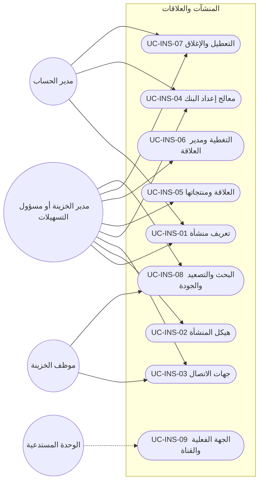
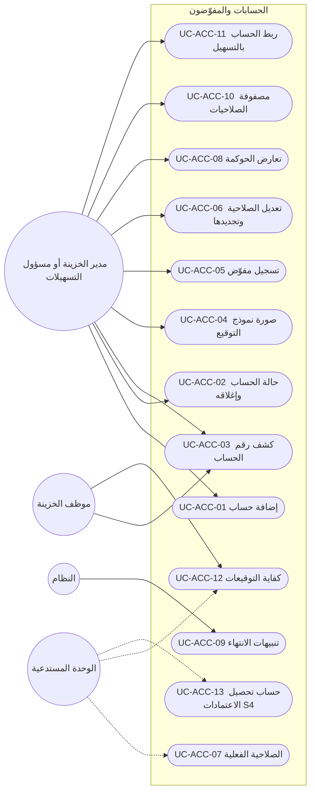
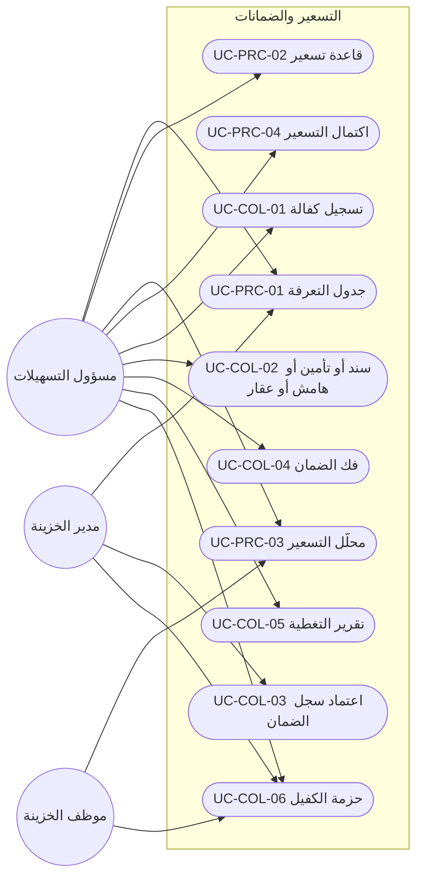
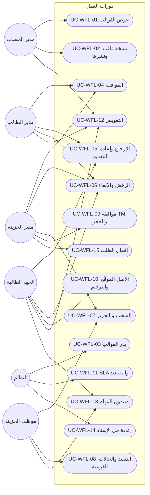
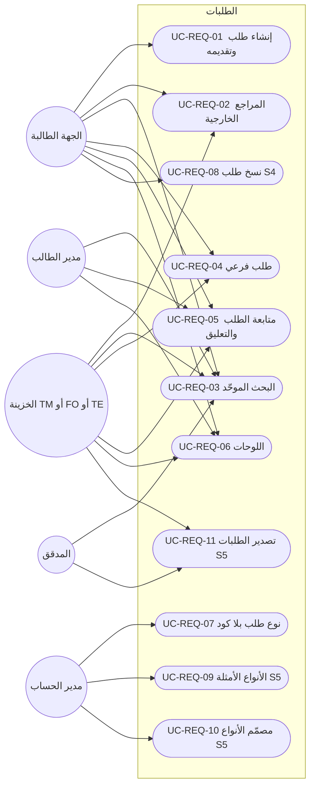
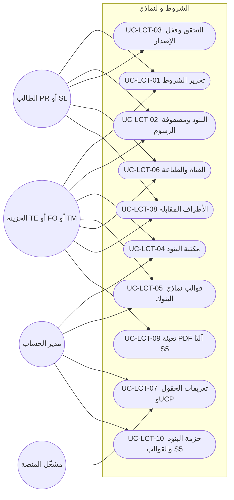
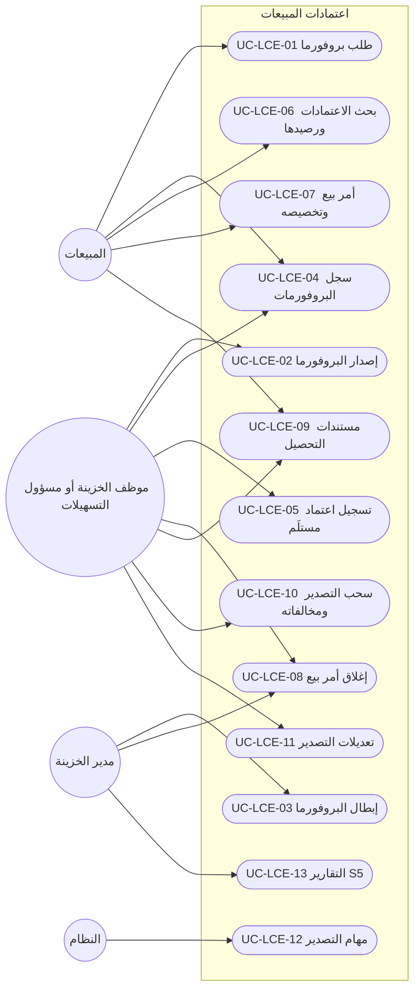

# DOC-F09 — كتالوج حالات الاستخدام: المنشآت والحسابات والكتالوجات والتسهيلات والطلبات والاعتمادات (M2 إلى M8)

| البند | القيمة |
|---|---|
| المعرّف | DOC-F09 (docs/30-readiness-documents.md) |
| الإصدار | 0.1 — مسودة للمراجعة — 2026-10-12 |
| المالك المقترح | محلل الأعمال مع مالكي الوحدات |
| الأولوية | P1 قبل S2؛ ويُراجَع قسما M2 وM4 والحسابات قبل بدء S1 (§22 البند 2) |
| يغطي | FR-INS-001…021، FR-ACC-001…023، FR-CAT-001…026، FR-FAC-001…031، FR-PRC-001…017، FR-COL-001…015، FR-OBL-001…016، FR-FIN-001…014، FR-CMP-001…008، FR-WFL-001…041، FR-REQ-001…027، FR-NTF-001…025، FR-LCT-001…037، FR-LCI-001…033، FR-LCE-001…029 (363 متطلبًا)، وقواعد BR المقابلة، وBR-WFL-027 (docs/20-database-design.md:396) |
| يعتمد على | DOC-F01 (الفاعلون)، DOC-F07 (قالب الكتالوج ورموز CORE)، DOC-F08 (حالة الطلب الموحّدة)، DOC-B02 (قبول S1)، DOC-B04 (رموز الأخطاء)، DOC-F10 إلى DOC-F17 (التسلسلات ومخططات الحالات) |
| المصادر | docs/10-detailed-analysis/11-m2-m4-institutions-accounts-catalogs.md، docs/10-detailed-analysis/12-m5-facilities-pricing-collateral-obligations.md، docs/10-detailed-analysis/13-m6-workflow-engine-notifications.md، docs/10-detailed-analysis/14-m7-m8-letters-of-credit.md، docs/10-detailed-analysis/00-overview-and-cross-cutting.md، db/model/12-institutions-accounts-catalogs.model إلى db/model/16-letters-of-credit.model، docs/20-database-design.md |

## 1. الغرض والنطاق

يعطي هذا الكتالوج معرّفًا ثابتًا لكل حالة استخدام في M2 إلى M8، بقالب DOC-F07. تستشهد بهذه المعرّفات سيناريوهات القبول والشاشات والاختبارات ومصفوفة التتبع (DOC-B08).

- حالات S1 وS1-ب وS2 وS2-ب وS3 مكتملة (§5 إلى §18): الفاعل، الشريحة، رمز الصلاحية، الشروط المسبقة واللاحقة، المسار الرئيسي، البديل والخطأ، المتطلبات والقواعد، وسيناريو القبول.
- حالات S4 وS5 مختصرة في جداول (§19).
- كل متطلب في المواصفات الأربع مربوط بحالة أو مذكور في §20، والربط مفحوص بسكربت (§23.1).
- نقطة البدء التدفقات المرقمة: F-INS-1 وF-INS-2 وF-ACC-1 إلى F-ACC-3 وF-CAT-1 إلى F-CAT-3 (docs/10-detailed-analysis/11-m2-m4-institutions-accounts-catalogs.md:411-442)، وF-FAC-1 وF-FAC-2 وF-FIN-1 وF-COL-1 وF-OBL-1 وF-CMP-1 (docs/10-detailed-analysis/12-m5-facilities-pricing-collateral-obligations.md:427-443)، وF-WFL-1 إلى F-WFL-6 (docs/10-detailed-analysis/13-m6-workflow-engine-notifications.md:459-511)، وF-LCI-1 إلى F-LCI-4 وF-LCE-1 إلى F-LCE-3 (docs/10-detailed-analysis/14-m7-m8-letters-of-credit.md:490-516).
- التسلسلات ومخططات الحالات ليست هنا: سير الموافقات لكل قالب في DOC-F10، ومعاملة الموافقة والحجز في DOC-F11، والإصدار والتعديل في DOC-F12، وإدخال التسهيل واعتماده في DOC-F13، وحالات التسهيل والحجز في DOC-F14، وحالات الالتزامات في DOC-F15، وحالات كيانات الاعتماد في DOC-F16، والأحداث غير المتزامنة في DOC-F17.

اختصارات المسارات في هذه الوثيقة: «11-m2-m4» و«12-m5» و«13-m6» و«14-m7-m8» هي الملفات الأربعة في docs/10-detailed-analysis/، و«00-overview» = docs/10-detailed-analysis/00-overview-and-cross-cutting.md.

**قواعد تسري على كل حالة ولا تتكرر فيها:**

- قواعد DOC-F07 §1 كلها: ترتيب التقييم (حالة المشترك، المصادقة، الصلاحية، نطاق الشركات، قواعد السجل)، والتدقيق، وREST أولًا، وعزل RLS، والوحدة المعطّلة 403. رموز الوحدات: INSTITUTIONS وFACILITIES وCOVENANTS وWORKFLOW وREQUESTS وLC_PURCHASE وLC_SALES (00-overview:239-245).
- الجهة الطالبة (RQ وPR وSL) لا ترى تسهيلًا ولا متاحًا ولا حجزًا ولا هامشًا؛ ترى إسقاط الطالب فقط (FR-FAC-031، BR-WFL-024، BR-LCI-014، BR-LCE-015).
- كل كتابة على طلب أو اعتماد تحمل RowVersion وIdempotency-Key، والتعارض 409 (FR-WFL-035، FR-LCI-031، DOC-B04 §6 و§7).
- كل إجراء على طلب يُسجَّل في RequestAction (FR-WFL-033) وفي التدقيق (FR-WFL-034)، وكل انتقال يكتب حدثًا في طابور الإرسال (FR-WFL-038، DOC-F17).
- حالة الطلب تتبع النموذج الموحّد المقترح في DOC-F08 §4: Status بست قيم (DRAFT وACTIVE وAWAITING_CLOSE وCOMPLETED وREJECTED وCANCELLED) والمرحلة الظاهرة بثماني. وحيث تقول 13-m6 «COMPLETED» عند آخر مرحلة، فهي هنا AWAITING_CLOSE ثم الإقفال (UC-WFL-15).
- المبلغ الوحيد الممرَّر لخدمات الحد هو ExposureAmount تحسبه 14-m7-m8، والمتاح تحسبه 12-m5 وحدها (BR-FAC-014، BR-FAC-015، BR-WFL-016، BR-LCI-004).
- كل رقم افتراضي (مهلة أو عتبة أو مدة) إعداد مشترك بحد أدنى وأقصى (BR-WFL-025، FR-PLT-043).
- البنك والمورّد والعميل خارج النظام: لا ربط حيًّا الآن (11-m2-m4:561-574، 12-m5:575-587، 14-m7-m8:648-660)، وما يصدر عنهم يُدخله موظف الخزينة يدويًا.

## 2. الفاعلون

القائمة المرجعية في DOC-F01 §3. الأدوار الجديدة هنا كلها من فئة A-03 لأنها لا تملك صلاحية كشف (DOC-F01: «موظف الخزينة، مدير القسم، الجهة الطالبة»).

| الفاعل | الرمز | DOC-F01 | الهوية والمصدر |
|---|---|---|---|
| مدير حساب المشترك | TA | A-01 | الكتالوجات العامة، الأنواع والقوالب، قواعد الإشعار |
| مدير الخزينة | TM | A-02 | الموافقة في نقطة الحجز، اعتماد المراجعات، التجاوز (13-m6:58، 12-m5:56) |
| مسؤول التسهيلات | FO | A-02 | إدخال التسهيلات والحدود والضمانات والالتزامات (00-overview:61) |
| موظف الخزينة | TE | A-03 | سحب الطلب وتنفيذه وتسجيل الإصدار والسحوبات |
| المحلل المالي 🟡 | FA | A-03 | دور مقترح لإدخال القوائم (00-overview:66، 12-m5:46) |
| الجهة الطالبة ومديرها | RQ · RQM | A-03 | 13-m6:46 |
| المشتريات | PR | A-03 | طالب اعتماد المشتريات ومديره (14-m7-m8:44) |
| المبيعات | SL | A-03 | معدّ ومدقّق وموافِق، أدوار تُبذر مع S4 (14-m7-m8:44) |
| المدقق | AU | A-04 | قراءة وتصدير بحسب المصفوفات |
| النظام | SYS | A-05 | المهام JOB-* بحساب الخدمة؛ هوية الربط في DOC-F04 |
| مشغّل المنصة | PO | A-06 | المرجع العالمي ومواد UCP (FR-CAT-021، FR-LCT-006) |
| الوحدة المستدعية | MOD | — | مكوّن داخلي يستدعي خدمة SVC-* أو خطافًا في معاملة الطلب؛ ليس فاعلًا خارجيًا |
| خدمة البريد | — | A-09 | بريد الإشعارات في S5 فقط |

## 3. رموز الصلاحيات

### 3.1 الرموز القائمة في المواصفات

الرموز التالية معرّفة 🟢 في مصفوفات الأدوار، ولا يعيد هذا الكتالوج تعريفها. كتالوج الصلاحيات نفسه ملك 10-m0-m1 (FR-PLT-017)، والجدول sec.Permission عالمي (db/model/10-platform.model:169)، ولا يوجد اليوم في db/ أي سكربت يبذر صفوفه؛ خطة البذور في docs/20-database-design.md:474.

| الوحدة | الرموز | المصدر |
|---|---|---|
| INSTITUTIONS | `ins.view` `ins.manage` `ins.contacts.manage` `ins.relationship.manage` `ins.wizard.run` `ins.deactivate` `ins.export` · `acc.view` `acc.reveal` `acc.manage` `acc.close` `acc.facility_link` · `sig.view` `sig.manage` `sig.conflict.review` | 11-m2-m4:45-59 |
| CORE (الكتالوجات) | `cat.view` `cat.manage.general` `cat.manage.financial` `cat.baserate.enter` `cat.global.manage` | 11-m2-m4:61-65 |
| FACILITIES · COVENANTS | `fac.view` `fac.edit` `fac.approve` `fac.conflict.resolve` `fac.util.manage` `fac.reserve` `fac.override_limit` · `prc.view` `prc.manage` `prc.tariff.approve` · `col.view` `col.manage` `col.approve` · `obl.view` `obl.manage` `obl.record` `obl.breach.manage` `obl.waiver.approve` · `fin.view` `fin.stmt.enter` `fin.stmt.approve` `fin.stats.enter` `fin.formula.manage` `fin.formula.approve` `fin.verify.run` · `cmp.view` `cmp.manage` | 12-m5:50-71 |
| WORKFLOW · REQUESTS · CORE (الإشعارات) | `req.create` `req.view.own` `req.view.department` `req.view.all` `req.view.internal` `req.comment` `req.comment.internal` `req.approve` `req.treasury.approve` `req.facility.select` `req.claim` `req.execute` `req.reassign` `req.cancel` `req.cancel.any` `req.extref.edit` `req.create.child` `req.delegate.own` `req.delegate.manage` `req.dashboard.manager` `req.type.manage` `req.export` · `wfl.template.view` `wfl.template.manage` `wfl.template.publish` · `ntf.manage` `ntf.prefs` `ntf.log.view` | 13-m6:50-77 |
| LC_PURCHASE · LC_SALES | `lc.terms.edit` `lc.terms.treasury.edit` `lc.view.own` `lc.view.all` `lc.view.internal` `lc.export.view` `lc.export.record` `lc.issuance.record` `lc.proforma.issue` `lc.proforma.void` `lc.child.create` `lc.amendment.record` `lc.drawing.record` `lc.discrepancy.decide` `lc.close` `lc.order.release` `lc.legacy.enter` `lc.counterparty.manage` `lc.clause.manage` `lc.template.manage` `lc.field.manage` `lc.print` `lc.compare` `lc.report.view` `lc.report.export` | 14-m7-m8:48-75 |
| من خارج المواصفات الأربع | `req.treasury.close` (إقفال الطلب؛ حامله قرار DQ-F08-3) · `party.identity.reveal` 🔒 و`party.pack.export` 🔒 · `party.pack.draft` 🟡 و`cfg.settings.manage` 🟡 (DOC-F07 §3) | docs/20-database-design.md:403؛ DOC-F07 §3 |

### 3.2 رموز مقترحة

أربعة إجراءات في المواصفات بلا رمز. المقترح 🟡 بنمط `<وحدة>.<كائن>.<فعل>`، واعتمادها قرار DQ-F09-1.

| الرمز | الأدوار الافتراضية | الإجراء الذي يسده | المصدر | حالة الاستخدام |
|---|---|---|---|---|
| `fac.status.manage` | TM، FO | حسم «السريان غير المؤكد»، وتعليق التسهيل وإعادته وإنهاؤه | 12-m5:115، :451 | UC-FAC-07 |
| `cmp.term.propose` | FO، TM | اقتراح مفتاح شرط جديد وترقية OTHER | 12-m5:224، :71 | UC-CMP-01 |
| `acc.signature.image.view` 🔒 | TM، FO | عرض صورة نموذج التوقيع وتنزيلها | 11-m2-m4:158، :621 | UC-ACC-04 |
| `wfl.request.migrate` | TM، TA | نقل طلب جارٍ إلى نسخة قالب أحدث | 13-m6:153 | UC-WFL-18 |

إجراءات تستعمل رمزًا قائمًا بلا رمز جديد 🟡:

- إعادة فتح علاقة مغلقة: `ins.deactivate` (11-m2-m4:50)، مع أن جدول الحالات يذكر TM وحده (11-m2-m4:451)؛ انظر DQ-F09-3.
- فك حجز يدويًا في M5: `fac.reserve` (12-m5:55) مع سبب، ويصل المحرك حدث `released_externally` فيُعلَّم الطلب LOST (13-m6:311)؛ انظر DQ-F09-4.
- إعادة محاولة تسليم فاشل: `ntf.manage` (13-m6:74)، لأن `ntf.log.view` للعرض فقط.
- التحقق من مواد UCP: دور المشغّل `cat.global.manage` (11-m2-m4:65)، لأن الجدول عالمي (FR-LCT-006).
- تفعيل `fac.override_limit.enabled` وإعدادات `lc.*` و`wf.*`: `cfg.settings.manage` (DOC-F07 §3).

## 4. مخططات حالات الاستخدام

الخط المتصل فاعل يبدأ الحالة، والمتقطع فاعل ثانوي أو استدعاء. الحالات المختصرة (S4 وS5) تظهر في مخطط وحدتها لاكتمال الصورة.

### 4.1 المنشآت المالية (INS)

### 4.2 الحسابات والمفوّضون (ACC)

### 4.3 الكتالوجات (CAT)

### 4.4 التسهيلات والحدود (FAC)

### 4.5 التسعير والضمانات (PRC وCOL)

### 4.6 الالتزامات ومكتبة الشروط (OBL وCMP)

### 4.7 البيانات المالية والتحقق (FIN)

### 4.8 محرك دورات العمل (WFL)

### 4.9 الطلبات (REQ)

### 4.10 الإشعارات (NTF)

### 4.11 شروط الاعتماد والنماذج (LCT)

### 4.12 اعتمادات المشتريات (LCI)

### 4.13 اعتمادات المبيعات والبروفورما (LCE، S4)

## 5. M2 المنشآت المالية (INS)

الشروط المسبقة المشتركة: وحدة INSTITUTIONS مفعّلة، وجلسة مصادقة، والشركة ضمن نطاق المستخدم. الشرط اللاحق المشترك: حدث تدقيق بالقيمتين، وحدث `institution.*` أو `relationship.*` في طابور الإرسال (11-m2-m4:568). الجداول في db/model/12-institutions-accounts-catalogs.model:278-376.

### UC-INS-01 — تعريف منشأة مالية

- **الفاعل · الشريحة · الصلاحية:** TM أو FO أو TA · S1 · `ins.manage`
- **قبل:** الكتالوج InstitutionType والمرجع ref.Country مبذوران (UC-CAT-01).
- **بعد:** صف ins.Institution بحالة ACTIVE (db/model/12-institutions-accounts-catalogs.model:287)؛ المحلي والأجنبي يُشتق عند القراءة ولا يُخزَّن (db/model/12-institutions-accounts-catalogs.model:8).
- **يغطي:** FR-INS-001…004، FR-INS-020، FR-INS-021، BR-INS-001…003 · **القبول:** AC-INS-4

1. يختار المستخدم «منشأة جديدة» من SCR-INS-01 ويحدد النوع.
2. يُدخل الرمز والاسمين والدولة وBIC والموقع.
3. يطبّع النظام الرمز ويتحقق من فرادته وشكل BIC (V-INS-01)، وينبّه إلى اسم مشابه أو BIC قائم (V-INS-02).
4. إن كان النوع RequiresParty يختار المستخدم Party قائمًا أو ينشئه (UC-PTY-01)، ولا تُعرض حقول هوية في بطاقة المنشأة.
5. يحفظ النظام المنشأة ويعرض «محلي» أو «أجنبي» بمقارنة دولتها بدولة المشترك.
6. منشأة الفرد تُسجَّل مزوّد استخدام Party فتظهر شارة «ممول فرد» في بطاقته (FR-INS-021).

**بديل وخطأ:**
- 3أ. رمز مكرر أو BIC بغير 8 أو 11 خانة: رفض. دولة غير مفعّلة في المرجع: رفض.
- 4أ. نوع الفرد بلا Party، أو Party مربوط بمنشأة أخرى للمشترك: رفض (BR-INS-003).
- 4ب. نوع غير الفرد مع Party: رفض.
- ملاحظة: حقل DirectoryRef محجوز في الواجهة البرمجية ولا يظهر في الشاشة (FR-INS-020، §20).

### UC-INS-02 — هيكل المنشأة: الوحدات وبياناتها

- **الفاعل · الشريحة · الصلاحية:** TM أو FO أو TA · S1 · `ins.manage`
- **قبل:** منشأة غير INACTIVE.
- **بعد:** صفوف ins.InstitutionUnit في شجرة بعمق 4 على الأكثر، ووسائل الاتصال والعنوان بملكية UNIT في M1.
- **يغطي:** FR-INS-005، FR-INS-006، BR-INS-004 · **القبول:** AC-INS-5

1. يفتح المستخدم تبويب «الهيكل وجهات الاتصال» في SCR-INS-02.
2. يضيف وحدة بنوعها (إدارة أو قسم أو فرع) واسمها وأبيها.
3. يُدخل الهاتف والبريد والموقع والعنوان.
4. يتحقق النظام من الأب والعمق والحلقة وصيغة البريد والموقع، ثم يحفظ.

**بديل وخطأ:**
- 4أ. أب من منشأة أخرى، أو مستوى خامس، أو حلقة، أو قسم تحت قسم: رفض (V-INS-03).
- 4ب. اسم مكرر تحت الأب نفسه: رفض بقيد الفرادة.

### UC-INS-03 — جهات الاتصال وتسلسل «يتبع لـ»

- **الفاعل · الشريحة · الصلاحية:** TM أو FO أو TE أو TA · S1 · `ins.contacts.manage`
- **قبل:** منشأة غير INACTIVE.
- **بعد:** صف ins.Contact بحالة ACTIVE ووسيلة اتصال واحدة على الأقل؛ PartyId فارغ ما لم يُربط.
- **يغطي:** FR-INS-007، FR-INS-008، FR-INS-021، BR-INS-005، BR-INS-006، BR-INS-014 · **القبول:** AC-INS-2، AC-INS-3

1. يضيف المستخدم جهة اتصال بالاسمين والمسمى والوحدة.
2. يُدخل وسائل الاتصال؛ يطبّع النظام الهاتف بصيغة دولية بـ DialCode الدولة.
3. يختار اختياريًا «يتبع لـ» جهة من المنشأة نفسها.
4. يختار اختياريًا ربط الجهة ببطاقة Party قائمة (ترقية).
5. يتحقق النظام ويحفظ، ويعرض الشجرة.
6. عند الربط تُسجَّل الجهة مزوّد استخدام Party ولا يُنسخ منها شيء إلى Contact.

**بديل وخطأ:**
- 2أ. بلا هاتف ولا جوال ولا بريد: رفض (V-INS-04).
- 3أ. الذات، أو جهة من منشأة أخرى، أو حلقة: رفض (V-INS-03).
- 4أ. Party مربوط بجهة أخرى في المنشأة نفسها، أو غير موجود: رفض (V-INS-07).
- 4ب. دمج Party مربوط (UC-PTY-06): يعيد التوجيه إلى الباقي في المعاملة نفسها.

### UC-INS-04 — معالج إعداد البنك

- **الفاعل · الشريحة · الصلاحية:** TM أو FO أو TA · S1 · `ins.wizard.run`
- **قبل:** شركة نشطة واحدة على الأقل ضمن نطاق المستخدم؛ منتجات مبذورة.
- **بعد:** في معاملة واحدة: منشأة واحدة، وعلاقة لكل شركة مختارة، وRelationshipProduct لكل خلية، وصفوف التغطية (BR-INS-013)؛ أو مسودة بمنشأة DRAFT وعلاقات PROSPECT.
- **يغطي:** FR-INS-014، FR-INS-015، BR-INS-013، F-INS-1 · **القبول:** AC-INS-1، AC-INS-7

1. يُدخل المستخدم بيانات المنشأة كما في UC-INS-01.
2. يختار الشركات ويُدخل رقم العميل لكلٍّ.
3. يعلّم مصفوفة الشركات × المنتجات ويحدد القناة لكل خلية؛ الفارغ = MANUAL_FORM.
4. يضيف التغطية لكل علاقة ثم الوحدات والجهات، ويختار الجهة الافتراضية لكل (علاقة، منتج).
5. تعرض المراجعة الأعداد والتحذيرات: منتج بلا جهة، علاقة بلا مدير علاقة.
6. يضغط «إنشاء» فينفّذ النظام الكل في معاملة واحدة (`/bank-setup`، 11-m2-m4:567).

**بديل وخطأ:**
- 6أ. أي خطأ تحقق (رمز مكرر، قناة DIRECT_INTEGRATION): لا يُنشأ أي صف، وتعود الخطوة المعنية مظللة.
- 6ب. «حفظ مسودة» بدل «إنشاء»: منشأة DRAFT وعلاقات PROSPECT؛ الاستئناف يعيد إلى آخر خطوة (Could).
- 6ج. علاقة قائمة لشركة مختارة: يفتح المعالج العلاقة القائمة ولا ينشئ ثانية (BR-INS-007).

### UC-INS-05 — العلاقة ومنتجاتها وقنواتها

- **الفاعل · الشريحة · الصلاحية:** TM أو FO أو TA · S1 · `ins.relationship.manage`
- **قبل:** منشأة ACTIVE وشركة ضمن النطاق.
- **بعد:** صف ins.Relationship فريد لكل (شركة، منشأة) مهما كانت حالته، وصفوف ins.RelationshipProduct.
- **يغطي:** FR-INS-009، FR-INS-011، FR-INS-012، FR-INS-013، BR-INS-007، BR-INS-010 · **القبول:** AC-INS-6

1. يفتح المستخدم SCR-INS-04 من المنشأة أو الشركة.
2. يُدخل رقم العميل وتاريخ البدء والحالة.
3. يضيف منتجًا نشطًا ويختار جهته الافتراضية من جهات المنشأة نفسها.
4. يختار القناة المفضلة: BANK_PORTAL أو MANUAL_FORM.
5. يحفظ النظام، وتعيد UC-INS-09 القناة والجهة الفعلية للمستهلكين.

**بديل وخطأ:**
- 2أ. علاقة قائمة للزوج نفسه: يفتحها النظام بدل إنشاء ثانية.
- 2ب. رقم عميل مكرر داخل المنشأة: تحذير لا منع (V-INS-05).
- 3أ. منتج غير نشط، أو مكرر في العلاقة، أو جهة من منشأة أخرى: رفض (V-INS-06).
- 4أ. DIRECT_INTEGRATION: رفض برسالة «غير مفعّل» (BR-INS-010).

### UC-INS-06 — التغطية واستبدال مدير العلاقة

- **الفاعل · الشريحة · الصلاحية:** TM أو FO أو TA · S1 · `ins.relationship.manage`
- **قبل:** علاقة غير CLOSED؛ الجهة من منشأة العلاقة.
- **بعد:** صفوف ins.RelationshipContact بفترات لا تتداخل؛ القديم يُغلق بتاريخ ولا يُحذف؛ حدث `relationship.coverage.changed`.
- **يغطي:** FR-INS-010، BR-INS-008، F-INS-2 · **القبول:** AC-INS-6

1. يضيف المستخدم صف تغطية: الجهة والدور والرتبة والأساسي وتاريخ البدء.
2. إن تُركت الرتبة فارغة يملؤها النظام بحسب الدور (1 إلى 4).
3. للاستبدال يختار «استبدال» والجهة الجديدة وتاريخ السريان.
4. يغلق النظام الصف القديم في اليوم السابق ويفتح الجديد بالرتبة نفسها.
5. يعرض النظام الجهات الافتراضية التي كانت تشير إلى القديم ويحدّثها بعد تأكيد.

**بديل وخطأ:**
- 1أ. رتبة مكررة بين النشطة، أو صفان أساسيان للدور نفسه: رفض.
- 5أ. رفض التأكيد: تبقى الجهات الافتراضية كما هي، وتظهر في مؤشر الجودة (UC-INS-08).
- علاقة ACTIVE بلا مدير علاقة نشط تُصدر NTF-INS-01 لـ TM وFO.

### UC-INS-07 — تعطيل المنشأة أو الجهة وإغلاق العلاقة وإعادة فتحها

- **الفاعل · الشريحة · الصلاحية:** TM أو TA · S1 · `ins.deactivate`؛ وتعطيل الجهة بـ `ins.contacts.manage`
- **قبل:** الهدف ليس في الحالة المطلوبة.
- **بعد:** العلاقة CLOSED بتاريخ وسبب، وفترات تغطيتها منتهية ومنتجاتها معطّلة؛ أو المنشأة INACTIVE؛ أو الجهة INACTIVE بسبب. لا حذف.
- **يغطي:** FR-INS-016، BR-INS-005، BR-INS-011، BR-INS-012 · **القبول:** AC-INS-7، AC-INS-2

1. يختار المستخدم «إغلاق العلاقة» أو «تعطيل المنشأة» أو «تعطيل الجهة».
2. يفحص النظام الأثر: حسابات غير مغلقة، وتسهيلات نشطة (M5)، وجهات افتراضية، وتابعون.
3. يكتب المستخدم السبب وتاريخ الإغلاق.
4. للجهة الافتراضية أو المدير الذي له تابعون يحدد بديلًا، أو يترك التابعين بلا مدير بتحذير.
5. يحفظ النظام في معاملة واحدة ويصدر `relationship.closed` أو `institution.*`.

**بديل وخطأ:**
- 2أ. حساب غير مغلق أو تسهيل نشط: رفض بقائمة المراجع (BR-INS-011).
- 2ب. منشأة لها علاقة غير CLOSED: رفض (BR-INS-012).
- 1أ. إعادة فتح علاقة CLOSED بسبب: تعود ACTIVE ويبقى تاريخها. الحامل قرار DQ-F09-3.

### UC-INS-08 — البحث الموحّد وورقة التصعيد ومؤشرات الجودة

- **الفاعل · الشريحة · الصلاحية:** TM أو FO أو TE · S1 · `ins.view`؛ والطباعة `ins.export`
- **قبل:** لا شيء غير المشترك.
- **بعد:** لا تغيير؛ الطباعة مدقَّقة.
- **يغطي:** FR-INS-017، FR-INS-018، FR-INS-019، R-INS-01…04 · **القبول:** AC-INS-8

1. يكتب المستخدم جزءًا من اسم أو هاتف أو بريد أو BIC أو رقم عميل.
2. يعيد النظام المنشآت والجهات المطابقة ضمن النطاق في أقل من ثانيتين على 5000 جهة.
3. يفتح علاقة ويطبع ورقة التصعيد: صفوف الطبقة الأولى النشطة بترتيب الرتبة.
4. يفتح تقرير الجودة: علاقة بلا مدير علاقة، منتج بلا جهة، جهة بلا وسيلة، منشأة بلا علاقة نشطة.

**بديل وخطأ:**
- 3أ. بلا `ins.export`: لا يظهر زر الطباعة، والاستدعاء المباشر 403.
- ملاحظة: شاشة المصفوفة SCR-INS-05 تقرأ البيانات نفسها (R-INS-02).

### UC-INS-09 — حل الجهة الفعلية والقناة المفضلة (خدمة)

- **الفاعل · الشريحة · الصلاحية:** الوحدة المستدعية (M6 وM7) · S1، ويُستهلك من S3 · خدمة داخلية بسياق المستخدم الفاعل
- **قبل:** علاقة قائمة أو (شركة، منشأة)، ومنتج، وتاريخ.
- **بعد:** لا تغيير؛ نتيجة بمصدرها.
- **يغطي:** FR-INS-012، FR-INS-013، BR-INS-009، SVC-01، SVC-02 · **القبول:** AC-INS-1، AC-INS-2

1. تستدعي الوحدة SVC-01 بالعلاقة والمنتج والتاريخ.
2. يعيد النظام الجهة الافتراضية للمنتج إن كانت نشطة، بمصدر DEFAULT.
3. وإلا يعيد مدير العلاقة النشط ذا أقل رتبة، بمصدر RM.
4. تستدعي الوحدة SVC-02 فيعيد النظام القناة المضبوطة (CONFIGURED) أو MANUAL_FORM (DEFAULT).

**بديل وخطأ:**
- 3أ. لا جهة: النتيجة NONE ولا خطأ؛ يعرضها المستهلك «لا جهة».
- 1أ. علاقة خارج نطاق شركات المستخدم الفاعل: 404 (DOC-F07 §1).

## 6. M3 الحسابات والمفوّضون (ACC)

الشروط المسبقة المشتركة: وحدة INSTITUTIONS مفعّلة، والشركة ضمن النطاق. الشرط اللاحق المشترك: تدقيق بلا قيم سرية، وحدث `bankaccount.*` أو `signatory.*` بلا رقم حساب ولا IBAN (11-m2-m4:568). الجداول في db/model/12-institutions-accounts-catalogs.model:378-506. حالات المفوّضين (UC-ACC-05 إلى UC-ACC-10) من S1-ب.

### UC-ACC-01 — إضافة حساب بنكي

- **الفاعل · الشريحة · الصلاحية:** TM أو FO · S1 · `acc.manage`
- **قبل:** منشأة ACTIVE؛ الكتالوج AccountType مبذور.
- **بعد:** صف acc.BankAccount بحالة ACTIVE؛ الرقم وIBAN مشفّران مع قناع وفهرس أعمى (db/model/12-institutions-accounts-catalogs.model:5)؛ حدث `bankaccount.created`.
- **يغطي:** FR-ACC-001…007، BR-ACC-001…005، F-ACC-1 · **القبول:** AC-ACC-1، AC-ACC-5

1. يختار المستخدم الشركة والمنشأة.
2. إن لم توجد علاقة يعرض النظام إنشاءها، فيؤكد المستخدم فتُنشأ ACTIVE (BR-ACC-003).
3. يُدخل النوع والعملة والرقم وIBAN والاسم الداخلي والفرع.
4. يطبّع النظام الرقم ويتحقق من IBAN (الطول وباقي 97) ومن الفرادة فورًا.
5. للنوع الافتراضي يختار المستخدم الحساب الرئيسي.
6. يُدخل نص قاعدة التوقيع والحد الأدنى للتوقيعات، ثم يحفظ.

**بديل وخطأ:**
- 4أ. رقم مكرر في المنشأة بعد التطبيع، أو IBAN مكرر في المشترك أو غير صحيح، أو عملة ناقصة: رفض (V-ACC-01).
- 5أ. رئيس افتراضي أو مغلق أو مختلف الشركة أو المنشأة أو العملة: رفض (V-ACC-02).
- 6أ. MinSignatures أقل من 1: رفض (V-ACC-03). أكبر من عدد المفوّضين المؤهلين: تحذير، ويعمل بعد S1-ب (V-ACC-04).

### UC-ACC-02 — تغيير حالة الحساب وإغلاقه

- **الفاعل · الشريحة · الصلاحية:** TM للتجميد والإغلاق · S1 · `acc.close`؛ والخمول بـ `acc.manage`
- **قبل:** الحساب ليس CLOSED.
- **بعد:** الحالة الجديدة؛ CLOSED نهائي بتاريخ وسبب ويحجز رقمه (db/model/12-institutions-accounts-catalogs.model:416-417)؛ حدث `bankaccount.status_changed` أو `bankaccount.closed`.
- **يغطي:** FR-ACC-008، BR-ACC-004، BR-ACC-006 · **القبول:** AC-ACC-5، AC-ACC-1

1. يختار المستخدم الإجراء: خامل، مجمّد، إعادة تنشيط، إغلاق.
2. للإغلاق يُدخل التاريخ والسبب.
3. يفحص النظام الحسابات الافتراضية تحته، وأغراضه الافتراضية في تسهيل نشط (S2).
4. يحفظ النظام الحالة.

**بديل وخطأ:**
- 3أ. افتراضي غير مغلق تحته: رفض حتى يُغلق.
- 3ب. حساب افتراضي لغرض في تسهيل نشط: رفض حتى يُحدَّد بديل للغرض (BR-ACC-006).
- 4أ. تجميد أو إغلاق حساب مربوط بتسهيل: NTF-ACC-03 لـ TM وFO (S2).
- 4ب. تعديل حساب CLOSED عدا الملاحظات: رفض.

### UC-ACC-03 — كشف رقم الحساب أو IBAN

- **الفاعل · الشريحة · الصلاحية:** TM أو FO أو TE · S1 · `acc.reveal`
- **قبل:** الحساب ضمن نطاق المستخدم.
- **بعد:** القيمة الكاملة معروضة مؤقتًا؛ حدث تدقيق (مستخدم، وقت، حساب، سبب اختياري).
- **يغطي:** FR-ACC-009، BR-ACC-016، R-ACC-01 · **القبول:** AC-ACC-1

1. يعرض النظام الرقم مقنَّعًا: رمز الدولة وآخر 4 خانات.
2. يضغط المستخدم «كشف» ويكتب سببًا اختياريًا.
3. يتحقق النظام من الصلاحية والنطاق ثم يفك التشفير ويعرض القيمة.
4. يسجّل النظام حدث الكشف.

**بديل وخطأ:**
- 3أ. بلا الصلاحية (TA وAU افتراضيًا): 403 وحدث مرفوض.
- 2أ. تصدير R-ACC-01 كاملًا: الصلاحية نفسها وعلامة مائية 🟡 (11-m2-m4:589)، وكل تصدير مدقَّق.

### UC-ACC-04 — إرفاق صورة نموذج التوقيع وعرضها

- **الفاعل · الشريحة · الصلاحية:** TM أو FO · S1، ويعمل فعليًا مع S1-ب · `sig.manage` للإرفاق و`acc.signature.image.view` 🔒 🟡 للعرض
- **قبل:** سجل مفوّض قائم (UC-ACC-05)؛ نوع الوثيقة SIGNATURE_SPECIMEN حساس.
- **بعد:** Signatory.SpecimenDocumentId يشير إلى وثيقة مخزّنة بقيود الحساس (UC-PLT-21)؛ كل عرض مدقَّق.
- **يغطي:** FR-ACC-022، BR-CAT-016 · **القبول:** AC-ACC-6

1. يفتح المستخدم بطاقة المفوّض ويضغط «إرفاق نموذج التوقيع».
2. يرفع الملف عبر خدمة المستندات.
3. يحفظ النظام الربط.
4. لاحقًا يضغط حامل الصلاحية «عرض» فيعرض النظام الصورة ويسجّل الحدث.

**بديل وخطأ:**
- 4أ. بلا الصلاحية: 403 وحدث مرفوض.
- ملاحظة: FR-ACC-022 في S1 والحقل على سجل المفوّض في S1-ب (11-m2-m4:158)، فالتسليم مع S1-ب (DQ-F09-5).

### UC-ACC-05 — تسجيل مفوّض وتفعيله

- **الفاعل · الشريحة · الصلاحية:** TM أو FO · S1-ب · `sig.manage`
- **قبل:** علاقة ACTIVE؛ Party من نوع شخص طبيعي.
- **بعد:** صف acc.Signatory بحالة PENDING، ثم ACTIVE بإرفاق وثيقة التفويض (db/model/12-institutions-accounts-catalogs.model:449، :457)؛ مزوّد استخدام Party مسجَّل؛ حدث `signatory.activated`.
- **يغطي:** FR-ACC-012، FR-ACC-023، BR-ACC-008، BR-ACC-009، F-ACC-2 · **القبول:** AC-ACC-2 (الشارة)

1. يختار المستخدم Party أو ينشئه (UC-PTY-01).
2. يحدد العلاقة وفئة التوقيع والمنصب وفترة السريان.
3. يرفع وثيقة التفويض.
4. يحفظ النظام؛ مع الوثيقة وتاريخ البدء تصير الحالة ACTIVE.
5. يدخل المستخدم الصلاحيات (UC-ACC-06).
6. تظهر في بطاقة Party شارة «مفوَّض بنكي» بعدد علاقاته.

**بديل وخطأ:**
- 1أ. Party ليس شخصًا طبيعيًا: رفض.
- 2أ. صف مفتوح للثلاثي (علاقة، Party، فئة): رفض (BR-ACC-008).
- 3أ. بلا وثيقة: يبقى PENDING ولا يُحسب في الكفاية.
- 4أ. إيقاف أو سحب لاحق: SUSPENDED أو REVOKED بسبب؛ REVOKED نهائي.

### UC-ACC-06 — صلاحيات المفوّض: الإدخال والتعديل والتجديد

- **الفاعل · الشريحة · الصلاحية:** TM أو FO · S1-ب · `sig.manage`
- **قبل:** مفوّض غير REVOKED.
- **بعد:** صفوف acc.SignatoryAuthority؛ التعديل يغلق القديم (SupersededById) ويفتح جديدًا دون فجوة؛ حدث `signatory.authority.changed`؛ مقارنة الحوكمة تعمل (UC-ACC-08).
- **يغطي:** FR-ACC-013، FR-ACC-014، FR-ACC-017، BR-ACC-010، BR-ACC-011 · **القبول:** —، فجوة (§22)

1. يفتح المستخدم شبكة الصلاحيات (عملية × حساب أو البنك).
2. يختار العملية والنطاق والسقف ونمطه والعملة والسقف اليومي.
3. يحدد التوقيع المشترك: الفئات المطلوبة والعدد الأدنى.
4. يحفظ النظام بعد التحقق، ويشغّل مقارنة الحوكمة.
5. للتعديل يغيّر السقف فيغلق النظام الصف القديم ويفتح جديدًا.
6. للتجديد يختار «تجديد مع نسخ» بوثيقة وفترة جديدتين فيُنسخ كل صف فعّال.

**بديل وخطأ:**
- 2أ. صف بلا عملية، أو حساب من علاقة أخرى، أو LIMITED بلا مبلغ أو عملة، أو يومي أقل من سقف العملية، أو تداخل فترات: رفض (V-ACC-05).
- 2ب. عملية لا تدعم السقف: لا يُطلب مبلغ.
- 4أ. فترة تتجاوز انتهاء وثيقة التفويض: تحذير (V-ACC-06).

### UC-ACC-07 — الصلاحية الفعلية لمفوّض (خدمة)

- **الفاعل · الشريحة · الصلاحية:** الوحدة المستدعية أو مستخدم الخزينة · S1-ب · `sig.view`
- **قبل:** مفوّض وحساب أو بنك وعملية وتاريخ.
- **بعد:** لا تغيير؛ السقوف والعملة والتوقيع المشترك والمستوى ACCOUNT أو MASTER أو BANK أو NONE.
- **يغطي:** FR-ACC-015، BR-ACC-012، SVC-03، F-ACC-3 · **القبول:** AC-ACC-2

1. يستدعي المستهلك SVC-03.
2. يبحث النظام عن صف صالح للحساب في التاريخ.
3. وإلا، إن كان الحساب افتراضيًا، عن صف رئيسه.
4. وإلا عن صف مستوى البنك.
5. يعيد الأخص ولو كان سقفه أدنى.

**بديل وخطأ:**
- 4أ. لا صف: «لا صلاحية» (NONE) لا خطأ.
- 3أ. إرث الافتراضي من رئيسه افتراض 🟡 معلّق على Q-ACC-04.

### UC-ACC-08 — مراجعة تعارضات الحوكمة

- **الفاعل · الشريحة · الصلاحية:** TM أو FO؛ AU للقراءة · S1-ب · `sig.conflict.review`
- **قبل:** صلاحية مفوّض محفوظة؛ منح AuthorityGrant في M1.
- **بعد:** صف acc.AuthorityConflict بحالة OPEN أو ACKNOWLEDGED بسبب، أو RESOLVED آليًا (db/model/12-institutions-accounts-catalogs.model:498، :505)؛ حدث `authority.conflict.opened` أو `resolved`.
- **يغطي:** FR-ACC-018، BR-ACC-015، FR-ORG-030 (مؤشر) · **القبول:** AC-ACC-3

1. عند حفظ صلاحية، وليليًا (JOB-ACC-GOV)، وعند تغيّر منحة، يقارن النظام الصلاحية بالمنح غير المقيّدة ببنك أو المقيّدة ببنك العلاقة.
2. عند تعارض ينشئ مثيلًا ببصمة ورمز، ويصدر NTF-ACC-04 لـ TM وFO.
3. يفتح المراجع SCR-ACC-06 ويرى الصلاحية والمنحة.
4. يقرّ بسبب مدوَّن فتصير الحالة ACKNOWLEDGED.

**بديل وخطأ:**
- 1أ. زوال السبب: RESOLVED آليًا.
- 1ب. بصمة جديدة (تغيّر الصلاحية أو المنحة): مثيل جديد.
- 1ج. عملتان مختلفتان: NOT_COMPARABLE_CURRENCY؛ عملية بلا ربط: NOT_MAPPED.
- 4أ. الإقرار بلا سبب: رفض بقيد القاعدة.

### UC-ACC-09 — تنبيهات انتهاء المفوّض والصلاحية والوثيقة

- **الفاعل · الشريحة · الصلاحية:** النظام (JOB-ACC-EXPIRY) · S1-ب · حساب الخدمة
- **قبل:** مفوّضون ACTIVE بتواريخ انتهاء.
- **بعد:** إشعار NTF-ACC-01 واحد لكل (هدف، عتبة)؛ المفوّض EXPIRED في اليوم التالي لـ ValidTo؛ NTF-ACC-02 إن بقي حساب بلا مفوّض نشط.
- **يغطي:** FR-ACC-019، BR-ACC-009، BR-ACC-017 · **القبول:** AC-ACC-4

1. تعمل المهمة يوميًا بتوقيت المشترك.
2. تحسب أبكر تاريخ من انتهاء المفوّض والصلاحية والوثيقة.
3. عند T-30 وT-15 وT-7 ويوم الانتهاء تصدر الحدث عبر Emit (UC-NTF-01).
4. بعد ValidTo تنقل المفوّض إلى EXPIRED.

**بديل وخطأ:**
- 3أ. تشغيل ثانٍ في اليوم نفسه: لا تكرار (DedupKey).
- 3ب. تجديد يغيّر التاريخ: تُعاد العتبات للتاريخ الجديد.

### UC-ACC-10 — مصفوفة الصلاحيات وتقارير المفوّضين

- **الفاعل · الشريحة · الصلاحية:** TM أو FO أو TE؛ AU · S1-ب · `sig.view`؛ والتصدير `sig.manage`
- **قبل:** بنك وتاريخ.
- **بعد:** لا تغيير؛ التصدير مدقَّق بعلامة مائية 🟡.
- **يغطي:** FR-ACC-020، R-ACC-02…06 · **القبول:** —، فجوة (§22)

1. يختار المستخدم البنك أو الحساب والتاريخ.
2. يبني النظام المصفوفة (مفوّض × عملية × حساب) من الصلاحيات الفعلية في ذلك التاريخ (UC-ACC-07).
3. يطبع المستخدم أو يصدّر.
4. يفتح التقارير: السجل، الحسابات بلا مفوّضين، الانتهاءات خلال 90 يومًا.

**بديل وخطأ:**
- 3أ. تصدير بلا صلاحية: 403.

### UC-ACC-11 — ربط الحساب بالتسهيل وتحديد غرضه

- **الفاعل · الشريحة · الصلاحية:** TM أو FO · S2 · `acc.facility_link`
- **قبل:** تسهيل في مراجعة DRAFT (UC-FAC-01)؛ حساب نشط لشركة من شركات التسهيل.
- **بعد:** صف acc.FacilityAccount؛ حساب افتراضي واحد لكل (تسهيل، غرض، عملة)؛ SVC-FAC-07 تعيد الحسابات الثلاثة.
- **يغطي:** FR-ACC-010، FR-FAC-022، BR-ACC-007 · **القبول:** —، فجوة (§22)

1. يفتح المستخدم تبويب «الحسابات» في بطاقة التسهيل.
2. يختار الحساب والغرض ويعلّم «افتراضي» إن لزم.
3. يحفظ النظام بعد التحقق.

**بديل وخطأ:**
- 2أ. حساب مجمّد أو مغلق، أو شركة خارج شركات التسهيل: رفض.
- 2ب. منشأة الحساب ليست من المقرضين: تحذير في التمويل المشترك.
- 2ج. افتراضيان للثلاثي نفسه: رفض.
- 3أ. اعتماد مراجعة بلا حساب بغرض FACILITY: تحذير (V-FAC-12).

### UC-ACC-12 — فحص كفاية التوقيعات (خدمة)

- **الفاعل · الشريحة · الصلاحية:** الوحدة المستدعية؛ TE في مرحلة التنفيذ · S3 · خدمة داخلية؛ والعرض `sig.view`
- **قبل:** حساب وعملية ومبلغ وعملة وتاريخ.
- **بعد:** لا تغيير؛ النتيجة SUFFICIENT أو INSUFFICIENT أو NOT_COMPARABLE أو «لم يُفحص»، مع المرشحين والأسباب، وتُسجَّل مع الطلب.
- **يغطي:** FR-ACC-016، BR-ACC-013، BR-ACC-014، SVC-04 · **القبول:** AC-ACC-2

1. يستدعي المستهلك SVC-04 عند حالة «توقيع» في التنفيذ (UC-WFL-08، UC-LCI-04).
2. يحسب النظام المفوّضين النشطين الذين صلاحيتهم الفعلية تغطي المبلغ بالعملة نفسها أو UNLIMITED.
3. يبحث عن مجموعة بحجم MinSignatures يستوفي كل عضو فيها شرطه المشترك.
4. يعيد النتيجة.

**بديل وخطأ:**
- 2أ. حساب بلا مفوّضين مُدخلين: «لم يُفحص» ولا منع (FR-ACC-016).
- 2ب. عملة مختلفة أو سقف UNSPECIFIED: NOT_COMPARABLE، لا تحويل عملات.
- 4أ. INSUFFICIENT: تحذير للمنفّذ ولا يمنع إكمال التنفيذ 🟡.

## 7. M4 الكتالوجات (CAT)

الكتالوجات ضمن CORE. الشرط اللاحق المشترك: تدقيق بالقيمتين لكل تغيير (FR-CAT-025)، وحدث `catalog.item.changed`. الجداول في db/model/12-institutions-accounts-catalogs.model:14-276.

### UC-CAT-01 — بذر الكتالوجات عند تهيئة المشترك

- **الفاعل · الشريحة · الصلاحية:** النظام ضمن تهيئة المشترك (UC-PLT-02) · S1 · حساب الخدمة
- **قبل:** حزمة البذر منشورة؛ المرجع العالمي منشور (DOC-B05).
- **بعد:** صف لكل عنصر في الحزمة بـ SeedKey ومفتاح فريد (مشترك، كتالوج، SeedKey)؛ الأعداد تطابق 11-m2-m4 §6.4؛ تدقيق بالأعداد.
- **يغطي:** FR-CAT-001، FR-CAT-002، FR-CAT-019، FR-CAT-026، BR-CAT-002، BR-CAT-017، BR-CAT-018، F-CAT-1 · **القبول:** AC-CAT-1

1. تستدعي التهيئة خدمة البذر بحزمة الدولة.
2. تنسخ الخدمة صفوف كل كتالوج مملوك للمشترك بأعلام النظام والقفل.
3. تبذر Position وPowerType وLegalEntityType بقيم السمات في 11-m2-m4 §6.4-ب، وOperationTypePowerType.
4. تسجّل الأعداد في التدقيق وفي cfg.SeedRun.

**بديل وخطأ:**
- 2أ. إعادة التشغيل: لا تكرار صفوف (المفتاح الفريد).
- 2ب. فشل كتالوج: يتبع سلوك التهيئة في DOC-F05 (استئناف بلا تكرار).
- ملاحظة: إجراء البذر خطة لم تُنفَّذ (docs/20-database-design.md:470-475).

### UC-CAT-02 — إدارة عنصر كتالوج

- **الفاعل · الشريحة · الصلاحية:** TA للعامة؛ TA أو TM أو FO للمالية · S1 · `cat.manage.general` أو `cat.manage.financial`
- **قبل:** الكتالوج مملوك للمشترك، أو قائمة قيم تقبل عناصر المشترك.
- **بعد:** العنصر مضاف أو معدّل أو مرتّب أو معطّل؛ لا حذف لمستخدم أو نظام.
- **يغطي:** FR-CAT-001، FR-CAT-004، FR-CAT-005، FR-CAT-006، FR-CAT-018، FR-CAT-019، FR-CAT-020، FR-CAT-025، BR-CAT-001، BR-CAT-003، BR-CAT-016، F-CAT-3 · **القبول:** AC-CAT-4، AC-CAT-1، AC-CAT-7

1. يفتح المستخدم مركز الكتالوجات (SCR-CAT-01) ثم المحرر العام (SCR-CAT-02).
2. يضيف عنصرًا برمز واسمين ووصف، أو يعدّل الاسمين، أو يرتّب بالسحب.
3. للتعطيل يعرض النظام «أين يُستخدم» وعدد المراجع، ويؤكد المستخدم.
4. يحفظ النظام؛ المعطّل يختفي من الاختيار ويبقى في السجلات.

**بديل وخطأ:**
- 2أ. رمز بصيغة خاطئة أو مكرر، أو تغيير رمز قائم: رفض (V-CAT-01). تكرار الاسم العربي بين النشطة: تحذير.
- 3أ. حذف صف مستخدم أو نظام، أو تعطيل صف مقفل: رفض.
- 2ب. إضافة عنصر لقائمة عالمية: رفض.
- 2ج. نوع وثيقة بعلم «حساس»: يخضع ما يُرفع تحته لقيد TM وFO في M1.

### UC-CAT-03 — المنتجات والمصاريف وأنواع التمويل وروابطها

- **الفاعل · الشريحة · الصلاحية:** TA أو TM أو FO · S1 · `cat.manage.financial`
- **قبل:** تصنيفات المنتجات مبذورة.
- **بعد:** صفوف cat.Product وcat.FeeType وcat.FinancingType وروابط ProductFeeType وProductFinancingType؛ SVC-08 تعيد المسموح.
- **يغطي:** FR-CAT-007…010، FR-CAT-022، BR-CAT-004…007 · **القبول:** AC-CAT-5

1. يفتح المستخدم محرر المنتج (SCR-CAT-03).
2. يحدد التصنيف والعائلة والامتثال والأعلام ومجموعة المتغيرات.
3. يربط المصاريف المسموحة (مع «متوقع») وأنواع التمويل.
4. يحفظ النظام.

**بديل وخطأ:**
- 2أ. منتج ثالث بالامتثال نفسه في مجموعة المتغيرات: رفض.
- 2ب. تغيير «يستهلك حدًّا» أو طبيعة المصروف بعد الاستخدام: رفض إلا بتأكيد TM، ويُدقَّق بالقيمتين (V-CAT-02).
- 3أ. ربط مكرر: رفض. تعطيل ربط تستعمله قاعدة تسعير: تحذير ولا يمسها.

### UC-CAT-04 — أنواع التسهيلات والحدود والضمانات والالتزامات

- **الفاعل · الشريحة · الصلاحية:** TA أو TM أو FO · S1 · `cat.manage.financial`
- **قبل:** الكتالوجات مبذورة.
- **بعد:** صفوف FacilityType وLimitType ومنتجاتها المسموحة، وCollateralType بقالب سمات، وObligationType بعائلته.
- **يغطي:** FR-CAT-011…014، BR-CAT-008، BR-CAT-009، BR-CAT-010 · **القبول:** AC-CAT-6

1. يفتح المستخدم محرر نوع الحد أو الضمان (SCR-CAT-04) أو المحرر العام.
2. لنوع الحد: يحدد MAIN أو SUB والأب ونمط التوزيع الافتراضي والمنتجات المسموحة.
3. لنوع الضمان: يرتّب سمات القالب بمفتاح ونوع وإلزام.
4. لنوع الالتزام: العائلة والمقياس وأساس الاستحقاق الافتراضي.
5. يحفظ النظام.

**بديل وخطأ:**
- 2أ. SUB بلا أب، أو MAIN بأب: رفض.
- 2ب. قائمة منتجات فارغة: تعني «أي منتج» بعلامة ظاهرة.
- 3أ. مفتاح سمة مكرر: رفض. حذف سمة مستعملة: تُعلَّم Retired وتبقى مقروءة.

### UC-CAT-05 — أسعار الأساس وقيمها

- **الفاعل · الشريحة · الصلاحية:** TM أو FO · S1 · `cat.manage.financial` للتعريف و`cat.baserate.enter` للقيم
- **قبل:** للسعر الداخلي منشأة قائمة.
- **بعد:** صف cat.BaseRate فريد لكل (العائلة، الفترة، المنشأة)؛ قيم cat.BaseRateValue بحالة VALID أو SUPERSEDED بلا حذف (db/model/12-institutions-accounts-catalogs.model:239، :243)؛ حدث `baserate.value.recorded` أو `corrected`.
- **يغطي:** FR-CAT-015، FR-CAT-016، BR-CAT-011…013، SVC-05، F-CAT-2 · **القبول:** AC-CAT-2، AC-CAT-3

1. يعرّف المستخدم السعر: العائلة والفترة والنوع والمنشأة للداخلي والأسماء البديلة.
2. يفتح جدول القيم ويُدخل التاريخ والقيمة والمصدر.
3. إن وُجدت قيمة VALID بالتاريخ نفسه يعرض النظام «تصحيح» بسبب.
4. يحفظ النظام؛ التصحيح ينشئ صفًا جديدًا ويجعل القديم SUPERSEDED.
5. «القيمة في تاريخ» تعيد أحدث قيمة VALID لا تتجاوز التاريخ.

**بديل وخطأ:**
- 1أ. سعر سوق بمنشأة، أو داخلي بلا منشأة، أو تكرار الثلاثي: رفض (V-CAT-03).
- 2أ. قيمة صفرية أو سالبة: تُقبل.
- 5أ. لا قيمة قبل التاريخ: NO_VALUE ولا تعويض بلاحقة.

### UC-CAT-06 — المرجع العالمي والعملات المفعّلة

- **الفاعل · الشريحة · الصلاحية:** مشغّل المنصة للمرجع · S1 · `cat.global.manage`؛ وTA لتفعيل العملات بـ `cat.manage.general` 🟡
- **قبل:** جلسة مشغّل للمرجع؛ جلسة TA للعملات.
- **بعد:** المرجع العالمي (ref.Country وref.Currency وref.Incoterm) بإصدار جديد للقراءة فقط؛ أو صفوف cat.TenantCurrency للمشترك (db/model/12-institutions-accounts-catalogs.model:46).
- **يغطي:** FR-CAT-021، FR-CAT-023، FR-CAT-026، BR-CAT-015، BR-CAT-018 · **القبول:** AC-CAT-7، AC-CAT-1

1. يعدّل المشغّل دولة أو عملة أو يضع Incoterm بحالة LEGACY من لوحة المشغّل (UC-PLT-06).
2. يتحقق النظام من ISO2 وISO3 وDialCode وWeekendDays وينشر.
3. يختار TA العملات المفعّلة لمشتركه.
4. تظهر المفعّلة وحدها في الاختيار، وتبقى غيرها ظاهرة في السجلات.

**بديل وخطأ:**
- 1أ. أي محاولة كتابة من مستخدم المشترك على المرجع: رفض بصلاحيات القاعدة.
- 2أ. رمز مكرر أو بصيغة خاطئة: رفض بقيود ref.Country (db/model/12-institutions-accounts-catalogs.model:23-26).
- 4أ. Incoterm بحالة LEGACY: لا يُختار في جديد ويُعرض في القديم.

### UC-CAT-07 — تنبيه تقادم سعر الأساس

- **الفاعل · الشريحة · الصلاحية:** النظام (JOB-CAT-STALE) · S2 · حساب الخدمة
- **قبل:** سعر أساس تستعمله قاعدة تسعير نشطة (UC-PRC-02).
- **بعد:** إشعار NTF-CAT-01 لـ FO وTM مرة لكل قيمة.
- **يغطي:** FR-CAT-017 · **القبول:** —، فجوة (§22)

1. تعمل المهمة يوميًا.
2. تجد الأسعار المستعملة التي مضى على آخر قيمة لها أكثر من StaleAfterDays (35 🟡).
3. تصدر الحدث عبر Emit.

**بديل وخطأ:**
- 3أ. إدخال قيمة جديدة: لا تنبيه لاحق للقيمة القديمة.

## 8. M5 التسهيلات والحدود (FAC)

الشروط المسبقة المشتركة: وحدة FACILITIES مفعّلة، والشركة المقترضة ضمن نطاق المستخدم، ومبالغ الشركات خارج النطاق مخفية (Q-FAC-11). الجداول في db/model/13-facilities-pricing-terms.model:23-352. التسلسلات في DOC-F11 (الحجز) وDOC-F12 (الإصدار) وDOC-F13 (الإدخال والاعتماد)، والحالات في DOC-F14.

كل كتابة على بيانات التسهيل المنمّطة (UC-FAC-01 إلى UC-FAC-06، UC-PRC-02، UC-COL-01 وUC-COL-02 حين تُربط، UC-OBL-01، UC-CMP-02) تقع داخل مراجعة مفتوحة واحدة، ولا تُلزم إلا باعتمادها (BR-FAC-003، db/model/13-facilities-pricing-terms.model:85).

### UC-FAC-01 — إنشاء تسهيل: الرأس والمقرضون والوثائق

- **الفاعل · الشريحة · الصلاحية:** FO أو TM (المُعِدّ) · S2 · `fac.edit`
- **قبل:** علاقة بين الشركة والبنك (UC-INS-05)؛ FacilityType مبذور.
- **بعد:** صف fac.Facility بحالة DRAFT ومراجعة رقم 1 بحالة DRAFT (db/model/13-facilities-pricing-terms.model:44، :74)؛ رقم داخلي `FAC-YY-NNN` من التسلسل (UC-PLT-19).
- **يغطي:** FR-FAC-001…004، FR-FAC-023، BR-FAC-001، BR-FAC-002، BR-FAC-007، BR-FAC-008 · **القبول:** —، فجوة (§22)

1. يختار المستخدم «تسهيل جديد» من SCR-FAC-01.
2. يُدخل المقترض والنوع والعملة والمبلغ ومرجع البنك ورقم الهيكل ولغة الأسبقية.
3. يُدخل التواريخ بالميلادي أو الهجري، فيحسب مكوّن M1 المقابل.
4. يضيف المقرضين: واحدًا بـ 100%، أو تمويلًا مشتركًا بأدوار ونسب.
5. يرفع الوثائق بأنواعها وأسبقيتها وتاريخها ولغتها و«تعدّل وثيقة».
6. يُدخل حقوق البنك المنفردة ومهلة الإخطار.
7. يحفظ النظام المسودة.

**بديل وخطأ:**
- 2أ. حقل إلزامي ناقص أو ترتيب تواريخ خاطئ: رفض (V-FAC-01). تكرار (المقرض الرئيسي، مرجع البنك): تحذير.
- 3أ. تعديل المقابل يدويًا: يتطلب سببًا ويُعلَّم «معدَّل».
- 4أ. مجموع الحصص ليس 100، أو وكيلان، أو SOLE بأكثر من مقرض: رفض (V-FAC-02).
- 5أ. أسبقية مكررة أو نوع لا يقبل FACILITY: رفض (V-FAC-03).
- 6أ. «تعديل التسعير منفردًا» بلا مهلة أو «بلا»: رفض.

### UC-FAC-02 — الحدود والخطوط وقيود الشركات وشروط العملية

- **الفاعل · الشريحة · الصلاحية:** FO أو TM · S2 · `fac.edit`
- **قبل:** مراجعة مفتوحة للتسهيل.
- **بعد:** صفوف fac.Limit وLimitProductLine وLimitCompanyRule وProductLineTerm بنطاق المراجعة؛ نتائج فحوص السلامة محدّثة.
- **يغطي:** FR-FAC-010…014، FR-FAC-025، BR-FAC-009…012 · **القبول:** AC-FAC-1

1. يفتح المستخدم محرر الحدود (SCR-FAC-03) ويضيف حدًّا بنوعه وأبيه.
2. يحدد السقف مبلغًا أو نسبة من الأب، والنمط، والدوران، والالتزام، والتواريخ.
3. يضيف خطوط المنتجات برمز منتج البنك وسقف اختياري واستحقاق.
4. يضبط قيود الشركات: مسموح، مستثنى، تخصيص.
5. يُدخل شروط العملية لكل خط بتاريخ سريان وCheckMode.
6. يعرض النظام نتائج السلامة فورًا ويحفظ.

**بديل وخطأ:**
- 2أ. SUB بلا أب، أو عمق أكبر من 6، أو حلقة، أو نسبة خارج (0،100]: رفض (V-FAC-07).
- 2ب. SHARED_CAP أكبر من الأب: خطأ؛ مجموع PARTITION أكبر من الأب: خطأ، وخلطهما تحذير (V-FAC-04، V-FAC-05).
- 3أ. منتج غير مسموح: رفض؛ قائمة مسموحة فارغة: تحذير (V-FAC-08).
- 4أ. «مسموح» في فرع خارج مسموحات الأب، أو مسموح ومستثنى معًا: رفض (V-FAC-09).
- 5أ. نسبة خارج 0 إلى 100 أو أيام سالبة: رفض؛ الحقل الفارغ يعني «غير محدد» لا صفرًا (V-FAC-10).
- 6أ. «جرّب الفحص» بطلب افتراضي: يستدعي SVC-FAC-02 بلا أثر.

### UC-FAC-03 — تقديم مراجعة التسهيل واعتمادها

- **الفاعل · الشريحة · الصلاحية:** FO أو TM يقدّم بـ `fac.edit`؛ TM غير المُعِدّ يعتمد بـ `fac.approve` · S2
- **قبل:** مراجعة DRAFT؛ لا مراجعة SUBMITTED أخرى.
- **بعد:** المراجعة APPROVED وثابتة؛ ApprovedRevisionNo يزيد؛ التسهيل ACTIVE عند أول اعتماد (db/model/13-facilities-pricing-terms.model:67)؛ إسقاط TermValue وتوليد الأجندة والاختبارات (UC-CMP-02، UC-OBL-02)؛ NTF-FAC-03.
- **يغطي:** FR-FAC-024، FR-FAC-027، BR-FAC-003، BR-FAC-004، BR-FAC-018، F-FAC-1 · **القبول:** —، فجوة (§22)

1. يضغط المُعِدّ «تقديم» فيشغّل النظام فحوص السلامة.
2. تنتقل المراجعة إلى SUBMITTED ويُشعَر TM.
3. يفتح المعتمِد SCR-FAC-05: الفرق عن المعتمدة، والتحذيرات، والقيم المقروءة من مسح، والتعارضات المفتوحة.
4. يتحقق من كل قيمة مقروءة من مسح أو يقرّ بقبولها بسبب، ويقرّ بالتحذيرات.
5. يضغط «اعتماد» فيطبّق النظام المراجعة في معاملة واحدة ويُشعَر المُعِدّ.

**بديل وخطأ:**
- 1أ. خطأ سلامة (E): لا تقديم.
- 4أ. قيمة مالية مقروءة من مسح بلا تحقق ولا إقرار، أو تعارض مالي مفتوح: لا اعتماد (V-FAC-12، UC-FAC-04).
- 5أ. المعتمِد عدّل المراجعة أو قدّمها: رفض (BR-FAC-004).
- 5ب. «رفض» بسبب: REJECTED ثم DRAFT للتصحيح؛ أو DISCARDED بقرار المُعِدّ.
- 5ج. كفيل ناقص البيانات أو لا حساب بغرض FACILITY: تحذير يُقرّ به.

### UC-FAC-04 — حسم تعارض القيم

- **الفاعل · الشريحة · الصلاحية:** TM · S2 · `fac.conflict.resolve`
- **قبل:** صف fac.ValueConflict بحالة OPEN، واحد لكل (هدف، حقل) (db/model/13-facilities-pricing-terms.model:349).
- **بعد:** الحالة RESOLVED بالجانب المختار والسبب والحاسم والوقت (db/model/13-facilities-pricing-terms.model:351)؛ تُرفع العلامة عن القيمة.
- **يغطي:** FR-FAC-026، BR-FAC-008، BR-FAC-019 · **القبول:** —، فجوة (§22)

1. يفتح النظام التعارض تلقائيًا عند قيمتين متناقضتين من مصدرين، أو يفتحه FO يدويًا.
2. تظهر القيمة مظلَّلة وتُستبعد من المقارنة.
3. يفتح TM التعارض فيرى القيمتين ومصدريهما والقيمة المقترحة بالأسبقية.
4. يختار القيمة ويكتب السبب فيحفظ النظام القرار ويطبّق القيمة في المراجعة المفتوحة.

**بديل وخطأ:**
- 4أ. بلا سبب: رفض.
- 3أ. تعارض على قيمة نصية: يجوز اعتماد المراجعة بإقرار المعتمِد.

### UC-FAC-05 — تجديد التسهيل

- **الفاعل · الشريحة · الصلاحية:** FO أو TM · S2 · `fac.edit`
- **قبل:** تسهيل ACTIVE أو EXPIRED بلا لاحق.
- **بعد:** تسهيل لاحق DRAFT يشير إلى السابق بنسخة من كل صف فعّال؛ عند اعتماده يصير السابق SUPERSEDED من EffectiveFrom اللاحق.
- **يغطي:** FR-FAC-005، BR-FAC-006 · **القبول:** AC-FAC-6

1. يختار المستخدم «تجديد» من بطاقة التسهيل.
2. ينشئ النظام تسهيلًا مسودة وينسخ الحدود والتسعير والضمانات والالتزامات والشروط.
3. يعدّل المستخدم التواريخ والقيم ويرفع وثائق التجديد.
4. يقدّم ويعتمد كما في UC-FAC-03.
5. يعرض النظام السلسلة F1 ثم F2 ثم F3.

**بديل وخطأ:**
- 1أ. للتسهيل لاحق قائم: رفض (لاحق واحد).
- 4أ. تداخل أكثر من 31 يومًا بين السابق واللاحق: تحذير.
- 4ب. قبل EffectiveFrom اللاحق يبقى السابق صالحًا للحجز.

### UC-FAC-06 — ملحق في المدة نفسها

- **الفاعل · الشريحة · الصلاحية:** FO أو TM · S2 · `fac.edit`
- **قبل:** تسهيل ACTIVE بلا مراجعة مفتوحة.
- **بعد:** مراجعة AMENDMENT معتمدة بتاريخ نفاذ؛ المراجعة السابقة باقية كاملة.
- **يغطي:** FR-FAC-006، BR-FAC-003 · **القبول:** —، فجوة (§22)

1. يختار المستخدم «ملحق» فينشئ النظام مراجعة جديدة.
2. يرفع وثيقة الملحق ويحدد تاريخ النفاذ.
3. يعدّل السعر أو الحد أو الضمان.
4. يقدّم ويعتمد كما في UC-FAC-03.

**بديل وخطأ:**
- 4أ. مراجعة AMENDMENT بلا وثيقة ملحق: رفض عند التقديم (V-FAC-03).
- 4ب. قبل الاعتماد تُحل القيم السابقة؛ بعده تُطبَّق الجديدة من تاريخ النفاذ (BR-FAC-003).

### UC-FAC-07 — السريان: التنبيه والحسم والتعليق

- **الفاعل · الشريحة · الصلاحية:** النظام (JOB-FAC-VALIDITY)؛ FO أو TM للحسم والتعليق · S2 · `fac.status.manage` 🟡
- **قبل:** تسهيل ACTIVE أو SUSPENDED.
- **بعد:** المؤشر محسوب يوميًا؛ أو LifecycleStatus في SUSPENDED أو EXPIRED أو TERMINATED بسبب (db/model/13-facilities-pricing-terms.model:65)، أو تمديد بمراجعة.
- **يغطي:** FR-FAC-007، FR-FAC-008، BR-FAC-005، NTF-FAC-01، NTF-FAC-02 · **القبول:** AC-FAC-6

1. تحسب المهمة المؤشر: SCHEDULED أو VALID أو EXPIRING أو NOT_CONFIRMED.
2. تصدر تنبيهات الانتهاء عند T-90 وT-60 وT-30 وT-15 وT-7 ويوم الانتهاء، مرة لكل (هدف، عتبة).
3. عند NOT_CONFIRMED تصدر NTF-FAC-02 ثم أسبوعيًا.
4. يختار FO أو TM أحد ثلاثة: تسجيل تمديد بتاريخ ووثيقة (مراجعة)، أو «منتهٍ»، أو «مُنهى» بسبب.
5. يجوز لـ TM تعليق التسهيل أو إعادته بسبب.

**بديل وخطأ:**
- 4أ. «منتهٍ»: يمنع الحجز الجديد؛ والمراجعة تعيده ACTIVE لاحقًا.
- 3أ. NOT_CONFIRMED مع سياسة المنع: يرفض الحجز VALIDITY_UNCONFIRMED (UC-FAC-12).
- 2أ. تغيير تاريخ الانتهاء: تُعاد جدولة العتبات.

### UC-FAC-08 — اللقطات المعترف بها

- **الفاعل · الشريحة · الصلاحية:** FO أو TM · S2 · `fac.util.manage`
- **قبل:** تسهيل غير DRAFT.
- **بعد:** صف fac.OutstandingSnapshot بالمبلغ والتاريخ والمصدر، تشغيلي بلا اعتماد ومدقَّق.
- **يغطي:** FR-FAC-009، BR-FAC-017، R-FAC-04 · **القبول:** —، فجوة (§22)

1. يختار المستخدم التسهيل أو الحد أو الخط ويُدخل المبلغ والتاريخ والمصدر والنسبة المنصوص عليها.
2. يحسب النظام النسبة من السقف والفرق عن المستخدم المحسوب.
3. يحفظ ويعرض الفرق.

**بديل وخطأ:**
- 2أ. فرق النسبة 0.005 نقطة أو أكثر عن المنصوص: علم مراجعة.

### UC-FAC-09 — الاستخدام اليدوي

- **الفاعل · الشريحة · الصلاحية:** FO أو TM · S2 · `fac.util.manage`
- **قبل:** تسهيل ACTIVE؛ خط أو حد.
- **بعد:** صف fac.Utilization بحالة ACTIVE، أو معدّل، أو RELEASED بتاريخ وسبب (db/model/13-facilities-pricing-terms.model:256، :269)؛ لا حذف؛ صف LimitMovement لكل تغيير.
- **يغطي:** FR-FAC-016، BR-FAC-002، BR-FAC-013 · **القبول:** —، فجوة (§22)

1. يفتح المستخدم SCR-FAC-04 ويضيف بندًا: الوصف والمرجع والشركة والحد أو الخط والمبلغ والتواريخ.
2. بعملة غير عملة التسهيل يُدخل سعر تحويل يثبَّت.
3. يحفظ النظام ويحدّث المستخدم والمتاح.
4. للتعديل أو الفك يختار البند ويكتب السبب.

**بديل وخطأ:**
- 1أ. مبلغ غير موجب: رفض (V-FAC-11).
- 4أ. تعديل مبلغ بند SourceType=LC: لا كتابة مباشرة؛ يمر بـ UC-FAC-13 بالفرق.
- 4ب. RELEASED: يخرج من المستخدم من تاريخه ولا يُعدَّل بعده.

### UC-FAC-10 — المتاح ولوحة التسهيل والتقارير

- **الفاعل · الشريحة · الصلاحية:** TM أو FO أو TE؛ AU · S2 · `fac.view`
- **قبل:** تسهيل ضمن النطاق.
- **بعد:** لا تغيير؛ AvailabilityResult بستة حقول كما تعيدها SVC-FAC-03.
- **يغطي:** FR-FAC-019، FR-FAC-028، BR-FAC-013، BR-FAC-014، SVC-FAC-03، R-FAC-01…03 · **القبول:** AC-FAC-2

1. يفتح المستخدم قائمة التسهيلات ويصفّي بالشركة والبنك والحالة والمؤشر و«ينتهي خلال N».
2. يفتح البطاقة فيعرض النظام الإجمالي والمستخدم والمحجوز والمتاح داخل المجموع وخارجه، والسريان والامتثال.
3. يفتح شجرة الحدود فيرى لكل عقدة Cap وUsed وReservedForOthers وAvail والعقدة الملزِمة.

**بديل وخطأ:**
- 2أ. تسهيل غير ACTIVE أو شركة بلا أهلية: المتاح صفر بسبب.
- 2ب. NOT_CONFIRMED: القيمة بعلم تحذير.
- 3أ. حجز متجاوز: المتاح سالب بالأحمر في التقارير، و`max(0، Avail)` في الطلب.
- ملاحظة: لا تعيد M6 ولا M7 صياغة المتاح؛ تعرضان ما تعيده الخدمة (BR-FAC-014).

### UC-FAC-11 — الخطوط المؤهلة وفحص شروط العملية (خدمة)

- **الفاعل · الشريحة · الصلاحية:** الوحدة المستدعية لمستخدم خزينة (TM أو FO أو TE) · S3 · `fac.view`
- **قبل:** شركة ومنتج يستهلك حدًّا وعملة وExposureAmount وتاريخ؛ RequestId اختياري.
- **بعد:** لا تغيير؛ خطوط مرتبة لكل منها AvailabilityResult وCheckMode ونتائج الشروط وقيود العملية وتحذيرات الامتثال وأسباب الاستبعاد.
- **يغطي:** FR-FAC-015، FR-FAC-021، FR-FAC-031، FR-OBL-009، BR-FAC-016، SVC-FAC-01، SVC-FAC-02 · **القبول:** AC-FAC-3، AC-WFL-9، AC-LCT-3

1. تستدعي مرحلة اختيار التسهيل SVC-FAC-01 (UC-LCI-02).
2. يعيد النظام الخطوط المؤهلة: الساري أولًا، ثم المتاح الكافي، ثم الأقل سعرًا إن توفر تسعير.
3. لكل خط يقيّم SVC-FAC-02 وقائع الطلب مقابل ProductLineTerm الساري وقيود العملية.
4. يعيد لكل شرط: مطابق أو مخالف أو NOT_DEFINED، والقيمتين، وCheckMode الخط.

**بديل وخطأ:**
- 1أ. استدعاء بحساب الطالب (RQ أو PR أو SL): 403 ويُدقَّق (FR-FAC-031).
- 2أ. شركة مستثناة: يظهر الخط بسبب «مستثناة».
- 4أ. CheckMode = BLOCK مع مخالفة: يمنع المستدعي SUBMIT وAPPROVE ويسمّي الشروط؛ WARN يطلب إقرارًا مسجَّلًا؛ OFF يُخفي.
- 2ب. منتج لا يستهلك حدًّا: لا فحص إتاحة ولا حجز.

### UC-FAC-12 — حجز الحد وتعديله وتحريره (خدمة)

- **الفاعل · الشريحة · الصلاحية:** محرك الطلبات في معاملة موافقة TM (UC-WFL-09) · S3 · `fac.reserve`، و`fac.override_limit` للتجاوز
- **قبل:** تخصيص (التسهيل والحد والخط) وExposureAmount تحسبه M7 (BR-LCI-004).
- **بعد:** صف fac.LimitReservation بحالة ACTIVE، حجز فعّال واحد لكل طلب (db/model/13-facilities-pricing-terms.model:291)، أو رمز رفض؛ أو CONVERTED أو RELEASED نهائيتان؛ صف LimitMovement.
- **يغطي:** FR-FAC-017، FR-FAC-018، FR-FAC-020، FR-FAC-029، BR-FAC-015، SVC-FAC-04، NTF-FAC-04 · **القبول:** AC-FAC-2، AC-WFL-3

1. يستدعي المحرك `fac.reserve_limit` بتوقيعه الثابت داخل معاملة الموافقة.
2. يقفل النظام التسهيل ثم الحدود من الجذر إلى الورقة بترتيب ثابت.
3. يعيد حساب المتاح مستثنيًا حجز الطلب نفسه.
4. إن كفى المتاح ينشئ الحجز أو يعدّله (upsert بـ RequestId) ويعيد ReservationId.
5. قبل الإصدار، عند تغيّر المبلغ، يستدعي المحرك `fac.adjust_reservation` بالفرق.
6. عند الرفض أو الإلغاء يستدعي `fac.release_reservation` (UC-WFL-06).

**بديل وخطأ:**
- 4أ. المتاح لا يكفي: INSUFFICIENT_AVAILABLE وتُلغى معاملة الموافقة كلها.
- 4ب. تجاوز بسبب مع الإعداد `fac.override_limit.enabled` والصلاحية: OverLimit = true وتنبيه فوري لـ TM وFO وTE؛ وإلا OVERRIDE_NOT_ALLOWED أو OVERRIDE_REASON_REQUIRED.
- 4ج. خرق مفتوح مع سياسة الإيقاف: COVENANT_STOP_POLICY (FR-FAC-029).
- 2أ. تعذّر القفل: CONCURRENT_RETRY ويعيد المحرك حتى 3 مرات.
- 5أ. تعديل حجز غير ACTIVE: RESERVATION_NOT_ACTIVE.
- 6أ. JOB-FAC-RESERVATION يحرر الحجز المنتهي، أو يحرره TM يدويًا بسبب (DQ-F09-4)، فيصل المحرك `fac.reservation.expired` أو `released_externally` ويُعلَّم الطلب LOST.

### UC-FAC-13 — استخدام الاعتماد بعد الإصدار (خدمة)

- **الفاعل · الشريحة · الصلاحية:** وحدة الاعتمادات (M7) أو محرك الطلبات · S3 · خدمة داخلية تُدقَّق باسم المستخدم الفاعل
- **قبل:** حجز ACTIVE للتحويل، أو Utilization ACTIVE للتعديل والفك، أو اعتماد قديم بلا حجز للإنشاء.
- **بعد:** Utilization من نوع LC؛ SourceRefId يُعبَّأ مرة واحدة من فارغ إلى LcId؛ صف LimitMovement بالمطلوب والمطبَّق لكل تعديل.
- **يغطي:** FR-FAC-030، BR-FAC-020 · **القبول:** AC-FAC-9، AC-LCI-1، AC-LCI-2

1. عند الإصدار يستدعي المحرك `fac.convert_reservation` فيُنشأ الاستخدام ويصير الحجز CONVERTED، ثم `lc.record_issuance` في المعاملة نفسها (UC-LCI-04).
2. عند زيادة بتعديل يستدعي `fac.adjust_utilization` بفرق موجب يُفحص مقابل المتاح.
3. عند تسديد أو تخفيض أو فك غير المسحوب يستدعي فرقًا سالبًا بلا فحص.
4. عند الإغلاق أو الإلغاء المؤكد يستدعي `fac.release_utilization`.
5. لاعتماد قديم يستدعي `fac.create_utilization` بلا فحص إتاحة (UC-LCI-11).

**بديل وخطأ:**
- 2أ. المتاح لا يكفي: INSUFFICIENT_AVAILABLE.
- 3أ. فرق سالب أكبر من الرصيد: يتوقف عند الصفر ويصير RELEASED، ويُسجَّل المطلوب والمطبَّق.
- 5أ. (LC، LcId) مكرر: DUPLICATE_SOURCE.
- 1أ. تغيير SourceRefId بعد تعبئته: IMMUTABLE_SOURCE.
- تكرار المفتاح نفسه يعيد النتيجة الأولى بلا أثر ثانٍ.

## 9. M5 التعرفة والتسعير (PRC)

الجداول في db/model/13-facilities-pricing-terms.model:360-540. لا احتساب لمستحقات فعلية في S2 (12-m5:37).

### UC-PRC-01 — جدول تعرفة البنك واعتماده

- **الفاعل · الشريحة · الصلاحية:** FO أو TM يُعِدّ بـ `prc.manage`؛ TM يعتمد بـ `prc.tariff.approve` · S2
- **قبل:** منشأة ACTIVE؛ FeeType مبذور.
- **بعد:** prc.TariffSchedule بحالة APPROVED ثابتة، معتمد مفتوح واحد لكل (بنك، تسهيل) (db/model/13-facilities-pricing-terms.model:368، :374)؛ السابق SUPERSEDED.
- **يغطي:** FR-PRC-001…004، BR-PRC-001…005 · **القبول:** AC-FAC-4

1. ينشئ المستخدم إصدارًا للبنك أو لتسهيل بعينه، بتاريخ سريان ومصدر (ملحق التعرفة).
2. يضيف البنود: الفئة والرمز والنوع وأساس المدة والحد الأدنى والأعلى والنطاق والعملة والضريبة.
3. يضيف شرائح المبلغ أو المدة.
4. يعرض النظام مؤشر الاكتمال: بنود ناقصة لمنتجات الخطوط.
5. يعتمد TM الإصدار.

**بديل وخطأ:**
- 2أ. «لكل فترة» بلا طول فترة، أو أدنى أكبر من أعلى: رفض.
- 3أ. شريحتان متداخلتان: رفض (V-PRC-01).
- 5أ. معتمدان متداخلان للنطاق نفسه: رفض.
- 5ب. تعديل إصدار معتمد: رفض؛ التغيير إصدار جديد.

### UC-PRC-02 — قاعدة تسعير

- **الفاعل · الشريحة · الصلاحية:** FO أو TM · S2 · `prc.manage`، داخل مراجعة التسهيل
- **قبل:** مراجعة مفتوحة (UC-FAC-03)؛ جدول تعرفة أو سعر أساس حسب الطريقة.
- **بعد:** صف prc.PricingRule بنطاقه وطريقته وRateState ونسخة سريان؛ تُلزم باعتماد المراجعة.
- **يغطي:** FR-PRC-004…014، FR-PRC-017، BR-PRC-004، BR-PRC-006…009، BR-PRC-011، BR-PRC-012 · **القبول:** AC-FAC-5، AC-FAC-10

1. يختار المستخدم النطاق: تسهيل أو حد أو خط أو منتج أو شركة، أو تركيبها.
2. يختار المكوّن ونوع الرسم والطريقة: بند تعرفة، أو بند مع إضافة، أو أساس مع هامش، أو نسبة، أو ثابت، أو لكل مليون، أو شرائح.
3. يُدخل حقول الطريقة: الثابت للعقد أو المتغيّر ودوريته، الأرضية، شرط استبدال المؤشر، أساس الاحتساب، الضريبة، الحد الأدنى.
4. لبند تركته الاتفاقية فارغًا يختار «غير محدد في الاتفاقية» بلا معدل.
5. لعقوبة التأخر يختار نوعًا طبيعته PENALTY_NON_INCOME.
6. لحق البنك في التغيير يحدد النمط والمهلة.
7. يحفظ النظام نسخة بتاريخ سريان تغلق السابقة في اليوم السابق.

**بديل وخطأ:**
- 3أ. حقل إلزامي للطريقة ناقص، أو إضافة على بند ثابت: رفض (V-PRC-02، db/model/13-facilities-pricing-terms.model:486-491).
- 4أ. «غير محدد» مع قيمة معدل: رفض (db/model/13-facilities-pricing-terms.model:485).
- 7أ. تاريخ قبل اليوم: علم Retroactive وسبب، ولا إعادة حساب.
- 7ب. تداخل نسختين للمفتاح نفسه: رفض؛ الفجوة تحذير.
- 2أ. صيغة إسلامية: تسمية «ربح»، والمدى (أدنى وأعلى) يُخزَّن مدًى.

### UC-PRC-03 — محلّل التسعير

- **الفاعل · الشريحة · الصلاحية:** TM أو FO أو TE؛ M6 وM7 للمعاينة · S2 · `prc.view`
- **قبل:** تسهيل معتمد.
- **بعد:** لا تغيير؛ القاعدة الفائزة والمرفوضة وسببها، والمكوّنات، والمعدل الشامل، والرسم.
- **يغطي:** FR-PRC-015، BR-PRC-010، SVC-FAC-05 · **القبول:** AC-FAC-4، AC-FAC-5

1. يفتح المستخدم «ما السعر؟» في SCR-PRC-02 ويُدخل الحد أو المنتج والشركة والمبلغ والمدة والتاريخ.
2. يبني النظام السلسلة من الخط صعودًا ما دام الوضع INHERIT.
3. يرتّب المرشحات: أقرب عقدة، ثم المحددة بالشركة، ثم بالمنتج، ثم الأحدث.
4. يقيّم الفائزة ويعيد الناتج مع المرفوضة.

**بديل وخطأ:**
- 2أ. OWN بلا قاعدة للمكوّن: NO_RULE بلا صعود صامت.
- 4أ. الأكثر تحديدًا «غير محدد»: INCOMPLETE بسبب RATE_NOT_SPECIFIED، لا صفر.
- 4ب. لا قيمة أساس في التاريخ: INCOMPLETE.

### UC-PRC-04 — فحص اكتمال التسعير

- **الفاعل · الشريحة · الصلاحية:** FO أو TM · S2 · `prc.view`
- **قبل:** تسهيل بخطوط منتجات.
- **بعد:** لا تغيير؛ تقرير R-PRC-02.
- **يغطي:** FR-PRC-016 · **القبول:** AC-FAC-10

1. يفتح المستخدم تقرير نقص التسعير.
2. يسرد النظام الخطوط التي لمنتجاتها رسوم متوقعة بلا قاعدة، والقواعد «غير المحددة في الاتفاقية»، وقائمة العقوبات.
3. يفتح المستخدم القاعدة من التقرير للمعالجة (UC-PRC-02).

**بديل وخطأ:**
- 2أ. لا نقص: تقرير فارغ؛ ولا يمنع النقص أي اعتماد.

## 10. M5 الضمانات والكفلاء (COL)

الجداول في db/model/14-collateral-obligations-financials.model:27-160. لا رقم هوية في جداول هذه الوحدة؛ بيانات الكفيل تُقرأ من Party (FR-COL-004).

### UC-COL-01 — تسجيل كفالة

- **الفاعل · الشريحة · الصلاحية:** FO أو TM · S2 · `col.manage`
- **قبل:** تسهيل قائم؛ CollateralType من بنية GUARANTEE.
- **بعد:** col.Collateral بحالة DRAFT وcol.Guarantee بكفيل Party واحد، ورابط CollateralLink؛ الكفالة مزوّد استخدام Party.
- **يغطي:** FR-COL-002، FR-COL-003، FR-COL-004، FR-COL-015، BR-COL-001، F-COL-1 · **القبول:** AC-FAC-8

1. يفتح المستخدم تبويب الضمانات ويختار «كفالة فرد» أو «كفالة شركة».
2. يختار الكفيل من Party أو ينشئه (UC-PTY-01)؛ شركة المجموعة تُختار بـ Party المرآة.
3. يحدد نوع الكفالة والتضامن والمبلغ أو «غير محدد» وتاريخ التوقيع والسند.
4. يربط الكفالة بالتسهيل أو الحد بمبلغ تغطية ورتبة.
5. يعرض النظام شارة وثائق الكفيل واكتماله.
6. يحفظ، ثم يعتمد السجل (UC-COL-03).

**بديل وخطأ:**
- 3أ. «محدد» بلا مبلغ، أو «غير محدد» مع مبلغ: رفض (V-COL-01).
- 2أ. بلا Party: رفض.
- 5أ. وثيقة هوية الكفيل منتهية أو ناقصة: شارة حمراء وتحذير عند اعتماد المراجعة.

### UC-COL-02 — سند لأمر، تأمين، هامش، عقار، وبنود العلَم

- **الفاعل · الشريحة · الصلاحية:** FO أو TM · S2 · `col.manage`
- **قبل:** تسهيل قائم؛ نوع الضمان بقالب سماته.
- **بعد:** col.Collateral بسماته، والجدول الفرعي بحسب البنية؛ مواعيد التجديد والتقييم في الأجندة (UC-OBL-02).
- **يغطي:** FR-COL-001، FR-COL-005…009، BR-COL-002…005 · **القبول:** AC-FAC-8

1. يختار المستخدم النوع فيعرض النظام سمات القالب.
2. للسند: المبلغ ودورة التجديد وآخر تجديد وموضع الحفظ؛ يحسب النظام النسبة من الحد والموعد التالي.
3. للتأمين: قاعدة التغطية والوثيقة والمؤمِّن والمبلغ والتواريخ؛ يحسب النظام النقص.
4. للهامش الدائم: النسبة أو المبلغ والحساب من نوع MARGIN.
5. للعقار: السمات السبع ومراحل جدول التقييم؛ يولّد النظام المواعيد.
6. للمقاصة والرهن السلبي: نص ومصدر بلا مبلغ.
7. يحفظ ويربط بالتسهيل.

**بديل وخطأ:**
- 2أ. سند أكبر من الحد: يُقبل ويعرض نسبة فوق 100%.
- 3أ. انتهاء الوثيقة قبل بدئها: رفض.
- 5أ. سمة إلزامية ناقصة: رفض عند الاعتماد؛ مراحل تقييم متداخلة: رفض.
- 4أ. خلط الهامش الدائم بالغطاء النقدي لكل عملية: ممنوع؛ الثاني شرط خط (UC-FAC-02).
- تنبيهات تجديد السند وانتهاء التأمين وموعد التقييم: NTF-COL-01 من JOB-COL-DUE.

### UC-COL-03 — اعتماد سجل الضمان

- **الفاعل · الشريحة · الصلاحية:** TM غير المُعِدّ · S2 · `col.approve`
- **قبل:** ضمان DRAFT.
- **بعد:** ApprovalState = APPROVED والحالة ACTIVE (db/model/14-collateral-obligations-financials.model:34-35)؛ التعديل اللاحق نسخة DRAFT، والتغطية تستخدم المعتمدة حتى اعتماد الجديدة.
- **يغطي:** FR-COL-013، FR-COL-014 · **القبول:** —، فجوة (§22)

1. يفتح TM الضمان المقدَّم.
2. يعرض النظام السمات والروابط واكتمال بيانات الكفيل مقابل ملف بنك التسهيل (UC-PTY-11).
3. يعتمد TM أو يرفض بسبب.

**بديل وخطأ:**
- 3أ. المعتمِد هو المُعِدّ: رفض (X-SEC-7).
- 2أ. كفيل ناقص: تحذير لا منع.

### UC-COL-04 — فك الضمان أو ربطه

- **الفاعل · الشريحة · الصلاحية:** FO أو TM · S2 · `col.manage`
- **قبل:** ضمان ACTIVE.
- **بعد:** RELEASED بتاريخ وسبب ووثيقة، أو رابط بـ UnlinkedOn؛ لا حذف؛ يخرج من التغطية من التاريخ.
- **يغطي:** FR-COL-002، FR-COL-010، BR-COL-005 · **القبول:** —، فجوة (§22)

1. يختار المستخدم «فك» أو «فك الربط» ويُدخل التاريخ والسبب ويرفع الوثيقة.
2. يحفظ النظام ويعيد حساب التغطية.

**بديل وخطأ:**
- 2أ. ضمان بلا ربط فعّال بعد الفك: يظهر في تقرير الجودة.
- 1أ. انتهاء ValidTo أو الوثيقة: EXPIRED آليًا.

### UC-COL-05 — تقرير تغطية الضمانات

- **الفاعل · الشريحة · الصلاحية:** TM أو FO أو TE؛ AU · S2 · `col.view`
- **قبل:** تسهيل بضمانات.
- **بعد:** لا تغيير؛ R-COL-01.
- **يغطي:** FR-COL-011، BR-COL-006، R-COL-01، R-COL-02 · **القبول:** AC-FAC-8

1. يفتح المستخدم مصفوفة التغطية في SCR-COL-01.
2. يعرض النظام لكل نوع: الكفالات (مجموع المحددة وعدد غير المحددة)، السندات ونسبتها، التأمين ونقصه، الهامش، آخر قيمة للعقار وتاريخها، وأعلام المقاصة والرهن السلبي.
3. يعرض «من يكفل ماذا» لكفيل.

**بديل وخطأ:**
- 2أ. لا «إجمالي ضمانات» واحد (BR-COL-006).

### UC-COL-06 — حزمة بيانات الكفيل

- **الفاعل · الشريحة · الصلاحية:** TM أو FO للكاملة؛ TE للمسودة · S2 · `party.pack.export` 🔒 أو `party.pack.draft` 🟡
- **قبل:** كفيل أو كفلاء تسهيل؛ ملف اكتمال لبنك التسهيل.
- **بعد:** PDF يُولَّد عند الطلب بلا حفظ نسخة؛ كل توليد مدقَّق (المصدِّر، الكفيل، التسهيل، هل الأرقام كاملة).
- **يغطي:** FR-COL-012، BR-COL-007 · **القبول:** AC-PTY-3

1. يضغط المستخدم «حزمة الكفيل» من الضمان أو التسهيل.
2. يحيل النظام إلى UC-PTY-12 بالبنك والكفيل.
3. يعرض المعاينة مقنَّعة أو كاملة بحسب الصلاحية، ثم يصدّر.

**بديل وخطأ:**
- 3أ. بلا `party.identity.reveal` و`party.pack.export`: مسودة مقنَّعة بعلامة؛ والصور لـ TM وFO فقط.

## 11. M5 الالتزامات والتعهدات (OBL)

الوحدة COVENANTS مفعّلة. الجداول في db/model/14-collateral-obligations-financials.model:161-380. حالات الالتزام والاختبار والخرق في DOC-F15.

### UC-OBL-01 — تسجيل التزام

- **الفاعل · الشريحة · الصلاحية:** FO أو TM · S2 · `obl.manage`، داخل مراجعة التسهيل
- **قبل:** مراجعة مفتوحة؛ ObligationType مبذور.
- **بعد:** obl.Obligation وجدوله الفرعي بحسب العائلة (ReportingObligation أو Covenant أو قيد عملية أو بند ثابت)؛ يُلزم باعتماد المراجعة.
- **يغطي:** FR-OBL-001، FR-OBL-006، FR-OBL-008، FR-OBL-009، FR-OBL-010، BR-OBL-001 · **القبول:** AC-FAC-7

1. يختار المستخدم النوع فيشتق النظام العائلة.
2. يحدد المرحلة (سابقة أو مستمرة أو لاحقة) والنطاق (تسهيل أو حد أو خط أو شركة) ومرجع البند ونصه الأصلي والأثر.
3. للتعهد القابل للقياس: حالة الحد، والمشغّل، والقيمة، والوحدة، والتواتر، والتجميع، والشركة المختبَرة، والصيغة (UC-FIN-06)، ومهلة السماح.
4. للتعهد الوصفي: المراجِع وموعد المراجعة التالية.
5. لقيد العملية: النص وحقل الاعتماد الذي يُقيَّم عليه.
6. للبند الثابت: القيمة والوحدة.
7. يحفظ النظام.

**بديل وخطأ:**
- 3أ. حد فارغ في الاتفاقية: NOT_SPECIFIED_IN_AGREEMENT بلا خطأ، والنتيجة لاحقًا NOT_ASSESSED.
- 3ب. SET بلا مشغّل أو قيمة، أو مقياس رقمي بلا صيغة: رفض (V-OBL-01).
- 2أ. قاعدة استحقاق ناقصة: رفض.

### UC-OBL-02 — توليد الأجندة واختبارات التعهدات

- **الفاعل · الشريحة · الصلاحية:** النظام (JOB-OBL-CALENDAR) · S2، والاختبارات S2-ب · حساب الخدمة
- **قبل:** مراجعة معتمدة فيها التزامات؛ السنة المالية للشركة معرّفة.
- **بعد:** بنود obl.ReportingInstance بحالة SCHEDULED حتى 24 شهرًا أو نهاية التسهيل، واختبارات obl.CovenantTest بحالة SCHEDULED؛ مواعيد السندات والتأمين والتقييم.
- **يغطي:** FR-OBL-002، FR-OBL-003، FR-OBL-011، FR-OBL-016، BR-OBL-002، BR-OBL-003، BR-OBL-005 · **القبول:** AC-FAC-6، AC-FAC-7

1. تقرأ المهمة قواعد الاستحقاق بمرساتها وإزاحتها.
2. تحسب المواعيد بخدمة أيام العمل في M1 (AddWorkingDays).
3. تنشئ البنود والاختبارات حتى الأفق.
4. تحسب DUE_SOON وOVERDUE يوميًا وتصدر NTF-OBL-01 وNTF-OBL-02.

**بديل وخطأ:**
- 1أ. تغيير القاعدة أو نسخة تعهد جديدة: يعيد توليد البنود والاختبارات المستقبلية غير المقدّمة وغير المقيَّمة فقط.
- 2أ. تغيير عطلة أو يوم غير عمل: يعيد حساب مواعيد أيام العمل غير المقدَّمة.
- 4أ. شهادة دورية منتهية: تفتح بندًا مستحقًا.

### UC-OBL-03 — تسجيل تقديم تقرير

- **الفاعل · الشريحة · الصلاحية:** FO أو TM أو TE · S2 · `obl.record`
- **قبل:** بند SCHEDULED.
- **بعد:** البند SUBMITTED بتاريخ وقناة ومرجع ودليل وأيام التأخير.
- **يغطي:** FR-OBL-004، BR-OBL-003 · **القبول:** —، فجوة (§22)

1. يفتح المستخدم أجندة التقارير (SCR-OBL-02).
2. يختار البند ويسجّل تاريخ التقديم والقناة ومرجع الاستلام ويرفع الدليل.
3. يحفظ النظام ويحسب التأخير.

**بديل وخطأ:**
- 2أ. بلا دليل حيث ExpectsEvidence: رفض.
- 3أ. تقديم بعد الاستحقاق: SUBMITTED بتأخير، ويفتح خرق LATE_REPORT (UC-OBL-06).
- 2ب. تنازل أو «لا ينطبق» أو إلغاء بسبب: WAIVED أو NOT_APPLICABLE أو CANCELLED.

### UC-OBL-04 — تسجيل حدث أو إخطار بنك

- **الفاعل · الشريحة · الصلاحية:** FO أو TM أو TE · S2 · `obl.record`
- **قبل:** التزام إخطار مرتبط بحدث، أو قاعدة تسعير بحق تغيير بمهلة اعتراض.
- **بعد:** بند أجندة بآخر موعد محسوب.
- **يغطي:** FR-OBL-005، FR-PRC-010، BR-OBL-004 · **القبول:** —، فجوة (§22)

1. يسجّل المستخدم الحدث (تغيير شكل أو ملكية، مخالفة، تدهور) بتاريخه المخطط، أو إخطار البنك بتغيير هامش بتاريخه.
2. يحسب النظام الموعد: قبل الحدث بعدّ تنازلي لأيام العمل، أو بعد الإخطار بعدّ تصاعدي.
3. ينشئ بند الأجندة ويصدر NTF-OBL-01 عند عتباته.

**بديل وخطأ:**
- 1أ. حدث بلا تاريخ لالتزام EVENT_BASED: رفض (V-OBL-01).

### UC-OBL-05 — مراجعة تعهد وصفي

- **الفاعل · الشريحة · الصلاحية:** FO أو TM أو TE · S2 · `obl.record`
- **قبل:** تعهد وصفي.
- **بعد:** حالة يدوية بمراجِع وتاريخ ودليل؛ NON_COMPLIANT يفتح خرقًا.
- **يغطي:** FR-OBL-007، BR-OBL-008 · **القبول:** —، فجوة (§22)

1. يفتح المستخدم التعهد في SCR-OBL-03.
2. يختار ملتزم أو غير ملتزم أو قيد المراجعة، ويرفع الدليل ويكتب الملاحظة.
3. يحدد موعد المراجعة التالية ويحفظ.

**بديل وخطأ:**
- 3أ. فوات الموعد: «مراجعة متأخرة» (AMBER) وNTF-OBL-06.
- 2أ. غير ملتزم: خرق OPEN (UC-OBL-06).

### UC-OBL-06 — الخرق والعلاج والتنازل

- **الفاعل · الشريحة · الصلاحية:** FO أو TM بـ `obl.breach.manage`؛ TM يعتمد التنازل بـ `obl.waiver.approve` · S2
- **قبل:** اختبار BREACH، أو بند متأخر، أو وصفي غير ملتزم، أو تسجيل يدوي.
- **بعد:** obl.ObligationBreach بحالة OPEN ثم IN_CURE ثم CURED أو WAIVED أو CLOSED_NO_ACTION (db/model/14-collateral-obligations-financials.model:351)؛ نتيجة الاختبار لا تتغير بالتنازل.
- **يغطي:** FR-OBL-010، FR-OBL-012، BR-OBL-009، F-OBL-1 · **القبول:** AC-FAC-7

1. ينشئ النظام الخرق OPEN ويصدر NTF-OBL-03.
2. مع CureDays يحسب مهلة العلاج وتصير الحالة IN_CURE.
3. يسجّل FO إخطار البنك وخطوات العلاج.
4. عند ورود تنازل يُدخل المرجع والتاريخ والجهة والوثيقة والشروط.
5. يعتمد TM فتصير WAIVED.

**بديل وخطأ:**
- 4أ. تنازل بلا مرجع أو تاريخ أو جهة: رفض (V-OBL-01).
- 2أ. بقاء 7 أيام من مهلة العلاج: NTF-OBL-06 إلزامي.
- 5أ. معتمِد بلا `obl.waiver.approve`: 403.
- 1أ. إعادة تقييم بعد إعادة عرض: NeedsReview دون تغيير الحالة (UC-FIN-03).

### UC-OBL-07 — لوحة امتثال التسهيل والمجموعة

- **الفاعل · الشريحة · الصلاحية:** TM أو FO أو TE أو FA؛ AU · S2 · `obl.view`
- **قبل:** تسهيل بالتزامات.
- **بعد:** لا تغيير.
- **يغطي:** FR-OBL-013، FR-OBL-014، BR-OBL-010، R-OBL-01…05 · **القبول:** —، فجوة (§22)

1. يفتح المستخدم لوحة التسهيل أو لوحة المجموعة.
2. يعرض النظام العدّادات بالعائلة، والمستحقات القادمة والمتأخرة، ونتائج الاختبارات، والخروقات، واللون المجمّع.
3. يفتح المستخدم أي عنصر للمعالجة.

**بديل وخطأ:**
- 2أ. NOT_ASSESSED عدّاد معلومات لا يغيّر اللون؛ بلا التزامات: GREY.

### UC-OBL-08 — حالة الامتثال للطلبات (خدمة)

- **الفاعل · الشريحة · الصلاحية:** محرك الطلبات لمستخدم خزينة · S3 · `obl.view`
- **قبل:** تسهيل مخصّص لطلب.
- **بعد:** لا تغيير؛ RED أو AMBER أو GREEN أو GREY وأسبابه وسياسة الإيقاف.
- **يغطي:** FR-OBL-015، SVC-FAC-06 · **القبول:** —، فجوة (§22)

1. تستدعي لوحة موافقة TM الخدمة (UC-WFL-09).
2. يعيد النظام اللون والخروقات المفتوحة.
3. يعرض المحرك التحذير لـ TM لا للطالب.

**بديل وخطأ:**
- 2أ. سياسة «إيقاف الاستخدام عند خرق» مفعّلة: الحجز يُرفض COVENANT_STOP_POLICY (UC-FAC-12).

## 12. M5 البيانات المالية والتحقق (FIN)

(قيد الكتابة: §12)

## 13. M5 مكتبة الشروط (CMP)

(قيد الكتابة: §13)

## 14. M6 محرك دورات العمل (WFL)

(قيد الكتابة: §14)

## 15. M6 الطلبات (REQ)

(قيد الكتابة: §15)

## 16. M6 الإشعارات (NTF)

(قيد الكتابة: §16)

## 17. M7 شروط الاعتماد والنماذج (LCT)

(قيد الكتابة: §17)

## 18. M7 اعتمادات المشتريات (LCI)

(قيد الكتابة: §18)

## 19. حالات S4 وS5 (مختصرة)

(قيد الكتابة: §19)

## 20. ما ليس حالة استخدام

(قيد الكتابة: §20)

## 21. القرارات المطلوبة

(قيد الكتابة: §21)

## 22. تعارضات وفجوات في المصادر

(قيد الكتابة: §22)

## 23. التتبع

(قيد الكتابة: §23)
