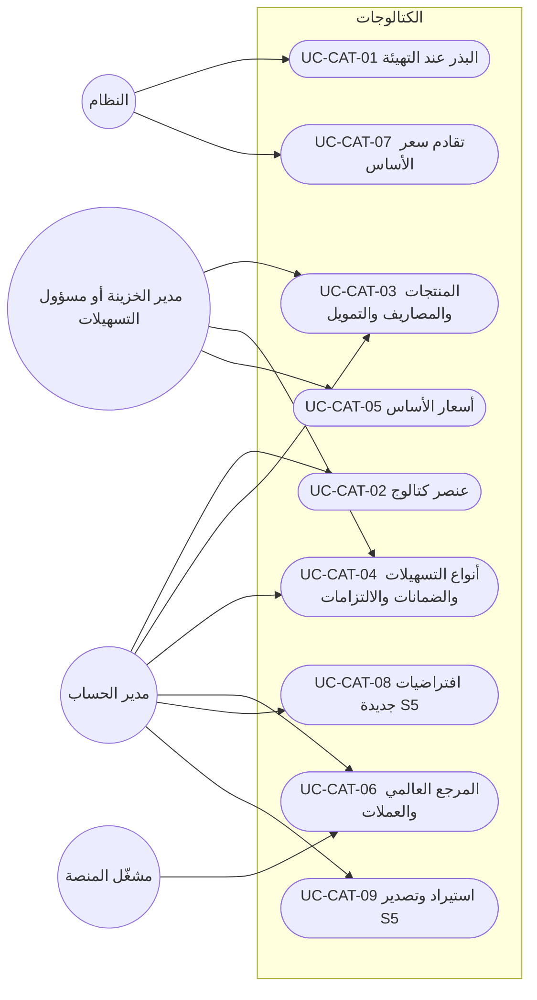
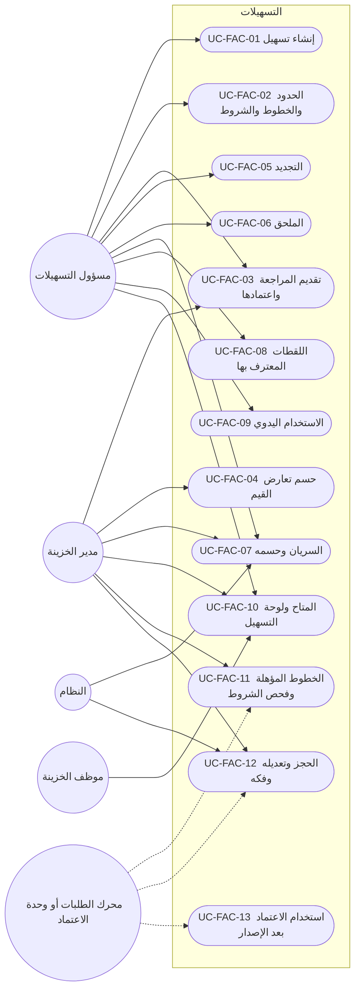
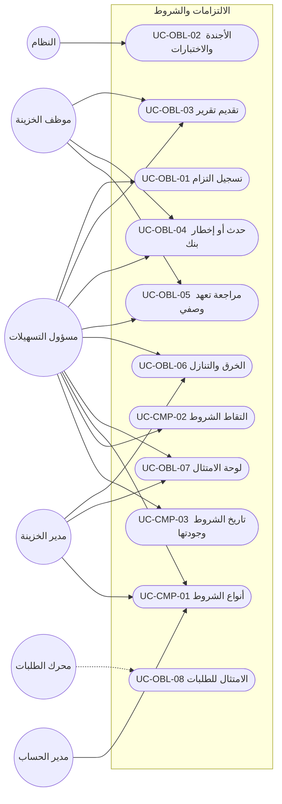
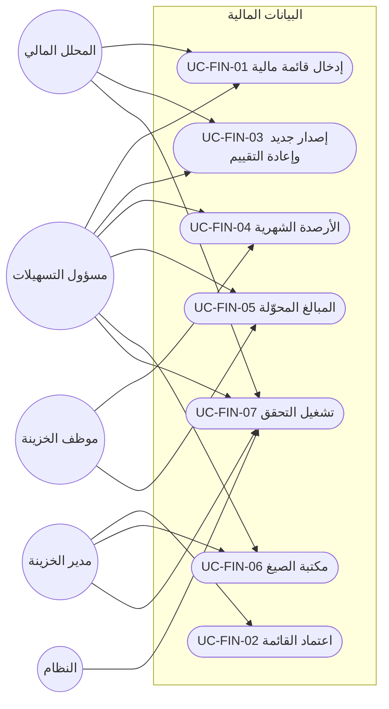

# DOC-F09 — كتالوج حالات الاستخدام: المنشآت والحسابات والكتالوجات والتسهيلات والطلبات والاعتمادات (M2 إلى M8)

| البند | القيمة |
|---|---|
| المعرّف | DOC-F09 (docs/30-readiness-documents.md) |
| الإصدار | 0.1 — مسودة للمراجعة — 2026-10-12 |
| المالك المقترح | محلل الأعمال مع مالكي الوحدات |
| الأولوية | P1 قبل S2؛ ويُراجَع قسما M2 وM4 والحسابات قبل بدء S1 (§22 البند 2) |
| يغطي | FR-INS-001…021، FR-ACC-001…023، FR-CAT-001…026، FR-FAC-001…031، FR-PRC-001…017، FR-COL-001…015، FR-OBL-001…016، FR-FIN-001…014، FR-CMP-001…008، FR-WFL-001…041، FR-REQ-001…027، FR-NTF-001…025، FR-LCT-001…037، FR-LCI-001…033، FR-LCE-001…029 (363 متطلبًا)، وقواعد BR المقابلة، وBR-WFL-027 (docs/20-database-design.md:396) |
| يعتمد على | DOC-F01 (الفاعلون)، DOC-F07 (قالب الكتالوج ورموز CORE)، DOC-F08 (حالة الطلب الموحّدة)، DOC-B02 (قبول S1)، DOC-B04 (رموز الأخطاء)، DOC-F10 إلى DOC-F17 (التسلسلات ومخططات الحالات) |
| المصادر | docs/10-detailed-analysis/11-m2-m4-institutions-accounts-catalogs.md، docs/10-detailed-analysis/12-m5-facilities-pricing-collateral-obligations.md، docs/10-detailed-analysis/13-m6-workflow-engine-notifications.md، docs/10-detailed-analysis/14-m7-m8-letters-of-credit.md، docs/10-detailed-analysis/00-overview-and-cross-cutting.md، db/model/12-institutions-accounts-catalogs.model إلى db/model/16-letters-of-credit.model، docs/20-database-design.md |

## 1. الغرض والنطاق

يعطي هذا الكتالوج معرّفًا ثابتًا لكل حالة استخدام في M2 إلى M8، بقالب DOC-F07. تستشهد بهذه المعرّفات سيناريوهات القبول والشاشات والاختبارات ومصفوفة التتبع (DOC-B08).

- حالات S1 وS1-ب وS2 وS2-ب وS3 مكتملة (§5 إلى §18): الفاعل، الشريحة، رمز الصلاحية، الشروط المسبقة واللاحقة، المسار الرئيسي، البديل والخطأ، المتطلبات والقواعد، وسيناريو القبول.
- حالات S4 وS5 مختصرة في جداول (§19).
- كل متطلب في المواصفات الأربع مربوط بحالة أو مذكور في §20، والربط مفحوص بسكربت (§23.1).
- نقطة البدء التدفقات المرقمة: F-INS-1 وF-INS-2 وF-ACC-1 إلى F-ACC-3 وF-CAT-1 إلى F-CAT-3 (docs/10-detailed-analysis/11-m2-m4-institutions-accounts-catalogs.md:411-442)، وF-FAC-1 وF-FAC-2 وF-FIN-1 وF-COL-1 وF-OBL-1 وF-CMP-1 (docs/10-detailed-analysis/12-m5-facilities-pricing-collateral-obligations.md:427-443)، وF-WFL-1 إلى F-WFL-6 (docs/10-detailed-analysis/13-m6-workflow-engine-notifications.md:459-511)، وF-LCI-1 إلى F-LCI-4 وF-LCE-1 إلى F-LCE-3 (docs/10-detailed-analysis/14-m7-m8-letters-of-credit.md:490-516).
- التسلسلات ومخططات الحالات ليست هنا: سير الموافقات لكل قالب في DOC-F10، ومعاملة الموافقة والحجز في DOC-F11، والإصدار والتعديل في DOC-F12، وإدخال التسهيل واعتماده في DOC-F13، وحالات التسهيل والحجز في DOC-F14، وحالات الالتزامات في DOC-F15، وحالات كيانات الاعتماد في DOC-F16، والأحداث غير المتزامنة في DOC-F17.

اختصارات المسارات في هذه الوثيقة: «11-m2-m4» و«12-m5» و«13-m6» و«14-m7-m8» هي الملفات الأربعة في docs/10-detailed-analysis/، و«00-overview» = docs/10-detailed-analysis/00-overview-and-cross-cutting.md.

**قواعد تسري على كل حالة ولا تتكرر فيها:**

- قواعد DOC-F07 §1 كلها: ترتيب التقييم (حالة المشترك، المصادقة، الصلاحية، نطاق الشركات، قواعد السجل)، والتدقيق، وREST أولًا، وعزل RLS، والوحدة المعطّلة 403. رموز الوحدات: INSTITUTIONS وFACILITIES وCOVENANTS وWORKFLOW وREQUESTS وLC_PURCHASE وLC_SALES (00-overview:239-245).
- الجهة الطالبة (RQ وPR وSL) لا ترى تسهيلًا ولا متاحًا ولا حجزًا ولا هامشًا؛ ترى إسقاط الطالب فقط (FR-FAC-031، BR-WFL-024، BR-LCI-014، BR-LCE-015).
- كل كتابة على طلب أو اعتماد تحمل RowVersion وIdempotency-Key، والتعارض 409 (FR-WFL-035، FR-LCI-031، DOC-B04 §6 و§7).
- كل إجراء على طلب يُسجَّل في RequestAction (FR-WFL-033) وفي التدقيق (FR-WFL-034)، وكل انتقال يكتب حدثًا في طابور الإرسال (FR-WFL-038، DOC-F17).
- حالة الطلب تتبع النموذج الموحّد المقترح في DOC-F08 §4: Status بست قيم (DRAFT وACTIVE وAWAITING_CLOSE وCOMPLETED وREJECTED وCANCELLED) والمرحلة الظاهرة بثماني. وحيث تقول 13-m6 «COMPLETED» عند آخر مرحلة، فهي هنا AWAITING_CLOSE ثم الإقفال (UC-WFL-15).
- المبلغ الوحيد الممرَّر لخدمات الحد هو ExposureAmount تحسبه 14-m7-m8، والمتاح تحسبه 12-m5 وحدها (BR-FAC-014، BR-FAC-015، BR-WFL-016، BR-LCI-004).
- كل رقم افتراضي (مهلة أو عتبة أو مدة) إعداد مشترك بحد أدنى وأقصى (BR-WFL-025، FR-PLT-043).
- البنك والمورّد والعميل خارج النظام: لا ربط حيًّا الآن (11-m2-m4:561-574، 12-m5:575-587، 14-m7-m8:648-660)، وما يصدر عنهم يُدخله موظف الخزينة يدويًا.

## 2. الفاعلون

القائمة المرجعية في DOC-F01 §3. الأدوار الجديدة هنا كلها من فئة A-03 لأنها لا تملك صلاحية كشف (DOC-F01: «موظف الخزينة، مدير القسم، الجهة الطالبة»).

| الفاعل | الرمز | DOC-F01 | الهوية والمصدر |
|---|---|---|---|
| مدير حساب المشترك | TA | A-01 | الكتالوجات العامة، الأنواع والقوالب، قواعد الإشعار |
| مدير الخزينة | TM | A-02 | الموافقة في نقطة الحجز، اعتماد المراجعات، التجاوز (13-m6:58، 12-m5:56) |
| مسؤول التسهيلات | FO | A-02 | إدخال التسهيلات والحدود والضمانات والالتزامات (00-overview:61) |
| موظف الخزينة | TE | A-03 | سحب الطلب وتنفيذه وتسجيل الإصدار والسحوبات |
| المحلل المالي 🟡 | FA | A-03 | دور مقترح لإدخال القوائم (00-overview:66، 12-m5:46) |
| الجهة الطالبة ومديرها | RQ · RQM | A-03 | 13-m6:46 |
| المشتريات | PR | A-03 | طالب اعتماد المشتريات ومديره (14-m7-m8:44) |
| المبيعات | SL | A-03 | معدّ ومدقّق وموافِق، أدوار تُبذر مع S4 (14-m7-m8:44) |
| المدقق | AU | A-04 | قراءة وتصدير بحسب المصفوفات |
| النظام | SYS | A-05 | المهام JOB-* بحساب الخدمة؛ هوية الربط في DOC-F04 |
| مشغّل المنصة | PO | A-06 | المرجع العالمي ومواد UCP (FR-CAT-021، FR-LCT-006) |
| الوحدة المستدعية | MOD | — | مكوّن داخلي يستدعي خدمة SVC-* أو خطافًا في معاملة الطلب؛ ليس فاعلًا خارجيًا |
| خدمة البريد | — | A-09 | بريد الإشعارات في S5 فقط |

## 3. رموز الصلاحيات

### 3.1 الرموز القائمة في المواصفات

الرموز التالية معرّفة 🟢 في مصفوفات الأدوار، ولا يعيد هذا الكتالوج تعريفها. كتالوج الصلاحيات نفسه ملك 10-m0-m1 (FR-PLT-017)، والجدول sec.Permission عالمي (db/model/10-platform.model:169)، ولا يوجد اليوم في db/ أي سكربت يبذر صفوفه؛ خطة البذور في docs/20-database-design.md:474.

| الوحدة | الرموز | المصدر |
|---|---|---|
| INSTITUTIONS | `ins.view` `ins.manage` `ins.contacts.manage` `ins.relationship.manage` `ins.wizard.run` `ins.deactivate` `ins.export` · `acc.view` `acc.reveal` `acc.manage` `acc.close` `acc.facility_link` · `sig.view` `sig.manage` `sig.conflict.review` | 11-m2-m4:45-59 |
| CORE (الكتالوجات) | `cat.view` `cat.manage.general` `cat.manage.financial` `cat.baserate.enter` `cat.global.manage` | 11-m2-m4:61-65 |
| FACILITIES · COVENANTS | `fac.view` `fac.edit` `fac.approve` `fac.conflict.resolve` `fac.util.manage` `fac.reserve` `fac.override_limit` · `prc.view` `prc.manage` `prc.tariff.approve` · `col.view` `col.manage` `col.approve` · `obl.view` `obl.manage` `obl.record` `obl.breach.manage` `obl.waiver.approve` · `fin.view` `fin.stmt.enter` `fin.stmt.approve` `fin.stats.enter` `fin.formula.manage` `fin.formula.approve` `fin.verify.run` · `cmp.view` `cmp.manage` | 12-m5:50-71 |
| WORKFLOW · REQUESTS · CORE (الإشعارات) | `req.create` `req.view.own` `req.view.department` `req.view.all` `req.view.internal` `req.comment` `req.comment.internal` `req.approve` `req.treasury.approve` `req.facility.select` `req.claim` `req.execute` `req.reassign` `req.cancel` `req.cancel.any` `req.extref.edit` `req.create.child` `req.delegate.own` `req.delegate.manage` `req.dashboard.manager` `req.type.manage` `req.export` · `wfl.template.view` `wfl.template.manage` `wfl.template.publish` · `ntf.manage` `ntf.prefs` `ntf.log.view` | 13-m6:50-77 |
| LC_PURCHASE · LC_SALES | `lc.terms.edit` `lc.terms.treasury.edit` `lc.view.own` `lc.view.all` `lc.view.internal` `lc.export.view` `lc.export.record` `lc.issuance.record` `lc.proforma.issue` `lc.proforma.void` `lc.child.create` `lc.amendment.record` `lc.drawing.record` `lc.discrepancy.decide` `lc.close` `lc.order.release` `lc.legacy.enter` `lc.counterparty.manage` `lc.clause.manage` `lc.template.manage` `lc.field.manage` `lc.print` `lc.compare` `lc.report.view` `lc.report.export` | 14-m7-m8:48-75 |
| من خارج المواصفات الأربع | `req.treasury.close` (إقفال الطلب؛ حامله قرار DQ-F08-3) · `party.identity.reveal` 🔒 و`party.pack.export` 🔒 · `party.pack.draft` 🟡 و`cfg.settings.manage` 🟡 (DOC-F07 §3) | docs/20-database-design.md:403؛ DOC-F07 §3 |

### 3.2 رموز مقترحة

أربعة إجراءات في المواصفات بلا رمز. المقترح 🟡 بنمط `<وحدة>.<كائن>.<فعل>`، واعتمادها قرار DQ-F09-1.

| الرمز | الأدوار الافتراضية | الإجراء الذي يسده | المصدر | حالة الاستخدام |
|---|---|---|---|---|
| `fac.status.manage` | TM، FO | حسم «السريان غير المؤكد»، وتعليق التسهيل وإعادته وإنهاؤه | 12-m5:115، :451 | UC-FAC-07 |
| `cmp.term.propose` | FO، TM | اقتراح مفتاح شرط جديد وترقية OTHER | 12-m5:224، :71 | UC-CMP-01 |
| `acc.signature.image.view` 🔒 | TM، FO | عرض صورة نموذج التوقيع وتنزيلها | 11-m2-m4:158، :621 | UC-ACC-04 |
| `wfl.request.migrate` | TM، TA | نقل طلب جارٍ إلى نسخة قالب أحدث | 13-m6:153 | UC-WFL-18 |

إجراءات تستعمل رمزًا قائمًا بلا رمز جديد 🟡:

- إعادة فتح علاقة مغلقة: `ins.deactivate` (11-m2-m4:50)، مع أن جدول الحالات يذكر TM وحده (11-m2-m4:451)؛ انظر DQ-F09-3.
- فك حجز يدويًا في M5: `fac.reserve` (12-m5:55) مع سبب، ويصل المحرك حدث `released_externally` فيُعلَّم الطلب LOST (13-m6:311)؛ انظر DQ-F09-4.
- إعادة محاولة تسليم فاشل: `ntf.manage` (13-m6:74)، لأن `ntf.log.view` للعرض فقط.
- التحقق من مواد UCP: دور المشغّل `cat.global.manage` (11-m2-m4:65)، لأن الجدول عالمي (FR-LCT-006).
- تفعيل `fac.override_limit.enabled` وإعدادات `lc.*` و`wf.*`: `cfg.settings.manage` (DOC-F07 §3).

## 4. مخططات حالات الاستخدام

الخط المتصل فاعل يبدأ الحالة، والمتقطع فاعل ثانوي أو استدعاء. الحالات المختصرة (S4 وS5) تظهر في مخطط وحدتها لاكتمال الصورة.

### 4.1 المنشآت المالية (INS)

### 4.2 الحسابات والمفوّضون (ACC)

### 4.3 الكتالوجات (CAT)

### 4.4 التسهيلات والحدود (FAC)

### 4.5 التسعير والضمانات (PRC وCOL)

### 4.6 الالتزامات ومكتبة الشروط (OBL وCMP)

### 4.7 البيانات المالية والتحقق (FIN)

### 4.8 محرك دورات العمل (WFL)

### 4.9 الطلبات (REQ)

### 4.10 الإشعارات (NTF)

### 4.11 شروط الاعتماد والنماذج (LCT)

### 4.12 اعتمادات المشتريات (LCI)

### 4.13 اعتمادات المبيعات والبروفورما (LCE، S4)

## 5. M2 المنشآت المالية (INS)

(قيد الكتابة: §5)

## 6. M3 الحسابات والمفوّضون (ACC)

(قيد الكتابة: §6)

## 7. M4 الكتالوجات (CAT)

(قيد الكتابة: §7)

## 8. M5 التسهيلات والحدود (FAC)

(قيد الكتابة: §8)

## 9. M5 التعرفة والتسعير (PRC)

(قيد الكتابة: §9)

## 10. M5 الضمانات والكفلاء (COL)

(قيد الكتابة: §10)

## 11. M5 الالتزامات والتعهدات (OBL)

(قيد الكتابة: §11)

## 12. M5 البيانات المالية والتحقق (FIN)

(قيد الكتابة: §12)

## 13. M5 مكتبة الشروط (CMP)

(قيد الكتابة: §13)

## 14. M6 محرك دورات العمل (WFL)

(قيد الكتابة: §14)

## 15. M6 الطلبات (REQ)

(قيد الكتابة: §15)

## 16. M6 الإشعارات (NTF)

(قيد الكتابة: §16)

## 17. M7 شروط الاعتماد والنماذج (LCT)

(قيد الكتابة: §17)

## 18. M7 اعتمادات المشتريات (LCI)

(قيد الكتابة: §18)

## 19. حالات S4 وS5 (مختصرة)

(قيد الكتابة: §19)

## 20. ما ليس حالة استخدام

(قيد الكتابة: §20)

## 21. القرارات المطلوبة

(قيد الكتابة: §21)

## 22. تعارضات وفجوات في المصادر

(قيد الكتابة: §22)

## 23. التتبع

(قيد الكتابة: §23)
