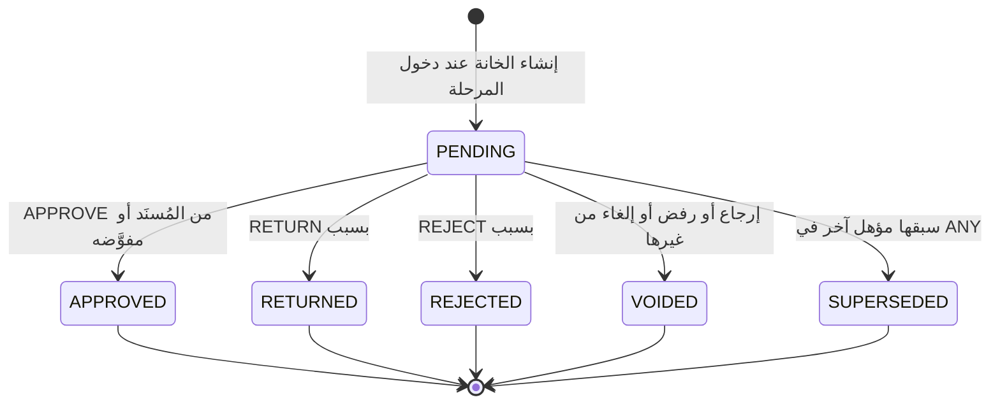
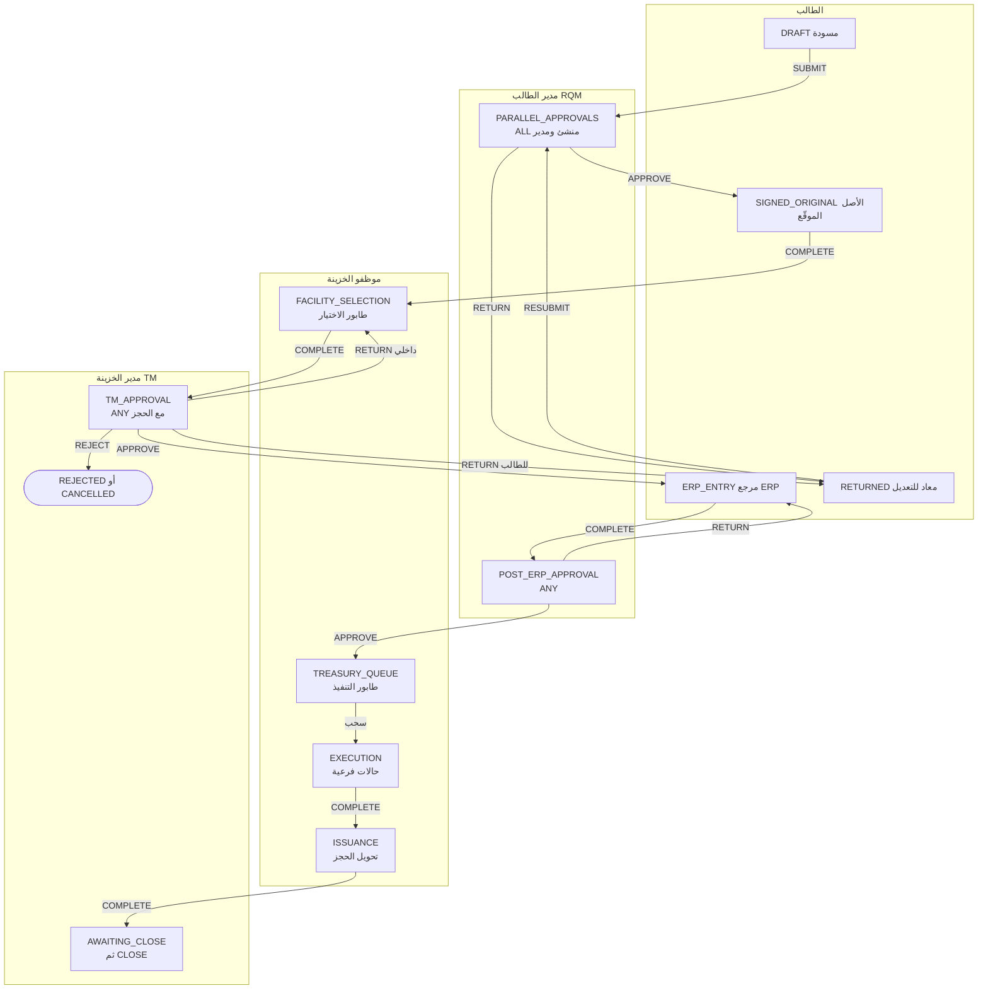
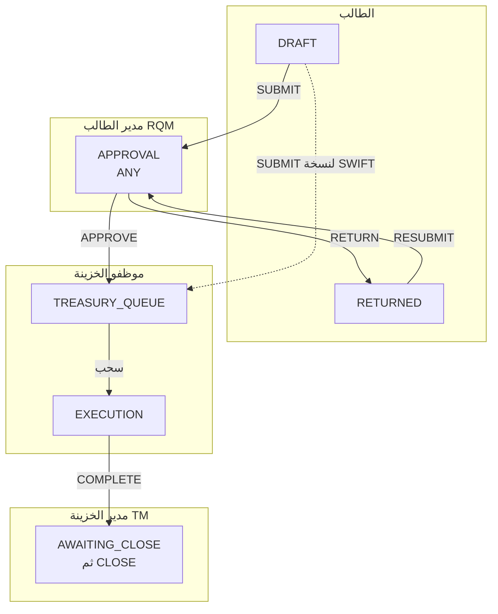
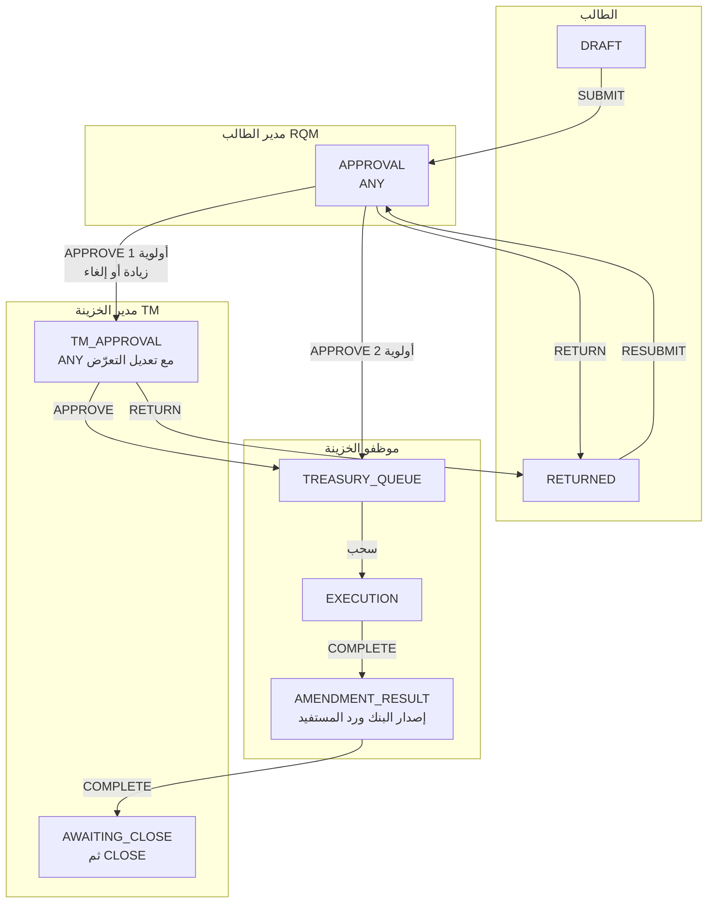
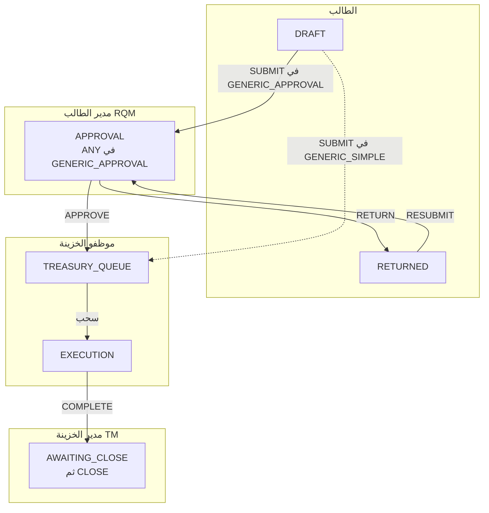
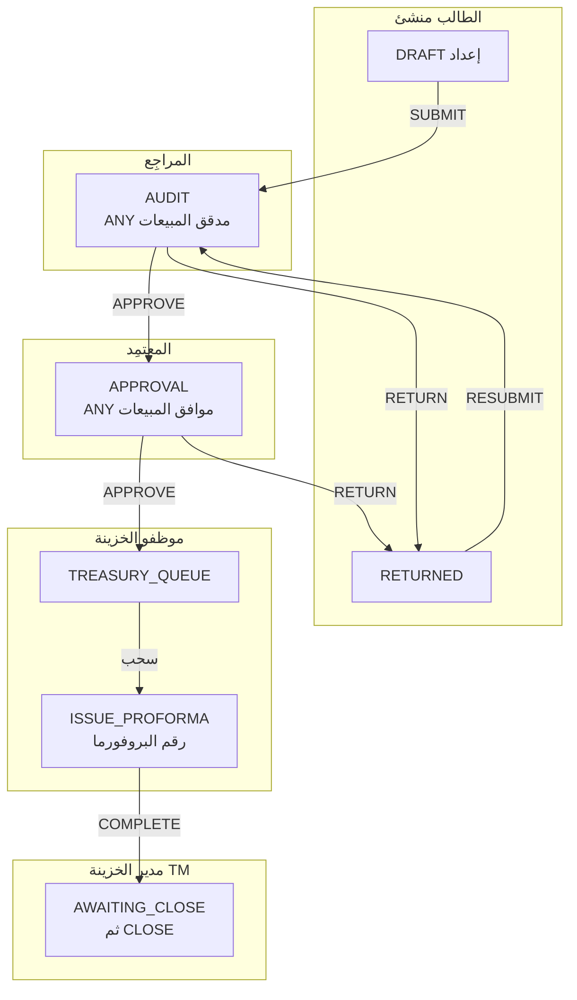
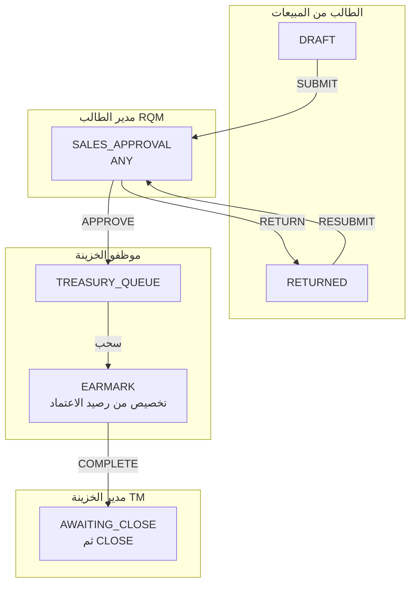
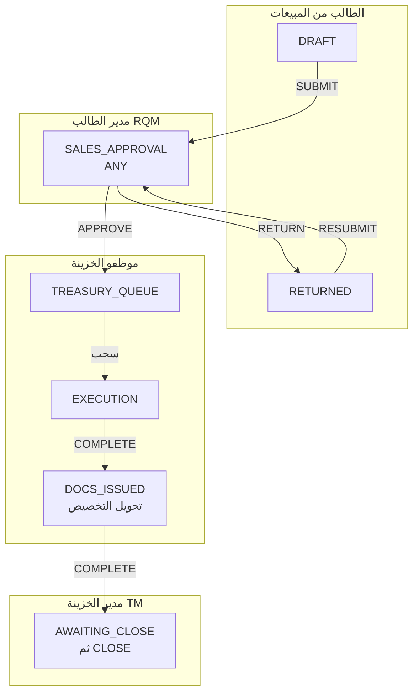

# DOC-F10 — نموذج سير الموافقات (M6): القوالب والمراحل والأدوار وجداول الانتقال

| البند | القيمة |
|---|---|
| المعرّف | DOC-F10 (docs/30-readiness-documents.md) |
| الإصدار | 0.1 — مسودة للمراجعة — 2026-10-12 |
| المالك المقترح | محلل العمليات (مالك M6) |
| الأولوية | P1 قبل S2 (يعطّل S3، وعقد الحجز مع M5 يُبنى في S2) |
| يغطي | FR-WFL-001…012، FR-WFL-017…020، FR-WFL-022، FR-WFL-029، FR-WFL-041، BR-WFL-001…011، BR-WFL-019…022، BR-WFL-026، BR-WFL-027 (في وثائق القاعدة)، FR-REQ-027، D-6 وD-7 وD-8 وD-9 |
| يعتمد على | DOC-F08 (حالة الطلب والإقفال)، DOC-F11 (معاملة الحجز)، DOC-F17 (الأحداث والمهام)، DOC-F09 (حالات الاستخدام UC-WFL وUC-REQ)، DOC-F12 (الإصدار والتعديل)، DOC-B04 (الأخطاء)، DOC-B10 (التسميات) |
| المصادر | docs/10-detailed-analysis/13-m6-workflow-engine-notifications.md، docs/10-detailed-analysis/14-m7-m8-letters-of-credit.md، db/model/15-workflow-notifications.model، docs/21-data-dictionary.md، docs/20-database-design.md، docs/review/design-review-2026-10-11.json |

## 1. الغرض والنطاق

تحدد هذه الوثيقة كيف يسير كل قالب مبذور: من يعمل في كل مرحلة، وأي إجراء ينقل الطلب إلى أين، وبأي شرط وأولوية. لكل قالب مخطط سباحة وجدول انتقالات. وتجمع القواعد المشتركة: خانات الموافقة، وفصل المهام، والتفويض، وSLA والتصعيد، والإرجاع والإلغاء والرفض، والإقفال.

القوالب الثمانية (13-m6:123): PURCHASE_LC وCHILD_STANDARD وCHILD_AMENDMENT وGENERIC_SIMPLE وGENERIC_APPROVAL في S3، وPROFORMA_REQUEST وSALES_ORDER_APPROVAL وCOLLECTION_DOCS_REQUEST في S4.

خارج النطاق:
- حالة الطلب الكلية والإقفال: DOC-F08. هنا نطبّقها فقط.
- ما يجري داخل معاملة الموافقة والحجز: DOC-F11.
- تسليم الإشعارات والمهام المجدولة: DOC-F17.
- تسلسل الإصدار والتعديل وتحويل الحجز: DOC-F12. حالات كيانات الاعتماد الفرعية: DOC-F16.
- حالات الاستخدام بمعرّفاتها: DOC-F09.

اختصار المسار: «13-m6» = docs/10-detailed-analysis/13-m6-workflow-engine-notifications.md، و«14-m7-m8» = docs/10-detailed-analysis/14-m7-m8-letters-of-credit.md، و«15.model» = db/model/15-workflow-notifications.model.

الرموز: 🟢 قائم في المستودع أو مقرَّر في الوثائق، 🟡 مقترح ينتظر القرار.

مصطلح: «السحب» هنا أخذ الطلب من الطابور (Claim) كما في 13-m6:93. DOC-B10 يقترح له «الاستلام من الطابور» تمييزًا عن السحب على الاعتماد (DQ-B10-4)، ونتبع ما يُحسم هناك.

## 2. ما يقرّه المستودع اليوم 🟢

النموذج يحمل المحرك كبيانات. لا يوجد كود للمحرك ولا بذور للقوالب بعد؛ حزم البذر مخططة في DOC-B05.

| العنصر | ما يفرضه النموذج | المصدر |
|---|---|---|
| نسخة القالب | VersionNo تصاعدي، وStatus بالقيم DRAFT وPUBLISHED وRETIRED، ونسخة حالية واحدة لكل TemplateKey | 15.model:66-97، :87 |
| المرحلة | Kind بالقيم DRAFT وTASK وAPPROVAL وTREASURY_QUEUE وTERMINAL؛ ApprovalMode ‏NONE أو ANY أو ALL، وغير NONE في APPROVAL وحدها؛ بداية DRAFT واحدة | 15.model:104، :113، :127، :131 |
| مرحلة الطابور | قاعدة ROLE بدور أو بصلاحية تحدد المجموعة المؤهلة (PoolPermissionId) | 15.model:109، :135 |
| نقطة الحجز | IsReservationPoint في مرحلة APPROVAL فقط | 15.model:122، :134 |
| خانة الموافقة | SlotKey، وWorkflowRole بالقيم CREATOR وAUDITOR وAPPROVER وOTHER، وSubjectRule، وAutoCompleteBySubmitter للطالب فقط، وAllowDelegation | 15.model:144-164 |
| الانتقال | Action بالقيم SUBMIT وAPPROVE وCOMPLETE وRETURN وREJECT وCANCEL وRESUBMIT؛ Priority وConditionJson؛ فريد (FromStageId, Action, Priority)؛ ResumeStageId لـ RETURN وRESUBMIT فقط؛ RETURN وREJECT بتعليق إلزامي | 15.model:166-181 |
| الخطاف | TriggerKind وActionFilter وHookKey وExecMode ‏(SYNC_TX أو AFTER_COMMIT) وOnFailure ‏(BLOCK أو WARN) | 15.model:183-195 |
| حالة الطلب | ست قيم منها AWAITING_CLOSE، وأعمدة الإقفال وقيوده | 15.model:257، :273-275، :323-326 |
| مثيل المرحلة | مثيل مفتوح واحد لكل طلب؛ حالاته QUEUED وCLAIMED وAWAITING_APPROVAL وDONE وRETURNED وREJECTED وCANCELLED | 15.model:387، :402 |
| موافقة الخانة | Decision بست قيم، وSource منها DELEGATE، وSnapshotHash إلزامي عند APPROVED، ووسم IsSodException | 15.model:428-452 |
| فصل المهام | SodAllowSamePerson على القالب ويُتجاوز على المرحلة، وHasSodException على الطلب | 15.model:77، :123، :297 |
| التفويض | UserDelegation بفترة ونطاق ALL أو APPROVALS_ONLY أو REQUEST_TYPE، ولا تفويض للنفس | 15.model:504-522 |

ما لا يوجد بعد: مخطط JSON لـ ConditionJson (DQ-F10-11)، وصفوف القوالب، وكود اختيار الانتقال. قيود الرسم (بداية واحدة، نهاية ناجحة، لا يتيم) يفحصها التطبيق عند النشر (FR-WFL-029، 13-m6:150).

## 3. الممرات والأدوار

مخطط السباحة يقسم كل قالب إلى ممرات. الممر جهة، والقالب يربطها بقاعدة إسناد وصلاحية.

| الممر | الأدوار | قاعدة الإسناد في النموذج | الصلاحية | WorkflowRole |
|---|---|---|---|---|
| الطالب | RQ أو المنشئ | REQUESTER | `req.create`، `req.cancel` في مراحل محددة | CREATOR |
| مدير الطالب | RQM | REQUESTER_MANAGER | `req.approve` | APPROVER |
| المراجِع | دور مدقق المبيعات المخصص (S4) | ROLE | `req.approve` | AUDITOR |
| المعتمِد | دور موافق المبيعات (S4)، أو RQM | ROLE أو REQUESTER_MANAGER | `req.approve` | APPROVER |
| موظفو الخزينة | TE وFO وTM بالسحب | ROLE بصلاحية `req.facility.select` أو `req.claim`، ثم CLAIMER | `req.claim`، `req.execute` | — |
| مدير الخزينة | TM | ROLE ‏TM | `req.treasury.approve`، و`req.treasury.close` للإقفال | APPROVER |

المصادر: مصفوفة الصلاحيات 13-m6:48-78، وقواعد المُسنَد FR-WFL-005 (13-m6:126)، والأدوار منشئ ومدقّق ومعتمِد FR-WFL-041 (13-m6:162)، والإقفال DOC-F08 §4.4.

تنبيه تسمية: «مدقّق» في FR-WFL-041 دور مراجعة داخل الدورة، و«المدقق AU» في المصفوفة قارئ بلا كتابة (13-m6:46). DOC-B10 يقترح «المراجِع» للأول، وReviewer بالإنجليزية (docs/30-readiness/DOC-B10-glossary-en-ar.md:158، DQ-B10-5)، ونتبعه هنا.

## 4. قواعد مشتركة لكل القوالب

### 4.1 اختيار الانتقال 🟢

1. لكل (مرحلة، إجراء) تُقرأ الانتقالات بترتيب Priority تصاعديًا. يُنفَّذ أول ما تحقق شرطه، والشرط الفارغ يتحقق دائمًا (BR-WFL-001، 13-m6:232).
2. لا مطابق يعني أن الإجراء غير مسموح: 422 بسببه (DOC-B04 §9).
3. شرط المبلغ يحمل عملته. عملة مختلفة تعني «غير قابل للمقارنة»، فيُختار المسار الأشد ويُسجَّل NOT_COMPARABLE.
4. إذا كان للمرحلة أكثر من انتقال RETURN، يختار الفاعل الهدف من بينها، والافتراضي أقلها Priority 🟡 (DQ-F10-8).

### 4.2 دخول المرحلة في معاملة واحدة 🟢

بالترتيب (BR-WFL-002، 13-m6:233): إنشاء المثيل، ثم حل المُسنَد وإنشاء الخانات، ثم المرحلة الظاهرة والحالة الفرعية، ثم DueAt، ثم خطافات ON_ENTER المتزامنة، ثم RequestAction وAuditLog وOutbox. الإشعارات بعد الالتزام (DOC-F17).

### 4.3 خانات الموافقة

| النمط | متى تكتمل المرحلة | ما يحدث للخانات الأخرى | التزامن |
|---|---|---|---|
| NONE | مهمة: COMPLETE من المُسنَد | لا خانات | RowVersion، والثاني 409 |
| ANY | أول APPROVE من مؤهل | SUPERSEDED | الثاني 409 «سبقت معالجة الطلب» (FR-WFL-008) |
| ALL | آخر خانة APPROVED في الدورة الحالية | — | الانتقال في معاملة الخانة الأخيرة (FR-WFL-007) |

- RETURN أو REJECT من أي خانة فعّالة ينهي المرحلة فورًا، ويصير الباقي VOIDED (BR-WFL-003، 13-m6:234).
- كل APPROVE يحمل SnapshotHash لما رآه الموافق (15.model:450). بناؤه في DOC-F11.
- خانة ORIGINATOR تكتمل بالتقديم إن قدّم الطالب بنفسه، بمصدر SUBMISSION. وإن قدّمه غيره تبقى PENDING للطالب (BR-WFL-004، Q-WFL-03).

لا رجوع من حالة نهائية. الدورة الجديدة بعد RESUBMIT تنشئ خانات جديدة (13-m6:532).

### 4.4 حل المُسنَد والمجموعة الفارغة

- REQUESTER_MANAGER يُحل إلى `LineManagerUserId` الفعّال، ثم رئيس الإدارة إن لم يكن الطالب، ثم FallbackRole، ثم TM (BR-WFL-005، 13-m6:236).
- ROLE وDEPARTMENT تعطيان مجموعة مؤهلة ضمن نطاق شركة الطلب، لا شخصًا.
- المُسنَد يُجمَّد عند الدخول، ويُعاد حله عند تعطيله أو تغيير مديره (FR-WFL-039، JOB-WFL-ASSIGN).

المجموعة الفارغة لا يحددها المصدر إلا لحالة TM منشئ الطلب (BR-WFL-006 ج). نقترح 🟡 (DQ-F10-4):
1. يُطبَّق فصل المهام والنطاق أولًا، ثم السلسلة البديلة: FallbackRole، ثم TM، ثم TA.
2. إن بقيت فارغة، لا يُلغى الإجراء السابق. تُفتح المرحلة بالخانة مسندة للدور، ويُسجَّل في MetaJson «لا مؤهل».
3. يُصدر حدث إلزامي لـ TA وTM باسم مقترح REQ.NO_ELIGIBLE_ASSIGNEE، ويظهر الطلب في لوحة المدير.
4. يستمر عدّ SLA، فيصعَّد بالمسار العادي إن لم يُعالَج.
5. مرحلة TREASURY_QUEUE بلا أي حامل لصلاحيتها في نطاق الشركة تأخذ الحكم نفسه.

### 4.5 انتقالات يضيفها المحرك 🟡

خطوتان لا تُكتبان صفوفًا في كل قالب:
- **CANCEL** من أي مرحلة غير نهائية إلى مرحلة TERMINAL ذات النتيجة CANCELLED (DQ-F10-1). يفحص المحرك AllowRequesterCancel للطالب، و`req.cancel.any` لـ TM (13-m6:63).
- **CLOSE** من AWAITING_CLOSE إلى COMPLETED بيد حامل `req.treasury.close` (DOC-F08 §4.6).

السبب: صفوف CANCEL لكل مرحلة تكرر نفسها، وقيد الفرادة (15.model:177) لا يمنع نسيان واحد منها.

### 4.6 السحب من الطابور 🟡

السحب ليس قيمة في Action (15.model:169). نقترح (DQ-F10-2):
1. السحب من مرحلة TREASURY_QUEUE تحديث شرطي ذرّي (BR-WFL-007، 13-m6:238).
2. في FACILITY_SELECTION يبقى الطلب في المرحلة نفسها، والساحب يكمل العمل ثم COMPLETE.
3. في TREASURY_QUEUE التي لا عمل فيها، يُنفّذ السحب COMPLETE آليًا في المعاملة نفسها، فيدخل الطلب مرحلة TASK التالية مسندة إلى الساحب (CLAIMER).
4. التحرير من مرحلة التنفيذ يعيد مثيلها إلى QUEUED بلا مُسنَد، ولا يصفّر QueueEnteredAt.

### 4.7 الحجز في القالب

- نقطة الحجز مرحلة TM_APPROVAL صريحة، وفيها ON_ACTION(APPROVE) `fac.reserve_limit` بوضع SYNC_TX وBLOCK (13-m6:327). المعاملة في DOC-F11.
- التحرير: نقترح 🟡 خطاف ON_ENTER على مرحلتي REJECTED وCANCELLED النهائيتين، `fac.release_reservation`، وهو بلا أثر إن لم يوجد حجز (13-m6:307). فيغطي الإلغاء في أي مرحلة بعد الحجز، كمثال BR-WFL-009 في ERP_ENTRY (13-m6:240). (DQ-F10-3)
- تحقق النشر يرفض قالبًا لنوع يستهلك حدًّا بلا حجز قبل الإصدار أو بلا تحرير (FR-WFL-029، V-WFL-03).

## 5. القالب PURCHASE_LC (S3)

المراحل وخصائصها في 13-m6:319-334. الممرات من اليمين: الطالب، ثم مدير الطالب، ثم موظفو الخزينة، ثم مدير الخزينة.

| من | الإجراء والأولوية | الشرط أو الفاعل | إلى | خطاف ومتطلب المغادرة | المصدر |
|---|---|---|---|---|---|
| DRAFT | SUBMIT ‏(1) | الطالب أو المنشئ | PARALLEL_APPROVALS | ON_ACTION(SUBMIT) `lc.validate_terms` SYNC_TX وBLOCK | 13-m6:323 |
| PARALLEL_APPROVALS | APPROVE ‏(1) | الخانة الأخيرة من ORIGINATOR وMANAGER | SIGNED_ORIGINAL | ON_ENTER للتالية `req.assign_number` | 13-m6:324-325 |
| PARALLEL_APPROVALS | RETURN ‏(1) | RQM أو الطالب، بسبب | RETURNED | ResumeStage = PARALLEL_APPROVALS | 13-m6:324، :239 |
| PARALLEL_APPROVALS | REJECT ‏(1) | RQM، بسبب | REJECTED | — | 13-m6:324 |
| SIGNED_ORIGINAL | COMPLETE ‏(1) | الطالب | FACILITY_SELECTION | مرفق SIGNED_REQUEST_ORIGINAL واحد على الأقل | 13-m6:325 |
| FACILITY_SELECTION | COMPLETE ‏(1) | الساحب بصلاحية `req.facility.select` | TM_APPROVAL | LIMIT_SELECTION إلزامي؛ CheckMode = BLOCK يمنع | 13-m6:326، :272 |
| TM_APPROVAL | APPROVE ‏(1) | TM بصلاحية `req.treasury.approve` | ERP_ENTRY | `fac.reserve_limit` SYNC_TX وBLOCK (DOC-F11) | 13-m6:327 |
| TM_APPROVAL | RETURN ‏(1) | TM، داخلي | FACILITY_SELECTION | لا يزيد CycleNo | 13-m6:239 |
| TM_APPROVAL | RETURN ‏(2) | TM، للطالب | RETURNED | ResumeStage = PARALLEL_APPROVALS؛ الحجز يبقى | 13-m6:327، :721 |
| TM_APPROVAL | REJECT ‏(1) | TM، بسبب | REJECTED | تحرير الحجز إن وُجد (§4.7) | 13-m6:327 |
| ERP_ENTRY | COMPLETE ‏(1) | الطالب | POST_ERP_APPROVAL | مرجع خارجي ERP / PURCHASE_REQUEST إلزامي | 13-m6:328 |
| POST_ERP_APPROVAL | APPROVE ‏(1) | RQM | TREASURY_QUEUE | — | 13-m6:329، :717 |
| POST_ERP_APPROVAL | RETURN ‏(1) | RQM، بسبب | ERP_ENTRY | لا يزيد CycleNo 🟡 | 13-m6:329 |
| POST_ERP_APPROVAL | REJECT ‏(1) 🟡 | RQM، بسبب | REJECTED | غير مذكور في المصدر (DQ-F10-6) | — |
| TREASURY_QUEUE | COMPLETE آلي بالسحب 🟡 | الساحب بصلاحية `req.claim` | EXECUTION | المُسنَد CLAIMER (§4.6) | 13-m6:330 |
| EXECUTION | COMPLETE ‏(1) | الساحب | ISSUANCE | قناة التنفيذ إلزامية | 13-m6:331 |
| ISSUANCE | COMPLETE ‏(1) | الساحب | COMPLETED، فيدخل الطلب AWAITING_CLOSE | ON_EXIT `fac.convert_reservation` ثم `lc.record_issuance`؛ LC.ISSUED بعد الالتزام (DOC-F12) | 13-m6:332؛ DOC-F08 §4.3 |
| RETURNED | RESUBMIT ‏(1) | الطالب | ResumeStage | `lc.validate_terms`؛ CycleNo + 1 وخانات جديدة | 13-m6:333 |
| أي مرحلة غير نهائية | CANCEL ضمني 🟡 | الطالب قبل EXECUTION، وTM في أي مرحلة | CANCELLED | تحرير الحجز (§4.7) | 13-m6:240 |
| AWAITING_CLOSE | CLOSE ضمني | حامل `req.treasury.close` | COMPLETED | لا خطاف | DOC-F08 §4.6 |

AllowRequesterCancel صحيحة في كل مرحلة قبل EXECUTION، لأن الطالب يلغي «حتى خروج الطلب من الطابور» (13-m6:240). بعد الإصدار لا إلغاء من هنا، بل طلب فرعي على الاعتماد.

## 6. القالب CHILD_STANDARD (S3)

يخدم LC_DOCUMENT_REQUEST وLC_SWIFT_REQUEST (13-m6:343، :420-421). لا يستهلك حدًّا، ولا يحمل TM_APPROVAL.

| من | الإجراء والأولوية | الشرط أو الفاعل | إلى | خطاف ومتطلب المغادرة | المصدر |
|---|---|---|---|---|---|
| DRAFT | SUBMIT ‏(1) | الطالب | APPROVAL | الأب يسمح (`CanCreateChild`، 14-m7-m8:178) | 13-m6:343 |
| DRAFT | SUBMIT ‏(1) في نسخة LC_SWIFT_REQUEST 🟡 | الطالب | TREASURY_QUEUE | النوع «بلا موافقة» (DQ-F10-5) | 13-m6:421 |
| APPROVAL | APPROVE ‏(1) | RQM | TREASURY_QUEUE | — | 13-m6:343 |
| APPROVAL | RETURN ‏(1) 🟡 | RQM، بسبب | RETURNED | ResumeStage = APPROVAL | 13-m6:239 |
| APPROVAL | REJECT ‏(1) 🟡 | RQM، بسبب | REJECTED | — | DQ-F10-6 |
| TREASURY_QUEUE | COMPLETE آلي بالسحب 🟡 | الساحب | EXECUTION | §4.6 | 13-m6:343 |
| EXECUTION | COMPLETE ‏(1) | الساحب | COMPLETED، فيدخل AWAITING_CLOSE | — | DOC-F08 §4.3 |
| RETURNED | RESUBMIT ‏(1) | الطالب | APPROVAL | CycleNo + 1 | 13-m6:239 |

المصدر لا يذكر مرحلة RETURNED في هذا القالب ولا في بقية القوالب غير PURCHASE_LC وPROFORMA_REQUEST (13-m6:341-345). نقترح إضافتها لكل قالب فيه موافقة، لأن الإرجاع للطالب يحتاج مرحلة له (DQ-F10-12).

## 7. القالب CHILD_AMENDMENT (S3)

يخدم LC_AMENDMENT. Delta فرق ExposureAmount، موقَّع (BR-REQ-008، 13-m6:270). الحجز والعكس تفصيلهما في DOC-F12.

| من | الإجراء والأولوية | الشرط أو الفاعل | إلى | خطاف ومتطلب المغادرة | المصدر |
|---|---|---|---|---|---|
| DRAFT | SUBMIT ‏(1) | الطالب، واعتماد ACTIVE بلا تعديل مفتوح | APPROVAL | `CanCreateChild` | 14-m7-m8:178 |
| APPROVAL | APPROVE ‏(1) | `amountDelta > 0` أو `kind = CANCEL` | TM_APPROVAL | — | 13-m6:344 |
| APPROVAL | APPROVE ‏(2) | بلا شرط | TREASURY_QUEUE | التخفيض يُطبَّق عند قبول المستفيد | 13-m6:344، :249 |
| APPROVAL | RETURN ‏(1) 🟡 | RQM، بسبب | RETURNED | ResumeStage = APPROVAL | 13-m6:239 |
| APPROVAL | REJECT ‏(1) 🟡 | RQM، بسبب | REJECTED | — | DQ-F10-6 |
| TM_APPROVAL | APPROVE ‏(1) | TM | TREASURY_QUEUE | حين Delta > 0: `fac.adjust_utilization` على الاعتماد الصادر، أو `fac.adjust_reservation` لحجز ACTIVE؛ لا حجز عند CANCEL | 13-m6:344، :309-310 |
| TM_APPROVAL | RETURN ‏(1) 🟡 | TM، بسبب | RETURNED | ResumeStage = APPROVAL | 13-m6:239 |
| TM_APPROVAL | REJECT ‏(1) | TM، بسبب | REJECTED | — | 13-m6:344 |
| TREASURY_QUEUE | COMPLETE آلي بالسحب 🟡 | الساحب | EXECUTION | §4.6 | 13-m6:344 |
| EXECUTION | COMPLETE ‏(1) | الساحب | AMENDMENT_RESULT | — | 13-m6:344 |
| AMENDMENT_RESULT | COMPLETE ‏(1) | الساحب | COMPLETED، فيدخل AWAITING_CLOSE | MODULE_FORM `lc.amendment_result`؛ ON_EXIT `lc.apply_amendment` يطبّق عند القبول ويعكس الزيادة عند الرفض أو السحب | 13-m6:344؛ 14-m7-m8:309 |
| RETURNED | RESUBMIT ‏(1) | الطالب | APPROVAL | CycleNo + 1 | 13-m6:239 |
| بعد TM_APPROVAL | REJECT أو CANCEL | TM أو الطالب | REJECTED أو CANCELLED | `fac.adjust_utilization` بقيمة −Delta، على ON_ENTER للنهائية 🟡 (§4.7) | 13-m6:344 |

## 8. القالبان GENERIC_SIMPLE وGENERIC_APPROVAL (S3)

أساس الطلبات العامة ومصمّم الأنواع في S5 (13-m6:345، FR-REQ-021). الفرق الوحيد مرحلة APPROVAL في الثاني.

| القالب | من | الإجراء | إلى | ملاحظة | المصدر |
|---|---|---|---|---|---|
| GENERIC_SIMPLE | DRAFT | SUBMIT ‏(1) | TREASURY_QUEUE | لا موافقة | 13-m6:345 |
| GENERIC_APPROVAL | DRAFT | SUBMIT ‏(1) | APPROVAL | — | 13-m6:345 |
| GENERIC_APPROVAL | APPROVAL | APPROVE ‏(1) | TREASURY_QUEUE | مكان شرط عتبة المبلغ إن أُضيف (Q-WFL-16) | 13-m6:129، :729 |
| GENERIC_APPROVAL | APPROVAL | RETURN ‏(1) 🟡 أو REJECT ‏(1) 🟡 | RETURNED أو REJECTED | بسبب | DQ-F10-6 |
| كلاهما | TREASURY_QUEUE | COMPLETE آلي بالسحب 🟡 | EXECUTION | §4.6 | 13-m6:345 |
| كلاهما | EXECUTION | COMPLETE ‏(1) | COMPLETED، فيدخل AWAITING_CLOSE | — | DOC-F08 §4.3 |
| GENERIC_APPROVAL | RETURNED | RESUBMIT ‏(1) | APPROVAL | CycleNo + 1 | 13-m6:239 |

مثال الشرط من FR-WFL-006: انتقالا APPROVE من مرحلة APPROVAL، الأول بشرط `Amount > 5,000,000 SAR` إلى مرحلة موافقة إضافية، والثاني بلا شرط إلى TREASURY_QUEUE (13-m6:127). لا عتبات مبذورة الآن (Q-WFL-16).

## 9. قوالب المبيعات (S4)

### 9.1 PROFORMA_REQUEST

سلسلة «إعداد، ثم تدقيق، ثم موافقة» (13-m6:340). هي النمط الكامل للأدوار الثلاثة: منشئ ومراجِع ومعتمِد، ثم تنفيذ الخزينة.

| من | الإجراء والأولوية | الشرط أو الفاعل | إلى | خطاف ومتطلب المغادرة | المصدر |
|---|---|---|---|---|---|
| DRAFT | SUBMIT ‏(1) | الطالب | AUDIT | ON_ACTION(SUBMIT) `lc.validate_terms` | 13-m6:340؛ 14-m7-m8:307 |
| AUDIT | APPROVE ‏(1) | دور مدقق المبيعات، WorkflowRole = AUDITOR | APPROVAL | — | 13-m6:340 |
| APPROVAL | APPROVE ‏(1) | دور موافق المبيعات، WorkflowRole = APPROVER | TREASURY_QUEUE | — | 13-m6:340 |
| AUDIT أو APPROVAL | RETURN ‏(1) | بسبب | RETURNED | ResumeStage = AUDIT 🟡 | 13-m6:340 |
| AUDIT أو APPROVAL | REJECT ‏(1) 🟡 | بسبب | REJECTED | — | DQ-F10-6 |
| TREASURY_QUEUE | COMPLETE آلي بالسحب 🟡 | الساحب | ISSUE_PROFORMA | §4.6 | 13-m6:340 |
| ISSUE_PROFORMA | COMPLETE ‏(1) | الساحب | COMPLETED، فيدخل AWAITING_CLOSE | ON_ACTION(COMPLETE) `lc.issue_proforma` يخصّص الرقم | 14-m7-m8:310 |
| RETURNED | RESUBMIT ‏(1) | الطالب | AUDIT | `lc.validate_terms`؛ CycleNo + 1 | 13-m6:340 |

الأدوار التفصيلية للمبيعات أدوار مخصصة تُبذر مع قوالب S4 (13-m6:79 ملاحظة د).

### 9.2 SALES_ORDER_APPROVAL

| من | الإجراء والأولوية | الشرط أو الفاعل | إلى | خطاف ومتطلب المغادرة | المصدر |
|---|---|---|---|---|---|
| DRAFT | SUBMIT ‏(1) | الطالب | SALES_APPROVAL | — | 13-m6:341 |
| SALES_APPROVAL | APPROVE ‏(1) | RQM (Q-WFL-15) | TREASURY_QUEUE | — | 13-m6:341، :728 |
| SALES_APPROVAL | RETURN ‏(1) 🟡 أو REJECT ‏(1) 🟡 | RQM، بسبب | RETURNED أو REJECTED | — | DQ-F10-6 |
| TREASURY_QUEUE | COMPLETE آلي بالسحب 🟡 | الساحب | EARMARK | §4.6 | 13-m6:341 |
| EARMARK | COMPLETE ‏(1) | الساحب | COMPLETED، فيدخل AWAITING_CLOSE | ON_ACTION(COMPLETE) 🟡 `lc.earmark_sales_order`؛ يرفض INSUFFICIENT_LC_BALANCE | 14-m7-m8:311 |
| RETURNED | RESUBMIT ‏(1) | الطالب | SALES_APPROVAL | CycleNo + 1 | 13-m6:239 |

### 9.3 COLLECTION_DOCS_REQUEST

| من | الإجراء والأولوية | الشرط أو الفاعل | إلى | خطاف ومتطلب المغادرة | المصدر |
|---|---|---|---|---|---|
| DRAFT | SUBMIT ‏(1) | الطالب | SALES_APPROVAL | اختيار أوامر الاعتماد ومبالغها | 13-m6:342؛ 14-m7-m8:516 |
| SALES_APPROVAL | APPROVE ‏(1) | RQM | TREASURY_QUEUE | — | 13-m6:342 |
| SALES_APPROVAL | RETURN ‏(1) 🟡 أو REJECT ‏(1) 🟡 | RQM، بسبب | RETURNED أو REJECTED | — | DQ-F10-6 |
| TREASURY_QUEUE | COMPLETE آلي بالسحب 🟡 | الساحب | EXECUTION | §4.6 | 13-m6:342 |
| EXECUTION | COMPLETE ‏(1) | الساحب | DOCS_ISSUED | — | 13-m6:342 |
| DOCS_ISSUED | COMPLETE ‏(1) | الساحب | COMPLETED، فيدخل AWAITING_CLOSE | ON_ACTION(COMPLETE) 🟡 `lc.convert_earmark`؛ مرفق COLLECTION_DOCS_PACKAGE ظاهر للطالب | 14-m7-m8:312، :300 |
| RETURNED | RESUBMIT ‏(1) | الطالب | SALES_APPROVAL | CycleNo + 1 | 13-m6:239 |

المصدر يذكر «ON_ACTION في EARMARK» و«ON_ACTION في DOCS_ISSUED» دون الإجراء (14-m7-m8:311-312). نقترح COMPLETE.

## 10. فصل المهام

القواعد المقرّة 🟢:
1. لا يشغل مستخدم خانتين في مرحلة واحدة؛ الثانية تنتقل لبديلها (BR-WFL-006 أ، 13-m6:237).
2. لا يوافق أحد على طلب أنشأه، إلا خانة ORIGINATOR (BR-WFL-006 ب).
3. TM منشئ الطلب تُحوَّل موافقته إلى TM آخر أو TA، وإن لم يوجد تُمنع الموافقة برسالة (BR-WFL-006 ج).
4. موافقة الطالب على خانة المدير تُرفض 403 مع حدث مرفوض في التدقيق (FR-WFL-009، 13-m6:130).
5. الاستثناء `wf.sod.allow_same_person` يلغي القاعدتين 1 و2 فقط، ويوسم الموافقة والإجراء والطلب، وينبّه المدير عند أول استعمال (BR-WFL-026، 13-m6:257؛ 15.model:77، :123، :297، :441، :472).
6. ناشر القالب غير محرّره (Q-WFL-14، 13-m6:727).
7. المُقفِل ليس الطالب ولا المنشئ ولا من أكمل آخر مرحلة (DOC-F08 DQ-F08-4).

مقترحات 🟡:
- تُفحص القواعد على الفاعل وعلى من يعمل نيابةً عنه معًا. فالمفوَّض لا يوافق على طلب أنشأه هو، ولا على طلب أنشأه المفوِّض.
- من أكمل FACILITY_SELECTION لا يوافق في TM_APPROVAL على الطلب نفسه، إلا بالاستثناء (DQ-F10-9).
- قاعدة البيانات لا تملك الأدوار، فالفرض في التطبيق. النموذج يحفظ الأثر فقط: IsSodException وActedByUserId وOnBehalfOfUserId (15.model:430-441).

## 11. التفويض

القواعد المقرّة 🟢 (FR-WFL-020، BR-WFL-021؛ 13-m6:141، :252):
- تفويض بفترة لا تتجاوز 90 يومًا، ونطاق ALL أو APPROVALS_ONLY أو REQUEST_TYPE.
- لا تفويض متسلسل، ولا تفويض للطالب في موافقات طلبه، ولا تفويض لصلاحيات الكشف الحساسة.
- الإلغاء فوري. الحالات SCHEDULED ثم ACTIVE ثم ENDED، أو REVOKED من أي حالة، وتنقلها JOB-WFL-DELEGATION (13-m6:639).
- الموافقة نيابةً تُسجَّل Source = DELEGATE مع DelegationId وOnBehalfOfUserId (15.model:451).
- الخانة لا تقبل التفويض إن كانت AllowDelegation = 0 (15.model:156).

مقترح 🟡 (DQ-F10-10): المفوَّض يلزمه أن يحمل صلاحية الخانة نفسها. فخانة TM في TM_APPROVAL تتطلب `req.treasury.approve` عند المفوَّض، و`fac.override_limit` لا تنتقل بالتفويض أبدًا. السبب: بغير ذلك يصل موظف الخزينة إلى نقطة الحجز بتفويض.

## 12. SLA والتصعيد

القواعد المقرّة 🟢:
- SLA لكل مرحلة بساعات عمل، بالدالة الوحيدة AddBusinessHours ضمن `work.start` و`work.end` (BR-WFL-012، 13-m6:243).
- ON_TRACK حتى 80% من SlaHours، ثم AT_RISK حتى DueAt، ثم OVERDUE. الحالة الفرعية AT_BANK توقف العدّ (BR-WFL-010).
- JOB-WFL-SLA كل 5 دقائق، والحدث مرة لكل (مثيل مرحلة، عتبة) (13-m6:637).
- عند OVERDUE يصل `REQ.SLA_BREACHED` إلى المُسنَد ثم مديره ثم TM، ويتكرر صباح كل يوم عمل. عند 200% يُضاف TA 🟡. وإعادة الإسناد التلقائي معطّلة (BR-WFL-022، 13-m6:253؛ 15.model:76).

قيم PURCHASE_LC بساعات العمل 🟡 من 13-m6:323-332:

| المرحلة | SLA | المرحلة | SLA |
|---|---|---|---|
| PARALLEL_APPROVALS | 16 | ERP_ENTRY | 24 |
| SIGNED_ORIGINAL | 24 | POST_ERP_APPROVAL | 8 |
| FACILITY_SELECTION | سحب 4، معالجة 8 | TREASURY_QUEUE | سحب 4 |
| TM_APPROVAL | 8 | EXECUTION | 40 |
| ISSUANCE | 8 | AMENDMENT_RESULT في CHILD_AMENDMENT | 24 |

المصدر لا يحدد SLA لبقية القوالب. نقترح القيم نفسها بحسب نوع المرحلة: موافقة RQM أو المبيعات 16، وTM_APPROVAL ‏8، والسحب 4، والتنفيذ 40، ومهمة الطالب 24 (DQ-F10-7). لا SLA في AWAITING_CLOSE (DOC-F08 §4.3).

## 13. الإرجاع والرفض والإلغاء والإقفال

| الإجراء | من يملكه | الأثر | المصدر |
|---|---|---|---|
| RETURN للطالب | الموافق في المرحلة | سبب إلزامي؛ الخانات PENDING تصير VOIDED؛ يُحفظ ResumeStage؛ الظاهرة RETURNED؛ `REQ.RETURNED` إلزامي | BR-WFL-008، 13-m6:239؛ F-WFL-4 :494 |
| RETURN داخلي | TM إلى FACILITY_SELECTION، أو RQM إلى ERP_ENTRY | لا يمر بالطالب ولا يزيد CycleNo | 13-m6:239 |
| RESUBMIT | الطالب | CycleNo + 1، ولقطة جديدة، وخانات جديدة؛ الرقم لا يتغير؛ تنبيه TM عند CycleNo ≥ 3 | FR-WFL-011، 13-m6:132؛ BR-WFL-013 |
| REJECT | الموافق | نهائي بسبب؛ الخانات المفتوحة VOIDED؛ تحرير الحجز | FR-WFL-012، BR-WFL-009 |
| CANCEL | الطالب قبل EXECUTION، وTM في أي مرحلة غير نهائية | مثل الرفض؛ بعد الإصدار لا إلغاء هنا بل طلب فرعي | BR-WFL-009، 13-m6:240 |
| الحجز عند الإرجاع | — | يبقى مع تنبيه `REQ.RESERVATION_AGING` بعد 14 يومًا، ويُعدَّل عند الموافقة التالية | Q-WFL-08، BR-WFL-017 |
| CLOSE | حامل `req.treasury.close` | AWAITING_CLOSE إلى COMPLETED؛ لا خطاف؛ `REQ.COMPLETED` عند الإقفال | DOC-F08 §4.3-§4.6 |

في AWAITING_CLOSE لا إرجاع ولا إلغاء (DOC-F08 DQ-F08-7). الرفض والإلغاء فوريان ولا يمران بالإقفال (DQ-F08-2).

## 14. القرارات المطلوبة

| المعرّف | السؤال | الافتراض المقترح | من يقرر | ما يعطّله |
|---|---|---|---|---|
| DQ-F10-1 | هل يُكتب انتقال CANCEL صفًّا لكل مرحلة؟ | لا؛ يضيفه المحرك من كل مرحلة غير نهائية إلى النهائية CANCELLED، بفحص AllowRequesterCancel و`req.cancel.any` | مالك M6 مع معماري الحلول | كود المحرك وتحقق النشر |
| DQ-F10-2 | كيف يغادر الطلب TREASURY_QUEUE؟ | السحب ينفّذ COMPLETE آليًا إلى مرحلة التنفيذ مسندة للساحب، والتحرير يعيد مثيل التنفيذ إلى QUEUED | مالك M6 | AC-WFL-2 وS3 |
| DQ-F10-3 | أين يوضع تحرير الحجز وعكس التعديل؟ | ON_ENTER لمرحلتي REJECTED وCANCELLED النهائيتين، بخطاف بلا أثر عند غياب الحجز | مالك M6 مع مالك M5 | البذور وFR-WFL-029 |
| DQ-F10-4 | ماذا يحدث حين لا يوجد مؤهل؟ | ✅ معتمد من المالك (2026-10-12): السلسلة البديلة حتى TA، ثم فتح المرحلة للدور مع حدث إلزامي مقترح REQ.NO_ELIGIBLE_ASSIGNEE لـ TA وTM | مالك المنتج | المحرك وكتالوج الأحداث |
| DQ-F10-5 | موافقات LC_DOCUMENT_REQUEST وLC_SWIFT_REQUEST | الوثيقة بموافقة RQM، والسويفت بلا موافقة في نسخته من CHILD_STANDARD | مالك M7 وM8 | بذور S3 |
| DQ-F10-6 | هل يُتاح REJECT في كل مرحلة APPROVAL؟ | ✅ معتمد من المالك (2026-10-12): نعم، بسبب إلزامي، في كل مرحلة APPROVAL من كل قالب | مالك المنتج | البذور |
| DQ-F10-7 | SLA القوالب غير PURCHASE_LC | ✅ معتمد من المالك (2026-10-12): قيم PURCHASE_LC بحسب نوع المرحلة كما في §12 | مالك المنتج مع TM لدى العميل | لوحات SLA |
| DQ-F10-8 | من يختار هدف الإرجاع عند تعدده؟ | الفاعل من انتقالات RETURN المعرّفة، والافتراضي أقلها Priority | مالك M6 | نافذة القرار |
| DQ-F10-9 | هل يوافق في TM_APPROVAL من أكمل FACILITY_SELECTION للطلب نفسه؟ | ✅ معتمد من المالك (2026-10-12): لا، إلا بالاستثناء `wf.sod.allow_same_person` | مالك المنتج مع مسؤول الأمن | فصل المهام في S3 |
| DQ-F10-10 | هل يلزم المفوَّض حمل صلاحية الخانة؟ | نعم؛ و`fac.override_limit` لا تُفوَّض | مسؤول الأمن | التفويض في S3 |
| DQ-F10-11 | مخطط ConditionJson ومتغيراته | تعبير FR-REQ-004 نفسه، ومتغيراته أعمدة الفهرسة وحقول النموذج غير المقيّدة و`amountDelta` و`kind` للأنواع الفرعية | معماري الحلول | تحقق النشر V-WFL-03 |
| DQ-F10-12 | مرحلة RETURNED في القوالب التي لا تذكرها | تُضاف لكل قالب فيه موافقة، وResumeStage أول مرحلة موافقة | مالك M6 | البذور |
| DQ-F10-13 | مفتاح القالب لنسخ CHILD_STANDARD لكل نوع | TemplateKey مستقل لكل نوع، مثل `CHILD_STANDARD.LC_SWIFT_REQUEST`، وSeedKey = CHILD_STANDARD | معماري قاعدة البيانات | بذر S3 (15.model:85، :87) |

## 15. تعارضات وفجوات في المصادر

1. CHILD_STANDARD فيه مرحلة APPROVAL بموافقة RQM (13-m6:343)، والنوع LC_SWIFT_REQUEST «بلا موافقة» (13-m6:421)، وLC_DOCUMENT_REQUEST «بلا موافقة أو مدير الطالب» (13-m6:420). الموقف في DQ-F10-5.
2. تعليق النموذج يبذر CHILD_STANDARD نسخة لكل نوع (15.model:67)، لكن الفرادة على (TemplateKey, VersionNo) ونسخة حالية واحدة لكل TemplateKey (15.model:85، :87) تمنعان نسختين بالمفتاح نفسه. الموقف في DQ-F10-13.
3. خطاف التحرير معرّف على TM_APPROVAL وحدها (13-m6:327)، والمثال في BR-WFL-009 يلغي في ERP_ENTRY ويتوقع التحرير (13-m6:240). الموقف في DQ-F10-3.
4. كلمة «مدقّق» تعني دورين: AU قارئ بلا كتابة (13-m6:46)، ودور المراجعة في الدورة (13-m6:162؛ 15.model:149). الموقف في DOC-B10 (DQ-B10-5).
5. F-WFL-1 يرسم السحب سهمًا بين مرحلتين (13-m6:470)، ولا قيمة CLAIM في Action (13-m6:127؛ 15.model:169)، ولا نص يحدد كيف يغادر الطلب TREASURY_QUEUE. الموقف في DQ-F10-2.
6. مرحلة RETURNED غير مذكورة في CHILD_STANDARD وCHILD_AMENDMENT وGENERIC_* وSALES_ORDER_APPROVAL وCOLLECTION_DOCS_REQUEST (13-m6:341-345)، مع أن الإرجاع للطالب عام (FR-WFL-010، 13-m6:131). الموقف في DQ-F10-12.
7. REJECT غير مذكور في POST_ERP_APPROVAL ومراحل الموافقة في القوالب الأخرى (13-m6:329، :340-345)، مع أن FR-WFL-012 يجعل الرفض عامًا (13-m6:133). الموقف في DQ-F10-6.
8. الإكمال الآلي في F-WFL-1 وفي مخطط §8 (13-m6:472، :521) يخالف الإقفال. سجّله DOC-F08 §8 (البندان 2 و3)، وهذه الوثيقة تطبّق AWAITING_CLOSE.
9. DR-43 مفتوح: مفتاح wfl.HookExecution لا يضم ActionFilter (15.model:497؛ docs/review/design-review-2026-10-11.json:446). حتى يُصلح، لا يوضع HookKey واحد على إجراءين في مرحلة واحدة. مقترح §4.7 يحترم ذلك.
10. DR-50 (د) مفتوح: لا قيد يلزم ResumeStageId مع RETURN (15.model:173، :180). الإرجاع الداخلي لا يحتاجه، فالفحص الصحيح في تحقق النشر: RETURN إلى مرحلة ظاهرتها RETURNED يلزمه ResumeStageId.
11. «ON_ACTION في EARMARK» و«ON_ACTION في DOCS_ISSUED» بلا إجراء محدد (14-m7-m8:311-312). اقترحنا COMPLETE في §9.

## 16. التتبع

| البند في هذه الوثيقة | المتطلب أو القاعدة أو القرار | المصدر |
|---|---|---|
| §2 | FR-WFL-001، FR-WFL-003، FR-WFL-004، FR-WFL-028 | db/model/15-workflow-notifications.model:66-195 |
| §3 الممرات | FR-WFL-005، FR-WFL-041، مصفوفة الصلاحيات | docs/10-detailed-analysis/13-m6-workflow-engine-notifications.md:48-78، :126، :162 |
| §4.1 | BR-WFL-001، FR-WFL-006 | docs/10-detailed-analysis/13-m6-workflow-engine-notifications.md:127، :232 |
| §4.2 | BR-WFL-002 | docs/10-detailed-analysis/13-m6-workflow-engine-notifications.md:233 |
| §4.3 | BR-WFL-003، BR-WFL-004، FR-WFL-007، FR-WFL-008 | docs/10-detailed-analysis/13-m6-workflow-engine-notifications.md:128-129، :234-235، :532 |
| §4.4 | BR-WFL-005، FR-WFL-039 | docs/10-detailed-analysis/13-m6-workflow-engine-notifications.md:160، :236 |
| §4.5 والإقفال | BR-WFL-027، C-7، DQ-F08-1 | docs/20-database-design.md:396-408؛ DOC-F08 §4 |
| §4.6 | FR-WFL-013، BR-WFL-007، D-7 | docs/10-detailed-analysis/13-m6-workflow-engine-notifications.md:134، :238 |
| §4.7 و§5 TM_APPROVAL | FR-WFL-022، FR-WFL-023، BR-WFL-016، D-9 | docs/10-detailed-analysis/13-m6-workflow-engine-notifications.md:143-144، :247، :327 |
| §5 | PURCHASE_LC، FR-WFL-002 | docs/10-detailed-analysis/13-m6-workflow-engine-notifications.md:123، :319-334 |
| §6 و§7 | FR-REQ-027، BR-WFL-018 | docs/10-detailed-analysis/13-m6-workflow-engine-notifications.md:194، :249، :343-344 |
| §8 | FR-REQ-021، Q-WFL-16 | docs/10-detailed-analysis/13-m6-workflow-engine-notifications.md:188، :345، :729 |
| §9 | قوالب S4، خطافات `lc.*` | docs/10-detailed-analysis/13-m6-workflow-engine-notifications.md:340-342؛ docs/10-detailed-analysis/14-m7-m8-letters-of-credit.md:307-312 |
| §10 | FR-WFL-009، BR-WFL-006، BR-WFL-026، X-SEC-7 | docs/10-detailed-analysis/13-m6-workflow-engine-notifications.md:130، :237، :257 |
| §11 | FR-WFL-020، BR-WFL-021 | docs/10-detailed-analysis/13-m6-workflow-engine-notifications.md:141، :252 |
| §12 | FR-WFL-017…019، BR-WFL-010، BR-WFL-012، BR-WFL-022 | docs/10-detailed-analysis/13-m6-workflow-engine-notifications.md:138-140، :241، :243، :253 |
| §13 | FR-WFL-010…012، BR-WFL-008، BR-WFL-009، Q-WFL-08 | docs/10-detailed-analysis/13-m6-workflow-engine-notifications.md:131-133، :239-240، :721 |
