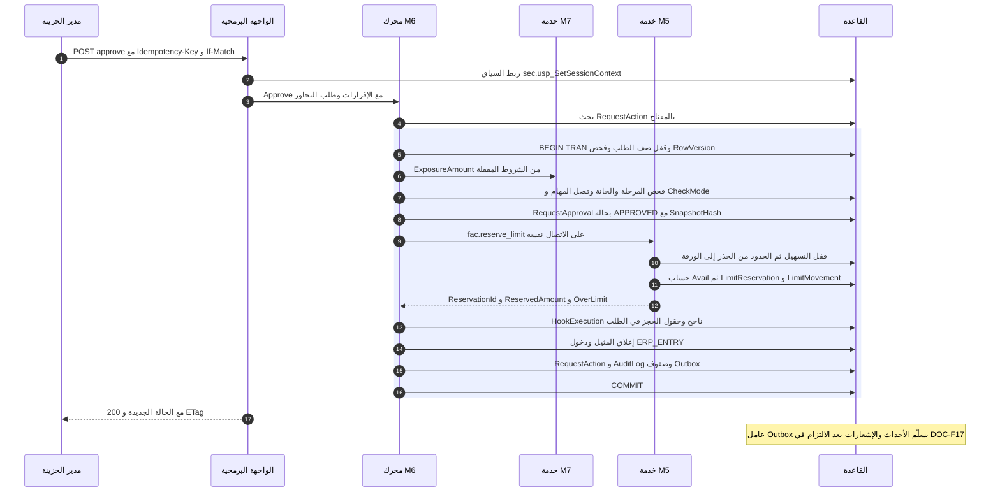
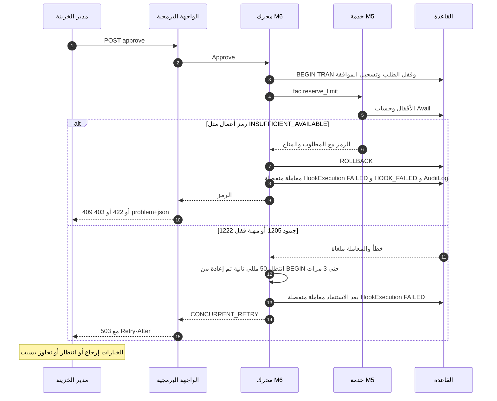

# DOC-F11 — تسلسل معاملة موافقة الطلب وحجز الحد (M6 مع M5)

| البند | القيمة |
|---|---|
| المعرّف | DOC-F11 (docs/30-readiness-documents.md) |
| الإصدار | 0.1 — مسودة للمراجعة — 2026-10-12 |
| المالك المقترح | معماري الحلول مع مالكي M5 وM6 |
| الأولوية | P1 قبل S2 (العقد مع M5 يُنفَّذ في S2، ويعطّل S3) |
| يغطي | FR-WFL-022، FR-WFL-023، FR-WFL-035، BR-WFL-003، BR-WFL-015، BR-WFL-016، BR-WFL-017، BR-WFL-023، FR-FAC-017، FR-FAC-018، FR-FAC-020، BR-FAC-014، BR-FAC-015، AC-WFL-3، NFR-PERF-03، D-9 |
| يعتمد على | DOC-F10 (نقطة الحجز في القالب)، DOC-F04 (ربط الاتصال)، DOC-F17 (Outbox والإشعار بعد الالتزام)، DOC-B03 (NFR-PERF-03)، DOC-B04 (رموز الأخطاء ومفتاح التكرار)، DOC-F12 (التحويل عند الإصدار)، DOC-F14 (حالات الحجز) |
| المصادر | docs/10-detailed-analysis/13-m6-workflow-engine-notifications.md، docs/10-detailed-analysis/12-m5-facilities-pricing-collateral-obligations.md، db/model/15-workflow-notifications.model، db/model/13-facilities-pricing-terms.model، db/model/10-platform.model، docs/20-database-design.md، docs/21-data-dictionary.md، docs/review/design-review-2026-10-11.json |

## 1. الغرض والنطاق

تصف هذه الوثيقة ما يجري حين يوافق مدير الخزينة على طلب في نقطة الحجز. الموافقة والحجز يتمّان معًا في معاملة واحدة أو لا يتمّ أيٌّ منهما (FR-WFL-022، 13-m6:143). وتفصل الوثيقة ما يقع داخل المعاملة عمّا يقع بعدها.

تغطي: ترتيب الخطوات، والأقفال وترتيبها، وإعادة المحاولة عند الجمود، وفروع الفشل ورموزها، والتجاوز، وعدم التكرار، والتحرير عند الرفض والإلغاء، والأحداث بعد الالتزام، واختبار NFR-PERF-03.

خارج النطاق: مراحل القالب (DOC-F10)، والتحويل عند الإصدار وتعديل الاعتماد (DOC-F12)، وحالات الحجز والاستغلال (DOC-F14)، وتسليم Outbox والإشعار (DOC-F17)، وربط الاتصال بالمشترك (DOC-F04).

اختصار المسار: «13-m6» و«12-m5» لملفي docs/10-detailed-analysis، و«15.model» = db/model/15-workflow-notifications.model، و«13.model» = db/model/13-facilities-pricing-terms.model.

الرموز: 🟢 قائم في المستودع أو مقرَّر في الوثائق، 🟡 مقترح ينتظر القرار.

## 2. ما يوجد في النموذج وما هو مواصفة فقط

الخدمة `fac.reserve_limit` عقد في طبقة التطبيق، لا إجراء في القاعدة (docs/20-database-design.md:41). لا يوجد إجراء حجز في db/static، ولا كود تطبيق في المستودع.

| البند | الحالة | المصدر |
|---|---|---|
| علم نقطة الحجز IsReservationPoint، ومقيّد بمرحلة APPROVAL | 🟢 في النموذج | 15.model:122، :134 |
| تعريف الخطاف على المرحلة: HookKey وExecMode = SYNC_TX وOnFailure = BLOCK | 🟢 الجدول wfl.WorkflowStageHook؛ 🟡 الصف المبذور غير موجود بعد | 15.model:183-195 |
| سجل تنفيذ الخطاف بمفتاح ونتيجة مخزّنة ورمز خطأ | 🟢 wfl.HookExecution، فريد (RequestId, StageInstanceId, HookKey, TriggerKind) | 15.model:480-502 |
| الموافقة ببصمة SnapshotHash، وإقرار التحذيرات، ولقطة التوفر، وطلب التجاوز وسببه | 🟢 قيود: البصمة إلزامية عند APPROVED، والسبب إلزامي مع التجاوز | 15.model:435-452 |
| مفتاح تكرار الإجراء | 🟢 wfl.RequestAction.IdempotencyKey فريد لكل طلب | 15.model:471-473 |
| حقول الحجز على الطلب | 🟢 ReservationId وReservedAmount وReservationState وقيد اقترانها | 15.model:294-296، :331-332 |
| الحجز | 🟢 fac.LimitReservation: مفتاح فريد، وحجز ACTIVE واحد لكل طلب، وOverLimit يلزمه سبب | 13.model:272-301 |
| حركة الحد | 🟢 fac.LimitMovement للإضافة فقط، بمفتاح فريد، والرصيد لا يهبط تحت الصفر | 13.model:303-324؛ db/generated/tsql/005_delete_grants.sql:49 |
| صف الحد الجاري | 🟢 fac.Limit بمراجعات، والجاري ToRevision IS NULL | 13.model:139-171 |
| صندوق Outbox | 🟢 cfg.OutboxEvent | db/model/10-platform.model:532-552 |
| قفل التسهيل ثم الحدود، وحساب المتاح، ورموز الرفض | 🟡 مواصفة فقط | 12-m5:252-253؛ 13-m6:306 |
| إعادة المحاولة عند الجمود حتى 3 مرات بتراجع 50 مللي ثانية | 🟡 مواصفة فقط | 13-m6:315 |
| اختبار 100 حجز متزامن | 🟡 غير مكتوب | docs/20-database-design.md:241، :493؛ NFR-PERF-03 |

## 3. المشاركون

| المشارك | ما يمثله | يعمل داخل المعاملة؟ |
|---|---|---|
| مدير الخزينة | المستخدم في المتصفح، يحمل `req.treasury.approve` | لا |
| الواجهة البرمجية | ASP.NET Core: المصادقة والربط ومفتاح التكرار | تفتح الاتصال وتربطه |
| محرك M6 | قواعد الدورة والخانات والانتقال | نعم |
| خدمة M7 | تحسب ExposureAmount (BR-WFL-016، 13-m6:247) | قراءة فقط |
| خدمة M5 | `fac.reserve_limit` وإخوتها (SVC-FAC-04، 12-m5:555) | نعم، على الاتصال نفسه |
| القاعدة | SQL Server 2025، جداول wfl وfac وaud وcfg تحت RLS | — |

قاعدة 🟡: الخطافات SYNC_TX استدعاءات داخل العملية نفسها، على الاتصال والمعاملة نفسيهما. لا خدمة شبكية بين M6 وM5 داخل المعاملة.

## 4. التسلسل الناجح

## 5. خطوات المعاملة

| # | الخطوة | القفل أو الكتابة | عند الفشل |
|---|---|---|---|
| 0 | قبل المعاملة: الصلاحية `req.treasury.approve`، ونطاق الشركة، ومفتاح التكرار (DOC-B04 §7) | قراءة | 403 أو 404؛ إعادة الاستجابة المخزّنة عند التكرار |
| 1 | BEGIN TRAN بعزل READ_COMMITTED (docs/20-database-design.md:239) | — | — |
| 2 | قفل wfl.Request بـ UPDLOCK وROWLOCK، ومقارنة RowVersion (BR-WFL-023) | قفل | 409 VERSION_CONFLICT |
| 3 | ExposureAmount من M7 (لغير الاعتماد DQ-F11-9)، والتخصيص FacilityId وLimitId وLimitProductLineId | قراءة | 422 إن نقص التخصيص (BR-WFL-016) |
| 4 | المرحلة الحالية IsReservationPoint، والخانة PENDING للفاعل أو مجموعته، وفصل المهام (BR-WFL-006)، وشروط المغادرة (BR-WFL-014)، وCheckMode (BR-REQ-010) | قراءة | 409 إن سبقه مؤهل؛ 403 SOD_VIOLATION؛ 422 VALIDATION_FAILED أو WARNINGS_REQUIRE_ACK |
| 5 | تسجيل الموافقة: Decision = APPROVED، وActedByUserId، وOnBehalfOfUserId، وSnapshotHash، وClientIp، وAckWarningsJson، وAvailabilitySnapshotJson، وOverrideRequested وOverrideReason؛ والخانات الأخرى SUPERSEDED في ANY | كتابة wfl.RequestApproval | يُلغى بالتراجع |
| 6 | HookExecution بحالة PENDING ومفتاحه (§8) | كتابة | يُلغى بالتراجع |
| 7 | `fac.reserve_limit` (§6) | أقفال M5 وكتابة fac وOutbox | رمز رفض: تراجع كامل (§7) |
| 8 | HookExecution بحالة SUCCEEDED وResultJson؛ وReservationId وReservedAmount وReservationState = RESERVED على الطلب (DQ-F11-10) | كتابة | — |
| 9 | إغلاق المثيل DONE بـ ExitAction = APPROVE، واختيار الانتقال (BR-WFL-001)، ودخول ERP_ENTRY (BR-WFL-002) | كتابة | خطاف ON_ENTER فاشل بسياسة BLOCK يلغي الكل |
| 10 | RequestAction بالأنواع APPROVED وHOOK_EXECUTED وSTAGE_CHANGED، وaud.AuditLog بشدة عالية، وصفوف Outbox (§10) | كتابة | — |
| 11 | COMMIT | تحرير الأقفال | — |

بصمة SnapshotHash 🟡 (DQ-F11-5): SHA-256 على JSON مُطبَّع لما عُرض على الموافق: RequestId وCycleNo وRowVersion الطلب، والحقول الظاهرة له من FormDataJson، وAmount والعملة وExposureAmount، والتخصيص الثلاثي، وقيم لوحة التوفر المعروضة. والحقول المقيّدة تدخل البصمة مشفّرة كما خُزّنت، لا نصها.

## 6. داخل `fac.reserve_limit`: الأقفال والحساب

### 6.1 ترتيب الأقفال 🟡

ترتيب واحد لكل من يكتب الاستغلال أو الحجز، فلا يقع جمود بين الحجوزات:

| الترتيب | الصف | التلميح | السبب |
|---|---|---|---|
| 1 | wfl.Request للطلب | UPDLOCK وROWLOCK | جذر الإجراء؛ يمنع موافقتين على طلب واحد |
| 2 | fac.Facility للتسهيل | UPDLOCK وHOLDLOCK | نقطة التسلسل الواحدة لكل تسهيل (BR-FAC-015، 12-m5:253) |
| 3 | fac.Limit على المسار من الجذر إلى الورقة، الجاري فقط | UPDLOCK وHOLDLOCK بترتيب العمق | المتاح يأخذ أصغر قيمة على المسار (BR-FAC-014) |
| 4 | fac.LimitProductLine للخط | UPDLOCK وHOLDLOCK | سقف الخط |

بعد القفل 2 تُقرأ مجاميع fac.Utilization وfac.LimitReservation في جمل لاحقة. كل كاتب يأخذ قفل التسهيل أولًا، فالمجاميع ثابتة حتى الالتزام. ومع READ_COMMITTED_SNAPSHOT، إن فُعّل (DOC-B03 §2)، تبدأ هذه الجمل بعد حصول القفل، فترى ما التزم به الكاتب السابق.

القاعدة تشمل `fac.adjust_reservation` و`fac.convert_reservation` و`fac.release_reservation` و`fac.adjust_utilization` و`fac.create_utilization` و`lc.sync_exposure` ومهمة JOB-FAC-RESERVATION. المهمة لا تقفل wfl.Request بعد التسهيل؛ تُصدر `fac.reservation.expired`، ويعلّم المحرك الطلب LOST في معاملة أخرى (13-m6:311).

### 6.2 الفحوص والكتابة

1. التسهيل ACTIVE والحد غير منتهٍ، وإلا LIMIT_NOT_ACTIVE.
2. السريان: NOT_CONFIRMED بحسب سياسة التسهيل، وإلا VALIDITY_UNCONFIRMED.
3. المنتج مسموح للخط، والشركة غير مستبعدة، وسعر العملة متاح، وسياسة إيقاف التعهدات: PRODUCT_NOT_ALLOWED وCOMPANY_EXCLUDED وCURRENCY_NO_RATE وCOVENANT_STOP_POLICY.
4. Avail بالتعريف الوحيد BR-FAC-014، **باستثناء حجز الطلب نفسه** (12-m5:252-253).
5. ExposureAmount ≤ Avail: upsert حجز ACTIVE بـ RequestId (13.model:291)، وصف LimitMovement ‏CREATE أو ADJUST، وصف Outbox ‏`reservation.created` أو `reservation.adjusted` (12-m5:582).
6. ExposureAmount > Avail بلا تجاوز صالح: INSUFFICIENT_AVAILABLE مع المطلوب والمتاح.

M6 لا يعيد حساب المتاح ولا يعرض إلا ما تعيده M5 (BR-REQ-009، 13-m6:271).

### 6.3 إعادة المحاولة عند الجمود 🟡

- الخطأ 1205 (ضحية الجمود) يلغي المعاملة كلها في SQL Server. يعيد المحرك المعاملة من الخطوة 1، لا الجملة وحدها.
- حتى 3 إعادات بتراجع 50 مللي ثانية (13-m6:315؛ DQ-F11-4)، ونقترح إضافة تفاوت عشوائي حتى 50 مللي ثانية كي لا تتصادم الإعادات ثانية.
- انتهاء مهلة القفل (1222) يُعامل كالجمود. هذا الخطأ يلغي الجملة لا المعاملة، فيتراجع المحرك صراحةً، أو يعمل بـ `SET XACT_ABORT ON`. نقترح `SET LOCK_TIMEOUT 5000` لهذه المعاملة (DQ-F11-2).
- بعد استنفاد الإعادات: CONCURRENT_RETRY ← 503 مع Retry-After (DOC-B04 §9.3).
- لا إعادة لرموز الأعمال ولا لـ VERSION_CONFLICT.

مع ترتيب §6.1 لا يقع جمود بين حجزين. الإعادة تبقى لحماية التقاطع مع مسارات أخرى لم تُبنَ بعد.

## 7. فروع الفشل

رمز الأعمال لا يُعاد. الجمود ومهلة القفل وحدهما يُعادان (§6.3).

| الحالة | أين | ما يُلغى | ما يُكتب بعد التراجع | HTTP والرمز |
|---|---|---|---|---|
| تعارض RowVersion | الخطوة 2 | لا شيء كُتب | — | 409 VERSION_CONFLICT |
| سبقه مؤهل في ANY | الخطوة 4 | — | — | 409 (FR-WFL-008) |
| فصل المهام | الخطوة 4 | — | AuditLog بحدث مرفوض (FR-WFL-009) | 403 SOD_VIOLATION |
| CheckMode = BLOCK أو إقرار ناقص | الخطوة 4 | — | — | 422 VALIDATION_FAILED أو WARNINGS_REQUIRE_ACK |
| INSUFFICIENT_AVAILABLE | الخطوة 7 | الموافقة والخانات والطلب كلها | HookExecution FAILED بالرمز، وRequestAction ‏HOOK_FAILED داخلي (BR-WFL-015) | 409 مع المطلوب والمتاح |
| LIMIT_NOT_ACTIVE | الخطوة 7 | كلها | كما سبق | 409 |
| VALIDITY_UNCONFIRMED، PRODUCT_NOT_ALLOWED، COMPANY_EXCLUDED، CURRENCY_NO_RATE، COVENANT_STOP_POLICY | الخطوة 7 | كلها | كما سبق | 422 |
| OVERRIDE_NOT_ALLOWED | الخطوة 7 | كلها | كما سبق | 403 |
| OVERRIDE_REASON_REQUIRED | الخطوة 4 أو 7 | كلها | — | 422 |
| جمود مستمر | الخطوة 7 | كلها | HookExecution FAILED برمز CONCURRENT_RETRY | 503 CONCURRENT_RETRY |

النتيجة كما في AC-WFL-3: الموافقة على B تُرفض INSUFFICIENT_AVAILABLE «دون أي موافقة مسجَّلة» (13-m6:759). الخانة تبقى PENDING، والطلب في TM_APPROVAL.

الرموز وحالاتها من DOC-B04 §9.3. النص للمستخدم يُصاغ من إسقاط الموظف، ولا يصل الطالب شيء منه (BR-WFL-024).

## 8. عدم التكرار

خمس طبقات، لكل منها مفتاحها:

| الطبقة | المفتاح | أين يُخزَّن | سلوك التكرار |
|---|---|---|---|
| طلب الواجهة | Idempotency-Key لكل (مشترك، مستخدم، مسار)، 24 ساعة (DOC-B04 §7) | wfl.RequestAction.IdempotencyKey مع الإجراء APPROVED (15.model:471-473) | يعيد الاستجابة المخزّنة؛ جسم مختلف 422 IDEMPOTENCY_KEY_REUSED؛ طلب لم ينته 409 IDEMPOTENCY_IN_PROGRESS |
| الإجراء | RowVersion وخانة PENDING | wfl.Request وwfl.RequestApproval | موافقة ثانية 409 (BR-WFL-023) |
| الخطاف | `{RequestId}:{StageInstanceId}:{HookKey}:{TriggerKind}:{ActionFilter}` 🟡 | wfl.HookExecution (15.model:480-502) | SUCCEEDED يعيد ResultJson دون استدعاء M5 (BR-WFL-015) |
| الحجز | upsert بـ RequestId؛ IdempotencyKey بالصيغة `res:{RequestId}:{n}`، ويزيد n بعد كل فك 🟡 | fac.LimitReservation (13.model:289-291) | إعادة الموافقة تعدّل الحجز ولا تنشئ ثانيًا |
| الحركة | `{مفتاح الخطاف}:{OpKind}` 🟡 | fac.LimitMovement (13.model:316-319) | الإدراج المكرر يفشل بالفرادة، فيُعامل كأنه طُبّق |

قاعدتان مقترحتان 🟡 (DQ-F11-3):
- الفشل لا يُخزَّن نتيجةً تُعاد. HookExecution بحالة FAILED يُنفَّذ من جديد في المحاولة التالية، ويزيد AttemptCount. وإلا بقي الطلب مرفوضًا بعد تحرير المتاح.
- صف HOOK_FAILED لا يحمل Idempotency-Key الطلب. فالعميل يعيد بالمفتاح نفسه بعد فشل، ويستعمل مفتاحًا جديدًا إن غيّر الجسم، كطلب التجاوز.

DR-43 مفتوح: الفرادة في wfl.HookExecution لا تضم ActionFilter (15.model:497). صيغة المفتاح أعلاه تضمه، ويلزم تعديل الفرادة لتطابقها (DQ-F11-6).

## 9. مسار التجاوز

1. يصل TM رمز INSUFFICIENT_AVAILABLE مع المطلوب والمتاح (F-WFL-3، 13-m6:492).
2. يعيد الموافقة بـ OverrideRequested = true وسبب مكتوب، بمفتاح تكرار جديد.
3. يفحص المحرك في الخطوة 4: الإعداد `fac.override_limit.enabled` مفعّل (الافتراضي معطّل)، والفاعل يحمل `fac.override_limit`، والسبب غير فارغ (BR-WFL-016، 13-m6:247).
4. تعيد M5 الفحص نفسه ولو فحصته M6 (BR-FAC-015، 12-m5:253).
5. ينشأ الحجز بـ OverLimit = 1 وOverrideReason (13.model:286-287، :301). وفي الموافقة OverrideRequested وOverrideReason (15.model:439-440، :452).
6. داخل المعاملة: AuditLog بشدة عالية (FR-WFL-034، 13-m6:155)، وحدث FAC.RESERVATION_ALERT الإلزامي لـ TM وFO (13-m6:595).

الصلاحية `fac.override_limit` لا تنتقل بالتفويض (DOC-F10 DQ-F10-10).

## 10. ما بعد الالتزام: التدقيق والأحداث

كل ما يلي يُكتب داخل المعاملة، ولا يخرج شيء قبل COMMIT. فشل المعاملة لا يترك حدثًا (FR-WFL-038، 13-m6:159).

| الصف | النوع | الغرض | المصدر |
|---|---|---|---|
| aud.AuditLog | تدقيق أمني | الموافقة المرتبطة بالحجز بشدة عالية؛ والتجاوز | 13-m6:689، :155 |
| wfl.RequestAction | سجل الطلب | APPROVED وHOOK_EXECUTED وSTAGE_CHANGED | FR-WFL-033، 13-m6:154 |
| `request.approved` و`request.stage_changed` | Outbox | أحداث النطاق للمستهلكين لاحقًا | 13-m6:676 |
| `reservation.created` أو `reservation.adjusted` | Outbox من M5 | حركة الحد | 12-m5:582 |
| REQ.PHASE_CHANGED وREQ.ACTION_REQUIRED_REQUESTER | طلب إشعار عبر Outbox | الطالب: المرحلة الظاهرة صارت «بانتظار إجراء منك» لمرجع ERP | 13-m6:570، :575 |
| FAC.RESERVATION_ALERT | طلب إشعار عبر Outbox | عند OverLimit فقط | 13-m6:595 |
| ntf.Notification.ActionState = RESOLVED | تحديث 🟡 (DQ-F11-8) | إشعارات REQ.APPROVAL_NEEDED المفتوحة لبقية المؤهلين | FR-NTF-007، 13-m6:206 |

بعد الالتزام:
- يسلّم عامل Outbox الأحداث، ويحوّل طلبات الإشعار إلى إشعارات (DOC-F17).
- خطافات AFTER_COMMIT تُسجَّل PENDING داخل المعاملة، وتُنفَّذ بعدها حتى 5 محاولات، ثم GAVE_UP وتنبيه TM (BR-WFL-015؛ 15.model:488، :502).
- تخزّن الواجهة الاستجابة بمفتاح التكرار.

في مسار الفشل تُكتب في معاملة منفصلة: HookExecution بحالة FAILED، وRequestAction ‏HOOK_FAILED داخلي، وAuditLog بشدة متوسطة 🟡 (DQ-F11-7). لا حدث Outbox ولا إشعار للطالب.

## 11. التحرير وإعادة الموافقة

| الحالة | ما يجري في معاملة الإجراء | المصدر |
|---|---|---|
| REJECT في TM_APPROVAL، أو CANCEL بعد الحجز | قفل الطلب، ثم الخانات VOIDED، ثم دخول المرحلة النهائية، ثم `fac.release_reservation` على ON_ENTER (DOC-F10 DQ-F10-3): قفل التسهيل، والحجز RELEASED بسبب REJECTED أو CANCELLED، وLimitMovement ‏RELEASE، و`reservation.released`، وReservationState = RELEASED | 13-m6:307؛ BR-WFL-009؛ AC-WFL-3 |
| لا حجز | التحرير ينجح بلا أثر | 13-m6:307 |
| إعادة الموافقة بعد إرجاع للطالب | الحجز باقٍ (Q-WFL-08)؛ upsert يعدّل الحجز ACTIVE إلى ExposureAmount الجديد بحركة ADJUST؛ المتاح يستثني حجز الطلب، فالتخفيض ينجح دائمًا | BR-WFL-017، 13-m6:248 |
| تغيّر الخط أو الحد أو التسهيل بعد إرجاع داخلي | فك الحجز القديم بسبب SUPERSEDED ثم حجز جديد بمفتاح جديد، في المعاملة نفسها؛ تسهيلان يُقفلان بترتيب FacilityId تصاعديًا 🟡 | 13.model:285، :289؛ 15.model:294 |
| انتهاء الحجز في M5 | M5 تفكّه وتُصدر `fac.reservation.expired`؛ المحرك يعلّم الطلب LOST ويصدر REQ.RESERVATION_LOST في معاملة أخرى | BR-WFL-017، 13-m6:311 |

## 12. الاختبار وربطه بـ NFR-PERF-03

NFR-PERF-03: «100 طلب حجز متزامن على الحد نفسه: لا تجاوز للمتاح، ولكل طلب نتيجة محددة»، قبل خروج S2 على SQL Server 2025 (docs/30-readiness/DOC-B03-nfr-specification.md:30؛ docs/20-database-design.md:241؛ DOC-B01 §5.3).

الاختبار المقترح 🟡:

| البند | القيمة |
|---|---|
| البيانات | تسهيل بحد جذر وخط واحد؛ السقف 10,000,000 والقائم 6,000,000، فالمتاح 4,000,000 كما في AC-WFL-3 |
| الحمل | 100 طلب في TM_APPROVAL، لكل منها ExposureAmount = 100,000، و100 موافقة متوازية |
| المتوقع | 40 نجاحًا بالضبط، و60 INSUFFICIENT_AVAILABLE؛ مجموع الحجوزات ACTIVE = 4,000,000؛ 40 صف LimitMovement |
| الاتساق | لا خانة APPROVED بلا حجز ACTIVE، ولا حجز بلا خانة؛ لكل طلب نتيجة واحدة |
| CONCURRENT_RETRY | يُعدّ ويُبلَّغ، والهدف صفر |
| التكرار | إعادة المئة بالمفاتيح نفسها لا تغيّر شيئًا |
| تنويع المسار | حدّان فرعيان تحت أب واحد (مثال BR-FAC-014، 12-m5:252)، 50 طلبًا على كل منهما؛ مجموع المحجوز لا يتجاوز متاح الأب |
| الجمود | جلستان تأخذان الأقفال بترتيب معاكس عمدًا لإثبات الإعادة ثم CONCURRENT_RETRY |

الأداة: اختبار تكامل بالكود (DQ-B01-6). القاعدة لا تحوي اليوم أي اختبار للتدفق المالي (docs/20-database-design.md:493).

## 13. القرارات المطلوبة

| المعرّف | السؤال | الافتراض المقترح | من يقرر | ما يعطّله |
|---|---|---|---|---|
| DQ-F11-1 | ما الذي يُقفل وبأي ترتيب؟ | الطلب، ثم صف التسهيل، ثم الحدود من الجذر إلى الورقة، ثم الخط، كلها UPDLOCK وHOLDLOCK عدا الطلب؛ ويلتزم به كل كاتب للاستغلال والحجز | معماري الحلول مع مالك M5 | خدمات `fac.*` في S2 |
| DQ-F11-2 | مهلة القفل | `SET LOCK_TIMEOUT 5000`، و1222 يُعاد كالجمود | معماري قاعدة البيانات | NFR-PERF-03 |
| DQ-F11-3 | هل تُخزَّن نتيجة الفشل وتُعاد؟ | لا؛ تُعاد النتيجة الناجحة فقط، في الخطاف وفي مفتاح الواجهة لإجراءات الطلب | مالك M6 | BR-WFL-015 وDOC-B04 §7 |
| DQ-F11-4 | معنى «حتى 3 مرات» | محاولة أولى ثم 3 إعادات، بتراجع 50 مللي ثانية مع تفاوت حتى 50 | معماري الحلول | المحرك |
| DQ-F11-5 | محتوى SnapshotHash وتطبيعه | ما في §5، بتطبيع JSON بمفاتيح مرتبة | مسؤول الأمن مع مالك M6 | عدم الإنكار (13-m6:689) |
| DQ-F11-6 | صيغ المفاتيح، وتعديل فرادة HookExecution | صيغ §8، وإضافة ActionFilter إلى الفرادة (DR-43) | معماري قاعدة البيانات | db/model قبل S3 |
| DQ-F11-7 | تدقيق المحاولة الفاشلة | AuditLog بشدة متوسطة في معاملة HOOK_FAILED | مسؤول الأمن | DOC-S12 |
| DQ-F11-8 | حل إشعارات REQ.APPROVAL_NEEDED | داخل المعاملة نفسها | مالك M6 | FR-NTF-007 |
| DQ-F11-9 | ExposureAmount لنوع يستهلك حدًّا وليس اعتمادًا (ضمان، سحب تمويل) | قيمة حقل المبلغ AmountFieldKey حين لا مزوّد من M7 | مالك M5 مع مالك M6 | أنواع S5 (Q-REQ-03) |
| DQ-F11-10 | نسخ حالة الحجز على الطلب (DR-44) | تبقى النسخة وتُكتب في المعاملة نفسها، مع مطابقة ليلية مع fac.LimitReservation | معماري قاعدة البيانات | لوحات الحجز |

## 14. تعارضات وفجوات في المصادر

1. ثلاثة أوصاف للقفل: «صف الحد (UPDLOCK/HOLDLOCK)» (13-m6:315)، و«UPDLOCK, ROWLOCK على fac.Limit» (docs/20-database-design.md:237)، و«تقفل التسهيل ثم الحدود من الجذر إلى الورقة» (12-m5:253). قفل صف واحد لا يمنع حجزين على حدّين شقيقين يتجاوزان متاح الأب. الموقف في DQ-F11-1.
2. قائمة رموز الرفض في 13-m6:306 بلا OVERRIDE_NOT_ALLOWED وOVERRIDE_REASON_REQUIRED، وهما في 12-m5:253 وDOC-B04 §9.3.
3. «التكرار يعيد النتيجة المخزَّنة» (BR-WFL-015، 13-m6:246) لا يميّز الفشل من النجاح. الموقف في DQ-F11-3.
4. DR-43 مفتوح: فرادة wfl.HookExecution بلا ActionFilter (15.model:497؛ docs/review/design-review-2026-10-11.json:446).
5. DR-44 مفتوح: حالة الحجز منسوخة على wfl.Request بلا قيد يربطها بـ fac.LimitReservation (15.model:294-296؛ docs/review/design-review-2026-10-11.json:457).
6. لا جدول باسم wfl.RequestStageHook في المستودع. تعريف الخطاف في wfl.WorkflowStageHook (15.model:183)، وتنفيذه في wfl.HookExecution (15.model:480).
7. خدمات الحجز عقود في التطبيق (docs/20-database-design.md:41)، ولا اختبار للتدفق المالي بعد (docs/20-database-design.md:493).

## 15. التتبع

| البند في هذه الوثيقة | المتطلب أو القاعدة أو القرار | المصدر |
|---|---|---|
| §4 و§5 | FR-WFL-022، BR-WFL-003، BR-WFL-016، D-9 | docs/10-detailed-analysis/13-m6-workflow-engine-notifications.md:143، :234، :247، :487-492 |
| §5 الخطوة 2 | BR-WFL-023، FR-WFL-035 | docs/10-detailed-analysis/13-m6-workflow-engine-notifications.md:156، :254 |
| §6.1 و§6.2 | BR-FAC-014، BR-FAC-015، FR-FAC-018 | docs/10-detailed-analysis/12-m5-facilities-pricing-collateral-obligations.md:125، :252-253 |
| §6.3 | التزامن في عقد الخطافات | docs/10-detailed-analysis/13-m6-workflow-engine-notifications.md:315 |
| §7 | رموز الرفض، AC-WFL-3 | docs/10-detailed-analysis/13-m6-workflow-engine-notifications.md:306، :756-759؛ DOC-B04 §9.3 |
| §8 | BR-WFL-015، FR-FAC-017 | db/model/15-workflow-notifications.model:471-502؛ db/model/13-facilities-pricing-terms.model:289-319 |
| §9 | FR-FAC-020، BR-WFL-016، Q-WFL-07 | docs/10-detailed-analysis/12-m5-facilities-pricing-collateral-obligations.md:127؛ docs/10-detailed-analysis/13-m6-workflow-engine-notifications.md:720 |
| §10 | FR-WFL-033، FR-WFL-034، FR-WFL-038 | docs/10-detailed-analysis/13-m6-workflow-engine-notifications.md:154-155، :159 |
| §11 | FR-WFL-023، BR-WFL-017 | docs/10-detailed-analysis/13-m6-workflow-engine-notifications.md:144، :248، :307، :311 |
| §12 | NFR-PERF-03 | docs/30-readiness/DOC-B03-nfr-specification.md:30؛ docs/20-database-design.md:241 |
