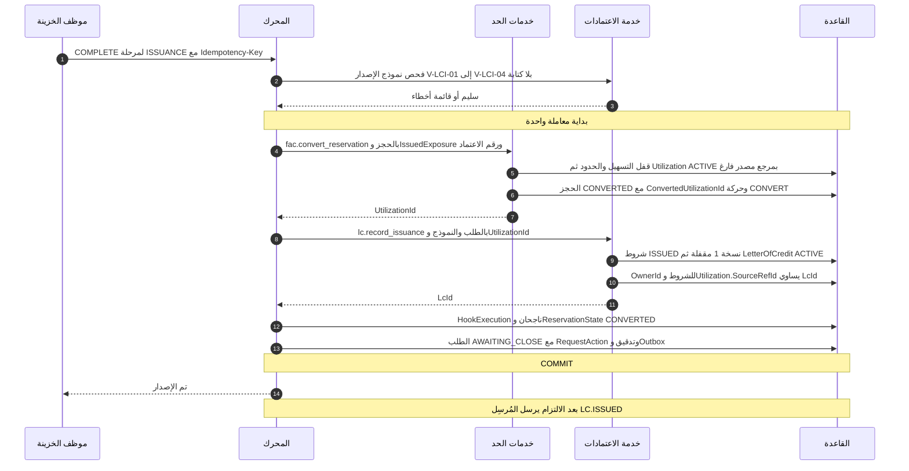
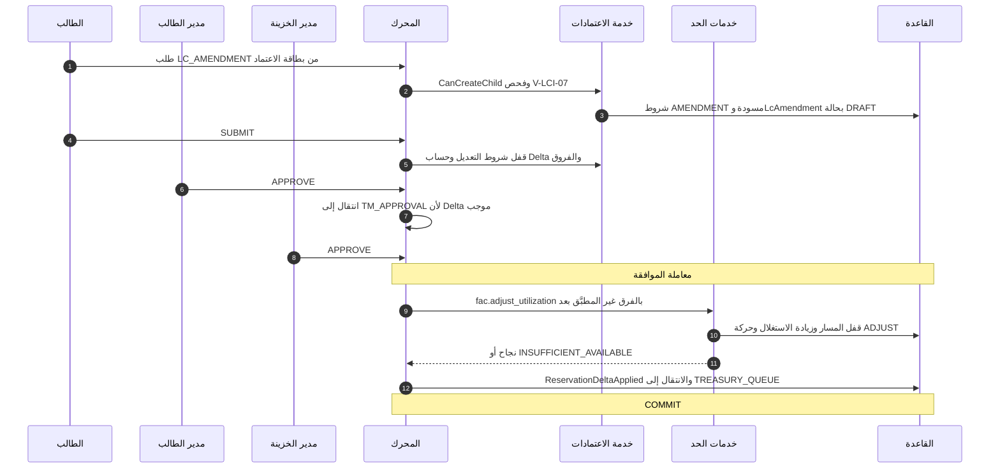
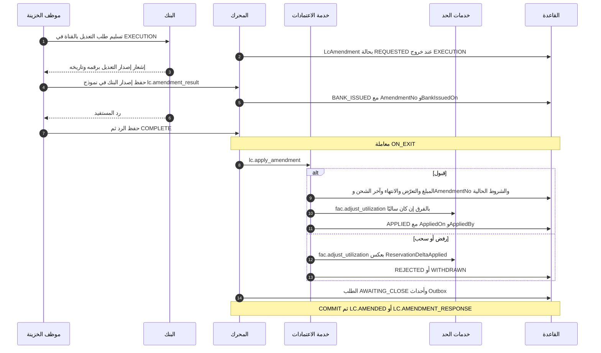
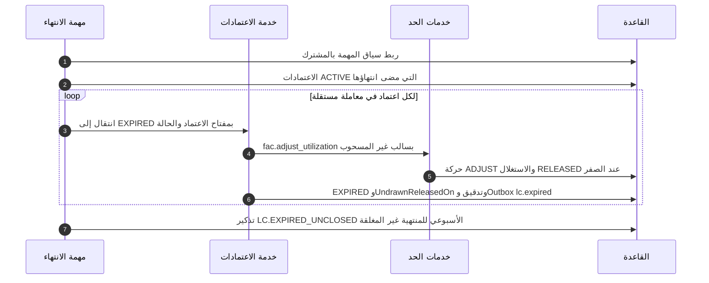
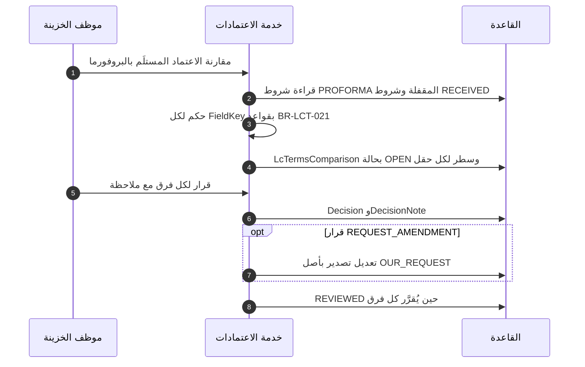

# DOC-F12 — تسلسل إصدار الاعتماد المستندي وتعديله وتحويل الحجز

| البند | القيمة |
|---|---|
| المعرّف | DOC-F12 (docs/30-readiness-documents.md) |
| الإصدار | 0.1 — مسودة للمراجعة — 2026-10-12 |
| المالك المقترح | مالك M7 وM8 مع معماري الحلول |
| الأولوية | P1 قبل S2 (يبدأ مع عقد M5، ويُستعمل في S3) |
| يغطي | FR-LCI-008، FR-LCI-012، FR-LCI-015، FR-LCI-017 إلى FR-LCI-022، FR-LCI-025، FR-LCI-026، FR-LCI-029، FR-LCT-031، FR-LCE-023، FR-REQ-027، FR-WFL-022، FR-WFL-023، BR-LCI-004، BR-LCI-007، BR-LCI-009 إلى BR-LCI-012، BR-LCI-019، BR-WFL-015، BR-WFL-018، BR-FAC-015، BR-FAC-020، AC-LCI-1، AC-LCI-2، AC-WFL-7، DR-26، DR-41، DR-45، DR-46، O-06 (erd_open_items) |
| يعتمد على | DOC-F11 (حجز الحد عند موافقة TM)، DOC-F10 (مراحل القوالب)، DOC-F08 (حالة الطلب والإقفال)، DOC-F14 (حالات الحجز والاستغلال)، DOC-F16 (حالات التعديل والسحب)، DOC-F17 (Outbox والمهام)، DOC-F02 وDOC-S06 (البيانات المقيّدة)، DOC-B04 (نموذج الأخطاء) |
| المصادر | docs/10-detailed-analysis/14-m7-m8-letters-of-credit.md، docs/10-detailed-analysis/13-m6-workflow-engine-notifications.md، docs/10-detailed-analysis/12-m5-facilities-pricing-collateral-obligations.md، docs/10-detailed-analysis/00-overview-and-cross-cutting.md، docs/02-forms-analysis-ucp600.md، db/model/16-letters-of-credit.model، db/model/13-facilities-pricing-terms.model، db/model/15-workflow-notifications.model، db/generated/tsql/006_sensitive_columns.sql، db/generated/tsql/007_table_grants.sql، docs/review/design-review-2026-10-11.json |

## 1. الغرض والنطاق

تبيّن الوثيقة ترتيب الخطوات بين الخزينة ومحرك الطلبات وخدمة الاعتمادات `lc.*` وخدمات الحد `fac.*` والقاعدة في ثلاث رحلات:

- إصدار اعتماد مشتريات من طلب `PURCHASE_LC` موافَق عليه.
- تعديل الاعتماد بطلب فرعي `LC_AMENDMENT` حتى رد المستفيد.
- انتقال المبلغ المحجوز من الطلب إلى الاعتماد ثم إلى الاستغلال حتى فكّه.

وتحدد لكل رحلة ما يقع داخل معاملة واحدة وما يقع بعد الالتزام، ومن يملك كل قرار.

**داخل النطاق:** خروج مرحلة ISSUANCE؛ قالب `CHILD_AMENDMENT` بأنواعه (زيادة، تخفيض، تمديد، إلغاء)؛ أثر السحب والتسديد والانتهاء والإغلاق على الاستغلال؛ الاعتماد القائم السابق؛ الطلبان الفرعيان `LC_DOCUMENT_REQUEST` و`LC_SWIFT_REQUEST` من حيث الأثر؛ مقارنة الشروط ونسخ البيانات المقيّدة (DR-46).

**خارج النطاق:**

| الموضوع | الوثيقة المالكة |
|---|---|
| الحجز عند موافقة TM وقفل صف الحد وإعادة المحاولة | DOC-F11 |
| مراحل القوالب ومن يوافق في كل مرحلة | DOC-F10 |
| مخططات حالات التعديل والسحب والمخالفات وأوامر البيع والبروفورما | DOC-F16 |
| حالات الحجز والاستغلال من منظور M5 | DOC-F14 |
| المُرسِل والمهام المجدولة ومسار الإشعار | DOC-F17 |
| حالة الطلب والإقفال AWAITING_CLOSE | DOC-F08 |
| اعتمادات المبيعات، فهي لا تمس الحدود (FR-LCE-027) | DOC-F16 §8 إلى §10 |

**الوسوم:** 🟢 موجود أو مقرر في المستودع أو الوثائق مع الملف والسطر. 🟡 اقتراح.

**اختصارات المراجع:** «14» هو docs/10-detailed-analysis/14-m7-m8-letters-of-credit.md، و«13» هو docs/10-detailed-analysis/13-m6-workflow-engine-notifications.md، و«12» هو docs/10-detailed-analysis/12-m5-facilities-pricing-collateral-obligations.md، و«02» هو docs/02-forms-analysis-ucp600.md. و«m16» هو db/model/16-letters-of-credit.model، و«m13» هو db/model/13-facilities-pricing-terms.model، و«m15» هو db/model/15-workflow-notifications.model، و«m10» هو db/model/10-platform.model. و«001_tables.sql» و«005» و«006» و«007» ملفات db/generated/tsql بالأرقام نفسها. وDR-nn نتائج docs/review/design-review-2026-10-11.json.

## 2. ما هو موجود اليوم

| البند | الحال | المرجع |
|---|---|---|
| الجداول | 🟢 LetterOfCredit وLcAmendment وLcTerms وUtilization وLimitReservation موجودة في النموذج والـDDL | m16:390، m16:485، m16:161؛ m13:242، m13:272 |
| الخطافات | 🟢 لا إجراء مخزَّن ولا قادح لـ `lc.*` أو `fac.*` في db/. هي كود تطبيق مسجَّل بمفتاح | 13:142؛ db/static فيها قوادح 030 و050 فقط |
| عدم التكرار | 🟢 wfl.HookExecution بمفتاح (RequestId، StageInstanceId، HookKey، TriggerKind) ونتيجة مخزَّنة | m15:480-497 |
| حركات الحد | 🟢 fac.LimitMovement للإضافة فقط بمفتاح فريد | m13:303-324؛ 005:49 |
| الانتقالات | 🟢 لا تفرضها القاعدة. توجد قيود CHECK لكل حالة، وtp_app يملك UPDATE على جداول lc | m16:465-467، m16:512-522؛ 007:375-405؛ DR-41 مفتوح |
| ربط الاستغلال بالاعتماد | 🟢 مرتان: LetterOfCredit.UtilizationId بمفتاح أجنبي، وUtilization.SourceRefId بلا مفتاح | m16:410؛ m13:255؛ DR-26 مفتوح |
| البنك | 🟢 لا ربط آلي. الخزينة تسجّل كل حدث بنكي يدويًا | 02:298؛ 14:650 |
| مبلغ التعرّض | 🟢 ExposureAmount مخبأ في الاعتماد، وهو المبلغ الوحيد الممرَّر إلى fac | m16:419؛ 14:263 |

## 3. المشاركون وحدود المعاملة

| الرمز | المشارك | المرجع |
|---|---|---|
| TE | موظف الخزينة المُسنَد (CLAIMER)، أو TM أو FO | A-02 وA-03 (DOC-F01)؛ 14:58 |
| PR وRQM | الطالب ومديره | A-03 (DOC-F01)؛ 14:44 |
| ENG | محرك الطلبات wfl | 13 §5 |
| LC | خدمة الاعتمادات `lc.*` | 14:303-313 |
| FAC | خدمات الحد `fac.*` | 12:253، 12:258 |
| DB | القاعدة BankFas بدور tp_app | D-01 وTB-3 (DOC-F01) |
| BANK | البنك، خارج النظام | A-15 (DOC-F01، لاحقًا) |

قواعد المعاملة:

1. 🟢 خطاف SYNC_TX بسياسة BLOCK يعمل في معاملة المحرك. فشله يلغي المعاملة كلها، ويُسجَّل HOOK_FAILED في معاملة منفصلة (13:246).
2. 🟢 تكرار الخطاف بالمفتاح نفسه يعيد النتيجة المخزَّنة ولا يكرر الأثر (13:246؛ m15:497).
3. 🟢 خدمات fac تقفل التسهيل ثم الحدود من الجذر إلى الورقة داخل معاملة المستدعي (12:253، 12:258). يعيد المحرك المحاولة حتى 3 مرات بتراجع 50 مللي ثانية عند الجمود (13:315). التفصيل في DOC-F11.
4. 🟢 الإشعار يصدر بعد الالتزام AFTER_COMMIT (13:332). 🟡 صف `cfg.OutboxEvent` يُكتب داخل المعاملة نفسها (m10:532)، فلا يخرج حدث لمعاملة أُلغيت (DOC-F17).
5. 🟢 كل كتابة على الاعتماد تحمل RowVersion وIdempotency-Key، والتعارض 409 (FR-LCI-031، 14:187؛ DOC-B04 §7).

## 4. تسلسل الإصدار

**الشروط المسبقة:**

- الطلب ACTIVE في مرحلة ISSUANCE (13:332).
- `Request.ReservationState = RESERVED` والحجز ACTIVE (m15:296؛ m13:281). كيف وصل إليها في DOC-F11.
- نموذج `lc.issuance` مكتمل: الرقم والتاريخ والمبلغ والتسامح والانتهاء ونسخة LC_COPY (FR-LCI-011، 14:167).

| # | الخطوة | ما يُكتب والقاعدة | عند الفشل |
|---|---|---|---|
| 2-3 | فحص مسبق 🟡 | V-LCI-01 إلى V-LCI-04 (14:570-573) بلا كتابة ولا قفل. يُعاد الفحص داخل `lc.record_issuance` (14:308) | 422 VALIDATION_FAILED، أو WARNINGS_REQUIRE_ACK لـ V-LCI-03 (DOC-B04:189) |
| 5-8 | التحويل | 🟢 Utilization بنوع LC ومبلغ IssuedExposure ومرجع مصدر فارغ؛ الحجز CONVERTED (12:253؛ m13:283). IssuedExposure يُحسب من المبلغ والتسامح الصادرين ولا يتجاوز الموافَق عليه (BR-LCI-007، 14:266) | RESERVATION_NOT_ACTIVE إن كان الحجز RELEASED أو LOST (DOC-B04:235) |
| 9-11 | تسجيل الإصدار | 🟢 ترتيب الكتابة يفرضه المفتاح الأجنبي: الشروط أولًا ثم الاعتماد ثم تحديث OwnerId (m16:10-12). الشروط نسخة من APPLICATION بـ CopiedFromTermsId (m16:259)، مقفلة بتجزئة (m16:272) | V-LCI-01 عند تكرار الرقم لمنشأة الإصدار (m16:436) |
| 10 | فرادة الاعتماد | 🟢 RequestId فريد في الاعتماد (m16:439)، فإعادة التنفيذ لا تنشئ اعتمادًا ثانيًا؛ وUtilizationId فريد (m16:438) | تعارض فريد يلغي المعاملة |
| 11 | مرجع المصدر | 🟢 SourceRefId يتغير مرة واحدة من فارغ إلى LcId، وأي تغيير آخر IMMUTABLE_SOURCE (12:253). الفرض في التطبيق فقط (m13:255) | يلغي المعاملة |
| 13 | حالة الطلب | 🟢 ReservationState = CONVERTED (m15:296). 🟡 الطلب AWAITING_CLOSE لا COMPLETED، و`REQ.COMPLETED` عند الإقفال (DOC-F08 §4.3) | — |
| 14 | التدقيق والأحداث | 🟡 صف aud.AuditLog بفئة TREASURY وفعل LC_ISSUED (m10:309-310). 🟢 حدث Outbox `lc.issued` (14:655) وإشعار LC.ISSUED (14:598) | — |

**الثابتة بعد الالتزام** 🟢: لا يبقى Utilization بنوع LC ومرجع مصدر فارغ، ويساوي LcId الاعتمادَ المنشأ (FR-LCI-012، 14:168). الفهرس m13:264 يكشف أي بند بلا مرجع في التقرير R-FAC-03 (12:533).

**الاعتماد القائم السابق** (FR-LCI-029، 14:185؛ BR-LCI-017، 14:276): الترتيب معكوس. يُنشأ الاعتماد أولًا بـ LegacyEntry = 1 وبلا طلب (m16:468)، ثم `fac.create_utilization` بنوع LC ومرجع LcId بلا حجز ولا فحص إتاحة (12:258)، ثم يُحدَّث `LetterOfCredit.UtilizationId` 🟡 في المعاملة نفسها. التكرار يُرفض DUPLICATE_SOURCE (m13:260). الصلاحية `lc.legacy.enter` (14:68) والتدقيق بشدة عالية (14:670).

## 5. انتقال الحجز بين الطلب والاعتماد والاستغلال

كل الاستدعاءات بمبلغ ExposureAmount أو فرقه (BR-LCI-019، 14:278). الحالات من m13:281 وm13:256 وm15:296.

| الحدث | الخدمة | الحجز | الاستغلال | الاعتماد | حالة الحجز في الطلب |
|---|---|---|---|---|---|
| موافقة TM | `fac.reserve_limit` (DOC-F11) | ACTIVE بمبلغ التعرّض | — | — | RESERVED |
| إعادة الموافقة قبل الإصدار | `fac.reserve_limit` upsert أو `fac.adjust_reservation` | ACTIVE بالمبلغ الجديد | — | — | RESERVED |
| رفض أو إلغاء قبل الإصدار | `fac.release_reservation` | RELEASED | — | — | RELEASED |
| انتهاء الحجز في M5 | حدث `fac.reservation.expired` (13:311) | RELEASED | — | — | LOST |
| الإصدار | convert ثم `lc.record_issuance` | CONVERTED | ACTIVE بمبلغ IssuedExposure | ACTIVE | CONVERTED |
| موافقة TM على زيادة تعديل | `fac.adjust_utilization` بفرق موجب | — | يزيد | لا يتغير | — |
| قبول المستفيد | `lc.apply_amendment` | — | ينقص عند التخفيض فقط | المبلغ الجديد | — |
| رفض المستفيد أو سحب التعديل | `fac.adjust_utilization` بعكس الزيادة | — | يعود | لا يتغير | — |
| تقديم مستندات | لا استدعاء (14:762) | — | لا يتغير | DrawnAmount يزيد | — |
| تسديد | `lc.sync_exposure` ثم adjust بفرق سالب | — | ينقص بالمسدَّد | SettledAmount يزيد | — |
| الانتهاء بالفك الآلي | adjust بسالب غير المسحوب | — | ينقص، وRELEASED عند الصفر | EXPIRED | — |
| الإغلاق أو الإلغاء المؤكد | `fac.release_utilization` | — | RELEASED | CLOSED أو CANCELLED | — |

ملاحظات:

- 🟢 `fac.adjust_reservation` على حجز CONVERTED يُرفض RESERVATION_NOT_ACTIVE، فكل تغيير بعد الإصدار على الاستغلال (FR-LCI-017، 14:173).
- 🟢 الفرق السالب مسموح دائمًا ولا يهبط تحت الصفر، ويُسجَّل المطلوب والمطبَّق في LimitMovement (12:258؛ m13:311-312).
- 🟢 الطلبان الفرعيان `LC_DOCUMENT_REQUEST` و`LC_SWIFT_REQUEST` يمران بقالب CHILD_STANDARD ولا يمسان الحد (13:343). يُنشآن لاعتماد ACTIVE أو EXPIRED أو CLOSED، لا CANCELLED (FR-LCI-022، 14:178)، ولا يكتملان بلا مرفق ظاهر للطالب (14:176-177).

## 6. تسلسل التعديل

### 6.1 المسار وأنواع التعديل

🟢 القالب CHILD_AMENDMENT: DRAFT ثم APPROVAL (مدير الطالب) ثم TM_APPROVAL شرطيًا ثم TREASURY_QUEUE ثم EXECUTION ثم AMENDMENT_RESULT ثم الإكمال (13:344). الانتقال إلى TM_APPROVAL عند `amountDelta > 0` أو `kind = CANCEL`، وإلا إلى TREASURY_QUEUE. Delta فرق ExposureAmount بإشارته (BR-LCI-011، 14:270؛ m16:495).

| النوع | إشارة Delta | TM_APPROVAL | عند موافقة TM | عند القبول | عند الرفض أو السحب |
|---|---|---|---|---|---|
| INCREASE_AMOUNT | موجب | نعم | adjust_utilization بالفرق، ويتطلب متاحًا | تحديث المبلغ والتعرّض | adjust بعكس المطبَّق |
| DECREASE_AMOUNT | سالب | لا | لا استدعاء | adjust بالفرق السالب، لا قبل القبول (14:175) | لا أثر |
| EXTEND_EXPIRY | صفر | لا | لا استدعاء | تحديث الانتهاء وإعادة ضبط التنبيهات (FR-LCI-027، 14:183) | لا أثر |
| CHANGE_SHIPMENT_DATE أو CHANGE_TERMS | صفر عادة | فقط إن رفع التسامح التعرّض | كالزيادة إن كان موجبًا | تحديث الشروط | كالزيادة |
| CANCEL | — | نعم (Q-LCI-11، 14:718) | لا استدعاء (13:344) | 🟡 الاعتماد CANCELLED وفك الاستغلال (DQ-F12-8) | لا أثر |

🟢 تعديل مفتوح واحد لكل اعتماد ACTIVE (V-LCI-07، 14:576؛ `lc.amendment.max_open`، 14:331). وتمديد بلا فرق مبلغ لا يمر بـ TM ولا يستدعي خدمات الحد (14:174).

### 6.2 من الطلب إلى رفع التعرّض

- 🟢 الخطوة 10 خطاف ON_ACTION(APPROVE) في TM_APPROVAL (13:310، 13:344). المبلغ لا يتغير في الاعتماد بعد (AC-LCI-2، 14:767).
- 🟢 فشل الإتاحة يلغي الموافقة كلها، ويرى TM المطلوب والمتاح (AC-WFL-7، 13:779).
- 🟡 الخطوتان 3 و5: لا يذكر 13:344 خطافًا ينشئ صف LcAmendment أو يقفل شروط التعديل. المقترح في DQ-F12-2 وDQ-F12-3.
- 🟡 الخطوة 10 تطبّق `Delta − ReservationDeltaApplied` لا Delta كاملًا. السبب: مفتاح الخطاف يحمل StageInstanceId (13:246)، فمرور ثانٍ بـ TM_APPROVAL بعد إرجاع ينتج مفتاحًا جديدًا ورفعًا ثانيًا (DQ-F12-4).

### 6.3 إصدار البنك ورد المستفيد والتطبيق

- 🟢 التطبيق عند القبول فقط، والقيد يفرض ACCEPTED وAppliedOn وAppliedBy (m16:521؛ BR-LCI-012، 14:271).
- 🟢 حالة BANK_ISSUED تتطلب AmendmentNo وBankIssuedOn (m16:520)، والرقم فريد لكل اعتماد (m16:507).
- 🟢 عند القبول تصير شروط التعديل هي `CurrentTermsId` (14:486؛ m16:413). شروط ISSUED الأولى تبقى LOCKED لأن مالكها وغرضها مختلفان (m16:263).
- 🟡 الخطوة 2: REQUESTED تعني «سُلِّم الطلب للبنك»، وتُكتب عند خروج EXECUTION (DQ-F12-2). الخطوة 5 حفظ نموذج لا خطاف، ويبقى الطلب في AMENDMENT_RESULT أيامًا.
- 🟡 بعد القبول يُعاد حساب ExposureAmount (m16:419) ونسخ التسامح (m16:417-418). وفي الزيادة لا يُستدعى fac لأن الرفع تم عند موافقة TM.
- 🟢 رفض الطلب الفرعي أو إلغاؤه بعد TM_APPROVAL يعكس الزيادة بـ `fac.adjust_utilization` على الاستغلال لا على الحجز (13:344). 🟡 والتعديل يصير WITHDRAWN.

### 6.4 من يملك كل قرار

| القرار | صاحبه | من يسجّله والصلاحية | الأثر |
|---|---|---|---|
| طلب التعديل ونوعه وفرقه | الطالب أو الخزينة | `req.create.child` و`lc.child.create` (14:62) | LcAmendment DRAFT |
| موافقة الإدارة | مدير الطالب | `req.approve` (13:57) | انتقال المرحلة |
| رفع التعرّض أو الإلغاء | TM | `req.treasury.approve` (14:56) | adjust موجب، أو لا شيء للإلغاء |
| إصدار التعديل | البنك | الخزينة بـ `lc.amendment.record` (14:63) | BANK_ISSUED |
| القبول أو الرفض | المستفيد (المورّد) | الخزينة من إشعار البنك بـ `lc.amendment.record` | BeneficiaryResponse |
| السحب قبل إصدار البنك | الطالب أو TM | إلغاء الطلب الفرعي (DOC-F08 §4.3) | WITHDRAWN وعكس الزيادة |
| السحب بعد إصدار البنك | 🟡 TM بتأكيد مكتوب من البنك | `lc.amendment.record` مع سبب ومرفق (DQ-F12-7) | WITHDRAWN وعكس الزيادة |
| تطبيق الأثر | النظام | خطاف ON_EXIT (14:309) | APPLIED أو REJECTED أو WITHDRAWN |

### 6.5 داخل المعاملة وبعدها

| الإجراء | داخل المعاملة | بعد الالتزام |
|---|---|---|
| APPROVE في TM_APPROVAL | الموافقة وSnapshotHash والرفع وReservationDeltaApplied والانتقال | إشعار المرحلة التالية |
| حفظ إصدار البنك | تحديث LcAmendment وRequestAction | 🟡 لا حدث |
| COMPLETE في AMENDMENT_RESULT | التطبيق أو العكس، وحالة التعديل، وAWAITING_CLOSE، وOutbox | LC.AMENDED (14:598) وLC.AMENDMENT_RESPONSE (14:605) |
| REJECT أو CANCEL بعد الرفع | العكس وWITHDRAWN وحالة الطلب | REQ.REJECTED أو REQ.CANCELLED |

### 6.6 حراسات ناقصة في المصادر

| # | الخطر | المصدر | المقترح 🟡 |
|---|---|---|---|
| G1 | رفع مزدوج بعد إرجاع ثم موافقة TM ثانية | 13:246، 13:344 | تطبيق الفرق عن ReservationDeltaApplied (DQ-F12-4) |
| G2 | `lc.sync_exposure` يحسب القائم بلا الزيادة المعلّقة، فيمحوها عند أي تسديد | 14:313، 14:269 | إضافة ReservationDeltaApplied للتعديلات المفتوحة إلى الهدف (DQ-F12-5) |
| G3 | المطابقة الليلية تعلّم فرقًا زائفًا أثناء تعديل معلّق | 14:617، FR-LCI-016 (14:172) | القاعدة نفسها في JOB-LC-RECONCILE (DQ-F12-5) |
| G4 | تمديد صادر من البنك والاعتماد ينتهي قبل رد المستفيد | 14:274، 14:615 | تأجيل الانتهاء آليًا (DQ-F12-6) |
| G5 | إلغاء مقبول وفي الاعتماد غير مسدَّد | 14:268، 14:578 | منع التطبيق حتى التسديد (DQ-F12-8) |
| G6 | شروط التعديل لا يقفلها خطاف | 13:344، 14:307 | `lc.validate_terms` في CHILD_AMENDMENT (DQ-F12-3) |

## 7. الانتهاء والإغلاق والإلغاء

| المسار | المشغّل والصلاحية | الحارس | الاستدعاء | النتيجة |
|---|---|---|---|---|
| انتهاء بالفك الآلي | JOB-LC-EXPIRY يوميًا 05:45 (14:615) | ACTIVE وتاريخ الانتهاء قبل اليوم بتوقيت المشترك (BR-LCI-015، 14:274) | adjust بسالب غير المسحوب حين `lc.auto_release_on_expiry` = true، وهو الافتراضي (14:330) | EXPIRED وUndrawnReleasedOn (m16:430، m16:467) |
| انتهاء بالنمط اليدوي | المهمة نفسها | الإعداد false | لا استدعاء | EXPIRED، ويبقى الاستغلال حتى الإغلاق |
| تسديد | TE بـ `lc.drawing.record` (14:64) | التسديد لا يتجاوز المقدَّم (m16:549) | adjust بسالب المسدَّد (FR-LCI-025، 14:181) | الاستغلال ينقص |
| إغلاق | TM بـ `lc.close` (14:66) | V-LCI-09: لا غير مسدَّد ولا سحب PRESENTED أو DISCREPANT (14:578) | `fac.release_utilization` | CLOSED مع ClosedOn وسبب (m16:465) |
| إلغاء مؤكد من البنك | TM بـ `lc.close` | 🟡 حارس الإغلاق نفسه | `fac.release_utilization` | CANCELLED |

- 🟢 غير المسدَّد يبقى مستهلكًا بعد الفك، والإغلاق بعد الفك الآلي بلا أثر مالي (BR-LCI-009، 14:268؛ AC-LCI-1، 14:762).
- 🟢 مفتاح عدم التكرار (اعتماد، حالة) (14:615). ربط سياق المهمة في DOC-F04، والجدولة وإعادة المحاولة في DOC-F17.
- 🟡 معاملة لكل اعتماد، ففشل واحد لا يوقف البقية.
- 🟡 لا تُنهي المهمة اعتمادًا عليه تعديل تمديد BANK_ISSUED بانتظار الرد (DQ-F12-6).

## 8. مقارنة الشروط والبيانات المقيّدة

### 8.1 الموجود

- 🟢 الجدولان lc.LcTermsComparison وlc.LcTermsComparisonLine بأولوية «ممكن» في S4 (m16:678-697؛ FR-LCT-031، 14:145؛ FR-LCE-023، 14:217).
- 🟢 الحكم لكل حقل بقواعد اتجاه المصلحة للمستفيد (BR-LCT-021، 14:253)، والقرار ACCEPT أو REQUEST_AMENDMENT أو IGNORE للفروق فقط (m16:694، m16:697).
- 🟢 الصلاحية `lc.compare` (14:74). المقارنة لا تعدّل الشروط المقفلة (14:145).

🟡 الخطوة 8 اقتراح (DQ-F12-12). وحالة OPEN وREVIEWED في DOC-F16 §12.

### 8.2 الفجوة DR-46

| النسخة | العمود | ما قد يُكتب فيه | الحماية اليوم |
|---|---|---|---|
| قيمتا المقارنة | `BaselineValue` و`ReceivedValue` (m16:691-692؛ 001_tables.sql:6359-6360) | IBAN المستفيد صريحًا | لا وسم ولا تشفير؛ tp_app يكتب (007:405) |
| فروق التعديل | `LcAmendment.ChangedFieldsJson` (m16:493؛ 001_tables.sql:6075) | IBAN المستفيد إن تغيّر الحساب | لا وسم (DOC-F02 SD-22) |
| المصدر | `BeneficiaryAccountIbanEnc` وMask وHash (m16:186-188) | — | 🟢 مشفّر ومقيّد ومحجوب عن tp_readonly (006:33-35) |

🟢 الحجب في 006 يشمل أعمدة المصدر وحدها، فدور التقارير tp_readonly يقرأ النسختين (006:33-35؛ db/static/020_roles_and_grants.sql:49). وفي اعتماد المبيعات المستفيد شركتنا، فالقيمة حساب تحصيلنا (14:287)، وهو مقيّد أيضًا (FR-REQ-024).

### 8.3 المعالجة المقترحة 🟡

1. **لا نسخ للقيمة المقيّدة.** للحقل المقيّد يبقى `BaselineValue` و`ReceivedValue` فارغين، ويُكتب الحكم وحده.
2. **الحكم من البصمة.** تُقارن `BeneficiaryAccountIbanHash` في صفي الشروط حين يتساوى `HashKeyId` (m16:192)، وإلا يُفك التشفير في الذاكرة ولا يُكتب.
3. **العرض من المصدر.** الشاشة تقرأ القناع من صف الشروط نفسه، والكشف بصلاحية `acc.reveal` ويُدقَّق (14:77).
4. **فروق التعديل.** `ChangedFieldsJson` يحمل للمفتاح المقيّد علامة «تغيّر» فقط.
5. **معرفة الحقل المقيّد.** لا عمود حساسية في `lc.LcFieldDefinition` (m16:64-87). يُضاف عمود `Sensitivity`، أو قائمة ثابتة في الكود أولها `beneficiaryAccountIban` (DQ-F12-11).
6. **الوسم.** `BaselineValue` و`ReceivedValue` و`ChangedFieldsJson` تُوسم `sens=confidential` على الأقل، لأن الشروط سرّية (14:407، 14:415).
7. **الاختبار.** فحص آلي يمسح الأعمدة الثلاثة بحثًا عن نمط IBAN (DOC-F02 §8؛ DOC-S13).

يختلف هذا عن DQ-F02-1 في DOC-F02، الذي يقترح نسخ القناع وبصمة HMAC. السبب في §11 البند 8.

## 9. مراجع UCP 600 الهندسية

🟢 أرقام المواد أدناه **مرجع هندسي** يجب مطابقته على النص الرسمي لـ ICC (Publication 600) ومراجعته من مختص قبل اعتماده (docs/10-detailed-analysis/00-overview-and-cross-cutting.md:225؛ 14:14؛ 02:11). التحقق مفتوح (O-06 في tools/dbgen/erd_open_items.py:44-48؛ Q-LCT-01، 14:696)، وكل مادة مبذورة UNVERIFIED (m16:51). عمود «الفهم الهندسي» قراءة المحلل 🟡 ولا يُبنى عليه سلوك قانوني قبل التحقق.

| الموضوع هنا | المادة | الفهم الهندسي 🟡 | أين يظهر |
|---|---|---|---|
| لا يتغير الاعتماد قبل قبول المستفيد | 10 | التعديل يحتاج موافقة البنك المُصدِر والمعزِّز والمستفيد | 02:172؛ 14:271؛ §6.3 |
| السحب بعد إصدار البنك | 10 | البنك المُصدِر يلتزم بالتعديل من وقت إصداره | DQ-F12-7 |
| القبول بتقديم مطابق للتعديل | 10 | تقديم يطابق التعديل قد يُعدّ قبولًا | DQ-F12-10 |
| القبول الجزئي | 10 | يُعدّ رفضًا | DQ-F12-10 |
| شرط النفاذ ما لم يُرفض خلال مدة | 10 | يُهمل، فلا قبول بالصمت | §6.3، BeneficiaryResponse يبقى PENDING |
| تاريخ الانتهاء ومكانه | 6 | تاريخ الانتهاء ومكان التقديم من الشروط | 14:369-370 |
| انتهاء في يوم عطلة البنك | 29 | المنصة تنبّه ولا تمدّد آليًا | 14:237؛ §7 |
| التسامح | 30 | ExposureAmount يشمل التسامح الموجب | 14:236، 14:263 |
| مهلة فحص المستندات | 14 | خمسة أيام عمل افتراضيًا | 14:272 |
| المخالفات والتنازل والرفض | 15 و16 | قرار LcDiscrepancy | 02:174؛ DOC-F16 §7 |

## 10. القرارات المطلوبة

(قيد الكتابة)

## 11. تعارضات وفجوات في المصادر

(قيد الكتابة)

## 12. التتبع

(قيد الكتابة)
