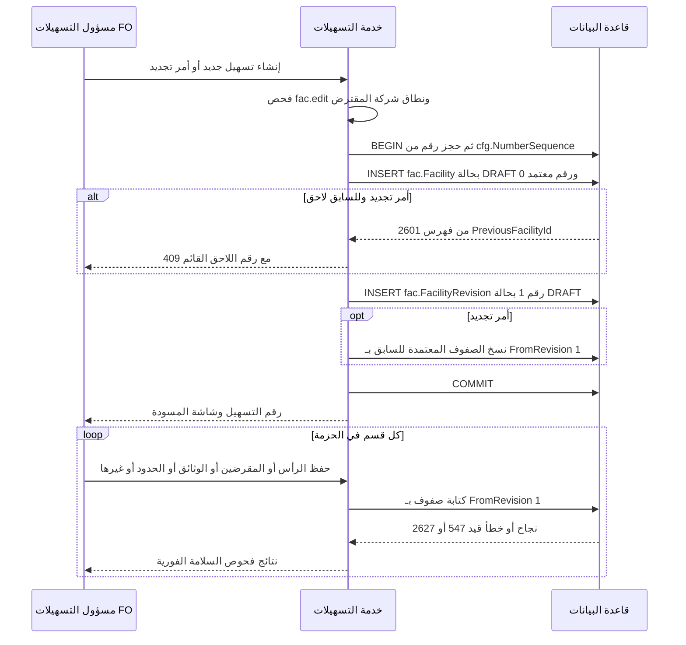
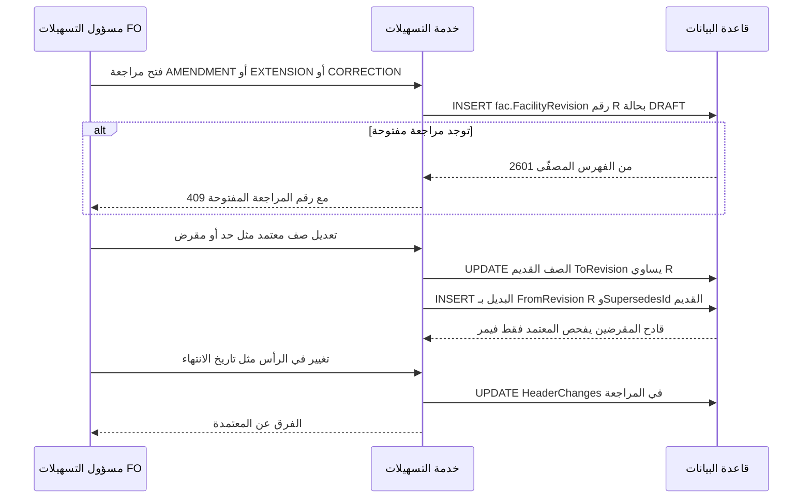
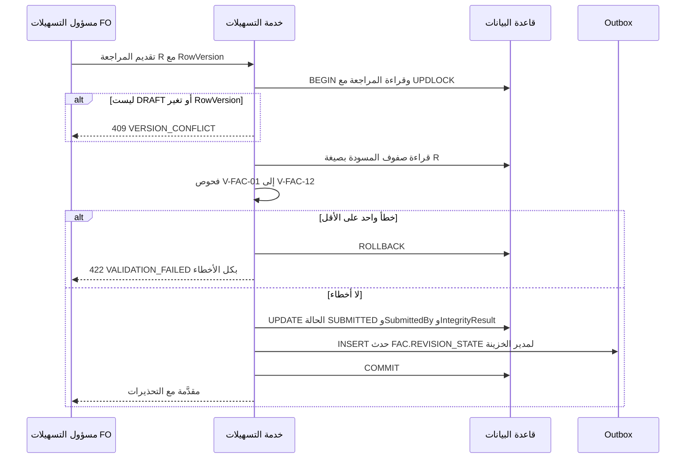
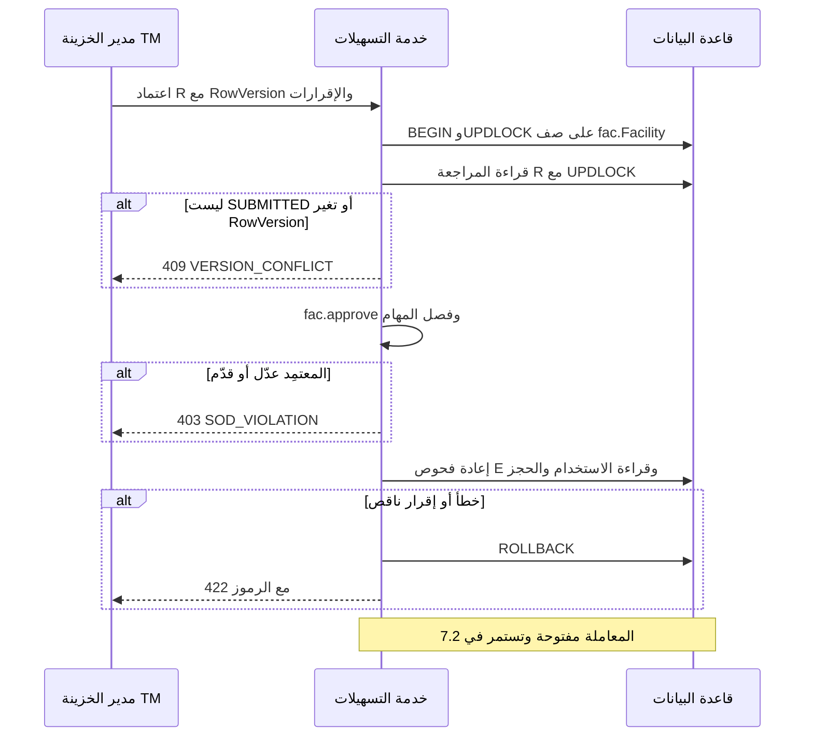
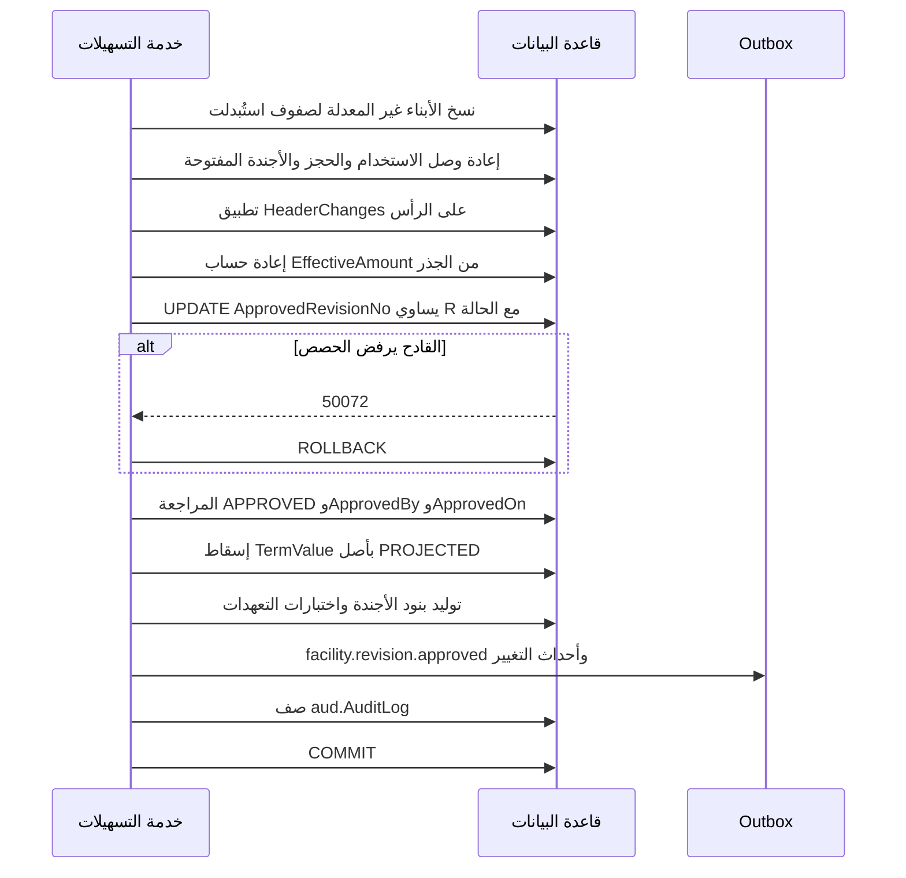
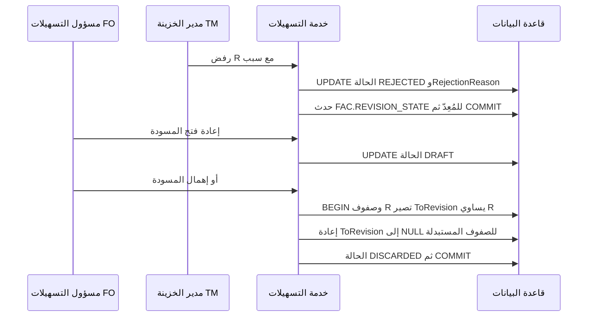
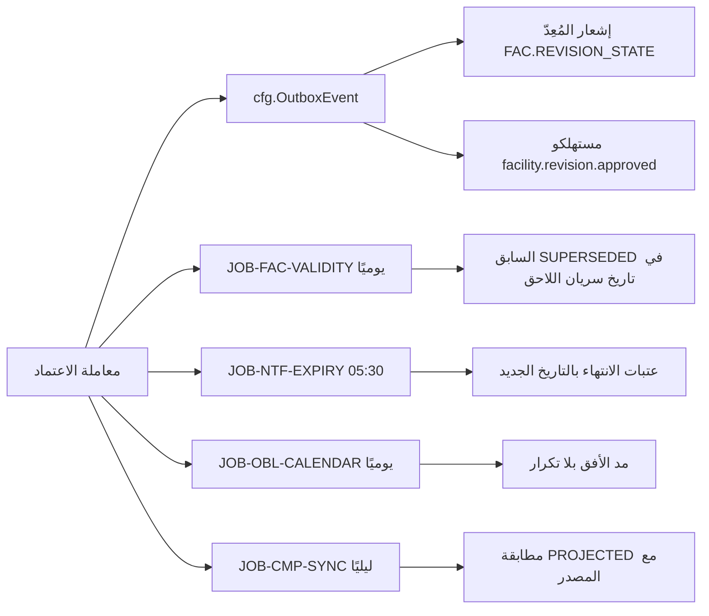

# DOC-F13 — تسلسل إدخال التسهيل واعتماد مراجعته وإسقاط بياناته

| البند | القيمة |
|---|---|
| المعرّف | DOC-F13 (docs/30-readiness-documents.md) |
| الإصدار | 0.1 — مسودة للمراجعة — 2026-10-12 |
| المالك المقترح | مالك M5 (التسهيلات) |
| الأولوية | P1 قبل S2 |
| يغطي | FR-FAC-001، FR-FAC-003، FR-FAC-005، FR-FAC-006، FR-FAC-024 إلى FR-FAC-027، FR-CMP-003، FR-OBL-003، FR-OBL-011، BR-FAC-003، BR-FAC-004، BR-FAC-006، BR-FAC-007، BR-FAC-018، BR-CMP-004، V-FAC-01 إلى V-FAC-12، O-03 وO-12 (erd_open_items) |
| يعتمد على | DOC-F14 (حالات التسهيل والمراجعة)، DOC-F15 (الأجندة والاختبارات)، DOC-F11 (معاملة الحجز وترتيب الأقفال)، DOC-F17 (Outbox والمهام)، DOC-F04 (ربط السياق وهوية المهام)، DOC-B04 (الأخطاء)، DOC-F09 (حالات الاستخدام UC-FAC) |
| المصادر | docs/10-detailed-analysis/12-m5-facilities-pricing-collateral-obligations.md، docs/04-facility-agreements-analysis.md، db/model/13-facilities-pricing-terms.model، db/model/14-collateral-obligations-financials.model، db/static/050_fac_share_rule.sql، db/tests/fac_share_rule_tests.sql، docs/21-data-dictionary.md، docs/20-database-design.md، docs/review/design-review-2026-10-11.json |

## 1. الغرض والنطاق

تصف الوثيقة ثلاثة تسلسلات بين الفاعل والخدمة والقاعدة: إدخال التسهيل في مسودة مراجعة، واعتماد المراجعة أو رفضها، وإسقاط بيانات المراجعة المعتمدة إلى الجداول التي تقرؤها الخدمات. وتحدد ما يقع داخل معاملة الاعتماد وما يقع بعدها، وفروع الفشل لكل خطوة.

- **داخل النطاق:** تسهيل جديد، وتجديد بتسهيل لاحق، ومراجعة تعديل أو تمديد أو تصحيح، والمقرضون وقاعدة 100%، والتقديم وفحوص السلامة، والاعتماد والرفض والإهمال، والإسقاط إلى الحدود والتسعير والشروط والضمانات وأجندة الالتزامات.
- **خارج النطاق:** حالات الكيانات وانتقالاتها (DOC-F14 وDOC-F15)، ومعاملة الحجز (DOC-F11)، وتحويل الحجز عند إصدار الاعتماد (DOC-F12)، وتسليم الأحداث (DOC-F17)، ودورة اعتماد سجل الضمان نفسه (FR-COL-014).

**الوسوم:** 🟢 موجود في المستودع أو مقرر في الوثائق، مع الملف والسطر. 🟡 اقتراح.

**اختصارات المراجع:** «12-m5» هو docs/10-detailed-analysis/12-m5-facilities-pricing-collateral-obligations.md. «m13» هو db/model/13-facilities-pricing-terms.model. «m14» هو db/model/14-collateral-obligations-financials.model. «050» هو db/static/050_fac_share_rule.sql. «T050» هو db/tests/fac_share_rule_tests.sql. «DR-nn» بند في docs/review/design-review-2026-10-11.json.

## 2. الفاعلون والمخازن

| الرمز | الفاعل أو المخزن | دوره هنا | المرجع |
|---|---|---|---|
| A-02 | مسؤول التسهيلات FO | المُعِدّ: ينشئ ويحرر ويقدّم بـ `fac.edit` | 🟢 12-m5:51؛ DOC-F01 A-02 |
| A-02 | مدير الخزينة TM | مُعِدّ أو معتمِد بـ `fac.approve`، ويحسم التعارض بـ `fac.conflict.resolve` | 🟢 12-m5:52-53 |
| A-05 | مستخدم الخدمة | المهام المجدولة بعد الالتزام | 🟢 DOC-F01 A-05؛ ربطه في DQ-F04-4 |
| — | خدمة التسهيلات | طبقة التطبيق عبر TB-3 بدور `tp_app` | 🟢 db/generated/tsql/007_table_grants.sql:223-247 |
| D-01 | قاعدة `BankFas` | صفوف التسهيل والمراجعة والقادحان | 🟢 050:26-94 |
| D-02 | `cfg.OutboxEvent` | أحداث ما بعد الالتزام | 🟢 db/model/10-platform.model:532-552 |
| D-03 | مخزن الملفات | وثائق الحزمة عبر `doc.Document` | 🟢 m13:93-95 |

فصل المهام 🟢: المعتمِد لم يعدّل المراجعة ولم يقدّمها (BR-FAC-004، 12-m5:242). والاستثناء لشخص واحد بإعداد `wf.sod.allow_same_person` ويُسجَّل (Q-FAC-08 محسوم، 12-m5:632؛ m13:15).

## 3. عقد المراجعة في القاعدة

ثلاثة عشر جدولًا تحمل `FromRevision` و`ToRevision` و`SupersedesId` 🟢 (tools/dbgen/dbgen.py:205-206؛ docs/20-database-design.md:154-155): FacilityDocument وFacilityLender وLimit وLimitProductLine وLimitCompanyRule وProductLineTerm وPricingRule وPricingTier وTermValue وCollateralLink وObligation وReportingObligation وCovenant.

قاعدة القراءة المعتمدة 🟢: `FromRevision <= a AND (ToRevision IS NULL OR ToRevision > a)`، حيث a هو `Facility.ApprovedRevisionNo` (m13:8؛ 050:10-11). وقراءة المسودة R بالصيغة نفسها مع R بدل a 🟡.

| حالة الصف | FromRevision | ToRevision | يُقرأ معتمدًا | يُقرأ في المسودة R |
|---|---|---|---|---|
| معتمد جارٍ لم يتغير | a أو أقل | NULL | نعم | نعم |
| معتمد يُستبدل في R | a أو أقل | R | نعم حتى الاعتماد | لا |
| جديد في R | R | NULL | لا | نعم |
| من مسودة مهملة | R | R | لا | لا |
| أُغلق بمراجعة سابقة | أقل من a | a أو أقل | لا | لا |

قواعد الكتابة:

1. 🟢 الاستبدال يضبط `ToRevision = R` للصف القديم عند إنشاء المسودة، ويبقى مقروءًا حتى الاعتماد (m13:9).
2. 🟡 يُغلق الصف القديم قبل إدراج بديله. الفهارس الفريدة مصفّاة على `ToRevision IS NULL` (مثل m13:159)، فالإدراج أولًا يعطي 2601.
3. 🟢 رأس التسهيل ليس جدولًا مراجَعًا. تغييراته تُحفظ في `FacilityRevision.HeaderChanges` وتُطبَّق عند الاعتماد (m13:77).
4. 🟢 الأبناء المنمّطة لصف مستبدل تُنسخ، والصفوف التشغيلية تُعاد وصلتها في معاملة الاعتماد (m13:11؛ m14:9-12).
5. 🟢 خارج المراجعة وبدورات اعتماد خاصة: TariffSchedule وCollateral وMeasureFormula وFinancialStatement. والتشغيلية بلا اعتماد: Utilization وLimitReservation وOutstandingSnapshot وReportingInstance وCovenantTest وObligationBreach (12-m5:241).
6. 🟢 القاعدة لا تفرض من هذا العقد إلا `ToRevision >= FromRevision` (مثل m13:169) وقاعدة الحصص في 050. الباقي على الخدمة (DR-28).

## 4. إنشاء التسهيل ومسودة المراجعة

### 4.1 تسهيل جديد أو تجديد

قواعد الخطوات:

1. 🟢 الرقم الداخلي `FAC-YY-NNN` من NumberSequence (BR-FAC-001، 12-m5:239). العداد يُقفل داخل معاملة المستدعي (db/model/10-platform.model:457). الرقم يُستهلك عند الإنشاء ولو أُهملت المسودة؛ الفجوات قرار O-12 (erd_open_items).
2. 🟢 الحقول الإلزامية للرأس تُكتب عند الإدراج: المقترض والنوع والعملة والمبلغ والتواريخ (m13:24-38). الرأس في المراجعة الأولى يُكتب مباشرة في `fac.Facility` لأنه غير ملزم قبل الاعتماد 🟡 (DQ-F13-1).
3. 🟢 التجديد ينشئ تسهيلًا مسودة مرتبطًا بالسابق، وينسخ الحدود والتسعير والضمانات والالتزامات والشروط (FR-FAC-005، 12-m5:112). المراجعة الأولى للاحق بنوع RENEWAL_COPY 🟡؛ والقيد `ReasonKind <> 'INITIAL' OR RevisionNo = 1` يسمح بذلك (m13:88).
4. 🟢 لاحق واحد لكل تسهيل بفهرس فريد على `PreviousFacilityId` (m13:54). منع الحلقات في الخدمة (BR-FAC-006، 12-m5:244).
5. 🟢 `CurrencyId` واحد لكل التسهيل، ولا عملة على الحدود (m13:13).

### 4.2 مراجعة على تسهيل معتمد

- 🟢 مراجعة مفتوحة واحدة لكل تسهيل: فهرس فريد على `FacilityId` حيث الحالة DRAFT أو SUBMITTED أو REJECTED (m13:85).
- 🟢 رقم المراجعة يبدأ من 1 وفريد لكل تسهيل (m13:84، :87). المسودة المهملة تستهلك رقمها، فقد يزيد R عن `ApprovedRevisionNo + 1` (§12).
- 🟢 التمديد مراجعة بنوع EXTENSION، والملحق في المدة نفسها مراجعة AMENDMENT تحتاج وثيقة ملحق عند التقديم (FR-FAC-006، 12-m5:113؛ V-FAC-03، :483).
- 🟡 الكتابة على صفوف `FromRevision = R` مسموحة ما دامت المراجعة DRAFT فقط. في SUBMITTED ترفض الخدمة كل تعديل حتى السحب أو الرفض.

## 5. المقرضون وقاعدة 100%

| القاعدة | أين تُفرض | المرجع |
|---|---|---|
| حصة كل مقرض في (0، 100] | قيد CHECK على كل صف | 🟢 m13:118 |
| SOLE يعني 100% | قيد CHECK على الصف | 🟢 m13:120 |
| المجموع 100 ووكيل واحد على الأكثر عند كل حفظ | الخدمة، تحذير أثناء التحرير وخطأ عند التقديم | 🟢 V-FAC-02 (12-m5:482)؛ 🟡 الشدة أثناء التحرير |
| المجموع 100 ووكيل واحد في المراجعة المعتمدة | القادحان في 050 | 🟢 050:26-94 |
| مشترك يعني مقرضين اثنين فأكثر، وغير المشترك مقرض واحد | الخدمة فقط | 🟢 BR-FAC-007 (12-m5:245)؛ FR-FAC-003 (:110) |
| `CommitmentAmount` = الإجمالي × الحصة ÷ 100 | مشتق لا يُخزَّن | 🟢 m13:115 |

سلوك القادحين 🟢:

- `fac.TR_FacilityLender_ApprovedShares` يعمل بعد كل إدراج أو تحديث أو حذف على المقرضين. يرفض بـ 50071 إن صار مجموع المقرضين الصالحين عند `ApprovedRevisionNo` غير 100، أو حمل AGENT أكثر من واحد (050:26-58).
- `fac.TR_Facility_ApprovedShares` يعمل حين يتغير `ApprovedRevisionNo`. يرفض بـ 50072 إن لم يحقق المقرضون الصالحون عند الرقم الجديد القاعدة نفسها (050:62-94).
- صفوف المسودة لا تُفحص لأن `FromRevision` أكبر من الرقم المعتمد، فيُحفظ المقرضون صفًّا صفًّا (050:14-15).
- الترتيب الملزم عند الاعتماد: صفوف المقرضين للمراجعة الجديدة أولًا، ثم رفع `ApprovedRevisionNo` في عبارة مستقلة (050:17-19).
- القادحان يقرآن تحت RLS بسياق المستدعي، فالمهمة تربط سياق المشترك قبل أي كتابة (050:21-23؛ DOC-F04).
- الرقمان 50071 و50072 يقابلان 422 مع V-FAC-02 🟢 (docs/30-readiness/DOC-B04-api-contract-and-error-model.md:252).

الاختبارات القائمة 🟢 تمر في الخطوة 6 من tools/ci/db_ci.sh:59-73:

| الاختبار | الحالة | النتيجة المتوقعة | المرجع |
|---|---|---|---|
| T1 | اعتماد بحصص 60 و40 | يُقبل | T050:36-53 |
| T2 | مقرض ثالث بـ 5 بعد الاعتماد | 50071 | T050:55-74 |
| T3 | اعتماد المراجعة 2 بلا مقرضين لها | 50072 | T050:76-97 |
| T4 | اعتماد المراجعة 2 بمقرض واحد 100 | يُقبل | T050:99-119 |
| T5 | وكيلان بحصتين 50 و50 | 50072 | T050:121-139 |
| T6 | مسودة بحصة 60 قبل أي اعتماد | يُقبل | T050:141-156 |

**تغيير المقرض بعد الاعتماد (O-03، erd_open_items).** القادح يرفض أي تعديل في مكانه يكسر 100% (tools/dbgen/erd_open_items.py:28). نقترح 🟡 ألا يُعدَّل صف معتمد أبدًا إلا بضبط `ToRevision`، وأن يمر كل تغيير في الحصص بمراجعة CORRECTION أو AMENDMENT، ويبقى القادح حارسًا أخيرًا (DQ-F13-7).

## 6. التقديم وفحوص السلامة

| الفحص | يُعرض عند الحفظ | يمنع التقديم | يُعاد عند الاعتماد | المرجع |
|---|---|---|---|---|
| V-FAC-01 الرأس والتواريخ | نعم | E | نعم | 🟢 12-m5:481؛ القيدان m13:58-59 |
| V-FAC-02 المقرضون | نعم | E | نعم والقادح | 🟢 12-m5:482 |
| V-FAC-03 الوثائق والملحق | نعم | E | نعم | 🟢 12-m5:483 |
| V-FAC-04 إلى V-FAC-07 الشجرة والأنماط | نعم | E، والخلط W | نعم | 🟢 12-m5:484-487 |
| V-FAC-08 إلى V-FAC-10 الخطوط والقيود والشروط | نعم | E، وبعضها W | نعم | 🟢 12-m5:488-490 |
| V-FAC-12 قيم المسح والتعارض والحساب والكفيل | نعم | لا | E بلا إقرار، والباقي W | 🟢 12-m5:492 |
| حد يُغلق وعليه استخدام أو حجز فعّال | نعم | E | نعم | 🟡 DQ-F13-9 |

- 🟢 الخطأ يمنع والتحذير يُعرض ويقرّ به المعتمِد (BR-FAC-004، 12-m5:242). النتيجة تُحفظ في `IntegrityResult` (m13:83).
- 🟢 القيمة المالية المقروءة من مسح بلا تحقق تمنع الاعتماد إلا بإقرار مدوَّن لكل قيمة (BR-FAC-018، 12-m5:256). والتعارض المالي المفتوح كذلك (FR-FAC-026، :133).
- 🟢 شكل الرد: 422 VALIDATION_FAILED بكل الأخطاء، و422 WARNINGS_REQUIRE_ACK للتحذير الذي يحتاج إقرارًا (DOC-B04:201-203).
- 🟢 الإشعار NTF-FAC-03 لمدير الخزينة عند التقديم (12-m5:509؛ 13-m6:594).

## 7. الاعتماد والإسقاط في معاملة واحدة

### 7.1 التحقق قبل الكتابة

### 7.2 الكتابة والإسقاط ثم الالتزام

### 7.3 خطوات المعاملة بالترتيب

| # | الخطوة | الجداول | المرجع |
|---|---|---|---|
| 1 | قفل صف التسهيل أولًا، ثم المراجعة. الترتيب نفسه في الحجز فلا جمود | fac.Facility، fac.FacilityRevision | 🟢 BR-FAC-015 (12-m5:253)؛ 🟡 الاعتماد |
| 2 | الحالة SUBMITTED وRowVersion كما رآه المعتمِد | fac.FacilityRevision | 🟢 العمود في db/generated/tsql/001_tables.sql:2913 |
| 3 | الصلاحية وفصل المهام | — | 🟢 BR-FAC-004؛ 🟡 طريقة معرفة المحررين DQ-F13-2 |
| 4 | إعادة فحوص E، والإقرارات المطلوبة موجودة | القراءة فقط | 🟢 12-m5:492؛ 🟡 الإعادة |
| 5 | نسخ الأبناء غير المعدلة إلى الأب الجديد بـ `FromRevision = R`، وإغلاق القديمة بـ R | Limit وأبناؤه، PricingRule، TermValue، CollateralLink، Obligation وأبناؤه | 🟢 m13:11؛ m14:9-12 |
| 6 | إعادة وصل الصفوف التشغيلية غير المنتهية بالصف الجديد | Utilization وLimitReservation الفعالة، wfl.Request وlc.LetterOfCredit | 🟢 m13:11؛ db/model/16-letters-of-credit.model:408؛ 🟡 حصرها في غير المنتهية DQ-F13-4 |
| 7 | تطبيق `HeaderChanges` على الرأس | fac.Facility | 🟢 m13:77 |
| 8 | `EffectiveAmount` من الجذر إلى الورقة | fac.Limit | 🟢 m13:150؛ BR-FAC-009 |
| 9 | رفع `ApprovedRevisionNo` إلى R في عبارة مستقلة، و`LifecycleStatus` من DRAFT إلى ACTIVE للأولى أو من EXPIRED إلى ACTIVE للتمديد | fac.Facility والقادح | 🟢 050:17-19؛ m13:67؛ 12-m5:451 |
| 10 | المراجعة APPROVED | fac.FacilityRevision | 🟢 m13:90 |
| 11 | إسقاط الحقول المنمّطة إلى TermValue | cmp.TermValue | 🟢 BR-CMP-004 (12-m5:330)؛ 🟡 داخل المعاملة DQ-F13-6 |
| 12 | توليد بنود الأجندة واختبارات التعهدات حتى الأفق | obl.ReportingInstance، obl.CovenantTest | 🟢 FR-OBL-003، FR-OBL-011؛ 🟡 داخل المعاملة DQ-F13-5 |
| 13 | الأحداث والتدقيق | cfg.OutboxEvent، aud.AuditLog | 🟢 12-m5:582، :597 |

ملاحظات على الإسقاط:

- **الحدود والتسعير والشروط والضمانات.** لا نسخ إلى جداول أخرى. الرفع في الخطوة 9 يجعل صفوف R هي المقروءة في المتاح والمحلّل والفحص (BR-FAC-003، 12-m5:241). والسريان بالتاريخ يحكم من أي يوم يُطبَّق كل صف 🟢.
- **مثال 🟢 (12-m5:241).** مراجعة تغير الهامش من 1.75 إلى 2.00 بنفاذ 2026-07-01. قبل الاعتماد يُحل 1.75. بعده تنتهي النسخة الأولى 2026-06-30 وتبدأ الثانية 2026-07-01.
- **TermValue.** لكل حقل له `SourceBinding` في `cmp.TermType` (m13:549): تُغلق صفوف PROJECTED القديمة بـ R وتُدرج جديدة بـ `Origin = PROJECTED` و`ProjectedFrom` وختم المصدر نفسه (m13:575-576، :586) 🟡. القاعدة بحالة NOT_SPECIFIED_IN_AGREEMENT تُسقَط بالحالة نفسها لا بصفر (FR-CMP-003، 12-m5:223) 🟢.
- **الضمانات.** صفوف `CollateralLink` تصير ملزمة بالرفع. سجل الضمان له اعتماده المستقل، والتغطية لا تحتسب إلا المعتمد (BR-COL-005، 12-m5:290) 🟢. نقترح تحذيرًا عند الاعتماد إن رُبط ضمان غير معتمد 🟡.
- **الأجندة والاختبارات.** التوليد حتى 24 شهرًا أو نهاية التسهيل (FR-OBL-003، 12-m5:185؛ m14:217). إعادة التوليد تمس البنود المستقبلية غير المقدَّمة فقط (BR-OBL-003، :299) 🟢. التفصيل في DOC-F15.
- **سلسلة التجديد.** اعتماد اللاحق لا يغير حالة السابق فورًا. السابق يصير SUPERSEDED من `EffectiveFrom` اللاحق، وقبله يبقى صالحًا للحجز (BR-FAC-006، 12-m5:244) 🟢. إن كان التاريخ اليوم أو قبله تُجرى الخطوة في المعاملة نفسها 🟡، وإلا تجريها JOB-FAC-VALIDITY (DOC-F14).

### 7.4 فروع الفشل

كل فشل بعد BEGIN يعيد المعاملة كلها. تبقى المراجعة SUBMITTED ولا يتغير شيء مقروء 🟡.

| الفشل | يُكتشف في | الرد | المرجع |
|---|---|---|---|
| المراجعة ليست SUBMITTED أو تغير RowVersion | الخطوة 2 | 409 VERSION_CONFLICT | 🟢 DOC-B04:101 |
| المعتمِد بلا صلاحية أو هو المُعِدّ | الخطوة 3 | 403 FORBIDDEN أو SOD_VIOLATION | 🟢 DOC-B04:185، :232 |
| خطأ سلامة جديد بعد التقديم | الخطوة 4 | 422 VALIDATION_FAILED | 🟡 |
| إقرار ناقص لقيمة مسح أو تعارض أو تحذير | الخطوة 4 | 422 WARNINGS_REQUIRE_ACK | 🟢 DOC-B04:203 |
| صفان جاريان للمفتاح نفسه | الخطوتان 5 و6 | 2627 أو 2601 ثم 409 DUPLICATE | 🟢 DOC-B04:257 |
| قيد CHECK على الرأس بعد تطبيق التغييرات | الخطوة 7 | 547 ثم 422 | 🟢 m13:58-67؛ DOC-B04:256 |
| الحصص لا تساوي 100 أو وكيلان | الخطوة 9 | 50072 ثم 422 V-FAC-02 | 🟢 050:92 |
| ضحية قفل متبادل مع حجز | أي خطوة | إعادة المعاملة حتى 3 مرات ثم 503 | 🟢 DOC-B04:258 |
| كتابة يرفضها RLS | أي خطوة | 33504 | 🟢 DOC-B04 §9.4 |

مدة القفل: المعاملة تمسك صف التسهيل حتى الالتزام. طلبات الحجز على التسهيل نفسه تنتظر ثم تنجح أو تعود CONCURRENT_RETRY (FR-FAC-018، 12-m5:125) 🟢. نقترح أن يبقى الاعتماد ضمن ثانيتين لتسهيل بمئة حد وخط، قياسًا على FR-FAC-028 (:135) 🟡.

## 8. الرفض والإهمال

- 🟢 الرفض من المعتمِد وبسبب إلزامي (m13:91؛ FR-FAC-024، 12-m5:131). يعود إلى DRAFT (12-m5:453). كيف يعود ومتى في DOC-F14.
- 🟢 المسودة المهملة تُعطَّل بفاصل فارغ `ToRevision = FromRevision` (m13:10)، وتبقى في التدقيق (12-m5:131).
- 🟡 الإهمال يعيد `ToRevision = NULL` لكل صف كان `ToRevision = R`. بغير ذلك تختفي هذه الصفوف عند اعتماد المراجعة التالية. للمقرضين يكشف القادح ذلك بـ 50072. لغيرهم لا شيء يكشفه (§12).
- 🟡 الرفض لا يكتب في صفوف المسودة. تبقى للتعديل بعد إعادة الفتح.

## 9. ما يقع بعد الالتزام

| ما يقع | متى | المرجع |
|---|---|---|
| تسليم الإشعار والأحداث | بعد الالتزام من Outbox | 🟢 12-m5:582؛ DOC-F17 |
| مؤشر السريان | يُحسب عند القراءة ويوميًا، ولا يُخزَّن إلا للتقارير | 🟢 12-m5:452 |
| SUPERSEDED للسابق في تاريخ مستقبلي | JOB-FAC-VALIDITY | 🟢 12-m5:244، :522 |
| تنبيهات الانتهاء بعد تغيير التاريخ | JOB-NTF-EXPIRY. السجل مفتاحه تاريخ الانتهاء، فالتاريخ الجديد يبدأ العتبات من جديد | 🟢 13-m6:641؛ db/model/10-platform.model:494-500 |
| مد أفق الأجندة والاختبارات | JOB-OBL-CALENDAR، متكررة الأمان بالفهارس الفريدة | 🟢 12-m5:522؛ m14:248-250، :325 |
| مطابقة الإسقاط | JOB-CMP-SYNC ليليًا | 🟢 12-m5:522؛ m13:581 |
| تقييم التعهدات | JOB-FIN-EVAL | 🟢 12-m5:522؛ DOC-F15 |

## 10. الاختبارات

| الاختبار | ما يثبته | الحالة |
|---|---|---|
| T1 إلى T6 | قاعدة الحصص والوكيل في القاعدة | 🟢 تمر في CI (tools/ci/db_ci.sh:59-73) |
| T-F13-1 | إدخال الاتفاقيات A إلى D كاملة واعتمادها بلا قيد خارج النموذج | 🟡 خروج S2 (docs/10-detailed-analysis/00-overview-and-cross-cutting.md:196) |
| T-F13-2 | AC-FAC-1: أنماط التوزيع عند التقديم | 🟡 12-m5:662 |
| T-F13-3 | اعتماد ذاتي يُرفض، ويُقبل مع الإعداد ويُسجَّل | 🟡 |
| T-F13-4 | اعتماد بـ RowVersion قديم يعطي 409 ولا يغير شيئًا | 🟡 |
| T-F13-5 | اعتماد متزامن مع حجز على التسهيل نفسه: لا جمود ولا متاح خاطئ | 🟡 مع اختبار التزامن في DOC-B01 §5.3 |
| T-F13-6 | إهمال مسودة ثم اعتماد التالية: الصفوف غير المعدلة باقية | 🟡 |
| T-F13-7 | بعد الاعتماد: الاستخدام والحجز الفعالان على الصف الجديد، والمتاح كما قبله | 🟡 |
| T-F13-8 | AC-FAC-8 وAC-FAC-10: إسقاط PROJECTED بحالته ومصدره | 🟡 12-m5:669، :671 |
| T-F13-9 | فشل 50072 في منتصف الاعتماد يعيد كل شيء | 🟡 |
| T-F13-10 | AC-FAC-6: تجديد يجعل السابق SUPERSEDED في تاريخه | 🟡 12-m5:667 |

## 11. القرارات المطلوبة

| المعرّف | السؤال | الافتراض المقترح | من يقرر | ما يعطّله |
|---|---|---|---|---|
| DQ-F13-1 | أين يُكتب الرأس في المراجعة الأولى؟ | مباشرة في `fac.Facility` ما دام DRAFT، وفي `HeaderChanges` بعد أول اعتماد | DBA مع مالك M5 | واجهة المسودة |
| DQ-F13-2 | كيف تعرف الخدمة من عدّل المراجعة لفصل المهام؟ | صف `aud.AuditLog` لكل حفظ على المراجعة، والفحص على `SubmittedBy` وهذه الصفوف | SEC مع مالك M5 | BR-FAC-004 |
| DQ-F13-3 | أين تُحفظ إقرارات المعتمِد للتحذيرات وقيم المسح؟ | في `IntegrityResult` عند الاعتماد مع صف تدقيق لكل قيمة | مالك M5 | FR-FAC-027 |
| DQ-F13-4 | هل تُعاد وصلة كل الصفوف التشغيلية أم غير المنتهية فقط؟ | ✅ منفّذ (ADR 0011، 2026-10-13): كل جدول مراجَع يحمل `RootId` هوية ثابتة للعقدة عبر المراجعات بمفتاح مركّب، وصف مفتوح واحد لكل جذر، وقادح يرفض اعتماد مراجعة فيها صفّان للعقدة أو أب خارجها (50049، 50050؛ RF24). الأصل: قادح سلامة المراجعات قبل S2 والهوية الثابتة للحد قبل كود S3. المقترح: غير المنتهية فقط، والمنتهية تبقى على صفها الحاكم. ثم هوية ثابتة للعقدة قبل S3 كما في DR-28 | DBA | الخطوة 6؛ DR-28؛ DR-39 |
| DQ-F13-5 | توليد الأجندة والاختبارات داخل المعاملة أم بمهمة؟ | داخلها حتى الأفق، والمهمة تمده بلا تكرار | مالك M5 | الخطوة 12 |
| DQ-F13-6 | الإسقاط: داخل المعاملة؟ والحقل الفارغ؟ وتاريخ السريان؟ | ✅ معتمد من المالك (2026-10-12): داخلها؛ الفارغ NOT_SPECIFIED_IN_AGREEMENT؛ السريان من الصف المصدر وإلا من الرأس | مالك M5 مع TRM | الخطوة 11 |
| DQ-F13-7 | تغيير المقرض بعد الاعتماد (O-03، erd_open_items) | ✅ معتمد من المالك (2026-10-12): لا تعديل في مكانه؛ مراجعة CORRECTION؛ القادح حارس أخير | TRM مع DBA | إغلاق O-03 |
| DQ-F13-8 | هل يُمد القادح إلى قاعدة المشترك وغير المشترك؟ | نعم بعد S2: مشترك يعني اثنين فأكثر، وغيره واحد | DBA | V-FAC-02 |
| DQ-F13-9 | إغلاق حد أو خط عليه استخدام أو حجز فعّال | ✅ معتمد من المالك (2026-10-12): خطأ عند التقديم والاعتماد، والبديل مراجعة تخفّض السقف | TRM | الخطوة 4 |
| DQ-F13-10 | الحد الأقصى لمدة معاملة الاعتماد | ثانيتان لتسهيل بمئة حد، وإلا يُقسَّم التوليد | SA | NFR في DOC-B03 |
| DQ-F13-11 | رموز أعمال جديدة | OPEN_REVISION_EXISTS (409) وREVISION_NOT_SUBMITTED (409) في سجل DOC-B04 | APP | DOC-B04 §9.3 |

## 12. تعارضات وفجوات في المصادر

| البند | الموضع | الملاحظة |
|---|---|---|
| مراجعة سابقة تصير SUPERSEDED | docs/30-readiness-documents.md:168 | لا حالة SUPERSEDED للمراجعة (m13:74). السابقة تبقى APPROVED، والحالية يحددها `ApprovedRevisionNo` |
| الرأس صف مراجَع | 12-m5:241 | BR-FAC-003 يعدّ الرأس بين صفوف [R]، والنموذج يجعله خارجها ويحفظ التغييرات في `HeaderChanges` (m13:77) |
| رقم المراجعة التالية | 12-m5:241 | «صف بـ ApprovedRevisionNo+1»، والمسودة المهملة تستهلك رقمها (m13:10، :84) |
| إهمال المسودة | m13:9-10 | لا ينص على إعادة `ToRevision` للصفوف المستبدلة، فتختفي عند الاعتماد التالي بلا كشف إلا للمقرضين |
| حالة 050 | 050:5-6 | «لم يُنفَّذ على SQL Server 2025» قديم: الاختبارات الستة تمر في CI (tools/dbgen/erd_open_items.py:28؛ tools/ci/db_ci.sh:59) |
| الاعتماد الذاتي | 12-m5:242 | «لا اعتماد ذاتي مطلقًا» يخالف Q-FAC-08 المحسوم (:632) وm13:15 |
| قاعدة المقرضين | 050:33-58؛ 12-m5:110 | القادح لا يفرض «مشترك يعني اثنين» ولا «غير مشترك يعني واحدًا». وقيمة `Roles` خاطئة مثل SOLO تتجاوز قيد SOLE (DR-32) |
| هدف القفل | docs/20-database-design.md:237 | يقفل `fac.Limit` وحده، وBR-FAC-015 يقفل التسهيل ثم الحدود (12-m5:253). الاعتماد يحتاج قفل التسهيل |
| سلامة إعادة الوصل | DR-28 (docs/review/design-review-2026-10-11.json:298) | القاعدة لا تكشف وصلة فائتة، و`ApprovedRevisionNo` بلا مفتاح إلى المراجعة المعتمدة |
| نص البند في الإسقاط | DR-31 | `OriginalText` غير مصنف، والإسقاط ينسخه إلى `cmp.TermValue` |

## 13. التتبع

| البند في هذه الوثيقة | المتطلب أو القاعدة أو القرار | المصدر |
|---|---|---|
| §3 | BR-FAC-003 | 12-m5:241؛ m13:8-11؛ m14:8-13 |
| §4.1 | FR-FAC-001، FR-FAC-005، BR-FAC-001، BR-FAC-006، O-12 (erd_open_items) | 12-m5:108، :112، :239، :244؛ m13:23-67 |
| §4.2 | FR-FAC-006، FR-FAC-024 | 12-m5:113، :131؛ m13:70-91 |
| §5 | FR-FAC-003، BR-FAC-007، V-FAC-02، O-03 (erd_open_items) | 050:26-94؛ T050؛ m13:111-121 |
| §6 | FR-FAC-025 إلى FR-FAC-027، BR-FAC-004، BR-FAC-018، NTF-FAC-03 | 12-m5:132-134، :242، :256، :481-492، :509 |
| §7 | FR-FAC-024، BR-CMP-004، FR-CMP-003، FR-OBL-003، FR-OBL-011، BR-FAC-006 | 12-m5:131، :185، :193، :223، :244، :330، :437 |
| §7.4 | X-SEC-7، رموز الأخطاء | docs/10-detailed-analysis/00-overview-and-cross-cutting.md:142؛ DOC-B04 §9 |
| §8 | FR-FAC-024 | 12-m5:131، :453؛ m13:10، :91 |
| §9 | JOB-FAC-VALIDITY، JOB-OBL-CALENDAR، JOB-CMP-SYNC، JOB-NTF-EXPIRY | 12-m5:522؛ 13-m6:641 |
| §10 | خروج S2، AC-FAC-1، AC-FAC-6، AC-FAC-8، AC-FAC-10 | 00-overview-and-cross-cutting.md:196؛ 12-m5:662-671 |
