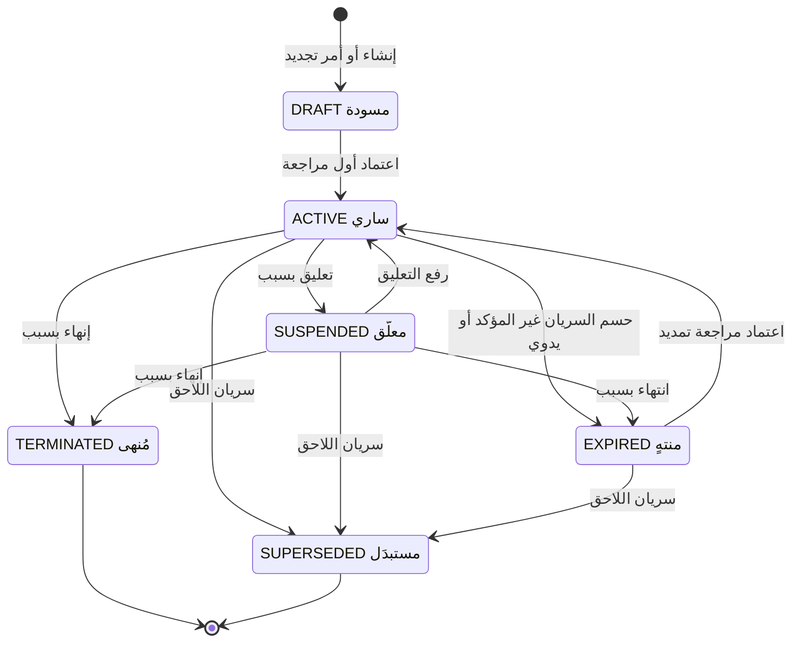
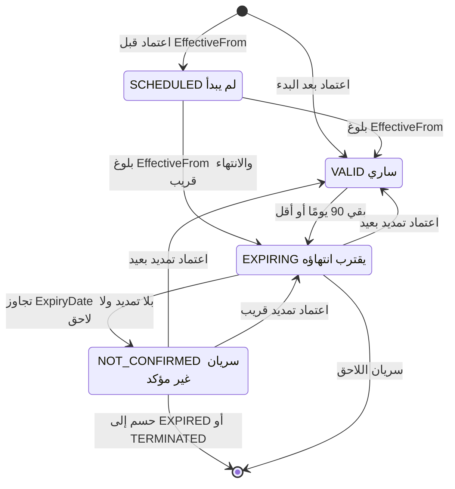
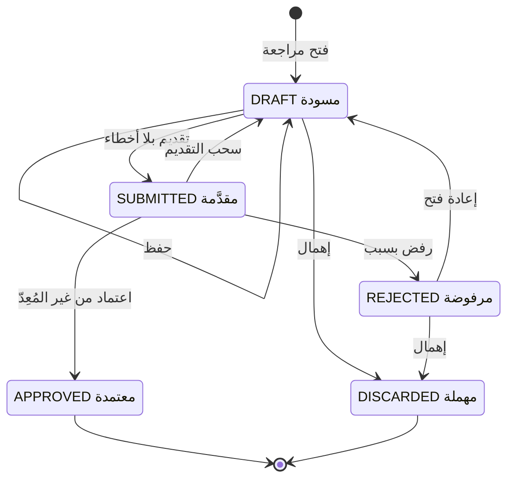
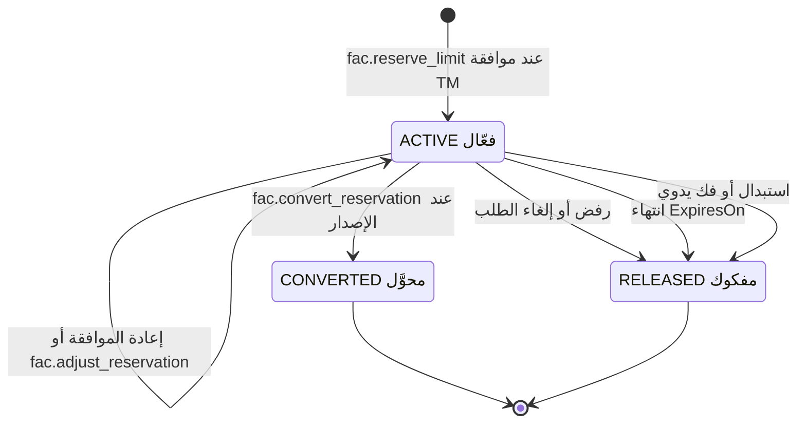
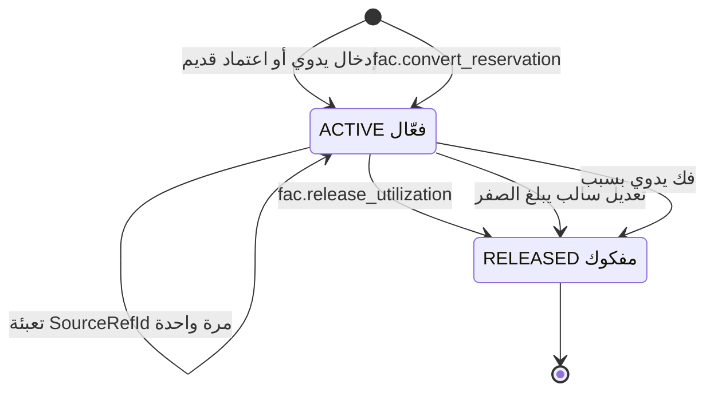
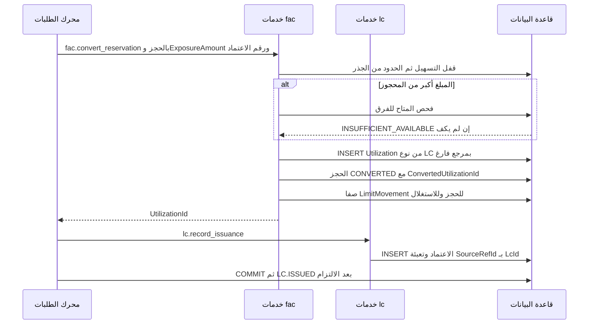

# DOC-F14 — مخططات حالات التسهيل والمراجعة والحجز والاستغلال

| البند | القيمة |
|---|---|
| المعرّف | DOC-F14 (docs/30-readiness-documents.md) |
| الإصدار | 0.1 — مسودة للمراجعة — 2026-10-12 |
| المالك المقترح | مالك M5 (التسهيلات) |
| الأولوية | P1 قبل S2 |
| يغطي | FR-FAC-005، FR-FAC-007، FR-FAC-008، FR-FAC-016، FR-FAC-017، FR-FAC-024، FR-FAC-030، BR-FAC-005، BR-FAC-006، BR-FAC-014، BR-FAC-015، BR-FAC-020، NTF-FAC-01 إلى NTF-FAC-04، BR-WFL-017 |
| يعتمد على | DOC-F13 (الإدخال والاعتماد)، DOC-F11 (معاملة الحجز)، DOC-F12 (التحويل عند الإصدار)، DOC-F17 (المهام والإشعارات)، DOC-F08 (حالة الطلب)، DOC-F04 (هوية المهام)، DOC-B04 (الأخطاء) |
| المصادر | docs/10-detailed-analysis/12-m5-facilities-pricing-collateral-obligations.md، docs/10-detailed-analysis/13-m6-workflow-engine-notifications.md، docs/04-facility-agreements-analysis.md، db/model/13-facilities-pricing-terms.model، db/model/15-workflow-notifications.model، db/model/16-letters-of-credit.model، docs/21-data-dictionary.md، docs/review/design-review-2026-10-11.json |

## 1. الغرض والنطاق

تحدد الوثيقة كل حالات أربعة كيانات وانتقالاتها: التسهيل، ومراجعة التسهيل، وحجز الحد، والاستغلال. ولكل انتقال الفاعل والشرط والأثر وما تفرضه القاعدة. وتضيف مؤشر السريان المشتق، والانتهاء والتجديد، ومسار الحجز إلى الاستغلال.

- **داخل النطاق:** `fac.Facility.LifecycleStatus`، ومؤشر السريان، و`fac.FacilityRevision.Status`، و`fac.LimitReservation.Status`، و`fac.Utilization.Status`.
- **خارج النطاق:** تسلسل الاعتماد والإسقاط (DOC-F13)، ومعاملة الحجز وأقفالها (DOC-F11)، وتحويل الحجز وتعديل الاعتماد (DOC-F12)، وحالات الالتزامات والبيانات المالية (DOC-F15)، وحالات الطلب (DOC-F08).

**الوسوم:** 🟢 موجود أو مقرر مع الملف والسطر. 🟡 اقتراح.

**اختصارات المراجع:** «12-m5» هو docs/10-detailed-analysis/12-m5-facilities-pricing-collateral-obligations.md. «13-m6» هو docs/10-detailed-analysis/13-m6-workflow-engine-notifications.md. «m13» هو db/model/13-facilities-pricing-terms.model. «m15» هو db/model/15-workflow-notifications.model. «m16» هو db/model/16-letters-of-credit.model. «dd» هو docs/21-data-dictionary.md.

**ما تفرضه القاعدة.** لا قادح ولا إجراء ينفّذ انتقالات الحالة. القاعدة تفرض فقط تماسك الحقول مع الحالة بقيود CHECK، وفرادة الحالات المفتوحة بفهارس مصفّاة. شرعية الانتقال على الخدمة 🟢 (m13:65-67، :85-91، :266-270، :291-301).

## 2. التسهيل Facility.LifecycleStatus

القيم الست 🟢: DRAFT وACTIVE وSUSPENDED وEXPIRED وTERMINATED وSUPERSEDED، والافتراضي DRAFT (m13:44؛ dd:2797).

### 2.1 جدول الانتقالات

| # | الانتقال | الفاعل | الشرط | الأثر | المرجع |
|---|---|---|---|---|---|
| 1 | بداية إلى DRAFT | FO أو TM بـ `fac.edit` | — | تسهيل ومراجعة 1 DRAFT | 🟢 12-m5:51، :112؛ DOC-F13 §4 |
| 2 | DRAFT إلى ACTIVE | TM بـ `fac.approve` | اعتماد المراجعة الأولى | `ApprovedRevisionNo` يصير 1 أو أكثر | 🟢 12-m5:451؛ القيد m13:67 |
| 3 | ACTIVE إلى SUSPENDED | TM | سبب إلزامي | لا حجز جديد ولا زيادة؛ المتاح 0 بسبب | 🟢 12-m5:451؛ القيد m13:65؛ 🟡 الأثر DQ-F14-3 |
| 4 | SUSPENDED إلى ACTIVE | TM | سبب في التدقيق | يعود الحجز | 🟢 12-m5:451 |
| 5 | ACTIVE إلى EXPIRED | FO أو TM | مؤشر NOT_CONFIRMED أو قرار يدوي، وسبب | لا حجز جديد؛ الحجوزات الفعالة تُفك 🟡 | 🟢 FR-FAC-008 (12-m5:115)؛ 12-m5:451 |
| 6 | ACTIVE إلى TERMINATED | FO أو TM | سبب إلزامي | كما في 5 | 🟢 FR-FAC-008؛ 12-m5:451 |
| 7 | SUSPENDED إلى EXPIRED أو TERMINATED | FO أو TM | سبب | كما في 5 | 🟡 DQ-F14-2 |
| 8 | ACTIVE إلى SUPERSEDED | النظام بـ JOB-FAC-VALIDITY | لاحق معتمد وبلغ اليوم `EffectiveFrom` له | نقل الاستغلال الفعّال 🟡 | 🟢 BR-FAC-006 (12-m5:244)؛ 12-m5:451 |
| 9 | SUSPENDED أو EXPIRED إلى SUPERSEDED | النظام | كما في 8 | كما في 8 | 🟡 DQ-F14-2 |
| 10 | EXPIRED إلى ACTIVE | TM بـ `fac.approve` | اعتماد مراجعة EXTENSION بتاريخ انتهاء بعد اليوم | العتبات تبدأ من جديد بالتاريخ الجديد | 🟢 12-m5:451؛ AC-FAC-6 (:667) |

قواعد عامة:

- 🟢 SUSPENDED وEXPIRED وTERMINATED تتطلب `LifecycleReason` (m13:65).
- 🟢 الانتهاء لا يقع آليًا أبدًا. تجاوز تاريخ الانتهاء يعطي NOT_CONFIRMED لا EXPIRED (04 Δ10، docs/04-facility-agreements-analysis.md:170؛ AC-FAC-6).
- 🟢 الحالات 3 إلى 7 كتابة مباشرة على الرأس لا مراجعة، والتمديد في 10 مراجعة (12-m5:451). 🟡 رمز صلاحية هذه الكتابة في DQ-F14-1.
- 🟢 التسهيل لا يُحذف: لا منحة DELETE عليه (db/generated/tsql/007_table_grants.sql:223).

### 2.2 ما تسمح به كل حالة

| الحالة | حجز جديد أو زيادة | تحويل حجز قائم | نقص وفك | مراجعة جديدة |
|---|---|---|---|---|
| DRAFT | لا | لا يوجد حجز | لا يوجد | المراجعة الأولى فقط |
| ACTIVE | بحسب المؤشر (§3) | نعم | نعم دائمًا | AMENDMENT وEXTENSION وCORRECTION |
| SUSPENDED | لا، LIMIT_NOT_ACTIVE | 🟡 نعم مع تنبيه TM | نعم دائمًا | AMENDMENT وCORRECTION 🟡 |
| EXPIRED | لا | لا | نعم دائمًا | EXTENSION وCORRECTION 🟡 |
| TERMINATED | لا | لا | نعم دائمًا | CORRECTION فقط 🟡 |
| SUPERSEDED | لا | لا | نعم دائمًا | CORRECTION فقط 🟡 |

- 🟢 النقص والفك مسموحان دائمًا بلا فحص إتاحة ولا حالة تسهيل (BR-FAC-020، 12-m5:258).
- 🟢 التسهيل غير ACTIVE متاحه 0 بسبب (BR-FAC-014، 12-m5:252). و«منتهٍ» يمنع الحجز الجديد (FR-FAC-008، :115).

### 2.3 التجديد والتمديد

| المسار | ما يحدث | المرجع |
|---|---|---|
| تمديد في المدة نفسها | مراجعة EXTENSION تغير `ExpiryDate` عبر `HeaderChanges`. تُعتمد فيعود المؤشر VALID أو EXPIRING، أو يعود EXPIRED إلى ACTIVE | 🟢 12-m5:451؛ m13:73، :77 |
| تجديد بتسهيل لاحق | أمر تجديد ينشئ تسهيلًا DRAFT بـ `PreviousFacilityId` وينسخ الشروط. يُعتمد فيصير ACTIVE بمؤشر SCHEDULED إن لم يبدأ | 🟢 FR-FAC-005 (12-m5:112)؛ m13:43 |
| سريان اللاحق | السابق SUPERSEDED من `EffectiveFrom` اللاحق، وقبله يبقى صالحًا للحجز. تداخل أكثر من 31 يومًا تحذير | 🟢 BR-FAC-006 (12-m5:244) |
| الاستغلال القائم عند الاستبدال | يُنقل الفعّال إلى العقدة المقابلة في اللاحق بالرمز `Code`، بحركة في LimitMovement. وما لا مقابل له يبقى ويظهر في R-FAC-03 | 🟡 DQ-F14-5 |
| الحجوزات القائمة عند الاستبدال | تُنقل كالاستغلال، وإلا تُفك بسبب SUPERSEDED فيصير الطلب LOST | 🟡 DQ-F14-5، DQ-F14-12 |

مثال 🟢 (AC-FAC-6، 12-m5:667): تسهيل X ينتهي 2026-11-30 ويُجدَّد بـ F2 يبدأ 2026-12-01. باعتماد F2 يبقى X ساريًا حتى 2026-11-30، ثم يصير SUPERSEDED من 2026-12-01.

## 3. مؤشر السريان المشتق

قيمة مشتقة لتسهيل ACTIVE فقط، ولا تُخزَّن إلا للتقارير 🟢 (BR-FAC-005، 12-m5:243؛ :452). الرموز الأربعة وحدها تعيدها الخدمات وتعرضها الوحدات الأخرى بلا ترجمة 🟢 (12-m5:243).

| الرمز | الشرط في اليوم D بتوقيت المشترك | الحجز | التنبيه |
|---|---|---|---|
| SCHEDULED | D قبل `EffectiveFrom` | 🟡 مرفوض LIMIT_NOT_ACTIVE (DQ-F14-7) | — |
| VALID | بين البدء والانتهاء وبقي أكثر من 90 يومًا | مسموح | — |
| EXPIRING | بقي 90 يومًا أو أقل، والعتبة إعداد | مسموح | NTF-FAC-01 عند 90/60/30/15/7 ويوم الانتهاء |
| NOT_CONFIRMED | D بعد `ExpiryDate` بلا لاحق معتمد ولا تمديد معتمد | مسموح بتحذير، ومرفوض VALIDITY_UNCONFIRMED إن `UsageBlockOnUnconfirmed` | NTF-FAC-02 فورًا ثم أسبوعيًا |

- 🟢 الأمثلة: ينتهي 2026-11-30 واليوم 2026-10-10 فبقي 51 يومًا فهو EXPIRING. وانتهى 2025-02-28 بلا لاحق فهو NOT_CONFIRMED (12-m5:243).
- 🟢 الحجز عند NOT_CONFIRMED تحذير ظاهر لا منع، والمنع خيار لكل تسهيل (Q-FAC-03، 12-m5:627؛ m13:49).
- 🟢 العتبات من `Facility.AlertLeadDays` وإلا من `cfg.ExpiryAlertRule` (m13:50؛ db/model/10-platform.model:482-492).
- 🟡 الحد والخط بلا حالة مخزنة. «حد غير فعّال» (LIMIT_NOT_ACTIVE) يُشتق: التسهيل ACTIVE ومؤشره ليس SCHEDULED، واليوم داخل `StartDate` و`EndDate` للحد، والخط `IsActive` ولم يتجاوز `DueDate` (m13:154-156، :182-183؛ DQ-F14-13).

## 4. مراجعة التسهيل FacilityRevision.Status

القيم الخمس 🟢: DRAFT وSUBMITTED وAPPROVED وREJECTED وDISCARDED، والافتراضي DRAFT (m13:74؛ dd:2826). لا حالة SUPERSEDED: المراجعة الحالية يحددها `Facility.ApprovedRevisionNo` 🟢 (m13:51).

| # | الانتقال | الفاعل | الشرط | الأثر | المرجع |
|---|---|---|---|---|---|
| 1 | بداية إلى DRAFT | FO أو TM بـ `fac.edit` | لا مراجعة مفتوحة | رقم R تالٍ | 🟢 m13:84-85، :87 |
| 2 | DRAFT إلى SUBMITTED | المُعِدّ | أخطاء السلامة صفر | `SubmittedBy/On` و`IntegrityResult`؛ NTF-FAC-03 لمدير الخزينة | 🟢 12-m5:453؛ m13:83، :89 |
| 3 | SUBMITTED إلى DRAFT | من قدّم | قبل الاعتماد | يُفتح التحرير | 🟡 DQ-F14-9 |
| 4 | SUBMITTED إلى APPROVED | TM بـ `fac.approve` لم يعدّل ولم يقدّم | فحوص الاعتماد | المعاملة كلها في DOC-F13 §7 | 🟢 BR-FAC-004 (12-m5:242)؛ m13:90 |
| 5 | SUBMITTED إلى REJECTED | المعتمِد | سبب إلزامي | NTF-FAC-03 للمُعِدّ | 🟢 m13:91؛ 12-m5:453 |
| 6 | REJECTED إلى DRAFT | المُعِدّ | إجراء صريح | يبقى آخر سبب رفض للعرض | 🟢 12-m5:453؛ 🟡 الإجراء DQ-F14-10 |
| 7 | DRAFT أو REJECTED إلى DISCARDED | المُعِدّ أو TM | — | تعطيل صفوف R وإعادة الصفوف المستبدلة | 🟢 m13:10؛ 🟡 الإعادة (DOC-F13 §8) |

- 🟢 المعتمدة لا تُعدَّل، والتغيير مراجعة جديدة (BR-FAC-003، 12-m5:241). المهملة تبقى في التدقيق (FR-FAC-024، :131).
- 🟢 الفهرس المصفّى يعدّ REJECTED مفتوحة، فلا مراجعة جديدة قبل إعادة فتحها أو إهمالها (m13:85).
- 🟡 تسهيل أُهملت مراجعته الأولى يبقى DRAFT برقمه، ويمكن فتح مراجعة جديدة له. القيد m13:67 يمنع TERMINATED قبل أي اعتماد (DQ-F14-8).

## 5. الحجز LimitReservation.Status

القيم الثلاث 🟢: ACTIVE وCONVERTED وRELEASED، والافتراضي ACTIVE. الأخيرتان نهائيتان (m13:281؛ dd:3151). المبلغ هو ExposureAmount الذي تحسبه وحدة الاعتمادات 🟢 (m13:278؛ BR-FAC-015، 12-m5:253).

| # | الانتقال | الفاعل | الشرط | الأثر | المرجع |
|---|---|---|---|---|---|
| 1 | بداية إلى ACTIVE | خطاف `fac.reserve_limit` بموافقة TM يحمل `fac.reserve` | المبلغ لا يتجاوز المتاح، أو تجاوز مأذون بسبب | صف ACTIVE وحركة CREATE؛ `OverLimit` عند التجاوز | 🟢 FR-FAC-017؛ BR-FAC-015؛ m13:286-287، :301 |
| 2 | ACTIVE إلى ACTIVE | الخطاف نفسه أو `fac.adjust_reservation` | الزيادة تتطلب متاحًا كافيًا، والنقص يبقي المبلغ أكبر من صفر | حركة ADJUST | 🟢 12-m5:253 |
| 3 | ACTIVE إلى CONVERTED | `fac.convert_reservation` عند الخروج من مرحلة الإصدار | الفرق الزائد يُفحص كحجز جديد | Utilization جديد و`ConvertedUtilizationId` | 🟢 12-m5:253؛ m13:283، :297-298 |
| 4 | ACTIVE إلى RELEASED بسبب REJECTED أو CANCELLED | `fac.release_reservation` من المحرك | رفض الطلب أو إلغاؤه | المبلغ يعود للمتاح | 🟢 13-m6:307؛ BR-WFL-017 (13-m6:248) |
| 5 | ACTIVE إلى RELEASED بسبب EXPIRED | JOB-FAC-RESERVATION | اليوم بعد `ExpiresOn` | حدث `fac.reservation.expired` فيصير الطلب LOST | 🟢 12-m5:522؛ 13-m6:311؛ 🟡 التوقيت DQ-F14-14 |
| 6 | ACTIVE إلى RELEASED بسبب MANUAL | TM من SCR-FAC-04 | سبب | حدث `released_externally` فيصير الطلب LOST | 🟢 12-m5:412؛ 13-m6:311 |
| 7 | ACTIVE إلى RELEASED بسبب SUPERSEDED | الخدمة | حجز بديل للطلب نفسه | 🟡 المعنى في DQ-F14-12 | 🟢 القيمة m13:285 |

- 🟢 حجز فعّال واحد لكل طلب (m13:291). إعادة الموافقة بمبلغ آخر تعدّل الحجز نفسه (upsert).
- 🟢 الحجز بعد الفك صف جديد بمفتاح مشتق جديد، لأن `IdempotencyKey` فريد (m13:289-290).
- 🟢 `fac.adjust_reservation` على CONVERTED أو RELEASED تُرفض RESERVATION_NOT_ACTIVE (12-m5:253).
- 🟢 الفك متكرر الأمان: لا حجز يعني بلا أثر (13-m6:307).
- 🟢 قيود الحقول: CONVERTED يستلزم `ConvertedUtilizationId`، وRELEASED يستلزم التاريخ والسبب (m13:297-300).

## 6. الاستغلال Utilization.Status

القيمتان 🟢: ACTIVE وRELEASED، والأخيرة نهائية (m13:256؛ dd:3122). البند لا يُحذف (m13:242).

| # | الانتقال | الفاعل | الشرط | الأثر | المرجع |
|---|---|---|---|---|---|
| 1 | بداية إلى ACTIVE يدويًا | FO أو TM بـ `fac.util.manage` | مبلغ أكبر من صفر، وسعر تحويل عند اختلاف العملة | `SourceType = MANUAL` | 🟢 FR-FAC-016 (12-m5:123)؛ 12-m5:54؛ m13:266 |
| 2 | بداية إلى ACTIVE بالتحويل | `fac.convert_reservation` | حجز ACTIVE | `SourceType = LC` و`SourceRefId` فارغ | 🟢 BR-FAC-015 |
| 3 | بداية إلى ACTIVE لاعتماد قديم | `fac.create_utilization` | (المصدر، المرجع) غير مكرر | بلا فحص إتاحة، وتنبيه إن صار المتاح سالبًا | 🟢 BR-FAC-020 (12-m5:258)؛ m13:260 |
| 4 | ACTIVE إلى ACTIVE بفرق | `fac.adjust_utilization` | الموجب يتطلب متاحًا كافيًا، والسالب دائمًا | حركة ADJUST بالمطلوب والمطبَّق | 🟢 BR-FAC-020؛ m13:322-324 |
| 5 | ACTIVE إلى ACTIVE بالمرجع | `lc.record_issuance` | `SourceRefId` فارغ | يصير LcId، وأي تغيير بعده IMMUTABLE_SOURCE | 🟢 m13:255؛ 12-m5:253 |
| 6 | ACTIVE إلى RELEASED | `fac.release_utilization` | إغلاق الاعتماد أو إلغاؤه أو انتهاؤه | الرصيد صفر والتاريخ والسبب | 🟢 BR-FAC-020؛ m13:269 |
| 7 | ACTIVE إلى RELEASED بالتعديل | `fac.adjust_utilization` | فرق سالب يبلغ الصفر | يتوقف عند الصفر ويسجل المطبَّق | 🟢 AC-FAC-9 (12-m5:670) |
| 8 | ACTIVE إلى RELEASED يدويًا | FO أو TM | سبب، ولبند MANUAL فقط | يخرج من المستخدم من تاريخه | 🟢 FR-FAC-016؛ 🟡 حصره في MANUAL |

- 🟢 مبلغ بند LC لا يتغير إلا عبر خدمات BR-FAC-020، ولا يُكتب من الشاشة مباشرة (FR-FAC-016، 12-m5:123).
- 🟢 كل تعديل يكتب صف LimitMovement، والجدول للإضافة فقط (m13:303؛ DENY UPDATE في db/generated/tsql/005_delete_grants.sql:49).
- 🟢 بند LC بلا `SourceRefId` بعد معاملة الإصدار خطأ سلامة يظهر في R-FAC-03، وله فهرس للكشف (V-FAC-11، 12-m5:491؛ m13:264).

## 7. من الحجز إلى الاستغلال

الحجز في معاملة الموافقة (DOC-F11)، والتحويل في معاملة الإصدار (DOC-F12). الملخص هنا للحالات فقط.

| مرحلة الطلب | Request.ReservationState | LimitReservation | Utilization | LimitMovement |
|---|---|---|---|---|
| قبل نقطة الحجز | NONE | لا صف | لا صف | — |
| موافقة TM | RESERVED | ACTIVE | — | RESERVATION CREATE |
| تعديل قبل الإصدار | RESERVED | ACTIVE بمبلغ جديد | — | RESERVATION ADJUST |
| الإصدار | CONVERTED | CONVERTED | ACTIVE | RESERVATION CONVERT ثم UTILIZATION CREATE 🟡 |
| رفض أو إلغاء | RELEASED | RELEASED | — | RESERVATION RELEASE |
| انتهاء أو فك يدوي | LOST | RELEASED | — | RESERVATION RELEASE |
| تعديل الاعتماد | CONVERTED | — | ACTIVE بمبلغ جديد | UTILIZATION ADJUST |
| إغلاق الاعتماد أو انتهاؤه | CONVERTED | — | RELEASED | UTILIZATION RELEASE |

- 🟢 حالة الطلب نسخة من حالة الحجز في `wfl.Request.ReservationState` (m15:294-296؛ 13-m6:535). لا قيد يضمن تطابقهما (DR-44).
- 🟢 الاعتماد يحمل `UtilizationId` أيضًا، فرابط الاعتماد بالاستغلال مخزن مرتين (m16:410؛ DR-26).
- 🟢 الفرق بين ExposureAmount والمحجوز عند التحويل: الأكبر يُفحص كحجز جديد، والأصغر يعود فرقه للمتاح (BR-FAC-015، 12-m5:253).
- 🟢 عند اعتماد مراجعة التسهيل يُعاد وصل الحجز والاستغلال الفعالين بصف الحد الجديد، بلا تغيير في الحالة (m13:11؛ DOC-F13 §7.3).

## 8. المهام المجدولة والتنبيهات

ترتيب المهام وتوصيلها يملكه DOC-F17. المهام بتوقيت كل مشترك، متكررة الأمان، تعوّض التوقف 🟢 (BR-NTF-010، 13-m6:293). وتربط سياق المشترك قبل الكتابة 🟢 (db/static/050_fac_share_rule.sql:21-23؛ DQ-F04-4).

| المهمة | التوقيت | ما تفعله هنا | مفتاح عدم التكرار | المرجع |
|---|---|---|---|---|
| JOB-FAC-VALIDITY | يومية، 🟡 05:00 قبل التنبيهات | SUPERSEDED في تاريخه؛ نقل الاستغلال؛ لقطة المؤشر للتقارير | (التسهيل، اليوم) 🟡 | 🟢 12-m5:522 |
| JOB-FAC-RESERVATION | كل ساعة | فك الحجوزات المنتهية؛ تنبيه T-7 وT-1؛ كشف بنود LC بلا مرجع | (الحجز، العتبة) | 🟢 12-m5:522؛ m13:264، :294 |
| JOB-NTF-EXPIRY | يوميًا 05:30 | مزوّدو الانتهاء: انتهاء التسهيل والحد والخط، والسريان غير المؤكد، وانتهاء الحجز | (العنصر، العتبة، ItemVersion) | 🟢 13-m6:641؛ FR-NTF-017 (:216) |
| JOB-WFL-STALE | يوميًا 06:00 | حجوزات أقدم من 14 يومًا | (الطلب، النوع، الأسبوع) | 🟢 13-m6:640، :579 |

| التنبيه | الحدث | المستلمون | التوقيت | المرجع |
|---|---|---|---|---|
| NTF-FAC-01 | FAC.EXPIRY_DUE | TM، FO | 90/60/30/15/7 ويوم الانتهاء، مرة لكل (هدف، عتبة) | 🟢 12-m5:507 |
| NTF-FAC-02 | FAC.VALIDITY_UNCONFIRMED | TM، FO | فورًا ثم أسبوعيًا حتى الحسم | 🟢 12-m5:508 |
| NTF-FAC-03 | FAC.REVISION_STATE | TM عند التقديم، والمُعِدّ عند الاعتماد أو الرفض | فوري | 🟢 12-m5:509 |
| NTF-FAC-04 | FAC.RESERVATION_ALERT | TM، FO، TE | فوري للتجاوز والمتاح السالب، وT-7 وT-1 للانتهاء | 🟢 12-m5:510 |
| — | REQ.RESERVATION_LOST | TM والمُسنَد | فوري عند الانتهاء أو الفك اليدوي | 🟢 13-m6:579 |

- 🟢 سجل التنبيهات مفتاحه يشمل تاريخ الانتهاء، فالتمديد يعيد العتبات بلا حذف (db/model/10-platform.model:494-500).
- 🟢 تشغيل المهمة مرتين في اليوم نفسه لا يكرر التنبيه (FR-FAC-008، 12-m5:115).

## 9. القرارات المطلوبة

| المعرّف | السؤال | الافتراض المقترح | من يقرر | ما يعطّله |
|---|---|---|---|---|
| DQ-F14-1 | رمز صلاحية تغيير دورة الحياة | `fac.lifecycle.manage` لـ TM وFO، والتعليق ورفعه لـ TM فقط | TRM مع مالك M5 | الانتقالات 3 إلى 7 |
| DQ-F14-2 | هل يُسمح من SUSPENDED إلى EXPIRED أو TERMINATED أو SUPERSEDED، ومن EXPIRED إلى SUPERSEDED؟ | نعم | TRM | §2 |
| DQ-F14-3 | أثر التعليق على الحجز القائم | لا حجز ولا زيادة؛ التحويل مسموح مع تنبيه TM لأن البنك قد أصدر | TRM | DOC-F11، DOC-F12 |
| DQ-F14-4 | الحجوزات الفعالة عند EXPIRED أو TERMINATED | تُفك بسبب MANUAL ويصدر `released_externally` فيصير الطلب LOST | TRM مع مالك M6 | الانتقالان 5 و6 |
| DQ-F14-5 | الاستغلال والحجوزات عند استبدال السابق | تُنقل إلى العقدة بالرمز نفسه في اللاحق بحركة مدققة؛ وما لا مقابل له يظهر في R-FAC-03 | TRM | التجديد في S2 |
| DQ-F14-6 | المؤشر بعد انتهاء السابق ولاحقه المعتمد لم يبدأ | NOT_CONFIRMED حتى بدء اللاحق | TRM | BR-FAC-005 |
| DQ-F14-7 | الحجز على تسهيل مؤشره SCHEDULED | مرفوض LIMIT_NOT_ACTIVE حتى `EffectiveFrom` | TRM | §3 |
| DQ-F14-8 | تسهيل DRAFT أُهملت مراجعته الأولى | يبقى DRAFT ويُخفى من القائمة الافتراضية، ورقمه لا يعاد | مالك M5 | O-12 (erd_open_items) |
| DQ-F14-9 | سحب المراجعة المقدَّمة | مسموح لمن قدّمها قبل الاعتماد، ويُدقَّق | مالك M5 | §4 |
| DQ-F14-10 | العودة من REJECTED إلى DRAFT | إجراء صريح من المُعِدّ، ويبقى آخر سبب رفض | مالك M5 | §4 |
| DQ-F14-11 | أنواع المراجعة المسموحة لكل حالة | كما في §2.2 | TRM | §2.2 |
| DQ-F14-12 | معنى `ReleaseReason = SUPERSEDED` للحجز | حجز استُبدل بحجز آخر للطلب نفسه، أو نُقل عند تجديد التسهيل | مالك M5 مع مالك M6 | BR-WFL-017 |
| DQ-F14-13 | اشتقاق LIMIT_NOT_ACTIVE | كما في §3: الحالة والمؤشر وتواريخ الحد والخط و`IsActive` | مالك M5 | خدمات الحجز |
| DQ-F14-14 | لحظة انتهاء الحجز | أول تشغيل للمهمة بعد نهاية يوم `ExpiresOn` بتوقيت المشترك | مالك M5 | JOB-FAC-RESERVATION |
| DQ-F14-15 | ترتيب المهام اليومية | VALIDITY ثم NTF-EXPIRY ثم WFL-STALE، ويثبته DOC-F17 | SA | DOC-F17 |

## 10. تعارضات وفجوات في المصادر

| البند | الموضع | الملاحظة |
|---|---|---|
| مخطط التسهيل ناقص | 12-m5:463-472 | لا TERMINATED ولا انتقال إليها، ولا خروج من SUSPENDED إلا إلى ACTIVE |
| تسمية الإنهاء | 12-m5:470 | «حسم NOT_CONFIRMED أو إنهاء» يذهب إلى EXPIRED، والجدول يرسل الإنهاء إلى TERMINATED (12-m5:451) |
| أسطر القاموس في السجل | docs/30-readiness-documents.md:176 | 2795 و2824 و3120 و3149، والصحيح 2797 و2826 و3122 و3151 |
| مهمتان لتنبيه الانتهاء | 12-m5:522؛ 13-m6:641 | JOB-FAC-VALIDITY «المؤشر والتنبيهات»، وJOB-NTF-EXPIRY تصدر التنبيهات من المزوّدين (13-m6:216). نقترح أن تصدرها الثانية وحدها |
| LIMIT_NOT_ACTIVE | 12-m5:253 | رمز خطأ بلا حالة للحد في النموذج (m13:139-171) |
| مفتاح الحجز | 12-m5:353 | `IdempotencyKey = RequestId`، والنموذج يشتق مفتاحًا جديدًا بعد الفك (m13:289) |
| حالة الطلب والحجز | m15:296؛ m13:281 | نسختان بلا قيد تطابق (DR-44). وLOST في الطلب يقابله RELEASED في الحجز |
| رابط الاعتماد بالاستغلال | m13:255؛ m16:410 | `SourceRefId` بلا مفتاح أجنبي، والرابط مخزن مرتين (DR-26) |
| لاحق معتمد لم يبدأ | 12-m5:243 | BR-FAC-005 لا يحدد المؤشر في الفجوة بين انتهاء السابق وبدء اللاحق |
| رموز رفض الحجز | 13-m6:306 | تغفل OVERRIDE_NOT_ALLOWED وOVERRIDE_REASON_REQUIRED المذكورين في 12-m5:253 |
| سبب الفك SUPERSEDED | m13:285؛ 12-m5:253 | قيمة بلا تعريف لمتى تُستعمل |

## 11. التتبع

| البند في هذه الوثيقة | المتطلب أو القاعدة أو القرار | المصدر |
|---|---|---|
| §2 | FR-FAC-007، FR-FAC-008، BR-FAC-006، 04 Δ10 | 12-m5:114-115، :244، :451؛ m13:44-67 |
| §2.3 | FR-FAC-005، AC-FAC-6 | 12-m5:112، :667 |
| §3 | BR-FAC-005، Q-FAC-03، FR-FAC-019 | 12-m5:126، :243، :452، :627؛ m13:49-50 |
| §4 | FR-FAC-024، BR-FAC-003، BR-FAC-004 | 12-m5:131، :241-242، :453؛ m13:70-91 |
| §5 | FR-FAC-017، FR-FAC-018، FR-FAC-020، BR-FAC-015، BR-WFL-017 | 12-m5:124-127، :253، :454؛ m13:272-301؛ 13-m6:248، :303-315 |
| §6 | FR-FAC-016، FR-FAC-030، BR-FAC-020، AC-FAC-9 | 12-m5:123، :137، :258، :455، :670؛ m13:242-270 |
| §7 | FR-WFL-022، FR-WFL-023، BR-WFL-018 | 13-m6:143-144، :249، :535؛ m15:294-296؛ m16:410 |
| §8 | NTF-FAC-01 إلى NTF-FAC-04، FR-NTF-017، BR-NTF-010 | 12-m5:507-510، :522؛ 13-m6:216، :293، :640-641 |
