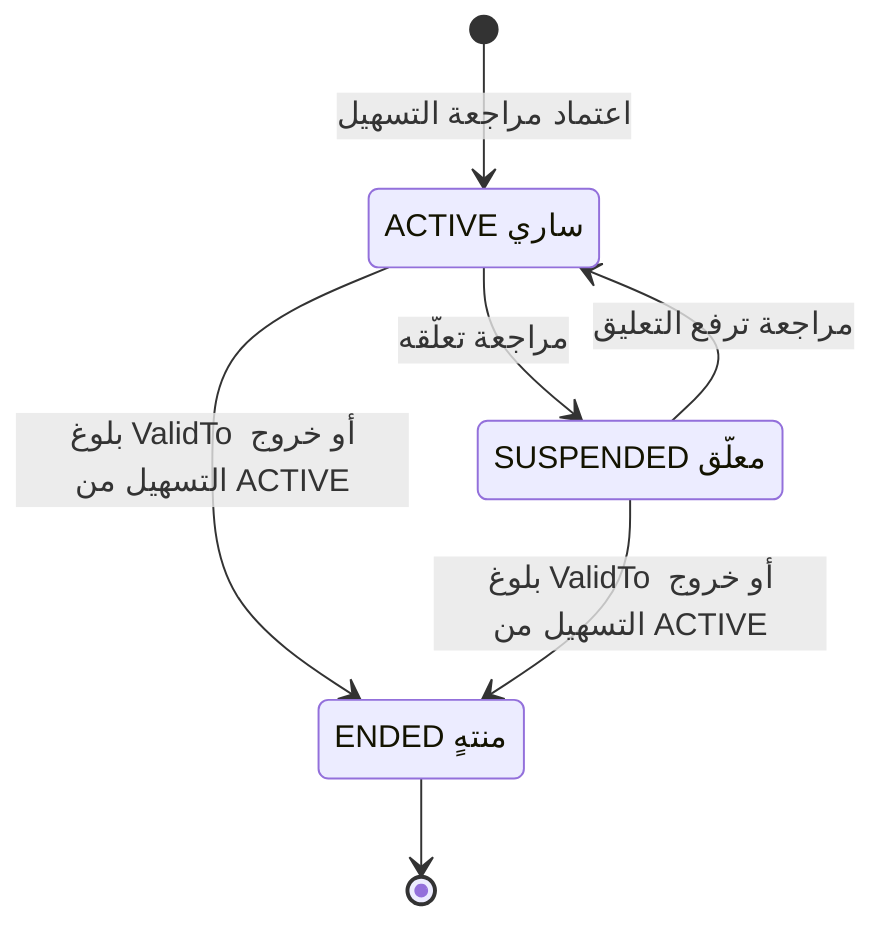
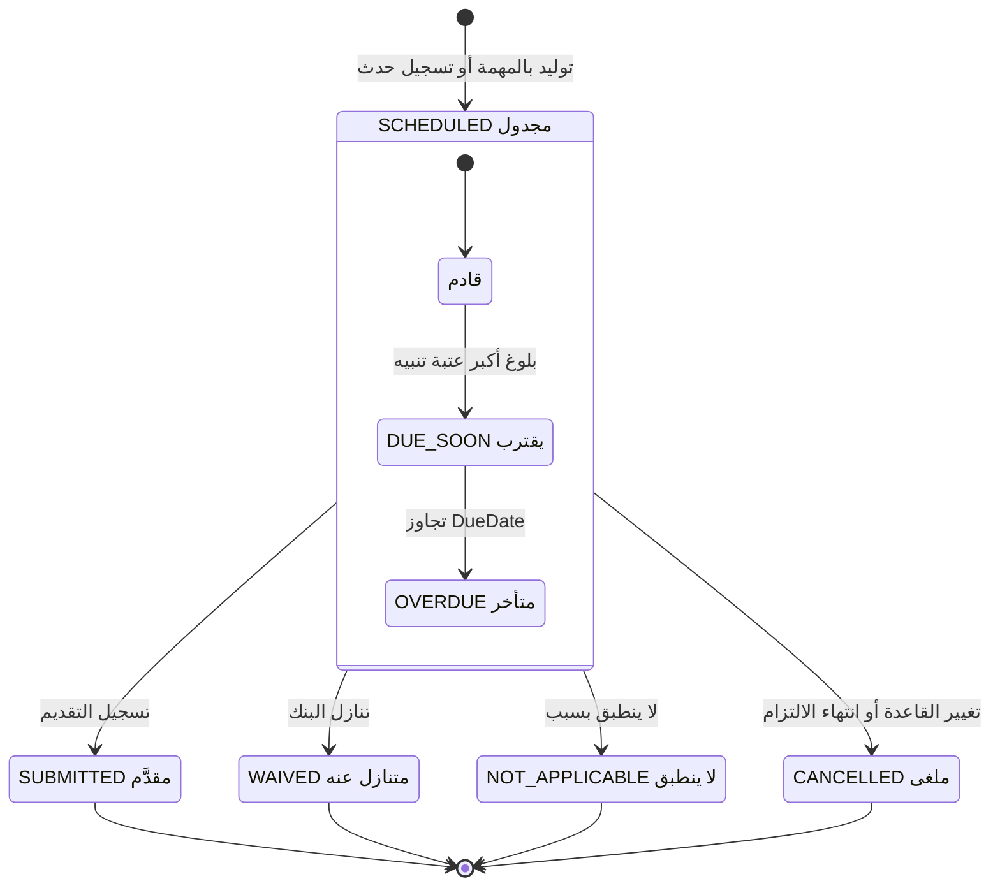
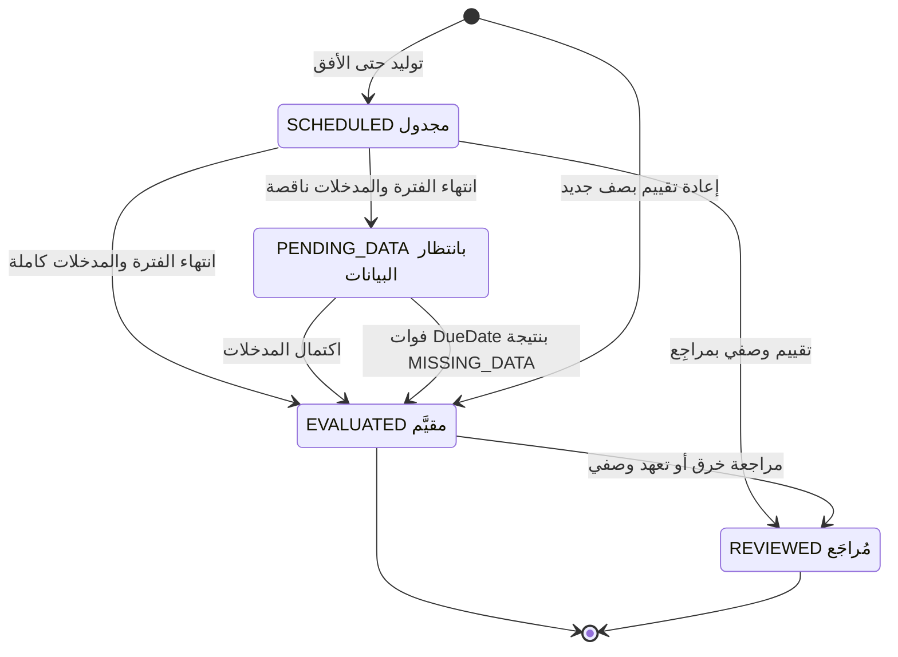
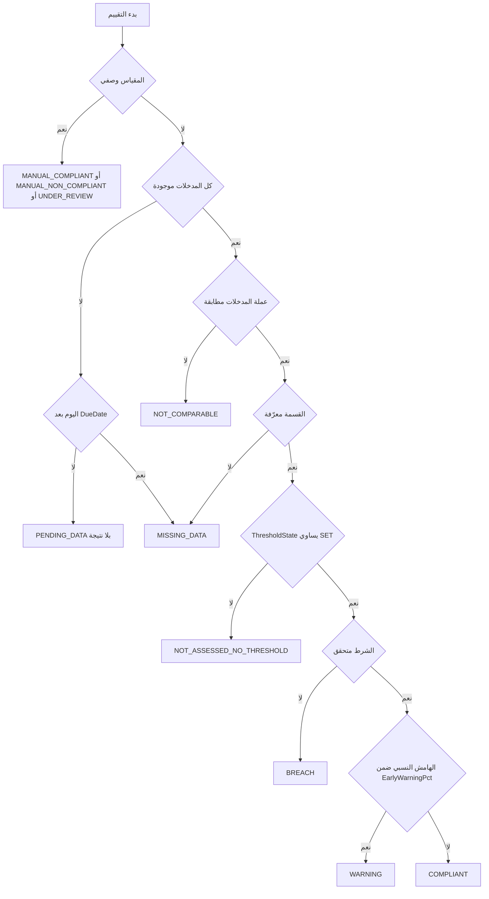
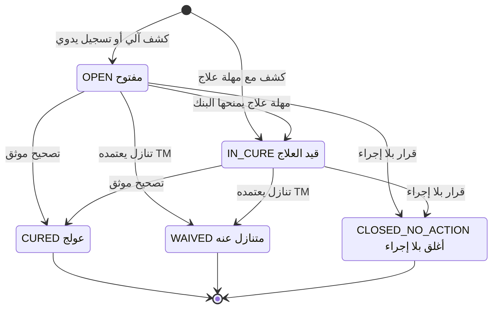
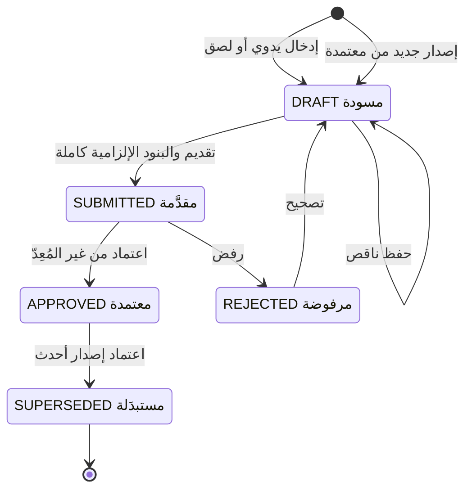

# DOC-F15 — مخططات حالات الالتزامات والبيانات المالية

| البند | القيمة |
|---|---|
| المعرّف | DOC-F15 (docs/30-readiness-documents.md) |
| الإصدار | 0.1 — مسودة للمراجعة — 2026-10-12 |
| المالك المقترح | مالك M5 (الالتزامات والبيانات المالية) |
| الأولوية | P1 قبل S2 (والبيانات المالية قبل S2-ب) |
| يغطي | FR-OBL-001 إلى FR-OBL-014، FR-FIN-002، FR-FIN-004 إلى FR-FIN-008، FR-FIN-011 إلى FR-FIN-014، BR-OBL-002 إلى BR-OBL-011، BR-FIN-001 إلى BR-FIN-005، BR-FIN-009، BR-FIN-010، NTF-OBL-01 إلى NTF-OBL-06، NTF-FIN-01، NTF-FIN-02 |
| يعتمد على | DOC-F13 (الاعتماد والتوليد وإعادة الوصل)، DOC-F14 (حالات التسهيل)، DOC-F17 (المهام والإشعارات)، DOC-F04 (هوية المهام)، DOC-F09 (حالات الاستخدام UC-OBL وUC-FIN) |
| المصادر | docs/03-financial-data-and-covenant-verification.md، docs/10-detailed-analysis/12-m5-facilities-pricing-collateral-obligations.md، docs/10-detailed-analysis/13-m6-workflow-engine-notifications.md، db/model/14-collateral-obligations-financials.model، db/generated/tsql/005_delete_grants.sql، db/generated/tsql/007_table_grants.sql، docs/21-data-dictionary.md، docs/review/design-review-2026-10-11.json |

## 1. الغرض والنطاق

تحدد الوثيقة حالات الالتزامات والبيانات المالية وانتقالاتها: الالتزام، وبند أجندة التقارير، واختبار التعهد ونتيجته، والخرق، والقائمة المالية، والأرصدة والصيغ. وتبيّن المهام المجدولة التي تحرّك هذه الحالات والتنبيهات التي تصدرها.

- **داخل النطاق:** `obl.Obligation.Status`، و`obl.ReportingInstance.Status`، و`obl.CovenantTest.State` و`Result`، و`obl.ObligationBreach.Status` و`NeedsReview`، و`fin.FinancialStatement.Status`، و`fin.AccountMonthlyStat.Status`، و`fin.MeasureFormula.Status`.
- **خارج النطاق:** توليد الأجندة والاختبارات داخل معاملة اعتماد التسهيل (DOC-F13 §7)، وحالات التسهيل والحجز (DOC-F14)، وتسليم الإشعارات (DOC-F17)، وحالات الضمانات.

**الوسوم:** 🟢 موجود أو مقرر مع الملف والسطر. 🟡 اقتراح.

**اختصارات المراجع:** «03» هو docs/03-financial-data-and-covenant-verification.md. «12-m5» هو docs/10-detailed-analysis/12-m5-facilities-pricing-collateral-obligations.md. «13-m6» هو docs/10-detailed-analysis/13-m6-workflow-engine-notifications.md. «m14» هو db/model/14-collateral-obligations-financials.model. «dd» هو docs/21-data-dictionary.md. «DR-nn» بند في docs/review/design-review-2026-10-11.json.

**ما تفرضه القاعدة.** لا قادح ولا إجراء ينفّذ هذه الانتقالات. القاعدة تفرض تماسك الحقول مع الحالة بقيود CHECK، وخرقًا مفتوحًا واحدًا لكل اختبار أو بند، وقائمة معتمدة واحدة لكل مفتاح 🟢 (m14:255-257، :332-341، :364-377، :425، :435-436). و`tp_app` يملك UPDATE على كل هذه الجداول ولا DELETE 🟢 (db/generated/tsql/007_table_grants.sql:283-297).

## 2. الالتزام Obligation.Status

القيم الثلاث 🟢: ACTIVE وSUSPENDED وENDED، والافتراضي ACTIVE (m14:180؛ dd:3752). الالتزام صف مراجَع ضمن مراجعة التسهيل (m14:9، :161). العائلة تأتي من نوعه ولا تُحرَّر (FR-OBL-001، 12-m5:183).

| الحالة | توليد بنود واختبارات جديدة | البنود المستقبلية المجدولة | خرق جديد | المرجع |
|---|---|---|---|---|
| ACTIVE | نعم حتى الأفق | تبقى | نعم | 🟢 FR-OBL-003 (12-m5:185) |
| SUSPENDED | لا | تُلغى بسبب 🟡 | لا 🟡 | 🟡 DQ-F15-1 |
| ENDED | لا | تُلغى بسبب 🟡 | لا | 🟡 DQ-F15-1 |

- 🟡 الحالة على صف مراجَع، فتغييرها يمر بمراجعة التسهيل (BR-FAC-003، 12-m5:241). وENDED مشتقة من `ValidTo` وحالة التسهيل ولا تُكتب يدويًا (DQ-F15-1).

## 3. بند الأجندة ReportingInstance

القيم الخمس 🟢: SCHEDULED وSUBMITTED وWAIVED وNOT_APPLICABLE وCANCELLED، والافتراضي SCHEDULED. وDUE_SOON وOVERDUE مشتقتان لا تُخزَّنان (m14:231، :238؛ dd:3842).

| # | الانتقال | الفاعل | الشرط | الأثر | المرجع |
|---|---|---|---|---|---|
| 1 | بداية إلى SCHEDULED بالمهمة | JOB-OBL-CALENDAR أو معاملة اعتماد التسهيل | قاعدة الاستحقاق والأفق | `GeneratedBy = JOB`؛ فريد لكل (القاعدة، نهاية الفترة) | 🟢 BR-OBL-002 (12-m5:298)؛ m14:246-250 |
| 2 | بداية إلى SCHEDULED بحدث | FO أو TM أو TE بـ `obl.record` | تاريخ الحدث | `GeneratedBy = MANUAL_EVENT`؛ الموعد قبل الحدث بأيام عمل | 🟢 FR-OBL-005 (12-m5:187)؛ BR-OBL-004؛ m14:254 |
| 3 | SCHEDULED إلى SCHEDULED بموعد جديد | FO أو TM بـ `obl.manage` | سبب | `DueDateOverrideReason`؛ العتبات من جديد | 🟢 m14:237؛ 12-m5:418 |
| 4 | SCHEDULED إلى SUBMITTED | FO أو TM أو TE بـ `obl.record` | الدليل إلزامي حيث `ExpectsEvidence` | التأخير = التقديم ناقص الموعد؛ التقديم المتأخر يفتح LATE_REPORT | 🟢 FR-OBL-004 (12-m5:186)؛ m14:218، :255 |
| 5 | SCHEDULED إلى WAIVED | TM بـ `obl.waiver.approve` | وثيقة التنازل وسبب | لا خرق | 🟢 12-m5:458؛ 🟡 الفاعل والحقول DQ-F15-12 |
| 6 | SCHEDULED إلى NOT_APPLICABLE | FO أو TM بـ `obl.manage` | سبب إلزامي | يخرج من المتأخر | 🟢 m14:257 |
| 7 | SCHEDULED إلى CANCELLED | الخدمة عند إعادة التوليد، أو FO أو TM | سبب إلزامي | يخرج من المتأخر | 🟢 m14:257؛ 🟡 الإلغاء الآلي |

- 🟢 المشتقة لبند SCHEDULED: DUE_SOON إن بقي للموعد أكبر عتبة أو أقل، وOVERDUE إن تجاوزه اليوم (BR-OBL-003، 12-m5:299). العتبات الافتراضية 30 و14 و7 و3 و1 (m14:215).
- 🟢 مثال (AC-FAC-6، 12-m5:667): قوائم مدققة بعد 210 أيام من 2025-12-31 موعدها 2026-07-29. تُقدَّم 2026-08-02 فتصير SUBMITTED بتأخير 4 أيام ويُفتح خرق LATE_REPORT مع NTF-OBL-03.
- 🟢 إعادة التوليد عند تغيير القاعدة تمس SCHEDULED المستقبلية فقط، وتُبقي المقدَّمة (FR-OBL-003، 12-m5:185؛ BR-OBL-003). 🟡 البند الذي بقيت فترته في الجدول الجديد يُحدَّث موعده، والذي خرج منه يصير CANCELLED.
- 🟡 SUBMITTED نهائية. تصحيح التاريخ أو المرجع تعديل مدقَّق بلا رجوع للحالة (DQ-F15-13).

## 4. اختبار التعهد CovenantTest

### 4.1 الحالة State

القيم الأربع 🟢: SCHEDULED وPENDING_DATA وEVALUATED وREVIEWED، والافتراضي SCHEDULED (m14:307؛ dd:3931). النتيجة Result عمود مستقل (m14:308؛ dd:3932). التقييم الجديد صف جديد برقم `EvaluationNo` أعلى ولا يعدّل القديم 🟢 (12-m5:459؛ m14:306، :325).

| # | الانتقال | الفاعل | الشرط | الأثر | المرجع |
|---|---|---|---|---|---|
| 1 | بداية إلى SCHEDULED | معاملة اعتماد التسهيل أو JOB-OBL-CALENDAR | نسخة تعهد سارية في الفترة | `DueDate = PeriodEnd + SubmissionLagDays` (30 افتراضيًا) | 🟢 FR-OBL-011 (12-m5:193)؛ BR-OBL-005 (:301)؛ m14:305 |
| 2 | SCHEDULED إلى PENDING_DATA | JOB-OBL-CALENDAR | اليوم بعد `PeriodEnd` ومدخل ناقص | تنبيه لا خرق | 🟢 BR-FIN-010 (12-m5:321)؛ 🟡 اللحظة DQ-F15-5 |
| 3 | SCHEDULED أو PENDING_DATA إلى EVALUATED | JOB-FIN-EVAL أو `fin.verify.run` | المدخلات كاملة | النتيجة واللقطة و`EvaluatedAt`؛ الصف نفسه | 🟢 FR-FIN-012 (12-m5:214)؛ m14:333 |
| 4 | PENDING_DATA إلى EVALUATED بنقص | JOB-FIN-EVAL | اليوم بعد `DueDate` | النتيجة MISSING_DATA وNTF-OBL-05 | 🟢 BR-FIN-010؛ AC-FAC-7 (12-m5:668) |
| 5 | بداية إلى EVALUATED بإعادة تقييم | JOB-FIN-EVAL أو `fin.verify.run` | بيانات جديدة أو إصدار قائمة أو تشغيل يدوي | صف برقم تقييم تالٍ؛ القديم لا يُمس | 🟢 BR-OBL-011 (12-m5:307)؛ FR-FIN-014 (:216) |
| 6 | SCHEDULED إلى REVIEWED | FO أو TM أو TE بـ `obl.record` | تعهد وصفي، ودليل ومراجِع | النتيجة MANUAL_* أو UNDER_REVIEW و`NextReviewOn` | 🟢 FR-OBL-007 (12-m5:189)؛ BR-OBL-008 (:304)؛ 🟡 الخطوة الواحدة DQ-F15-6 |
| 7 | EVALUATED إلى REVIEWED | FO أو TM | خرق أو تعهد وصفي | `ReviewedBy/On` وملاحظة فقط | 🟢 12-m5:459؛ m14:334 |

- 🟢 النتيجة الحالية للفترة هي صف أعلى `EvaluationNo` 🟡، وكل صف يحمل لقطة مدخلاته الثابتة (BR-FIN-010؛ m14:315).
- 🟢 الصف المقيَّم «لا يُعدَّل» في التصميم (m14:301)، لكن القاعدة تسمح بتحديثه (DR-39). نقترح قادحًا يمنع تغيير النتيجة واللقطة بعد EVALUATED، ويسمح بحقول المراجعة فقط (DQ-F15-4).
- 🟡 لا حالة لإلغاء اختبار مجدول صار خارج الجدول، ولا منحة DELETE (db/generated/tsql/005_delete_grants.sql:29-31 لا يذكره). نقترح إضافة CANCELLED إلى State (DQ-F15-2).

### 4.2 النتيجة Result

| النتيجة | الشرط | يفتح خرقًا | التنبيه | أثرها في اللون | المرجع |
|---|---|---|---|---|---|
| COMPLIANT | الشرط متحقق والهامش أكبر من حد الإنذار | لا | — | GREEN | 🟢 BR-OBL-007 (12-m5:303) |
| WARNING | الشرط متحقق والهامش 10% أو أقل | لا | NTF-OBL-04 | AMBER | 🟢 BR-OBL-007؛ BR-OBL-010 |
| BREACH | الشرط غير متحقق، والمقارنة بالدقة الكاملة | نعم COVENANT_BREACH | NTF-OBL-03 | RED ما لم يُتنازل | 🟢 BR-OBL-007؛ BR-FIN-011 (:322) |
| MISSING_DATA | نقص بعد الموعد أو قسمة على صفر | لا | NTF-OBL-05 | AMBER | 🟢 BR-FIN-009 (:320)؛ BR-FIN-010 |
| NOT_ASSESSED_NO_THRESHOLD | الحد غير SET | لا | — | لا يغيّر اللون | 🟢 BR-OBL-006 (:302)؛ BR-OBL-010 |
| NOT_COMPARABLE | عملة مختلفة | لا | — | AMBER 🟡 | 🟢 FR-FIN-013 (:215)؛ 🟡 اللون DQ-F15-14 |
| MANUAL_COMPLIANT | تقييم وصفي | لا | — | GREEN | 🟢 BR-OBL-008 |
| MANUAL_NON_COMPLIANT | تقييم وصفي | نعم | NTF-OBL-03 | RED | 🟢 BR-OBL-008 |
| UNDER_REVIEW | تقييم وصفي معلّق | لا | — | AMBER 🟡 | 🟡 DQ-F15-14 |

- 🟢 ترتيب الفحوص لـ BREACH وWARNING وCOMPLIANT وNOT_ASSESSED من BR-OBL-006 وBR-OBL-007. ترتيب فحص العملة والقسمة قبلها 🟡.
- 🟢 عتبة صفرية: بلا نسبة هامش ولا WARNING (BR-OBL-007).
- 🟢 قيود النتيجة: الحكم يستلزم القيمة والعتبة والمشغّل، وNOT_ASSESSED بلا عتبة، والوصفي بطريقة MANUAL_STATUS (m14:335-341).
- 🟢 مثال (AC-FAC-7، 12-m5:668): نسبة تداول 1.142857 مقابل 1.20 تعطي BREACH. إصدار معاد العرض يعطي التقييم 2 بقيمة 1.219048 فهو WARNING، ويُعلَّم الخرق NeedsReview ولا يُغلق.

### 4.3 أثر مراجعة التعهد على الاختبارات

التعهد صف مراجَع، والنموذج يعيد وصل الصفوف التشغيلية بالصف الجديد في معاملة الاعتماد 🟢 (m14:9-12). بذلك يفقد الاختبار المقيَّم صلته بالنسخة التي حكمته (DR-39). نقترح 🟡 (DQ-F15-3، ومعه DQ-F13-4):

| الصف | حالته | عند اعتماد مراجعة تغيّر التعهد أو قاعدته |
|---|---|---|
| CovenantTest | SCHEDULED لفترة مستقبلية | يُوصل بالنسخة السارية في `PeriodEnd`، ويُعاد حساب الموعد، والخارج من الجدول يصير CANCELLED |
| CovenantTest | PENDING_DATA | يُوصل بالنسخة السارية، ويُقيَّم بها حين تكتمل المدخلات |
| CovenantTest | EVALUATED أو REVIEWED | لا يُمس. العتبة والمشغّل محفوظان فيه (m14:311-312). التصحيح بأثر رجعي إعادة تقييم صريحة |
| ReportingInstance | SCHEDULED | يُوصل ويُعاد حساب الموعد كما في §3 |
| ReportingInstance | غير SCHEDULED | لا يُمس |
| ObligationBreach | OPEN أو IN_CURE | يُوصل بصف الالتزام الجديد |
| ObligationBreach | منتهٍ | لا يُمس |

## 5. الخرق ObligationBreach

القيم الخمس 🟢: OPEN وIN_CURE وCURED وWAIVED وCLOSED_NO_ACTION، والافتراضي OPEN (m14:351؛ dd:3972). و`NeedsReview` علم مستقل لا يغيّر الحالة (m14:362؛ dd:3983).

| # | الانتقال | الفاعل | الشرط | الأثر | المرجع |
|---|---|---|---|---|---|
| 1 | بداية إلى OPEN أو IN_CURE آليًا | JOB-FIN-EVAL لـ BREACH، وJOB-OBL-CALENDAR لـ LATE_REPORT | نتيجة BREACH أو MANUAL_NON_COMPLIANT، أو بند متأخر | IN_CURE إن كانت `CureDays` أكبر من صفر و`CureDeadline` = الكشف + المهلة؛ NTF-OBL-03 | 🟢 BR-OBL-009 (12-m5:305)؛ FR-OBL-010 (:192)؛ 🟡 الدخول الآلي DQ-F15-8 |
| 2 | بداية إلى OPEN يدويًا | FO أو TM بـ `obl.breach.manage` | نوع RESTRICTION_VIOLATION أو OTHER | NTF-OBL-03 | 🟢 FR-OBL-012 (12-m5:194)؛ 12-m5:65 |
| 3 | OPEN إلى IN_CURE | FO أو TM | مهلة يمنحها البنك لاحقًا | `CureDeadline` إلزامي | 🟢 القيد m14:372 |
| 4 | إلى CURED | FO أو TM بـ `obl.breach.manage` | دليل التصحيح | `ResolvedOn` | 🟢 m14:373؛ 🟡 الدليل |
| 5 | إلى WAIVED | يسجّل FO، ويعتمد TM بـ `obl.waiver.approve` | المرجع والتاريخ وجهة البنك | نتيجة الاختبار تبقى كما هي | 🟢 BR-OBL-009؛ FR-OBL-012؛ m14:376؛ F-OBL-1 (12-m5:443) |
| 6 | إلى CLOSED_NO_ACTION | TM | سبب 🟡 | `ResolvedOn` | 🟢 m14:373؛ 🟡 السبب DQ-F15-10 |
| 7 | NeedsReview إلى 1 | JOB-FIN-EVAL | إعادة تقييم بعد إعادة العرض | لا تغيير في الحالة ولا إغلاق آلي | 🟢 BR-OBL-011 (12-m5:307)؛ FR-FIN-014 (:216) |
| 8 | NeedsReview إلى 0 | FO أو TM | قرار مسجّل | الحالة كما يقرر | 🟡 |

- 🟢 خرق مفتوح واحد لكل اختبار ولكل بند أجندة (m14:364-365). 🟡 إعادة تقييم تعطي BREACH مرة أخرى للفترة نفسها لا تفتح خرقًا ثانيًا، بل تضع NeedsReview على القائم (DQ-F15-11).
- 🟢 حقول التنازل ممنوعة في غير WAIVED (m14:377). لذا لا مكان لتنازل سجّله FO قبل اعتماد TM (§10؛ DQ-F15-9).
- 🟢 أثر الخرق على الحجز: سياسة `UsageBlockOnBreach` ترفض الحجز COVENANT_STOP_POLICY مع خرق مفتوح غير متنازل عنه (FR-FAC-029، 12-m5:136؛ db/model/13-facilities-pricing-terms.model:48).
- 🟡 فوات `CureDeadline` في IN_CURE أو `WaiverValidUntil` في WAIVED لا يغيّر الحالة. يضع NeedsReview ويرسل تنبيهًا يوميًا (DQ-F15-15).

## 6. القائمة المالية FinancialStatement

القيم الخمس 🟢: DRAFT وSUBMITTED وAPPROVED وSUPERSEDED وREJECTED، والافتراضي DRAFT (m14:415؛ dd:4067). البيانات «سرية جدًا» (12-m5:593).

| # | الانتقال | الفاعل | الشرط | الأثر | المرجع |
|---|---|---|---|---|---|
| 1 | بداية إلى DRAFT | FO أو FA بـ `fin.stmt.enter` | المفتاح غير مكرر | الإصدار 1 بسبب ORIGINAL | 🟢 12-m5:67؛ m14:412-413، :424 |
| 2 | بداية إلى DRAFT بإصدار جديد | FO أو FA | قائمة معتمدة للمفتاح نفسه | الإصدار التالي بسبب RESTATED أو CORRECTION و`SupersedesId` | 🟢 FR-FIN-005 (12-m5:207)؛ BR-FIN-004 (:315)؛ m14:433-434 |
| 3 | DRAFT إلى SUBMITTED | المُعِدّ | البنود الإلزامية مملوءة؛ عدم التوازن يتطلب سببًا | الفارغ غير الإلزامي يُحفظ صفرًا؛ `PreparedBy/On`؛ NTF-FIN-02 | 🟢 BR-FIN-001، BR-FIN-002 (12-m5:312-313)؛ m14:417، :435 |
| 4 | SUBMITTED إلى APPROVED | TM بـ `fin.stmt.approve` | ليس المُعِدّ | `ApprovedBy/On`؛ السابق SUPERSEDED في المعاملة نفسها | 🟢 FR-FIN-006 (12-m5:208)؛ m14:425، :436 |
| 5 | SUBMITTED إلى REJECTED | المعتمِد | سبب 🟡 | NTF للمُعِدّ 🟡 | 🟢 12-m5:461؛ 🟡 عمود السبب DQ-F15-16 |
| 6 | REJECTED إلى DRAFT | المُعِدّ | — | يُفتح التحرير | 🟢 12-m5:461 |
| 7 | APPROVED إلى SUPERSEDED | الخدمة في معاملة الانتقال 4 للإصدار الأحدث | — | لا تُختار لأي اختبار بعدها | 🟢 BR-FIN-003، BR-FIN-004 (12-m5:314-315) |

- 🟢 قائمة معتمدة واحدة لكل (شركة، أساس، تأكيد، نوع فترة، نهاية فترة) بفهرس مصفّى (m14:425). 🟡 لذا تُحدَّث السابقة إلى SUPERSEDED قبل رفع الجديدة إلى APPROVED في المعاملة نفسها.
- 🟢 الاختيار للاختبار من APPROVED فقط: AUDITED_ONLY أو PREFER_AUDITED أو ANY، والأساس المطلوب الغائب يعطي MISSING_DATA بلا بديل صامت (BR-FIN-003، 12-m5:314).
- 🟡 اعتماد قائمة مدققة لفترة لها قائمة إدارية معتمدة لا يستبدلها، لأن المفتاح مختلف. لكنه يغيّر اختيار PREFER_AUDITED، فيُعاد تقييم الاختبارات المتأثرة.
- 🟡 إعادة التقييم بعد الاعتماد تجري بعد الالتزام: حدث `statement.approved` في Outbox، ثم JOB-FIN-EVAL بمفتاح عدم تكرار (DQ-F15-17؛ 12-m5:582).
- 🟢 سلسلة `SupersedesId` غير مقيدة بالشركة والفترة (DR-34).

## 7. الأرصدة والصيغ

| الكيان | الحالات | الانتقال والفاعل | الأثر في التحقق | المرجع |
|---|---|---|---|---|
| AccountMonthlyStat | DRAFT، CONFIRMED | DRAFT إلى CONFIRMED بـ `fin.stats.enter` من TM أو FO أو TE | 🟡 المؤكد وحده يدخل التقييم، وتعديله يطلق إعادة تقييم | 🟢 m14:455؛ 12-m5:68؛ 🟡 DQ-F15-18 |
| BankFlowEntry | بلا حالة | إدخال شهري وتجميع سنوي آلي | الحفظ يطلق إعادة تقييم | 🟢 m14:460-473؛ FR-FIN-009 (12-m5:211) |
| MeasureFormula | DRAFT، APPROVED، SUPERSEDED | الاعتماد بـ `fin.formula.approve` من غير المُعِدّ؛ معتمد واحد لكل (رمز، اتفاقية) | الاختبار يحفظ `FormulaVersion`. 🟡 اعتماد إصدار جديد لا يعيد تقييم الماضي إلا بتشغيل صريح | 🟢 m14:487، :491؛ FR-FIN-011 (12-m5:213)؛ m14:316 |

- 🟢 الصيغة نحو مقيّد يُحلَّل إلى شجرة ولا يُنفَّذ نصًا (BR-FIN-009، 12-m5:320).
- 🟢 `MonthEnd` غير مقيد بنهاية الشهر، فقد يتكرر الشهر بتاريخين (DR-37).

## 8. المهام المجدولة والتنبيهات

ترتيب المهام وتوصيلها يملكه DOC-F17. المهام بتوقيت المشترك، متكررة الأمان، تعوّض التوقف (BR-NTF-010، 13-m6:293)، وتربط سياق المشترك قبل الكتابة (DQ-F04-4).

| المهمة | التوقيت | ما تفعله هنا | مفتاح عدم التكرار | المرجع |
|---|---|---|---|---|
| JOB-OBL-CALENDAR | يومية، 🟡 05:10 | مد الأفق 24 شهرًا؛ SCHEDULED إلى PENDING_DATA بعد نهاية الفترة؛ خرق LATE_REPORT للمتأخر بعد مهلة السماح؛ المراجعة الوصفية المتأخرة | فرادة البند والاختبار والخرق المفتوح | 🟢 12-m5:522؛ m14:248-250، :325، :365 |
| JOB-FIN-EVAL | يومية، 🟡 05:20، وعند الأحداث | تقييم ما اكتملت مدخلاته؛ MISSING_DATA بعد الموعد؛ فتح COVENANT_BREACH؛ NeedsReview؛ نقص الأرصدة في اليوم 7 | (التعهد، نهاية الفترة، رقم التقييم) | 🟢 12-m5:522؛ FR-FIN-012؛ m14:326 |
| JOB-NTF-EXPIRY | يومية 05:30 | مزوّد أجندة التقارير: عتبات الاستحقاق ثم يوميًا بعده | (العنصر، العتبة، ItemVersion) | 🟢 13-m6:641؛ FR-NTF-017 (:216) |

| التنبيه | الحدث | المستلمون | التوقيت | المرجع |
|---|---|---|---|---|
| NTF-OBL-01 | OBL.DUE | FO، TM | 30/14/7/3/1 قبل الموعد | 🟢 12-m5:513؛ 13-m6:596 |
| NTF-OBL-02 | OBL.OVERDUE | FO، TM | يوميًا بعد الموعد، إلزامي | 🟢 12-m5:514 |
| NTF-OBL-03 | CMP.BREACH بمستوى BREACH | TM، FO | فوري عند فتح الخرق، إلزامي | 🟢 12-m5:515؛ 13-m6:599 |
| NTF-OBL-04 | CMP.BREACH بمستوى WARNING | TM، FO | مرة لكل اختبار ورقم تقييم | 🟢 12-m5:516 |
| NTF-OBL-05 | FIN.DATA_MISSING | TE، FO، FA | عند الحدوث ثم أسبوعيًا | 🟢 12-m5:517؛ 13-m6:600 |
| NTF-OBL-06 | OBL.REVIEW_OVERDUE | FO، TM | المراجعة المتأخرة يوميًا؛ مهلة العلاج قبل 7 أيام | 🟢 12-m5:518؛ m14:367 |
| NTF-FIN-01 | FIN.BALANCES_MISSING | TE، FO | اليوم 7 من الشهر التالي ثم أسبوعيًا | 🟢 12-m5:519؛ FR-FIN-008 (:210) |
| NTF-FIN-02 | FIN.STATEMENT_PENDING | TM، FA، FO | فوري عند التقديم أو تغيّر النتائج بإعادة العرض | 🟢 12-m5:520 |

اللون المجمَّع لكل تسهيل مشتق من هذه الحالات ولا يُخزَّن 🟢 (BR-OBL-010، 12-m5:306؛ m14:17):

| اللون | الشرط |
|---|---|
| RED | خرق OPEN أو IN_CURE، أو بند OVERDUE، أو اختبار BREACH غير متنازل عنه |
| AMBER | لا RED، ومعه WARNING أو MISSING_DATA أو DUE_SOON أو NOT_CONFIRMED أو مراجعة متأخرة |
| GREY | لا التزامات |
| GREEN | غير ذلك؛ وNOT_ASSESSED عدّاد لا يغيّر اللون |

مثال 🟢 (AC-FAC-7): اختبار لفترة تنتهي 2026-09-30 ومهلته 30 يومًا بلا أرصدة. يبقى PENDING_DATA حتى 2026-10-30، ثم MISSING_DATA مع NTF-OBL-05 في 2026-10-31 (12-m5:668).

## 9. القرارات المطلوبة

| المعرّف | السؤال | الافتراض المقترح | من يقرر | ما يعطّله |
|---|---|---|---|---|
| DQ-F15-1 | كيف تتغير حالة الالتزام وهو صف مراجَع؟ | ✅ معتمد من المالك (2026-10-12): SUSPENDED ورفعه بمراجعة؛ ENDED مشتقة؛ البنود المستقبلية تُلغى بسبب | TRM مع DBA | §2 |
| DQ-F15-2 | إلغاء اختبار مجدول خرج من الجدول | إضافة CANCELLED إلى `CovenantTest.State` بسبب | DBA | FR-OBL-011، §4.3 |
| DQ-F15-3 | إعادة وصل الاختبارات والبنود والخروقات عند مراجعة جديدة | كما في §4.3: غير المنتهي فقط | DBA مع مالك M5 | DR-39؛ DQ-F13-4 |
| DQ-F15-4 | منع تعديل النتيجة بعد EVALUATED في القاعدة | قادح يرفض تغيير النتيجة واللقطة، ويسمح بحقول المراجعة | DBA | DR-39 |
| DQ-F15-5 | لحظة SCHEDULED إلى PENDING_DATA | أول تشغيل بعد `PeriodEnd` بتوقيت المشترك | مالك M5 | JOB-OBL-CALENDAR |
| DQ-F15-6 | التعهد الوصفي: خطوة واحدة أم اثنتان؟ | ✅ معتمد من المالك (2026-10-12): خطوة واحدة إلى REVIEWED بمراجِع ودليل؛ UNDER_REVIEW حين لا يُحسم | TRM | FR-OBL-007 |
| DQ-F15-7 | لحظة فتح خرق LATE_REPORT | ✅ معتمد من المالك (2026-10-12): المهمة عند OVERDUE بعد `GraceDays`؛ وإلا عند التقديم المتأخر كما في AC-FAC-6 | TRM | FR-OBL-004 |
| DQ-F15-8 | الدخول إلى IN_CURE | ✅ معتمد من المالك (2026-10-12): آليًا عند الكشف إن كانت `CureDays` أكبر من صفر؛ ويدويًا إن منح البنك مهلة لاحقًا | TRM | BR-OBL-009 |
| DQ-F15-9 | أين يُحفظ التنازل قبل اعتماده؟ | ✅ معتمد من المالك (2026-10-12): إضافة `WaiverApprovedBy/On`، والسماح بحقول التنازل في OPEN وIN_CURE، وWAIVED يستلزم الاعتماد | DBA مع TRM | F-OBL-1 |
| DQ-F15-10 | سبب الإغلاق والعلاج | عمود `ResolutionNote` إلزامي لـ CURED وCLOSED_NO_ACTION | DBA | §5 |
| DQ-F15-11 | BREACH جديد لفترة لها خرق مفتوح | ✅ معتمد من المالك (2026-10-12): لا خرق ثانٍ؛ NeedsReview على القائم | TRM | BR-OBL-011 |
| DQ-F15-12 | من يضع بند الأجندة WAIVED وبأي دليل؟ | ✅ معتمد من المالك (2026-10-12): TM بـ `obl.waiver.approve`، وسبب ووثيقة إلزاميان | TRM | §3 |
| DQ-F15-13 | تصحيح بند SUBMITTED | ✅ معتمد من المالك (2026-10-12): لا رجوع؛ تعديل مدقَّق؛ والخرق الناتج يغلقه TM إن زال التأخير | TRM | §3 |
| DQ-F15-14 | لون NOT_COMPARABLE وUNDER_REVIEW | ✅ معتمد من المالك (2026-10-12): AMBER لكليهما | TRM | BR-OBL-010 |
| DQ-F15-15 | فوات مهلة العلاج أو انتهاء التنازل | ✅ معتمد من المالك (2026-10-12): NeedsReview وتنبيه يومي بلا تغيير حالة | TRM | §5 |
| DQ-F15-16 | سبب رفض القائمة المالية | عمود `RejectionReason` إلزامي مع REJECTED | DBA | §6 |
| DQ-F15-17 | إعادة التقييم بعد اعتماد قائمة: داخل المعاملة أم بعدها؟ | بعدها عبر Outbox وJOB-FIN-EVAL | SA | FR-FIN-012 |
| DQ-F15-18 | الرصيد الشهري: من يؤكد وما الذي يُقيَّم؟ | ✅ معتمد من المالك (2026-10-12): المؤكد وحده؛ يؤكده حامل `fin.stats.enter` بلا معتمِد ثانٍ | TRM | BR-FIN-005 |
| DQ-F15-19 | توقيت المهام وترتيبها | CALENDAR ثم FIN-EVAL ثم NTF-EXPIRY، ويثبته DOC-F17 | SA | DOC-F17 |

## 10. تعارضات وفجوات في المصادر

| البند | الموضع | الملاحظة |
|---|---|---|
| أسطر القاموس في السجل | docs/30-readiness-documents.md:184 | 3840 و3929 و3970، والصحيح 3842 و3931 و3972 |
| حالة الالتزام | 12-m5:449-461 | جدول الحالات لا يذكر `Obligation.Status`، والنموذج يعرّفه (m14:180) |
| التنازل على خطوتين | 12-m5:443؛ m14:377 | FO يسجّل وTM يعتمد، والقيد يمنع حقول التنازل قبل WAIVED |
| تنازل بند الأجندة | 12-m5:458؛ m14:257 | WAIVED «بتنازل» بلا حقول تنازل ولا سبب إلزامي |
| رفض القائمة المالية | 12-m5:461؛ m14:401-436 | REJECTED بلا عمود سبب |
| إلغاء الاختبار | 12-m5:193؛ m14:307 | إعادة التوليد بلا حالة إلغاء، ولا منحة DELETE |
| تعديل الاختبار المقيَّم | m14:301؛ db/generated/tsql/007_table_grants.sql:289 | «لا يُعدَّل» والقاعدة تسمح. وDR-39 يذكر السطر 290 والصحيح 289 |
| الصف الحاكم للاختبار | m14:11 | إعادة الوصل تفقد الاختبار نسخته الحاكمة (DR-39) |
| لحظة خرق التأخير | 12-m5:186، :667؛ m14:365 | المواصفة تفتحه عند التقديم المتأخر، والتعليق ينسبه إلى المهمة الليلية |
| سبب الإغلاق | m14:344-378 | لا عمود لسبب CLOSED_NO_ACTION أو دليل CURED |
| ألوان ناقصة | 12-m5:306 | BR-OBL-010 لا يصنّف NOT_COMPARABLE ولا UNDER_REVIEW |
| سلسلة الإصدارات | m14:414 | `SupersedesId` غير مقيد بالشركة والفترة (DR-34) |
| نهاية الشهر | m14:447، :464 | لا قيد على `MonthEnd` (DR-37) |
| وحدة العتبة | m14:287 | SET لا يستلزم `ThresholdUnit` (DR-38) |

## 11. التتبع

| البند في هذه الوثيقة | المتطلب أو القاعدة أو القرار | المصدر |
|---|---|---|
| §2 | FR-OBL-001، BR-OBL-001، BR-FAC-003 | 12-m5:183، :241، :297؛ m14:161-197 |
| §3 | FR-OBL-002 إلى FR-OBL-005، BR-OBL-002 إلى BR-OBL-004، AC-FAC-6 | 12-m5:184-187، :298-300، :458، :667؛ m14:231-259 |
| §4 | FR-OBL-006، FR-OBL-007، FR-OBL-011، FR-FIN-012 إلى FR-FIN-014، BR-OBL-005 إلى BR-OBL-008، BR-FIN-009 إلى BR-FIN-011، AC-FAC-7 | 12-m5:188-193، :214-216، :301-304، :320-322، :459، :668؛ m14:301-342؛ 03:141-161 |
| §5 | FR-OBL-010، FR-OBL-012، BR-OBL-009، BR-OBL-011، FR-FAC-029 | 12-m5:136، :192، :194، :305، :307، :443، :460؛ m14:344-378؛ 03:150 |
| §6 | FR-FIN-002، FR-FIN-004 إلى FR-FIN-007، BR-FIN-001 إلى BR-FIN-004 | 12-m5:204-209، :312-315، :461؛ m14:401-436؛ 03:182-184 |
| §7 | FR-FIN-008، FR-FIN-009، FR-FIN-011، BR-FIN-005، BR-FIN-009 | 12-m5:210-213، :316، :320؛ m14:445-502 |
| §8 | NTF-OBL-01 إلى NTF-OBL-06، NTF-FIN-01، NTF-FIN-02، BR-OBL-010، FR-NTF-017 | 12-m5:306، :513-522؛ 13-m6:216، :596-602، :641 |
