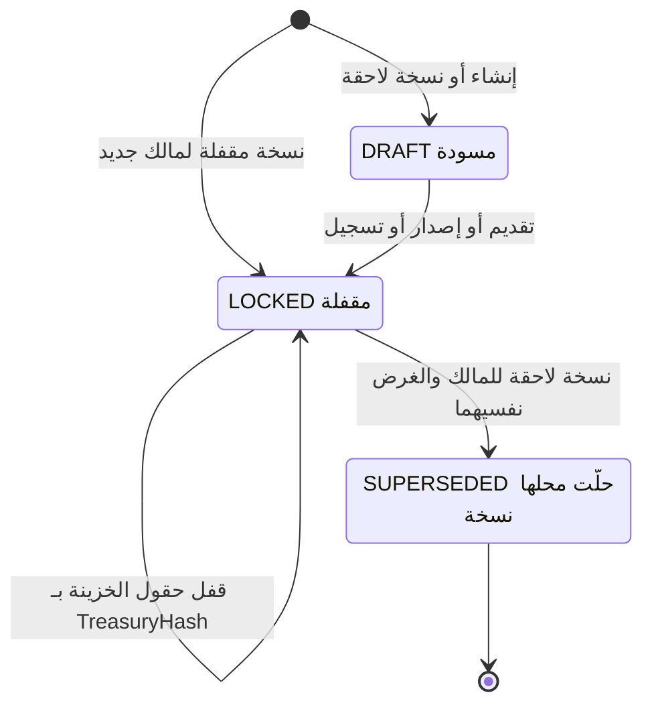
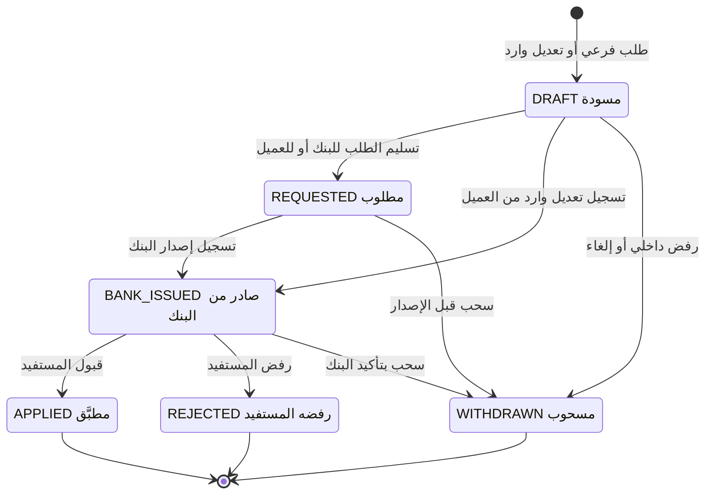
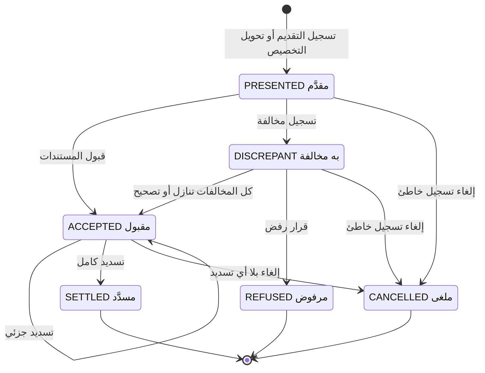
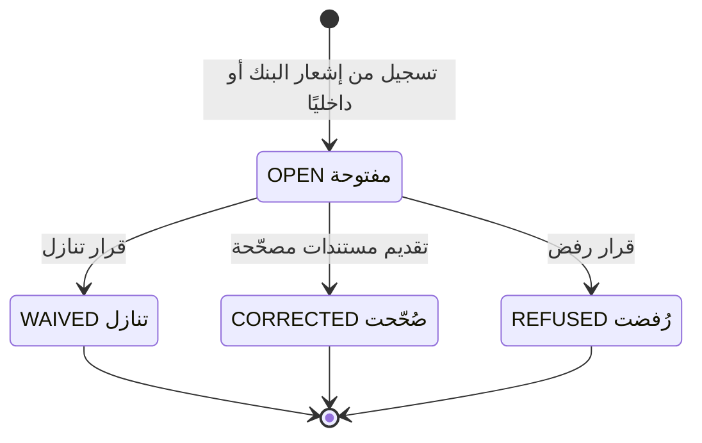
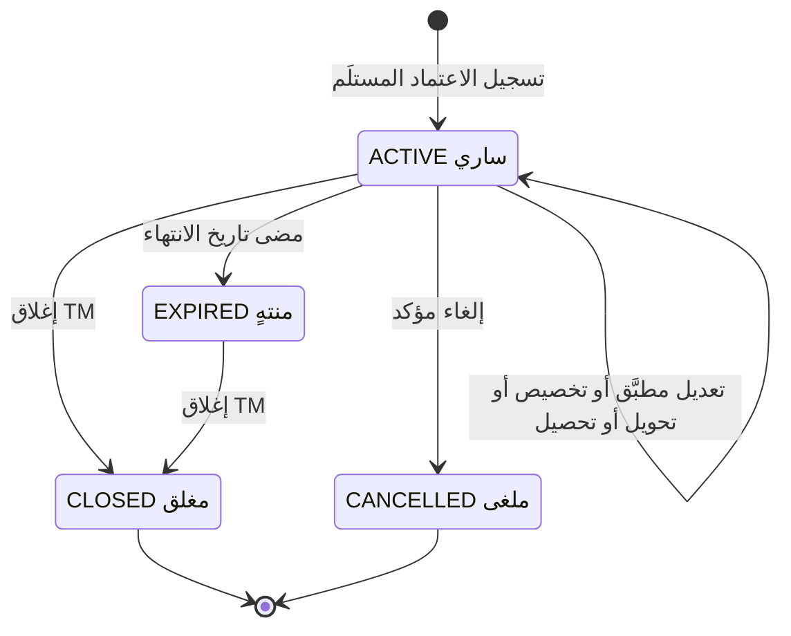
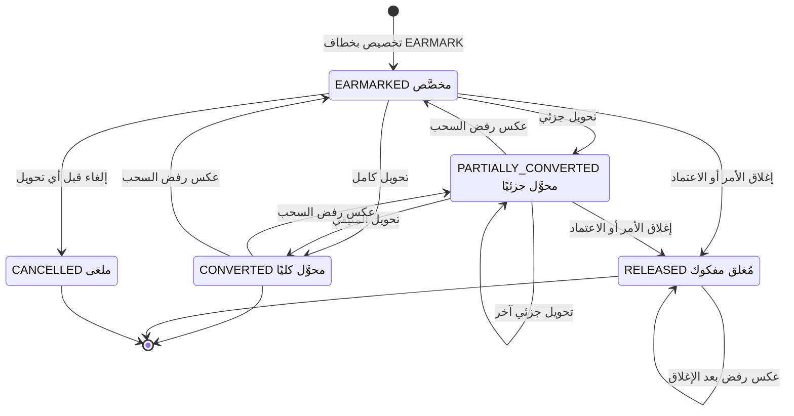
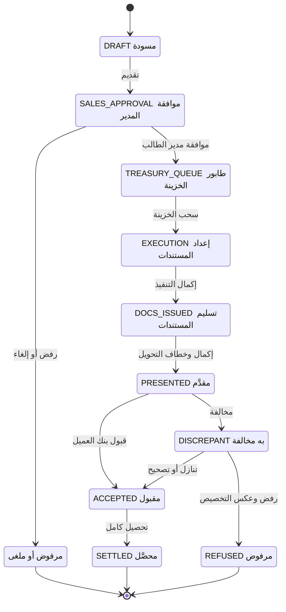
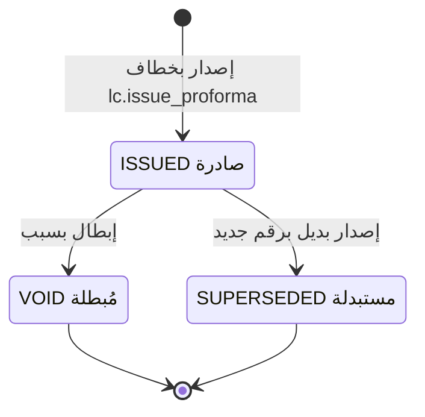
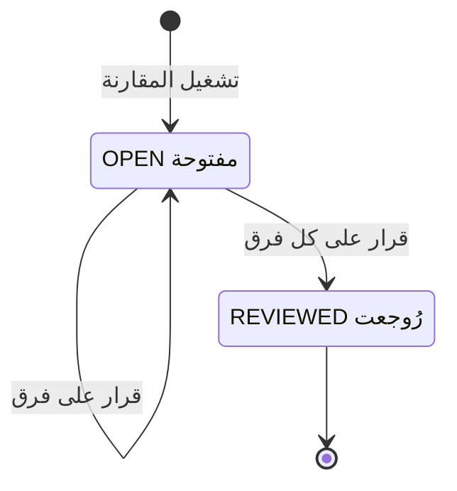

# DOC-F16 — مخططات حالات كيانات الاعتماد التابعة (التعديل والسحب والمبيعات والمخالفات والبروفورما)

| البند | القيمة |
|---|---|
| المعرّف | DOC-F16 (docs/30-readiness-documents.md) |
| الإصدار | 0.1 — مسودة للمراجعة — 2026-10-12 |
| المالك المقترح | مالك M7 وM8 |
| الأولوية | P1 قبل S3 |
| يغطي | FR-LCT-002، FR-LCT-031، FR-LCI-015، FR-LCI-018، FR-LCI-019، FR-LCI-023 إلى FR-LCI-025، FR-LCE-005، FR-LCE-007، FR-LCE-009، FR-LCE-013 إلى FR-LCE-021، BR-LCT-019، BR-LCI-011 إلى BR-LCI-013، BR-LCE-003، BR-LCE-007، BR-LCE-009 إلى BR-LCE-017، AC-LCI-2، AC-LCE-1 إلى AC-LCE-3، DR-41، DR-42، DR-46 |
| يعتمد على | DOC-F12 (تسلسل الإصدار والتعديل والحجز)، DOC-F08 (حالة الطلب)، DOC-F10 (مراحل القوالب)، DOC-F14 (الحجز والاستغلال)، DOC-F17 (الأحداث والمهام)، DOC-B04 (نموذج الأخطاء)، DOC-B05 (بذر الصلاحيات) |
| المصادر | db/model/16-letters-of-credit.model، docs/10-detailed-analysis/14-m7-m8-letters-of-credit.md، docs/10-detailed-analysis/13-m6-workflow-engine-notifications.md، db/generated/tsql/005_delete_grants.sql، db/generated/tsql/007_table_grants.sql، docs/21-data-dictionary.md، docs/review/design-review-2026-10-11.json |

## 1. الغرض والنطاق

تعطي الوثيقة لكل عمود حالة في وحدة الاعتمادات مخطط حالات وجدول انتقالات. كل صف في الجدول يذكر المشغّل والصلاحية والحارس والتدقيق أو الحدث. وتجرد كل تعدادات الحالة في النموذج بالملف والسطر، وتسجّل عدم التطابق بين قوائم المواصفة وتعدادات النموذج.

**داخل النطاق:** LcTerms، LcAmendment، LcDrawing (استيراد وتصدير)، LcDiscrepancy، اعتماد المبيعات المستلَم، LcSalesOrder، طلب مستندات التحصيل، ProformaInvoice، LcTermsComparison، وحالات الكتالوجات باختصار.

**خارج النطاق:**

| الموضوع | الوثيقة المالكة |
|---|---|
| مخطط اعتماد المشتريات الرئيسي، وهو مرسوم في 14:520-530 | يُستعمل كما هو؛ والفروق في §8 |
| التسلسلات بين الخدمات والمعاملات | DOC-F12 |
| LimitReservation وUtilization (m13:281، m13:256) | DOC-F14 |
| حالة الطلب وReservationState (m15:257، m15:296) | DOC-F08 |
| مراحل القوالب | DOC-F10 |
| المهام المجدولة والمُرسِل | DOC-F17 |

**الوسوم:** 🟢 موجود في المستودع أو الوثائق مع الملف والسطر. 🟡 اقتراح.

**اختصارات المراجع:** «14» هو docs/10-detailed-analysis/14-m7-m8-letters-of-credit.md، و«13» هو docs/10-detailed-analysis/13-m6-workflow-engine-notifications.md. و«m16» هو db/model/16-letters-of-credit.model، و«m13» هو db/model/13-facilities-pricing-terms.model، و«m15» هو db/model/15-workflow-notifications.model، و«m10» هو db/model/10-platform.model. و«005» و«006» و«007» ملفات db/generated/tsql بالأرقام نفسها. وDR-nn نتائج docs/review/design-review-2026-10-11.json. و«DOC-xxx:n» السطر n من الوثيقة في docs/30-readiness/.

## 2. جرد تعدادات الحالة

| العمود | القيم في النموذج | النموذج | المواصفة | التطابق | القسم |
|---|---|---|---|---|---|
| LetterOfCredit.Status | ACTIVE، EXPIRED، CLOSED، CANCELLED | m16:397 | 14:421، 14:520-530 | مطابق | §8 |
| LcTerms.Status | DRAFT، LOCKED، SUPERSEDED | m16:166 | 14:407، 14:534 | مطابق، مع استثناء الخزينة (§13 البند 12) | §4 |
| LcTerms.Purpose | PROFORMA، APPLICATION، ISSUED، RECEIVED، AMENDMENT | m16:164 | 14:84، 14:407 | مطابق | §4 |
| LcAmendment.Status | DRAFT، REQUESTED، BANK_ISSUED، APPLIED، REJECTED، WITHDRAWN | m16:498 | 14:423، 14:536 | القيم مطابقة والانتقالات ناقصة | §5 |
| LcAmendment.BeneficiaryResponse | PENDING، ACCEPTED، REJECTED | m16:501 | 14:423؛ 13:344 | 13:344 يذكر «سحب» ردًا | §5 |
| LcAmendment.Origin | OUR_REQUEST، RECEIVED_FROM_CUSTOMER | m16:489 | 14:423 | مطابق | §5 |
| LcAmendment.ChangeKinds | ستة أنواع بنوع set | m16:490 | 14:423 بنوع json | النوع مختلف | §5 |
| LcDrawing.Status | PRESENTED، DISCREPANT، ACCEPTED، SETTLED، REFUSED، CANCELLED | m16:533 | 14:424، 14:537 | القيم مطابقة؛ FR-LCE-019 يخالف §8 | §6 |
| LcDiscrepancy.Status | OPEN، WAIVED، CORRECTED، REFUSED | m16:598 | 14:426، 14:540 | مطابق | §7 |
| LcDiscrepancy.Source | BANK_NOTICE، INTERNAL | m16:596 | 14:426 | مطابق | §7 |
| LcSalesOrder.Status | EARMARKED، PARTIALLY_CONVERTED، CONVERTED، RELEASED، CANCELLED | m16:566 | 14:427، 14:538 | مطابق؛ العكس بعد الإغلاق غير مغطى | §9 |
| ProformaInvoice.Status | ISSUED، VOID، SUPERSEDED | m16:636 | 14:428، 14:539 | مطابق | §11 |
| LcTermsComparison.Status | OPEN، REVIEWED | m16:684 | 14:414 | مطابق | §12 |
| LcTermsComparisonLine.Verdict | MATCH، MORE_FAVOURABLE، LESS_FAVOURABLE، ADDED، MISSING، REVIEW | m16:693 | 14:415، 14:253 | مطابق | §12 |
| LcTermsComparisonLine.Decision | ACCEPT، REQUEST_AMENDMENT، IGNORE | m16:694 | 14:415 | مطابق | §12 |
| LcFormTemplate.Status | DRAFT، ACTIVE، RETIRED | m16:362 | 14:411 | مطابق | §12 |
| LcFormTemplate.LegalReviewStatus | UNREVIEWED، REVIEWED | m16:361 | 14:411 | مطابق | §12 |
| LcDocumentClause.Status | ACTIVE، RETIRED | m16:140 | 14:409 | مطابق | §12 |
| LcDocumentClause.LegalReviewStatus | UNREVIEWED، REVIEWED | m16:137 | 14:409 | مطابق | §12 |
| ref.UcpArticle.VerificationStatus | UNVERIFIED، VERIFIED | m16:51 | 14:405 | مطابق | §12 |
| ref.Incoterm.Status | ACTIVE، LEGACY | m16:37 | 14:127 | المواصفة لا تسمّي التعداد | §12 |
| Counterparty.IsActive وMergedIntoId | منطقي ومرجع | m16:113-114 | 14:254 | ليس تعدادًا | §12 |

لا يوجد عمود حالة في LcDrawingAllocation (m16:583-591) ولا في LcExternalRef (m16:473-483، وفيه IsActive) ولا في ProformaLine (m16:661-674).

## 3. اصطلاحات الجداول

- **الأعمدة:** # · الانتقال · المشغّل · الصلاحية · الحارس · التدقيق والحدث.
- **الصلاحيات** 🟢 من مصفوفة الأدوار في 14:46-75. بذرها في الكتالوج يتبع DOC-B05.
- **الحدث:** رموز الإشعار من 14:596-609، وأحداث Outbox من 14:655.
- **التدقيق** 🟡: صف aud.AuditLog بفئة TREASURY (m10:310)، والفعل بحروف كبيرة مثل LC_AMENDMENT_APPLIED (m10:309). الشدة HIGH للأفعال في 14:670، وكل تغيير في LetterOfCredit يحمل القيمتين القديمة والجديدة (14:670).
- **«النظام»:** خطاف أو مهمة بحساب الخدمة A-05 (DOC-F01) وسياق مربوط (DOC-F04).
- **الحارس** يشمل رموز V من 14:549-592 وقيود CHECK في النموذج.

🟢 **ما تفرضه القاعدة اليوم:** قيود CHECK تربط كل حالة بأعمدتها، مثل m16:520-521 وm16:550-551 وm16:576-581. لا شيء يمنع الانتقال من حالة إلى أخرى غير مسموحة. tp_app يملك SELECT وINSERT وUPDATE على كل جداول lc (007:375-405)، ولا قادح على جداول lc (القوادح الوحيدة في db/static/030_session_context.sql:245 وdb/static/050_fac_share_rule.sql:26). DR-41 مفتوح.

🟡 **قاعدة التنفيذ المقترحة:** كل انتقال يمر بدالة خدمة واحدة للكيان. تكتب `UPDATE ... WHERE Id = @id AND Status IN (@from) AND RowVersion = @rv`. صفر صفوف يعني 409 برمز جديد INVALID_STATE إن تغيّرت الحالة، أو VERSION_CONFLICT إن تغيّر RowVersion فقط (DQ-F16-1؛ DOC-B04:187).

## 4. شروط الاعتماد LcTerms

| # | الانتقال | المشغّل | الصلاحية | الحارس | التدقيق والحدث |
|---|---|---|---|---|---|
| 1 | بداية إلى DRAFT | الطالب ينشئ طلب PURCHASE_LC أو PROFORMA_REQUEST | `req.create` و`lc.terms.edit` (14:48-49) | الغرض يطابق المالك والجانب (m16:269-270) | RequestAction؛ لا تدقيق لكل حفظ 🟡 |
| 2 | DRAFT إلى LOCKED | خطاف `lc.validate_terms` على SUBMIT أو RESUBMIT (14:307) | صلاحية المقدِّم | لا قاعدة E في 14:549-569؛ وقيود غير DRAFT (m16:272-297) | Outbox `lc.terms.locked` (14:655)؛ 🟡 TERMS_LOCKED |
| 3 | LOCKED إلى LOCKED | موافقة TM في TM_APPROVAL | `req.treasury.approve` (14:56) | TreasuryHash فارغ قبلها (m16:255، m16:273) | 🟡 TERMS_TREASURY_LOCKED |
| 4 | LOCKED إلى SUPERSEDED | إرجاع للطالب (BR-LCI-002، 14:261)، أو تعديل خزينة بعد الموافقة (BR-LCI-006، 14:265) | `lc.terms.treasury.edit` (14:54) للخزينة | النسخة الجديدة VersionNo+1 وSupersedesTermsId (m16:266)؛ نسخة جارية واحدة لكل مالك وغرض (m16:263)، فالانتقالان في معاملة واحدة | 🟡 TERMS_SUPERSEDED مع ChangeReason؛ تعليق ظاهر للطالب (14:165) |
| 5 | بداية إلى LOCKED | `lc.record_issuance` (ISSUED)، `lc.issue_proforma` (PROFORMA على البروفورما)، تسجيل اعتماد مستلَم (RECEIVED) | `lc.issuance.record` أو `lc.proforma.issue` أو `lc.export.record` (14:58-61) | CopiedFromTermsId (m16:259)؛ التجزئة وLockedAt (m16:272) | ضمن حدث الكيان المالك |
| 6 | شروط AMENDMENT | DRAFT عند إنشاء الطلب الفرعي، وLOCKED عند التقديم 🟡 (DOC-F12 DQ-F12-3) | `lc.child.create` (14:62) | الغرض AMENDMENT لمالك REQUEST أو AMENDMENT (m16:269) | تصير الشروط الحالية للاعتماد عند APPLIED (m16:413) |

ملاحظات:

- 🟢 BR-LCT-019 يُبقي حقول الخزينة قابلة للتحرير في نسخة LOCKED حتى موافقة TM (14:251). فالقفل يثبّت حقول الطالب وحدها حتى يُكتب TreasuryHash. أي حارس قاعدة لـ DR-41 يجب أن يسمح بهذا الاستثناء (DQ-F16-14).
- 🟢 لا انتقال من DRAFT إلى SUPERSEDED في المواصفة (14:534). 🟡 المسودة المتروكة تبقى DRAFT مع طلبها المؤرشف.
- 🟢 شروط ISSUED لا تصير SUPERSEDED عند تطبيق تعديل، لأن شروط التعديل مالكها وغرضها مختلفان (m16:263). يتغير مؤشر CurrentTermsId فقط.
- 🟢 DR-42 مفتوح: لا شيء يربط CurrentTermsId وTermsId بمالكها (m16:162-163، m16:413). 🟡 حتى يُحسم، تفحص الخدمة المالك والغرض عند كل ربط.

## 5. تعديل الاعتماد LcAmendment

🟢 المواصفة: DRAFT ثم REQUESTED ثم BANK_ISSUED ثم APPLIED أو REJECTED، وWITHDRAWN من DRAFT أو REQUESTED أو BANK_ISSUED (14:536). في التصدير REQUESTED هو طلبنا من العميل، وBANK_ISSUED إشعار مستلَم ينتظر قرارنا. التسلسل والمعاملات في DOC-F12 §6.

الانتقال DRAFT إلى BANK_ISSUED مقترح 🟡 للتعديل الوارد في التصدير (DQ-F16-6).

| # | الانتقال | المشغّل | الصلاحية | الحارس | التدقيق والحدث |
|---|---|---|---|---|---|
| 1 | بداية إلى DRAFT (مشتريات) | الطالب أو الخزينة ينشئ LC_AMENDMENT | `req.create.child` و`lc.child.create` (14:62) | الاعتماد ACTIVE ولا تعديل مفتوح (V-LCI-07، 14:576؛ FR-LCI-022، 14:178) | RequestAction CREATED |
| 2 | DRAFT إلى REQUESTED | النظام عند خروج EXECUTION 🟡 (DOC-F12 DQ-F12-2) | `req.execute` (14:58) | شروط التعديل LOCKED؛ ومرّ بـ TM_APPROVAL إن كان Delta موجبًا أو إلغاءً (13:344) | 🟡 LC_AMENDMENT_REQUESTED |
| 3 | REQUESTED إلى BANK_ISSUED | TE يحفظ إصدار البنك في `lc.amendment_result` | `lc.amendment.record` (14:63) | AmendmentNo وBankIssuedOn (m16:520)؛ الرقم فريد للاعتماد (m16:507) | 🟡 LC_AMENDMENT_BANK_ISSUED |
| 4 | BANK_ISSUED إلى APPLIED | خطاف `lc.apply_amendment` ON_EXIT (14:309) بعد رد ACCEPTED | `lc.amendment.record` | ACCEPTED وAppliedOn وAppliedBy (m16:521)؛ إعادة فحص V-LCI-08 (14:577)؛ الاعتماد ACTIVE (BR-LCI-015، 14:274) | LC.AMENDED (14:598)، LC.AMENDMENT_RESPONSE (14:605)، Outbox `lc.amended`؛ تدقيق بالقيم القديمة والجديدة |
| 5 | BANK_ISSUED إلى REJECTED | الخطاف نفسه بعد رد REJECTED | `lc.amendment.record` | عكس ReservationDeltaApplied (BR-LCI-012، 14:271) | LC.AMENDMENT_RESPONSE؛ 🟡 LC_AMENDMENT_REJECTED |
| 6 | DRAFT أو REQUESTED إلى WITHDRAWN | رفض الطلب الفرعي أو إلغاؤه (13:344) | `req.approve` للرافض أو إلغاء الطالب أو TM (DOC-F08 §4.3) | عكس أي زيادة مطبَّقة | REQ.REJECTED أو REQ.CANCELLED؛ 🟡 LC_AMENDMENT_WITHDRAWN |
| 7 | BANK_ISSUED إلى WITHDRAWN | 🟡 TM بتأكيد البنك (DOC-F12 DQ-F12-7) | `lc.amendment.record` | سبب ومرفق التأكيد | 🟡 LC_AMENDMENT_WITHDRAWN بشدة HIGH |
| 8 | بداية إلى DRAFT ثم BANK_ISSUED (تصدير) | الخزينة تسجّل تعديلًا وارد من العميل (FR-LCE-020، 14:214) | `lc.amendment.record` | Origin = RECEIVED_FROM_CUSTOMER؛ BR-LCE-014: المبلغ الجديد لا يقل عن المخصَّص المتبقي والمسحوب (V-LCE-11، 14:590) | 🟡 LC_AMENDMENT_RECEIVED |
| 9 | BANK_ISSUED إلى APPLIED (تصدير) | قرارنا بالقبول، فنحن المستفيد | `lc.amendment.record`؛ 🟡 TM أو FO | BR-LCE-014 تحت قفل صف الاعتماد (14:671)؛ لا استدعاء fac (FR-LCE-027، 14:221) | 🟡 LC.AMENDED للجانبين (DQ-F16-6) |

**رد المستفيد** BeneficiaryResponse آلة صغيرة: PENDING ثم ACCEPTED أو REJECTED، مرة واحدة، مع RespondedOn (m16:522). 🟢 العمود يقبل NULL رغم الافتراضي PENDING (m16:501). 🟡 القيود المقترحة في DQ-F16-7:

- REJECTED في Status يستلزم REJECTED في الرد.
- WITHDRAWN يستلزم PENDING في الرد.
- العمود إلزامي.

🟢 لا حالة تعبّر عن «رُفع التعرّض بانتظار البنك». يحملها ReservationDeltaApplied (m16:505).

## 6. السحب وتقديم المستندات LcDrawing

🟢 المواصفة: PRESENTED ثم ACCEPTED ثم SETTLED؛ PRESENTED ثم DISCREPANT ثم ACCEPTED بتنازل أو REFUSED؛ وأي حالة غير نهائية إلى CANCELLED (14:537). REFUSED وCANCELLED لا تُحتسبان في المسحوب (m16:533).

| # | الانتقال | المشغّل | الصلاحية | الحارس | التدقيق والحدث |
|---|---|---|---|---|---|
| 1 | بداية إلى PRESENTED (استيراد) | TE من إشعار البنك | `lc.drawing.record` (14:64) | BR-LCI-013: المسحوب مع المبلغ لا يتجاوز التعرّض (V-LCI-05)، والتقديم قبل الانتهاء أو تجاوز TM بسبب (V-LCI-06؛ m16:541)؛ عملة الاعتماد (m16:526)؛ رقم فريد (m16:543) | LC.DRAWING_RECORDED (14:602)، Outbox `lc.drawing.recorded`؛ لا استدعاء fac (DOC-F12 §5) |
| 2 | بداية إلى PRESENTED (تصدير) | خطاف `lc.convert_earmark` في DOCS_ISSUED (14:312) | `req.execute` | V-LCE-09 وV-LCE-10 (14:588-589)؛ سحب واحد لكل طلب (m16:544) | Outbox `earmark.converted`؛ LC.DOCS_DELIVERED (14:607) |
| 3 | PRESENTED إلى ACCEPTED | TE من قبول البنك أو إشعار الاستحقاق | `lc.drawing.record` | MaturityDate للآجل (BR-LCT-009، 14:241؛ m16:535) | 🟡 LC_DRAWING_ACCEPTED |
| 4 | PRESENTED إلى DISCREPANT | TE يسجّل مخالفة OPEN (§7) | `lc.drawing.record` | ExaminationDeadline قائم (m16:536) | LC.DISCREPANCY_OPEN فوري ثم يومي (14:604) |
| 5 | DISCREPANT إلى ACCEPTED | النظام حين لا تبقى مخالفة OPEN ولا REFUSED 🟡 (DQ-F16-3) | `lc.discrepancy.decide` (14:65) لقرار المخالفة | قرار مدوَّن لكل مخالفة (FR-LCI-024، 14:180) | 🟡 LC_DRAWING_ACCEPTED |
| 6 | DISCREPANT إلى REFUSED | النظام عند قرار REFUSED على أي مخالفة | `lc.discrepancy.decide` | SettledAmount = 0 (m16:551)؛ في التصدير يُعكس التخصيص (BR-LCE-013، 14:296) | 🟡 LC_DRAWING_REFUSED؛ لا حدث معرَّف (DQ-F16-13) |
| 7 | ACCEPTED إلى ACCEPTED | TE يسجّل تسديدًا جزئيًا | `lc.drawing.record` | التسديد لا يتجاوز المبلغ (m16:549)؛ LastSettledOn (m16:552) | الاستيراد: adjust بسالب المسدَّد (FR-LCI-025، 14:181) |
| 8 | ACCEPTED إلى SETTLED | TE يسجّل آخر تسديد | `lc.drawing.record` | SettledAmount = Amount (m16:550) | كالبند 7؛ 🟡 LC_DRAWING_SETTLED |
| 9 | غير نهائية إلى CANCELLED | TE أو TM لتصحيح تسجيل خاطئ 🟡 | `lc.drawing.record` | SettledAmount = 0 (m16:551) وسبب في Notes | تدقيق HIGH «تصحيح بعد التسجيل» (14:670) |

ملاحظات:

- 🟢 التقديم لا يغيّر الاستغلال القائم في الاستيراد، لأن غير المسحوب ينقص بقدر ما يزيد غير المسدَّد (BR-LCI-008، 14:267). DrawnAmount في الاعتماد مخبأ يُطابَق ليلًا (m16:422).
- 🟡 الاعتماد بالاطلاع يُدفع عند التقديم. يُسجَّل القبول والتسديد في إجراء واحد بانتقالين وصفي تدقيق (DQ-F16-4).
- 🟢 FR-LCE-019 (14:213) والمخطط F-LCE-2 (14:512-513) يسمحان بالرفض بعد PRESENTED مباشرة، و§8 لا يسمح (14:537). 🟡 المقترح: الرفض يُسجَّل دائمًا بمخالفة مصدرها BANK_NOTICE، فيمر السحب بـ DISCREPANT في الإجراء نفسه (DQ-F16-2).

## 7. المخالفات LcDiscrepancy

| # | الانتقال | المشغّل | الصلاحية | الحارس | التدقيق والحدث |
|---|---|---|---|---|---|
| 1 | بداية إلى OPEN | TE من إشعار البنك (BANK_NOTICE) أو فحص داخلي (INTERNAL) | `lc.drawing.record` (14:64) | الوصف إلزامي (m16:597)؛ السحب من الاعتماد نفسه (m16:595)؛ لا قرار بعد (m16:605) | LC.DISCREPANCY_OPEN فوري ثم يومي (14:604؛ m16:603) |
| 2 | OPEN إلى WAIVED | TM أو FO | `lc.discrepancy.decide` (14:65) | DecidedBy وDecidedOn وDecisionNote (m16:604) | 🟡 LC_DISCREPANCY_DECIDED |
| 3 | OPEN إلى CORRECTED | TM أو FO بعد إعادة التقديم | `lc.discrepancy.decide` | كالبند 2 | كالبند 2 |
| 4 | OPEN إلى REFUSED | TM أو FO | `lc.discrepancy.decide` | كالبند 2 | كالبند 2؛ وفي التصدير تنبيه المبيعات والخزينة (FR-LCE-021، 14:215) |

**معنى القرار بحسب الجانب** 🟡 (فهم هندسي للمادتين 15 و16، غير مُتحقَّق، DOC-F12 §9):

| القرار | الاستيراد (نحن الطالب) | التصدير (نحن المستفيد) |
|---|---|---|
| WAIVED | نقبل المستندات رغم المخالفة حين يرجع إلينا البنك | العميل أو بنكه تنازل عنها |
| CORRECTED | المورّد قدّم مستندات مصحّحة قبل الانتهاء | صحّحنا مستنداتنا وأعدنا تقديمها |
| REFUSED | لا نتنازل، فيرفض البنك المستندات | رفض بنك العميل المستندات |

**ربط المخالفة بالسحب** 🟡 (DQ-F16-3):

- أول مخالفة OPEN على سحب PRESENTED تنقله إلى DISCREPANT في المعاملة نفسها.
- قرار REFUSED على أي مخالفة ينقل السحب إلى REFUSED.
- حين لا تبقى مخالفة OPEN وكلها WAIVED أو CORRECTED ينتقل السحب إلى ACCEPTED.
- مخالفة INTERNAL بلا DrawingId (m16:595) لا تغيّر أي سحب.

🟢 من يقرر مخالفات الاستيراد: الخزينة بعد استشارة الطالب بتعليق (Q-LCI-07، 14:714).

## 8. اعتماد المبيعات المستلَم

🟢 العمود نفسه للجانبين (m16:397). اعتماد المبيعات لا Utilization له ولا حجز ولا تعرّض ولا هامش (m16:460؛ FR-LCE-027، 14:221)، ويحمل ReceivedDate لا IssueDate (m16:454). الثابتة: المبلغ = المخصَّص المتبقي + المسحوب + المتاح (FR-LCE-025، 14:219).

| # | الانتقال | المشغّل | الصلاحية | الحارس | التدقيق والحدث |
|---|---|---|---|---|---|
| 1 | بداية إلى ACTIVE | الخزينة تسجّل الاعتماد (BR-LCE-007، 14:290) | `lc.export.record` (14:61) | الرقم والمبلغ والعميل والانتهاء (FR-LCE-009، 14:203)؛ تحذيرا V-LCE-12 وV-LCE-13 (14:591-592)؛ شروط RECEIVED نسخة 1 مقفلة | LC.RECEIVED (14:600)، Outbox `exportlc.received` |
| 2 | ACTIVE إلى ACTIVE | تعديل مطبَّق (§5)، تخصيص (§9)، تحويل (§10)، تحصيل (§6) | بحسب الإجراء | الثابتة محفوظة تحت قفل صف الاعتماد (14:671) | بحسب الإجراء |
| 3 | ACTIVE إلى EXPIRED | JOB-LC-EXPIRY (14:615) | النظام | الانتهاء قبل اليوم | لا تخصيص جديد؛ تنبيه المبيعات والخزينة بالأوامر المعلّقة (BR-LCE-016، 14:299) |
| 4 | ACTIVE أو EXPIRED إلى CLOSED | TM | `lc.close` (14:66) | 🟡 لا سحب PRESENTED أو DISCREPANT أو ACCEPTED غير محصّل (DQ-F16-8)؛ ClosedOn وسبب (m16:465) | الأوامر الفعالة RELEASED (BR-LCE-012، 14:295)؛ Outbox `lc.closed`؛ تدقيق HIGH |
| 5 | ACTIVE إلى CANCELLED | TM بعد تأكيد الإلغاء | `lc.close` | كالبند 4 | كالبند 4؛ 🟡 حدث إلغاء غير معرَّف (DQ-F16-13) |

ملاحظات:

- 🟢 التصحيح بعد التسجيل تحديث مدقَّق بسبب، لا انتقال حالة (BR-LCE-007، 14:290).
- 🟢 مخطط 14:525 يذكر الإغلاق حين يصير غير المسحوب وغير المسدَّد صفرًا، و14:535 يشترط `lc.close` وسببًا. 🟡 لا إغلاق آليًا للجانبين (DQ-F16-8).
- 🟢 اعتماد المشتريات يتبع المخطط 14:520-530 نفسه، ويضيف الفك عند الانتهاء والإغلاق (DOC-F12 §7).

## 9. أمر البيع LcSalesOrder

الانتقال RELEASED إلى RELEASED مقترح 🟡 (DQ-F16-5).

| # | الانتقال | المشغّل | الصلاحية | الحارس | التدقيق والحدث |
|---|---|---|---|---|---|
| 1 | بداية إلى EARMARKED | خطاف `lc.earmark_sales_order` في مرحلة EARMARK (14:311؛ 13:341) | `req.execute` للخزينة 🟡 | BR-LCE-010 تحت قفل صف الاعتماد: المبلغ لا يتجاوز المتاح، والاعتماد ACTIVE غير منتهٍ، والعملة نفسها (14:293؛ m16:558)؛ أمر واحد لكل طلب (m16:570) | Outbox `salesorder.earmarked` (14:655)؛ أخطاء INSUFFICIENT_LC_BALANCE وLC_NOT_ACTIVE وCURRENCY_MISMATCH |
| 2 | إلى PARTIALLY_CONVERTED أو CONVERTED | خطاف `lc.convert_earmark` في DOCS_ISSUED (14:312) | `req.execute` | التخصيص لا يتجاوز متبقي الأمر (V-LCE-09)؛ m16:575-578 | Outbox `earmark.converted` |
| 3 | عكس إلى PARTIALLY_CONVERTED أو EARMARKED | النظام عند رفض السحب أو إلغائه (BR-LCE-013، 14:296) | صلاحية الإجراء المشغِّل (§6 البندان 6 و9) | الحالة تُشتق من المبالغ 🟡 | ضمن تدقيق السحب |
| 4 | EARMARKED أو PARTIALLY_CONVERTED إلى RELEASED | TM أو FO يغلق الأمر | `lc.order.release` (14:67) | يفك `Amount − Converted − Released` (BR-LCE-012، 14:295)؛ ClosedOn وسبب (m16:581) | Outbox `salesorder.released` |
| 5 | الإغلاق بسبب الاعتماد | إغلاق الاعتماد أو إلغاؤه (§8) | `lc.close` | كالبند 4 لكل أمر فعّال | كالبند 4 |
| 6 | EARMARKED إلى CANCELLED | TM أو FO | 🟡 `lc.order.release` | لا تحويل ولا فك (m16:580؛ FR-LCE-015، 14:209) | 🟡 LC_ORDER_CANCELLED |
| 7 | RELEASED إلى RELEASED | النظام عند رفض سحب بعد إغلاق الأمر 🟡 | صلاحية الإجراء المشغِّل | Converted ينقص وReleased يزيد بالقدر نفسه | ضمن تدقيق السحب |

**اشتقاق الحالة** 🟡: تحسب الخدمة الحالة من المبالغ ولا تكتبها يدويًا.

- مغلق وفيه فك: RELEASED. مغلق بلا تحويل ولا فك: CANCELLED.
- غير مغلق والمحوَّل صفر: EARMARKED.
- المحوَّل بين الصفر والمبلغ: PARTIALLY_CONVERTED.
- المحوَّل يساوي المبلغ: CONVERTED، ويبقى كذلك عند إغلاق الاعتماد لأن RELEASED تتطلب فكًّا موجبًا (m16:579).

## 10. التحصيل: طلب مستندات التحصيل

🟢 لا كيان «تحصيل» ولا تعداد خاص به في m16. التحصيل طلب `COLLECTION_DOCS_REQUEST` (13:342) ينشئ عند DOCS_ISSUED سحب تصدير وتوزيعاته على الأوامر (m16:524، m16:583-591). المخطط يجمع مراحل الطلب وحالات السحب.

| مرحلة الطلب | الأثر في lc | الحارس | الحدث |
|---|---|---|---|
| DRAFT وSUBMIT | لا أثر. فحص إرشادي للتخصيصات 🟡 | مجموع التخصيصات لا يتجاوز مبلغ المستندات (FR-LCE-016، 14:210) | REQ.* |
| SALES_APPROVAL | لا أثر | مدير الطالب (13:342) | REQ.* |
| TREASURY_QUEUE وEXECUTION | إعداد المستندات وخطاب الإرسال (FR-LCE-029، 14:223) | — | — |
| DOCS_ISSUED ثم COMPLETE | `lc.convert_earmark`: سحب PRESENTED وتوزيعات وتحديث الأوامر والأرصدة (BR-LCE-011، 14:294) | مرفق COLLECTION_DOCS_PACKAGE واحد على الأقل (BR-LCE-017، 14:300)؛ قفل صف الاعتماد؛ V-LCE-09 وV-LCE-10 | `earmark.converted`؛ LC.DOCS_DELIVERED (14:607) |
| بعد الإكمال | الطلب AWAITING_CLOSE (DOC-F08)، وحالة البنك تُسجَّل على السحب (§6) | — | LC.DRAWING_RECORDED |

ملاحظات:

- 🟢 التوزيع بلا حالة. مجموعه لا يتجاوز مبلغ السحب، والفحص في التطبيق (m16:583).
- 🟢 tp_app لا يملك DELETE على LcDrawingAllocation (005:40-43 تذكر أربعة جداول lc أخرى فقط). 🟡 فالعكس لا يحذف التوزيعات، بل تبقى سجلًا وحالة السحب REFUSED تدل على عكسها.
- 🟢 «SETTLED» في التصدير يعني تحصيل قيمة المستندات، وSettledAmount يحمل المحصَّل (m16:537).

## 11. البروفورما ProformaInvoice

🟢 لا مسودة للبروفورما. المسودة هي طلب PROFORMA_REQUEST (13:340) وشروطه بغرض PROFORMA. الصف يُنشأ عند الإصدار برقمه (BR-LCE-002، 14:285).

| # | الانتقال | المشغّل | الصلاحية | الحارس | التدقيق والحدث |
|---|---|---|---|---|---|
| 1 | بداية إلى ISSUED | خطاف `lc.issue_proforma` على COMPLETE في ISSUE_PROFORMA (14:310) | `lc.proforma.issue` (14:59) | V-LCE-01 إلى V-LCE-04 (14:580-583)؛ بروفورما واحدة لكل طلب (m16:641)؛ الرقم فريد (m16:639-640)؛ الإجمالي = المجموع + الضريبة (m16:652)؛ شروط PROFORMA مقفلة (m16:632) | LC.PROFORMA_ISSUED (14:601)، Outbox `proforma.issued`؛ مستند PROFORMA_ISSUED بتجزئة (14:143) |
| 2 | ISSUED إلى VOID | TM | `lc.proforma.void` (14:60) | VoidReason إلزامي (m16:656)؛ الرقم لا يُعاد (BR-LCE-003، 14:286) | Outbox `proforma.voided`؛ تدقيق HIGH (14:670) |
| 3 | ISSUED إلى SUPERSEDED | `lc.issue_proforma` على طلب منسوخ من الأصلي 🟡 | `lc.proforma.issue` | الطلب الجديد يحمل CopiedFromRequestId (m15:287)؛ الأصل ISSUED وللشركة نفسها (m16:638)؛ SupersededById يُكتب في المعاملة نفسها (m16:658) | `proforma.issued` للجديدة؛ 🟡 PROFORMA_SUPERSEDED |

ملاحظات:

- 🟢 VOID نهائية فعليًا: VoidReason لا يوجد إلا مع VOID، وSupersededById لا يوجد إلا مع SUPERSEDED (m16:657-658). فاستبدال بروفورما مُبطلة إصدار جديد بلا رابط (DQ-F16-9).
- 🟢 مؤشرات مشتقة لا حالات: «وصل اعتماد» (اعتماد مبيعات يحمل ProformaId، m16:412)، و«انتهت صلاحية العرض» (BR-LCE-018، 14:301)، و«بلا اعتماد بعد N يومًا» (JOB-LCE-NOLC، 14:618).
- 🟢 اعتماد مستلَم مرتبط ببروفورما سابقة يبقى مرتبطًا بعد استبدالها (BR-LCE-003، 14:286).
- 🟢 عدم التعديل بعد الإصدار في التطبيق فقط: tp_app يملك UPDATE على ProformaInvoice وProformaLine (007:399-401؛ DR-41).

## 12. المقارنة والكتالوجات

### 12.1 مقارنة الشروط LcTermsComparison

| # | الانتقال | المشغّل | الصلاحية | الحارس | التدقيق والحدث |
|---|---|---|---|---|---|
| 1 | بداية إلى OPEN | الخزينة من شاشة التسجيل (FR-LCE-023، 14:217) | `lc.compare` (14:74) | شروط PROFORMA وRECEIVED مختلفتان (m16:686)؛ تشغيل جديد صف جديد (m16:685) | 🟡 TERMS_COMPARED |
| 2 | OPEN إلى OPEN | قرار على سطر | `lc.compare` | القرار للفروق فقط (m16:697) | 🟡 مع DecisionNote |
| 3 | OPEN إلى REVIEWED | 🟡 آليًا عند آخر قرار | `lc.compare` | كل سطر Verdict فيه غير MATCH له Decision 🟡 (DQ-F16-11) | 🟡 TERMS_COMPARISON_REVIEWED |

🟢 القيم المنسوخة في الأسطر فجوة DR-46. المعالجة في DOC-F12 §8.

### 12.2 الكتالوجات

| الكيان والعمود | الانتقالات | المشغّل والصلاحية | الحارس |
|---|---|---|---|
| ref.UcpArticle.VerificationStatus (m16:51) | UNVERIFIED إلى VERIFIED، وعكسه 🟡 (DQ-F16-12) | مشغّل المنصة وحده بـ `lc.ucp.verify` (14:44) | من ومتى (m16:59-60)؛ تدقيق HIGH (14:670) |
| LcDocumentClause.LegalReviewStatus (m16:137) | UNREVIEWED إلى REVIEWED | `lc.clause.manage` (14:70) | بيان المراجع وتاريخه (m16:151) |
| LcDocumentClause.Status (m16:140) | ACTIVE إلى RETIRED؛ والتغيير إصدار جديد (FR-LCT-019، 14:133) | `lc.clause.manage` | لا تغيير لبند مستخدم في نسخة مقفلة |
| LcFormTemplate.Status (m16:362) | DRAFT إلى ACTIVE إلى RETIRED | `lc.template.manage` (14:71) | لا قالبان فعّالان بالمفتاح وبداية النفاذ نفسيهما (m16:365) |
| ref.Incoterm.Status (m16:37) | ACTIVE أو LEGACY؛ LEGACY للعرض فقط | مشغّل المنصة (m16:32) | لا يُختار LEGACY في جديد (V-LCT-09، 14:557) |
| Counterparty.IsActive (m16:114) | فعّال إلى معطّل؛ والدمج يعطّل المدموج | `lc.counterparty.manage` (14:69) | المدموج معطّل وغير نفسه (m16:121) |

## 13. عدم التطابق بين المواصفة والنموذج

| # | البند | المواصفة | النموذج أو مصدر آخر | المعالجة |
|---|---|---|---|---|
| 1 | رفض السحب من PRESENTED | §8 يسمح بـ REFUSED من DISCREPANT فقط (14:537) | FR-LCE-019 (14:213) وF-LCE-2 (14:512-513) وF-LCE-3 (14:516) تسمح به مباشرة | DQ-F16-2 |
| 2 | إلغاء سحب «أي غير نهائية» | 14:537 | CANCELLED يتطلب SettledAmount = 0 (m16:551)، فسحب مسدَّد جزئيًا لا يُلغى | يُوثَّق الحارس (§6 البند 9) |
| 3 | «سحب» ردًا للمستفيد | 13:344 «قبول/رفض/سحب» | الرد PENDING أو ACCEPTED أو REJECTED (m16:501)، والسحب حالة WITHDRAWN (m16:498) | §5؛ DQ-F16-7 |
| 4 | REJECTED في الحالة والرد | 14:536 | لا قيد يربطهما؛ القيد للتطبيق وحده (m16:521) | DQ-F16-7 |
| 5 | تعديل وارد في التصدير | DRAFT ثم REQUESTED ثم BANK_ISSUED (14:536) | REQUESTED بلا معنى لتعديل وارد؛ Origin موجود (m16:489) | DQ-F16-6 |
| 6 | نوع ChangeKinds | json (14:423) | set بقيم ثابتة (m16:490) | يُحدَّث 14 |
| 7 | رقم التعديل في الاعتماد | AmendmentNo+1 (14:271) | رقم آخر تعديل مطبَّق (m16:429)؛ AC-LCI-2 يعطي 2 (14:767) | DOC-F12 DQ-F12-9 |
| 8 | إغلاق الاعتماد | مخطط 14:525 يغلق حين يصفر غير المسحوب وغير المسدَّد | 14:535 وFR-LCI-015 (14:171) يشترطان `lc.close` وسببًا؛ m16:465 يطلب ClosedReason | DQ-F16-8 |
| 9 | عكس رفض سحب على أمر مغلق | 14:296 و14:538 لا يغطيانه | EARMARKED تتطلب فكًّا صفرًا (m16:576)، فلا رجوع من RELEASED | DQ-F16-5 |
| 10 | أمر محوَّل كليًا عند إغلاق الاعتماد | الأوامر تصير RELEASED (14:295) | RELEASED تتطلب فكًّا موجبًا (m16:579)، فيبقى CONVERTED | DQ-F16-10 |
| 11 | استبدال بروفورما مُبطلة | الاستبدال يجعل السابقة SUPERSEDED (14:286) | VOID وSUPERSEDED متنافيتان بالقيود (m16:657-658) | DQ-F16-9 |
| 12 | ثبات LcTerms المقفلة | «لا رجوع من LOCKED» (14:534) | حقول الخزينة تُحرَّر بعد القفل حتى TreasuryHash (14:251) | DQ-F16-14 |
| 13 | علم المخالفة في السحب | FR-LCI-023 يذكر علمًا (14:179) | لا عمود؛ يُشتق من DISCREPANT (m16:533) | يُوثَّق |
| 14 | حدث تطبيق التعديل | LC.AMENDED مالكه LCI وحده (14:598) | تعديلات التصدير موجودة (FR-LCE-020، 14:214) | DQ-F16-6 |
| 15 | BeneficiaryResponse | الافتراضي PENDING (14:423) | العمود يقبل NULL (m16:501، m16:522) | DQ-F16-7 |

## 14. القرارات المطلوبة

| المعرّف | السؤال | الافتراض المقترح | من يقرر | ما يعطّله |
|---|---|---|---|---|
| DQ-F16-1 | كيف تُفرض الانتقالات؟ | دالة خدمة لكل كيان بتحديث مشروط بالحالة وRowVersion، و409 INVALID_STATE رمز جديد في DOC-B04؛ وحارس القاعدة مع DR-41 لاحقًا | معماري الحلول مع معماري قاعدة البيانات | تنفيذ S3 |
| DQ-F16-2 | رفض مستندات التصدير بلا مخالفة مسجلة | الرفض يُسجَّل بمخالفة BANK_NOTICE، فيمر السحب بـ DISCREPANT ثم REFUSED في إجراء واحد | مالك M8 | FR-LCE-019 |
| DQ-F16-3 | علاقة حالة السحب بمخالفاته | §7: أول OPEN تنقله إلى DISCREPANT، وأي REFUSED ترفضه، وانتهاء المفتوحة بلا رفض يقبله | مالك M7 وM8 | FR-LCI-024، FR-LCE-021 |
| DQ-F16-4 | سحب الاعتماد بالاطلاع | تسجيل القبول والتسديد الكامل في إجراء واحد بانتقالين وصفي تدقيق | مالك M7 | FR-LCI-023 |
| DQ-F16-5 | عكس رفض سحب على أمر RELEASED | المحوَّل ينقص والمفكوك يزيد بالقدر نفسه، ويبقى RELEASED، ويزيد المتاح | مالك M8 | BR-LCE-013 |
| DQ-F16-6 | تعديل التصدير الوارد وحدثه | DRAFT إلى BANK_ISSUED مباشرة لأصل RECEIVED_FROM_CUSTOMER؛ قرارنا لـ TM أو FO بـ `lc.amendment.record`؛ LC.AMENDED للجانبين | مالك M8 مع مالك M6 (كتالوج الأحداث) | FR-LCE-020 |
| DQ-F16-7 | قيود تربط الرد بالحالة | REJECTED يستلزم رد REJECTED؛ WITHDRAWN يستلزم PENDING؛ الرد إلزامي | معماري قاعدة البيانات | m16 قبل S3 |
| DQ-F16-8 | إغلاق الاعتماد | لا إغلاق آليًا؛ TM فقط بسبب؛ وحارس V-LCI-09 للجانبين | مالك المنتج (مدير الخزينة) | FR-LCI-015، BR-LCE-012 |
| DQ-F16-9 | استبدال بروفورما مُبطلة | VOID نهائية؛ البديل إصدار جديد بلا SupersededById | مالك M8 | FR-LCE-007 |
| DQ-F16-10 | أمر محوَّل كليًا عند إغلاق الاعتماد | يبقى CONVERTED؛ ويُصحَّح نص 14:295 | محلل الأعمال | BR-LCE-012 |
| DQ-F16-11 | متى تصير المقارنة REVIEWED؟ | آليًا عند قرار آخر فرق غير MATCH، مع تدقيق | مالك M8 | FR-LCT-031 (ممكن) |
| DQ-F16-12 | هل يعود VERIFIED إلى UNVERIFIED؟ | نعم بيد المشغّل مع ملاحظة وتدقيق HIGH، لتصحيح تحقق خاطئ | مالك المنتج مع مشغّل المنصة | FR-LCT-006 |
| DQ-F16-13 | أحداث ناقصة | إضافة أحداث لإلغاء الاعتماد ورفض التعديل ورفض السحب وتسديده إلى 14 §11 و13 §9.2 | مالك M6 (DOC-F17) | التكامل لاحقًا |
| DQ-F16-14 | حارس القاعدة لـ LcTerms المقفلة (DR-41) | يمنع تعديل حقول الطالب بعد LOCKED، ويسمح بحقول الخزينة حتى يُكتب TreasuryHash | معماري قاعدة البيانات | DR-41 |

## 15. تعارضات وفجوات في المصادر

1. **أسطر قديمة في السجل.** docs/30-readiness-documents.md:194 يشير إلى docs/21-data-dictionary.md:5545 و5579 و5615 و5662. الأقسام اليوم في 5527 (LcAmendment) و5565 (LcDrawing) و5600 (LcSalesOrder) و5652 (LcDiscrepancy).
2. **رفض السحب.** 14:537 يخالف 14:213 و14:512-513 و14:516 (§13 البند 1).
3. **إغلاق الاعتماد.** 14:525 يخالف 14:535 و14:171 (§13 البند 8).
4. **رقم التعديل.** 14:271 يخالف 14:767 وm16:429 (§13 البند 7؛ DOC-F12 §11 البند 1).
5. **الأوامر عند الإغلاق.** 14:295 يخالف m16:579 لأمر محوَّل كليًا (§13 البند 10).
6. **استبدال المُبطلة.** 14:286 لا يتسق مع m16:657-658 (§13 البند 11).
7. **ثبات الشروط.** 14:534 يخالف 14:251 (§13 البند 12).
8. **عبارة قديمة في DR-41.** «No trigger exists anywhere under db/» (docs/review/design-review-2026-10-11.json:431). القوادح موجودة اليوم في db/static/030_session_context.sql:245 وdb/static/050_fac_share_rule.sql:26، والعبارة صحيحة لجداول lc فقط.
9. **إكمال الطلب.** 13:485 يصدر REQ.COMPLETED عند الإصدار، وDOC-F08 §5 ينقله إلى الإقفال. هذه الوثيقة تتبع DOC-F08: طلبات التحصيل وأوامر البيع والتعديل تصير AWAITING_CLOSE بعد آخر مرحلة.
10. **رموز الأخطاء.** INSUFFICIENT_LC_BALANCE وLC_NOT_ACTIVE وCURRENCY_MISMATCH (14:311) غير موجودة في DOC-B04 (DOC-B04:187-189)، ولا رمز لحالة غير مسموحة. DOC-F12 DQ-F12-15 وDQ-F16-1.

## 16. التتبع

| البند في هذه الوثيقة | المتطلب أو القاعدة أو القرار | المصدر |
|---|---|---|
| §2 الجرد | قائمة الحالات في المواصفة | 14:520-541؛ m16:37، :51، :137، :140، :166، :361-362، :397، :489-501، :533، :566، :596-598، :636، :684، :693-694 |
| §4 LcTerms | FR-LCT-002، BR-LCT-019، BR-LCI-002، BR-LCI-006، DR-41، DR-42 | 14:116، 14:251، 14:261، 14:265، 14:534؛ m16:161-308 |
| §5 LcAmendment | FR-LCI-018، FR-LCI-019، FR-LCE-020، BR-LCI-011، BR-LCI-012، BR-LCE-014، AC-LCI-2 | 14:174-175، 14:214، 14:270-271، 14:297، 14:536، 14:764-767؛ m16:485-522؛ 13:344 |
| §6 LcDrawing | FR-LCI-023، FR-LCI-025، FR-LCE-019، BR-LCI-013 | 14:179، 14:181، 14:213، 14:272، 14:537؛ m16:524-554 |
| §7 LcDiscrepancy | FR-LCI-024، FR-LCE-021، Q-LCI-07 | 14:180، 14:215، 14:540، 14:604، 14:714؛ m16:593-605 |
| §8 اعتماد المبيعات | FR-LCE-009، FR-LCE-025، FR-LCE-027، BR-LCE-007، BR-LCE-016 | 14:203، 14:219، 14:221، 14:290، 14:299؛ m16:390-471 |
| §9 LcSalesOrder | FR-LCE-013 إلى FR-LCE-015، BR-LCE-009 إلى BR-LCE-013، AC-LCE-2 | 14:207-209، 14:292-296، 14:538، 14:774-777؛ m16:556-581 |
| §10 التحصيل | FR-LCE-016 إلى FR-LCE-018، BR-LCE-011، BR-LCE-017 | 14:210-212، 14:294، 14:300؛ 13:342؛ m16:583-591 |
| §11 ProformaInvoice | FR-LCE-005، FR-LCE-007، BR-LCE-002، BR-LCE-003، AC-LCE-1 | 14:199، 14:201، 14:285-286، 14:539، 14:769-772؛ m16:609-659 |
| §12 المقارنة والكتالوجات | FR-LCT-006، FR-LCT-019، FR-LCT-031، FR-LCT-036، DR-46 | 14:120، 14:133، 14:145، 14:150، 14:253؛ m16:32-60، m16:123-151، m16:342-371، m16:678-697 |
| §3 فرض الانتقالات | DR-41، FR-LCI-031 | 007:375-405؛ 005:40-43؛ 14:187؛ docs/review/design-review-2026-10-11.json:431 |
