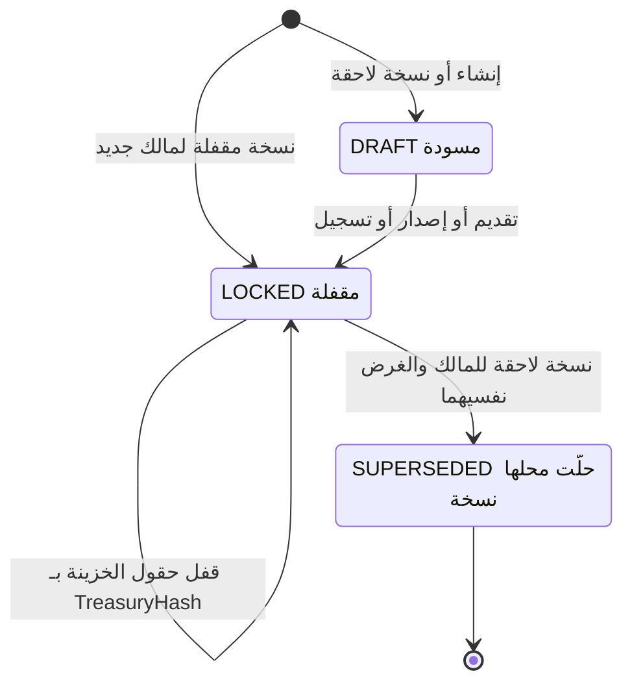

# DOC-F16 — مخططات حالات كيانات الاعتماد التابعة (التعديل والسحب والمبيعات والمخالفات والبروفورما)

| البند | القيمة |
|---|---|
| المعرّف | DOC-F16 (docs/30-readiness-documents.md) |
| الإصدار | 0.1 — مسودة للمراجعة — 2026-10-12 |
| المالك المقترح | مالك M7 وM8 |
| الأولوية | P1 قبل S3 |
| يغطي | FR-LCT-002، FR-LCT-031، FR-LCI-015، FR-LCI-018، FR-LCI-019، FR-LCI-023 إلى FR-LCI-025، FR-LCE-005، FR-LCE-007، FR-LCE-009، FR-LCE-013 إلى FR-LCE-021، BR-LCT-019، BR-LCI-011 إلى BR-LCI-013، BR-LCE-003، BR-LCE-007، BR-LCE-009 إلى BR-LCE-017، AC-LCI-2، AC-LCE-1 إلى AC-LCE-3، DR-41، DR-42، DR-46 |
| يعتمد على | DOC-F12 (تسلسل الإصدار والتعديل والحجز)، DOC-F08 (حالة الطلب)، DOC-F10 (مراحل القوالب)، DOC-F14 (الحجز والاستغلال)، DOC-F17 (الأحداث والمهام)، DOC-B04 (نموذج الأخطاء)، DOC-B05 (بذر الصلاحيات) |
| المصادر | db/model/16-letters-of-credit.model، docs/10-detailed-analysis/14-m7-m8-letters-of-credit.md، docs/10-detailed-analysis/13-m6-workflow-engine-notifications.md، db/generated/tsql/005_delete_grants.sql، db/generated/tsql/007_table_grants.sql، docs/21-data-dictionary.md، docs/review/design-review-2026-10-11.json |

## 1. الغرض والنطاق

تعطي الوثيقة لكل عمود حالة في وحدة الاعتمادات مخطط حالات وجدول انتقالات. كل صف في الجدول يذكر المشغّل والصلاحية والحارس والتدقيق أو الحدث. وتجرد كل تعدادات الحالة في النموذج بالملف والسطر، وتسجّل عدم التطابق بين قوائم المواصفة وتعدادات النموذج.

**داخل النطاق:** LcTerms، LcAmendment، LcDrawing (استيراد وتصدير)، LcDiscrepancy، اعتماد المبيعات المستلَم، LcSalesOrder، طلب مستندات التحصيل، ProformaInvoice، LcTermsComparison، وحالات الكتالوجات باختصار.

**خارج النطاق:**

| الموضوع | الوثيقة المالكة |
|---|---|
| مخطط اعتماد المشتريات الرئيسي، وهو مرسوم في 14:520-530 | يُستعمل كما هو؛ والفروق في §8 |
| التسلسلات بين الخدمات والمعاملات | DOC-F12 |
| LimitReservation وUtilization (m13:281، m13:256) | DOC-F14 |
| حالة الطلب وReservationState (m15:257، m15:296) | DOC-F08 |
| مراحل القوالب | DOC-F10 |
| المهام المجدولة والمُرسِل | DOC-F17 |

**الوسوم:** 🟢 موجود في المستودع أو الوثائق مع الملف والسطر. 🟡 اقتراح.

**اختصارات المراجع:** «14» هو docs/10-detailed-analysis/14-m7-m8-letters-of-credit.md، و«13» هو docs/10-detailed-analysis/13-m6-workflow-engine-notifications.md. و«m16» هو db/model/16-letters-of-credit.model، و«m13» هو db/model/13-facilities-pricing-terms.model، و«m15» هو db/model/15-workflow-notifications.model، و«m10» هو db/model/10-platform.model. و«005» و«006» و«007» ملفات db/generated/tsql بالأرقام نفسها. وDR-nn نتائج docs/review/design-review-2026-10-11.json. و«DOC-xxx:n» السطر n من الوثيقة في docs/30-readiness/.

## 2. جرد تعدادات الحالة

| العمود | القيم في النموذج | النموذج | المواصفة | التطابق | القسم |
|---|---|---|---|---|---|
| LetterOfCredit.Status | ACTIVE، EXPIRED، CLOSED، CANCELLED | m16:397 | 14:421، 14:520-530 | مطابق | §8 |
| LcTerms.Status | DRAFT، LOCKED، SUPERSEDED | m16:166 | 14:407، 14:534 | مطابق، مع استثناء الخزينة (§13 البند 12) | §4 |
| LcTerms.Purpose | PROFORMA، APPLICATION، ISSUED، RECEIVED، AMENDMENT | m16:164 | 14:84، 14:407 | مطابق | §4 |
| LcAmendment.Status | DRAFT، REQUESTED، BANK_ISSUED، APPLIED، REJECTED، WITHDRAWN | m16:498 | 14:423، 14:536 | القيم مطابقة والانتقالات ناقصة | §5 |
| LcAmendment.BeneficiaryResponse | PENDING، ACCEPTED، REJECTED | m16:501 | 14:423؛ 13:344 | 13:344 يذكر «سحب» ردًا | §5 |
| LcAmendment.Origin | OUR_REQUEST، RECEIVED_FROM_CUSTOMER | m16:489 | 14:423 | مطابق | §5 |
| LcAmendment.ChangeKinds | ستة أنواع بنوع set | m16:490 | 14:423 بنوع json | النوع مختلف | §5 |
| LcDrawing.Status | PRESENTED، DISCREPANT، ACCEPTED، SETTLED، REFUSED، CANCELLED | m16:533 | 14:424، 14:537 | القيم مطابقة؛ FR-LCE-019 يخالف §8 | §6 |
| LcDiscrepancy.Status | OPEN، WAIVED، CORRECTED، REFUSED | m16:598 | 14:426، 14:540 | مطابق | §7 |
| LcDiscrepancy.Source | BANK_NOTICE، INTERNAL | m16:596 | 14:426 | مطابق | §7 |
| LcSalesOrder.Status | EARMARKED، PARTIALLY_CONVERTED، CONVERTED، RELEASED، CANCELLED | m16:566 | 14:427، 14:538 | مطابق؛ العكس بعد الإغلاق غير مغطى | §9 |
| ProformaInvoice.Status | ISSUED، VOID، SUPERSEDED | m16:636 | 14:428، 14:539 | مطابق | §11 |
| LcTermsComparison.Status | OPEN، REVIEWED | m16:684 | 14:414 | مطابق | §12 |
| LcTermsComparisonLine.Verdict | MATCH، MORE_FAVOURABLE، LESS_FAVOURABLE، ADDED، MISSING، REVIEW | m16:693 | 14:415، 14:253 | مطابق | §12 |
| LcTermsComparisonLine.Decision | ACCEPT، REQUEST_AMENDMENT، IGNORE | m16:694 | 14:415 | مطابق | §12 |
| LcFormTemplate.Status | DRAFT، ACTIVE، RETIRED | m16:362 | 14:411 | مطابق | §12 |
| LcFormTemplate.LegalReviewStatus | UNREVIEWED، REVIEWED | m16:361 | 14:411 | مطابق | §12 |
| LcDocumentClause.Status | ACTIVE، RETIRED | m16:140 | 14:409 | مطابق | §12 |
| LcDocumentClause.LegalReviewStatus | UNREVIEWED، REVIEWED | m16:137 | 14:409 | مطابق | §12 |
| ref.UcpArticle.VerificationStatus | UNVERIFIED، VERIFIED | m16:51 | 14:405 | مطابق | §12 |
| ref.Incoterm.Status | ACTIVE، LEGACY | m16:37 | 14:127 | المواصفة لا تسمّي التعداد | §12 |
| Counterparty.IsActive وMergedIntoId | منطقي ومرجع | m16:113-114 | 14:254 | ليس تعدادًا | §12 |

لا يوجد عمود حالة في LcDrawingAllocation (m16:583-591) ولا في LcExternalRef (m16:473-483، وفيه IsActive) ولا في ProformaLine (m16:661-674).

## 3. اصطلاحات الجداول

- **الأعمدة:** # · الانتقال · المشغّل · الصلاحية · الحارس · التدقيق والحدث.
- **الصلاحيات** 🟢 من مصفوفة الأدوار في 14:46-75. بذرها في الكتالوج يتبع DOC-B05.
- **الحدث:** رموز الإشعار من 14:596-609، وأحداث Outbox من 14:655.
- **التدقيق** 🟡: صف aud.AuditLog بفئة TREASURY (m10:310)، والفعل بحروف كبيرة مثل LC_AMENDMENT_APPLIED (m10:309). الشدة HIGH للأفعال في 14:670، وكل تغيير في LetterOfCredit يحمل القيمتين القديمة والجديدة (14:670).
- **«النظام»:** خطاف أو مهمة بحساب الخدمة A-05 (DOC-F01) وسياق مربوط (DOC-F04).
- **الحارس** يشمل رموز V من 14:549-592 وقيود CHECK في النموذج.

🟢 **ما تفرضه القاعدة اليوم:** قيود CHECK تربط كل حالة بأعمدتها، مثل m16:520-521 وm16:550-551 وm16:576-581. لا شيء يمنع الانتقال من حالة إلى أخرى غير مسموحة. tp_app يملك SELECT وINSERT وUPDATE على كل جداول lc (007:375-405)، ولا قادح على جداول lc (القوادح الوحيدة في db/static/030_session_context.sql:245 وdb/static/050_fac_share_rule.sql:26). DR-41 مفتوح.

🟡 **قاعدة التنفيذ المقترحة:** كل انتقال يمر بدالة خدمة واحدة للكيان. تكتب `UPDATE ... WHERE Id = @id AND Status IN (@from) AND RowVersion = @rv`. صفر صفوف يعني 409 برمز جديد INVALID_STATE إن تغيّرت الحالة، أو VERSION_CONFLICT إن تغيّر RowVersion فقط (DQ-F16-1؛ DOC-B04:187).

## 4. شروط الاعتماد LcTerms

| # | الانتقال | المشغّل | الصلاحية | الحارس | التدقيق والحدث |
|---|---|---|---|---|---|
| 1 | بداية إلى DRAFT | الطالب ينشئ طلب PURCHASE_LC أو PROFORMA_REQUEST | `req.create` و`lc.terms.edit` (14:48-49) | الغرض يطابق المالك والجانب (m16:269-270) | RequestAction؛ لا تدقيق لكل حفظ 🟡 |
| 2 | DRAFT إلى LOCKED | خطاف `lc.validate_terms` على SUBMIT أو RESUBMIT (14:307) | صلاحية المقدِّم | لا قاعدة E في 14:549-569؛ وقيود غير DRAFT (m16:272-297) | Outbox `lc.terms.locked` (14:655)؛ 🟡 TERMS_LOCKED |
| 3 | LOCKED إلى LOCKED | موافقة TM في TM_APPROVAL | `req.treasury.approve` (14:56) | TreasuryHash فارغ قبلها (m16:255، m16:273) | 🟡 TERMS_TREASURY_LOCKED |
| 4 | LOCKED إلى SUPERSEDED | إرجاع للطالب (BR-LCI-002، 14:261)، أو تعديل خزينة بعد الموافقة (BR-LCI-006، 14:265) | `lc.terms.treasury.edit` (14:54) للخزينة | النسخة الجديدة VersionNo+1 وSupersedesTermsId (m16:266)؛ نسخة جارية واحدة لكل مالك وغرض (m16:263)، فالانتقالان في معاملة واحدة | 🟡 TERMS_SUPERSEDED مع ChangeReason؛ تعليق ظاهر للطالب (14:165) |
| 5 | بداية إلى LOCKED | `lc.record_issuance` (ISSUED)، `lc.issue_proforma` (PROFORMA على البروفورما)، تسجيل اعتماد مستلَم (RECEIVED) | `lc.issuance.record` أو `lc.proforma.issue` أو `lc.export.record` (14:58-61) | CopiedFromTermsId (m16:259)؛ التجزئة وLockedAt (m16:272) | ضمن حدث الكيان المالك |
| 6 | شروط AMENDMENT | DRAFT عند إنشاء الطلب الفرعي، وLOCKED عند التقديم 🟡 (DOC-F12 DQ-F12-3) | `lc.child.create` (14:62) | الغرض AMENDMENT لمالك REQUEST أو AMENDMENT (m16:269) | تصير الشروط الحالية للاعتماد عند APPLIED (m16:413) |

ملاحظات:

- 🟢 BR-LCT-019 يُبقي حقول الخزينة قابلة للتحرير في نسخة LOCKED حتى موافقة TM (14:251). فالقفل يثبّت حقول الطالب وحدها حتى يُكتب TreasuryHash. أي حارس قاعدة لـ DR-41 يجب أن يسمح بهذا الاستثناء (DQ-F16-14).
- 🟢 لا انتقال من DRAFT إلى SUPERSEDED في المواصفة (14:534). 🟡 المسودة المتروكة تبقى DRAFT مع طلبها المؤرشف.
- 🟢 شروط ISSUED لا تصير SUPERSEDED عند تطبيق تعديل، لأن شروط التعديل مالكها وغرضها مختلفان (m16:263). يتغير مؤشر CurrentTermsId فقط.
- 🟢 DR-42 مفتوح: لا شيء يربط CurrentTermsId وTermsId بمالكها (m16:162-163، m16:413). 🟡 حتى يُحسم، تفحص الخدمة المالك والغرض عند كل ربط.

## 5. تعديل الاعتماد LcAmendment

(قيد الكتابة)

## 6. السحب وتقديم المستندات LcDrawing

(قيد الكتابة)

## 7. المخالفات LcDiscrepancy

(قيد الكتابة)

## 8. اعتماد المبيعات المستلَم

(قيد الكتابة)

## 9. أمر البيع LcSalesOrder

(قيد الكتابة)

## 10. التحصيل: طلب مستندات التحصيل

(قيد الكتابة)

## 11. البروفورما ProformaInvoice

(قيد الكتابة)

## 12. المقارنة والكتالوجات

(قيد الكتابة)

## 13. عدم التطابق بين المواصفة والنموذج

(قيد الكتابة)

## 14. القرارات المطلوبة

(قيد الكتابة)

## 15. تعارضات وفجوات في المصادر

(قيد الكتابة)

## 16. التتبع

(قيد الكتابة)
