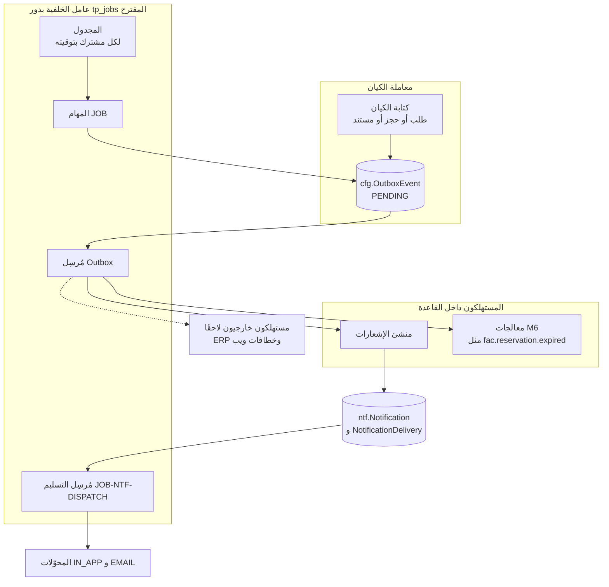
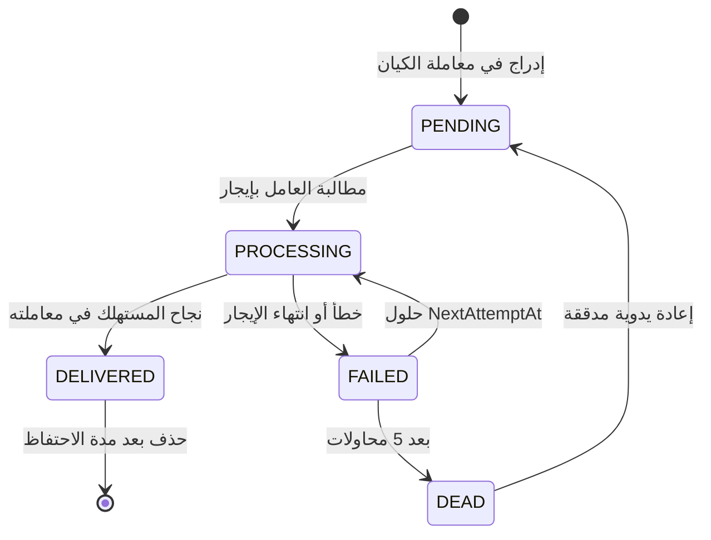
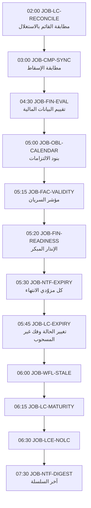
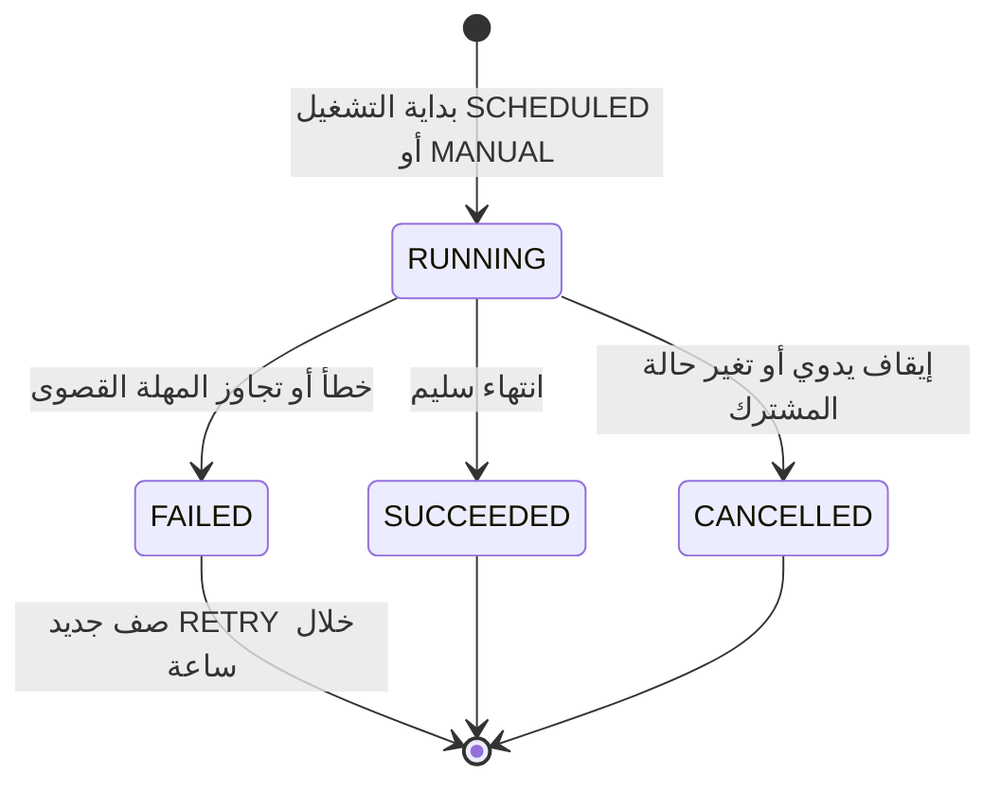
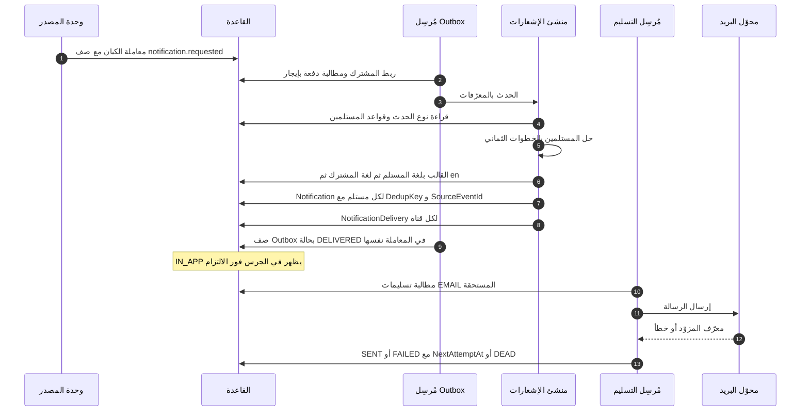
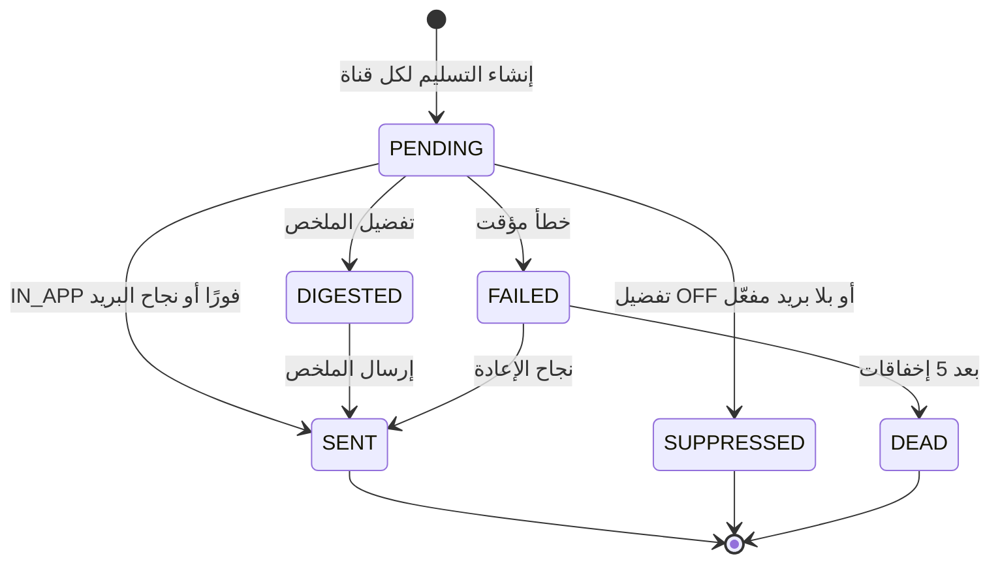

# DOC-F17 — تدفقات الأحداث غير المتزامنة: Outbox والمهام المجدولة ومسار الإشعار

| البند | القيمة |
|---|---|
| المعرّف | DOC-F17 (docs/30-readiness-documents.md) |
| الإصدار | 0.1 — مسودة للمراجعة — 2026-10-12 |
| المالك المقترح | مهندس الخلفية والتكامل |
| الأولوية | P1 قبل S2 (يعطّل S1 للإشعارات الأساس والأحداث، وS2 لمزوّدي الانتهاء) |
| يغطي | FR-PLT-038، FR-PLT-040، FR-PLT-042، FR-PLT-044، BR-PLT-002، BR-PLT-013، FR-NTF-001…024، BR-NTF-001…014، FR-WFL-018، FR-WFL-038، D-10، NFR-OPS-03، NFR-OPS-04، NFR-I18N-07، THR-32، THR-33، THR-55، DR-14 وDR-50 (design-review) |
| يعتمد على | DOC-F04 (ربط المهمة بالمشترك، DQ-F04-4)، DOC-F05 (المؤقتات الزمنية للمشترك)، DOC-F10 وDOC-F11 (مصادر الأحداث)، DOC-B03 (NFR-OPS وNFR-I18N)، DOC-B10 (اللغة)، DOC-S01 (التهديدات)، DOC-S08 (حسابات القاعدة)، DOC-S12 (السجلات والمراقبة) |
| المصادر | db/model/10-platform.model، db/model/15-workflow-notifications.model، db/generated/tsql/005_delete_grants.sql، db/generated/tsql/007_table_grants.sql، docs/10-detailed-analysis/10-m0-m1-platform-organization.md، docs/10-detailed-analysis/13-m6-workflow-engine-notifications.md، docs/10-detailed-analysis/14-m7-m8-letters-of-credit.md، docs/21-data-dictionary.md، docs/20-database-design.md، docs/review/design-review-2026-10-11.json |

> **تحديث التنفيذ (2026-10-12):** قائمة JobKey المغلقة (DQ-F17-2) جدول `cfg.JobDefinition` مبذور بالمهام التسع والعشرين في §5.2 ومعها JOB-PLT-ONBOARD، ثم JOB-PLT-EXPORT (ADR 0008)، ثم JOB-PLT-RECONCILE (ADR 0011، DR-44؛ 32 مهمة)، بنطاق كل مهمة وحالات المشترك المسموحة، و`sec.usp_SetJobContext` يرفض غيرها (docs/adr/0004-platform-access-jobs-and-onboarding.md، db/static/037_job_context.sql؛ الاختبارات J1 إلى J7، وJ7 تدقيق الربط). ومهمتا JOB-PLT-TRIAL-EXPIRE وJOB-PLT-ARCHIVE تستدعيان `plat.usp_RunTenantTransitions`.

## 1. الغرض والنطاق

تصف هذه الوثيقة كل ما يجري خارج طلب المستخدم: الحدث يُكتب في Outbox داخل معاملة الكيان، ثم يسلّمه عامل. والمهام المجدولة تعمل لكل مشترك بتوقيته. والإشعار يمر من الحدث إلى القاعدة إلى المستلم إلى القناة.

خارج النطاق: تفصيل ربط الاتصال بالمشترك (DOC-F04 §5، ونلخصه هنا)، ودورة حياة المشترك (DOC-F05)، ومحتوى كل حدث في الكتالوج (13-m6 §9.2)، والسجلات التشغيلية والمراقبة (DOC-S12)، ومزوّد البريد (Q-NTF-01، غير مختار).

اختصار المسار: «10-m0-m1» و«11-m2-m4» و«12-m5» و«13-m6» و«14-m7-m8» لملفات docs/10-detailed-analysis، و«10.model» و«15.model» لملفي db/model.

الرموز: 🟢 قائم في المستودع أو مقرَّر في الوثائق، 🟡 مقترح ينتظر القرار.

## 2. ما يوجد اليوم 🟢

| البند | الوضع | المصدر |
|---|---|---|
| cfg.OutboxEvent | جدول مشترك تحت RLS: MessageId فريد لكل مشترك، وEventName نقطي، وStatus بخمس قيم، وAttemptCount وNextAttemptAt وLockedBy وLockedUntil | 10.model:532-552؛ docs/21-data-dictionary.md:899 |
| فهرس الإرسال | (Status, NextAttemptAt) مصفّى على PENDING وFAILED، ولا فهرس على LockedUntil | 10.model:548؛ DR-14 |
| حذف Outbox | `tp_app` يملك DELETE على cfg.OutboxEvent وcfg.JobRun | db/generated/tsql/005_delete_grants.sql:17-18 |
| cfg.JobRun | جدول مشترك: JobKey وTriggerKind وStatus وAttemptNo وNextRetryAt؛ بلا مفتاح موعد ولا فرادة | 10.model:554-570؛ docs/21-data-dictionary.md:930 |
| تنبيهات الانتهاء | cfg.ExpiryAlertRule، وcfg.ExpiryAlertLog للإضافة فقط بفرادة (قاعدة، عنصر، تاريخ، نوع، عتبة) | 10.model:482-500 |
| الإشعارات | كتالوج وقواعد وقوالب وتفضيلات وملخصات وإشعار وتسليم | 15.model:527-658 |
| فرادة الإشعار | (UserId, DedupKey) حيث DedupKey غير فارغ؛ وSourceEventId بلا فرادة | 15.model:618، :623، :625 |
| لغة المستخدم والمشترك | AppUser.PreferredLanguage فارغها يعني لغة المشترك؛ Tenant.DefaultLanguage افتراضيها en؛ Tenant.TimeZone إلزامي | 10.model:120، :39-40 |
| حساب الخدمة | IsSystemUser بلا كلمة مرور ولا MFA | 10.model:123، :150 |

ما لا يوجد: عامل Outbox، ومجدول المهام، وطريق لربط المهمة بالمشترك. فحساب الخدمة لا يبدأ جلسة، والربط يشترط جلسة (DOC-F04 §5.1). هذا مانع لـ FR-PLT-044 في S0.

## 3. الصورة العامة

مبدآن:
1. الحدث يُكتب في معاملة الكيان نفسها، فلا حدث بلا كيان ولا كيان بلا حدث (FR-PLT-042، 10-m0-m1:144؛ FR-WFL-038، 13-m6:159).
2. المهام لا ترسل شيئًا مباشرة؛ تكتب أحداثًا وإشعارات، ويسلّمها المرسِلان.

## 4. Outbox

### 4.1 الكتابة داخل معاملة الكيان

| القاعدة | التفصيل | المصدر |
|---|---|---|
| الاسم | `domain.event_name` بحروف صغيرة | 10.model:534؛ docs/10-detailed-analysis/00-overview-and-cross-cutting.md:124 |
| الحمولة | معرّفات وقيم غير مقيّدة فقط | FR-PLT-042؛ FR-NTF-002، 13-m6:201 |
| المفاتيح | MessageId جديد، وAggregateType وAggregateId للكيان الجذر، وCorrelationId من الطلب الأصلي | 10.model:533-546 |
| الترتيب | يقفل الكاتب صف الجذر قبل الإدراج، فأحداث الجذر الواحد تأخذ OutboxEventId تصاعديًا بترتيب الالتزام 🟡 | DOC-F11 §6.1 |
| طلب الإشعار | واجهة Emit تكتب صفًا باسم مقترح `notification.requested`، وفي حمولته رمز الحدث (مثل REQ.RETURNED) والشركة والهدف وأجزاء DedupKey 🟡 | FR-NTF-002؛ 13-m6:498-511 |

### 4.2 حالات صف Outbox 🟡

قيود مقترحة من DR-14 (docs/review/design-review-2026-10-11.json:154): PROCESSING يلزمه LockedBy وLockedUntil، وDELIVERED يلزمه DeliveredAt، وDEAD يلزمه LastError، وفهرس مصفّى على (Status, LockedUntil) حيث PROCESSING.

### 4.3 العامل: الربط والمطالبة والإيجار 🟡

1. يطلب العامل معرّفات المشتركين التي فيها صفوف مستحقة، بإجراء مقترح `plat.usp_ListTenantsWithPendingOutbox` يعيد TenantId والعدد فقط (DQ-F17-1). ثم يربط اتصالًا لكل مشترك بـ `sec.usp_SetJobContext` (DOC-F04 §5.2، DQ-F04-4).
2. يطالب دفعة، 50 صفًا مثلًا، في جملة واحدة بتلميحات UPDLOCK وREADPAST وROWLOCK: الصفوف PENDING أو FAILED المستحقة، بترتيب OutboxEventId. يضبط PROCESSING وLockedBy وLockedUntil = الآن + 60 ثانية، ويزيد AttemptCount.
3. لكل صف: معاملة واحدة فيها أثر المستهلك وتحديث الصف إلى DELIVERED. التحديث مشروط بـ `LockedBy = العامل` وStatus = PROCESSING. صفر صفوف تعني أن الإيجار انتهى وأخذه غيره، فتُلغى المعاملة.
4. صفوف PROCESSING التي انتهى إيجارها تعود FAILED بسبب «انتهاء الإيجار»، وتُحتسب محاولة.
5. يغلق الاتصال بعد الدفعة، فيُمحى السياق (DOC-F04 §2 البند 5).

النتيجة: التسليم مرة على الأقل، والأثر داخل القاعدة مرة واحدة. فالمستهلك الداخلي يكتب أثره وحالة الصف في معاملة واحدة.

### 4.4 الترتيب

- لا ترتيب عام بين المشتركين ولا بين الجذور.
- داخل الجذر الواحد 🟡: لا يُطالَب بصف ما دام لجذره صف أقدم بحالة PENDING أو PROCESSING أو FAILED.
- DEAD لا يحجز ما بعده. المستهلك يقرأ الحالة الحالية من الكيان بالمعرّف، لا من الحمولة، فيتحمل الفجوة.
- الصف بلا AggregateId لا ترتيب له.

### 4.5 إعادة المحاولة والرسائل السامة 🟡 (DQ-F17-9)

| البند | القيمة |
|---|---|
| التراجع | 1 دقيقة، ثم 5، ثم 30، ثم ساعتان، ثم 12 ساعة، على نمط BR-NTF-009 (13-m6:292) |
| DEAD | بعد 5 محاولات فاشلة |
| الرسالة السامة | خطأ ثابت لا يزول بالإعادة: اسم حدث غير معروف، أو حمولة لا تُقرأ، أو خطأ برمجي. تصل DEAD بعد 5 محاولات ولا توقف غيرها |
| التنبيه | حدث JOB.FAILED لـ TA مرة لكل صف، ويظهر في شاشة المهام (13-m6:613؛ NFR-OPS-03) |
| الحفظ | DEAD لا يُحذف. نقترح DENY DELETE لـ `tp_app` وحذف DELIVERED بإجراء مهمة التنظيف فقط (THR-33، DR-14) |
| الإعادة اليدوية | DEAD إلى PENDING بـ AttemptCount = 0، بيد TA أو المشغّل، مع AuditLog |

### 4.6 المستهلكون متكررو الأمان

| المستهلك | مفتاح الأثر | سلوك التكرار |
|---|---|---|
| منشئ الإشعارات | (UserId, DedupKey) فريد (15.model:625) | يُدرج الإشعار بشرط عدم وجود المفتاح للمستخدم، والفرادة حارس أخير؛ الموجود يُتجاوز ويكمل الباقون (§6.3) |
| معالج `fac.reservation.expired` في M6 | حالة الطلب | RESERVED إلى LOST؛ وإن كان LOST أو RELEASED فلا أثر (13-m6:311) |
| المهام التي تكتب أحداثًا | مفتاح عدم التكرار للمهمة (§5.2) | لا تكتب الحدث مرتين للمفتاح نفسه |
| مستهلك خارجي لاحقًا | MessageId (10.model:533) | المستقبِل يتجاهل ما رآه (TB-11، DOC-F01) |

جدول «رسائل مستهلَكة» عام غير لازم الآن، لأن المستهلكين الداخليين يكتبون الأثر والحالة معًا. يُعاد النظر فيه مع أول مستهلك خارجي (DQ-F17-5).

### 4.7 التنظيف 🟡 (DQ-F17-10)

- DELIVERED يُحذف بعد 30 يومًا بمهمة JOB-PLT-OUTBOX-PURGE الأسبوعية.
- DEAD يبقى حتى يعالجه إنسان، ولا يُحذف آليًا.
- الحذف يدقَّق بعدد الصفوف في cfg.JobRun، لا بصف لكل حدث.

## 5. المهام المجدولة

### 5.1 ربط المهمة بالمشترك

نعتمد مقترح DOC-F04 §5.2 (DQ-F04-4) ولا نكرره:
- دور جديد `tp_jobs` لحساب العامل وحده، لا لحساب خادم الواجهة (DOC-S08).
- `plat.usp_ListTenantsForJobs` يعيد TenantId والحالة والمنطقة الزمنية فقط.
- `sec.usp_SetJobContext(@TenantId, @JobKey, @CorrelationId)` يربط الاتصال بحساب `IsSystemUser` النشط للمشترك، ويرفض بـ 50001 إلى 50004.
- كل ربط يُسجَّل في aud.AuditLog بالمعرّف JobKey، وكل تشغيل في cfg.JobRun.

ما تضيفه هذه الوثيقة 🟡:
1. JobKey قائمة مغلقة هي معرّفات JOB-* في §5.2. الإجراء يرفض غيرها (DQ-F17-2).
2. المهام نوعان: مهام مشترك تربط بالمشترك وتكتب جداوله، ومهام منصة لا تربط وتستدعي إجراءات منصة (§5.6).
3. المجدول يمر على المشتركين كل دقيقة، ويحسب لكل مشترك الموعد بتوقيته (10.model:40؛ 13-m6:633)، ويشغّل المهام المستحقة.
4. حالة المشترك تحدد المهام المسموحة بمصفوفة DOC-F04 §7.4: كل المهام في TRIAL وACTIVE؛ والتصدير وحده في SUSPENDED وCLOSED خلال 30 يومًا: JOB-PLT-EXPORT وJOB-PLT-EXPORT-EXPIRE (`RunsInStatuses` في db/seed/100_platform_global.sql). ولا مهمة لتنظيف الجلسات: الجلسة تنتهي بمهلتيها عند استعمالها، وتغيير الحالة يسحب الربوط بالقادح (db/static/030_session_context.sql). فأحداث Outbox لمشترك معلّق تبقى PENDING حتى يعود نشطًا (DQ-F17-12).

### 5.2 كتالوج المهام

| المهمة | النطاق | الموعد بتوقيت المشترك | الأثر | مفتاح عدم التكرار | المصدر |
|---|---|---|---|---|---|
| JOB-PLT-OUTBOX 🟡 | مشترك | مستمرة | مُرسِل cfg.OutboxEvent (§4) | MessageId | 10-m0-m1:144 |
| JOB-NTF-DISPATCH | مشترك | مستمرة | مُرسِل ntf.NotificationDelivery (§6.5) | DeliveryId | 13-m6:642 |
| JOB-WFL-SLA | مشترك | كل 5 دقائق | SlaState وأحداث AT_RISK وBREACHED | (مثيل المرحلة، العتبة) | 13-m6:637 |
| JOB-WFL-ASSIGN | مشترك | عند الحدث وكل ساعة | إعادة حل الإسنادات | (الطلب، الخانة، الدورة) | 13-m6:638 |
| JOB-WFL-DELEGATION | مشترك | كل ساعة وعند منتصف الليل | حالات التفويض | (التفويض، الحالة) | 13-m6:639 |
| JOB-WFL-STALE | مشترك | 06:00 | مسودات خاملة وحجوزات قديمة | (الطلب، النوع، الأسبوع) | 13-m6:640 |
| JOB-NTF-EXPIRY | مشترك | 05:30 | مزوّدو الانتهاء وأحداث العتبات | (العنصر، العتبة، ItemVersion) | 13-m6:641؛ 10-m0-m1:140 |
| JOB-NTF-REMIND | مشترك | كل ساعة في ساعات العمل | تذكير الإجراء المطلوب | (الإشعار، رقم التذكير) | 13-m6:643 |
| JOB-NTF-DIGEST | مشترك | 07:30 يوميًا، والأحد أسبوعيًا | الملخصات | (المستخدم، القناة، النوع، نهاية الفترة) | 13-m6:644؛ 15.model:596 |
| JOB-NTF-RETENTION | مشترك | أسبوعيًا | أرشفة المقروء بعد 180 يومًا | الإشعار | 13-m6:645 |
| JOB-FAC-VALIDITY وJOB-FAC-RESERVATION | مشترك | يومية 🟡 05:15، وكل ساعة | مؤشر السريان؛ انتهاء الحجوزات وتنبيهات T-7 وT-1 | — | 12-m5:522 |
| JOB-OBL-CALENDAR وJOB-FIN-EVAL وJOB-COL-DUE وJOB-CMP-SYNC | مشترك | يومية أو ليلية، والأوقات 🟡 في §5.3 | بنود الالتزامات والتقييم والمطابقة | — | 12-m5:522 |
| JOB-ACC-EXPIRY وJOB-ACC-GOV وJOB-CAT-STALE | مشترك | يومية أو ليلية | المفوّضون والحوكمة والأسعار المتقادمة | — | 11-m2-m4:522 |
| JOB-LC-RECONCILE وJOB-LC-EXPIRY وJOB-LC-MATURITY وJOB-LCE-NOLC | مشترك | 02:00 و05:45 و06:15 و06:30 | مطابقة؛ ACTIVE إلى EXPIRED وفك غير المسحوب؛ الاستحقاقات؛ بروفورما بلا اعتماد | (اعتماد، حالة) وغيرها | 14-m7-m8:615-618 |
| JOB-PLT-TRIAL-REMIND | مشترك في TRIAL | يومية | تنبيه نهاية التجربة 7 و3 و1 | (المشترك، الأيام) | DOC-F05 §6.3 |
| JOB-PLT-TRIAL-EXPIRE وJOB-PLT-ARCHIVE | منصة | يومية | TRIAL إلى SUSPENDED؛ CLOSED إلى ARCHIVED_READ_ONLY | (المشترك، التاريخ) | DOC-F05 §6.3 |
| JOB-PLT-EXPORT-EXPIRE | مشترك، ومسموحة في SUSPENDED وCLOSED | يومية | READY إلى EXPIRED وحذف الحزمة | DataExportJobId | DOC-F05 §6.3 |
| JOB-PLT-EXPORT (أُضيفت 2026-10-13، ADR 0008) | مشترك، ومسموحة في SUSPENDED وCLOSED خلال النافذة | عند وجود طلب معتمد | بناء الحزمة المختومة: APPROVED إلى RUNNING إلى READY أو FAILED | DataExportJobId | FR-PLT-039، DQ-F04-8 |
| JOB-PLT-OUTBOX-PURGE وJOB-PLT-JOBRUN-PURGE 🟡 | مشترك | أسبوعيًا | حذف DELIVERED بعد 30 يومًا، وJobRun بعد 90 يومًا | (المهمة، الأسبوع) | §4.7، §5.7 |
| JOB-PLT-RECONCILE (أُضيفت 2026-10-13، ADR 0011؛ ✅ اعتمدها المالك 2026-10-14) | مشترك | ليلية 🟡 | تقرأ `wfl.RequestCopyDrift` و`lc.ProformaTotalsDrift`؛ كل صف حادثة تُبلَّغ ولا تُصلَح آليًا (DR-44، DR-41) | (المشترك، التاريخ) | 044_entry_guards.sql |
| JOB-FIN-READINESS (أُضيفت 2026-10-20، ADR 0027) | مشترك | 05:20 | الإنذار المبكر: `fin.usp_RunEarlyWarnings` يكتب `fin.EarlyWarningAlert` وصف `notification.requested` بالحدث FIN.READINESS_RED أو FIN.READINESS_AMBER في معاملة واحدة، وقيم قوالب الرسالة في `fin.v_EarlyWarningMessageValues` (ADR 0028) | (الشركة، نوع الموعد، المرجع، التاريخ، المرحلة، الجاهزية) | 051_early_warning_job.sql |
| JOB-PLT-AUDIT-CHAIN (أُضيفت 2026-10-21، ADR 0033) | منصة | يومية | تسجيل رأس كل سلسلة تدقيق تحركت (`aud.usp_TakeAuditAnchors`)، ونسخه إلى المخزن غير القابل للتعديل، والتحقق من كل سلسلة مقابل آخر مرساة فيه (`aud.usp_VerifyAuditChain`) بأداة `tools/deploy/audit_anchor.sh`؛ والفشل حدث منصة بخطورة عالية ينبّه عليه AL-12 | (السلسلة، الرقم) | 055_audit_chain.sql؛ DOC-S12 §5.3 |

المهمة اليومية لإطار FR-PLT-038 هي JOB-NTF-EXPIRY نفسها 🟡: تستدعي كل مزوّدي `IExpiryProvider` (FR-NTF-017، 13-m6:216)، ومنها مزوّدات 10 و11 و12 و14. ويقترح تعليق النموذج اسم EXPIRY_ALERTS (10.model:555)، فنوحّد على JOB-NTF-EXPIRY (DQ-F17-2).

### 5.3 الترتيب اليومي 🟡

المواعيد 02:00 و05:30 و05:45 و06:00 و06:15 و06:30 و07:30 من المصادر (13-m6:640-644؛ 14-m7-m8:615-618). الباقية مقترحة.

قواعد الاعتماد 🟡 (DQ-F17-3):
1. JOB-NTF-EXPIRY يقرأ نتائج JOB-OBL-CALENDAR وJOB-FAC-VALIDITY، فيأتي بعدهما.
2. مزوّد انتهاء الاعتماد يحسب بالتاريخ لا بالحالة. فلا يهم أن JOB-LC-EXPIRY يغيّر الحالة بعده بربع ساعة.
3. تنبيه «منتهٍ» يصدر من JOB-NTF-EXPIRY وحده. JOB-LC-EXPIRY يغيّر الحالة ويفك غير المسحوب ولا يصدر تنبيه انتهاء، فلا يتكرر التنبيه.
4. JOB-NTF-DIGEST آخر السلسلة، ليضم تنبيهات الصباح.
5. إن لم ينجح السابق اليوم، يعمل اللاحق على البيانات المخزّنة، ويسجّل تحذيرًا في DetailJson. المهام متكررة الأمان، فالتشغيل التالي يصحح.

### 5.4 سجل التشغيل وحالاته

- كل تشغيل صف في cfg.JobRun بحالته ومدته ونتيجته، ظاهر لـ TA (FR-PLT-044، 10-m0-m1:146؛ NFR-OPS-03).
- الفشل يُعاد خلال ساعة بصف جديد TriggerKind = RETRY وAttemptNo + 1 (10.model:556-562). نقترح 3 إعادات ثم حدث JOB.FAILED لـ TA (13-m6:613).
- فشل مشترك لا يوقف غيره، ولكل مهمة مهلة قصوى (BR-NTF-010، 13-m6:293).
- صف RUNNING بلا نهاية بعد المهلة القصوى يُغلق FAILED عند التشغيل التالي 🟡.

### 5.5 عدم التكرار وتعويض التوقف

- كل مهمة تحسب من حالة مخزّنة لا من الذاكرة، ولها مفتاح عدم تكرار (13-m6:635-645؛ BR-NTF-010).
- التوقف ثلاثة أيام ثم التشغيل لا يرسل ثلاث نسخ (FR-NTF-016، 13-m6:215). فالمهمة تعمل مرة واحدة عن المواعيد الفائتة 🟡.
- cfg.JobRun لا يمنع تشغيلين للموعد نفسه. نقترح عمود ScheduledFor وفرادة (JobKey, ScheduledFor) لكل مشترك، فلا يشغّل عاملان الموعد نفسه (DQ-F17-4).
- المهام المستمرة تأخذ قفل تطبيق `sp_getapplock` باسم المهمة والمشترك، فلا يعمل منها اثنان معًا 🟡.

### 5.6 الانتقالات الزمنية للمشترك

| الانتقال | المهمة | كيف تعمل | المصدر |
|---|---|---|---|
| TRIAL إلى SUSPENDED بعد TrialEndsOn | JOB-PLT-TRIAL-EXPIRE | مهمة منصة تستدعي `plat.usp_RunTenantTransitions` (db/static/038_tenant_onboarding.sql)، لا `plat.usp_SetTenantStatus` الذي يشترط مدير مشغّلين بتحقق MFA حديث؛ والإجراءان يمرّان بـ `plat.usp_ApplyTenantStatus`، والانتقال يسحب كل الربوط بالقادح القائم | DOC-F05 §6.3؛ db/static/030_session_context.sql:285-296 |
| CLOSED إلى ARCHIVED_READ_ONLY بعد 30 يومًا | JOB-PLT-ARCHIVE | الإجراء نفسه، `plat.usp_RunTenantTransitions` | DOC-F05 §6.3؛ BR-PLT-002، 10-m0-m1:228 |

مهام المنصة لا تكتب cfg.JobRun لأنه جدول مشترك. تُسجَّل في aud.AuditLog (DQ-F05-6)، ونقترح جدول منصة لتشغيلاتها على نمط DQ-B05-1.

### 5.7 الاحتفاظ

| البيانات | القاعدة | المصدر |
|---|---|---|
| الإشعار المقروء | أرشفة بعد 180 يومًا؛ الإلزامي غير المقروء لا يُؤرشف | FR-NTF-020، BR-NTF-011 |
| cfg.OutboxEvent | DELIVERED بعد 30 يومًا 🟡؛ DEAD يبقى | §4.7 |
| cfg.JobRun | 90 يومًا 🟡 | — |
| wfl.RequestAction وaud.AuditLog وcfg.ExpiryAlertLog | لا حذف؛ الإتلاف بسير FR-PLT-040 فقط | 10-m0-m1:142؛ db/generated/tsql/005_delete_grants.sql:47، :50 |

## 6. مسار الإشعار

### 6.1 من الحدث إلى القناة

قرار المسار 🟡 (DQ-F17-6): Emit لا ينشئ الإشعارات في معاملة الكيان. يكتب صف Outbox فقط، فتبقى معاملة الكيان قصيرة، ولا يُبطئها حل المستلمين. الكلفة تأخير ثوانٍ قبل ظهور الإشعار.

NFR-OPS-04 يطلب وصول الحدث الأمني الفوري خلال دقيقة (DOC-B03 §8؛ AC-NTF-3). فنقترح أن يمر مُرسِل Outbox على المشتركين كل 10 ثوانٍ على الأكثر (DQ-F17-11).

### 6.2 حل المستلمين

الخطوات بالترتيب (BR-NTF-001، 13-m6:284؛ FR-NTF-004):

| # | الخطوة | التفصيل والنموذج |
|---|---|---|
| 1 | مرشحون من القواعد | NotificationRule.RecipientKind: ROLE وPERMISSION وUSER وREQUESTER وREQUESTER_MANAGER وASSIGNEE وSTAGE_APPROVERS وDEPARTMENT_HEAD (15.model:552)؛ ولتنبيهات الانتهاء ExpiryAlertRule.RecipientRoles (10.model:485) |
| 2 | الفعّالون غير المؤرشفين | حساب الخدمة IsSystemUser مستبعد دائمًا 🟡 |
| 3 | نطاق الشركة | يبقى من يشمل نطاقه شركة الحدث؛ RequireCompanyScope (15.model:557)؛ الحدث بلا شركة يتجاوز الخطوة |
| 4 | صلاحية عرض الهدف | BR-REQ-013؛ الداخلي يتطلب `req.view.internal`؛ والطالب لا يصله حدث داخلي (BR-NTF-013، 13-m6:296) |
| 5 | استبعاد الفاعل | ما لم يُفعَّل «أشعرني بأفعالي» |
| 6 | المفوَّضون | يُضاف المفوَّضون النشطون (UserDelegation ACTIVE) |
| 7 | التفضيلات | NotificationPreference لكل (مستخدم، مجموعة، قناة): IMMEDIATE أو DIGEST_DAILY أو DIGEST_WEEKLY أو OFF (15.model:576-581)؛ الإلزامي يتجاوزها في التطبيق فقط (BR-NTF-003) |
| 8 | إزالة التكرار | مستخدم واحد مرة واحدة |

FR-NTF-003 يجعل تغيير القواعد يسري على الأحداث التالية فقط (13-m6:202). المنشئ يقرأ القواعد وقت المعالجة، فحدث كُتب قبل التغيير بثوانٍ قد يأخذ القاعدة الجديدة. نقبل هذا الفارق 🟡.

### 6.3 مفتاح عدم التكرار

- الصيغة `{EventCode}:{TargetType}:{TargetId}:{Threshold أو Cycle}:{ItemVersion}`، فريدة لكل مستخدم (BR-NTF-002، 13-m6:285؛ 15.model:618، :625).
- إعادة تسليم Outbox لا تكرر الإشعار في المسار العادي، لأن الإشعار وحالة الصف يُكتبان في معاملة واحدة بشرط الإيجار (§4.3).
- يبقى خطر حدثين مختلفين بالمعنى نفسه، أو مستهلك يخالف النمط. DR-50 (و) مفتوح: DedupKey قابل للفراغ وSourceEventId بلا فرادة (docs/review/design-review-2026-10-11.json:525-527).
- نقترح DedupKey إلزاميًا 🟡. وحين لا مفتاح أعمال للحدث: `{EventCode}:{TargetType}:{TargetId}:msg:{MessageId}` (DQ-F17-7).
- ItemVersion لمزوّدات التاريخ = تاريخ الانتهاء بصيغة yyyymmdd. فالتجديد يعيد ضبط العتبات (BR-NTF-002)، ويطابق ExpiryDate في cfg.ExpiryAlertLog (10.model:497) 🟡.
- طبقتا التنبيه بالانتهاء تبقيان: السجل يمنع إعادة إصدار الحدث للعنصر والعتبة، وDedupKey يمنع التكرار للمستخدم.
- التجميع في نافذة 15 دقيقة يزيد CoalescedCount في إشعار المستخدم غير المقروء للنوع والهدف نفسيهما، في المعاملة نفسها (BR-NTF-005). الإلزامي وعالي الشدة لا يُجمَّع (15.model:548).

### 6.4 القوالب واللغة

1. لغة المستلم L = PreferredLanguage، وإلا DefaultLanguage للمشترك (FR-PLT-034، 10-m0-m1:136؛ 10.model:120، :39).
2. القالب: (الحدث، القناة، L، تجاوز المشترك)، ثم (الحدث، القناة، L، البذرة)، ثم الشيء نفسه بالإنجليزية (15.model:567-574).
3. الرجوع إلى الإنجليزية، لغة الواجهة الأساس (NFR-I18N-07؛ DQ-B02-2؛ DQ-B03-8؛ docs/30-readiness/DOC-B10-glossary-en-ar.md:17). هذا يخالف نص FR-NTF-024 الذي يرجع إلى العربية (13-m6:223)، والموقف في DQ-F17-8.
4. فحص آلي مقترح 🟡: لكل نوع حدث قالب IN_APP إنجليزي في البذور، لأنه الملاذ الأخير.
5. يُصاغ العنوان والنص عند الإنشاء ويُخزَّنان بلغة المستلم (15.model:608-609). تغيير اللغة لاحقًا لا يعيد صياغة القديم.
6. العناصر النائبة من القائمة البيضاء للحدث فقط (AllowedPlaceholdersJson، 15.model:537؛ BR-NTF-008). لا قيمة مقيّدة في العنوان أو النص أو الحمولة (FR-NTF-021).
7. الرابط العميق يتطلب دخولًا ولا يحمل رمزًا (13-m6:693).

### 6.5 التسليم وحالاته

- تسليم واحد لكل قناة (15.model:649). FAILED يلزمه NextAttemptAt، وDIGESTED يلزمه DigestBatchId (15.model:656-657).
- التراجع 1د و5د و30د و2س و12س، ثم DEAD وإشعار واحد لـ TA بحدث NTF.DELIVERY_DEAD (BR-NTF-009، 13-m6:292؛ 13-m6:538، :613).
- إخفاق البريد لا يمس الإشعار داخل التطبيق (BR-NTF-009). البريد في S5، ومزوّده غير مختار (FR-NTF-013؛ Q-NTF-01، 13-m6:737).
- البريد للخارج مرة على الأقل. انهيار بين الإرسال وتحديث الحالة قد يكرر رسالة واحدة، وهذا مقبول 🟡.

### 6.6 التجميع والملخص والتذكير

| الآلية | القاعدة | النموذج |
|---|---|---|
| الملخص | JOB-NTF-DIGEST يضم غير المقروء وغير المحلول من غير الإلزامي؛ لا يُرسل فارغًا (BR-NTF-004) | ntf.DigestBatch فريد (المستخدم، القناة، النوع، نهاية الفترة)؛ SENT يلزمه عناصر (15.model:596، :600-601) |
| التذكير | 24 ثم 48 ثم 72 ساعة عمل بالدالة AddBusinessHours، بحد 3؛ لا يُرسل خارج ساعات العمل؛ يتوقف بالحل (BR-NTF-006) | ReminderCount بين 0 و3، وNextReminderAt للمفتوح فقط (15.model:620-621، :636-637) |
| الحل | «يلزم إجراء» يصير RESOLVED عند إنجاز المهمة من أي مؤهل أو مفوَّض، في معاملة الإجراء (FR-NTF-007؛ DOC-F11 DQ-F11-8) | ActionState وResolvedAt (15.model:614-615، :634) |
| الأرشفة | JOB-NTF-RETENTION يؤرشف المقروء بعد 180 يومًا؛ الإلزامي غير المقروء لا يُؤرشف (BR-NTF-011) | ArchivedAt (15.model:617) |

## 7. الأمن والعزل

| التهديد | الضابط المقترح | المصدر |
|---|---|---|
| THR-32 مهام بلا مسار ربط | `tp_jobs` و`sec.usp_SetJobContext` وقائمة JobKey مغلقة | DOC-S01؛ DOC-F04 §5.2 |
| THR-33 حذف أحداث DEAD | DENY DELETE لـ `tp_app`، والحذف بمهمة التنظيف لـ DELIVERED فقط | db/generated/tsql/005_delete_grants.sql:17؛ DR-14 |
| THR-55 تسرب المقيّد عبر الحمولة | مخطط حمولة بقائمة سماح لكل EventName، وفحص في CI؛ Emit يرفض الحقل المحظور ويسجّله | DOC-F02 §10؛ FR-NTF-002، 13-m6:201 |
| خلط المشتركين في العامل | اتصال لكل مشترك، يُغلق بعد الدفعة؛ لا مشتركان على اتصال واحد | DOC-F04 §2 |
| كشف بيانات للطالب | الطالب لا يصله حدث داخلي، والنص من إسقاط الطالب | BR-NTF-013؛ BR-WFL-024 |
| البريد | SPF وDKIM وDMARC وفصل أسرار الإرسال في S5 | 13-m6:693؛ TB-10 في DOC-F01 |

## 8. القرارات المطلوبة

| المعرّف | السؤال | الافتراض المقترح | من يقرر | ما يعطّله |
|---|---|---|---|---|
| DQ-F17-1 | كيف يعرف العامل المشتركين الذين فيهم أحداث؟ | `plat.usp_ListTenantsWithPendingOutbox` بصفة `tp_auth_exec` يعيد TenantId والعدد فقط | معماري قاعدة البيانات مع مسؤول الأمن | مُرسِل Outbox في S1 |
| DQ-F17-2 | قيم JobKey | قائمة مغلقة بمعرّفات JOB-* في §5.2؛ JOB-NTF-EXPIRY بدل EXPIRY_ALERTS؛ JOB-PLT-OUTBOX لمُرسِل Outbox | مهندس الخلفية | DQ-F04-4 |
| DQ-F17-3 | مواعيد المهام غير المحددة وترتيبها | كما في §5.3 | مهندس الخلفية مع مالكي M5 وM7 | S2 |
| DQ-F17-4 | منع تشغيلين للموعد نفسه | عمود ScheduledFor في cfg.JobRun وفرادة (JobKey, ScheduledFor)، وsp_getapplock للمهام المستمرة | معماري قاعدة البيانات | db/model قبل S1 |
| DQ-F17-5 | جدول رسائل مستهلَكة عام | لا الآن؛ يُعاد النظر مع أول مستهلك خارجي | معماري الحلول | التكامل لاحقًا |
| DQ-F17-6 | هل ينشئ Emit الإشعار في معاملة الكيان؟ | لا؛ صف Outbox باسم `notification.requested` ومعالجة لاحقة | مالك M6 | FR-NTF-002 |
| DQ-F17-7 | DedupKey الفارغ (DR-50 و) | ✅ منفّذ (ADR 0011، DR-50): `DedupKey` إلزامي وفرادة (UserId, DedupKey) غير مصفّاة. المقترح: إلزامي، والافتراضي المبني على MessageId في §6.3 | معماري قاعدة البيانات | db/model قبل S1 |
| DQ-F17-8 | لغة الرجوع للإشعار | ✅ معتمد من المالك (2026-10-12): الإنجليزية، ويُعدَّل FR-NTF-024 | مالك المنتج | AC-NTF-4 |
| DQ-F17-9 | إعادة محاولة Outbox | تراجع BR-NTF-009، وDEAD بعد 5، وتنبيه JOB.FAILED لـ TA | مهندس الخلفية | S1 |
| DQ-F17-10 | الاحتفاظ والحذف | ✅ منفّذ بصيغة أدق (ADR 0011، DR-14): لا يُحذف إلا حدث DELIVERED، بقادح (50041)، فتبقى مهمة التنظيف ممكنة والحدث الميت دليلًا. المقترح الأصلي: DELIVERED بعد 30 يومًا، وJobRun بعد 90، وDENY DELETE على Outbox لـ `tp_app` | معماري قاعدة البيانات | DR-14 وTHR-33 |
| DQ-F17-11 | دورة مرور مُرسِل Outbox | 10 ثوانٍ على الأكثر لكل مشترك فيه أحداث | مهندس الخلفية | NFR-OPS-04 |
| DQ-F17-12 | أحداث مشترك معلّق | ✅ معتمد من المالك (2026-10-12): تبقى PENDING حتى يعود نشطًا؛ وتنبيه TA بالتعليق بريد منصة لا إشعار مشترك | مالك المنتج | DOC-F04 §7.4 وDOC-F05 |
| DQ-F17-13 | سجل تشغيل مهام المنصة | جدول منصة على نمط DQ-B05-1، مع AuditLog | معماري قاعدة البيانات | DQ-F05-6 |

## 9. تعارضات وفجوات في المصادر

1. لغة الرجوع: FR-NTF-024 يرجع إلى العربية (13-m6:223)، وNFR-I18N-07 وDQ-B02-2 يرجعان إلى الإنجليزية (docs/30-readiness/DOC-B03-nfr-specification.md:145؛ docs/30-readiness/DOC-B02-acceptance-criteria-register-s0-s1.md:311). الموقف في DQ-F17-8.
2. DR-50 (و) مفتوح: DedupKey قابل للفراغ، وSourceEventId بلا فرادة (15.model:618، :623، :625).
3. DR-14 مفتوح: حالات Outbox بلا قيود اقتران، ولا فهرس للإيجار، و`tp_app` يحذف (10.model:539-548؛ db/generated/tsql/005_delete_grants.sql:17).
4. docs/20-database-design.md:474 يضع ntf.NotificationEventType في البذر العالمي الذي يكتبه `tp_platform`، والنموذج يجعله جدول مشترك تحت RLS يكتبه `tp_app` (15.model:527؛ db/generated/tsql/001_tables.sql:5276-5277؛ db/generated/tsql/004_rls_tables.sql:163؛ db/generated/tsql/007_table_grants.sql:345). سجّله DOC-B05 أيضًا.
5. ثلاثة أسماء لمهمة تنبيه الانتهاء: EXPIRY_ALERTS (10.model:555)، و«مهمة يومية» في FR-PLT-038 (10-m0-m1:140)، وJOB-NTF-EXPIRY (13-m6:641)؛ وJOB-ACC-EXPIRY منفصلة (11-m2-m4:522). قد يصدر التنبيه نفسه من مهمتين. الموقف في DQ-F17-2.
6. F-WFL-6 يرسم البريد «Outbox ← إعادة محاولة ← DEAD» (13-m6:509)، والنموذج يعطي البريد إعادة محاولة في ntf.NotificationDelivery (15.model:639-658). موقفنا: Outbox يحمل الحدث إلى المنشئ، وإعادة محاولة القناة في التسليم فقط.
7. JOB-NTF-DISPATCH موصوفة «مستمرة (Outbox)» بمفتاح DeliveryId (13-m6:642)، فهي ترسل التسليمات لا صفوف Outbox. ولا مهمة مسماة لمُرسِل Outbox. اقترحنا JOB-PLT-OUTBOX.
8. رموز الإشعار بحروف كبيرة مثل REQ.RETURNED (15.model:528)، وأسماء Outbox بحروف صغيرة (10.model:534)، ولا ربط موثق بينهما. اقترحنا `notification.requested` يحمل الرمز.
9. cfg.JobRun جدول مشترك (docs/21-data-dictionary.md:930)، فلا يسجّل مهام المنصة (DOC-F05 DQ-F05-6). الموقف في DQ-F17-13.
10. مهام M5 بلا مواعيد (12-m5:522)، وJOB-NTF-EXPIRY يعتمد على نتائجها. الموقف في DQ-F17-3.

## 10. التتبع

| البند في هذه الوثيقة | المتطلب أو القاعدة أو القرار | المصدر |
|---|---|---|
| §4.1 | FR-PLT-042، FR-WFL-038، D-10 | docs/10-detailed-analysis/10-m0-m1-platform-organization.md:144؛ docs/10-detailed-analysis/13-m6-workflow-engine-notifications.md:159 |
| §4.2 و§4.3 و§4.5 | DR-14، THR-33 | db/model/10-platform.model:532-552؛ docs/review/design-review-2026-10-11.json:154 |
| §5.1 | FR-PLT-044، DQ-F04-4، THR-32 | DOC-F04 §5؛ docs/10-detailed-analysis/10-m0-m1-platform-organization.md:146 |
| §5.2 و§5.3 | مهام 11 و12 و13 و14 | docs/10-detailed-analysis/13-m6-workflow-engine-notifications.md:633-645؛ docs/10-detailed-analysis/14-m7-m8-letters-of-credit.md:615-618؛ docs/10-detailed-analysis/12-m5-facilities-pricing-collateral-obligations.md:522؛ docs/10-detailed-analysis/11-m2-m4-institutions-accounts-catalogs.md:522 |
| §5.4 و§5.5 | FR-NTF-016، BR-NTF-010، NFR-OPS-03 | db/model/10-platform.model:554-570؛ docs/10-detailed-analysis/13-m6-workflow-engine-notifications.md:215، :293 |
| §5.6 | BR-PLT-002 | DOC-F05 §6؛ docs/10-detailed-analysis/10-m0-m1-platform-organization.md:228 |
| §5.7 | FR-PLT-040، FR-NTF-020 | docs/10-detailed-analysis/10-m0-m1-platform-organization.md:142؛ docs/10-detailed-analysis/13-m6-workflow-engine-notifications.md:219 |
| §6.1 | FR-NTF-002، NFR-OPS-04 | docs/10-detailed-analysis/13-m6-workflow-engine-notifications.md:201، :498-511 |
| §6.2 | FR-NTF-003، FR-NTF-004، BR-NTF-001، BR-NTF-013 | docs/10-detailed-analysis/13-m6-workflow-engine-notifications.md:202-203، :284، :296 |
| §6.3 | FR-NTF-008، BR-NTF-002، BR-NTF-005، BR-PLT-013، DR-50 | db/model/15-workflow-notifications.model:618-625؛ db/model/10-platform.model:494-500 |
| §6.4 | FR-NTF-012، FR-NTF-021، FR-NTF-024، NFR-I18N-07 | db/model/15-workflow-notifications.model:567-574؛ docs/30-readiness/DOC-B03-nfr-specification.md:145 |
| §6.5 | FR-NTF-013، FR-NTF-019، BR-NTF-009، BR-NTF-014 | db/model/15-workflow-notifications.model:639-658 |
| §6.6 | FR-NTF-007، FR-NTF-014، FR-NTF-015، BR-NTF-004، BR-NTF-006 | db/model/15-workflow-notifications.model:585-637 |
| §7 | THR-32، THR-33، THR-55 | docs/30-readiness/DOC-S01-threat-model.md:96-97، :159 |
