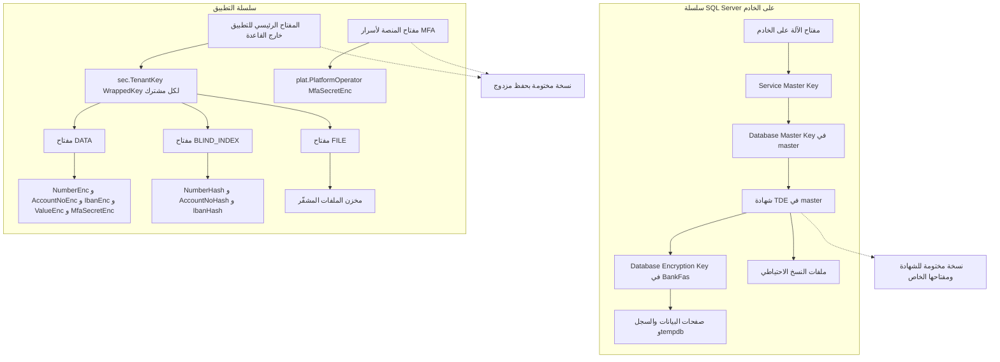

# DOC-S02 — سياسة إدارة المفاتيح والتشفير عند التخزين

| البند | القيمة |
|---|---|
| المعرّف | DOC-S02 (docs/30-readiness-documents.md) |
| الإصدار | 0.1 — مسودة للمراجعة — 2026-10-12 |
| المالك المقترح | معماري الأمن مع مدير قاعدة البيانات (DBA) ومسؤولَي الحفظ |
| الأولوية | P0 قبل S0 |
| يغطي | FR-PLT-037، BR-PLT-015، BR-PLT-009، FR-PLT-027، FR-PTY-006، FR-PTY-009، X-SEC-2، X-SEC-6، Q-PLT-12، T-7 (20-database-design)، O-23 (erd_open_items) |
| يعتمد على | DOC-F01 (حدود الثقة)، DOC-F02 (تدفقات البيانات الحساسة)، DOC-S06 (التصنيف)، DOC-S08 (أسرار حسابات القاعدة)، DOC-S09 (النسخ والاستعادة)، DOC-S10 (تجهيز الخادم) |
| المصادر | docs/30-readiness-documents.md:216-222 · docs/adr/0001-schema-work-on-linux.md · docs/20-database-design.md §6 · docs/21-data-dictionary.md:490-524 · docs/10-detailed-analysis/10-m0-m1-platform-organization.md §5 و§12 و§14 · db/model/10-platform.model · db/model/11-organization-party.model · db/generated/tsql/006_sensitive_columns.sql · db/generated/tsql/007_table_grants.sql · tools/dbgen/erd_open_items.py |

**وسوم المصدر:** 🟢 ذكره المستخدم أو ورد في الوثائق · 🟡 اقتراح له افتراضي ويُعدَّل.

## 1. الغرض والنطاق

**الغرض.** تحدد هذه الوثيقة كيف تُشفَّر بيانات المنصة عند التخزين، وأين تعيش المفاتيح، ومن يحفظ نسخها، ومتى تُدوَّر، وماذا يحدث عند فقدها. ADR 0001 يشترط حسم «حفظ المفاتيح: المفتاح الخارجي الذي يلفّ `sec.TenantKey` وشهادة TDE» قبل تحميل أي بيانات حقيقية 🟢 (docs/adr/0001-schema-work-on-linux.md:26، tools/dbgen/erd_open_items.py:149).

**داخل النطاق:**
- TDE لقاعدة `BankFas` على SQL Server 2025 فوق Ubuntu 24.04 LTS (ADR 0001).
- تشفير النسخ الاحتياطية.
- تشفير الأعمدة في طبقة التطبيق كما صُمّم في النموذج (T-7)، ومفاتيح المشترك في `sec.TenantKey`.
- تشفير مخزن الملفات (صور الهويات والمستندات).
- سلسلة المفاتيح، والحفظ المزدوج، والتدوير، والضمان (Escrow) والاسترداد، وأثر فقد المفتاح.

**خارج النطاق (يُحال):**
- شهادات TLS ومفاتيحها: DOC-S05.
- أسرار تسجيلات الدخول إلى القاعدة: DOC-S08.
- تجزئة كلمات المرور (Argon2id) ورموز الجلسات: ADR 0002 وDOC-S03 وDOC-S04.
- جدول النسخ واختبار الاستعادة: DOC-S09 (هذه الوثيقة تحدد المفاتيح التي تحتاجها الاستعادة فقط).

## 2. ما هو موجود اليوم

| البند | الحالة | المصدر |
|---|---|---|
| تشفير أعمدة المقيّد في طبقة التطبيق AES-256-GCM بغلاف مُصدَّر | قرار تصميم 🟢، ولا يوجد تطبيق بعد | docs/20-database-design.md:67 و188-202 |
| سجل مفاتيح المشترك `sec.TenantKey` بأغراض DATA وBLIND_INDEX وFILE، و`WrappedKey` و`MasterKeyRef` | منشور في DDL | db/model/10-platform.model:276-289 |
| ربط عمود المفتاح بغرضه بمفتاح أجنبي مركّب (DR-02) | منفّذ | db/model/11-organization-party.model:297-300، db/model/10-platform.model:128-129 |
| أدنى طول للغلاف `DATALENGTH >= 29` | منفّذ بقيود CHECK | db/model/11-organization-party.model:317، db/model/10-platform.model:85 و149 |
| سجل أحداث المفاتيح `sec.KeyEvent` ومنه `MASTER_KEY_CHANGED` و`BACKUP_VERIFIED` | منشور، للإضافة فقط | db/model/10-platform.model:291-299، db/generated/tsql/005_delete_grants.sql:46 |
| حجب `WrappedKey` عن دور التقارير | منفّذ | db/generated/tsql/006_sensitive_columns.sql:15 |
| `tp_app` يقرأ ويكتب ويعدّل `sec.TenantKey` | منفّذ | db/generated/tsql/007_table_grants.sql:50 |
| سر MFA للمشغّلين مشفّر بمفتاح منصة «في KMS» | عمود فقط، بلا مخزن محدد | db/model/10-platform.model:72-73 |
| كل إصدار ملف يحمل مفتاح FILE إلزاميًا | منفّذ | db/model/10-platform.model:394-395 |
| TDE لقاعدة البيانات | مطلوب في التحليل 🟢، ولا يوجد أي كائن TDE أو شهادة أو مفتاح رئيسي في `db/` | docs/10-detailed-analysis/10-m0-m1-platform-organization.md:582، db/deploy.sql:17-34 |
| نسخ احتياطية مشفّرة ومفتاحها منفصل | مطلوب في التحليل 🟢، ولا يوجد شيء في المستودع | docs/10-detailed-analysis/10-m0-m1-platform-organization.md:582 |
| مكان المفتاح الرئيسي | «خارج القاعدة» و«KMS» بلا منتج ولا موقع | docs/20-database-design.md:183-184، docs/21-data-dictionary.md:503 |
| إجراء الحفظ | افتراض Q-PLT-12: «مسؤولان مستقلان بنسخة مختومة؛ الإجراء يوثّقه فريق التشغيل»، والإجراء غير مكتوب | docs/10-detailed-analysis/10-m0-m1-platform-organization.md:624 |

**ملاحظة جوهرية.** حماية الأعمدة في هذا المشروع **ليست Always Encrypted**. القرار T-7 تشفير في طبقة التطبيق بغلاف ثابت الشكل ومفتاح لكل مشترك (docs/20-database-design.md:67 و188-202). TDE طبقة إضافية تحت هذا التشفير، ولا تحل محله.

## 3. طبقات التشفير عند التخزين

| الطبقة | ما تشفّره | تحمي من | لا تحمي من |
|---|---|---|---|
| L1 TDE 🟡 | ملفات بيانات `BankFas` وسجلها وtempdb ونسخها | نسخ ملف البيانات أو السجل أو ملف نسخة منفردًا دون الشهادة | لقطة كاملة للخادم تحمل master ومفتاح الآلة معًا؛ ومدير القاعدة (sysadmin) وحساب التطبيق وحقن SQL: كلهم يقرؤون نصًا صريحًا |
| L2 تشفير النسخ 🟡 | ملفات النسخ، ومنها master وmsdb غير المشمولة بـ TDE | ضياع نسخة في الموقع المنفصل | ما سبق |
| L3 أعمدة المقيّد (T-7) 🟢 | أرقام الهوية والحساب وIBAN والحقول المقيّدة وأسرار MFA | مدير القاعدة، ودور التقارير، واستعادة النسخة على خادم آخر بلا المفتاح الرئيسي (BR-PLT-015) | خادم تطبيق مخترق يحمل المفاتيح المفكوكة في ذاكرته |
| L4 ملفات المخزن 🟢 | كل ملف في مخزن المستندات بمفتاح FILE للمشترك | من يصل إلى المخزن أو نسخه | خادم تطبيق مخترق |
| L5 تشفير وحدة التخزين 🟡 اختياري | كل ما على قرص الخادم | قراءة القرص أو لقطته من خارج نظام التشغيل، إذا لم يُحفظ مفتاح الوحدة على القرص نفسه | أي وصول أثناء التشغيل |

**لقطات الخادم.** مفتاح الآلة وmaster والشهادة على قرص الخادم نفسه. لذلك لقطة كاملة للخادم الافتراضي يأخذها مزوّد الاستضافة تحمل البيانات ومفاتيح فتحها معًا، ولا تحميها TDE. تبقى الأعمدة المقيّدة والملفات محمية بـ L3 وL4 لأن المفتاح الرئيسي خارج الخادم، وتحمي L5 الباقي إن طُبّقت. تُعامل اللقطات معاملة النسخة غير المشفّرة (DOC-S09).

**البصمات ليست تشفيرًا:** `PasswordHash` (Argon2id) و`TokenHash` و`CodeHash` (SHA-256) و`NumberHash` (HMAC) قيم أحادية الاتجاه. لا تحتاج مفتاحًا للاستعادة، عدا HMAC الذي يحتاج مفتاح BLIND_INDEX لحساب بصمة إدخال جديد.

## 4. سلسلة المفاتيح

| الرمز | المفتاح | مكانه | يحمي | يحميه | المالك التشغيلي |
|---|---|---|---|---|---|
| K-01 | مفتاح الآلة وService Master Key | الخادم نفسه | DMK في master | نظام التشغيل | DBA |
| K-02 | Database Master Key في master | master | شهادة TDE | SMK وكلمة مرور مختومة | DBA |
| K-03 | شهادة TDE، مثل `BankFas_TDE_2026` (اسم افتراضي) | master | DEK والنسخ (L2) | DMK | DBA، ونسختها لدى الحافظَين |
| K-04 | DEK بـ AES_256 | `BankFas` | الصفحات والسجل | K-03 | DBA |
| K-05 | المفتاح الرئيسي للتطبيق AMK | مخزن مفاتيح منفصل 🟡 (DQ-S02-1) | `WrappedKey` لكل مشترك | مخزن المفاتيح | مسؤول الأمن، لا DBA |
| K-06 | مفاتيح DATA لكل مشترك وإصداراتها | `sec.TenantKey` ملفوفة | الأعمدة المشفّرة | K-05 | خدمة التشفير |
| K-07 | مفاتيح BLIND_INDEX لكل مشترك | `sec.TenantKey` ملفوفة | بصمات HMAC | K-05 | خدمة التشفير |
| K-08 | مفاتيح FILE لكل مشترك | `sec.TenantKey` ملفوفة | ملفات المخزن | K-05 | خدمة التشفير |
| K-09 | مفتاح المنصة لأسرار MFA للمشغّلين | مخزن المفاتيح (`MfaKeyRef`) | `plat.PlatformOperator.MfaSecretEnc` | مخزن المفاتيح | مسؤول الأمن |

**الفصل بين الأدوار 🟢:** «مدير القاعدة لا يملك المفتاح الرئيسي» (docs/10-detailed-analysis/10-m0-m1-platform-organization.md:583). يُطبَّق على K-05 وK-09. أما K-01 إلى K-04 فيديرها DBA بحكم صلاحية sysadmin، ولذلك لا تحمي TDE من DBA (القسم 3).

## 5. TDE على SQL Server 2025 فوق Ubuntu 24.04 🟡

### 5.1 الإعداد الأول (مرة واحدة لكل خادم)

يُكتب الإجراء في سكربت تشغيل منفصل عن `db/deploy.sql`، لأن `deploy.sql` يُشغَّل في CI على قاعدة جديدة كل مرة (tools/ci/db_ci.sh:51-54). الخطوات بالترتيب:

1. إنشاء `MASTER KEY` في master بكلمة مرور مولَّدة عشوائيًا، تُقسم بين الحافظَين (القسم 9).
2. إنشاء شهادة TDE في master باسم يحمل السنة.
3. **قبل تفعيل التشفير:** `BACKUP CERTIFICATE ... TO FILE ... WITH PRIVATE KEY (FILE = ..., ENCRYPTION BY PASSWORD = ...)`، ثم نقل الملفين إلى الضمان وحذفهما من الخادم بعد التحقق.
4. `BACKUP SERVICE MASTER KEY` و`BACKUP MASTER KEY` إلى ملفات بكلمات مرور، وتُعامل كالشهادة.
5. في `BankFas`: `CREATE DATABASE ENCRYPTION KEY WITH ALGORITHM = AES_256 ENCRYPTION BY SERVER CERTIFICATE ...`.
6. `ALTER DATABASE BankFas SET ENCRYPTION ON`، ومتابعة `sys.dm_database_encryption_keys` حتى تصير الحالة مشفّرة.
7. إثبات الاستعادة: استعادة نسخة على خادم اختبار باستعمال ملفات الضمان فقط (تمرين DOC-S09).

### 5.2 قواعد

- لا تُحفظ ملفات الشهادة ولا كلمات مرورها في المستودع ولا في مجلد النسخ الاحتياطية ولا في الموقع المنفصل نفسه الذي يحمل النسخ.
- ملفات الشهادة تُحذف من الخادم بعد إيداعها والتحقق منها؛ تبقى الشهادة داخل master فقط.
- يحمي SQL Server على Linux مفتاح الخدمة الرئيسي بمفتاح آلة محفوظ في ملفات الخادم. يُتحقق من مساره وطريقة نسخه في وثائق Microsoft عند التجهيز (DOC-S10)، لأن إعادة بناء الخادم تفقده.
- أداء TDE يُقاس على الخادم الفعلي قبل الإطلاق، ويُسجَّل الأثر في DOC-B03.
- توفر TDE وتشفير النسخ يُتحقق منه للإصدار المرخَّص (Edition) من SQL Server؛ سير عمل CI يضبط الإصدار Developer (../.github/workflows/treasury-db-ci.yml:40، جذر المستودع)، ويعمل على GitHub منذ 2026-10-12 (O-02 (erd_open_items))؛ ونجاحه هناك أو في حاوية التطوير لا يثبت شيئًا عن الترخيص الإنتاجي (DQ-S02-5).
- لا يُستعمل EKM (حفظ حامي TDE في مخزن مفاتيح خارجي) حتى يُتحقق من دعمه على Linux لهذا الإصدار (DQ-S02-6).

## 6. تشفير النسخ الاحتياطية 🟡

- محتوى نسخ `BankFas` مشفّر أصلًا بـ TDE. يُضاف `WITH ENCRYPTION (ALGORITHM = AES_256, SERVER CERTIFICATE = <شهادة TDE>)` لكل النسخ، فيشمل master وmsdb اللتين لا يشملهما TDE.
- الافتراضي: شهادة واحدة لـ TDE وللنسخ، فيبقى سر واحد في الضمان. البديل شهادة نسخ مستقلة (DQ-S02-4).
- كل نسخة تحمل `CHECKSUM` و`COMPRESSION`. الجدول والاحتفاظ في DOC-S09.
- **كل شهادة متقاعدة تبقى في الضمان** حتى تنتهي مدة احتفاظ آخر نسخة شُفِّرت بها؛ حذفها قبل ذلك يُتلف تلك النسخ.
- المفتاح الرئيسي للتطبيق (K-05) **لا يدخل أي نسخة** من القاعدة أو الخادم (BR-PLT-015، docs/20-database-design.md:459). النسخ تحمل `WrappedKey` ملفوفًا فقط، فلا تكشف الأعمدة المقيّدة لمن يملك النسخة وشهادة TDE معًا.
- نسخ مخزن الملفات لا تحتاج طبقة إضافية، لأن كل ملف مشفّر بمفتاح FILE ملفوف داخل القاعدة.

## 7. حماية الأعمدة القائمة في النموذج

### 7.1 الأعمدة المشفّرة بمفتاح المشترك

| الجدول | الأعمدة | غرض المفتاح | المصدر |
|---|---|---|---|
| `pty.IdentityDocument` | `NumberEnc` و`NumberHash` و`NumberMask` | DATA وBLIND_INDEX | db/model/11-organization-party.model:294-300 |
| `pty.PartyCustomField` | `ValueEnc` (للحقل المقيّد) | DATA | db/model/11-organization-party.model:397-405 |
| `acc.BankAccount` | `AccountNoEnc` و`IbanEnc` وبصمتاهما | DATA وBLIND_INDEX | db/model/12-institutions-accounts-catalogs.model:386-396 |
| `lc.LcTerms` | `BeneficiaryAccountIbanEnc` وبصمته | DATA وBLIND_INDEX | db/model/16-letters-of-credit.model:186-192 |
| `sec.AppUser` | `MfaSecretEnc` | DATA | db/model/10-platform.model:127-129 |
| `doc.DocumentVersion` | الملف في المخزن | FILE | db/model/10-platform.model:394-395 |
| `plat.PlatformOperator` | `MfaSecretEnc` | مفتاح المنصة K-09 | db/model/10-platform.model:72-73 |
| `wfl.Request` | الحقول المقيّدة داخل `FormDataJson` | DATA، بلا عمود مفتاح في الصف | db/model/15-workflow-notifications.model:283 |

### 7.2 قواعد خدمة التشفير المشتركة (FR-PLT-037)

- خدمة واحدة تستعملها كل الوحدات 🟢 (docs/10-detailed-analysis/10-m0-m1-platform-organization.md:139). الغلاف والـ AAD كما في docs/20-database-design.md:188-202 دون تغيير.
- 🟡 فك الغلاف الخارجي يتم داخل مخزن المفاتيح إن دعم عمليتي اللف والفك، فلا يخرج K-05 منه أبدًا. إن لم يدعمهما يُحمَّل K-05 في ذاكرة التطبيق فقط عند البدء، ولا يُكتب على قرص.
- 🟡 المفاتيح المفكوكة لكل مشترك تُخزَّن مؤقتًا في الذاكرة 15 دقيقة على الأكثر، ولا تُسجَّل ولا تظهر في رسالة خطأ.
- 🟡 خوارزمية لف `WrappedKey`: AES-256 بنمط لف مفاتيح معياري أو AES-256-GCM، وتُكتب في `Algorithm` أو في بادئة الغلاف.
- 🟡 الحقول المقيّدة داخل `FormDataJson` تحمل الغلاف نفسه، وتحمل معرّف مفتاح DATA داخل قيمة JSON، لأن الصف لا يملك عمود `EncKeyId`.
- كل فشل فك يُسجَّل حدث `UNWRAP_FAILED` (db/model/10-platform.model:293) وينبّه مسؤول الأمن.

## 8. مخزن الملفات المشفّر

- كل ملف يُشفَّر قبل الكتابة بمفتاح FILE النشط للمشترك، ويُخزَّن معرّفه في `DocumentVersion.KeyId` (db/model/10-platform.model:395) 🟢.
- 🟡 التشفير AES-256-GCM على أجزاء متتالية (مثلًا 1 ميغابايت) بـ nonce فريد لكل جزء. الـ AAD: `TenantId` ‖ `StorageKey` ‖ `VersionNo` ‖ رقم الجزء ‖ علم الجزء الأخير، فلا يُنقل جزء بين ملفين ولا يُقتطع ملف دون كشف.
- `Sha256` يُحسب من البايتات المستلمة قبل التشفير (BR-PLT-011)، فيبقى صحيحًا بعد إعادة التشفير.
- 🟡 مسار `StorageKey` يبدأ بمعرّف المشترك العام لا برمزه، فلا يكشف المسار أسماء المشتركين.
- المصغّرات والمعاينات ملفات مقيّدة مثل أصلها (BR-PTY-010، docs/10-detailed-analysis/10-m0-m1-platform-organization.md:281)، وتُشفَّر بالطريقة نفسها.
- 🟡 لا ملفات مؤقتة صريحة على القرص: فحص البرمجيات الخبيثة والمعاينة يعملان في الذاكرة أو في منطقة حجر مشفّرة.
- مكان المخزن لم يُحسم: «مشاركة ملفات/تخزين كائنات» (docs/01-preliminary-analysis.md:329). الافتراضي وحدة تخزين مستقلة على VPS نفسه مع نسخ منفصل (DQ-S02-10).

## 9. الحفظ المزدوج (Split custody)

### 9.1 الأدوار

| الدور | المسؤولية | ما لا يملكه |
|---|---|---|
| الحافظ الأول KC-1 🟡 مسؤول الأمن | نصف سر الضمان لـ K-05 وK-09 وكلمات مرور ملفات K-02 وK-03 | النصف الآخر |
| الحافظ الثاني KC-2 🟡 ممثل المالك | النصف الآخر | النصف الأول وأي صلاحية على الخادم |
| مدير القاعدة DBA | تشغيل K-01 إلى K-04، وتنفيذ الاستعادة | K-05 وK-09 (docs/10-detailed-analysis/10-m0-m1-platform-organization.md:583) |
| مشغّل المنصة | لا شيء في المفاتيح | كل ما سبق |

### 9.2 القواعد 🟡

- لا يملك شخص واحد ما يكفي لاستعادة K-05 أو فتح نسخة بلا الآخر. الافتراضي ملف ضمان مشفّر بكلمة مرور من نصفين، لكل حافظ نصف (Q-PLT-12). البديل مخطط 2 من 3 بحصة ثالثة في خزنة مستقلة (DQ-S02-3).
- مظاريف مختومة قابلة لكشف العبث في موقعين ماديين منفصلين، وكلاهما خارج مزوّد الاستضافة.
- **مراسم المفتاح:** إنشاء K-03 وK-05 ونسخهما بحضور الحافظَين، وكل مراسم أو فتح مظروف حدث عالي الشدة (BR-PLT-009، docs/10-detailed-analysis/10-m0-m1-platform-organization.md:235).
- مغادرة حافظ: يُعاد تقسيم السر وتُستبدل الحصة خلال 5 أيام عمل، ويُدوَّر K-05 إن شُكّ في تسرّب.
- **حد صريح:** sysadmin يستطيع تصدير K-03 بكلمة مرور جديدة في أي وقت. الحفظ المزدوج على K-03 يحمي من الضياع ومن تسرّب المظروف، ولا يحمي من DBA. الحماية من DBA هي الطبقة L3.

## 10. جدول التدوير 🟡

| المفتاح | الدورية المقترحة | أحداث تفرض التدوير فورًا | الطريقة | الكلفة |
|---|---|---|---|---|
| K-05 AMK | سنويًا | تسرّب، مغادرة حافظ، تغيير مخزن المفاتيح | إعادة لف كل صفوف `sec.TenantKey` وتحديث `MasterKeyRef`، وحدث `MASTER_KEY_CHANGED` لكل مشترك | منخفضة، بلا إعادة تشفير بيانات |
| K-06 DATA | كل سنتين | تسرّب مفتاح مشترك | §6.3: مفتاح ACTIVE جديد ثم مهمة خلفية تعيد التشفير (docs/20-database-design.md:204-208) | متوسطة |
| K-07 BLIND_INDEX | عند التسرّب فقط | تسرّب | إعادة حساب كل البصمات وإعادة بناء الفهارس الفريدة (docs/20-database-design.md:209) | عالية |
| K-08 FILE | كل سنتين | تسرّب | مفتاح جديد للملفات الجديدة ومهمة تعيد تشفير القديمة | عالية بحجم المخزن |
| K-09 مفتاح المنصة | سنويًا | تسرّب | إعادة تشفير أسرار MFA للمشغّلين | منخفضة |
| K-03 شهادة TDE | سنويًا | تسرّب ملف الشهادة | شهادة جديدة ثم `ALTER DATABASE ENCRYPTION KEY ENCRYPTION BY SERVER CERTIFICATE`، مع إبقاء القديمة في الضمان | منخفضة |
| K-04 DEK | كل 3 سنوات | تسرّب نسخة مع شهادتها | `ALTER DATABASE ENCRYPTION KEY REGENERATE WITH ALGORITHM = AES_256` | متوسطة، مسح كامل للقاعدة |
| K-01 وK-02 | عند الحاجة | تسرّب، إعادة بناء الخادم | إعادة توليد ثم نسخ جديد إلى الضمان | منخفضة |

- كل مشترك جديد يحصل عند التهيئة على ثلاثة مفاتيح إصدارها 1 (DATA وBLIND_INDEX وFILE). التسلسل في DOC-F05.
- مفتاح بحالة RETIRED أو REVOKED لا يُستعمل لكتابة ولا يشير إليه صف جديد؛ القاعدة في خدمة التدوير (بقية DR-20).

## 11. الضمان والاسترداد

### 11.1 محتوى الضمان

| العنصر | الشكل | يُحدَّث عند |
|---|---|---|
| K-05 وK-09 | تصدير مشفّر من مخزن المفاتيح، أو مادة المفتاح مشفّرة بكلمة مرور من نصفين | كل تدوير |
| K-03 بكل إصداراته المطلوبة للنسخ | ملف الشهادة وملف المفتاح الخاص وكلمة مرور من نصفين | كل تدوير، ويُحذف الإصدار بعد انتهاء آخر نسخة تحتاجه |
| K-02 وK-01 | ملفا `BACKUP MASTER KEY` و`BACKUP SERVICE MASTER KEY` | كل إعادة توليد |
| سجل الضمان | قائمة بالعناصر وتواريخها ومواقعها، بلا أسرار | كل تغيير |

### 11.2 التحقق 🟡

- كل ربع سنة يثبت تمرين الاستعادة (DOC-S09) ثلاثة أمور: ملفات K-03 من الضمان تفتح نسخة على خادم نظيف؛ وK-05 من الضمان يفك `WrappedKey` لمشترك اختباري؛ وصف عيّنة يُفك تشفيره (docs/20-database-design.md:460).
- يُسجَّل النجاح حدث `BACKUP_VERIFIED` (db/model/10-platform.model:293).

### 11.3 الاسترداد عند تعطل مخزن المفاتيح

1. يعلن مسؤول الأمن الحادث، ويُفتح سجل في DOC-S15.
2. يحضر KC-1 وKC-2، ويُفتح المظروفان، ويُسجَّل الفتح.
3. يُحمَّل K-05 في مخزن بديل، ويُختبر الفك على مشترك واحد ثم على الكل.
4. بعد عودة الخدمة يُدوَّر K-05 (القسم 10)، ويُودَع ضمان جديد.

## 12. ماذا يحدث عند فقد المفتاح

| المفقود | الأثر الفوري | ما يضيع | المعالجة |
|---|---|---|---|
| K-05 وكل نسخه | لا يُفك أي `WrappedKey` | **نهائيًا:** أرقام الهوية والحساب وIBAN والحقول المقيّدة، وأسرار MFA لكل المستخدمين، وكل ملفات المخزن (صور الهويات والاتفاقيات وكل مستند). تبقى الأقنعة فيعمل العرض المقنَّع، ويتعذر الكشف والبحث بالفهرس الأعمى لإدخال جديد | لا معالجة بعد الفقد؛ الوقاية بالضمان المزدوج. يعيد كل مستخدم تسجيل MFA |
| صف `sec.TenantKey` لمشترك تلف أو حُذف | بيانات ذلك المشترك فقط | لا شيء إن وُجدت نسخة | استعادة الصف من نسخة القاعدة؛ الصف ملفوف فلا خطر في نسخه |
| K-03 مع بقاء الخادم يعمل | لا أثر ظاهر | لا شيء بعد | تصدير فوري لنسخة جديدة إلى الضمان؛ الخطر أن يمر الفقد دون ملاحظة، ولذلك التحقق ربع السنوي |
| K-03 مع فقد الخادم | لا تُستعاد أي نسخة | **القاعدة كلها** | لا معالجة؛ الوقاية بالضمان |
| K-01 أو K-02 بإعادة بناء الخادم | master الجديد بلا الشهادة | لا شيء إن وُجد K-03 في الضمان | إنشاء DMK جديد واستعادة الشهادة من الضمان |
| K-09 | لا يدخل المشغّلون بـ MFA | أسرار MFA للمشغّلين | إعادة تسجيل MFA لكل مشغّل بإجراء موثّق |

التسرّب (لا الفقد) يعالَج بالتدوير الفوري (القسم 10) وبإجراء DOC-S15.

## 13. تسجيل أحداث المفاتيح

- أحداث مفاتيح المشترك تُكتب في `sec.KeyEvent` بشدة عالية (BR-PLT-009)، ولا تحمل مادة مفتاح ولا نتيجة فك.
- **فجوة:** `sec.KeyEvent` جدول مملوك للمشترك، و`TenantId` فيه إلزامي (db/generated/tsql/001_tables.sql:475، docs/21-data-dictionary.md:515). أحداث المنصة (تدوير K-03، مراسم K-05، ضمان K-09) لا مكان لها فيه. 🟡 الافتراضي: تُكتب في `aud.AuditLog` بـ `TenantId` فارغ و`Category = PLATFORM` و`Severity = HIGH` (db/model/10-platform.model:304-311)، ويُكتب `MASTER_KEY_CHANGED` لكل مشترك عند إعادة اللف (DQ-S02-8).
- 🟡 `tp_app` يملك `UPDATE` على `sec.TenantKey` (db/generated/tsql/007_table_grants.sql:50)، فاتصال تطبيق مخترق يستطيع استبدال `WrappedKey` لمشتركه فيعطّل بياناته. يُقترح حصر تعديل `WrappedKey` و`Status` في إجراء مفاتيح مدقَّق (DQ-S02-11)، ويُسجَّل الخطر في DOC-S01.

## 14. التثبيت المحلي لاحقًا (FR-PLT-047)

- كل تثبيت محلي لدى مشترك له K-01 إلى K-05 خاصة به، ولا تُنقل إليه مفاتيح المنصة.
- 🟡 الحافظان في التثبيت المحلي من جهة المشترك، وتسلّمه المنصة هذا الإجراء نفسه (DQ-S02-12).

## 15. القرارات المطلوبة

| المعرّف | السؤال | الافتراض المقترح | من يقرر | ما يعطّله |
|---|---|---|---|---|
| DQ-S02-1 | أين يعيش المفتاح الرئيسي للتطبيق K-05 ومفتاح المنصة K-09؟ | خدمة إدارة مفاتيح أو وحدة أمن عتادية خارج VPS القاعدة وخارج حساب الاستضافة نفسه، تدعم اللف والفك دون تصدير المفتاح | المالك مع معماري الأمن | FR-PLT-037، تحميل بيانات حقيقية (ADR 0001) |
| DQ-S02-2 | من الحافظان؟ | KC-1 مسؤول الأمن، KC-2 ممثل المالك؛ DBA مستبعد من K-05 | المالك | Q-PLT-12، مراسم المفاتيح |
| DQ-S02-3 | مخطط التقسيم | نصفان ومظروفان في موقعين؛ البديل 2 من 3 | المالك مع مسؤول الأمن | الضمان |
| DQ-S02-4 | شهادة واحدة لـ TDE وللنسخ، أم شهادة نسخ مستقلة؟ | شهادة واحدة | DBA مع مسؤول الأمن | DOC-S09 |
| DQ-S02-5 | إصدار SQL Server المرخَّص وهل يشمل TDE وتشفير النسخ | يُتحقق قبل الشراء؛ CI يستعمل Developer | المالك مع DBA | القسمان 5 و6 |
| DQ-S02-6 | استعمال EKM لحماية TDE على Linux | لا، حتى يُتحقق من الدعم | DBA | لا شيء الآن |
| DQ-S02-7 | دوريات التدوير | جدول القسم 10 | مسؤول الأمن | خطة التشغيل |
| DQ-S02-8 | أين تُسجَّل أحداث مفاتيح المنصة؟ | `aud.AuditLog` بـ TenantId فارغ وشدة عالية | معماري قاعدة البيانات | تطبيق S0 |
| DQ-S02-9 | تشفير وحدة التخزين (L5) على VPS | نعم لوحدتي مخزن الملفات والنسخ إن أمكن الإقلاع غير المراقَب، وإلا لا | مهندس البنية مع مسؤول الأمن | DOC-S10 |
| DQ-S02-10 | مكان مخزن الملفات | وحدة تخزين مستقلة على VPS مع نسخ منفصل | المالك مع مهندس البنية | FR-PLT-027 |
| DQ-S02-11 | حصر تعديل `WrappedKey` و`Status` في إجراء مفاتيح | نعم | معماري قاعدة البيانات | DDL قبل S0 |
| DQ-S02-12 | الحفظ في التثبيت المحلي | الحافظان من جهة المشترك | المالك | FR-PLT-047 (S5) |
| Q-PLT-12 | حفظ المفتاح الرئيسي واستعادته ومن يملك نسخته | هذا الإجراء | المالك | ADR 0001 |

## 16. تعارضات وفجوات في المصادر

- docs/10-detailed-analysis/11-m2-m4-institutions-accounts-catalogs.md:582 يقول «Always Encrypted أو ما يعادله» لـ AccountNo وIban، والقرار T-7 تشفير في طبقة التطبيق (docs/20-database-design.md:67) والنموذج يطبّقه (db/model/12-institutions-accounts-catalogs.model:386-396). يُصحَّح النص إلى «غلاف T-7».
- TDE ونسخ مشفّرة مطلوبة (docs/10-detailed-analysis/10-m0-m1-platform-organization.md:582)، ولا يوجد أي كائن TDE في `db/` ولا سكربت نسخ في المستودع.
- Q-PLT-12 يحيل الإجراء إلى «فريق التشغيل» (docs/10-detailed-analysis/10-m0-m1-platform-organization.md:624)، ولا يوجد إجراء. هذه الوثيقة مسودته.
- DR-20 مسجَّل «open» (docs/review/design-review-2026-10-11.json:220-221)، مع أن ربط الغرض منفّذ بعد DR-02 (docs/review/design-review-2026-10-11.json:28-29، db/model/12-institutions-accounts-catalogs.model:393-396). يبقى منه منع الإشارة إلى مفتاح RETIRED أو REVOKED فقط.
- `sec.KeyEvent` مملوك للمشترك (db/generated/tsql/001_tables.sql:475)، فلا يتسع لأحداث مفاتيح المنصة التي يطلب BR-PLT-009 تسجيلها بشدة عالية.
- `wfl.Request.FormDataJson` يحمل حقولًا مقيّدة مشفّرة (db/model/15-workflow-notifications.model:283) بلا عمود مفتاح، خلافًا لقاعدة «عمود المفتاح في الصف يحدد الإصدار» (docs/20-database-design.md:200).
- docs/20-database-design.md:183 وdb/model/10-platform.model:73 يذكران «KMS» دون منتج ولا موقع؛ القرار مفتوح (DQ-S02-1).

## 17. التتبع

| البند في هذه الوثيقة | المتطلب أو القاعدة أو القرار | المصدر |
|---|---|---|
| القسم 3، L3 | T-7، BR-PLT-015، FR-PTY-006 | docs/20-database-design.md:67؛ docs/10-detailed-analysis/10-m0-m1-platform-organization.md:241 و196 |
| القسم 4 | FR-PLT-037، X-SEC-6 | docs/10-detailed-analysis/10-m0-m1-platform-organization.md:139؛ docs/10-detailed-analysis/00-overview-and-cross-cutting.md:141 |
| القسم 5 | صف التشفير «TDE لقاعدة البيانات»، ADR 0001 | docs/10-detailed-analysis/10-m0-m1-platform-organization.md:582؛ docs/adr/0001-schema-work-on-linux.md:26 |
| القسم 6 | «نسخ احتياطية مشفَّرة ومفتاحها منفصل»، BR-PTY-010 | docs/10-detailed-analysis/10-m0-m1-platform-organization.md:582 و281؛ docs/20-database-design.md:459 |
| القسم 7 | §6.1 و§6.2، DR-02 | docs/20-database-design.md:174-202؛ db/model/11-organization-party.model:294-300 |
| القسم 8 | FR-PLT-027، FR-PTY-009، BR-PLT-011 | docs/10-detailed-analysis/10-m0-m1-platform-organization.md:129 و199؛ db/model/10-platform.model:386-408 |
| القسم 9 | Q-PLT-12، الفصل بين الأدوار | docs/10-detailed-analysis/10-m0-m1-platform-organization.md:624 و583 |
| القسم 10 | §6.3، BR-PLT-015 | docs/20-database-design.md:204-209 |
| القسم 11 | `BACKUP_VERIFIED`، اختبار الاستعادة | db/model/10-platform.model:293؛ docs/20-database-design.md:460 |
| القسم 13 | BR-PLT-009، `sec.KeyEvent` | docs/10-detailed-analysis/10-m0-m1-platform-organization.md:235؛ db/model/10-platform.model:291-299 |
| القسم 14 | FR-PLT-047 | docs/10-detailed-analysis/10-m0-m1-platform-organization.md:149 |
