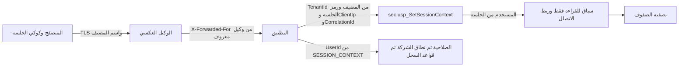

# DOC-S03 — معمارية الأمن والمصادقة والجلسات (سلسلة الثقة من الهوية إلى سياق المشترك)

| البند | القيمة |
|---|---|
| المعرّف | DOC-S03 (docs/30-readiness-documents.md) |
| الإصدار | 0.1 — مسودة للمراجعة — 2026-10-12 |
| المالك المقترح | معماري الحلول (جانب الأمن) |
| الأولوية | P0 قبل S0 |
| يغطي | FR-PLT-010 إلى FR-PLT-014، FR-PLT-021، FR-PLT-023، FR-PLT-046، BR-PLT-005، O-22 وO-24 (erd_open_items)، DR-17 |
| يعتمد على | DOC-F04 (تسلسل الربط)، DOC-F03 (تسلسل الدخول)، DOC-S04 (قيم السياسة)، DOC-S05 (TLS وHSTS)، DOC-S08 (حسابات القاعدة)، DOC-F01 (حدود الثقة TB-1 وTB-3 وTB-4)، DOC-B04 (نموذج الأخطاء)، DOC-B11 (البيئات) |
| المصادر | docs/adr/0002-login-and-session-bound-context.md، db/static/030_session_context.sql، db/static/010_rls.sql، db/static/020_roles_and_grants.sql، db/generated/tsql/005_delete_grants.sql و006_sensitive_columns.sql و007_table_grants.sql، db/model/10-platform.model، tools/dbgen/erd_open_items.py، docs/10-detailed-analysis/10-m0-m1-platform-organization.md |

## 1. الغرض والنطاق

تحدد الوثيقة كيف تنتقل الهوية من المتصفح إلى سياق المشترك في قاعدة البيانات، وأين تُفرض كل سياسة: في التطبيق أم في القاعدة.

- **داخل النطاق:** شكل رمز الجلسة وتخزينه، والكوكي، وCSRF، وCSP وترويسات الأمان، ومصدر عنوان IP الموثوق، ومعرّف الارتباط، ومعاملة مجمّع الاتصالات، وجدول مواضع الفرض، والمخاطر المتبقية O-24.
- **خارج النطاق:** تسلسل الربط نفسه ومهام الخلفية (DOC-F04)، وتسلسلات الدخول (DOC-F03)، والقيم الرقمية للسياسة (DOC-S04)، وإعدادات TLS وHSTS (DOC-S05)، وحسابات القاعدة وأسرارها (DOC-S08).

**الوسوم:** 🟢 موجود أو مقرر مع الملف والسطر. 🟡 اقتراح.

**اختصارات المراجع:** «030» هو db/static/030_session_context.sql، و«010_rls.sql» و«020» في db/static، و«005» و«006» و«007» ملفات db/generated/tsql، و«model» هو db/model/10-platform.model، و«10-m0-m1» هو docs/10-detailed-analysis/10-m0-m1-platform-organization.md. أرقام T حالات db/tests/tenant_isolation_tests.sql.

## 2. سلسلة الثقة

| الحلقة | ما تثبته | ما لا تثبته | المرجع |
|---|---|---|---|
| المتصفح إلى الوكيل | قناة مشفرة إلى اسم مضيف المشترك | هوية المستخدم | TB-1، DOC-S05 |
| الوكيل إلى التطبيق | عنوان العميل كما رآه الوكيل | أي شيء إن جاء الطلب من غير الوكيل | §7 |
| الكوكي | حيازة رمز صدر بعد كلمة مرور صحيحة | أن حامله هو صاحب الحساب | §3 و§4 |
| usp_SetSessionContext | جلسة صالحة لهذا المشترك ومستخدم ACTIVE وMFA مسجّل متى كان مفعّلًا | صحة عنوان IP ومعرّف الارتباط | TB-3، TB-4؛ 🟢 030:186-199 |
| الربط والتصفية | الصفوف للمشترك المربوط فقط | الصلاحية ونطاق الشركة | 🟢 010_rls.sql:22-57 |
| التطبيق بعد الربط | الصلاحية ونطاق الشركة وقواعد السجل | — | FR-PLT-021 (10-m0-m1:123) |

قاعدة الهوية 🟡: بعد الربط يقرأ التطبيق المستخدم من SESSION_CONTEXT(N'UserId') الذي يكتبه الإجراء (030:205). لا يأخذ معرّف مستخدم من الكوكي أو الطلب. ويتحقق أن SESSION_CONTEXT(N'TenantId') يساوي مشترك اسم المضيف.

## 3. رمز الجلسة

| الخاصية | القيمة | الحالة والمرجع |
|---|---|---|
| المولّد | مولّد عشوائي آمن تشفيريًا في التطبيق | 🟡 |
| الطول | 32 بايتًا بالضبط، والقاعدة ترفض أقل من 32 | 🟢 الحد في 030:53-54؛ 🟡 القيمة |
| النوع | رمز مرجعي معتم بلا مطالبات، لا JWT | 🟡؛ القاعدة تتحقق في كل طلب فلا حاجة لتوقيع |
| الترميز في الكوكي | base64url بلا حشو، 43 حرفًا | 🟡 |
| التخزين في القاعدة | SHA-256 في sec.UserSession.TokenHash، فريد | 🟢 030:117، model:221 و231 |
| تخزين الأصل | لا يُخزَّن في القاعدة ولا في سجلات التطبيق ولا في الروابط | 🟢 القاعدة؛ 🟡 السجلات |
| الإصدار | رمز جديد لكل دخول، يولّده الخادم بعد قبول كلمة المرور | 🟢 030:43؛ 🟡 عدم قبول رمز من المتصفح |
| التدوير بعد MFA | لا يُدوَّر؛ tp_app لا يغيّر TokenHash | 🟢 030:239، T35 |
| قبل MFA | الرمز نفسه، ولا يُربط حتى يُسجَّل MFA | 🟢 030:198؛ 🟡 نافذة 5 دقائق (DOC-F03 §6) |
| المهلتان | خمول 30 دقيقة ومطلقة 12 ساعة؛ المطلقة لا يغيّرها التطبيق | 🟢 030:117-118 و239، T35 |

لا يتعرض النظام لتثبيت الجلسة لأن الرمز يولد في الخادم بعد إثبات كلمة المرور ولا يُقبل من العميل.

## 4. الكوكي على العنوان الفرعي

| الخاصية | القيمة المقترحة 🟡 | السبب |
|---|---|---|
| الاسم | `__Host-bf_session` | البادئة تفرض Secure وPath=/ وتمنع Domain |
| Domain | بلا قيمة، فيبقى للمضيف وحده مثل acme.bankfas.com | كوكي المشترك لا يُرسل إلى مضيف مشترك آخر (FR-PLT-046) |
| Path | / | شرط البادئة |
| Secure | نعم | لا إرسال بلا TLS |
| HttpOnly | نعم | لا يقرؤه JavaScript |
| SameSite | Lax | يمنع الإرسال في الطلبات غير الآمنة من مواقع أخرى (DQ-S03-1) |
| Expires وMax-Age | بلا قيمة، كوكي جلسة | المهلتان تفرضهما القاعدة |

قواعد 🟡:

- لا يُضبط أي كوكي بقيمة Domain=bankfas.com، لأنه يُرسل عندئذ إلى كل المشتركين.
- كل العناوين الفرعية «موقع واحد» في نظر المتصفح لأنها تحت النطاق المسجّل نفسه. فلا يمنع SameSite طلبًا من صفحة مشترك إلى مضيف مشترك آخر. الدفاع هو الكوكي المقصور على المضيف، ورمز CSRF، وفحص Origin (§5)، وفحص القاعدة أن مشترك الجلسة هو المشترك المطلوب (030:194، T18).
- لوحة المشغّل على مضيف مستقل وكوكي باسم مختلف، فلا يصل كوكي مشغّل إلى بوابة مشترك ولا العكس (FR-PLT-006، 10-m0-m1:108؛ DQ-S03-7).
- عند الخروج يُرسل الكوكي بقيمة فارغة وMax-Age=0. لا تُستعمل ترويسة Clear-Site-Data بقيمة cookies لأنها تمسح كوكيات النطاق المسجّل كله.

## 5. الحماية من CSRF

| الضابط | القيمة المقترحة 🟡 |
|---|---|
| رمز مضاد للتزوير | رمز متزامن من آلية ASP.NET Core، في كوكي `__Host-bf_csrf` وفي الترويسة X-CSRF-Token أو حقل النموذج |
| الطرق المحمية | كل POST وPUT وPATCH وDELETE؛ GET وHEAD لا تغيّر حالة |
| فحص Origin | يساوي https مع اسم المضيف نفسه، وإلا Referer من الأصل نفسه، وإلا الرفض 403 |
| CSRF الدخول | نموذج الدخول يحمل رمزًا مربوطًا بكوكي ما قبل الجلسة |
| CORS | لا ترويسة Access-Control-Allow-Origin في أي استجابة |
| الواجهة | تفاصيل الربط مع Blazor أو React تتبع قرار 01 س-25 (docs/01-preliminary-analysis.md:345) |

## 6. CSP وترويسات الأمان

| الترويسة | القيمة المقترحة 🟡 | ملاحظة |
|---|---|---|
| Content-Security-Policy | default-src 'self'; script-src 'self'; style-src 'self'; img-src 'self' data:; font-src 'self'; connect-src 'self'; object-src 'none'; base-uri 'none'; form-action 'self'; frame-ancestors 'none' | لا سكربت مضمَّن؛ الخطوط مستضافة ذاتيًا؛ تعديلات الواجهة في DQ-S03-2 |
| Strict-Transport-Security | في DOC-S05 | O-08 (erd_open_items) |
| X-Content-Type-Options | nosniff | — |
| Referrer-Policy | no-referrer | لا يتسرب رمز الدعوة أو الإعادة من الرابط |
| Permissions-Policy | camera=(), microphone=(), geolocation=(), payment=() | لا حاجة لها في الواجهة |
| Cross-Origin-Opener-Policy | same-origin | عزل النافذة |
| Cross-Origin-Resource-Policy | same-origin | — |
| X-Frame-Options | DENY | للمتصفحات القديمة مع frame-ancestors |
| Cache-Control | no-store | لكل استجابة مصدَّقة ولصفحات الدخول والإعادة |

روابط الدعوة والإعادة 🟡: تفتح الصفحة الرمز من الرابط وترسله بطلب POST فورًا، ثم تحوّل إلى عنوان بلا رمز. سجلات الوكيل والتطبيق تحجب مسار هذه الروابط.

## 7. عنوان IP الموثوق

**الحقيقة 🟢.** الإجراءات تأخذ @ClientIp من التطبيق كما هو (030:44 و147 و168)، وتخزّنه في الجلسة (030:116-118) ومحاولات الدخول (030:124-129) وسياق الاتصال (030:206). القاعدة لا تستطيع التحقق منه. فقيمته بقدر ثقة التطبيق بمصدره.

**القواعد 🟡:**

1. لا يصل إلى التطبيق إلا الوكيل العكسي. يستمع التطبيق على واجهة داخلية، ويمنع الجدار الناري غيره (DOC-B11).
2. يكتب الوكيل X-Forwarded-For بعنوان الاتصال الذي رآه، ويستبدل أي قيمة أرسلها العميل ولا يضيف إليها.
3. يفعّل التطبيق وسيط الترويسات المحوّلة بقائمة وكلاء معروفين تضم عنوان الوكيل وحده، وحد تحويل واحد، للترويستين X-Forwarded-For وX-Forwarded-Proto.
4. يؤخذ العنوان الأيمن الذي أضافه الوكيل الموثوق، ولا يؤخذ الأيسر أبدًا.
5. يُطبَّع العنوان: IPv4 المضمَّن في IPv6 يُكتب IPv4، وIPv6 بالصيغة المختصرة بحروف صغيرة. الطول لا يتجاوز 45 (model:203 و226).
6. إن أُضيف موزّع حمل أو شبكة توزيع لاحقًا تُحدَّث القائمة وحد التحويل في الإعداد نفسه.
7. هذا العنوان هو مفتاح تقييد المعدل (DOC-S04 §7) وقيمة IpAddress في التدقيق (model:318).

منتج الوكيل يتبع نظام تشغيل طبقة التطبيق: Windows Server وفق 01 §13، ومطروح للمراجعة بعد ADR 0001 (docs/10-detailed-analysis/00-overview-and-cross-cutting.md:126، 10-m0-m1:147). القواعد أعلاه لا تتغير بتغيّر المنتج.

## 8. معرّف الارتباط

| البند | القيمة | الحالة والمرجع |
|---|---|---|
| في القاعدة | @CorrelationId من نوع UNIQUEIDENTIFIER يُحفظ في السياق للقراءة فقط | 🟢 030:169 و207 |
| في التدقيق | aud.AuditLog.CorrelationId مع فهرس | 🟢 model:317 و330 |
| المصدر | يولّد التطبيق GUID جديدًا لكل طلب، ولا يقبله من المتصفح | 🟡 |
| مع الوكيل | إن أرسل الوكيل الموثوق traceparent يُستعمل معرّف التتبع ذو 16 بايتًا قيمةً للـ GUID | 🟡 |
| في الاستجابة | الترويسة X-Correlation-Id لأغراض الدعم | 🟡 |
| الاستعمال | سجلات التطبيق وصفوف التدقيق وكل استدعاء usp_SetSessionContext في الطلب | 🟡 |
| مهام الخلفية | معرّف واحد لكل تشغيل | DOC-F04 |

## 9. مجمّع الاتصالات وإعادة الربط لكل طلب

**الحقائق 🟢.** المجمّع يعيد ضبط الاتصال بـ sp_reset_connection قبل إعادة استعماله، فيمسح السياق (030:18). المفاتيح تُكتب للقراءة فقط (030:205-219). ربط اتصال مربوط يرفع 50004 (030:201-202، T20). صف sec.SessionBinding القديم يبقى بعد الإعادة، لكن رمزه لا يطابق السياق الفارغ (010_rls.sql:22-31)، ويحل محله MERGE التالي (030:209-215).

**القواعد 🟡** (التسلسل التفصيلي في DOC-F04):

1. كل طلب: فتح اتصال، ثم usp_SetSessionContext أول أمر، ثم العمل، ثم الإغلاق والعودة إلى المجمّع.
2. لا يبقى اتصال مربوط بين طلبين أو مستخدمين، ولا يُربط اتصال مفتوح مرتين.
3. لا تُعطَّل إعادة الضبط في سلسلة الاتصال.
4. تُغلق القارئات والمؤشرات قبل إعادة الاتصال، لأن المؤشر المفتوح يبقى يعيد صفوفًا بعد السحب (O-22 (erd_open_items)).

| الخطأ | المعنى | إجراء التطبيق |
|---|---|---|
| 50001 | معامل ناقص | خطأ برمجي: تسجيل وإغلاق الاتصال |
| 50002 | مشترك غير معروف أو غير مقبول | حذف الكوكي وصفحة الدخول أو الصفحة المحايدة |
| 50003 | لا جلسة صالحة | حذف الكوكي وصفحة الدخول، بالاستجابة نفسها لـ 50002 |
| 50004 | الاتصال مربوط مسبقًا | خطأ برمجي: إغلاق الاتصال وإعادة المحاولة مرة على اتصال جديد |
| 50005 | فشل الدخول | الرسالة الموحّدة (DOC-F03) |
| 33504 | كتابة مرفوضة لمشترك غير مفتوح | إشعار «للقراءة فقط» |
| 50006 | مقترح في DQ-F04-3: عضو أثبت كلمة مروره ورُفض بحالة المشترك | رسالة «المشترك غير متاح» (DOC-F03 DQ-F03-11) |

توحيد استجابة 50002 و50003 يمنع كشف حالة المشترك للعميل (O-22، CTX-5). رموز HTTP في DOC-B04.

## 10. ترتيب التقييم في كل طلب

FR-PLT-021 يفرض الترتيب: حالة المشترك، ثم المصادقة، ثم الصلاحية، ثم نطاق الشركة، ثم قواعد السجل، والرفض هو الأصل (10-m0-m1:123).

| الخطوة | أين | المرجع |
|---|---|---|
| المشترك من اسم المضيف | التطبيق 🟡 | DOC-F03 §5 |
| حالة المشترك | القاعدة عند الربط، والتطبيق للقراءة فقط من plat.v_CurrentTenant | 🟢 030:186-188، 025_tenant_views.sql:9-15 |
| المصادقة | القاعدة عند الربط | 🟢 030:191-199 |
| الصلاحية | التطبيق، اتحاد صلاحيات الأدوار | BR-PLT-007 |
| نطاق الشركة | التطبيق، والخارج عنه 404 | FR-PLT-020 |
| قواعد السجل | التطبيق وقيود القاعدة | — |

## 11. أين تُفرض كل سياسة

| السياسة | التطبيق | القاعدة | المرجع | الاختبار |
|---|---|---|---|---|
| عزل المشترك | — | التصفية والربط | 010_rls.sql:22-57 | T1 إلى T16c |
| المستخدم من الجلسة | قراءة السياق | الإجراء | 030:190-199 | T19 |
| Argon2id وصيغة PHC | حساب التجزئة | قيد CHECK | model:87 و154 و264 | 🟡 T-S04-1 |
| معاملات Argon2id الدنيا | نعم | لا، عمدًا | docs/adr/0002-login-and-session-bound-context.md:15 | 🟡 T-S04-2 |
| الطول والتسريب وسجل الكلمات | نعم | 🟡 السجل في إجراء | BR-PLT-004 | 🟡 DOC-S04 |
| المقارنة والقفل والخطأ الواحد | ربط الرسالة | نعم | 030:84-140 | T33، T34 |
| تساوي زمن البريد غير الموجود | نعم | — | DOC-F03 §5.2 | 🟡 |
| تقييد المعدل لكل IP | نعم | فهرس فقط | model:205 | 🟡 |
| MFA قبل الربط | — | نعم | 030:198 | T36 |
| التحقق من TOTP | نعم | يسجّل النتيجة | 030:159-162 | T36 |
| إنشاء المهلتين وفحصهما | — | نعم | 030:116-118 و196 | T32 |
| تمديد الخمول | نعم | لا | O-24 | — |
| السحب الفوري للربط | — | المحفّزات | 030:245-296 | T25، T26، T30، T37 |
| حجب تجزئات كلمات المرور وإدراج الجلسات وتغيير الرمز والمهلة المطلقة | — | DENY | 030:237-239 | T35 |
| كتابة مشترك معلّق أو مؤرشف | — | fn_BoundWrite | 010_rls.sql:34-41 | T27، T31 |
| التدقيق للإدراج فقط | — | DENY | 020:65 | T15 |
| الكوكي وCSRF وCSP | نعم | — | §4 إلى §6 | 🟡 DOC-S13 |
| مصدر IP | نعم | يخزّن ما يصله | 030:44 | 🟡 |
| حدود إعدادات المشترك | نعم فقط | لا | DR-17 | 🟡 |
| الصلاحية ونطاق الشركة | نعم | لا | FR-PLT-021 | 🟡 لكل نقطة API |

## 12. المخاطر المتبقية O-24 وما يتصل بها

O-24 (erd_open_items) يسجّل المخاطر داخل المشترك الواحد (tools/dbgen/erd_open_items.py:151-156). الجدول يجمعها في R1 إلى R6، ويضيف ما يتصل بها في R7 إلى R9.

| # | الخطر | الوضع الراهن | الاقتراح 🟡 |
|---|---|---|---|
| R1 | التطبيق يغيّر PasswordHash وأعمدة القفل لمستخدم من مشتركه | 🟢 UPDATE على sec.AppUser (007:24)، والحجب للقراءة فقط (030:237) | إجراءات للتغيير والإعادة وإعادة التجزئة والدعوة وفك القفل، ثم DENY UPDATE على PasswordHash وStatus وأعمدة القفل لـ tp_app |
| R2 | التطبيق يقرر نجاح TOTP | 🟢 030:11-12 و159-162 | يُقبل خطرًا متبقيًا لأن مفاتيح السر في التطبيق (BR-PLT-015)، مع فحص إعادة الخطوة داخل الإجراء والتدقيق |
| R3 | التطبيق يمدد الجلسة أو يعيد جلسة منتهية | 🟢 المهلة المطلقة محمية (030:239، T35)، وتبقى IdleExpiresAt وLastSeenAt وEndedAt قابلة للتحديث | إجراءان بصفة tp_auth_exec لتمديد الخمول حتى المهلة المطلقة وللإنهاء (DQ-F04-8، DQ-F03-6)، ثم DENY UPDATE على الأعمدة الثلاثة لـ tp_app |
| R4 | قراءة تجزئة سجل الكلمات | 🟢 SELECT لـ tp_app (007:46)، والحجب لـ tp_readonly وحده (006:14) | DENY SELECT على العمود لـ tp_app، وفحص السجل داخل إجراء؛ وإلا قد تُعاد التجزئة الحالية إن خُزّنت في السجل |
| R5 | قراءة تجزئات رموز الاسترداد | 🟢 SELECT لـ tp_app (007:42) | الاستهلاك داخل القاعدة ثم DENY SELECT على CodeHash (DQ-F03-3) |
| R6 | محو أثر الدخول | 🟢 INSERT وDELETE على sec.LoginAttempt (007:37، 005:11) | الأثر الدائم في aud.AuditLog الذي لا يُحذف (DQ-F03-10) |
| R7 | عنوان IP غير قابل للتحقق | 🟢 030:44 | §7 |
| R8 | المؤشرات بعد السحب ورموز الخطأ | O-22 (erd_open_items) | §9 |
| R9 | حدود الإعدادات في التطبيق وحده | DR-17 | إجراء يتحقق من cfg.SettingDefinition لمفاتيح الأمان |

لا يعبر أي من هذه المخاطر حد المشترك، لأن الربط يتطلب جلسة من المشترك نفسه (docs/adr/0002-login-and-session-bound-context.md:30).

## 13. القرارات المطلوبة

| المعرّف | السؤال | الافتراض المقترح | من يقرر | ما يعطّله |
|---|---|---|---|---|
| DQ-S03-1 | SameSite للكوكي | Lax مع رمز CSRF وفحص Origin؛ Strict يكسر الوصول من روابط البريد | معماري الحلول | كوكي الجلسة |
| DQ-S03-2 | أثر إطار الواجهة على CSP وCSRF | يُحسم مع 01 س-25؛ الاتصال الدائم للواجهة من الأصل نفسه، ولا سكربت مضمَّن | قائد الواجهة | CSP |
| DQ-S03-3 | الوكيل العكسي ومصدر IP | وكيل واحد يستبدل X-Forwarded-For، وقائمة وكلاء معروفين في التطبيق؛ المنتج يتبع نظام طبقة التطبيق | مهندس البنية | التدقيق وتقييد المعدل |
| DQ-S03-4 | مصدر معرّف الارتباط | GUID يولّده التطبيق لكل طلب، أو traceparent من الوكيل؛ لا يُقبل من المتصفح | معماري الحلول | FR-PLT-023 |
| DQ-S03-5 | حزمة إغلاق O-24 | ✅ معتمد من المالك (2026-10-12): R1 وR3 وR4 وR5 كما في §12؛ R3 يتفق مع DQ-F04-8 | المالك مع معماري القاعدة | إغلاق O-24 |
| DQ-S03-6 | مهل الجلسة الأقصر لكل مشترك (FR-PLT-043) | ✅ معتمد من المالك (2026-10-12): usp_StartSession يقرأ مفتاحي المهلتين من cfg.TenantSetting بحد أقصى 30 دقيقة و12 ساعة | مالك المنتج | FR-PLT-043 |
| DQ-S03-7 | فصل لوحة المشغّل | ✅ معتمد من المالك (2026-10-12): مضيف مستقل وكوكي باسم مختلف | المالك | FR-PLT-006 |

## 14. تعارضات وفجوات في المصادر

| البند | الموضع | الملاحظة |
|---|---|---|
| مراجع قديمة في السجل | docs/30-readiness-documents.md:228 | يذكر 030:17-22 للمعرّف والعنوان و:73 للمنح، والملف تغيّر: الرمز في 030:13-14 و165-170، والمنح في 030:229-232 |
| منح tp_app في وثيقة القاعدة | docs/20-database-design.md:267 | يذكر EXECUTE على usp_SetSessionContext فقط، والمنفّذ يمنح أربعة إجراءات (030:229-232) |
| الارتباط في الدخول | db/static/030_session_context.sql:39-47 | usp_StartSession بلا @CorrelationId، وsec.LoginAttempt بلا عمود له (model:199-208) |
| ضوابط الجلسة بلا تصميم | 10-m0-m1:585 | تسرد الكوكي وSameSite وCSRF وCSP دون قيم؛ هذه الوثيقة تقترحها |

## 15. التتبع

| البند في هذه الوثيقة | المتطلب أو القاعدة أو القرار | المصدر |
|---|---|---|
| §2 | O-16 وO-17 (erd_open_items)، ADR 0002 | 030:165-227، 010_rls.sql:22-57 |
| §3 | FR-PLT-014 | 030:116-118 و237-239 |
| §4 | FR-PLT-046، FR-PLT-006 | 10-m0-m1:148 و:108 |
| §5 و§6 | §12 من 10-m0-m1، X-SEC-5 | 10-m0-m1:585، docs/10-detailed-analysis/00-overview-and-cross-cutting.md:140 |
| §7 | BR-PLT-005، FR-PLT-023 | 030:44 و206، 10-m0-m1:231 و:125 |
| §8 | FR-PLT-023 | 030:169 و207، model:317 |
| §9 | O-22 (erd_open_items) | 030:18 و201-219 |
| §10 | FR-PLT-021، FR-PLT-020 | 10-m0-m1:123 و:122 |
| §12 | O-24 (erd_open_items)، DR-17 | tools/dbgen/erd_open_items.py:151-156 |
