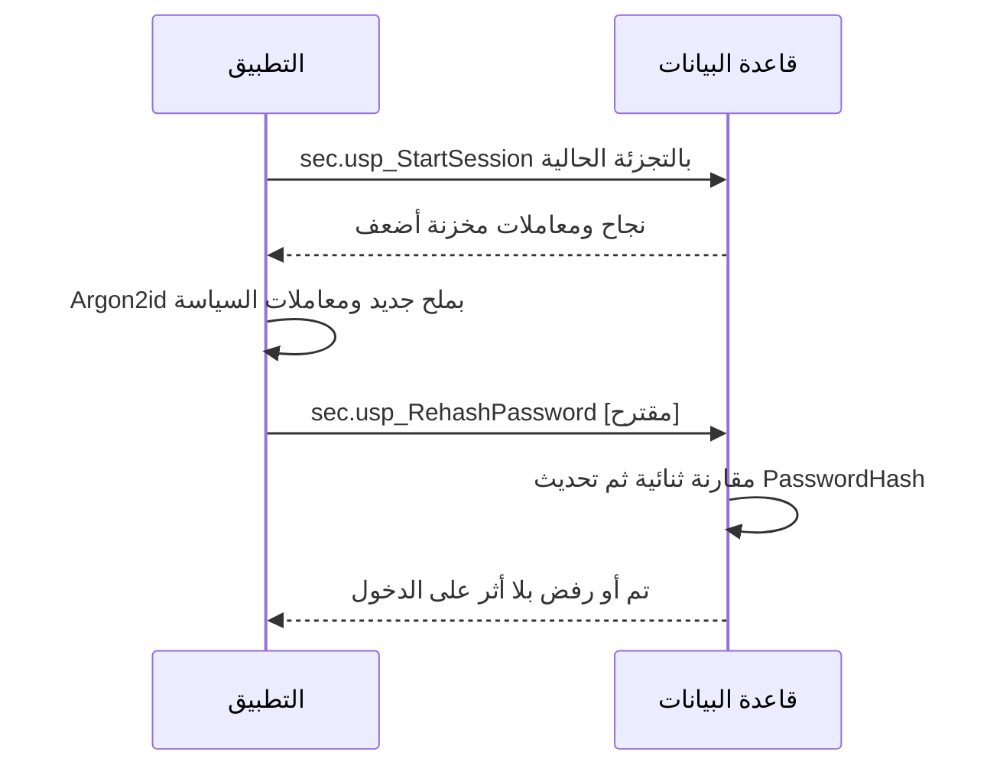

# DOC-S04 — سياسة كلمات المرور والمصادقة المتعددة والاسترداد

| البند | القيمة |
|---|---|
| المعرّف | DOC-S04 (docs/30-readiness-documents.md) |
| الإصدار | 0.1 — مسودة للمراجعة — 2026-10-12 |
| المالك المقترح | مسؤول أمن المعلومات مع مالك المنتج (اعتماد الإدارة) |
| الأولوية | P0 قبل S0 |
| يغطي | FR-PLT-006، FR-PLT-010 إلى FR-PLT-014، FR-PLT-043، BR-PLT-004، BR-PLT-005، BR-PLT-006، BR-PLT-018، O-01 وO-24 (erd_open_items) |
| يعتمد على | DOC-F03 (التسلسلات)، DOC-F06 (الحالات)، DOC-S03 (مواضع الفرض)، DOC-S02 (مفتاح سر TOTP)، DOC-B03 (زمن الاستجابة)، DOC-B01 (خطة الاختبار) |
| المصادر | docs/adr/0002-login-and-session-bound-context.md، db/static/030_session_context.sql، db/model/10-platform.model، db/generated/tsql/005_delete_grants.sql و007_table_grants.sql، db/tests/tenant_isolation_tests.sql، tools/dbgen/erd_open_items.py، docs/10-detailed-analysis/10-m0-m1-platform-organization.md |

## 1. الغرض والنطاق

تعطي الوثيقة قيمة قابلة للقياس لكل بند في سياسة كلمات المرور وMFA والاسترداد، مع موضع فرضها واختبارها.

- **المبدأ 🟢:** قيم المنصة حد أدنى. يشدّدها المشترك ولا يخففها (FR-PLT-010، FR-PLT-043، BR-PLT-018).
- **خارج النطاق:** التسلسلات (DOC-F03)، وشكل الكوكي والجلسة (DOC-S03)، ومفاتيح التشفير (DOC-S02).

**الوسوم:** 🟢 موجود أو مقرر مع الملف والسطر. 🟡 اقتراح.

**اختصارات المراجع:** «030» هو db/static/030_session_context.sql، و«model» هو db/model/10-platform.model، و«005» و«007» ملفا db/generated/tsql، و«10-m0-m1» هو docs/10-detailed-analysis/10-m0-m1-platform-organization.md، و«ADR 0002» هو docs/adr/0002-login-and-session-bound-context.md. أرقام T حالات db/tests/tenant_isolation_tests.sql، وأرقام T-S04 اختبارات مقترحة في §14.

## 2. ملخص القيم

| # | البند | القيمة | المصدر | موضع الفرض | الاختبار |
|---|---|---|---|---|---|
| P-1 | الخوارزمية | Argon2id بصيغة PHC والإصدار 19 | 🟢 ADR 0002:14 | القاعدة بقيد CHECK (model:87 و154 و264) | T-S04-1 |
| P-2 | المعاملات الدنيا | m=65536، t=3، p=4 | 🟢 ADR 0002:14 | التطبيق؛ القيد لا يفحصها عمدًا (ADR 0002:15) | T-S04-2 |
| P-3 | الملح والناتج | ملح 16 بايتًا عشوائيًا، وناتج 32 بايتًا | 🟡 | التطبيق | T-S04-2 |
| P-4 | إعادة التجزئة عند الدخول | إذا كانت المعاملات المخزنة أضعف من السياسة | 🟡 | التطبيق وإجراء مقترح | T-S04-3 |
| P-5 | الطول الأدنى | 12 افتراضيًا، وحد المنصة 10 | 🟢 BR-PLT-004 (10-m0-m1:230) | التطبيق | T-S04-4 |
| P-6 | الطول الأقصى | 128 محرفًا بعد التطبيع | 🟡 | التطبيق | T-S04-4 |
| P-7 | التركيب | بلا قواعد تركيب، وكل محارف Unicode مقبولة | 🟢 BR-PLT-004؛ 🟡 التطبيع NFKC | التطبيق | T-S04-5 |
| P-8 | المسرّبة والشائعة | مرفوضة | 🟢 BR-PLT-004؛ 🟡 المصدر | التطبيق | T-S04-6 |
| P-9 | السجل | لا تُقبل أي من آخر 5 كلمات | 🟢 BR-PLT-004، model:260-264 | 🟡 إجراء في القاعدة | T-S04-7 |
| P-10 | الانتهاء الدوري | لا يوجد؛ التغيير عند الاشتباه | 🟢 BR-PLT-004 | — | — |
| P-11 | القفل | 5 إخفاقات خلال 15 دقيقة تقفل 15 دقيقة | 🟢 BR-PLT-005، 030:88-103 | القاعدة | T34 |
| P-12 | القفل الثالث | يحتاج فك مدير الحساب | 🟢 030:96-100 | القاعدة | T-F06-1 |
| P-13 | إخفاقات MFA | تُعدّ في العداد نفسه، وخمسة في الجلسة تنهيها | 🟡 | إجراء مقترح | T-S04-8 |
| P-14 | تقييد المعدل لكل IP | §7.3 | 🟢 القاعدة؛ 🟡 القيم | التطبيق | T-S04-9 |
| P-15 | MFA للجميع | كل مستخدم غير خدمي، بلا استثناء من المشترك | 🟢 BR-PLT-006، FR-PLT-011؛ 🟡 منع الاستثناء | القاعدة عند الربط (030:198) | T36، T-S04-10 |
| P-16 | معاملات TOTP | HMAC-SHA1، 6 أرقام، 30 ثانية، خطوة واحدة قبل وبعد | 🟡 | التطبيق | T-S04-11 |
| P-17 | منع إعادة الخطوة | خطوة أكبر من MfaLastUsedStep فقط | 🟢 العمود model:131؛ 🟡 الفرض | 🟡 إجراء | T-S04-11 |
| P-18 | رموز الاسترداد | 10 لمرة واحدة، مجزّأة | 🟢 FR-PLT-011، model:236-242 | 🟡 إجراء | T-S04-12 |
| P-19 | تصفير MFA | بيد مدير الحساب، بشدة عالية | 🟢 BR-PLT-006 | التطبيق | T-S04-13 |
| P-20 | مهلة إعادة التسجيل | 24 ساعة | 🟡 | القاعدة بانتهاء الرابط | T-S04-13 |
| P-21 | إعادة المصادقة | TOTP خلال آخر 5 دقائق قبل التصدير الحساس | 🟢 FR-PLT-014؛ 🟡 المدة | التطبيق | T-S04-14 |
| P-22 | الروابط | الدعوة 48 ساعة، والإعادة 30 دقيقة | 🟢 FR-PLT-013 | القاعدة بانتهاء الرابط | T-S04-15 |
| P-23 | MFA للمشغّل | إلزامي لكل مشغّل ACTIVE | 🟢 FR-PLT-006، model:82 | القاعدة بقيد CHECK | T-S04-16 |

## 3. التجزئة بـ Argon2id

| البند | القيمة | الحالة والمرجع |
|---|---|---|
| الصيغة المخزنة | `$argon2id$v=19$m=65536,t=3,p=4$` ثم الملح ثم الناتج بترميز base64 بلا حشو | 🟢 ADR 0002:14، model:154 |
| الأعمدة | sec.AppUser.PasswordHash وsec.UserPasswordHistory.PasswordHash وplat.PlatformOperator.PasswordHash | 🟢 ADR 0002:15 |
| الطول | نحو 97 حرفًا بالقيم المقترحة، والعمود 255 | 🟢 model:124؛ 🟡 القيم |
| موضع الحساب | التطبيق في الخادم، والمقارنة في القاعدة ثنائيًا | 🟢 ADR 0002:19-20، 030:84-86 |
| المكتبة | مكتبة Argon2id مراجَعة لـ .NET، لم تُختر | 🟢 مفتوح (tools/dbgen/erd_open_items.py:17) |
| الحماية من الاستنزاف | حد لعدد التجزئات المتوازية في الخادم، لأن كل تجزئة تحجز 64 ميغابايت | 🟡 |
| زمن التجزئة | يُقاس على خادم الإنتاج ويُسجَّل في DOC-B03 | 🟡 |

### 3.1 إعادة التجزئة عند الدخول 🟡

1. **الشرط:** أي معامل مخزن (m أو t أو p) أقل من السياسة الحالية، أو الإصدار غير 19.
2. **التوقيت:** في طلب كلمة المرور نفسه بعد نجاح usp_StartSession، لأن النص الصريح لا يُحتفظ به إلى خطوة MFA.
3. **الطريقة:** ملح جديد ومعاملات السياسة، ثم sec.usp_RehashPassword(@TenantId, @SessionToken, @CurrentHash, @NewHash) بصفة tp_auth_exec. يتحقق الإجراء من تطابق التجزئة الحالية ثنائيًا ومن أن الجلسة أُنشئت للتو.
4. **ما لا يتغير:** PasswordChangedAt، وسجل الكلمات، والجلسات.
5. **الفشل:** لا يُفشل الدخول، ويُسجَّل في سجل التطبيق ليُعاد في الدخول التالي.
6. **السبب:** التطبيق لا يكتب sec.AppUser قبل الربط، والربط ينتظر MFA (030:198). والإجراء يقلّص أيضًا الخطر R1 في DOC-S03 §12.

## 4. قواعد كلمة المرور

| القاعدة | القيمة | الحالة |
|---|---|---|
| الطول الأدنى | 12 افتراضيًا، ويرفعه المشترك حتى 64، ولا يُنزل تحت 10 | 🟢 12 و10 (BR-PLT-004)؛ 🟡 الحد 64 |
| الطول الأقصى | 128 محرفًا | 🟡 |
| العدّ | بنقاط Unicode بعد تطبيع NFKC | 🟡 |
| المحارف | كل محرف قابل للطباعة بما فيه المسافة | 🟡 |
| قواعد التركيب | لا يوجد | 🟢 BR-PLT-004 |
| الاقتطاع والتلميح | لا اقتطاع ولا تلميح، واللصق مسموح | 🟡 |
| قائمة الرفض | المسرّبة، والشائعة، وكلمات السياق: رمز المشترك وbankfas والجزء الأول من البريد والاسم المعروض | 🟢 المسرّبة والشائعة؛ 🟡 السياق |
| رسالة الرفض | تذكر القاعدة المخالفة | 🟡 |
| التسجيل | لا تُخزَّن ولا تُسجَّل نصًا | 🟢 FR-PLT-010 (10-m0-m1:112) |

**مصدر قائمة المسرّبة 🟡 (DQ-S04-1).** قائمة منشورة لتجزئات SHA-1 لكلمات مرور مسرّبة، مقسومة ببادئة التجزئة على نموذج k-anonymity. تُنزَّل إلى خادم التطبيق وتُبحث محليًا، فلا يخرج أي جزء من كلمة المرور. تُحدَّث كل ثلاثة أشهر. يُفحص بها عند كل تعيين لكلمة مرور: الدعوة والتغيير والإعادة. غياب القائمة خطأ نشر، فيُرفض التعيين ولا يُتجاوز الفحص.

## 5. سجل الكلمات وتغييرها

| البند | القيمة | الحالة والمرجع |
|---|---|---|
| عدد السجل | الجديدة تختلف عن آخر 5، والحالية منها | 🟢 BR-PLT-004؛ 🟡 تضمين الحالية |
| التخزين | سلسلة PHC بمعاملاتها في sec.UserPasswordHistory للإضافة فقط | 🟢 model:260-264، 005:45 |
| المقارنة | يجلب التطبيق معاملات آخر 5 بلا تجزئات، ويحسب الجديدة بكل منها، وتقارن القاعدة | 🟡 sec.usp_GetPasswordHistoryParams |
| التشذيب | تُحذف الأقدم من 5 عند كل إضافة | 🟡؛ الحذف ممنوح (005:15) |
| التغيير الذاتي | يتطلب الكلمة الحالية | 🟡 sec.usp_ChangePassword |
| أثر التغيير | PasswordChangedAt، وتنتهي الجلسات الأخرى بسبب PASSWORD_CHANGED | 🟡 DOC-F06 §4 |
| المدير | لا يعيّن كلمة مرور لغيره؛ يرسل رابط إعادة | 🟡 |
| حجب القراءة | DENY SELECT على PasswordHash في السجل لـ tp_app | 🟡 R4 في DOC-S03 §12 |

## 6. روابط الدعوة والإعادة وإعادة التسجيل

| البند | القيمة | الحالة والمرجع |
|---|---|---|
| الرمز | 32 بايتًا عشوائية بترميز base64url | 🟡 |
| التخزين | SHA-256 في sec.UserToken.TokenHash، فريد | 🟢 model:247 و256 |
| الاستعمال | مرة واحدة (UsedAt)، والإصدار الجديد يلغي السابق (RevokedAt) | 🟢 الأعمدة model:249-250؛ 🟡 القاعدة |
| مدة الدعوة | 48 ساعة | 🟢 FR-PLT-013 (10-m0-m1:115) |
| مدة الإعادة | 30 دقيقة | 🟢 FR-PLT-013 |
| مدة إعادة التسجيل | 24 ساعة | 🟡 DQ-F03-8 |
| معدل طلب الإعادة | 3 لكل مستخدم في الساعة، و10 لكل IP في الساعة، باستجابة واحدة | 🟡 |
| من يطلب الإعادة | ACTIVE وLOCKED فقط؛ لا INVITED ولا DISABLED ولا ARCHIVED ولا حساب الخدمة | 🟡 |
| أثر الإعادة على القفل | تفك القفل المؤقت، ولا ترفع RequiresAdminUnlock | 🟡 DQ-S04-12 |

## 7. القفل وفكه وتقييد المعدل

### 7.1 القيم المنفذة 🟢

| البند | القيمة | المرجع |
|---|---|---|
| الحد | 5 إخفاقات | 030:94 |
| النافذة | 15 دقيقة من أول إخفاق | 030:90-93 |
| مدة القفل | 15 دقيقة | 030:98 |
| القفل الثالث | يضع RequiresAdminUnlock | 030:96 و100 |
| النجاح | يصفّر العداد ويفك القفل المؤقت | 030:113-114 |
| التسجيل | كل محاولة في sec.LoginAttempt، والقفل حدث إضافي | 030:123-129 |
| الرسالة | خطأ واحد 50005 لكل فشل | 030:138-140 |
| القيم ثابتة في الإجراء | لا يقرأ cfg.TenantSetting | 030:90-100 |

### 7.2 دلالة القفل الثالث

المنفَّذ: يزيد LockoutCount إن كان القفل السابق خلال 24 ساعة من الحالي، وإلا يعود 1 (030:96). فثلاثة أقفال متتابعة يفصل كلًا منها عن سابقه أقل من 24 ساعة تكفي، ولو امتدت كلها أكثر من 24 ساعة. كل حالة يشملها نص BR-PLT-005 («ثالث قفل خلال 24 ساعة») يشملها المنفَّذ، فهو أشد. 🟡 يُقبل المنفَّذ ويُعدَّل نص القاعدة (DQ-S04-4).

### 7.3 تقييد المعدل لكل عنوان IP 🟡

| القاعدة | الحد | الأثر |
|---|---|---|
| إخفاقات كلمة المرور من IP واحد | 10 في الدقيقة | رفض 429 لمدة دقيقة |
| إخفاقات كلمة المرور من IP واحد عبر كل الحسابات | 50 في الساعة | رفض 429 لمدة ساعة |
| إخفاقات MFA من IP واحد | 10 في 15 دقيقة | رفض 429 لمدة 15 دقيقة |
| طلبات الإعادة | §6 | استجابة واحدة |

العنوان من مصدر موثوق (DOC-S03 §7). العدّ في ذاكرة التطبيق في S0 بنسخة واحدة، ويصير مخزنًا مشتركًا عند تعدد النسخ.

### 7.4 الفك

- 🟢 تلقائي: أول كلمة صحيحة بعد LockedUntil ما لم يكن RequiresAdminUnlock = 1 (030:80 و113-114).
- 🟡 بيد مدير الحساب بالصلاحية sec.user.manage (DOC-F07) في أي وقت، مع تدقيق ACCOUNT_UNLOCKED (DOC-F06 §5).
- 🟡 الإشعار عند القفل الثالث لمدير الحساب (10-m0-m1:532)، وفي S0 يظهر في شاشة المستخدمين (DQ-F06-6).

**خطر متبقٍ.** من يعرف بريد مستخدم يستطيع قفله. يحدّ منه تقييد المعدل وعدم كشف وجود البريد، ولا يمنعه.

## 8. MFA بتطبيق TOTP

| البند | القيمة | الحالة والمرجع |
|---|---|---|
| النطاق | كل مستخدم غير خدمي؛ المشترك لا يعطّلها | 🟢 BR-PLT-006 (10-m0-m1:232)؛ 🟡 منع التعطيل (DQ-S04-11) |
| الطريقة | TOTP فقط؛ لا رسائل نصية ولا رمز بالبريد | 🟢 Q-PLT-02 (10-m0-m1:614) |
| الخوارزمية | RFC 6238 بـ HMAC-SHA1، 6 أرقام، خطوة 30 ثانية | 🟡 |
| نافذة القبول | الخطوة الحالية وخطوة قبلها وبعدها | 🟡 |
| منع الإعادة | الخطوة المقبولة أكبر من MfaLastUsedStep، ثم تُحفظ | 🟢 العمود model:131؛ 🟡 الفحص داخل usp_ConfirmMfa |
| السر | 20 بايتًا عشوائية، مشفرة بمفتاح DATA للمشترك | 🟢 model:127-129 و149؛ 🟡 الطول؛ التفصيل في DOC-S02 |
| التسجيل | رمز QR يُعرض مرة، ولا يُحفظ قبل إدخال رمز صحيح منه | 🟡 |
| نافذة خطوة MFA | 5 دقائق من إنشاء الجلسة | 🟡 DOC-F03 §6 |
| الإخفاقات | كل رمز خاطئ يُعدّ في عداد القفل، وخمسة في الجلسة تنهيها | 🟡 DQ-S04-5 |
| تذكّر الجهاز | لا يوجد | 🟡 |
| التحقق | في التطبيق، والقاعدة تسجّل النتيجة | 🟢 030:143-163؛ خطر R2 في DOC-S03 |

## 9. رموز الاسترداد

| البند | القيمة | الحالة والمرجع |
|---|---|---|
| العدد | 10 | 🟢 FR-PLT-011 (10-m0-m1:113)، model:236 |
| الاستعمال | مرة واحدة لكل رمز، ويعادل اجتياز MFA لذلك الدخول | 🟢 FR-PLT-011؛ 🟡 المعادلة |
| الشكل | 16 محرفًا من أبجدية Crockford base32 (80 بتًا)، في أربع مجموعات | 🟡 |
| المقارنة | بلا حساسية لحالة الأحرف، وتُهمل الشرطات | 🟡 |
| التخزين | SHA-256 للرمز بعد التطبيع في CodeHash | 🟢 العمود bin(32) model:238؛ 🟡 الدالة |
| الاستهلاك | داخل القاعدة: UsedAt وUsedIp، ويُعاد عدد الباقي | 🟢 الأعمدة model:239-240؛ 🟡 sec.usp_UseRecoveryCode |
| التنبيه | يُبلَّغ المستخدم بعدد الباقي | 🟢 BR-PLT-006 |
| التجديد | عند الوصول إلى 2 أو أقل يُقترح التجديد؛ التجديد يلغي كل القديم ويتطلب TOTP حديثًا | 🟡 |
| الرمز الخاطئ | يُعدّ إخفاق MFA | 🟡 |
| التدقيق | RECOVERY_CODE_USED وRECOVERY_CODES_REGENERATED | 🟡 |

قوة 80 بتًا تجعل تخمين الرمز من تجزئته غير عملي دون دالة بطيئة. ومع ذلك يُحجب CodeHash عن tp_app بعد نقل الاستهلاك إلى القاعدة (DOC-S03 §12 R5).

## 10. تصفير MFA وإعادة التسجيل

**شروط التصفير 🟡:**

1. يطلبه المستخدم لفقد الجهاز مع فقد رموز الاسترداد، أو يبادر به مدير الحساب عند الاشتباه.
2. ينفّذه مدير الحساب بالصلاحية sec.user.manage (DOC-F07)، بعد إعادة مصادقته بـ TOTP حديث.
3. لا يصفّر مدير الحساب MFA الخاص به. المدير الوحيد يمر بمسار المشغّل (DQ-F06-4).
4. يتحقق المدير من الهوية بقناة غير قناة الطلب: لقاء مباشر، أو اتصال برقم معروف مسبقًا لدى المشترك. يكتب الطريقة في سبب إلزامي يُحفظ في حدث التدقيق.
5. أكثر من تصفيرين للمستخدم نفسه خلال 30 يومًا يظهر في تقرير R-PLT-4 (10-m0-m1:548).

**الأثر 🟢 مع تفصيل 🟡:** MfaEnabled = 0، ومسح السر ومرجعه وMfaEnrolledAt وMfaLastUsedStep، وحذف رموز الاسترداد (005:13)، وإنهاء كل الجلسات بسبب MFA_RESET، وتدقيق بشدة عالية (BR-PLT-009، 10-m0-m1:235)، وإشعار SEC.MFA_RESET للمستخدم والمديرين (10-m0-m1:534).

**إعادة التسجيل 🟡:**

- رابط صالح 24 ساعة يُرسل إلى بريد المستخدم (DQ-F03-8).
- يفتح المستخدم الرابط، ويدخل كلمة المرور، ويسجّل جهازًا جديدًا، ويستلم عشرة رموز جديدة.
- قبل الإكمال لا يدخل المستخدم، لأن الربط يشترط MFA لكل مستخدم غير خدمي (DQ-F03-4).
- بعد انتهاء المهلة يُصدر المدير رابطًا جديدًا دون تصفير جديد.

## 11. إعادة المصادقة

| البند | القيمة المقترحة 🟡 |
|---|---|
| الحداثة | آخر تحقق MFA خلال 5 دقائق (sec.UserSession.MfaVerifiedAt) |
| الطريقة | رمز TOTP؛ رمز الاسترداد لا يكفي لهذه الخطوة |
| التصديرات الحساسة | party.pack.export، وparty.export.sensitive، وتصدير التدقيق (10-m0-m1:48)، وتصدير بيانات المشترك (10-m0-m1:67، FR-PLT-039) |
| أفعال إدارية حساسة | تصفير MFA لمستخدم، وفك القفل الثالث، وإسناد دور TM أو FO (BR-PLT-008)، وتجديد رموز الاسترداد، وتغيير جهاز TOTP، وتغيير كلمة المرور |
| الرفض | يُسجَّل في التدقيق بنتيجة DENIED |

## 12. حسابات المشغّل (FR-PLT-006)

**الموجود 🟢:** plat.PlatformOperator بحالات المستخدم نفسها (model:68)، وMFA إلزامي لكل مشغّل ACTIVE (model:82)، وسر TOTP مشفر بمفتاح المنصة (model:72-73)، وقيد Argon2id (model:87). الجدول محجوب عن tp_app (model:64).

**الناقص 🟢:** لا إجراء دخول للمشغّل، ولا جدول جلسات له، ولا رموز استرداد. والجدول فيه FailedAttempts وLockedUntil فقط (model:76-77)، بلا FirstFailedAt ولا LockoutCount ولا RequiresAdminUnlock، فلا يُطبَّق عليه BR-PLT-005 كاملًا.

| البند | القيمة المقترحة 🟡 |
|---|---|
| كلمة المرور | 14 محرفًا على الأقل، وبقية §4 و§5 |
| MFA | TOTP إلزامي، بلا رموز استرداد |
| الاسترداد | تصفير بيد OPERATOR_ADMIN آخر فقط، مع بقاء اثنين من OPERATOR_ADMIN دائمًا |
| القفل | 5 إخفاقات خلال 15 دقيقة تقفل حتى يفك OPERATOR_ADMIN آخر |
| الجلسة | خمول 15 دقيقة ومطلقة 8 ساعات |
| الوصول | مضيف مستقل وقائمة عناوين IP مسموحة (DOC-S03 §4) |
| التنفيذ | جدول جلسات للمشغّل وأعمدة القفل وإجراءات دخول بصفة مخصصة (DQ-S04-10) |

## 13. مفاتيح إعدادات المشترك المقترحة

تُعرَّف في cfg.SettingDefinition بحد أدنى وأقصى (model:426-436). لم تُبذر أي مفاتيح بعد. القيم كلها 🟡.

| المفتاح | الافتراضي | أضعف قيمة | أشد قيمة | موضع الفرض |
|---|---|---|---|---|
| security.password.min_length | 12 | 10 | 64 | التطبيق |
| security.password.history_count | 5 | 5 | 24 | إجراء السجل |
| security.lockout.threshold | 5 | 5 | 3 | usp_StartSession (DQ-S03-6) |
| security.session.idle_minutes | 30 | 30 | 5 | usp_StartSession والربط |
| security.session.absolute_hours | 12 | 12 | 1 | usp_StartSession |
| security.stepup.freshness_minutes | 5 | 5 | 1 | التطبيق |

قيم Argon2id وMFA وعدد رموز الاسترداد ليست إعدادات للمشترك. حدود الإعدادات اليوم في التطبيق وحده (DR-17)، والإجراء يستعمل قيمًا ثابتة (030:90-100 و117-118).

## 14. الاختبارات

| المعرّف | ما يثبته | المستوى | الحالة (حالات db/tests/tenant_isolation_tests.sql بأرقامها؛ «CI» هو tools/ci/db_ci.sh في حاوية التطوير، ولم يعمل على GitHub بعد، O-02 (erd_open_items)) |
|---|---|---|---|
| T33 | المعاملات بلا تجزئة، والرفض بخطأ واحد، والجلسة عند النجاح | القاعدة | 🟢 موجود ويمر في CI |
| T34 | خمسة إخفاقات تقفل والكلمة الصحيحة ترفض | القاعدة | 🟢 موجود ويمر في CI |
| T35 | التطبيق لا يقرأ التجزئة ولا ينشئ جلسة ولا يمدد المهلة المطلقة | القاعدة | 🟢 موجود ويمر في CI |
| T36 | لا ربط قبل MFA | القاعدة | 🟢 موجود ويمر في CI |
| T-S04-1 | إدراج تجزئة غير Argon2id يُرفض بالقيد في الجداول الثلاثة | القاعدة | 🟡 |
| T-S04-2 | التجزئة الناتجة بمعاملات أقل من P-2 ترفضها خدمة التعيين | التطبيق | 🟡 |
| T-S04-3 | مستخدم بمعاملات أضعف تُعاد تجزئته بعد دخول ناجح، ولا يتغير PasswordChangedAt | تكامل | 🟡 |
| T-S04-4 | 9 محارف ترفض، و10 ترفض افتراضيًا وتقبل بإعداد 10، و129 ترفض | التطبيق | 🟡 |
| T-S04-5 | كلمة بمحارف عربية ومسافات تقبل، وصيغتا تطبيع لها تتطابقان | التطبيق | 🟡 |
| T-S04-6 | كلمة من القائمة المسرّبة ترفض، وكلمة فيها رمز المشترك ترفض | التطبيق | 🟡 |
| T-S04-7 | إعادة أي من آخر 5 كلمات ترفض، والسادسة القديمة تقبل | تكامل | 🟡 |
| T-S04-8 | خمسة رموز MFA خاطئة تنهي الجلسة وتزيد العداد | القاعدة | 🟡 |
| T-S04-9 | المحاولة 11 من IP في الدقيقة تعطي 429 | التطبيق | 🟡 |
| T-S04-10 | مستخدم ACTIVE بلا MFA لا تُربط جلسته | القاعدة | 🟡 بعد DQ-F03-4 |
| T-S04-11 | رمز TOTP مستعمل يرفض، ورمز بانحراف خطوتين يرفض | تكامل | 🟡 |
| T-S04-12 | رمز استرداد يُقبل مرة ويرفض الثانية، ويعاد عدد الباقي 9 | القاعدة | 🟡 |
| T-S04-13 | بعد التصفير لا دخول حتى إعادة التسجيل، والرابط بعد 24 ساعة يرفض | تكامل | 🟡 |
| T-S04-14 | تصدير حساس بتحقق أقدم من 5 دقائق يطلب TOTP | تكامل | 🟡 |
| T-S04-15 | رابط دعوة بعد 48 ساعة أو مستعمل يرفض برسالة واحدة | تكامل | 🟡 |
| T-S04-16 | مشغّل ACTIVE بلا MFA يرفضه القيد | القاعدة | 🟡 |

## 15. القرارات المطلوبة

| المعرّف | السؤال | الافتراض المقترح | من يقرر | ما يعطّله |
|---|---|---|---|---|
| DQ-S04-1 | مصدر قائمة المسرّبة وتحديثها | قائمة تجزئات SHA-1 بنموذج k-anonymity محلية، تُحدَّث كل 3 أشهر | مسؤول أمن المعلومات | FR-PLT-010 |
| DQ-S04-2 | الطول الأقصى والتطبيع | 128 محرفًا بعد NFKC | مسؤول أمن المعلومات | T-S04-4 و5 |
| DQ-S04-3 | إعادة التجزئة | sec.usp_RehashPassword في طلب كلمة المرور | معماري القاعدة | ترقية المعاملات |
| DQ-S04-4 | دلالة القفل الثالث | قبول المنفَّذ وتعديل نص BR-PLT-005 | مالك المنتج | لا شيء |
| DQ-S04-5 | إخفاقات MFA | تُعدّ في عداد BR-PLT-005، وخمسة في الجلسة تنهيها، داخل usp_ConfirmMfa؛ يتفق مع DQ-S01-7 | مسؤول أمن المعلومات | FR-PLT-011 |
| DQ-S04-6 | قيم تقييد المعدل | §7.3 | مسؤول أمن المعلومات | BR-PLT-005 |
| DQ-S04-7 | معاملات TOTP | RFC 6238، SHA1، 6 أرقام، 30 ثانية، خطوة واحدة | مسؤول أمن المعلومات | التسجيل |
| DQ-S04-8 | شكل رموز الاسترداد وتجزئتها | 16 محرف base32 وSHA-256 | معماري الأمن | FR-PLT-011 |
| DQ-S04-9 | شروط التصفير ومهلة إعادة التسجيل | §10، والمهلة 24 ساعة | المالك | BR-PLT-006 |
| DQ-S04-10 | سياسة المشغّل والجداول الناقصة | §12 | المالك مع معماري القاعدة | FR-PLT-006 |
| DQ-S04-11 | هل يعطّل المشترك MFA؟ | لا، فـ «افتراضيًا» تعني قيمة المنصة الدنيا | المالك | BR-PLT-006 |
| DQ-S04-12 | هل تفك الإعادة القفل؟ | تفك المؤقت فقط | مسؤول أمن المعلومات | FR-PLT-013 |
| DQ-S04-13 | مكتبة Argon2id | مكتبة مراجَعة تُختار مع بدء التطبيق | قائد التطبيق | O-01 (erd_open_items) |
| DQ-S04-14 | مفاتيح الإعدادات وحدودها | §13 | مالك المنتج | FR-PLT-043، البذر |
| DQ-S04-15 | طريقة إعادة المصادقة | TOTP وحده؛ كلمة المرور معه تحتاج إجراء تحقق جديدًا لا يُنشئ جلسة | مسؤول أمن المعلومات | FR-PLT-014، §11 |

## 16. تعارضات وفجوات في المصادر

| البند | الموضع | الملاحظة |
|---|---|---|
| رموز الاسترداد في التحليل | 10-m0-m1:304 | تذكر RecoveryCodesHash بصيغة json في AppUser، والنموذج يستعمل sec.MfaRecoveryCode (model:236) |
| إلزام PasswordHash | 10-m0-m1:304 | «PasswordHash م»، والنموذج يجعله فارغًا حتى إكمال الدعوة (model:124) |
| القفل الثالث | 10-m0-m1:231 و030:96 | النص «خلال 24 ساعة» والمنفَّذ سلسلة (§7.2) |
| معنى «افتراضيًا» | 10-m0-m1:232 و10-m0-m1:113 | قد يُفهم أن MFA قابلة للتعطيل، وFR-PLT-043 يمنع التخفيف (10-m0-m1:145) |
| قيم ثابتة | 030:90-100 و117-118 | الإجراء لا يقرأ إعدادات المشترك، وFR-PLT-043 يسمح بالتشديد |
| إخفاقات MFA | 030:159-162 | تُسجَّل ولا تُعدّ ولا حد لها، وBR-PLT-005 يسرد FAILED_MFA ضمن أحداث القفل (10-m0-m1:231) |
| رسائل البريد المعاملاتي | 10-m0-m1:115 | رسالتان فقط، وإعادة التسجيل تحتاج ثالثة (DQ-F03-8) |
| قفل المشغّل | model:76-77 | أعمدة أقل من AppUser (model:132-137) |
| سجل الكلمات قابل للقراءة | 007:46 | tp_app يقرأ التجزئات القديمة، والحجب لـ tp_readonly وحده (db/generated/tsql/006_sensitive_columns.sql:14) |

## 17. التتبع

| البند في هذه الوثيقة | المتطلب أو القاعدة أو القرار | المصدر |
|---|---|---|
| §3 | FR-PLT-010، O-01 (erd_open_items) | ADR 0002:13-15، tools/dbgen/erd_open_items.py:13-18 |
| §4 و§5 | BR-PLT-004، FR-PLT-043 | 10-m0-m1:230 و:145، model:260-264 |
| §6 | FR-PLT-013 | 10-m0-m1:115، model:244-258 |
| §7 | BR-PLT-005، FR-PLT-012 | 030:88-140، 10-m0-m1:231 |
| §8 و§9 | FR-PLT-011، BR-PLT-006 | 030:143-163، model:126-131 و236-242 |
| §10 | BR-PLT-006، BR-PLT-009 | 10-m0-m1:232 و:534 |
| §11 | FR-PLT-014، FR-PLT-019 | 10-m0-m1:116 و:121 |
| §12 | FR-PLT-006 | model:64-87 |
| §13 | FR-PLT-043، BR-PLT-018، DR-17 | model:426-441 |
