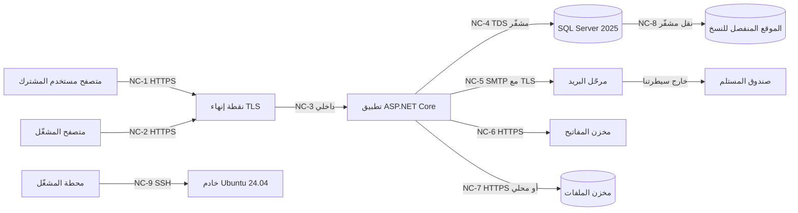

# DOC-S05 — سياسة TLS وتشفير الاتصالات

| البند | القيمة |
|---|---|
| المعرّف | DOC-S05 (docs/30-readiness-documents.md) |
| الإصدار | 0.1 — مسودة للمراجعة — 2026-10-12 |
| المالك المقترح | مهندس البنية التحتية والأمن |
| الأولوية | P0 قبل S0 |
| يغطي | O-08 (erd_open_items)، FR-PLT-046، FR-PLT-013، FR-PLT-006، X-SEC-2، FR-NTF-013 |
| يعتمد على | DOC-F01 (حدود الثقة TB-n)، DOC-S02 (المفاتيح عند التخزين)، DOC-S03 (ملفات تعريف الارتباط وCSP)، DOC-S08 (أسرار القاعدة)، DOC-S10 (تقوية الخادم وSSH)، DOC-B11 (البيئات والأسرار) |
| المصادر | docs/30-readiness-documents.md:240-246 · tools/dbgen/erd_open_items.py:56-60 · docs/10-detailed-analysis/10-m0-m1-platform-organization.md:115 و148 و582 · docs/10-detailed-analysis/00-overview-and-cross-cutting.md:137 · tools/deploy/deploy.sh · tools/deploy/deploy.ps1 · tools/ci/db_ci.sh · tools/dbgen/check_deployed.py · .github/workflows/db-ci.yml · docs/adr/0001-schema-work-on-linux.md |

**وسوم المصدر:** 🟢 ذكره المستخدم أو ورد في الوثائق · 🟡 اقتراح له افتراضي ويُعدَّل.

## 1. الغرض والنطاق

**الغرض.** تحدد هذه الوثيقة كيف يُشفَّر كل اتصال شبكي في المنصة: إصدارات TLS ومجموعات التشفير وHSTS، وشهادة النطاق `bankfas.com` وإصدارها وتجديدها ومالكها، وتشفير اتصال التطبيق بـ SQL Server مع التحقق من الشهادة، واتصال البريد، ووصول المشغّلين بـ SSH. تُغلق بها O-08 (erd_open_items) بعد اعتمادها.

**داخل النطاق:** المتصفح إلى التطبيق، والتطبيق إلى SQL Server، والتطبيق إلى مرحّل البريد، والتطبيق إلى مخزن المفاتيح ومخزن الملفات، ونقل النسخ إلى الموقع المنفصل، ووصول المشغّلين بـ SSH.

**خارج النطاق (يُحال):**
- خصائص ملف تعريف الارتباط وSameSite وCSRF وCSP: DOC-S03 (docs/10-detailed-analysis/10-m0-m1-platform-organization.md:585).
- تقوية خادم Ubuntu وحساباته: DOC-S10.
- التشفير عند التخزين: DOC-S02.

## 2. ما هو موجود اليوم

| البند | النص الحالي | المصدر |
|---|---|---|
| الحد الأدنى للنقل | «TLS 1.2 فأعلى (1.3 مفضّل) مع HSTS» 🟢 | docs/10-detailed-analysis/10-m0-m1-platform-organization.md:582 |
| تشفير النقل قرار | X-SEC-2 «تشفير النقل (TLS) والتخزين» 🟢 | docs/10-detailed-analysis/00-overview-and-cross-cutting.md:137 |
| النطاق والعناوين | `{رمز-المشترك}.bankfas.com`، «شهادة TLS شاملة (wildcard) أو شهادة لكل عنوان» 🟢 | docs/10-detailed-analysis/10-m0-m1-platform-organization.md:148 |
| العناوين المحجوزة | `www` و`admin` و`api` و`app` وغيرها | db/model/10-platform.model:58-62 |
| صيغة رمز المشترك | حروف لاتينية وأرقام وشرطة، لا شرطة في الطرفين، 30 خانة | db/model/10-platform.model:32 و51 |
| البريد المعاملاتي | «عبر مرحّل SMTP تهيّئه الاستضافة» لرسالتي الدعوة وإعادة التعيين 🟡 | docs/10-detailed-analysis/10-m0-m1-platform-organization.md:115 |
| مصادقة نطاق البريد | SPF وDKIM وDMARC لبريد الإشعارات في S5 | docs/10-detailed-analysis/13-m6-workflow-engine-notifications.md:693 |
| O-08 | «Open. Not documented in the analysis or the model» | tools/dbgen/erd_open_items.py:58-59 |
| أداة النشر | الافتراضي `-C` أي الثقة بشهادة الخادم دون تحقق | tools/deploy/deploy.sh:10-11 و19 |
| CI | `-C` في كل استدعاء | tools/ci/db_ci.sh:21، tools/dbgen/check_deployed.py:52 |
| أداة Windows | تضيف `-C` دائمًا مع تسجيل دخول SQL | tools/deploy/deploy.ps1:32 |

**خلاصة.** الحد الأدنى وHSTS مذكوران في docs/10-detailed-analysis/10-m0-m1-platform-organization.md:582، فـ O-08 أضيق مما يعرضه سجلها. الناقص: مجموعات التشفير، ومدة HSTS، والشهادة ومالكها وتجديدها، وإعدادات `Encrypt` و`TrustServerCertificate`، والبريد، وSSH.

## 3. خريطة الاتصالات

| الرمز | الاتصال | البروتوكول والحد الأدنى | التحقق من الطرف الآخر | ملاحظة |
|---|---|---|---|---|
| NC-1 | المتصفح إلى التطبيق | TLS 1.3 مفضّل، 1.2 أدنى | شهادة `*.bankfas.com` من سلطة عامة | القسم 4 |
| NC-2 | لوحة المشغّل | كما NC-1 | كما NC-1، و MFA إلزامي (FR-PLT-006) | تقييد المصدر 🟡 DQ-S05-8 |
| NC-3 | نقطة الإنهاء إلى التطبيق | محلي على المضيف نفسه، أو TLS 1.2+ إن كانا مضيفين | شهادة داخلية | يتبع قرار نظام تشغيل طبقة التطبيق |
| NC-4 | التطبيق إلى SQL Server | TLS 1.2+ داخل TDS | `TrustServerCertificate=False` واسم المضيف مطابق | القسم 5 |
| NC-5 | التطبيق إلى مرحّل البريد | TLS إلزامي بلا تراجع | شهادة المرحّل | القسم 6 |
| NC-6 | التطبيق إلى مخزن المفاتيح | TLS 1.2+ | شهادة الخدمة ومصادقة التطبيق | DOC-S02 |
| NC-7 | التطبيق إلى مخزن الملفات | محلي، أو HTTPS إن كان بعيدًا | شهادة الخدمة | الملفات مشفّرة أصلًا (DOC-S02 §8) |
| NC-8 | نسخ الملفات إلى الموقع المنفصل | SSH أو HTTPS | مفتاح المضيف أو الشهادة | DOC-S09 |
| NC-9 | المشغّل إلى الخادم | SSH بمفتاح فقط | بصمة مفتاح المضيف | القسم 7 |

تُربط هذه الرموز بحدود الثقة TB-n في DOC-F01 عند صدوره.

## 4. المتصفح إلى التطبيق (NC-1 وNC-2)

### 4.1 البروتوكولات ومجموعات التشفير 🟡

- **مسموح:** TLS 1.3، وTLS 1.2.
- **مرفوض:** SSLv2 وSSLv3 وTLS 1.0 وTLS 1.1، كما توصي O-08 (tools/dbgen/erd_open_items.py:59).
- **TLS 1.3:** المجموعات القياسية الثلاث: `TLS_AES_256_GCM_SHA384` و`TLS_CHACHA20_POLY1305_SHA256` و`TLS_AES_128_GCM_SHA256`.
- **TLS 1.2:** تبادل مفاتيح ECDHE فقط، وتشفير AEAD فقط (AES-GCM أو ChaCha20-Poly1305). لا CBC، ولا تبادل مفاتيح RSA الساكن، ولا 3DES ولا RC4، ولا توقيعات SHA-1.
- **المنحنيات:** X25519 وP-256.
- لا ضغط على مستوى TLS، ولا إعادة تفاوض يبدأها العميل.

### 4.2 HSTS 🟡

- الترويسة على كل استجابة HTTPS من `bankfas.com` وكل عنوان فرعي: `Strict-Transport-Security: max-age=31536000; includeSubDomains`.
- **التدرّج:** أسبوع أول بـ `max-age=86400`، ثم سنة بعد التحقق من أن كل عنوان فرعي يعمل بـ HTTPS.
- `includeSubDomains` آمن هنا لأن كل مشترك عنوان فرعي على HTTPS.
- `preload` لا يُضاف الآن، لأنه التزام يصعب التراجع عنه (DQ-S05-3).
- المنفذ 80 يعيد التوجيه فقط (301) إلى HTTPS على المضيف نفسه، ولا يقدّم محتوى ولا يقرأ ملف تعريف ارتباط.

### 4.3 الشهادة 🟡

- **النوع الافتراضي:** شهادة شاملة `*.bankfas.com` مع اسم بديل للجذر `bankfas.com`. الخيار مفتوح في FR-PLT-046 (DQ-S05-2).
- **سبب تفضيل الشاملة:** الشهادة لكل عنوان تُنشر في سجلات الشفافية العامة (Certificate Transparency)، فتكشف رمز كل مشترك جديد للعالم، أي قائمة العملاء. الشاملة لا تكشفها.
- **حدها:** الشاملة تغطي مستوى واحدًا فقط (`acme.bankfas.com` نعم، و`x.acme.bankfas.com` لا). يُمنع أي تصميم يضيف مستوى ثانيًا تحت عنوان المشترك. صيغة رمز المشترك تُنتج تسمية DNS صالحة من مستوى واحد: حروف وأرقام وشرطة، و30 خانة على الأكثر (db/model/10-platform.model:32 و51). DNS لا يميّز حالة الأحرف، فيُطابَق الرمز بلا تمييز لها، وترتيب القاعدة غير حساس لها أصلًا (T-2، docs/20-database-design.md:62).
- **المفتاح:** ECDSA P-256 افتراضيًا، أو RSA 2048 بت فأكثر إن لزم توافق قديم. مفتاح جديد عند كل تجديد.
- **المفتاح الخاص** يبقى على مضيف إنهاء TLS فقط، بصلاحية قراءة لحساب الخدمة وحده، ولا يدخل المستودع ولا النسخ إلى الموقع المنفصل.
- **العنوان غير المعروف:** الشهادة نفسها، وصفحة محايدة لا تكشف وجود المشترك 🟢 (FR-PLT-046).
- **العزل لا يعتمد على الشهادة:** تحديد المشترك من اسم المضيف يتم في التطبيق، وربط السياق في القاعدة (ADR 0002). الشهادة الشاملة لا تفتح طريقًا بين المشتركين.

### 4.4 الإصدار والتجديد 🟡

| البند | الافتراضي |
|---|---|
| الجهة المصدرة | سلطة تصديق عامة يثق بها كل متصفح (DQ-S05-1) |
| طريقة الإصدار | بروتوكول ACME (RFC 8555) بتحدي DNS-01، لأن الشهادة الشاملة تُثبت بسجل DNS |
| رمز واجهة DNS | صلاحيته تعديل سجلات `_acme-challenge` فقط، ويُحفظ في مخزن الأسرار (DOC-B11) |
| التجديد | آلي، عند مرور ثلثي مدة الصلاحية |
| المراقبة | تنبيه إن بقي على الانتهاء 21 يومًا ثم 7 أيام دون تجديد |
| سجل CAA | يحصر الإصدار للنطاق في السلطة المختارة |
| مدة الصلاحية | تتبع الحد الساري لدى منتدى CA/Browser وقت الإصدار؛ التجديد الآلي يجعل قِصرها غير مؤثر |
| المالك | مهندس البنية التحتية والأمن، ونائبه مهندس DevOps |

### 4.5 مكان إنهاء TLS

- نظام تشغيل طبقة التطبيق لم يُحسم (docs/10-detailed-analysis/00-overview-and-cross-cutting.md:226). يُنهى TLS على Kestrel أو IIS أو خادم وسيط عكسي على مضيف التطبيق، والسياسة أعلاه تنطبق على أيها (DQ-S05-12).
- إن كان الوسيط على مضيف غير مضيف التطبيق، فالاتصال NC-3 يُشفَّر كذلك.
- عنوان IP العميل يمرّره الوسيط في ترويسة يثق بها التطبيق من الوسيط فقط؛ التصميم في DOC-S03.

### 4.6 لوحة المشغّل 🟡

- على عنوان محجوز مثل `admin.bankfas.com` (db/model/10-platform.model:58-62) بالشهادة نفسها.
- MFA إلزامي للمشغّل 🟢 (FR-PLT-006). الافتراضي إضافة قائمة عناوين مصدر مسموحة أو شبكة خاصة (DQ-S05-8).

## 5. التطبيق إلى SQL Server (NC-4)

### 5.1 القاعدة 🟡

- **الإنتاج وكل بيئة فيها بيانات حقيقية:** `Encrypt=True` (إلزامي) و`TrustServerCertificate=False`، واسم الخادم في سلسلة الاتصال يطابق اسمًا في شهادة SQL Server.
- مثال بلا أسرار: `Server=tcp:<db-host>,1433;Database=BankFas;Encrypt=True;TrustServerCertificate=False`. كلمة المرور خارج السلسلة المخزّنة في المستودع (DOC-S08).
- `Encrypt=Strict` (TDS 8.0، TLS قبل التفاوض الأولي) أقوى. يُعتمد بعد التحقق من دعمه في مشغّل .NET وفي SQL Server 2025 على Linux (DQ-S05-6).
- **الخادم يفرض التشفير:** يُضبط SQL Server على Linux بأداة `mssql-conf` (مسار الشهادة والمفتاح، والبروتوكولات المسموحة، وفرض التشفير). تُتحقق أسماء الإعدادات من وثائق Microsoft عند التجهيز (DOC-S10)، وقد يلزم إعادة تشغيل الخدمة عند تبديل الشهادة.
- **الشبكة:** المنفذ 1433 غير مكشوف للإنترنت. الجدار الناري يسمح لمضيف التطبيق فقط. إن كان التطبيق والقاعدة على المضيف نفسه يبقى التشفير مفروضًا.
- **إدارة القاعدة:** عبر نفق SSH (NC-9) إلى المنفذ المحلي، و`sqlcmd` بلا `-C` مع شهادة الجهة المصدرة مثبتة على محطة المشغّل.

### 5.2 شهادة SQL Server 🟡

| البند | الافتراضي |
|---|---|
| المصدر | جهة تصديق خاصة بالمنصة، جذرها مثبت على مضيف التطبيق ومحطات DBA فقط، لأن اسم مضيف القاعدة لا يلزم أن يكون عامًّا (DQ-S05-5) |
| البديل | شهادة عامة لاسم تحت `bankfas.com` |
| الاسم | اسم المضيف المستعمل في سلسلة الاتصال، واسم بديل لاسم النفق المحلي إن لزم |
| الصلاحية والتجديد | سنة، وتنبيه قبل الانتهاء بـ 30 يومًا، والتبديل في نافذة صيانة |
| المالك | DBA مع مهندس البنية |

### 5.3 الخيار `-C` في الأدوات

- `-C` في `sqlcmd` يعني الثقة بشهادة الخادم دون تحقق، أي ما يعادل `TrustServerCertificate=True`.
- **في CI فقط:** `tools/ci/db_ci.sh:21` و`tools/dbgen/check_deployed.py:52` يتصلان بحاوية مؤقتة على المشغّل نفسه (`localhost,1433`، .github/workflows/db-ci.yml:38-42) بشهادة ذاتية التوقيع. هذا مقبول هناك ولا يُنقل إلى أي بيئة فيها بيانات حقيقية.
- **في أداة النشر:** `tools/deploy/deploy.sh:19` يجعل `-C` افتراضيًا، وADR 0001 يجعل هذه الأداة مسار النشر الإنتاجي (docs/adr/0001-schema-work-on-linux.md:19). حتى يتغير الافتراضي، يُشغَّل النشر الإنتاجي بـ `SQLCMD_OPTS=""` صراحة. المقترح أن يصير الافتراضي بلا `-C`، وأن يمرّره `db_ci.sh` صراحة (DQ-S05-7).
- `tools/deploy/deploy.ps1:32` يضيف `-C` دائمًا مع تسجيل دخول SQL. المسار غير إنتاجي (docs/adr/0001-schema-work-on-linux.md:20)، ويُصحَّح إن استُعمل يومًا.

## 6. التطبيق إلى خدمة البريد (NC-5)

- 🟡 الإرسال إلى المرحّل بمنفذ الإرسال مع TLS ضمني، أو STARTTLS **إلزامي** يفشل الإرسال دونه. لا تراجع إلى نص صريح.
- 🟡 التحقق من شهادة المرحّل واسمه مفعّل، ومصادقة SMTP بحساب خاص بالمنصة يُحفظ سره في مخزن الأسرار (DOC-B11).
- النقل من المرحّل إلى صندوق المستلم خارج سيطرتنا، وقد لا يُشفَّر. لذلك **لا يحمل البريد أي بيانات مقيّدة** 🟢 (FR-PLT-013، docs/10-detailed-analysis/10-m0-m1-platform-organization.md:115؛ FR-NTF-013، docs/10-detailed-analysis/13-m6-workflow-engine-notifications.md:212).
- روابط البريد إلى `https://{رمز-المشترك}.bankfas.com` فقط. رمز الدعوة أو إعادة التعيين لمرة واحدة ومحدود المدة (48 ساعة و30 دقيقة) ومجزّأ في القاعدة (db/model/10-platform.model:244-258).
- 🟡 SPF وDKIM وDMARC لنطاق المرسل تُضبط في S0، لا في S5، لأن S0 يرسل الدعوات (DQ-S05-9).
- فشل الإرسال يُسجَّل (`SendStatus` و`SendError`، db/model/10-platform.model:252-253) دون نص الرسالة ولا الرابط.

## 7. وصول المشغّلين بـ SSH (NC-9) 🟡

- مصادقة بالمفتاح فقط (يُفضَّل Ed25519)، و`PasswordAuthentication no`، و`PermitRootLogin no`.
- حساب شخصي لكل مشغّل، لا حسابات مشتركة. الصلاحيات المرتفعة عبر `sudo` مسجَّلة.
- المصدر مقيّد بقائمة عناوين مسموحة أو بشبكة خاصة (DQ-S05-11).
- خوارزميات SSH الافتراضية الحديثة في Ubuntu 24.04 تُبقى، ويُعطَّل أي خيار قديم يُضاف يدويًا.
- بصمة مفتاح المضيف تُتحقق خارج القناة عند أول اتصال، وتُسجَّل في دليل التشغيل.
- نفق SSH هو الطريق الوحيد لإدارة SQL Server من خارج الخادم (القسم 5.1).
- إلغاء المفتاح عند مغادرة المشغّل خلال يوم عمل. التفصيل في DOC-S10.

## 8. سجل الشهادات والأسرار المتعلقة بالنقل

| العنصر | الجهة المصدرة | التجديد | المالك | مكان المفتاح الخاص |
|---|---|---|---|---|
| `*.bankfas.com` و`bankfas.com` | سلطة عامة 🟡 | آلي | مهندس البنية | مضيف إنهاء TLS |
| شهادة SQL Server | جهة خاصة 🟡 | سنوي | DBA | خادم القاعدة |
| جذر الجهة الخاصة | المنصة | كل 5 سنوات 🟡 | مسؤول الأمن | خارج الخوادم، بحفظ مزدوج كما في DOC-S02 §9 |
| رمز واجهة DNS | مزوّد DNS | سنوي أو عند التسرّب | مهندس البنية | مخزن الأسرار |
| حساب SMTP | مزوّد المرحّل | سنوي أو عند التسرّب | مهندس البنية | مخزن الأسرار |
| مفاتيح SSH للمشغّلين | كل مشغّل | سنوي، وعند المغادرة | صاحب المفتاح | محطته فقط |

## 9. معايير القبول

| المعرّف | المعيار | طريقة التحقق |
|---|---|---|
| TLS-1 | اتصال بـ TLS 1.0 أو 1.1 إلى أي عنوان تحت `bankfas.com` يُرفض | فحص خارجي في بوابة الإصدار (DOC-B11، DOC-S13) |
| TLS-2 | كل استجابة HTTPS تحمل HSTS بالقيمة المعتمدة | الفحص نفسه |
| TLS-3 | طلب HTTP يعيد 301 إلى HTTPS ولا يعيد محتوى | الفحص نفسه |
| TLS-4 | عنوان فرعي غير معروف يعيد الصفحة المحايدة بالشهادة الصحيحة | اختبار آلي |
| TLS-5 | التطبيق يفشل في الاتصال بالقاعدة إن قُدّمت له شهادة غير موثوقة | اختبار في بيئة الاختبار بشهادة ذاتية |
| TLS-6 | لا `TrustServerCertificate=True` ولا `-C` في إعدادات الإنتاج | فحص الإعدادات قبل النشر |
| TLS-7 | المنفذ 1433 غير مفتوح من الإنترنت | فحص منافذ خارجي |
| TLS-8 | شهادة تقترب من الانتهاء تولّد التنبيه | اختبار المراقبة (DOC-S12) |
| TLS-9 | دخول SSH بكلمة مرور يُرفض | فحص على الخادم |

## 10. القرارات المطلوبة

| المعرّف | السؤال | الافتراض المقترح | من يقرر | ما يعطّله |
|---|---|---|---|---|
| DQ-S05-1 | سلطة التصديق العامة وطريقة الإصدار | سلطة عامة عبر ACME بتحدي DNS-01 وتجديد آلي | المالك مع مهندس البنية | النشر الأول (FR-PLT-046) |
| DQ-S05-2 | شهادة شاملة أم شهادة لكل عنوان؟ | شاملة مع اسم الجذر، لحماية قائمة المشتركين من سجلات الشفافية | المالك | FR-PLT-046 |
| DQ-S05-3 | إضافة `preload` إلى HSTS | لا الآن؛ يُعاد النظر بعد ستة أشهر تشغيل | مهندس البنية | لا شيء |
| DQ-S05-4 | إبقاء TLS 1.2 | نعم بمجموعات AEAD فقط | مسؤول الأمن | لا شيء |
| DQ-S05-5 | مصدر شهادة SQL Server | جهة تصديق خاصة بالمنصة | DBA مع مسؤول الأمن | NC-4 |
| DQ-S05-6 | `Encrypt=Strict` (TDS 8.0) | `Encrypt=True` الآن، و`Strict` بعد التحقق من الدعم | DBA | لا شيء |
| DQ-S05-7 | تغيير افتراضي `deploy.sh` إلى بلا `-C` | نعم، ويمرّره CI صراحة | مالك الأدوات | أول نشر على VPS |
| DQ-S05-8 | تقييد مصدر لوحة المشغّل | قائمة عناوين مسموحة أو شبكة خاصة | المالك مع مسؤول الأمن | FR-PLT-005 |
| DQ-S05-9 | SPF وDKIM وDMARC في S0 | نعم | المالك | FR-PLT-013 |
| DQ-S05-10 | مزوّد DNS وحفظ رمز واجهته | يُحدَّد مع مزوّد الاستضافة؛ رمز بأضيق صلاحية | المالك | إصدار الشهادة |
| DQ-S05-11 | طريق SSH: قائمة عناوين أم شبكة خاصة؟ | قائمة عناوين مسموحة ومفتاح شخصي | مهندس البنية | DOC-S10 |
| DQ-S05-12 | أين يُنهى TLS؟ | على مضيف التطبيق؛ يتبع قرار نظام تشغيل طبقة التطبيق | المالك مع معماري الحلول | DOC-B11 |

## 11. تعارضات وفجوات في المصادر

- حالة O-08 «Not documented in the analysis or the model» (tools/dbgen/erd_open_items.py:58)، بينما docs/10-detailed-analysis/10-m0-m1-platform-organization.md:582 يحدد «TLS 1.2 فأعلى (1.3 مفضّل) مع HSTS». الناقص هو التفصيل لا المبدأ.
- tools/deploy/deploy.sh:19 يجعل `-C` افتراضيًا، والأداة نفسها مسار النشر الإنتاجي (docs/adr/0001-schema-work-on-linux.md:19). التعليق في tools/deploy/deploy.sh:10-11 يعترف بذلك ويحيل إلى O-08.
- FR-PLT-046 يترك «شهادة شاملة أو لكل عنوان» مفتوحًا (docs/10-detailed-analysis/10-m0-m1-platform-organization.md:148)؛ الشهادة لكل عنوان تكشف رموز المشتركين في سجلات الشفافية، ولم يُذكر ذلك في أي مصدر.
- SPF وDKIM وDMARC مؤجلة إلى S5 (docs/10-detailed-analysis/13-m6-workflow-engine-notifications.md:693)، بينما S0 يرسل بريد الدعوة وإعادة التعيين (docs/10-detailed-analysis/10-m0-m1-platform-organization.md:115).
- docs/01-preliminary-analysis.md:343 يقترح «ASP.NET Core على Windows Server / IIS»، وdocs/10-detailed-analysis/00-overview-and-cross-cutting.md:226 يجعل نظام تشغيل طبقة التطبيق مفتوحًا. هذه الوثيقة لا تفترض أيهما.

## 12. التتبع

| البند في هذه الوثيقة | المتطلب أو القاعدة أو القرار | المصدر |
|---|---|---|
| القسم 4.1 | O-08 (erd_open_items)، صف التشفير | tools/dbgen/erd_open_items.py:56-60؛ docs/10-detailed-analysis/10-m0-m1-platform-organization.md:582 |
| القسم 4.2 | HSTS | docs/10-detailed-analysis/10-m0-m1-platform-organization.md:582 |
| القسم 4.3 و4.4 | FR-PLT-046، `plat.ReservedSubdomain` | docs/10-detailed-analysis/10-m0-m1-platform-organization.md:148؛ db/model/10-platform.model:58-62 |
| القسم 4.6 | FR-PLT-006 | docs/10-detailed-analysis/10-m0-m1-platform-organization.md:108 |
| القسم 5 | X-SEC-2، ADR 0001 | docs/10-detailed-analysis/00-overview-and-cross-cutting.md:137؛ docs/adr/0001-schema-work-on-linux.md:16-19 |
| القسم 5.3 | أدوات النشر وCI | tools/deploy/deploy.sh:19؛ tools/ci/db_ci.sh:21؛ tools/dbgen/check_deployed.py:52؛ tools/deploy/deploy.ps1:32 |
| القسم 6 | FR-PLT-013، FR-NTF-013 | docs/10-detailed-analysis/10-m0-m1-platform-organization.md:115؛ docs/10-detailed-analysis/13-m6-workflow-engine-notifications.md:212 و693 |
| القسم 7 | ADR 0001 (VPS بـ SSH) | docs/adr/0001-schema-work-on-linux.md:16؛ tools/dbgen/erd_open_items.py:149 |
