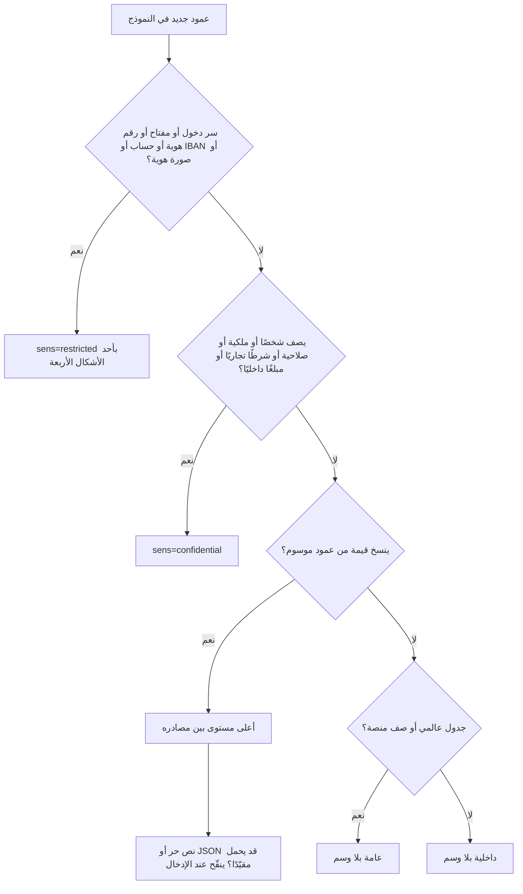

# DOC-S06 — معيار تصنيف البيانات وحمايتها على مستوى الأعمدة والملفات

| البند | القيمة |
|---|---|
| المعرّف | DOC-S06 (docs/30-readiness-documents.md) |
| الإصدار | 0.1 — مسودة للمراجعة — 2026-10-12 |
| المالك المقترح | معماري البيانات مع مسؤول الأمن |
| الأولوية | P0 قبل S0 |
| يغطي | صف «تصنيف البيانات» في 10-m0-m1 §12، X-SEC-2، X-SEC-3، FR-PLT-023، FR-PLT-028، FR-PLT-030، FR-PLT-039، FR-PTY-006 إلى FR-PTY-009، FR-PTY-014، FR-REQ-024، BR-PLT-016، BR-PTY-008 إلى BR-PTY-010، DR-18 وDR-25 وDR-31 وDR-46، O-15 (20-database-design) |
| يعتمد على | DOC-S02 (التشفير والمفاتيح)، DOC-F02 (تدفقات البيانات الحساسة)، DOC-S07 (الخصوصية والاحتفاظ)، DOC-S12 (السجلات)، DOC-B06 (بيانات الاختبار) |
| المصادر | docs/30-readiness-documents.md:250-256 · docs/10-detailed-analysis/10-m0-m1-platform-organization.md:294-347 و581 · db/model/*.model · db/generated/tsql/006_sensitive_columns.sql · db/static/020_roles_and_grants.sql · tools/dbgen/dbgen.py · tools/dbgen/README.md · docs/review/design-review-2026-10-11.json |

**وسوم المصدر:** 🟢 ذكره المستخدم أو ورد في الوثائق · 🟡 اقتراح له افتراضي ويُعدَّل.

## 1. الغرض والنطاق

**الغرض.** معيار واحد يربط كل عمود وكل ملف بمستوى حساسية، ويحدد ما يلزم كل مستوى من تشفير وتقنيع وحجب وتدقيق واحتفاظ، ويمنع الانحراف بين ما يحمله العمود فعلًا وما وُسم به في النموذج.

**داخل النطاق:** أعمدة `db/model/*.model` وما يولّده منها، ومستندات المخزن وصورها، ومخرجات التطبيق التي تنسخ القيم (السجلات، التدقيق، الإشعارات، Outbox، التصدير، المقارنات).

**خارج النطاق:** آلية التشفير والمفاتيح (DOC-S02)، وأسس المعالجة والإقامة ومدد الاحتفاظ النظامية (DOC-S07)، ومسارات القيم بين المكوّنات (DOC-F02).

## 2. المستويات الأربعة

المستويات معرّفة في التحليل 🟢 (docs/10-detailed-analysis/10-m0-m1-platform-organization.md:294 و581). هذا القسم يضيف ربطها بالنموذج.

| المستوى | التعريف | الوسم في النموذج | `doc.Document.Sensitivity` | أمثلة |
|---|---|---|---|---|
| عامة | مراجع المنصة المشتركة بين كل المشتركين | بلا وسم، في جدول `global` أو صف عام في جدول `mixed` | `PUBLIC` (لمستندات المنصة فقط 🟡) | `ref.Country`، `plat.Plan`، `sec.Permission` |
| داخلية | بيانات المشترك العادية | بلا وسم (الافتراضي في جدول مملوك للمشترك) | `INTERNAL` | `org.Department`، `cfg.NumberSequence` |
| سرّية | بيانات شخصية وعناوين وملكية وصلاحيات وشروط تجارية | `sens=confidential` | `CONFIDENTIAL` | `pty.Party.BirthDate`، `fin.StatementLine.EnteredAmount` |
| مقيّدة | أرقام الهوية وصورها، أرقام الحسابات وIBAN، أسرار الدخول، المفاتيح، إقرارات الامتثال | `sens=restricted` | `RESTRICTED` | `pty.IdentityDocument.NumberEnc`، `sec.AppUser.PasswordHash` |

**تنبيه تسمية.** علامة الجدول `public` في لغة النموذج تعني «يضيف `PublicId` للتعريض عبر API» (tools/dbgen/README.md:39)، ولا علاقة لها بالمستوى «عامة». جدول `public` مثل `pty.Party` سرّي.

**مقيّدة ≠ مشفّرة.** التحليل يقول إن المقيّدة «تُشفَّر» (docs/10-detailed-analysis/10-m0-m1-platform-organization.md:581). في النموذج للمقيّد أربعة أشكال مقبولة 🟡: غلاف مشفّر (`...Enc`)، أو بصمة أحادية (`...Hash`)، أو قناع عرض (`...Mask`)، أو مفتاح ملفوف (`WrappedKey`). أي عمود مقيّد بنص صريح خارج هذه الأشكال استثناء يُسجَّل في القسم 6.1.

## 3. كيف يعمل الوسم اليوم

- المولّد يقرأ `sens=restricted|confidential` على العمود (tools/dbgen/dbgen.py:172، tools/dbgen/README.md:63)، أو سطر `sens col,col` الذي يعني `restricted` افتراضيًا (tools/dbgen/dbgen.py:142-145 و224-227).
- **المقيّد وحده** يولّد `DENY SELECT` لدور التقارير `tp_readonly` (tools/dbgen/dbgen.py:723-724)، فيُنتج 29 سطرًا (db/generated/tsql/006_sensitive_columns.sql:7-35).
- السرّي لا يولّد إلا علامة 🔒 في القاموس (tools/dbgen/dbgen.py:608). و`tp_readonly` يملك `SELECT` على كل المخططات (db/static/020_roles_and_grants.sql:41-53)، **فيقرأ دور التقارير كل الأعمدة السرّية**.
- الاختبار T21 يثبت رفض قراءة عمود مقيّد بالخطأ 230، وT23 يثبت قراءة عمود غير مقيّد (db/tests/tenant_isolation_tests.sql:704-731).
- **العدد اليوم:** 46 وسمًا مباشرًا (23 مقيّدًا و23 سرّيًا) وسطر `sens` واحد بستة أعمدة، فالمجموع 29 مقيّدًا و23 سرّيًا. القاموس يطابقه (29 علامة `🔒 restricted` و23 `🔒 confidential` في docs/21-data-dictionary.md)، وdocs/20-database-design.md:216 يذكر 29.

## 4. قواعد التعامل لكل مستوى

| الضابط | عامة | داخلية | سرّية | مقيّدة |
|---|---|---|---|---|
| التخزين | TDE (DOC-S02) | TDE | TDE | TDE + أحد الأشكال الأربعة (القسم 2) |
| العرض | لكل مستخدم | بالصلاحية ونطاق الشركة (FR-PLT-020) | بالصلاحية ونطاق الشركة | مقنَّع (آخر 4) افتراضيًا؛ الكشف بصلاحية مقفلة وزر لكل قيمة ويُخفى بعد 60 ثانية (BR-PTY-008، BR-PTY-009) |
| التصدير | حر | بالصلاحية | بالصلاحية، ويُدقَّق | يُستثنى ما لم يملك الطالب صلاحية الكشف، مع إعادة مصادقة وحزمة مختومة (BR-PLT-016، FR-PTY-027) |
| سجلات التطبيق | مسموح | مسموح | 🟡 لا قيم، المعرّفات فقط | القناع فقط، ولا قيمة كاملة أبدًا (docs/10-detailed-analysis/10-m0-m1-platform-organization.md:586) |
| التدقيق | لا يلزم | قبل وبعد | قبل وبعد؛ 🟡 «تغيّر» فقط لأعمدة الأشخاص (DQ-S07-6) | «تغيّر» مع القناعين فقط (FR-PLT-023، BR-PLT-009) |
| دور التقارير `tp_readonly` | يقرأ | يقرأ | يقرأ اليوم؛ 🟡 يُحجب (DQ-S06-1) | محجوب (`006`) |
| الإشعارات والبريد وOutbox | مسموح | مسموح | 🟡 المعرّفات فقط | ممنوع (FR-PLT-042، FR-NTF-013) |
| بيانات الاختبار | تُنسخ | 🟡 مجهّلة | اصطناعية | اصطناعية فقط، ولا تخرج قيمة حقيقية من الإنتاج (DOC-B06) |
| الاحتفاظ | دائم | بحسب الكيان | بحسب DOC-S07 | بحسب DOC-S07، والإتلاف بسير FR-PLT-040 |

## 5. الأعمدة المقيّدة اليوم (29)

| الجدول | الأعمدة | الشكل | المصدر |
|---|---|---|---|
| `plat.PlatformOperator` | `PasswordHash`، `MfaSecretEnc` | بصمة، غلاف بمفتاح المنصة | db/model/10-platform.model:69 و72 |
| `sec.AppUser` | `PasswordHash`، `MfaSecretEnc` | بصمة، غلاف | db/model/10-platform.model:124 و127 |
| `sec.UserSession` | `TokenHash` | بصمة | db/model/10-platform.model:221 |
| `sec.MfaRecoveryCode` | `CodeHash` | بصمة | db/model/10-platform.model:238 |
| `sec.UserToken` | `TokenHash` | بصمة | db/model/10-platform.model:247 |
| `sec.UserPasswordHistory` | `PasswordHash` | بصمة | db/model/10-platform.model:262 |
| `sec.TenantKey` | `WrappedKey` | مفتاح ملفوف | db/model/10-platform.model:281 |
| `pty.IdentityDocument` | `NumberEnc`، `NumberMask`، `NumberHash` | غلاف، قناع، HMAC | db/model/11-organization-party.model:294-296 |
| `pty.PartyCustomField` | `ValueEnc` | غلاف | db/model/11-organization-party.model:397 |
| `pty.PartyCompliance` | `IsPep`، `IsRelatedToPep`، `IsSanctioned`، `IsUnderInvestigation`، `HasImmunity`، `Details` | **نص صريح** | db/model/11-organization-party.model:455-465 |
| `acc.BankAccount` | `AccountNoEnc/Mask/Hash`، `IbanEnc/Mask/Hash` | غلاف، قناع، HMAC | db/model/12-institutions-accounts-catalogs.model:386-392 |
| `col.Collateral` | `Attributes` | **JSON صريح** | db/model/14-collateral-obligations-financials.model:32 |
| `lc.LcTerms` | `BeneficiaryAccountIban` بـ Enc وMask وHash | غلاف، قناع، HMAC | db/model/16-letters-of-credit.model:186-188 |

السطور المقابلة في `DENY`: db/generated/tsql/006_sensitive_columns.sql:7-35.

## 6. الأعمدة السرّية اليوم (23)

| الجدول | الأعمدة | المصدر |
|---|---|---|
| `pty.Party` | `BirthDate`، `BirthDateHijriText`، `BirthPlace`، `MaritalStatus`، `Gender`، `EducationLevelId` | db/model/11-organization-party.model:267-273 |
| `pty.TaxIdentity` | `TaxNumber`، `VatNumber` | db/model/11-organization-party.model:470-471 |
| `cat.BaseRateValue` | `ValuePct` | db/model/12-institutions-accounts-catalogs.model:236 |
| `acc.BankAccount` | `AccountNoLast4` | db/model/12-institutions-accounts-catalogs.model:389 |
| `acc.Signatory` | `CashWithdrawalLimit` | db/model/12-institutions-accounts-catalogs.model:443 |
| `acc.SignatoryAuthority` | `MaxPerTransaction`، `DailyLimit` | db/model/12-institutions-accounts-catalogs.model:466-467 |
| `fin.StatementLine` | `EnteredAmount`، `ComputedAmount` | db/model/14-collateral-obligations-financials.model:441-442 |
| `wfl.Request` | `FormDataJson` (والحقول المقيّدة داخله مشفّرة) | db/model/15-workflow-notifications.model:283 |
| `wfl.RequestApproval` | `AckWarningsJson`، `AvailabilitySnapshotJson` | db/model/15-workflow-notifications.model:437-438 |
| `wfl.RequestAction` | `SnapshotJson` | db/model/15-workflow-notifications.model:469 |
| `lc.Counterparty` | `Phone`، `Fax`، `Email` | db/model/16-letters-of-credit.model:106-108 |
| `lc.ProformaInvoice` | `CustomerSnapshotJson` | db/model/16-letters-of-credit.model:622 |

### 6.1 استثناءات المقيّد بنص صريح 🟡

| الاستثناء | السبب | الشرط |
|---|---|---|
| E-1 أعلام `pty.PartyCompliance` المنطقية | قيم نعم/لا يحتاجها الفلترة والتقارير الداخلية | `DENY` لدور التقارير + TDE؛ و`Details` نص حر يُقترح تشفيره بالغلاف (DQ-S06-3) |
| E-2 `col.Collateral.Attributes` | سمات قالب متغيرة؛ الحساب النقدي صار مرجعًا مُعرَّفًا (db/model/14-collateral-obligations-financials.model:33) | لا معرّف هوية ولا رقم حساب داخل JSON؛ تتحقق خدمة الكتابة من ذلك (DR-08) |

## 7. ما لم يُصنَّف بعد

### 7.1 نتائج مراجعة التصميم المفتوحة

| النتيجة | البند | الخطر | المقترح 🟡 | المصدر |
|---|---|---|---|---|
| DR-46 | `lc.LcTermsComparisonLine.BaselineValue` و`ReceivedValue`، و`lc.LcAmendment.ChangedFieldsJson` | IBAN المستفيد يُكتب صريحًا في المقارنة والفروق | لا تُكتب قيم الحقول المقيّدة في المقارنة؛ يُكتب القناع وبصمة HMAC فقط، ويوسم العمود بأعلى حساسية يحملها | db/model/16-letters-of-credit.model:691-692 و493؛ docs/review/design-review-2026-10-11.json:486 |
| DR-31 | `OriginalText` في 11 جدول `src`، و`CandidateAOriginalText` و`CandidateBOriginalText` | نص البند الحرفي قد ينقل رقم حساب أو IBAN | `sens=confidential` مع حجب عن التقارير، وتنقيح أنماط IBAN والحساب عند الإدخال، والأصل في المستند فقط | tools/dbgen/dbgen.py:209؛ db/model/13-facilities-pricing-terms.model:335 و341؛ docs/review/design-review-2026-10-11.json:330 |
| DR-18 | `doc.Document.Sensitivity` | الافتراضي `CONFIDENTIAL` ويقبل `PUBLIC` لوثيقة هوية | حد أدنى بمحفّز: `RESTRICTED` إذا كان النوع `IsSensitive` | db/model/10-platform.model:370؛ docs/review/design-review-2026-10-11.json:200 |
| DR-25 | `org.Company.TaxNumber` | نسخة غير موسومة من رقم موسوم سرّيًا | ✅ حُذفت النسخة، والرقم يُقرأ من `pty.TaxIdentity` (ADR 0011) | db/model/11-organization-party.model:26؛ docs/review/design-review-2026-10-11.json:270 |
| DR-13 | حزمة التصدير `cfg.DataExportJob.PackageDocumentId` | الحزمة تأخذ `CONFIDENTIAL` ولو حملت مقيّدًا | `RESTRICTED` إذا `IncludesRestricted = 1` | db/model/10-platform.model:507 و514؛ docs/review/design-review-2026-10-11.json:150 |

### 7.2 بيانات شخصية بلا وسم (لم تذكرها المراجعة)

التحليل يصنّف Party والعناوين ووسائل اتصال الأفراد والمستخدم وسجل التدقيق سرّية 🟢 (docs/10-detailed-analysis/10-m0-m1-platform-organization.md:304 و309 و342-345)، والنموذج لا يسمها:

| الجدول | الأعمدة | المستوى المقترح 🟡 | المصدر |
|---|---|---|---|
| `pty.Party` | `NameAr`، `NameEn`، `NameNormalized` | سرّية | db/model/11-organization-party.model:262-264 |
| `pty.Address` | من `Region` إلى `FreeText` | سرّية (قوس المالك يخلط الأفراد بالمنشآت، فيؤخذ الأشد) | db/model/11-organization-party.model:331-341 |
| `pty.ContactMethod` | `Value`، `NormalizedValue` | سرّية للسبب نفسه | db/model/11-organization-party.model:360-361 |
| `sec.AppUser` | `Email`، `DisplayNameAr`، `DisplayNameEn` | سرّية | db/model/10-platform.model:114-116 |
| `sec.LoginAttempt` | `LoginName`، `IpAddress`، `UserAgent` | سرّية | db/model/10-platform.model:201-204 |
| `sec.UserSession` و`sec.UserToken` | `IpAddress`، `UserAgent`، `SentTo`، `RequestIp` | سرّية | db/model/10-platform.model:226-227 و251 و255 |
| `aud.AuditLog` | `BeforeJson`، `AfterJson`، `IpAddress`، `UserAgent` | سرّية | db/model/10-platform.model:315-319 |
| `aud.SensitiveAccessLog` | `Reason`، `IpAddress`، `UserAgent` | سرّية | db/model/10-platform.model:344-346 |
| `org.Company` | `CrNumber` | سرّية | db/model/11-organization-party.model:23 و26 |

## 8. تصنيف الملفات والصور

- كل ملف مستند له `doc.Document.Sensitivity` بالقيم الأربع (db/model/10-platform.model:370)، ولنوعه علم `cat.DocumentType.IsSensitive` «قيد TM/FO للعرض والتنزيل (صور الهوية، نموذج التوقيع، KYC)» (db/model/12-institutions-accounts-catalogs.model:84).
- **كل ملف مشفّر** بمفتاح FILE أيًّا كان مستواه، لأن `DocumentVersion.KeyId` إلزامي (db/model/10-platform.model:395). المستوى يحدد الوصول لا التشفير.

| فئة الملف | المستوى 🟡 | الوصول | المصدر |
|---|---|---|---|
| صور وثائق الهوية (وجه وظهر وأخرى) | مقيّدة | `party.identity.image.view` لـ TM وFO فقط، بلا مصغّرات لغيرهم، وكل عرض في `aud.SensitiveAccessLog` | BR-PTY-010 (docs/10-detailed-analysis/10-m0-m1-platform-organization.md:281)؛ FR-PLT-030 (docs/10-detailed-analysis/10-m0-m1-platform-organization.md:132) |
| نماذج التوقيع ونماذج KYC وإقرارات الامتثال | مقيّدة | كما سبق | db/model/12-institutions-accounts-catalogs.model:84؛ db/model/11-organization-party.model:461 |
| حزمة تصدير فيها مقيّد | مقيّدة | الطالب والموافق فقط، وتنتهي بعد 7 أيام | db/model/10-platform.model:502-521 |
| الاتفاقيات والقوائم المالية ومستندات الطلبات | سرّية | بالصلاحية ونطاق الشركة | FR-PLT-028 (docs/10-detailed-analysis/10-m0-m1-platform-organization.md:130) |
| مستندات الشركة العادية (سجل، رخصة) | داخلية | بالصلاحية ونطاق الشركة | FR-ORG-005 (docs/10-detailed-analysis/10-m0-m1-platform-organization.md:159) |
| مستندات منصة عامة (أدلة، قوالب) | عامة | لكل مستخدم | — |

- 🟡 لا يأخذ مستند مشترك المستوى `PUBLIC`؛ القيمة لمستندات المنصة فقط (DQ-S06-5).
- المصغّرات والمعاينات ترث مستوى الأصل (BR-PTY-010).
- التنزيل من نقطة مصرَّحة فقط، بلا روابط مباشرة إلى المخزن (FR-PLT-030).

## 9. كيف يُصنَّف عمود جديد

## 10. منع الانحراف 🟡

- **فحص آلي جديد في CI** بجانب `tools/dbgen/check_fk_indexes.py` و`tools/dbgen/check_grants.py` في الخطوة 3 (tools/ci/db_ci.sh:47-49)، يفشل البناء إذا:
  - عمود اسمه ينتهي بـ `Enc` أو `Hash` أو `Mask` أو يحوي `Password` أو `Token` أو `Secret` أو `Iban` أو `AccountNo` بلا `sens=restricted`؛
  - عمود اسمه يحوي `Email` أو `Phone` أو `IpAddress` أو `OriginalText` أو `Snapshot` بلا وسم ولا استثناء مسجَّل؛
  - عمود مقيّد بلا سطر `DENY` في `006`؛
  - عمود مقيّد بنص صريح خارج الاستثناءات E-n.
- **سجل الاستثناءات** ملف واحد في المستودع، لكل استثناء سبب ومالك وتاريخ مراجعة.
- **فحص الاستجابات:** اختبار API يمسح كل استجابة بحثًا عن قيم مقيّدة كاملة، عدا نقطة الكشف (DOC-S13).
- **فحص السجلات:** اختبار يكتب قيمة مقيّدة معروفة في سيناريو كامل، ثم يبحث عنها في سجلات التطبيق وفي `aud.AuditLog` وفي `cfg.OutboxEvent.PayloadJson`، ويفشل إن وجدها.
- **أي عمود ينسخ قيمًا** (مقارنة، لقطة، فرق، JSON) يرث أعلى مستوى بين مصادره. هذه القاعدة كانت ستمنع DR-46 وDR-31.

## 11. القرارات المطلوبة

| المعرّف | السؤال | الافتراض المقترح | من يقرر | ما يعطّله |
|---|---|---|---|---|
| DQ-S06-1 | هل يُحجب السرّي عن `tp_readonly` كالمقيّد؟ | ✅ معتمد من المالك (2026-10-12): نعم، بتوليد `DENY` للسرّي أيضًا، والتقارير عبر عروض مجمّعة | معماري البيانات مع المالك | DDL قبل S0 |
| DQ-S06-2 | رقم الحساب وIBAN مقيّدان أم سرّيان؟ | ✅ معتمد من المالك (2026-10-12): مقيّدان، كما في النموذج وFR-REQ-024 | المالك | توحيد 11-m2-m4 §12 |
| DQ-S06-3 | تشفير `pty.PartyCompliance.Details` | نعم بالغلاف؛ الأعلام المنطقية استثناء E-1 | مسؤول الأمن | S1 |
| DQ-S06-4 | وسم البيانات الشخصية في القسم 7.2 | كما في الجدول | معماري البيانات | DDL قبل S0 |
| DQ-S06-5 | منع `PUBLIC` لمستندات المشترك | ✅ منفّذ (ADR 0011، DR-18): قيد `Sensitivity <> 'PUBLIC'` في `doc.Document`، وحد أدنى RESTRICTED لنوع حساس بقادح. المقترح: نعم، بقيد CHECK أو محفّز | معماري البيانات | DR-18 |
| DQ-S06-6 | اعتماد فحص الانحراف في CI | نعم | قائد قاعدة البيانات | O-15 (20-database-design) |
| DQ-S06-7 | تنقيح IBAN والحساب في النصوص الحرة عند الإدخال | ✅ منفّذ (ADR 0011، 2026-10-13): التطبيق يقنّع عند الإدخال، وقيد على كل `OriginalText` ونصي التعارض و`ClauseText` يرفض عشرة أرقام متتالية أو IBAN بمجموعات أربعة أرقام (وسم `redact` في المولّد؛ RF25). واعتمد المالك القيد كما هو (2026-10-14): المبالغ في النص تُكتب بفواصل. المقترح: نعم، بنمط IBAN وطول الحساب، مع إبقاء الأصل في المستند | مالك M5 مع مسؤول الأمن | DR-31، S2 |
| DQ-S06-8 | حالة الإعاقة وأي فئة صحية | ✅ معتمد من المالك (2026-10-12): لا تُجمع إلا بطلب نموذج بنك، حقلًا مخصصًا مقيّدًا، بعد رأي قانوني | المالك مع المستشار القانوني | docs/05-kyc-forms-analysis.md:73 |
| DR-46، DR-31، DR-18، DR-25، DR-13 | نتائج المراجعة | ✅ اعتمدها المالك 2026-10-13 ونُفّذ ما يخص القاعدة (ADR 0011): DR-13 وDR-18 كاملين، والوسم والمنع في DR-25 وDR-31 وDR-46؛ الحجب عند الإدخال (S2) وحذف الرقم الضريبي (S1) وخدمة المقارنة (S3) شروط دخول | المالك (O-15، 20-database-design) | DDL قبل S0 |

## 12. تعارضات وفجوات في المصادر

- docs/10-detailed-analysis/11-m2-m4-institutions-accounts-catalogs.md:581 يصنّف رقم الحساب وIBAN «سري»، بينما النموذج يسمهما مقيّدين ويشفّرهما (db/model/12-institutions-accounts-catalogs.model:386-392)، وFR-REQ-024 يسمّي IBAN «حقلًا مقيّدًا» (docs/10-detailed-analysis/13-m6-workflow-engine-notifications.md:191). تعريف المقيّدة في docs/10-detailed-analysis/10-m0-m1-platform-organization.md:581 لا يذكر الحسابات أصلًا.
- docs/10-detailed-analysis/10-m0-m1-platform-organization.md:581 يقول إن المقيّدة «تُشفَّر»، بينما `pty.PartyCompliance` (db/model/11-organization-party.model:455-465) و`col.Collateral.Attributes` (db/model/14-collateral-obligations-financials.model:32) مقيّدة بنص صريح.
- التحليل يصنّف Party والعناوين ووسائل الاتصال والمستخدم وسجل التدقيق سرّية (docs/10-detailed-analysis/10-m0-m1-platform-organization.md:304 و309 و342-345)، والنموذج لا يسم أعمدتها (القسم 7.2).
- docs/10-detailed-analysis/10-m0-m1-platform-organization.md:581 يقول إن السرّية «تُحمى بالصلاحية والنطاق والتدقيق»، بينما دور التقارير يقرؤها كلها (db/static/020_roles_and_grants.sql:41-53).
- `doc.Document.Sensitivity` افتراضيه `CONFIDENTIAL` بلا حد أدنى (db/model/10-platform.model:370)، والتحليل يجعل المستند «مقيّدًا إن كان النوع IsSensitive» (docs/10-detailed-analysis/10-m0-m1-platform-organization.md:313).
- اسم العلامة `public` في لغة النموذج (tools/dbgen/README.md:39) يلتبس بالمستوى «عامة».

## 13. التتبع

| البند في هذه الوثيقة | المتطلب أو القاعدة أو القرار | المصدر |
|---|---|---|
| القسم 2 | صف «تصنيف البيانات»، عمود الحساسية في §6 | docs/10-detailed-analysis/10-m0-m1-platform-organization.md:581 و294 |
| القسم 3 | `006`، T21 وT23 | db/generated/tsql/006_sensitive_columns.sql:7-35؛ db/tests/tenant_isolation_tests.sql:704-731 |
| القسم 4 | X-SEC-3، BR-PTY-008، BR-PTY-009، FR-PLT-023، BR-PLT-016، FR-PLT-042 | docs/10-detailed-analysis/00-overview-and-cross-cutting.md:138؛ docs/10-detailed-analysis/10-m0-m1-platform-organization.md:279-280 و125 و242 و144 |
| القسم 5 | FR-PTY-006، FR-PLT-037 | docs/10-detailed-analysis/10-m0-m1-platform-organization.md:196 و139 |
| القسم 6.1 | DR-08 | docs/review/design-review-2026-10-11.json:95 |
| القسم 7.1 | DR-46، DR-31، DR-18، DR-25، DR-13، O-15 (20-database-design) | docs/review/design-review-2026-10-11.json:486 و330 و200 و270 و150؛ docs/20-database-design.md:543 |
| القسم 8 | FR-PLT-028، FR-PLT-030، BR-PTY-010، FR-PTY-009 | docs/10-detailed-analysis/10-m0-m1-platform-organization.md:130 و132 و281 و199 |
| القسم 10 | O-15 (20-database-design) | docs/20-database-design.md:543 |
| القسم 11، DQ-S06-8 | BR-PTY-019، G-12 | docs/10-detailed-analysis/10-m0-m1-platform-organization.md:290؛ docs/05-kyc-forms-analysis.md:73 |
