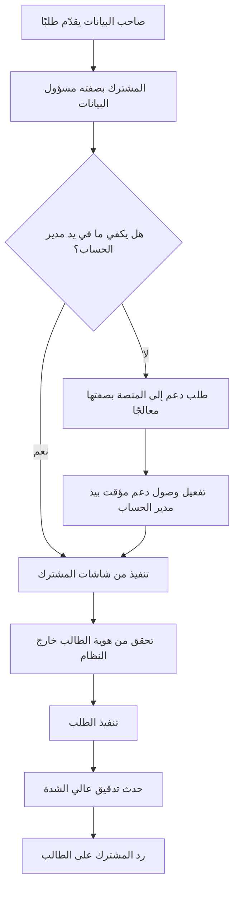

# DOC-S07 — تقييم أثر الخصوصية وحماية البيانات الشخصية

| البند | القيمة |
|---|---|
| المعرّف | DOC-S07 (docs/30-readiness-documents.md) |
| الإصدار | 0.1 — مسودة للمراجعة — 2026-10-12 |
| المالك المقترح | مسؤول حماية البيانات (DPO) مع مستشار قانوني ومالك المنتج |
| الأولوية | P0 قبل S0 (وقبل تحميل أي بيانات شخصية حقيقية) |
| يغطي | X-AUD-3، X-AUD-4، BR-PLT-016، BR-PLT-002، BR-PTY-019، FR-PLT-039، FR-PLT-040، FR-PTY-028، FR-PTY-029، Q-PLT-03، Q-PLT-04، O-23 (erd_open_items) |
| يعتمد على | DOC-S06 (التصنيف)، DOC-S02 (التشفير)، DOC-S09 (النسخ)، DOC-F02 (تدفقات البيانات الحساسة)، DOC-S15 (إخطار الخرق، P2 لم يُكتب بعد) |
| المصادر | docs/30-readiness-documents.md:256-262 · docs/10-detailed-analysis/10-m0-m1-platform-organization.md §4 و§5 و§12 و§14 · docs/10-detailed-analysis/00-overview-and-cross-cutting.md §6.2 و§10.4 · docs/01-preliminary-analysis.md · docs/04-facility-agreements-analysis.md:246-254 · docs/05-kyc-forms-analysis.md:73 · db/model/10-platform.model · db/model/11-organization-party.model · db/static/030_session_context.sql |

**وسوم المصدر:** 🟢 ذكره المستخدم أو ورد في الوثائق · 🟡 اقتراح له افتراضي ويُعدَّل.

**تحفّظ.** هذه الوثيقة تقييم هندسي لا رأي قانوني. لا تفترض نظامًا بعينه لحماية البيانات. كل ما يتوقف على النظام المطبَّق أو على دولة الاستضافة مسجَّل قرارًا للمالك مع المستشار القانوني (X-AUD-4 🔴، docs/10-detailed-analysis/00-overview-and-cross-cutting.md:150).

## 1. الغرض والنطاق

**الغرض.** جرد البيانات الشخصية التي تعالجها المنصة، وأغراضها، ومدد الاحتفاظ المقترحة، وحقوق أصحابها، وموقع الاستضافة والنقل عبر الحدود، والجهات المعالِجة، ومخاطر الخصوصية وضوابطها. ADR 0001 يشترط حسم إقامة البيانات قبل تحميل بيانات حقيقية 🟢 (docs/adr/0001-schema-work-on-linux.md:26).

**داخل النطاق:** البيانات المخزنة في قاعدة `BankFas` وفي مخزن الملفات، وما يخرج منها في البريد والتصدير والسجلات والنسخ الاحتياطية.

**خارج النطاق:** آليات الحماية التفصيلية (DOC-S02 وDOC-S06)، وإجراء الاستجابة للحوادث (DOC-S15).

## 2. الأدوار

| الجهة | الدور المفترض | الحالة | المصدر |
|---|---|---|---|
| المشترك | مسؤول البيانات (Controller) لبيانات موظفيه والأشخاص الذين يُدخلهم | افتراض 🟡 | docs/10-detailed-analysis/10-m0-m1-platform-organization.md:588 |
| المنصة | معالج (Processor) لبيانات المشترك | افتراض 🟡 | المصدر نفسه |
| المنصة | مسؤول بيانات لحسابات المشغّلين، وربما لسجلات الأمن على مستوى المنصة | اقتراح 🟡 | — |
| مزوّد الاستضافة | معالج فرعي (يستضيف VPS) | 🟢 الاستضافة VPS خاص | docs/10-detailed-analysis/10-m0-m1-platform-organization.md:615 |
| مرحّل البريد | معالج فرعي (رسائل الدعوة وإعادة التعيين) | 🟡 «تهيّئه الاستضافة» | docs/10-detailed-analysis/10-m0-m1-platform-organization.md:115 |
| مخزن المفاتيح، الموقع المنفصل للنسخ | معالجان فرعيان محتملان | قرار مفتوح | DOC-S02 (DQ-S02-1)، DOC-S09 |

## 3. أصحاب البيانات

| الفئة | أمثلة | من يُدخل بياناتهم |
|---|---|---|
| DS-1 مستخدمو المشترك | موظفو الخزينة والمشتريات والمبيعات | مدير حساب المشترك |
| DS-2 أشخاص Party من الأفراد | الكفلاء، الملاك، أعضاء المجالس، المفوَّضون، جهات الاتصال المرقّاة | مستخدمو المشترك (قرار تخزين بيانات الكفلاء كاملة 🟢، docs/01-preliminary-analysis.md:40) |
| DS-3 جهات اتصال البنوك | `ins.Contact` بلا هوية | مستخدمو المشترك (db/model/12-institutions-accounts-catalogs.model:310) |
| DS-4 جهات اتصال الأطراف المقابلة | هاتف وبريد في `lc.Counterparty` | مستخدمو المشترك (db/model/16-letters-of-credit.model:106-108) |
| DS-5 مشغّلو المنصة | حسابات `plat.PlatformOperator` | المنصة |
| DS-6 أشخاص غير مسجّلين | بريد كُتب في شاشة الدخول ولا يطابق مستخدمًا | النظام نفسه (db/static/030_session_context.sql:124-126) |

## 4. جرد البيانات الشخصية

| المعرّف | الفئة | الموقع | التصنيف (DOC-S06) | الغرض 🟡 | الاحتفاظ 🟡 |
|---|---|---|---|---|---|
| P-01 | أرقام وثائق الهوية والإقامة والجواز | `pty.IdentityDocument` (db/model/11-organization-party.model:288-319) | مقيّدة | متطلبات KYC للبنوك | 5 سنوات بعد آخر استخدام نشط (BR-PLT-016) |
| P-02 | صور وثائق الهوية | `doc.DocumentVersion` بروابط `IMAGE_FRONT` و`IMAGE_BACK` (db/model/10-platform.model:414) | مقيّدة | KYC | كما P-01 |
| P-03 | سمات الفرد: الميلاد ومكانه والحالة الاجتماعية والجنس والتعليم | `pty.Party` (db/model/11-organization-party.model:265-273) | سرّية | KYC | كما P-01 |
| P-04 | الأسماء | `pty.Party` (db/model/11-organization-party.model:262-264) | سرّية مقترحة | التعريف والبحث ومنع التكرار | تبقى بعد إخفاء الهوية (FR-PTY-029) |
| P-05 | العناوين | `pty.Address` (db/model/11-organization-party.model:321-351) | سرّية للأفراد | KYC والمراسلات | كما P-01 |
| P-06 | وسائل الاتصال | `pty.ContactMethod` (db/model/11-organization-party.model:353-376) | سرّية للأفراد | التواصل وKYC | كما P-01 |
| P-07 | إقرارات PEP والعقوبات والتحقيقات والحصانة | `pty.PartyCompliance` (db/model/11-organization-party.model:449-465) | مقيّدة | KYC | كما P-01 |
| P-08 | الهوية الضريبية | `pty.TaxIdentity` (db/model/11-organization-party.model:467-480) | سرّية | KYC وFATCA وCRS | كما P-01 |
| P-09 | حقول مخصصة (الدخل، مصدر الأموال، جهة العمل) | `pty.PartyCustomField` (db/model/11-organization-party.model:393-405) | سرّية أو مقيّدة بحسب التعريف | ما يطلبه نموذج بنك فقط (BR-PTY-019) | كما P-01 |
| P-10 | الملكية والعضوية والمنح | `org.Shareholding`، `org.BodyMember`، `org.AuthorityGrant` (db/model/11-organization-party.model:71 و108 و126) | سرّية (docs/10-detailed-analysis/10-m0-m1-platform-organization.md:331) | الحوكمة والتفويض | 10 سنوات بعد الانتهاء |
| P-11 | المفوَّضون وسقوفهم | `acc.Signatory`، `acc.SignatoryAuthority` (db/model/12-institutions-accounts-catalogs.model:434-467) | سرّية | التحقق من التوقيعات | 10 سنوات بعد الانتهاء |
| P-12 | حساب المستخدم: البريد والاسم وتجزئة كلمة المرور وسر MFA | `sec.AppUser` (db/model/10-platform.model:113-154) | سرّية، والأسرار مقيّدة | الدخول والصلاحيات | مدة الحساب ثم الأرشفة؛ الأسرار تُمحى عند الأرشفة |
| P-13 | محاولات الدخول بعناوين IP ووكيل المتصفح والبريد المكتوب | `sec.LoginAttempt` (db/model/10-platform.model:199-208) | سرّية مقترحة | تقييد المعدل والقفل (BR-PLT-005) | 180 يومًا؛ الأثر الدائم في التدقيق |
| P-14 | الجلسات ورموز الدعوة | `sec.UserSession`، `sec.UserToken` (db/model/10-platform.model:219-258) | سرّية، والبصمات مقيّدة | إدارة الجلسة | 90 يومًا بعد الانتهاء |
| P-15 | سجل التدقيق: الفاعل والعنوان والقيم قبل وبعد | `aud.AuditLog` (db/model/10-platform.model:304-330) | سرّية | المساءلة والأمن | 10 سنوات (BR-PLT-016) |
| P-16 | سجل الوصول الحساس: من كشف رقم من ومتى | `aud.SensitiveAccessLog` (db/model/10-platform.model:332-355) | سرّية | المساءلة وكشف الشذوذ (BR-PTY-009) | 10 سنوات |
| P-17 | حسابات المشغّلين | `plat.PlatformOperator` (db/model/10-platform.model:64-87) | سرّية، والأسرار مقيّدة | تشغيل المنصة | مدة الحساب + سنة |
| P-18 | جهات اتصال الأطراف المقابلة وبنود اللقطات | `lc.Counterparty`، `lc.ProformaInvoice.CustomerSnapshotJson` (db/model/16-letters-of-credit.model:106-108 و622) | سرّية | الاعتمادات والفواتير | 10 سنوات للطلبات (docs/10-detailed-analysis/13-m6-workflow-engine-notifications.md:694) |
| P-19 | حزم التصدير | `cfg.DataExportJob` (db/model/10-platform.model:502-521) | مقيّدة إن حملت مقيّدًا | حق المشترك في بياناته | 7 أيام للحزمة (db/model/10-platform.model:513) |
| P-20 | الإشعارات وتسليمها | `ntf.Notification`، `ntf.NotificationDelivery` (db/model/15-workflow-notifications.model:603 و639) | داخلية بلا قيم مقيّدة | العمل اليومي | أرشفة بعد 180 يومًا من القراءة (Q-NTF-05) |

## 5. الغرض والأساس النظامي 🟡

- **الأغراض المعلنة في المصادر:** «متطلبات KYC للبنوك فقط» لبيانات الأشخاص 🟢 (docs/10-detailed-analysis/10-m0-m1-platform-organization.md:588)، وأمن الحسابات، والمساءلة بالتدقيق، وإدارة التسهيلات والاعتمادات.
- **الأساس النظامي** لكل فئة (عقد، التزام نظامي، مصلحة مشروعة، موافقة) يحدده المستشار القانوني لكل دولة يعمل فيها المشترك. لا تفترض هذه الوثيقة أساسًا. docs/04-facility-agreements-analysis.md:253 يذكر مثالًا لنظام وطني دون حسم، والحالة 🔴.
- **أدنى جمع للبيانات 🟢:** «لا يُجمع إلا ما يطلبه ملف اكتمال أو يلزمه الدور» (BR-PTY-019، docs/10-detailed-analysis/10-m0-m1-platform-organization.md:290). الدخل ومصدر الأموال حقول مخصصة تُفعَّل عند الطلب.
- **الفئات الخاصة:** سؤال الإعاقة في بعض نماذج البنوك «حقل حساس اختياري… 🔴» (docs/05-kyc-forms-analysis.md:73). لا يوجد له عمود في النموذج. الافتراضي ألا يُجمع حتى يُبدي المستشار رأيه (DQ-S06-8 في DOC-S06).
- **إعلام أصحاب البيانات:** الشخص المُدخَل (الكفيل مثلًا) لا يتعامل مع المنصة مباشرة. إعلامه مسؤولية المشترك بصفته مسؤول البيانات. 🟡 تزوّد المنصة المشترك بنص وصف للمعالجة يضمّنه في إشعاره.

## 6. إقامة البيانات والنقل عبر الحدود

| البند | الحالة | المصدر |
|---|---|---|
| مكان الاستضافة | VPS خاص لدى مزوّد استضافة 🟢؛ **دولة الخادم غير محددة في أي وثيقة** | docs/10-detailed-analysis/10-m0-m1-platform-organization.md:615 |
| السؤال القانوني | «يبقى سؤال إقامة البيانات/حماية البيانات الشخصية للمراجعة القانونية» | المصدر نفسه |
| الدول المستهدفة | 01 س-4 🔴 «هل هناك متطلبات إقامة البيانات؟» | docs/01-preliminary-analysis.md:125 |
| عمود الإقامة | `plat.Tenant.DataRegion` موجود | db/model/10-platform.model:42 |
| قاعدة واحدة لكل المشتركين | T-1 | docs/20-database-design.md:61 |
| تثبيت محلي لمن يطلب | لاحقًا بحزمة قابلة للنقل | FR-PLT-047، docs/10-detailed-analysis/10-m0-m1-platform-organization.md:149 |

**ملاحظات:**
- مع قاعدة واحدة (T-1) لا يمكن وضع بيانات مشترك في منطقة غير منطقة غيره. `DataRegion` يصف ولا يفرض. الخيارات: (أ) منطقة واحدة لكل المشتركين تقبلها أنظمتهم؛ (ب) نشر مستقل لكل منطقة؛ (ج) التثبيت المحلي (FR-PLT-047) لمن يشترط الإقامة داخل منشأته.
- النقل عبر الحدود لا يقتصر على الخادم: الموقع المنفصل للنسخ (DOC-S09)، ومرحّل البريد، ومخزن المفاتيح (DOC-S02)، ومحطات المشغّلين، كلها قد تكون في دول أخرى.
- 🟡 الافتراضي: يختار المالك دولة الخادم والموقع المنفصل معًا، بعد رأي قانوني لكل دولة مستهدفة، قبل تحميل أي بيانات حقيقية (DQ-S07-1 وDQ-S07-2).

## 7. الاحتفاظ والإتلاف

- **القاعدة 🟢:** لا إتلاف تلقائي. الإتلاف تقرير ثم موافقة ثم إتلاف أو إخفاء مع أثر (BR-PLT-016، docs/10-detailed-analysis/10-m0-m1-platform-organization.md:242؛ FR-PLT-040 Should في S5، docs/10-detailed-analysis/10-m0-m1-platform-organization.md:142).
- **المدد المقترحة 🟢 للمراجعة القانونية:** التدقيق 10 سنوات، والمستندات 10 سنوات بعد انتفاء الاستخدام، وهويات الأشخاص وصورها 5 سنوات بعد آخر استخدام نشط (Q-PLT-04، docs/10-detailed-analysis/10-m0-m1-platform-organization.md:616).
- **ما ليس له مدة في المصادر:** محاولات الدخول، والجلسات، والرموز، وOutbox، وسجل المهام. المقترح في عمود الاحتفاظ بالقسم 4 🟡، وO-6 (20-database-design) يطلب قرارًا لكل جدول (docs/20-database-design.md:532).
- **المشترك المغلق 🟢:** تصدير 30 يومًا ثم قراءة فقط، والإتلاف بموافقة المشغّل وموافقة المشترك الخطية بعد المدة (BR-PLT-002، docs/10-detailed-analysis/10-m0-m1-platform-organization.md:228).
- **النسخ الاحتياطية:** البيانات المتلفة تبقى في النسخ حتى تنتهي مدتها (DOC-S09، 35 يومًا للاستعادة النقطية و12 شهرًا للنسخ الشهرية 🟡). يُذكر ذلك في وصف المعالجة. استعادة نسخة بعد إتلاف تتطلب إعادة تنفيذ الإتلافات المسجّلة بعد تاريخ النسخة 🟡.

## 8. حقوق أصحاب البيانات

### 8.1 المسار

### 8.2 أنواع الطلبات

| الحق | ما يوجد اليوم | الفجوة | المقترح 🟡 |
|---|---|---|---|
| الاطلاع والنسخة | FR-PTY-028 «نظرة شاملة للشخص» ضمن نطاق المستخدم (docs/10-detailed-analysis/10-m0-m1-platform-organization.md:218)، وتصدير بيانات المشترك كلها FR-PLT-039 (docs/10-detailed-analysis/10-m0-m1-platform-organization.md:141) | لا يوجد تصدير لبيانات شخص واحد | متطلب جديد: تصدير بيانات شخص واحد (Party) بكل وثائقه واستخداماته، بصلاحية الكشف وإعادة المصادقة، ويُدقَّق |
| التصحيح | تصحيح رقم الوثيقة بصلاحية ويُدقَّق (BR-PTY-006، docs/10-detailed-analysis/10-m0-m1-platform-organization.md:277)؛ التجديد ينشئ وثيقة جديدة | لا شيء جوهري | يبقى |
| الحذف | إخفاء الهوية بعد الاحتفاظ (FR-PTY-029 Could في S5، docs/10-detailed-analysis/10-m0-m1-platform-organization.md:219): إزالة الأرقام والصور وإبقاء الاسم والتاريخ | التعارض مع التدقيق غير المعدَّل (القسم 8.3) | إخفاء الهوية مع تقديم FR-PTY-029 إلى Should |
| التقييد والاعتراض | لا شيء | لا آلية لتجميد معالجة شخص | علم «مقيَّد المعالجة» على Party يمنع استعماله في ملفات جديدة (DQ-S07-5) |
| حقوق المستخدم DS-1 | تعطيل وأرشفة (FR-PLT-016، docs/10-detailed-analysis/10-m0-m1-platform-organization.md:118) | لا محو للأسرار عند الأرشفة | محو `PasswordHash` و`MfaSecretEnc` ورموز الاسترداد عند الأرشفة |

### 8.3 الحذف مقابل عدم تعديل التدقيق

- `aud.AuditLog` للإضافة فقط، و`tp_app` و`tp_platform` ممنوعان من التعديل والحذف 🟢 (db/static/020_roles_and_grants.sql:65). سلسلة البصمات (BR-PLT-009) تكشف أي تعديل.
- التدقيق لا يحمل القيم المقيّدة إلا مقنَّعة 🟢 (FR-PLT-023، docs/10-detailed-analysis/10-m0-m1-platform-organization.md:125)، والفاعل يُسجَّل بـ `PublicId` (db/model/10-platform.model:308).
- 🟡 **المقترح:** لا يُحذف صف تدقيق لتنفيذ طلب حذف. يُخفى الشخص في جداول الأعمال (FR-PTY-029)، ويبقى في التدقيق معرّفه والقناع فقط. يُذكر في وصف المعالجة أن سجل التدقيق يُحفظ لمدته للمساءلة. القبول القانوني لهذا قرار (DQ-S07-4).
- **حد تقني:** التشفير بمفتاح لكل مشترك لا لكل شخص، فلا يمكن «محو» شخص بإتلاف مفتاحه. المحو يتم بحذف الغلاف نفسه.
- `BeforeJson` و`AfterJson` قد تحمل اسمًا أو عنوانًا (سرّي لا مقيّد). 🟡 لا تُكتب فيها قيم سرّية لأعمدة Party، بل «تغيّر» فقط، مثل المقيّد (DQ-S07-6).

## 9. المعالجون الفرعيون

| الجهة | البيانات التي تصلها | الحالة | المطلوب 🟡 |
|---|---|---|---|
| مزوّد الاستضافة (VPS) | كل شيء مشفّرًا عند التخزين (TDE، DOC-S02) | مقرر، والمزوّد غير مسمّى في المصادر | عقد معالجة، ودولة الخادم، والتزام إخطار بالخرق، وحظر الوصول إلى الأقراص |
| مرحّل البريد | عنوان المستلم واسمه ورابط الدعوة | «تهيّئه الاستضافة» 🟡 | عقد معالجة، وTLS إلزامي (DOC-S05 §6) |
| مخزن المفاتيح | لا بيانات شخصية؛ مفاتيح فقط | قرار مفتوح (DQ-S02-1) | الدولة وشروط الوصول |
| الموقع المنفصل للنسخ | نسخ مشفّرة | قرار مفتوح (DOC-S09) | الدولة، والحذف عند انتهاء المدة |
| سلطة التصديق ومزوّد DNS | رموز المشتركين في DNS إن وُجدت سجلات لكل مشترك | DOC-S05 | شهادة شاملة لا تكشف الرموز (DOC-S05 §4.3) |

🟡 تنشر المنصة للمشتركين قائمة المعالجين الفرعيين، وتُبلغهم قبل أي تغيير (DQ-S07-3).

## 10. تقييم المخاطر

| الخطر | الوصف | الضابط اليوم | المقترح 🟡 | المتبقي |
|---|---|---|---|---|
| R-P1 تسريب بين المشتركين | قراءة بيانات مشترك آخر | RLS وربط الجلسة و40 اختبار عزل في CI (db/tests/tenant_isolation_tests.sql) | اختبارات IDOR على كل نقطة API (DOC-S13) | منخفض؛ O-20 وO-21 (erd_open_items) مفتوحان |
| R-P2 نسخ مقيّدة غير محمية | IBAN صريح في المقارنات، ونص البنود الحرفي | لا شيء | DR-46 وDR-31 (DOC-S06 §7.1) | متوسط حتى التطبيق |
| R-P3 سجلات الأمن بلا مدة | عناوين IP وبريد مكتوب خطأ يتراكم | لا شيء | مدد القسم 4، ومهمة إتلاف بموافقة | منخفض |
| R-P4 النسخ تحمل المحذوف | بيانات متلفة باقية في النسخ | لا شيء | مدد DOC-S09 وإعادة تنفيذ الإتلاف بعد الاستعادة | منخفض |
| R-P5 وصول المشغّل | المشغّل يرى بيانات المشترك في جلسة دعم | وصول مؤقت بيد مدير الحساب، ولا كشف للمقيّد (FR-PLT-007، docs/10-detailed-analysis/10-m0-m1-platform-organization.md:109؛ BR-PLT-017، docs/10-detailed-analysis/10-m0-m1-platform-organization.md:243) | سجل جلسة الدعم يراه مدير الحساب 🟢 | منخفض |
| R-P6 مخالفة الإقامة | خادم أو نسخ في دولة غير مقبولة | لا قرار | DQ-S07-1 وDQ-S07-2 | **عالٍ حتى القرار** |
| R-P7 تسرّب عبر البريد | رابط أو بيانات في بريد غير مشفّر | الرابط لمرة واحدة ومجزّأ، ولا مقيّد في البريد (FR-PLT-013) | DOC-S05 §6 | منخفض |
| R-P8 فقد المفتاح الرئيسي | فقد الأعمدة المشفّرة والملفات | لا شيء بعد | الحفظ المزدوج (DOC-S02 §9) | متوسط حتى التطبيق |
| R-P9 حزم التصدير | حزمة مقيّدة تخرج من المنصة | موافقة حامل الكشف، وحزمة مختومة (BR-PLT-016) | DR-13: مستوى الحزمة مقيّد | منخفض |
| R-P10 فئات خاصة | PEP والعقوبات والإعاقة | `DENY` لدور التقارير على `pty.PartyCompliance` (db/generated/tsql/006_sensitive_columns.sql:20-25) | تشفير `Details`، ولا جمع للإعاقة دون رأي قانوني | متوسط |
| R-P11 الشذوذ في الكشف | موظف يكشف أرقامًا كثيرة | تنبيه بعد 20 كشفًا في الساعة (BR-PTY-009، docs/10-detailed-analysis/10-m0-m1-platform-organization.md:280) | يبقى | منخفض |

## 11. إخطار الخرق

- الإجراء الكامل في DOC-S15 (P2، لم يُكتب بعد؛ docs/30-readiness-documents.md:323-328). هذه الوثيقة تحدد ما يلزمه منها.
- **مصادر الكشف الموجودة:** `UNWRAP_FAILED` في `sec.KeyEvent` (db/model/10-platform.model:293)، وشذوذ الكشف (BR-PTY-009)، وفشل سلامة الملفات `MISMATCH` و`MISSING` (db/model/10-platform.model:399)، وفشل اختبارات العزل.
- 🟡 تُبلغ المنصة المشترك المتأثر بعد تأكيد الحادث بلا تأخير، وبهدف داخلي 24 ساعة. المهلة النظامية للإبلاغ إلى الجهة المختصة وأصحاب البيانات يحددها المستشار لكل دولة، والمشترك هو المبلِّغ بصفته مسؤول البيانات.
- 🟡 محتوى الإبلاغ للمشترك: وصف الحادث، والفئات P-n المتأثرة، وعدد السجلات تقريبًا، والإجراءات المتخذة، ونقطة اتصال.
- كل مشترك يسجّل نقطة اتصال للخصوصية عند التهيئة (DQ-S07-7).

## 12. القرارات المطلوبة

| المعرّف | السؤال | الافتراض المقترح | من يقرر | ما يعطّله |
|---|---|---|---|---|
| DQ-S07-1 | دولة VPS الإنتاج | تُختار بعد رأي قانوني لكل دولة مستهدفة | المالك مع المستشار القانوني | تحميل بيانات حقيقية (ADR 0001) |
| DQ-S07-2 | دولة الموقع المنفصل للنسخ ومخزن المفاتيح | الدولة نفسها أو دولة يقبلها الرأي القانوني | المالك مع المستشار | DOC-S09، DOC-S02 |
| DQ-S07-3 | الأدوار (Controller وProcessor) والعقد مع المشترك وقائمة المعالجين الفرعيين | الافتراض في القسم 2، وملحق معالجة في عقد الاشتراك | المالك مع المستشار | الإطلاق التجريبي |
| DQ-S07-4 | قبول بقاء التدقيق المقنَّع بعد طلب حذف | مقبول للمساءلة، ويُذكر في وصف المعالجة | المستشار القانوني | FR-PTY-029 |
| DQ-S07-5 | علم «مقيَّد المعالجة» على Party | نعم في S1 | مالك المنتج | S1 |
| DQ-S07-6 | منع القيم السرّية في `BeforeJson` و`AfterJson` | «تغيّر» فقط لأعمدة Party السرّية | معماري البيانات | S0 |
| DQ-S07-7 | نقطة اتصال الخصوصية لكل مشترك | حقل إلزامي عند التهيئة | مالك المنتج | DOC-F05 |
| DQ-S07-8 | مدد الاحتفاظ لكل فئة | عمود الاحتفاظ في القسم 4 | المستشار مع المالك | FR-PLT-040، O-6 (20-database-design) |
| DQ-S07-9 | تصدير بيانات شخص واحد | متطلب جديد في S1 أو S2 | مالك المنتج | حق الاطلاع |
| DQ-S07-10 | الأساس النظامي لكل غرض | يحدده المستشار لكل دولة | المستشار القانوني | X-AUD-4 |
| Q-PLT-03 (الجزء القانوني) | إقامة البيانات وحماية البيانات الشخصية | DQ-S07-1 | المالك مع المستشار | ADR 0001 |
| Q-PLT-04 | المدد النظامية | 10 / 10 / 5 سنوات حتى الرأي القانوني | المستشار | FR-PLT-040 |

## 13. تعارضات وفجوات في المصادر

- docs/10-detailed-analysis/00-overview-and-cross-cutting.md:301 ما زال يقترح لـ Q-PLT-03 «منطقة داخل دولة المشترك»، والوثيقة نفسها تسجّل القرار «VPS خاص لدى مزوّد استضافة» (docs/10-detailed-analysis/00-overview-and-cross-cutting.md:319). وdocs/10-detailed-analysis/00-overview-and-cross-cutting.md:303 ما زال يقترح «عربية كاملة» لـ Q-PLT-05 خلافًا للقرار في docs/10-detailed-analysis/00-overview-and-cross-cutting.md:320.
- `plat.Tenant.DataRegion` (db/model/10-platform.model:42) يوحي بإقامة لكل مشترك، والقاعدة واحدة لكل المشتركين (docs/20-database-design.md:61).
- docs/10-detailed-analysis/10-m0-m1-platform-organization.md:588 ينسب «استخراج كل بيانات شخص عند الطلب» إلى FR-PTY-028، لكن FR-PTY-028 نظرة شاملة ضمن نطاق المستخدم (docs/10-detailed-analysis/10-m0-m1-platform-organization.md:218) لا تصدير.
- `sec.LoginAttempt` يخزّن البريد المكتوب لمستخدم غير موجود (db/static/030_session_context.sql:124-126) بلا مدة احتفاظ، وقد يكون بريد شخص لا علاقة له بالمنصة.
- مرحّل البريد «تهيّئه الاستضافة» (docs/10-detailed-analysis/10-m0-m1-platform-organization.md:115) دون ذكر أنه معالج فرعي يلزمه عقد.
- صف الخصوصية يحيل الإقامة إلى Q-PLT-03 (docs/10-detailed-analysis/10-m0-m1-platform-organization.md:588)، وQ-PLT-03 يحيلها إلى المراجعة القانونية (docs/10-detailed-analysis/10-m0-m1-platform-organization.md:615)؛ لا وثيقة تحدد دولة الخادم.

## 14. التتبع

| البند في هذه الوثيقة | المتطلب أو القاعدة أو القرار | المصدر |
|---|---|---|
| القسم 2 | صف الخصوصية، X-AUD-4 | docs/10-detailed-analysis/10-m0-m1-platform-organization.md:588؛ docs/10-detailed-analysis/00-overview-and-cross-cutting.md:150 |
| القسم 4 | النموذج، DOC-S06 | db/model/10-platform.model؛ db/model/11-organization-party.model |
| القسم 5 | BR-PTY-019، G-12 | docs/10-detailed-analysis/10-m0-m1-platform-organization.md:290؛ docs/05-kyc-forms-analysis.md:73 |
| القسم 6 | Q-PLT-03، 01 س-4، T-1، FR-PLT-047 | docs/10-detailed-analysis/10-m0-m1-platform-organization.md:615 و149؛ docs/01-preliminary-analysis.md:125؛ docs/20-database-design.md:61 |
| القسم 7 | BR-PLT-016، Q-PLT-04، FR-PLT-040، BR-PLT-002، X-AUD-3، O-6 (20-database-design) | docs/10-detailed-analysis/10-m0-m1-platform-organization.md:242 و616 و142 و228؛ docs/10-detailed-analysis/00-overview-and-cross-cutting.md:149؛ docs/20-database-design.md:532 |
| القسم 8 | FR-PTY-028، FR-PTY-029، BR-PTY-006، FR-PLT-039، FR-PLT-023 | docs/10-detailed-analysis/10-m0-m1-platform-organization.md:218 و219 و277 و141 و125 |
| القسم 9 | FR-PLT-013، Q-NTF-01 | docs/10-detailed-analysis/10-m0-m1-platform-organization.md:115؛ docs/10-detailed-analysis/13-m6-workflow-engine-notifications.md:737 |
| القسم 10 | R4 وR5 | docs/01-preliminary-analysis.md:359-360 |
| القسم 11 | DOC-S15، BR-PTY-009 | docs/30-readiness-documents.md:323-328؛ docs/10-detailed-analysis/10-m0-m1-platform-organization.md:280 |
