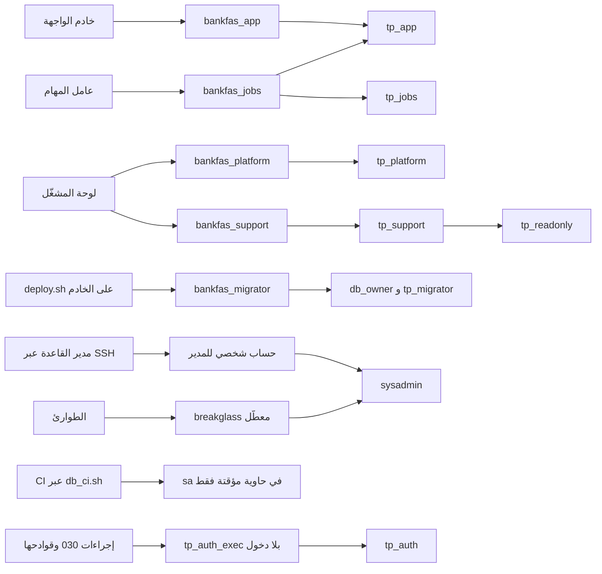
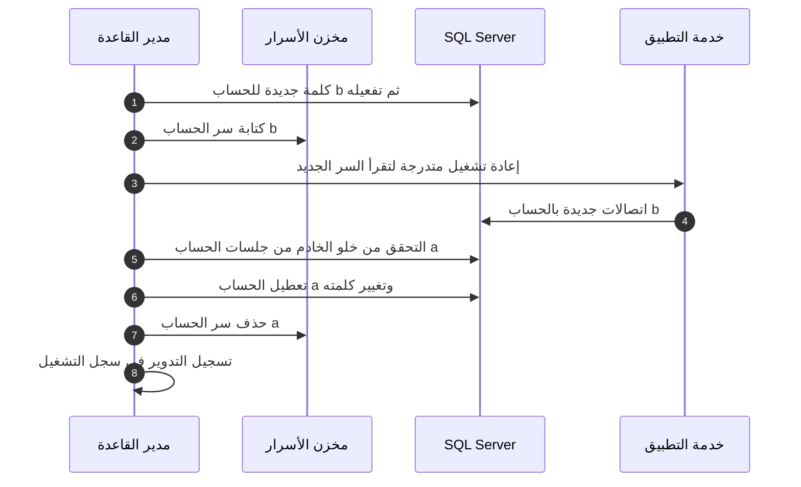

# DOC-S08 — نموذج الوصول إلى قاعدة البيانات وبيانات اعتمادها

| البند | القيمة |
|---|---|
| المعرّف | DOC-S08 (docs/30-readiness-documents.md) |
| الإصدار | 0.1 — مسودة للمراجعة — 2026-10-12 |
| المالك المقترح | مدير قاعدة البيانات (DBA) مع مهندس DevOps ومسؤول الأمن |
| الأولوية | P0 قبل S0 |
| يغطي | BR-PLT-001، BR-PLT-009، FR-PLT-006، FR-PLT-045، O-17 وO-24 (erd_open_items)، O-2 وO-12 (20-database-design)، ADR 0001، ADR 0002 |
| يعتمد على | DOC-F04 (أنواع الاتصال والأدوار الجديدة)، DOC-F05 (إجراءات المنصة)، DOC-S02 (المفاتيح وTDE)، DOC-S05 (TLS)، DOC-S10 (تقوية خادم Ubuntu)، DOC-S12 (السجلات)، DOC-B11 (البيئات والنشر) |
| المصادر | db/static/020_roles_and_grants.sql، db/static/030_session_context.sql، db/static/010_rls.sql، db/generated/tsql/000_schemas.sql، db/generated/tsql/005_delete_grants.sql، db/generated/tsql/006_sensitive_columns.sql، db/generated/tsql/007_table_grants.sql، db/deploy.sql، tools/deploy/deploy.sh، tools/ci/db_ci.sh، .github/workflows/db-ci.yml، tools/dbgen/check_grants.py، docs/adr/0001-schema-work-on-linux.md، docs/adr/0002-login-and-session-bound-context.md، docs/20-database-design.md |

## 1. الغرض والنطاق

تحدد الوثيقة كل حساب يتصل بقاعدة SQL Server 2025 على خادم Ubuntu 24.04 الخاص (docs/adr/0001-schema-work-on-linux.md:16): اسمه، والدور الذي يأخذه في القاعدة، ومن يستعمله ومن أين، وكيف يُصادَق، وأين يُحفظ سره، وكيف يُدوَّر، وما أقل صلاحياته. وتغطي حساب `sa` والوصول الطارئ وتدقيق الوصول المميّز.

خارج النطاق: مفاتيح التشفير وTDE والمفتاح الرئيسي (DOC-S02)، وشهادات TLS (DOC-S05)، وتقوية نظام التشغيل وSSH (DOC-S10)، وجمع السجلات وتنبيهاتها (DOC-S12)، ومسار الإصدار بين البيئات (DOC-B11).

الرموز: 🟢 قائم في المستودع أو مقرَّر، 🟡 مقترح ينتظر القرار. أسماء الحسابات في هذه الوثيقة كلها مقترحة 🟡.

## 2. الوضع اليوم 🟢

- خمسة أدوار تُنشأ بلا تسجيل دخول: `tp_app` و`tp_platform` و`tp_readonly` و`tp_migrator` و`tp_auth` (db/static/020_roles_and_grants.sql:16-30). ومستخدم واحد بلا تسجيل دخول `tp_auth_exec` عضو في `tp_auth` (db/static/020_roles_and_grants.sql:35-36).
- لا يوجد `CREATE LOGIN` في `db/` ولا في `tools/`. لا حساب دخول لتطبيق أو منصة أو تقارير.
- المخططات كلها يملكها `dbo` (db/generated/tsql/000_schemas.sql:6-45). دور `tp_migrator` بلا منح (db/static/020_roles_and_grants.sql:9)، والنشر يعمل بحساب مالك القاعدة (docs/20-database-design.md:271).
- سكربت النشر يستعمل `sa` افتراضيًا (tools/deploy/deploy.sh:17)، ويقرأ كلمة المرور من المتغير `SQLCMDPASSWORD` (tools/deploy/deploy.sh:8، :22)، ويثق بشهادة الخادم بالخيار `-C` إلى أن تُحسم O-08 (tools/deploy/deploy.sh:10-11، :19).
- مثال النشر في رأس `deploy.sql` يمرر كلمة المرور في سطر الأوامر (db/deploy.sql:9).
- CI يعمل على حاوية مؤقتة بحساب `sa` (tools/ci/db_ci.sh:14، :21، :54)، ويمر اليوم في حاوية التطوير فقط: لم يعمل على GitHub بعد، لأن ملف سير العمل تحت treasury-platform/.github وGitHub يقرأ سير العمل من جذر المستودع وحده (O-02 (erd_open_items)). كلمة المرور نص صريح في ملف سير العمل لحاوية لا يصل إليها غير هذه المهمة (.github/workflows/db-ci.yml:36-41). ولا يستعمل سير العمل أي سر من GitHub، وصلاحيته قراءة المحتوى فقط (.github/workflows/db-ci.yml:22-23).
- غلاف Windows `deploy.ps1` غير مختبر وليس مسار الإنتاج (docs/adr/0001-schema-work-on-linux.md:20).
- الاختبارات تنشئ مستخدمين بلا تسجيل دخول وتعمل بـ`EXECUTE AS` (db/tests/tenant_isolation_tests.sql:21-26).
- لا أسرار في النماذج (docs/20-database-design.md:220). ومدير القاعدة لا يملك المفتاح الرئيسي (docs/10-detailed-analysis/10-m0-m1-platform-organization.md:583).
- طبقة التطبيق على Windows Server وفق 01 §13، ومطروحة للمراجعة بعد ADR 0001 (docs/10-detailed-analysis/00-overview-and-cross-cutting.md:126، :226؛ FR-PLT-045 في docs/10-detailed-analysis/10-m0-m1-platform-organization.md:147).

## 3. خريطة الحسابات 🟡

| الحساب | الدور في القاعدة | يستعمله | من أين | الحالة |
|---|---|---|---|---|
| `bankfas_app` | `tp_app` | خادم الواجهة لمستخدمي المشترك | مضيف طبقة التطبيق | 🟡 جديد |
| `bankfas_jobs` | `tp_app` و`tp_jobs` | عامل المهام وOutbox والبذر (DOC-F04 §5، DOC-F05 §4) | مضيف طبقة التطبيق، عملية منفصلة | 🟡 جديد، والدور جديد |
| `bankfas_platform` | `tp_platform` | خدمة لوحة المشغّل | مضيف طبقة التطبيق، عملية منفصلة | 🟡 جديد |
| `bankfas_support` | `tp_support` عضو في `tp_readonly` | جلسات الدعم المؤقت (DOC-F04 §6.2) | خدمة لوحة المشغّل | 🟡 جديد، والدور جديد |
| `bankfas_report` | `tp_readonly` | لا يُنشأ حتى تُحسم حالة استعمال للتقارير (§7، DQ-S08-6) | — | 🟡 مؤجل |
| `bankfas_migrator` | `db_owner` و`tp_migrator` | `tools/deploy/deploy.sh` | خادم القاعدة نفسه عبر SSH | 🟡 جديد، معطّل خارج نافذة النشر |
| حساب شخصي لكل مدير قاعدة | `sysadmin` | الإدارة والاستكشاف | محطة الإدارة عبر نفق SSH | 🟡 جديد |
| `breakglass` | `sysadmin` | الطوارئ فقط (§9) | طرفية الخادم | 🟡 جديد، معطّل ومختوم |
| `sa` | `sysadmin` | لا أحد في الإنتاج | — | 🟡 يُعطَّل ويُعاد تسميته |
| `tp_auth_exec` | `tp_auth` | الإجراءات والقوادح بـ`EXECUTE AS` (db/static/030_session_context.sql:27، :170، :246) | داخل القاعدة | 🟢 بلا تسجيل دخول ولا سر |

حدود الثقة بأرقام DOC-F01: `bankfas_app` يعبر TB-3، و`tp_auth_exec` هو TB-4، و`bankfas_platform` يعبر TB-5، و`tp_readonly` هو TB-6، والنشر TB-7، والمديرون TB-12. الحسابان `bankfas_jobs` و`bankfas_support` يحتاجان حدّين جديدين في DOC-F01.

قواعد عامة 🟡:
- حساب لكل عملية، لا حساب مشترك بين الواجهة والعامل ولوحة المشغّل. فإن تسرب سر واحد لم يمنح صلاحيات الآخرين، ولا يصل خادم الواجهة إلى ربط المهام (DOC-F04 §5.2).
- كل حساب خدمة بلا أدوار خادم، وقاعدته الافتراضية `BankFas`، ولا يملك إلا مستخدمه في هذه القاعدة.
- لا يُمنح أي مستخدم صلاحية `IMPERSONATE` على `tp_auth_exec`، لأن انتحاله يتجاوز دوال الصفوف (db/static/010_rls.sql:11-12). والقاعدة نفسها لكل مستخدم جديد بلا تسجيل دخول، مثل مستخدم بذر المنصة المقترح في DOC-B05 §4.3.

## 4. المصادقة

| الخيار | الوصف | التقييم |
|---|---|---|
| حسابات SQL | اسم وكلمة مرور يتحقق منهما SQL Server | 🟡 الافتراضي: يعمل على Linux دون بنية إضافية، وهو ما يختبره CI اليوم (tools/ci/db_ci.sh:21) |
| مصادقة Windows عبر Kerberos | تحتاج نطاق Active Directory وتذكرة Kerberos (tools/deploy/deploy.sh:7) | لا نطاق في البنية المقررة؛ مرفوض الآن |
| مستخدمو قاعدة محتواة | المستخدم وكلمة مروره داخل القاعدة لا في الخادم | ينقل الأسرار مع كل نسخة احتياطية؛ غير مقترح |
| خيارات هوية أخرى | تحتاج خدمات خارج البنية المقررة | لم يُتحقق منها في هذا المستودع؛ تُراجع إن تغيرت البنية |

قواعد حسابات SQL 🟡:
- كلمة مرور عشوائية لا تقل عن 32 حرفًا، يولّدها مولّد آمن، ولا يكتبها إنسان.
- الاتصال مشفّر بالخادم. إسقاط الخيار `-C` ينتظر شهادة موثوقة (O-08 في tools/dbgen/erd_open_items.py:55-60، DOC-S05).
- منفذ SQL Server لا يُفتح إلا لمضيف طبقة التطبيق وللخادم نفسه. المدير يصل عبر نفق SSH لا عبر منفذ مفتوح (DOC-S10).

## 5. حفظ الأسرار

| السر | مكان الحفظ 🟡 | من يقرؤه | ملاحظات |
|---|---|---|---|
| كلمات مرور `bankfas_app` و`bankfas_jobs` و`bankfas_platform` و`bankfas_support` | مخزن أسرار نظام التشغيل على مضيف طبقة التطبيق، لكل عملية سرها | العملية المعنية وحدها | يُحسم شكل المخزن مع قرار نظام تشغيل طبقة التطبيق. لا يوضع السر في ملف إعداد داخل المستودع ولا في صورة البناء |
| كلمة مرور `bankfas_migrator` | ملف على خادم القاعدة يملكه الجذر وصلاحيته 0600، يُقرأ إلى `SQLCMDPASSWORD` لحظة النشر | مهندس النشر عبر `sudo` | لا تمرَّر في سطر الأوامر كما في db/deploy.sql:9، فتبقى في تاريخ الصدفة وقائمة العمليات |
| كلمات مرور حسابات المديرين الشخصية | مدير كلمات مرور شخصي | صاحبها | الوصول نفسه يمر عبر SSH بمفتاح شخصي |
| كلمة مرور `breakglass` | نصفان في ظرفين مختومين عند أمينين مستقلين | الأمينان معًا | على نمط حفظ المفتاح الرئيسي (Q-PLT-12، docs/10-detailed-analysis/10-m0-m1-platform-organization.md:624) |
| كلمة مرور `sa` | لا تُحفظ: عشوائية عند التثبيت ثم يُعطَّل الحساب | لا أحد | §9 |
| كلمة مرور `sa` في CI | نص صريح لحاوية مؤقتة (.github/workflows/db-ci.yml:37، :41) | مهمة CI | مقبول لأنها لا تحمي بيانات؛ لا تُستعمل القيمة في أي بيئة أخرى |
| أسرار قاعدة الإنتاج في GitHub | لا توجد | — | النشر يجري على الخادم عبر SSH. إن نفّذ خط النشر في DOC-B11 النشر عن بعد، تحفظ بيئة GitHub المحمية بمراجِعين مفتاح SSH للنشر فقط، وتبقى كلمة حساب الترحيل على الخادم |
| المفتاح الرئيسي وشهادة TDE | خارج هذه الوثيقة | — | DOC-S02 |

ويُقترح أن يضيف `.gitignore` أنماط ملفات الأسرار المحلية الشائعة، لأنه اليوم يستثني ملفات Python المؤقتة فقط (.gitignore:1-2). 🟡

## 6. التدوير 🟡

| الحساب | الدورية | التدوير الفوري عند |
|---|---|---|
| حسابات الخدمة الأربعة | كل 90 يومًا | ترك موظف يعرف السر، أو اشتباه تسرب، أو استعمال حساب الطوارئ |
| `bankfas_migrator` | بعد كل نافذة نشر | الاشتباه نفسه |
| حسابات المديرين الشخصية | كل 90 يومًا | ترك صاحبها العمل: يُعطَّل الحساب في اليوم نفسه |
| `breakglass` | بعد كل استعمال، وسنويًا | فتح الظرف لأي سبب |

لتجنّب انقطاع الخدمة أثناء التدوير، يكون لكل حساب خدمة حسابان متماثلان (مثل `bankfas_app_a` و`bankfas_app_b`)، مستخدماهما عضوان في الدور نفسه، ويعمل أحدهما في كل وقت:

## 7. أقل الصلاحيات لكل دور

| الدور | ما يملكه اليوم 🟢 | ما لا يملكه 🟢 | فجوات ومقترحات 🟡 |
|---|---|---|---|
| `tp_app` | منح جدولية صريحة (db/generated/tsql/007_table_grants.sql، 190 سطرًا)، وحذف على الجداول القابلة للحذف (db/generated/tsql/005_delete_grants.sql:8-43)، و`EXECUTE` على إجراءات الجلسة الأربعة (db/static/030_session_context.sql:229-232)، وقراءة مخطط `rls` (db/static/010_rls.sql:19) والعرضين (db/static/025_tenant_views.sql:17، :29) | لا كتابة على العالمي، ولا شيء على `noapp` (tools/dbgen/check_grants.py:5-6)، ولا قراءة بصمات كلمات المرور ولا إنشاء جلسات (db/static/030_session_context.sql:237-239)، ولا تعديل التدقيق أو حذفه (db/static/020_roles_and_grants.sql:65) | ما زال يحدّث `PasswordHash` ومهلة الخمول (O-24). ويملك حذف `sec.LoginAttempt` (db/generated/tsql/005_delete_grants.sql:11)، والأثر الدائم للمحاولات ليس في `aud.AuditLog` كما يقول القاموس (docs/21-data-dictionary.md:345) بل في `sec.LoginAttempt` وحده (db/static/030_session_context.sql:124-129). المقترح: نزع الحذف أو كتابة الأثر في التدقيق (DQ-S08-8) |
| `tp_platform` | قراءة وإدراج وتحديث على الجداول العالمية و`plat` والمختلطة، وقراءة وإدراج على `aud.AuditLog` (db/generated/tsql/007_table_grants.sql:9-20، :29، :55، :66، :83، :142، :145، :360، :363)، وتجاوز دوال الصفوف (db/static/010_rls.sql:48) | لا منح على جداول المشترك (docs/20-database-design.md:117)، ولا قراءة للربط (db/static/020_roles_and_grants.sql:60)، ولا حذف | يقرأ `PasswordHash` و`MfaSecretEnc` للمشغّلين (db/generated/tsql/007_table_grants.sql:18). المقترح: `DENY` على العمودين بعد 007 وإجراء دخول للمشغّل على نمط `usp_StartSession` (DQ-S08-7). ويحدّث حالة المشترك مباشرة (DQ-F05-5). أما قراءته تدقيق كل المشتركين (DQ-F04-7) فصُحّحت في 1f0f0af: لا يقرأ إلا أحداث المنصة (`TenantId` فارغ، db/static/010_rls.sql:83، T38) |
| `tp_readonly` | قراءة كل المخططات (db/static/020_roles_and_grants.sql:41-53) دون 29 عمودًا مقيّدًا (db/generated/tsql/006_sensitive_columns.sql:7-35) | لا قراءة لسجل المشتركين والوحدات والمشغّلين والربط (db/static/020_roles_and_grants.sql:55-63) | يخضع لـRLS ولا يملك `EXECUTE` على إجراء الربط، فلا يرى اليوم أي صف مشترك، بل الصفوف العالمية فقط. لا يُنشأ له حساب حتى تُحسم حالة استعمال (DQ-S08-6) |
| `tp_migrator` | دور فارغ (db/static/020_roles_and_grants.sql:9) | كل شيء | المقترح: حساب الترحيل عضو في `db_owner` أثناء النشر فقط، لأن `deploy.sql` ينشئ القاعدة والأدوار والمستخدمين والسياسات (db/deploy.sql:17-34). يُعطَّل خارج النافذة. أداة الترحيل بين الإصدارات قرار مفتوح (O-2 في docs/20-database-design.md:530) |
| `tp_auth` و`tp_auth_exec` | قراءة المستخدم والمشترك، وتحديث المستخدم، وكتابة الجلسات ومحاولات الدخول والربط (db/static/020_roles_and_grants.sql:38-39، :59، :67-69) | لا تسجيل دخول | يحتاج قراءة `sec.UserRole` و`sec.Role` إن اعتُمد DQ-F04-1. والقاعدة R6 تحصر منحه في هذه الجداول الخمسة ويشغّلها CI منذ e5ea45e (tools/dbgen/check_grants.py:81-87، tools/ci/db_ci.sh:49)؛ وصفها في رأس الملف ما زال قديمًا (§12) |
| `tp_jobs` و`tp_support` | غير موجودين | — | يُنشآن بمنح `EXECUTE` على إجراءات الربط الجديدة فقط (DOC-F04 §5.2 و§6.2) |

## 8. قاعدة ترتيب DENY

ترتيب النشر في db/deploy.sql:27-34: `020` ثم `005` ثم `006` ثم `007` ثم `010` ثم `025` ثم `030` ثم `050`. 🟢

القاعدة كما يكتبها المستودع: منحة `GRANT` لاحقة على الصلاحية نفسها تزيل `DENY` سابقًا، ومنحة على مستوى الجدول تزيل `DENY` على الأعمدة. لذلك يوضع كل `DENY` قد تزيله منح `007` في `030`، لأنه يُنشر بعدها (db/static/020_roles_and_grants.sql:70-71، db/static/030_session_context.sql:234-236). 🟢

| موضع DENY | الأسطر | آمن من منح 007؟ | السبب |
|---|---|---|---|
| `020` | db/static/020_roles_and_grants.sql:55، :60، :62-63، :65 | نعم | `007` لا يمنح هذه الصلاحيات لهذه الأدوار |
| `005` | db/generated/tsql/005_delete_grants.sql:44-50 | نعم | `007` يمنح القراءة والإدراج فقط على جداول الإضافة |
| `006` | db/generated/tsql/006_sensitive_columns.sql:7-35 | نعم | `007` لا يمنح `tp_readonly` شيئًا، ومنحته على مستوى المخطط لا تزيل `DENY` الأعمدة |
| `030` | db/static/030_session_context.sql:237-239 | يجب أن يبقى بعد 007 | `007` يمنح `tp_app` القراءة على `sec.AppUser` والإدراج والتحديث على `sec.UserSession` (db/generated/tsql/007_table_grants.sql:24، :40) |

القواعد المقترحة 🟡:
1. كل `DENY` جديد على صلاحية يمنحها `007` لدور ما يوضع في `030` أو في ملف يُنشر بعده. ومنها المقترحات `DQ-F05-5` و`DQ-S08-7`.
2. لا يُشغَّل `007` وحده أبدًا، بل `deploy.sql` كاملًا، وإلا اختفت محظورات `030`.
3. يُضاف فحص ثابت يرفض أي `DENY` في ملف يسبق `007` على ما يمنحه `007`، في `check_grants.py` الذي يشغّله CI في الخطوة 3 منذ e5ea45e (tools/ci/db_ci.sh:49).
4. الحارس الفعلي اليوم هو الاختبار T35 (db/tests/tenant_isolation_tests.sql:524-544)، ويغطي محظورات `030` الثلاثة فقط.

## 9. حساب sa والوصول الطارئ 🟡

حساب `sa`:
- يُضبط بكلمة عشوائية عند التثبيت، ثم يُنشأ حساب شخصي لكل مدير وحساب `breakglass`، ثم يُعطَّل `sa` ويُعاد تسميته. لا يُستعمل في أي سكربت إنتاج، فيُضبط `SQL_USER` صراحة عند النشر بدل القيمة الافتراضية (tools/deploy/deploy.sh:17).
- يبقى `sa` في CI لأنه حاوية مؤقتة (tools/ci/db_ci.sh:21).

الوصول الطارئ:
1. حساب `breakglass` عضو في `sysadmin`، معطّل في الأحوال العادية، وسره مقسوم بين أمينين.
2. شروط فتحه: حادث مسجّل، وشخصان حاضران، وموافقة مالك المنتج أو من ينوب عنه.
3. خطوات الاستعمال: تفعيل الحساب من حساب مدير شخصي أو من طرفية الخادم، ثم العمل، ثم التعطيل، ثم تدوير السر، ثم مراجعة سجل التدقيق خلال 24 ساعة.
4. من يملك صلاحية الجذر على خادم Ubuntu يملك عمليًا القاعدة كلها، لأن أدوات SQL Server على Linux تسمح له بإعادة ضبط حساب المدير. يُتحقق من هذا السلوك ويُضبط الوصول إلى `sudo` في DOC-S10.
5. `sysadmin` و`db_owner` يستطيعان تعديل سياسات RLS أو تعطيلها، فلا يحمي العزل منهما. ما يحمي الأعمدة المقيّدة منهما أن المفتاح الرئيسي خارج يد مدير القاعدة (docs/10-detailed-analysis/10-m0-m1-platform-organization.md:583؛ DOC-S02).

## 10. تدقيق الوصول المميّز 🟡

- سجل `aud.AuditLog` لأحداث التطبيق (BR-PLT-009). أما ما يجري على الخادم بالحسابات المميّزة فيُسجَّل بتدقيق SQL Server نفسه (SQL Server Audit) في ملف على الخادم، ويُنسخ فورًا خارجه (DOC-S12).
- مجموعات الأحداث المقترحة: `SUCCESSFUL_LOGIN_GROUP` و`FAILED_LOGIN_GROUP` و`LOGIN_CHANGE_PASSWORD_GROUP` و`SERVER_ROLE_MEMBER_CHANGE_GROUP` و`SERVER_PRINCIPAL_CHANGE_GROUP` و`SERVER_PERMISSION_CHANGE_GROUP` و`DATABASE_ROLE_MEMBER_CHANGE_GROUP` و`DATABASE_PRINCIPAL_CHANGE_GROUP` و`DATABASE_PERMISSION_CHANGE_GROUP` و`SCHEMA_OBJECT_PERMISSION_CHANGE_GROUP` و`SCHEMA_OBJECT_CHANGE_GROUP` و`AUDIT_CHANGE_GROUP`.
- تسجيل دخول حسابات الخدمة الناجح يُستثنى من الملف لكثرته، ويُسجَّل فشلها.
- تنبيه فوري عند: أي دخول بحساب `breakglass`، أو تفعيل `sa`، أو تغيير منحة أو سياسة أمن خارج نافذة نشر، أو دخول `bankfas_migrator` خارج النافذة.
- مراجعة شهرية لقائمة الحسابات وأعضاء الأدوار يوقّعها مسؤول الأمن.

## 11. القرارات المطلوبة

| المعرّف | السؤال | الافتراض المقترح | من يقرر | ما يعطّله |
|---|---|---|---|---|
| DQ-S08-1 | ما الحسابات وأسماؤها وأدوارها؟ | الجدول في §3: حساب لكل عملية، بلا حساب مشترك | مدير قاعدة البيانات مع مسؤول الأمن | أول اتصال للتطبيق في S0 |
| DQ-S08-2 | كيف تُصادَق الحسابات على Linux؟ | حسابات SQL بكلمات عشوائية طويلة واتصال مشفّر | مسؤول الأمن | §4 |
| DQ-S08-3 | أين تُحفظ أسرار طبقة التطبيق؟ | مخزن أسرار نظام التشغيل لكل عملية، ويُحسم شكله مع نظام تشغيل طبقة التطبيق | مهندس DevOps | النشر الأول للتطبيق |
| DQ-S08-4 | دورية التدوير وطريقته؟ | 90 يومًا لحسابات الخدمة والمديرين، بحسابين متناوبين لكل خدمة | مسؤول الأمن | §6 |
| DQ-S08-5 | كيف يجري نشر الإنتاج؟ | على الخادم عبر SSH بحساب `bankfas_migrator` المفعّل خلال النافذة فقط؛ لا كلمة مرور قاعدة في GitHub، ومفتاح SSH للنشر وحده في بيئة محمية (ينسجم مع DOC-B11 §9) | مهندس DevOps (DOC-B11) | أول نشر على VPS |
| DQ-S08-6 | ما غرض `tp_readonly`؟ | لا حساب له حتى تُحسم حالة استعمال؛ تقارير المشترك تمر بالتطبيق بربط عادي | مالك المنتج مع معماري البيانات | تقارير S5 |
| DQ-S08-7 | هل يُحجب `PasswordHash` و`MfaSecretEnc` للمشغّلين عن `tp_platform`؟ | نعم، بـ`DENY` بعد 007 وإجراء دخول للمشغّل داخل القاعدة | مسؤول الأمن مع مالك DOC-F03 | دخول المشغّل في S0 |
| DQ-S08-8 | هل يبقى حذف `sec.LoginAttempt` لـ`tp_app`؟ | يُنزع الحذف، أو يُكتب أثر دائم في `aud.AuditLog` من `usp_StartSession` | مسؤول الأمن | BR-PLT-005 |
| DQ-S08-9 | ما سياسة `sa` والطوارئ؟ | تعطيل `sa` وإعادة تسميته، وحساب `breakglass` بسر مقسوم بين أمينين | مدير قاعدة البيانات مع مالك المنتج | تجهيز VPS |
| DQ-S08-10 | ما الذي يدققه SQL Server وأين يُحفظ؟ | المجموعات في §10، وملف يُنسخ خارج الخادم | مسؤول الأمن (DOC-S12) | تجهيز VPS |
| DQ-S08-11 | كيف تُحرس قاعدة ترتيب DENY؟ | فحص ثابت جديد، وتصحيح R6، وتشغيل `check_grants.py` في CI | معماري قاعدة البيانات | كل تغيير في المنح |

## 12. تعارضات وفجوات في المصادر

1. ✅ صُحّح (e5ea45e): القاعدة R6 في tools/dbgen/check_grants.py:81-87 تقبل الجداول الخمسة التي يمنحها 020 لـ`tp_auth` (db/static/020_roles_and_grants.sql:38-39، :59، :67-69)، والسكربت يمر ويشغّله CI في الخطوة 3 قبل النشر (tools/ci/db_ci.sh:47-49)، كما تقول docs/20-database-design.md:452. بقي وصف R6 في رأس الملف (tools/dbgen/check_grants.py:10) يقول إن `tp_auth` يملك القراءة على `sec.AppUser` و`plat.Tenant` فقط.
2. db/static/020_roles_and_grants.sql:9 يصف `tp_migrator` بأنه «مالك مخطط النشر»، والمخططات يملكها `dbo` (db/generated/tsql/000_schemas.sql:6-45) والدور بلا منح.
3. docs/20-database-design.md:267 ما زال يصف منح `tp_app` قبل 1944f8c («`EXECUTE` على `sec.usp_SetSessionContext` فقط»)، والمنفّذ يمنح الإجراءات الأربعة (db/static/030_session_context.sql:229-232). صف `tp_auth` في :269 صُحّح (التفصيل في DOC-F04 §9).
4. docs/21-data-dictionary.md:345 يقول إن الأثر الدائم لمحاولات الدخول في `aud.AuditLog`، والإجراء يكتبها في `sec.LoginAttempt` فقط (db/static/030_session_context.sql:124-129)، و`tp_app` يستطيع حذفها (db/generated/tsql/005_delete_grants.sql:11).
5. db/deploy.sql:9 يمرر كلمة المرور في سطر الأوامر في مثاله، وهذا يخالف القاعدة في §5.

## 13. التتبع

| البند في هذه الوثيقة | المتطلب أو القاعدة أو القرار | المصدر |
|---|---|---|
| §3 و§7 | أدوار القاعدة، C-2 وC-3 وC-4 (20-database-design) | db/static/020_roles_and_grants.sql:5-11؛ docs/20-database-design.md:264-271 |
| §3 حساب العامل | DQ-F04-4، FR-PLT-044 | DOC-F04 §5 |
| §3 حساب الدعم | FR-PLT-007، BR-PLT-017، DQ-F04-6 | DOC-F04 §6.2 |
| §4 | ADR 0001، O-08 (erd_open_items) | docs/adr/0001-schema-work-on-linux.md:16؛ tools/deploy/deploy.sh:10-11 |
| §5 | Q-PLT-12، قاعدة «لا أسرار في النماذج» | docs/10-detailed-analysis/10-m0-m1-platform-organization.md:624؛ docs/20-database-design.md:220 |
| §7 صف `tp_app` | O-17 وO-24 (erd_open_items)، ADR 0002 | db/static/030_session_context.sql:229-239؛ docs/adr/0002-login-and-session-bound-context.md:24 |
| §7 صف `tp_migrator` | O-2 (20-database-design) | docs/20-database-design.md:530 |
| §8 | قاعدة ترتيب DENY | db/static/020_roles_and_grants.sql:70-71؛ db/static/030_session_context.sql:234-239؛ db/deploy.sql:27-34 |
| §9 | الفصل بين الأدوار: مدير القاعدة لا يملك المفتاح الرئيسي | docs/10-detailed-analysis/10-m0-m1-platform-organization.md:583 |
| §10 | BR-PLT-009 | docs/10-detailed-analysis/10-m0-m1-platform-organization.md:235 |
