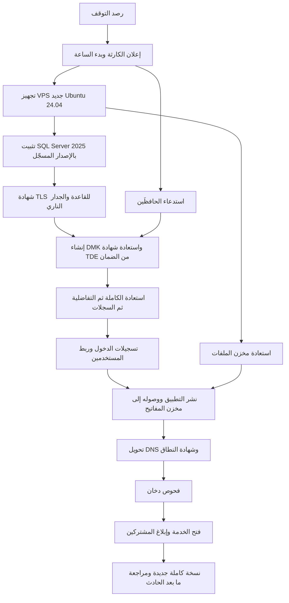

# DOC-S09 — خطة النسخ الاحتياطي والاستعادة والتعافي من الكوارث

| البند | القيمة |
|---|---|
| المعرّف | DOC-S09 (docs/30-readiness-documents.md) |
| الإصدار | 0.1 — مسودة للمراجعة — 2026-10-12 |
| المالك المقترح | مسؤول العمليات مع مدير قاعدة البيانات (DBA) |
| الأولوية | P0 قبل S0 (وقبل تحميل بيانات حقيقية) |
| يغطي | §6.4 «التعافي» في 00-overview، صف «الاستمرارية» في 10-m0-m1 §12، O-14 وO-7 وO-6 (20-database-design)، BR-PLT-015، FR-PLT-031، O-23 (erd_open_items) |
| يعتمد على | DOC-S02 (المفاتيح وشهادة TDE)، DOC-S05 (النقل المشفّر)، DOC-S07 (الإقامة والاحتفاظ)، DOC-S08 (تسجيلات الدخول)، DOC-S10 (تجهيز الخادم)، DOC-S12 (المراقبة)، DOC-B03 (NFR) |
| المصادر | docs/30-readiness-documents.md:273-279 · docs/10-detailed-analysis/00-overview-and-cross-cutting.md:164-169 · docs/10-detailed-analysis/10-m0-m1-platform-organization.md:590 · docs/20-database-design.md:455-461 و532-540 · docs/adr/0001-schema-work-on-linux.md · db/deploy.sql · db/model/10-platform.model |

**وسوم المصدر:** 🟢 ذكره المستخدم أو ورد في الوثائق · 🟡 اقتراح له افتراضي ويُعدَّل.

## 1. الغرض والنطاق

**الغرض.** تحويل أهداف RPO وRTO المقترحة إلى خطة قابلة للاختبار: جدول النسخ لـ SQL Server 2025 على Ubuntu 24.04، والنسخ إلى موقع منفصل، والتشفير، والاحتفاظ، واختبار الاستعادة بتمرين مقاس، ودليل التعافي عند فقد VPS، وحدود استعادة مشترك واحد. ADR 0001 يشترط حسم النسخ الاحتياطي قبل تحميل بيانات حقيقية 🟢 (docs/adr/0001-schema-work-on-linux.md:26، tools/dbgen/erd_open_items.py:149).

**داخل النطاق:** قاعدة `BankFas`، وقاعدتا النظام master وmsdb، ومخزن الملفات، وما تحتاجه الاستعادة من مفاتيح.

**خارج النطاق:** تفاصيل المفاتيح وحفظها (DOC-S02)، وتجهيز الخادم وتقويته (DOC-S10)، وإجراء الحوادث الأمنية (DOC-S15).

## 2. ما هو موجود اليوم

| البند | النص أو الحالة | المصدر |
|---|---|---|
| الأهداف | «RPO ≤ 15 دقيقة · RTO ≤ 4 ساعات؛ نسخ كامل يومي + تفاضلي + سجل معاملات» تحت عنوان «أهداف مقترحة 🟡» | docs/10-detailed-analysis/00-overview-and-cross-cutting.md:164 و169 |
| التوفر | «99.5% شهريًا في المرحلة الأولى» 🟡 | docs/10-detailed-analysis/00-overview-and-cross-cutting.md:168 |
| الاستمرارية | استعادة تُختبر دوريًا، و«استعادة العمود المشفَّر تتطلب المفتاح»، والأهداف «تُثبَّت مع الاستضافة» | docs/10-detailed-analysis/10-m0-m1-platform-organization.md:590 |
| توصيات التشغيل | نسخ كامل ليلي وتفاضلي وسجل كل 15 دقيقة بنموذج `FULL`، وموقع منفصل، والمفاتيح الرئيسية في نسخ منفصل، واختبار استعادة مع فك عيّنة، واسترجاع مشترك واحد بالتصدير والاستيراد من نسخة مؤقتة 🟡 | docs/20-database-design.md:455-460 |
| القرار | «أرقام RPO/RTO لم تُحدَّد بعد» O-14 (20-database-design) | docs/20-database-design.md:461 و540 |
| استعادة مشترك واحد | «معقّدة» O-7 (20-database-design) | docs/20-database-design.md:533 |
| أثر التحقق من النسخ | الحدث `BACKUP_VERIFIED` في `sec.KeyEvent` | db/model/10-platform.model:293 |
| إنشاء القاعدة | `CREATE DATABASE ... COLLATE Arabic_100_CI_AS_SC` فقط، بلا نموذج استرداد صريح | db/deploy.sql:17-18 |
| سكربتات نسخ أو استعادة | لا يوجد أي سكربت في `db/` ولا `tools/` | — |

## 3. الأهداف وما تعنيه

### 3.1 الأرقام المقترحة 🟡

| المؤشر | القيمة المقترحة | الحالة |
|---|---|---|
| RPO | ≤ 15 دقيقة | مقترح غير معتمد (O-14، 20-database-design) |
| RTO | ≤ 4 ساعات من إعلان الكارثة | مقترح غير معتمد |
| التوفر | 99.5% شهريًا | مقترح غير معتمد |

### 3.2 ملاحظتان تلزمان القرار

- **RTO والتوفر متعارضان.** 99.5% من شهر من 30 يومًا تسمح بـ 3.6 ساعة توقف (720 × 0.005). كارثة واحدة تستهلك 4 ساعات تكسر هدف الشهر وحدها، قبل أي صيانة. الخيارات: قبول ذلك صراحة، أو RTO أقصر بخادم احتياطي جاهز، أو هدف توفر أدنى (DQ-S09-1).
- **RPO عند فقد VPS يساوي فترة نسخ السجل + زمن وصوله إلى الموقع المنفصل.** نسخة سجل على الخادم المفقود لا تفيد. لذلك نسخ السجل كل 15 دقيقة (docs/20-database-design.md:456) لا يحقق 15 دقيقة. المقترح: سجل كل 10 دقائق، ودفع كل ملف إلى الموقع المنفصل فور كتابته بهدف 5 دقائق، فيكون أسوأ فقد نحو 15 دقيقة.

## 4. جدول النسخ لـ SQL Server على Linux 🟡

### 4.1 الإعداد

- نموذج الاسترداد `FULL` يُضبط صراحة في سكربت التشغيل (`ALTER DATABASE BankFas SET RECOVERY FULL`)، لأن `deploy.sql` لا يحدده (db/deploy.sql:17-18). سلسلة السجل تبدأ بأول نسخة كاملة بعده.
- الجدولة: SQL Server Agent بعد تفعيله على Linux، أو مؤقّت نظام يستدعي `sqlcmd`. يُختار واحد (DQ-S09-4)، وتُتحقق خطوات التفعيل من وثائق Microsoft عند التجهيز (DOC-S10).
- مجلد النسخ على وحدة تخزين غير وحدة البيانات والسجل.
- كل نسخة: `WITH CHECKSUM, COMPRESSION, ENCRYPTION (ALGORITHM = AES_256, SERVER CERTIFICATE = <شهادة TDE>)` كما في DOC-S02 §6.
- الاتصال الذي ينفّذ النسخ يستعمل TLS بلا `-C` (DOC-S05 §5.3).

### 4.2 الجدول

| النوع | القاعدة | الدورية | الاحتفاظ المحلي | الاحتفاظ في الموقع المنفصل |
|---|---|---|---|---|
| كاملة | `BankFas` | يوميًا 01:00 بتوقيت UTC | 7 أيام | 35 يومًا؛ ونسخة أول الشهر 12 شهرًا |
| تفاضلية | `BankFas` | كل 6 ساعات | 7 أيام | 35 يومًا |
| سجل المعاملات | `BankFas` | كل 10 دقائق | 7 أيام | 35 يومًا |
| كاملة | master وmsdb | يوميًا بعد نسخة `BankFas` | 7 أيام | 35 يومًا |
| مخزن الملفات | الملفات الجديدة | فور الرفع، أو كل 5 دقائق على الأكثر | — | كمدة المستند (DOC-S07) |

- الحمل المتوقع منخفض (docs/20-database-design.md:464)، فالنسخة الكاملة اليومية لا تثقل الخادم. يُراجع الجدول إذا تجاوزت مدة النسخة الكاملة ساعة.
- التفاضلية تختصر الاستعادة: كاملة + آخر تفاضلية + سجلات أقصاها 6 ساعات.
- master يحمل شهادة TDE وتسجيلات الدخول، فنسخه لازم لكنه لا يغني عن ضمان الشهادة (DOC-S02 §11).

### 4.3 المراقبة (تفصيلها في DOC-S12)

| التنبيه | الشرط |
|---|---|
| سجل متأخر | لا نسخة سجل ناجحة منذ 20 دقيقة |
| كاملة متأخرة | لا نسخة كاملة ناجحة منذ 26 ساعة |
| نقل متأخر | ملف نسخة لم يصل إلى الموقع المنفصل خلال 15 دقيقة |
| مساحة | مجلد النسخ فوق 80% |
| تحقق فاشل | `RESTORE VERIFYONLY ... WITH CHECKSUM` اليومي فشل |

## 5. الموقع المنفصل 🟡

- مزوّد أو موقع مختلف عن مزوّد VPS، حتى لا يفقدهما حادث واحد (DQ-S09-2).
- النقل مشفّر (SSH أو HTTPS، DOC-S05 الاتصال NC-8). الملفات مشفّرة أصلًا.
- حساب الدفع من الخادم يملك **الكتابة فقط**، بلا حذف ولا استبدال، وتُفعَّل خاصية الحفظ غير القابل للتعديل إن وفرها الموقع. خادم مخترق لا يستطيع إذن محو النسخ.
- الحذف عند انتهاء المدة يتم من جهة الموقع المنفصل بقاعدة دورة حياة، لا من الخادم.
- **ضمان المفاتيح ليس هنا:** شهادة TDE والمفتاح الرئيسي للتطبيق لا يُحفظان مع النسخ (BR-PLT-015، docs/20-database-design.md:457؛ DOC-S02 §9).
- دولة الموقع قرار إقامة (DOC-S07، DQ-S07-2).
- **لقطات VPS التي يقدّمها المزوّد** لا تُعد نسخًا احتياطيًا في هذه الخطة. اللقطة الكاملة تحمل البيانات ومفاتيح TDE معًا (DOC-S02 §3)، فتُعطَّل أو تُقيَّد بموافقة المالك (DQ-S09-6).

## 6. ما تحتاجه الاستعادة

| العنصر | لماذا | من أين |
|---|---|---|
| شهادة TDE ومفتاحها الخاص وكلمة المرور | فتح أي نسخة على خادم آخر | الضمان بحضور الحافظَين (DOC-S02 §9) |
| كل شهادة متقاعدة ما زالت نسخها ضمن المدة | فتح النسخ الأقدم | الضمان |
| المفتاح الرئيسي للتطبيق | فك الأعمدة المقيّدة والملفات بعد الاستعادة | مخزن المفاتيح، أو الضمان إن فُقد (DOC-S02 §11.3) |
| سلسلة النسخ | كاملة + تفاضلية + سجلات متصلة | الموقع المنفصل |
| ملفات المخزن | المستندات والصور | الموقع المنفصل |
| أسرار تسجيلات الدخول | التطبيق والتقارير والنشر | DOC-S08 |
| إصدار SQL Server نفسه أو أحدث | الاستعادة لا تعمل إلى إصدار أقدم | سجل الإصدارات (FR-PLT-045، docs/10-detailed-analysis/10-m0-m1-platform-organization.md:147) |

## 7. اختبار الاستعادة

### 7.1 الإيقاع 🟡

| الاختبار | الدورية | ما يثبته |
|---|---|---|
| `RESTORE VERIFYONLY ... WITH CHECKSUM` لآخر كاملة | يوميًا، آليًا | سلامة الملف فقط، لا قابلية الاستعادة |
| استعادة آلية على خادم استعادة منفصل إلى نقطة زمنية | أسبوعيًا | السلسلة كاملة، و`DBCC CHECKDB` نظيف، ومطابقة البنية بـ `tools/dbgen/check_deployed.py`، وفك عيّنة (docs/20-database-design.md:458) |
| تمرين تعافٍ كامل مقاس | كل ربع سنة | RTO وRPO الفعليان، وضمان المفاتيح بحضور الحافظَين (DOC-S02 §11.2) |
| استعادة ملف واحد ومستند واحد | شهريًا | مخزن الملفات وفك ملف |

- **لا تُشغَّل اختبارات العزل على نسخة إنتاج مستعادة.** db/tests/tenant_isolation_tests.sql يشترط قاعدة «لا تحوي بيانات حقيقية» (db/tests/tenant_isolation_tests.sql:6-7). يكفي على النسخة المستعادة: `CHECKDB` و`check_deployed.py` وفك العيّنة وتسجيل دخول تجريبي.
- خادم الاستعادة معزول عن الإنترنت، ويُمحى بعد كل تمرين، ولا يصل إليه إلا DBA. نسخة مستعادة بيانات حقيقية كاملة.
- كل تمرين ناجح يكتب `BACKUP_VERIFIED` لكل مشترك (db/model/10-platform.model:293)، وحدث منصة للشهادة (DOC-S02 §13).

### 7.2 سجل التمرين

| الحقل | المحتوى |
|---|---|
| التاريخ والسيناريو | مثل «فقد VPS كامل» |
| النقطة المطلوبة والنقطة المستعادة | الفرق هو RPO المحقَّق |
| زمن كل خطوة من القسم 8 | بداية ونهاية |
| المجموع | RTO المحقَّق مقابل الهدف |
| النتائج | `CHECKDB`، فك العيّنة، تسجيل الدخول، تنزيل ملف |
| المشكلات والإجراءات | مالك وتاريخ لكل إجراء |

## 8. دليل التعافي عند فقد VPS (مخطط تنفيذي)

| الخطوة | المسؤول | الهدف الزمني 🟡 | ملاحظات |
|---|---|---|---|
| 1. رصد التوقف وإعلان الكارثة | مسؤول العمليات | 30 دقيقة | الإعلان يبدأ ساعة RTO؛ إن اشتُبه بهجوم يُفتح DOC-S15 |
| 2. تجهيز VPS جديد | مهندس البنية | 60 دقيقة | بسكربت تجهيز مختبر مسبقًا (DOC-S10)، لا يدويًا |
| 3. تثبيت SQL Server 2025 | DBA | ضمن الخطوة 2 | الإصدار والتحديث التراكمي من سجل الإصدارات (FR-PLT-045) |
| 4. شهادة TLS للقاعدة وفرض التشفير | DBA | 15 دقيقة | DOC-S05 §5 |
| 5. إنشاء DMK في master واستعادة شهادة TDE | DBA مع الحافظَين | 30 دقيقة | `CREATE CERTIFICATE ... FROM FILE ... WITH PRIVATE KEY (...)` |
| 6. استعادة السلسلة | DBA | 45 دقيقة، يُقاس | `WITH NORECOVERY` لكل ملف ثم `RECOVERY`؛ يُسجَّل وقت آخر سجل مستعاد (RPO المحقَّق) |
| 7. تسجيلات الدخول وربط المستخدمين | DBA | 15 دقيقة | DOC-S08 |
| 8. استعادة مخزن الملفات | مهندس البنية | بالتوازي مع 5-7 | الملفات ثابتة الإصدار، فالنسخ الأحدث من نقطة القاعدة لا يضر |
| 9. نشر التطبيق | مهندس DevOps | 30 دقيقة | سلسلة اتصال جديدة، ووصول إلى مخزن المفاتيح من المضيف الجديد |
| 10. تحويل DNS | مهندس البنية | 15 دقيقة + مدة TTL | 🟡 TTL سجلات `bankfas.com` و`*.bankfas.com` 300 ثانية في الأوقات العادية |
| 11. فحوص دخان | مسؤول العمليات | 15 دقيقة | دخول على مشتركين اثنين، وكشف رقم عيّنة، وتنزيل ملف، وكتابة حدث تدقيق |
| 12. فتح الخدمة وإبلاغ المشتركين | مسؤول العمليات | — | بالنقطة الزمنية التي استُعيدت إليها البيانات |
| 13. ما بعد التعافي | DBA ومسؤول الأمن | 24 ساعة | نسخة كاملة فورية لبدء سلسلة جديدة، وتدوير أي سر كان على الخادم المفقود، وتشغيل فحص سلامة الملفات (FR-PLT-031) |

مجموع الأهداف نحو 4 ساعات، فلا هامش. التمرين الأول يحدد إن كان الهدف واقعيًا (DQ-S09-1).

## 9. استعادة مشترك واحد

### 9.1 المشكلة

- كل المشتركين في قاعدة واحدة 🟢 (T-1، docs/20-database-design.md:61). **استعادة القاعدة كلها ترجع كل المشتركين إلى النقطة نفسها**، فيضيع عمل المشتركين الآخرين بعدها. لا تصلح إذن لإصلاح خطأ مشترك واحد.
- docs/20-database-design.md:459 يقترح الاستعادة إلى قاعدة مؤقتة ثم تصدير صفوف المشترك واستيرادها بترتيب التبعيات. هذا المسار يواجه عقبات محددة:

| العقبة | السبب | المصدر |
|---|---|---|
| المفاتيح الأساسية | `BIGINT IDENTITY`، والـ AAD في الغلاف المشفّر يتضمن المعرّف الثابت للصف؛ تغيّر المعرّف عند الاستيراد يكسر فك التشفير | docs/20-database-design.md:136 و199 |
| التعارض | صفوف أُنشئت بعد النقطة تحمل المراجع نفسها أو تشغل الفرادة | المفاتيح المركّبة، docs/20-database-design.md:47 |
| المفاتيح | صفوف `sec.TenantKey` للمشترك يجب أن تُستعاد مع بياناته، وإلا لا يُفك شيء | db/model/10-platform.model:276-289 |
| الصلاحيات | `tp_platform` بلا منح على جداول المشتركين، و`tp_app` مقيّد بمشترك مربوط؛ يلزم إجراء صيانة مدقَّق | docs/20-database-design.md:268؛ db/static/010_rls.sql:11 |
| التدقيق | `aud.AuditLog` للإضافة فقط بسلسلة بصمات؛ لا تُعاد كتابة صفوفه | db/static/020_roles_and_grants.sql:65؛ db/model/10-platform.model:321-323 |
| الملفات | ملفات المشترك في المخزن تُستعاد معه | db/model/10-platform.model:389 |

### 9.2 المقترح 🟡

- **حتى S5:** لا تقدّم المنصة خدمة «استعادة مشترك واحد». استعادة القاعدة كلها للكوارث فقط. خطأ المستخدم في مشترك يُصحَّح من التطبيق بما يحفظه التدقيق من القيم السابقة.
- **قراءة فقط:** يجوز استعادة قاعدة مؤقتة معزولة لاستخراج معلومة لمشترك بطلب مكتوب منه، وتُمحى بعد ذلك.
- يُذكر هذا الحد صراحة في شروط الخدمة للمشتركين.
- **لاحقًا:** إن احتاج مشترك كبير استعادة مستقلة، يُنقل إلى قاعدة خاصة به، والبنية تسمح لأنها تحمل `TenantId` في كل جدول (O-7، docs/20-database-design.md:533؛ 01 س-24، docs/01-preliminary-analysis.md:326).
- القرار للمالك (DQ-S09-3).

## 10. الأدوار

| الدور | المسؤولية |
|---|---|
| مسؤول العمليات | ملكية الخطة، وإعلان الكارثة، وجدولة التمارين، وإبلاغ المشتركين |
| DBA | سكربتات النسخ والاستعادة، والمراقبة، وتنفيذ التمارين |
| مهندس البنية | الموقع المنفصل، والتجهيز، وDNS، ومخزن الملفات |
| الحافظان KC-1 وKC-2 | حضور كل استعادة تحتاج ضمان المفاتيح (DOC-S02 §9) |
| المالك | اعتماد RPO وRTO والتوفر، ودولة الموقع المنفصل، وسياسة استعادة المشترك الواحد |

## 11. القرارات المطلوبة

| المعرّف | السؤال | الافتراض المقترح | من يقرر | ما يعطّله |
|---|---|---|---|---|
| DQ-S09-1 | اعتماد RPO ≤ 15 دقيقة وRTO ≤ 4 ساعات مع توفر 99.5% | اعتماد RPO؛ RTO 4 ساعات مع قبول أن كارثة واحدة تكسر هدف التوفر في شهرها، ومراجعة بعد أول تمرين | المالك | O-14 (20-database-design)، DOC-B03 |
| DQ-S09-2 | الموقع المنفصل ومزوّده ودولته | مزوّد مختلف عن مزوّد VPS، في دولة يقبلها الرأي القانوني | المالك مع المستشار | تحميل بيانات حقيقية |
| DQ-S09-3 | استعادة مشترك واحد | لا خدمة حتى S5؛ استعادة كاملة للكوارث فقط | المالك | شروط الخدمة |
| DQ-S09-4 | أداة الجدولة على Linux | SQL Server Agent | DBA | سكربتات النسخ |
| DQ-S09-5 | الاحتفاظ | 35 يومًا للاستعادة النقطية و12 شهرًا للنسخ الشهرية، بلا نسخ سنوية | المالك مع DPO | DOC-S07 |
| DQ-S09-6 | لقطات VPS من المزوّد | معطّلة، أو مقيّدة بموافقة المالك ومعاملة نسخة غير مشفّرة | المالك مع مسؤول الأمن | DOC-S02 |
| DQ-S09-7 | خادم احتياطي جاهز بنقل السجلات إليه | لا الآن؛ يُعاد النظر إن لم يحقق التمرين RTO | المالك | RTO |
| DQ-S09-8 | خادم الاستعادة للاختبار الأسبوعي | خادم صغير منفصل يُشغَّل عند الحاجة | مسؤول العمليات | القسم 7 |
| DQ-S09-9 | فترات النسخ | كاملة يوميًا، وتفاضلية كل 6 ساعات، وسجل كل 10 دقائق | DBA | القسم 4 |

## 12. تعارضات وفجوات في المصادر

- docs/20-database-design.md:456 يقترح نسخ السجل كل 15 دقيقة، وهذا لا يحقق RPO ≤ 15 دقيقة (docs/10-detailed-analysis/00-overview-and-cross-cutting.md:169) عند فقد الخادم، لأن زمن النقل إلى الموقع المنفصل يُضاف.
- RTO ≤ 4 ساعات (docs/10-detailed-analysis/00-overview-and-cross-cutting.md:169) أطول من التوقف الشهري المسموح بتوفر 99.5% (docs/10-detailed-analysis/00-overview-and-cross-cutting.md:168)، أي نحو 3.6 ساعة.
- تصادم الترقيم: O-14 في docs/20-database-design.md:540 هو «أرقام RPO/RTO»، وO-14 في tools/dbgen/erd_open_items.py:98-101 هو «خطة الشرائح». هذه الوثيقة تكتب «O-14 (20-database-design)».
- سجل الجاهزية يقول «يعتمد عليه D-02، لأن فقدان المفتاح الرئيسي يعني فقدان الأعمدة المشفّرة» (docs/30-readiness-documents.md:276)، وD-2 في docs/01-preliminary-analysis.md:393 هو كيان «شخص/جهة». المقصود غالبًا DOC-S02.
- docs/10-detailed-analysis/10-m0-m1-platform-organization.md:590 يربط الأهداف بـ «01 س-26» (docs/01-preliminary-analysis.md:348، 🔴 الاستضافة)، والاستضافة حُسمت VPS خاصًا (docs/10-detailed-analysis/10-m0-m1-platform-organization.md:615). الباقي دولة الخادم لا نوع الاستضافة.
- `next` في O-02 يطلب تشغيل `deploy.ps1` «on the target Windows server» (tools/dbgen/erd_open_items.py:23)، وADR 0001 يجعل الإنتاج Ubuntu ومسار النشر `deploy.sh` (docs/adr/0001-schema-work-on-linux.md:16-20). دليل التعافي هنا يتبع ADR 0001.
- `db/deploy.sql:17-18` ينشئ القاعدة دون نموذج استرداد صريح، والتوصية `FULL` (docs/20-database-design.md:456).
- لا يوجد في المستودع أي سكربت نسخ أو استعادة أو فحص استعادة.

## 13. التتبع

| البند في هذه الوثيقة | المتطلب أو القاعدة أو القرار | المصدر |
|---|---|---|
| القسم 3 | §6.4 التعافي والتوفر، O-14 (20-database-design) | docs/10-detailed-analysis/00-overview-and-cross-cutting.md:164-169؛ docs/20-database-design.md:540 |
| القسم 4 | §12.3 توصيات التشغيل | docs/20-database-design.md:455-460 |
| القسم 5 | BR-PLT-015، صف التشفير «نسخ احتياطية مشفَّرة ومفتاحها منفصل» | docs/10-detailed-analysis/10-m0-m1-platform-organization.md:241 و582 |
| القسم 6 | FR-PLT-045، DOC-S02 | docs/10-detailed-analysis/10-m0-m1-platform-organization.md:147 |
| القسم 7 | صف الاستمرارية، `BACKUP_VERIFIED` | docs/10-detailed-analysis/10-m0-m1-platform-organization.md:590؛ db/model/10-platform.model:293؛ docs/20-database-design.md:458 |
| القسم 8 | ADR 0001، FR-PLT-046، FR-PLT-031 | docs/adr/0001-schema-work-on-linux.md:16-20؛ docs/10-detailed-analysis/10-m0-m1-platform-organization.md:148 و133 |
| القسم 9 | T-1، O-7 (20-database-design)، 01 س-24 | docs/20-database-design.md:61 و459 و533؛ docs/01-preliminary-analysis.md:326 |
| القسم 11 | ADR 0001 (إغلاق قرار النسخ قبل البيانات الحقيقية)، O-23 (erd_open_items) | docs/adr/0001-schema-work-on-linux.md:26؛ tools/dbgen/erd_open_items.py:149 |
