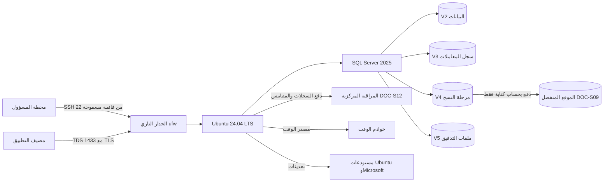

# DOC-S10 — دليل تشغيل خادم Ubuntu 24.04 لقاعدة البيانات

| البند | القيمة |
|---|---|
| المعرّف | DOC-S10 (docs/30-readiness-documents.md) |
| الإصدار | 0.1 — مسودة للمراجعة — 2026-10-12 |
| المالك المقترح | مهندس DevOps / مسؤول الأنظمة (OPS في DOC-B09) مع مدير قاعدة البيانات (DBA) |
| الأولوية | P1 قبل أول نشر على VPS وقبل S2 |
| يغطي | ADR 0001، O-23 (erd_open_items)، FR-PLT-045، NFR-OPS-07، NFR-AVL-02، NFR-SEC-09، THR-56 وTHR-58 وTHR-59 (DOC-S01)، TB-12 وTB-13 (DOC-F01) |
| يعتمد على | DOC-S02 (TDE والمفاتيح)، DOC-S05 (TLS وSSH)، DOC-S08 (حسابات القاعدة والطوارئ)، DOC-S09 (النسخ)، DOC-S11 (النشر)، DOC-S12 (السجلات والتنبيهات)، DOC-B11 (البيئات وسجل الإصدارات) |
| المصادر | docs/adr/0001-schema-work-on-linux.md، tools/dbgen/erd_open_items.py، ../.github/workflows/treasury-db-ci.yml (repository root)، db/deploy.sql، docs/10-detailed-analysis/10-m0-m1-platform-organization.md، docs/01-preliminary-analysis.md، docs/20-database-design.md، docs/30-readiness/DOC-S02، DOC-S05، DOC-S08، DOC-S09، DOC-B03، DOC-B11 |

**الوسوم:** 🟢 قائم في المستودع أو مقرَّر · 🟡 مقترح ينتظر القرار · **[تحقق MS]** بند في إعداد SQL Server على Linux مأخوذ من المعرفة العامة، ويجب التحقق منه على وثائق Microsoft الرسمية قبل التنفيذ، لأنها لم تُفتح من بيئة العمل (tools/dbgen/erd_open_items.py:148).

كل أمر في كتل bash مقترح يُجرَّب على خادم تجريبي ثم على الخادم الهدف. القيم بين `<...>` أماكن لقيم حقيقية لا تُكتب في المستودع.

## 1. الغرض والنطاق

**الغرض.** إجراءات تنفيذية لخادم قاعدة البيانات: تجهيزه، وتثبيت SQL Server 2025 وضبطه، وتقويته، وترقيعه مع سجل الإصدارات، والوصول إليه، وربطه بالمراقبة. ADR 0001 يقرر Ubuntu 24.04 LTS على VPS خاص مع SQL Server 2025 🟢 (docs/adr/0001-schema-work-on-linux.md:8، :16)، والخطوة التالية في O-23 هي تجهيز الخادم وتشغيل deploy.sh عليه (tools/dbgen/erd_open_items.py:149).

**داخل النطاق:** خادم القاعدة في الإنتاج، وخادما UAT والاختبار حين يُبنيان بالمواصفة نفسها (DOC-B11 §3).

**خارج النطاق:**
- مضيف طبقة التطبيق: نظامه غير محسوم، وADR 0001 يبقيه على Windows Server حتى المراجعة (docs/adr/0001-schema-work-on-linux.md:3؛ DQ-B11-1). إن صار Ubuntu، تنطبق عليه الأقسام 6 و7 و8 كما هي.
- خطوات النشر (DOC-S11)، وحسابات القاعدة وأسرارها (DOC-S08)، والمفاتيح وTDE (DOC-S02)، وTLS (DOC-S05)، والنسخ (DOC-S09)، ومحتوى السجلات وحدود التنبيه (DOC-S12)، والحوادث (DOC-S15).

## 2. الوضع اليوم 🟢

| البند | الحالة | المصدر |
|---|---|---|
| النظام والمحرك | Ubuntu 24.04 LTS على VPS خاص لدى مزوّد استضافة، وSQL Server 2025 | docs/adr/0001-schema-work-on-linux.md:8، :16 |
| الخادم | لم يُجهَّز. التجهيز يحتاج وصول SSH | tools/dbgen/erd_open_items.py:23، :149 |
| دعم Microsoft لهذا المزيج | مبني على ملخصات بحث، ويُتحقق منه على الصفحة الرسمية قبل التجهيز | docs/adr/0001-schema-work-on-linux.md:9، :27؛ docs/01-preliminary-analysis.md:456 |
| ما جُرِّب فعلًا | CI كامل على حاوية SQL Server 2025 المبنية على Ubuntu 24.04، في حاوية التطوير وعلى GitHub | docs/adr/0001-schema-work-on-linux.md:11؛ ../.github/workflows/treasury-db-ci.yml:32، :37 |
| ما لم يُجرَّب | تثبيت الحزمة على خادم افتراضي، وmssql-conf، وأي إعداد خادم. الحاوية تختبر المخطط لا التثبيت | — |
| أدوات sqlcmd | مستودع Microsoft لـ Ubuntu 24.04 وحزمة mssql-tools18 | ../.github/workflows/treasury-db-ci.yml:67-71 |
| ملفات القاعدة | `CREATE DATABASE` بلا مسارات، فتُنشأ الملفات في المسار الافتراضي للخادم | db/deploy.sql:17-18 |
| سياسة الإصدارات | سجل إصدارات يشمل نظام كل مضيف، ولا نشر إنتاجي بإصدار مخالف له | docs/10-detailed-analysis/10-m0-m1-platform-organization.md:147 |
| التقوية والترقيع والوصول والمراقبة | لا شيء في المستودع | — |

## 3. الصورة المستهدفة 🟡



| الوحدة | نقطة التركيب المقترحة | المحتوى | ملاحظات |
|---|---|---|---|
| V1 | `/` | النظام والحزم وmaster ومفتاح الآلة إن بقيا في المسار الافتراضي | لقطة V1 مع V2 تحمل البيانات ومفاتيح فتحها (DOC-S02 §3) |
| V2 | `/var/opt/mssql/data` | ملفات بيانات `BankFas` وقواعد النظام وtempdb | نظام الملفات وخيارات التركيب [تحقق MS] |
| V3 | `/var/opt/mssql/tlog` | ملفات سجل المعاملات | فصلها يحمي السجل حين تمتلئ البيانات |
| V4 | `/var/opt/mssql/backup` | النسخ المحلية 7 أيام قبل الدفع (DOC-S09 §4.2) | تشفير الوحدة L5 وفق DQ-S02-9 |
| V5 | `/var/opt/mssql/audit` | ملفات SQL Server Audit (DOC-S12) | امتلاؤها يوقف التدقيق، فلها حد وتنبيه |

- كل مجلد جديد يملكه مستخدم الخدمة `mssql`، وتُضبط إليه إعدادات `filelocation` **قبل أول نشر**، لأن db/deploy.sql:17-18 ينشئ القاعدة في المسار الافتراضي ولا يحدد مسارًا (§5.2).
- مخزن الملفات المشفّر ليس على هذا الخادم إلا إذا حُسم DQ-S02-10 كذلك (تعارض في §13).
- أحجام الوحدات تُقدَّر من نمو الجداول (NFR-SCL-03 في DOC-B03) ومن جدول النسخ (DOC-S09 §4.2)، وتُراجع بعد أول شهر.

## 4. قائمة التجهيز

بالترتيب. لا تبدأ خطوة قبل دليل التي قبلها.

| # | الخطوة | المنفّذ | الدليل |
|---|---|---|---|
| P-01 | قرار دولة الخادم وعقد المعالجة مع المزوّد (DQ-S07-1، DOC-S07 §9) وفصل خادم القاعدة عن التطبيق (DQ-B11-2) | OWN | محضر القرار |
| P-02 | لوحة المزوّد: حساب شخصي بمصادقة متعددة لكل من يحتاجها، وتعطيل اللقطات التلقائية أو تقييدها (DQ-S09-6) | OPS | لقطة من الإعدادات في سجل التشغيل |
| P-03 | إنشاء الخادم من صورة Ubuntu 24.04 LTS الرسمية، وتسجيل بصمة مفتاح المضيف خارج القناة (DOC-S05 §7) | OPS | البصمة في سجل التشغيل |
| P-04 | إنشاء الوحدات V2 إلى V5 وتركيبها (§3) | OPS | ناتج `lsblk` و`findmnt` |
| P-05 | التقوية قبل أي خدمة: SSH والجدار والحسابات والتحديثات والوقت (§6) | OPS | فحوص §6.9 |
| P-06 | تثبيت SQL Server 2025 والأدوات بالإصدار المسجّل (§5.1) | DBA | `SERVERPROPERTY('ProductVersion')` مطابق للسجل |
| P-07 | ضبط mssql-conf ثم إعادة تشغيل الخدمة (§5.2) | DBA | ناتج `mssql-conf list` [تحقق MS] |
| P-08 | شهادة TLS لـ SQL Server وفرض التشفير (DOC-S05 §5.1-5.2) | DBA | اتصال بلا `-C` ينجح، وبشهادة غير موثوقة يفشل (TLS-5) |
| P-09 | تسجيلات الدخول: حساب شخصي لكل مدير، و`breakglass` و`bankfas_migrator` معطّلان، ثم تعطيل `sa` (DOC-S08 §3، §9) | DBA | قائمة `sys.server_principals` |
| P-10 | SQL Server Audit يعمل وملفاته تصل المخزن المركزي (DOC-S12 §3.6) | DBA مع SEC | أول ملف في المخزن |
| P-11 | وكيل المقاييس وشحن السجلات (§9) | OPS | الخادم ظاهر في اللوحة |
| P-12 | خطوات TDE في master: DMK والشهادة ونسخهما إلى الضمان (DOC-S02 §5.1 الخطوات 1-4) | DBA مع KC-1 وKC-2 | سجل الضمان |
| P-13 | جدولة النسخ ودفعها إلى الموقع المنفصل (DOC-S09 §4) | DBA | أول نسخة master وmsdb في الموقع المنفصل |
| P-14 | تسجيل الخادم في سجل الإصدارات (§7.2) | OPS | تغيير `versions.json` مع سجل المراجعة |
| P-15 | فحص القبول §6.9 وتوقيعه | SEC | القائمة موقّعة |
| P-16 | أول نشر للقاعدة، ثم تفعيل TDE عليها (DOC-S11) | OPS مع DBA | سجل النشر |

## 5. تثبيت SQL Server 2025 وضبطه

### 5.1 التثبيت 🟡 [تحقق MS]

```bash
# اقتراح للتحقق على الخادم الهدف. اسم ملف المستودع لـ SQL Server 2025 على Ubuntu 24.04 يُؤخذ من وثائق Microsoft [تحقق MS].
curl -fsSL https://packages.microsoft.com/keys/microsoft.asc | sudo gpg --dearmor -o /usr/share/keyrings/microsoft-prod.gpg
curl -fsSL https://packages.microsoft.com/config/ubuntu/24.04/mssql-server-2025.list | sudo tee /etc/apt/sources.list.d/mssql-server-2025.list
# مستودع الأدوات كما في CI (../.github/workflows/treasury-db-ci.yml:68)
echo "deb [arch=amd64 signed-by=/usr/share/keyrings/microsoft-prod.gpg] https://packages.microsoft.com/ubuntu/24.04/prod noble main" | sudo tee /etc/apt/sources.list.d/mssql-release.list
sudo apt-get update
apt-cache policy mssql-server                          # يُختار الإصدار المسجّل في versions.json
sudo apt-get install -y mssql-server=<version-from-register>
sudo apt-mark hold mssql-server                        # لا يُرقّى إلا بإجراء §7.3
sudo /opt/mssql/bin/mssql-conf setup                   # الإصدار المرخَّص (DQ-S02-5) وكلمة sa عشوائية لا تُحفظ (DOC-S08 §9)
sudo ACCEPT_EULA=Y apt-get install -y mssql-tools18 unixodbc-dev
```

- إصدار Developer الذي يستعمله CI (../.github/workflows/treasury-db-ci.yml:40) لا يصلح للإنتاج بحسب شروط الترخيص [تحقق MS]. اختيار الإصدار المرخَّص وأثره على TDE وتشفير النسخ قرار DQ-S02-5.
- يتأكد DBA بعد التثبيت أن الخدمة تعمل بالمستخدم `mssql` وأنها مفعّلة عند الإقلاع (`systemctl status mssql-server`).

### 5.2 إعدادات mssql-conf 🟡 [تحقق MS]

أسماء الإعدادات من المعرفة العامة بأداة `mssql-conf`، وتُطابَق مع وثائق Microsoft للإصدار المثبّت قبل التنفيذ.

| الإعداد | القيمة المقترحة | السبب |
|---|---|---|
| `filelocation.defaultdatadir` | `/var/opt/mssql/data` على V2 | db/deploy.sql:17-18 ينشئ القاعدة في المسار الافتراضي |
| `filelocation.defaultlogdir` | `/var/opt/mssql/tlog` على V3 | فصل السجل عن البيانات |
| `filelocation.defaultbackupdir` | `/var/opt/mssql/backup` على V4 | DOC-S09 §4.1 |
| `network.tcpport` | 1433 | منفذ واحد يقيّده الجدار (DOC-S08 §4) |
| `network.ipaddress` | عنوان الواجهة الخاصة إن وُجدت شبكة خاصة | لا استماع على الواجهة العامة (DQ-S10-2) |
| `network.forceencryption` | 1 | الخادم يفرض التشفير (DOC-S05 §5.1) |
| `network.tlscert` و`network.tlskey` | مسارا الشهادة والمفتاح، يملكهما `mssql`، والمفتاح بصلاحية 0600 | DOC-S05 §5.2 |
| `network.tlsprotocols` | 1.2 و1.3 إن دعمهما الإصدار | NFR-SEC-09؛ دعم 1.3 في TDS [تحقق MS] (DQ-S05-6) |
| `memory.memorylimitmb` | نحو 80% من ذاكرة الخادم | يترك ذاكرة للنظام ووكيل المراقبة |
| `sqlagent.enabled` | true إن اعتُمد SQL Server Agent للنسخ | DQ-S09-4 |
| `telemetry.customerfeedback` | false إن سمح الإصدار المرخَّص | لا بيانات استعمال تخرج من خادم المشتركين (DQ-S10-4) |
| `hadr.hadrenabled` | 0 | لا خادم احتياطي الآن (DQ-S09-7) |

```bash
# بعد إنشاء المجلدات على الوحدات
sudo install -d -o mssql -g mssql -m 0750 /var/opt/mssql/tlog /var/opt/mssql/backup /var/opt/mssql/audit
sudo /opt/mssql/bin/mssql-conf set filelocation.defaultdatadir /var/opt/mssql/data
sudo /opt/mssql/bin/mssql-conf set filelocation.defaultlogdir /var/opt/mssql/tlog
sudo /opt/mssql/bin/mssql-conf set filelocation.defaultbackupdir /var/opt/mssql/backup
sudo /opt/mssql/bin/mssql-conf set network.forceencryption 1
sudo systemctl restart mssql-server
sudo /opt/mssql/bin/mssql-conf list                    # يُحفظ الناتج في سجل التجهيز
```

### 5.3 إعدادات الخادم بعد التثبيت 🟡

| الإعداد | القيمة | السبب |
|---|---|---|
| `backup checksum default` | 1 | كل نسخة بمجموع تحقق (DOC-S09 §4.1) |
| `backup compression default` | 1 | DOC-S09 §4.1 |
| `contained database authentication` | 0 | لا مستخدمين محتوين (DOC-S08 §4) |
| `clr enabled` و`cross db ownership chaining` | 0 | لا حاجة في المخطط الحالي |
| `remote admin connections` | 0 | المدير يصل عبر نفق SSH إلى المنفذ المحلي (DOC-S05 §5.1) |
| تدقيق تسجيل الدخول في سجل الأخطاء | الفاشل فقط | الناجح يغطيه SQL Server Audit بقيوده (DOC-S08 §10) |
| عدد ملفات سجل الأخطاء المحفوظة محليًا | 30، وتدوير يومي | النسخة المركزية هي المرجع (DOC-S12 §5)؛ طريقة الضبط على Linux [تحقق MS] |
| حساب `sa` | معطّل ومعاد التسمية بعد إنشاء الحسابات الشخصية | DOC-S08 §9 |

- مفتاح الآلة الذي يحمي Service Master Key محفوظ في ملفات الخادم، ومساره تحت `/var/opt/mssql/secrets/` [تحقق MS]. يُحصر الوصول إليه في `root` و`mssql`، ويُراقب بقاعدة auditd (§6.8)، ويُنسخ وفق DOC-S02 §11.1 (K-01).
- خيارات الأداء الموصى بها لـ SQL Server على Linux (إعدادات النواة والذاكرة) تُطبَّق كما تسردها صفحة Microsoft لإصدار Ubuntu هذا فقط [تحقق MS]، وتُسجَّل في سجل التجهيز.
- `READ_COMMITTED_SNAPSHOT` ونموذج الاسترداد إعدادان للقاعدة لا للخادم، ومكانهما DOC-S11.

## 6. التقوية

### 6.1 SSH 🟡

القواعد في DOC-S05 §7: مفتاح فقط، ولا دخول لـ root، وحساب شخصي لكل مسؤول، ومصدر مقيّد (DQ-S05-11).

```bash
# /etc/ssh/sshd_config.d/10-bankfas.conf  (اقتراح؛ يُتحقق على الخادم)
sudo tee /etc/ssh/sshd_config.d/10-bankfas.conf >/dev/null <<'EOF'
PasswordAuthentication no
KbdInteractiveAuthentication no
PermitRootLogin no
PubkeyAuthentication yes
AllowGroups bankfas-admins
MaxAuthTries 3
LoginGraceTime 30
ClientAliveInterval 300
ClientAliveCountMax 2
X11Forwarding no
AllowAgentForwarding no
AllowTcpForwarding local
PermitTunnel no
EOF
sudo sshd -t && sudo systemctl reload ssh
```

- `AllowTcpForwarding local` يبقي نفق SSH المحلي الذي يصل به DBA إلى المنفذ 1433 (DOC-S05 §5.1)، ويمنع غيره.
- المفاتيح Ed25519 شخصية، في `~/.ssh/authorized_keys` لصاحبها فقط. إضافة مفتاح أو حذفه تغيير مسجَّل (§8.2).
- في Ubuntu 24.04 قد تُدار خدمة SSH بتفعيل المقبس (socket)، فتغيير المنفذ يتم في وحدة المقبس لا في الملف أعلاه. يُتحقق من ذلك على الخادم إن تغيّر المنفذ.

### 6.2 الجدار الناري 🟡

```bash
sudo ufw default deny incoming
sudo ufw default deny outgoing                                   # DQ-S10-3
sudo ufw allow from <ADMIN_CIDR> to any port 22 proto tcp
sudo ufw allow from <APP_HOST_IP> to any port 1433 proto tcp
sudo ufw allow out to <NTP_SERVERS> port 123 proto udp
sudo ufw allow out 53                                            # DNS، أو إلى المحلّل المحدد فقط
sudo ufw allow out to <APT_AND_MICROSOFT_MIRRORS> port 443 proto tcp
sudo ufw allow out to <OFFSITE_BACKUP_HOST> port <PORT> proto tcp
sudo ufw allow out to <LOG_AND_METRICS_HOST> port <PORT> proto tcp
sudo ufw logging low
sudo ufw enable
sudo ufw status verbose                                          # يُحفظ في سجل التجهيز
```

- المنفذ 1433 لا يُفتح للإنترنت (TLS-7 في DOC-S05 §9).
- الخروج مقيّد بقائمة: خادم قاعدة مخترق لا يرفع بيانات إلى أي وجهة. القائمة تُراجع ربع سنويًا (§10).
- إن وفّر المزوّد جدارًا شبكيًا أمام الخادم يُضبط بالقواعد نفسها، طبقة ثانية لا بديلًا.

### 6.3 الحسابات وsudo 🟡

- حساب نظام شخصي لكل مسؤول، عضو في `bankfas-admins` للدخول، وفي `bankfas-sudo` لمن يحتاج الصلاحية المرتفعة. لا حسابات مشتركة.
- `root` يبقى بلا كلمة مرور ولا دخول مباشر. حساب الصورة الافتراضي الذي ينشئه المزوّد يُقفل بعد إنشاء الحسابات الشخصية.
- من يملك `sudo` يملك القاعدة عمليًا، لأن أدوات SQL Server على Linux تسمح له بإعادة ضبط حساب المدير (DOC-S08 §9، البند 4). لذلك يُحصر `sudo` في عدد صغير مسمّى (DQ-S10-8)، ولا يُمنح لحافظَي المفتاح الرئيسي KC-1 وKC-2 (DOC-S02 §9.1).
- قاعدة sudo: `Defaults use_pty` و`Defaults timestamp_timeout=5`. كل أمر يُسجَّل في journald ويُشحن (§9). لا يُفعَّل تسجيل مخرجات الطرفية، لأنه قد يلتقط أسرارًا.
- مستخدم الخدمة `mssql` بلا صدفة دخول. مستخدم دفع النسخ وحده يملك مفتاح الكتابة إلى الموقع المنفصل (DOC-S09 §5).

### 6.4 التحديثات الأمنية الآلية 🟡

```bash
sudo apt-get install -y unattended-upgrades
sudo tee /etc/apt/apt.conf.d/52bankfas-unattended >/dev/null <<'EOF'
Unattended-Upgrade::Allowed-Origins { "${distro_id}:${distro_codename}-security"; };
Unattended-Upgrade::Package-Blacklist { "mssql-server"; "mssql-tools18"; "msodbcsql18"; };
Unattended-Upgrade::Automatic-Reboot "false";
Unattended-Upgrade::Remove-Unused-Kernel-Packages "true";
EOF
sudo unattended-upgrade --dry-run --debug | tail -20
```

- تحديثات أمن Ubuntu تُثبَّت يوميًا آليًا. حزم Microsoft مستثناة ومجمّدة (`apt-mark hold`)، لأن FR-PLT-045 يمنع النشر بإصدار SQL Server مخالف للسجل (docs/10-detailed-analysis/10-m0-m1-platform-organization.md:147). ترقيتها بإجراء §7.3.
- لا إعادة تشغيل آلية. وجود `/var/run/reboot-required` ينبّه (DOC-S12)، وإعادة التشغيل في نافذة الصيانة (§7.1).

### 6.5 مزامنة الوقت 🟡

- الهدف فارق ≤ 1 ثانية (NFR-OPS-07 في DOC-B03)، لأن القفل والجلسات تُحسب بـ `SYSUTCDATETIME()` في القاعدة (db/static/030_session_context.sql:56)، وTOTP يُحسب في التطبيق.
- خدمة وقت واحدة، chrony افتراضيًا لأنها تعرض الفارق للمراقبة (DQ-S10-10)، بثلاثة مصادر على الأقل. مضيف التطبيق يستعمل المصادر نفسها.
- المنطقة الزمنية للخادم UTC (`timedatectl set-timezone Etc/UTC`)، فتتطابق السجلات مع أوقات القاعدة.

### 6.6 الأقراص والتشفير

- التخطيط في §3. نظام الملفات وخيارات التركيب لملفات SQL Server (مثل `noatime`) تتبع توصية Microsoft [تحقق MS] (DQ-S10-12).
- TDE يشفّر V2 وV3 وtempdb والنسخ (L1 وL2 في DOC-S02 §3). مفتاح الآلة وmaster على الخادم نفسه، فلقطة كاملة للخادم تحمل البيانات ومفاتيحها معًا (DOC-S02 §3)؛ لذلك اللقطات مقيّدة (DQ-S09-6).
- تشفير الوحدة L5 لـ V4 ولمخزن الملفات إن كان هنا، بشرط إقلاع غير مراقَب (DQ-S02-9). مفتاح L5 لا يُحفظ على الوحدة نفسها.
- ملف مبادلة صغير وفق توصية Microsoft لـ SQL Server على Linux [تحقق MS].
- V4 تتسع لسبعة أيام نسخ محلية (DOC-S09 §4.2) مع هامش 30%. V5 تتسع لحد ملفات التدقيق (DOC-S12 §3.6).

### 6.7 تقليل السطح 🟡

- الخدمات المسموحة: ssh، mssql-server، خدمة الوقت، وكيل المقاييس، شاحن السجلات، auditd، unattended-upgrades. كل خدمة أخرى تُراجع بـ `systemctl list-units --type=service --state=running` وتُعطَّل إن لم تلزم.
- لا مترجمات ولا خادم ويب ولا محرك حاويات على خادم الإنتاج. CI يستعمل الحاوية للاختبار فقط، والإنتاج يثبّت الحزمة.
- إعدادات النواة الدفاعية: `kernel.kptr_restrict=2`، `kernel.dmesg_restrict=1`، `net.ipv4.conf.all.accept_redirects=0`، `net.ipv4.conf.all.send_redirects=0`، `net.ipv4.tcp_syncookies=1`، في ملف تحت `/etc/sysctl.d/`.

### 6.8 سجلات النظام 🟡

- journald دائم (`Storage=persistent`)، ويُشحن إلى المخزن المركزي (DOC-S12 §3.7).
- auditd بقواعد مراقبة على: إعداد SSH وsudoers وملفات الحسابات، و`/var/opt/mssql/mssql.conf`، ومجلد الأسرار ومفتاح الآلة [تحقق MS للمسار]، وملف مفتاح شهادة TLS، والحذف من V4 وV5 بغير مستخدم الخدمة.
- السجلات تخرج من الخادم بالدفع وبحساب لا يملك الحذف؛ لا يُعتمد على النسخة المحلية في أي تحقيق (DOC-S15).

### 6.9 فحوص قبول التقوية

| المعرّف | الفحص | النتيجة المطلوبة |
|---|---|---|
| HS-1 | دخول SSH بكلمة مرور، ودخول root | مرفوضان (TLS-9) |
| HS-2 | فحص منافذ من خارج المزوّد | 22 من القائمة فقط، و1433 مغلق (TLS-7) |
| HS-3 | `ss -tlnp` على الخادم | لا منفذ مستمع غير 22 و1433 ومنفذ الوكيل المحلي إن لزم |
| HS-4 | اتصال `sqlcmd` بلا `-C` باسم الشهادة، وآخر باسم لا يطابقها | الأول ينجح والثاني يفشل (TLS-5) |
| HS-5 | `chronyc tracking` | فارق ≤ 1 ثانية |
| HS-6 | `apt-mark showhold` و`unattended-upgrade --dry-run` | mssql-server مجمّد، والأمن وحده آلي |
| HS-7 | `sa` و`breakglass` و`bankfas_migrator` | معطّلة (DOC-S08 §3) |
| HS-8 | `sys.server_audits` | التدقيق يعمل، وآخر ملف وصل المخزن المركزي |
| HS-9 | محاولة اتصال صادر إلى وجهة غير مسموحة | مرفوضة |

## 7. الترقيع وسجل الإصدارات

### 7.1 الإيقاع 🟡

| المكوّن | الدورية | الطريقة |
|---|---|---|
| تحديثات أمن Ubuntu | يوميًا، آليًا | §6.4، بلا إعادة تشغيل |
| النواة وما يحتاج إعادة تشغيل | خلال 7 أيام في نافذة الصيانة، و72 ساعة لثغرة مستغلة فعلًا (DQ-S10-11) | إيقاف التطبيق، ثم إعادة التشغيل، ثم فحص دخان |
| حزم Ubuntu غير الأمنية | شهريًا في النافذة | بعد UAT |
| تحديث تراكمي لـ SQL Server 2025 | مراجعة خلال 30 يومًا بقرار «ترقية» أو «تأجيل بسبب»، ثم UAT ثم الإنتاج (DQ-S10-5) | §7.3 |
| تحديث أمني لـ SQL Server | خلال 14 يومًا | §7.3 |
| mssql-tools18 وmsodbcsql18 | مع التحديث التراكمي | §7.3 |
| إصدار Ubuntu التالي | بقرار مسجّل، وبخادم جديد لا ترقية في المكان | بعد التحقق من دعم SQL Server 2025 له [تحقق MS] |

نافذة الصيانة ساعتان أسبوعيًا خارج ساعات العمل بإشعار 48 ساعة (NFR-AVL-02 في DOC-B03).

### 7.2 سجل الإصدارات لمضيف القاعدة (FR-PLT-045)

يطلب FR-PLT-045 سجلًا يثبّت إصدار SQL Server ونظام كل مضيف (docs/10-detailed-analysis/10-m0-m1-platform-organization.md:147). مكانه وصيغته في DOC-B11 §4.3 (`versions.json`، DQ-B11-7). الحقول التي يملؤها هذا الدليل 🟡:

| الحقل | مصدر القيمة على الخادم |
|---|---|
| إصدار Ubuntu والنواة | `/etc/os-release` و`uname -r` |
| حزمة mssql-server | `dpkg-query -W mssql-server` |
| إصدار المحرك ورقم التحديث | `SERVERPROPERTY('ProductVersion')` و`SERVERPROPERTY('ProductUpdateLevel')` |
| الإصدار المرخَّص (Edition) | `SERVERPROPERTY('Edition')` |
| mssql-tools18 وmsodbcsql18 | `dpkg-query -W` |
| وسم صورة CI المقابل | DQ-B11-11؛ يطابق التحديث التراكمي نفسه |
| تاريخ المراجعة وقرارها | سجل المراجعة (FR-PLT-045 البند 3) |

```bash
# قراءة القيم الفعلية؛ تُقارن بالسجل قبل كل نشر (بوابة G4 في DOC-B11)
. /etc/os-release && echo "ubuntu=$VERSION_ID kernel=$(uname -r)"
dpkg-query -W -f='${Package}=${Version}\n' mssql-server mssql-tools18 msodbcsql18
sqlcmd -S "<db-cert-name>,1433" -U "<personal-login>" -Q "SET NOCOUNT ON; SELECT SERVERPROPERTY('ProductVersion'), SERVERPROPERTY('ProductUpdateLevel'), SERVERPROPERTY('Edition');"
```

### 7.3 إجراء ترقية SQL Server 🟡

1. سجل مراجعة بقرار «ترقية» لهذا التحديث، وتحديث `versions.json` في تغيير واحد مراجَع.
2. الإشعار قبل 48 ساعة (NFR-AVL-02).
3. التطبيق على UAT أولًا، ثم `check_deployed.py` وفحص الدخان هناك (DOC-S11 §8).
4. في الإنتاج: نسخة كاملة وفحصها (DOC-S09 §4، G8 في DOC-B11)، ثم إيقاف التطبيق.
5. `apt-mark unhold mssql-server`، ثم تثبيت الإصدار المسجّل بعينه، ثم `apt-mark hold mssql-server`.
6. التحقق من الإصدار (§7.2)، ومن أن الخدمة وTDE والتدقيق تعمل، ثم تشغيل التطبيق وفحص الدخان.
7. الفشل: الرجوع إلى الحزمة السابقة إن سمحت Microsoft بذلك [تحقق MS]، وإلا الاستعادة على خادم جديد بالإصدار السابق (DOC-S09 §8). لا استعادة لنسخة إلى إصدار أقدم (DOC-S09 §6).

## 8. الوصول

### 8.1 الحسابات على الخادم 🟡

| الحساب | لمن | الصلاحية | المصادقة |
|---|---|---|---|
| حساب شخصي لمسؤول الأنظمة | OPS | `bankfas-admins` و`bankfas-sudo` | مفتاح SSH شخصي |
| حساب شخصي لمدير القاعدة | DBA | `bankfas-admins`، و`bankfas-sudo` إن اعتُمد (DQ-S10-8) | مفتاح SSH شخصي |
| حساب طوارئ النظام | الطوارئ فقط | `bankfas-sudo` | كلمة مرور مقسومة بين أمينين، عبر طرفية المزوّد فقط (DQ-S10-9) |
| `mssql` | خدمة SQL Server | لا دخول | — |
| مستخدم دفع النسخ | المهمة المجدولة | كتابة فقط في الموقع المنفصل | مفتاح خاص بالمهمة (DOC-S09 §5) |

حسابات القاعدة نفسها (الشخصية و`breakglass` و`bankfas_migrator`) في DOC-S08 §3. النشر يجري بحساب شخصي يقرأ سر `bankfas_migrator` عبر `sudo` (DOC-S08 §5، DOC-S11 §4).

### 8.2 الانضمام والتغيير والمغادرة 🟡

- **الانضمام:** طلب يعتمده OWN أو SEC، ثم إضافة الحساب والمفتاح بتغيير مسجّل يحمل اسم الطالب والمعتمِد.
- **التغيير:** نقل الصلاحية بين المجموعات بالتغيير المسجّل نفسه.
- **المغادرة:** حذف المفتاح وقفل الحساب خلال يوم عمل (DOC-S05 §7)، وفي اليوم نفسه لمغادرة غير ودية. ثم تدوير كل سر كان يعرفه (DOC-S08 §6)، وإلغاء وصوله إلى لوحة المزوّد ومخزن السجلات.

### 8.3 الوصول الطارئ

- إلى القاعدة: حساب `breakglass` بشروط DOC-S08 §9.
- إلى النظام حين يتعذر SSH: طرفية المزوّد بحساب طوارئ النظام. الشروط نفسها: حادث مسجّل في DOC-S15، وشخصان حاضران، وموافقة OWN أو من ينوب عنه.
- بعد كل استعمال: تدوير السر، ومراجعة journald وauditd وSQL Server Audit خلال 24 ساعة، وتسجيل النتيجة في سجل الحادث.

### 8.4 المراجعة الدورية 🟡

مراجعة شهرية يوقّعها SEC لـ: الحسابات والمجموعات، وملفات `authorized_keys`، وقواعد sudo، ومستخدمي لوحة المزوّد. تُجرى مع مراجعة حسابات القاعدة الشهرية في DOC-S08 §10.

## 9. ربط المراقبة

يحدد DOC-S12 الحدود والمستلمين. هذا الدليل يضمن أن الخادم يرسل التالي:

| ما يُرسل | مصدره على الخادم | الوجهة |
|---|---|---|
| مقاييس النظام: المعالج والذاكرة والأقراص والشبكة | وكيل مقاييس 🟡 (DQ-S12-1) | نظام المراقبة المركزي |
| مقاييس SQL Server: الاتصالات والانتظار ومساحة السجل ونجاح النسخ | استعلامات بحساب مراقبة للقراءة (DQ-S12-6) | كذلك |
| journald وsudo وSSH | journald | مخزن السجلات المركزي |
| auditd | `/var/log/audit/` | كذلك |
| سجل أخطاء SQL Server | `/var/opt/mssql/log/` [تحقق MS] | كذلك |
| ملفات SQL Server Audit | V5 | كذلك، ونسخة مغلقة في مخزن غير قابل للتعديل |
| حاجة إعادة التشغيل | `/var/run/reboot-required` | تنبيه |
| فارق الوقت | chrony | تنبيه (NFR-OPS-07) |
| فحص صحة من الخارج | مراقب خارج المزوّد (NFR-AVL-01) | — |

القاعدة: الشحن بالدفع من الخادم، بحساب كتابة فقط، فلا يستطيع خادم مخترق محو ما شُحن (كما في DOC-S09 §5).

## 10. أعمال التشغيل الدورية 🟡

| الدورية | العمل |
|---|---|
| يوميًا | لوحة الصحة والتنبيهات المفتوحة، ونجاح النسخ ونقلها (DOC-S09 §4.3) |
| أسبوعيًا | `reboot-required`، ومساحة الوحدات، ونتائج التحديثات الآلية، وتقرير الاستعادة الأسبوعي (DOC-S09 §7.1) |
| شهريًا | مراجعة الوصول (§8.4)، والحزم غير الأمنية، وإعادة فحوص §6.9 |
| ربع سنويًا | تمرين التعافي (DOC-S09 §7.1)، ومراجعة قواعد الجدار والخروج |
| عند كل تحديث تراكمي | §7.3 |

## 11. إعادة البناء والتجهيز ككود 🟡

- دليل التعافي يفترض «سكربت تجهيز مختبرًا مسبقًا» (DOC-S09 §8، الخطوة 2). لذلك تُكتب الأقسام 5 و6 سكربتًا في المستودع، مثلًا تحت `tools/provision/`، بلا أسرار وقابلًا للإعادة (DQ-S10-6).
- يُختبر السكربت في كل تمرين تعافٍ ربع سنوي على خادم مؤقت، ويُحدَّث مع كل تغيير في هذا الدليل.

## 12. القرارات المطلوبة

| المعرّف | السؤال | الافتراض المقترح | من يقرر | ما يعطّله |
|---|---|---|---|---|
| DQ-S10-1 | حجم خادم القاعدة | ✅ معتمد من المالك (2026-10-12): 4 معالجات افتراضية و16 GB ذاكرة نقطة بدء، بعد التحقق من الحد الأدنى لدى Microsoft [تحقق MS]، ويُراجع بعد اختبار الحمل (NFR-PERF-01) | OWN مع OPS | P-03 |
| DQ-S10-2 | شبكة خاصة بين مضيف التطبيق والقاعدة | شبكة المزوّد الخاصة إن وُجدت، وإلا عنوان عام بقائمة مسموحة مع TLS | OPS | §5.2، §6.2 |
| DQ-S10-3 | تقييد الخروج من خادم القاعدة | منع افتراضي وقائمة وجهات مسموحة | SEC | §6.2 |
| DQ-S10-4 | إرسال بيانات الاستعمال إلى Microsoft | معطّل إن سمح الإصدار المرخَّص [تحقق MS] | SEC مع DBA | §5.2 |
| DQ-S10-5 | معاملة التحديث التراكمي لـ SQL Server | كل تحديث إصدار يُراجع خلال 30 يومًا، والأمني خلال 14 يومًا | OPS، وOWN للتأجيل | FR-PLT-045، G3 |
| DQ-S10-6 | التجهيز ككود | سكربت bash مع cloud-init في `tools/provision/` | OPS | DOC-S09 §8 |
| DQ-S10-7 | طريق SSH | قائمة عناوين مسموحة ومفتاح شخصي (DQ-S05-11) | OPS مع SEC | §6.1 |
| DQ-S10-8 | من يملك sudo | ✅ معتمد من المالك (2026-10-12): ثلاثة أشخاص مسمّون على الأكثر، يعتمدهم OWN، وليس بينهم حافظا المفتاح الرئيسي | OWN مع SEC | §6.3 |
| DQ-S10-9 | طوارئ النظام | ✅ معتمد من المالك (2026-10-12): طرفية المزوّد بحساب كلمته مقسومة بين أمينين | OWN | §8.3 |
| DQ-S10-10 | خدمة الوقت | chrony بثلاثة مصادر | OPS | NFR-OPS-07 |
| DQ-S10-11 | مهلة إعادة التشغيل للنواة | 7 أيام، و72 ساعة لثغرة مستغلة | SEC | §7.1 |
| DQ-S10-12 | نظام الملفات وتخطيط الوحدات | الوحدات V1 إلى V5، ونظام الملفات الذي توصي به Microsoft [تحقق MS] | DBA مع OPS | P-04 |

## 13. تعارضات وفجوات في المصادر

1. السجل docs/30-readiness-documents.md:287 يقول إن docs/10-detailed-analysis/00-overview-and-cross-cutting.md:126 يذكر «ويندوز + SQL Server». السطر اليوم يذكر Ubuntu 24.04 LTS لمضيف القاعدة؛ وصف السجل قديم.
2. السجل docs/30-readiness-documents.md:287 يستشهد بالأسطر 52-62 من ../.github/workflows/treasury-db-ci.yml لتثبيت mssql-tools18. بعد إضافة خطوة Pillow صار التثبيت في الأسطر 61-71، والأسطر 52-55 لإعداد Python.
3. مكان مخزن الملفات: DOC-B11 §3 يضعه على خادم التطبيق (docs/30-readiness/DOC-B11-environments-build-release.md:53)، وDQ-S02-10 يضعه «على VPS» (docs/30-readiness/DOC-S02-key-management-encryption.md:268)، وDQ-F01-4 «على VPS نفسه» (docs/30-readiness/DOC-F01-context-and-trust-boundaries.md:243). مع خادمين منفصلين (DQ-B11-2) لا يُعرف أي VPS. هذا الدليل لا يضعه على خادم القاعدة حتى يُحسم.
4. ما اختُبر هو الحاوية (docs/adr/0001-schema-work-on-linux.md:11)، والإنتاج تثبيت حزمة على خادم افتراضي (docs/adr/0001-schema-work-on-linux.md:16). خطوات §5 لم تُجرَّب في أي بيئة.
5. DOC-S02 §5.2 وDOC-S09 §4.1 وDOC-S05 §5.1 تحيل تفاصيل SQL Server على Linux (مفتاح الآلة، والجدولة، وإعدادات TLS) إلى هذا الدليل. القسم 5 يسردها، لكنها كلها [تحقق MS] حتى تُفتح وثائق Microsoft.

## 14. التتبع

| البند في هذه الوثيقة | المتطلب أو القاعدة أو القرار | المصدر |
|---|---|---|
| §1، §2 | ADR 0001، O-23 (erd_open_items) | docs/adr/0001-schema-work-on-linux.md:8-27؛ tools/dbgen/erd_open_items.py:146-150 |
| §3، §5.2 | مسارات ملفات القاعدة | db/deploy.sql:17-18 |
| §5.1 | أدوات sqlcmd، الإصدار المرخَّص | ../.github/workflows/treasury-db-ci.yml:40، :67-71؛ DQ-S02-5 |
| §5.2، §6.2 | NC-4، TLS-5، TLS-7 (DOC-S05)، NFR-SEC-09 | docs/30-readiness/DOC-S05-tls-policy.md:127-153 |
| §5.3، §8.3 | `sa` والطوارئ (DOC-S08 §9)، DQ-S08-9 | docs/30-readiness/DOC-S08-database-access-model-and-secrets.md:166-178 |
| §6.1، §8 | TB-12، THR-56، DOC-S05 §7 | docs/30-readiness/DOC-S01-threat-model.md:165 |
| §6.5 | NFR-OPS-07 | db/static/030_session_context.sql:56 |
| §6.6 | L1 وL2 وL5، DQ-S02-9، DQ-S09-6، THR-58 | docs/30-readiness/DOC-S02-key-management-encryption.md:52-64 |
| §7 | FR-PLT-045، AC-PLT-4، G3 وG4 (DOC-B11) | docs/10-detailed-analysis/10-m0-m1-platform-organization.md:147، :695-698 |
| §7.1 | NFR-AVL-02 | docs/30-readiness/DOC-B03-nfr-specification.md:45 |
| §9 | قابلية الدعم، NFR-AVL-01، DQ-S08-10 | docs/10-detailed-analysis/00-overview-and-cross-cutting.md:173 |
| §11 | DOC-S09 §8، THR-59 | docs/30-readiness/DOC-S09-backup-restore-dr.md:134-172 |
