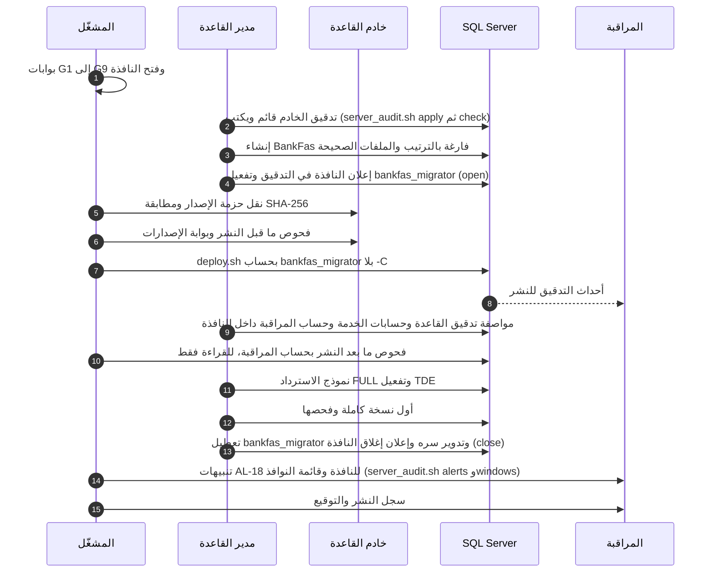

# DOC-S11 — دليل نشر قاعدة البيانات على الخادم باستخدام deploy.sh

| البند | القيمة |
|---|---|
| المعرّف | DOC-S11 (docs/30-readiness-documents.md) |
| الإصدار | 0.1 — مسودة للمراجعة — 2026-10-12 |
| المالك المقترح | مهندس DevOps (OPS في DOC-B09) مع مدير قاعدة البيانات (DBA) |
| الأولوية | P1 قبل S2، وقبل أول نشر على VPS |
| يغطي | ADR 0001، O-02 وO-23 (erd_open_items)، O-2 (20-database-design)، FR-PLT-045 البند 4، NFR-OPS-06، NFR-AVL-02، THR-44 (DOC-S01)، TB-7 (DOC-F01)، DQ-S05-7، DQ-B11-4، DQ-B11-5 |
| يعتمد على | DOC-S10 (الخادم)، DOC-S08 (حساب النشر وسره)، DOC-S05 (شهادة SQL Server)، DOC-S02 (TDE)، DOC-S09 (النسخ)، DOC-B11 (البوابات والترحيل)، DOC-B05 (البذور)، DOC-B01 (الاختبارات)، DOC-S12 (التدقيق والسجلات) |
| المصادر | tools/deploy/deploy.sh، tools/deploy/deploy.ps1، db/deploy.sql، db/generated/tsql/، db/static/، tools/dbgen/check_deployed.py، tools/dbgen/check_grants.py، tools/ci/db_ci.sh، ../.github/workflows/treasury-db-ci.yml (repository root)، db/tests/، docs/20-database-design.md، docs/adr/0001-schema-work-on-linux.md |

**الوسوم:** 🟢 قائم في المستودع أو مقرَّر · 🟡 مقترح ينتظر القرار · **[تحقق MS]** سلوك أداة من Microsoft يُتحقق منه في وثائقها الرسمية قبل الاعتماد.

كل أمر في كتل bash أو sql مقترح يُجرَّب في بيئة الاختبار ثم في UAT قبل الإنتاج. القيم بين `<...>` أماكن لقيم حقيقية لا تُكتب في المستودع.

## 1. الغرض والنطاق

**الغرض.** دليل المشغّل لنشر قاعدة `BankFas` على خادم Ubuntu 24.04 بالأداة `tools/deploy/deploy.sh`، وهي مسار النشر الإنتاجي في ADR 0001 🟢 (docs/adr/0001-schema-work-on-linux.md:19). يغطي: المتطلبات المسبقة، ومتغيرات البيئة، والنشر الجديد اليوم، وحدود الترقية، وفحوص ما قبل النشر وما بعده، والتراجع، والنافذة والتوقيع.

**خارج النطاق:** خط بناء التطبيق ونشره (DOC-B11 §5.2)، وتصميم أداة الترحيل (DOC-B11 §6)، وتجهيز الخادم (DOC-S10)، والحسابات وأسرارها (DOC-S08)، ومحتوى البذور (DOC-B05).

## 2. ما تفعله الأداة اليوم 🟢

| البند | السلوك | المصدر |
|---|---|---|
| الغلاف | ينتقل إلى `db/` ثم يشغّل `sqlcmd` بالخيارين `-I -b` و`SQLCMD_OPTS` على `deploy.sql`. ✅ اليوم: يشغّل فحص ما قبل النشر و`deploy.sql` في جلسة واحدة، و`deploy.sql` يتوقف (50146) إن لم يمر الفحص فيها (المراجعة الذاتية E5) | tools/deploy/deploy.sh:14-15، :28-29 |
| الخادم | `localhost,1433` افتراضيًا | tools/deploy/deploy.sh:16 |
| الحساب | `sa` افتراضيًا؛ القيمة الفارغة تعني مصادقة Windows (`-E`) وتحتاج تذكرة Kerberos. ✅ اليوم: `bankfas_migrator` افتراضيًا، ويرفض الفحص `sa` وأي عضو دور خادم أو صاحب CONTROL SERVER أو ALTER ANY LOGIN (50140) | tools/deploy/deploy.sh:7، :17، :21-26 |
| كلمة المرور | من `SQLCMDPASSWORD`، وإلزامية مع حساب SQL | tools/deploy/deploy.sh:8، :22 |
| التحقق من الشهادة | `-C` افتراضيًا، أي الثقة بأي شهادة. ✅ اليوم: بلا `-C` (ADR 0013)، و`SQLCMD_OPTS` لا يقبل إلا `-l` و`-t` و`-N s|m`، و`-C` في CI وحده (E7) | tools/deploy/deploy.sh:10-11، :19 |
| صفحة الترميز | بلا `-f 65001`، بينما يمرّرها غلاف Windows ويذكرها مثال `deploy.sql`. ✅ النص العربي يصل سليمًا بلا `-f`، ويطابق CI في الخطوة 4b بصمة SHA-256 لأسماء الدول العربية الـ249 بالبذرة (المراجعة الذاتية D3)؛ وقائمة الخيارات لا تقبل `-f` | tools/deploy/deploy.sh:29؛ tools/deploy/deploy.ps1:37؛ db/deploy.sql:10 |
| اسم القاعدة | ثابت `BankFas` بـ `:setvar`، ولا يمرّره الغلاف | db/deploy.sql:1 |
| التوقف | عند أول خطأ | db/deploy.sql:16 |
| الإنشاء | `CREATE DATABASE` بترتيب `Arabic_100_CI_AS_SC` إن لم تكن القاعدة موجودة، بلا مسارات ملفات ولا نموذج استرداد. ✅ اليوم: لا ينشئ `deploy.sql` القاعدة، بل يتوقف (50141)؛ ينشئها DBA بـ `prepare_database.sh prepare` مع RECURSIVE_TRIGGERS OFF (E5، A7) | db/deploy.sql:17-18 |
| الترتيب | 000 إلى 004، ثم 020، ثم 005 إلى 007، ثم 010 و025 و030 و050، في جلسة واحدة لأن 010 يقرأ جدولًا مؤقتًا من 004. ✅ اليوم: 000 إلى 004، ثم 020، ثم 005 إلى 007، ثم 010 و025 و028 و029 و030 و035 إلى 039 و041 إلى 044 و050 و090، ثم البذور 100 إلى 103 | db/deploy.sql:13-14، :22-34 |
| قاعدة موجودة | المخططات محمية بفحص وجود، وأول `CREATE TABLE` يفشل فيتوقف النشر دون تغيير. ✅ اليوم: يرفض فحص ما قبل النشر قبل أي تغيير قاعدةً فيها جدول أو كائن أو مشغّل قاعدة أو مخطط أو مستخدم غير `bankfas_migrator` أو مفتاح أو مواصفة تدقيق أو اتصال guest (50142، E4) | db/generated/tsql/000_schemas.sql:6؛ db/generated/tsql/001_tables.sql:8 |
| CI | يحذف القاعدة ثم ينشر بـ `sa` بالغلاف نفسه، ثم يقارن ويختبر. ✅ اليوم: يحضّرها بـ `prepare_database.sh` وينشر بـ `bankfas_migrator`، ولا يعمل إلا على خادم محلي (E8) | tools/ci/db_ci.sh:52-57 |
| فحص ما بعد النشر | ✅ منذ ADR 0013: أربعة عشر فحصًا منذ المراجعة الذاتية C6 وE3 (أعداد الكتالوج مقابل DDL المولَّد، وسياسات الأمن، والإجراءات بصفة `tp_auth_exec`، والمشغّلات الـ63 ولا مشغّل معطّل، ولا دالة داخلية يقرؤها `tp_readonly`، و`bankfas_migrator` معطّل، والترتيب) بحساب المراقبة `bankfas_monitor` وبلا `-C`، بعد إغلاق النافذة | tools/dbgen/check_deployed.py |
| الترحيل بين الإصدارات | لا يوجد | docs/20-database-design.md:452، :530 |

**الترميز اليوم.** في الملفات التي ينشرها `deploy.sql` لا تظهر حروف غير ASCII إلا في التعليقات (فحص هذه المراجعة للملفات تحت db/generated/tsql وdb/static). الاستثناء نص عربي في db/static/040_fulltext_optional.sql:11، وهذا الملف لا يدخل `deploy.sql` (db/deploy.sql:22-34). فغياب `-f 65001` لا يغيّر شيئًا اليوم، ويصير مؤثرًا حين تدخل البذور بأسماء عربية (DOC-B05 §4.3؛ DQ-S11-3).

## 3. مسار النشر الجديد في الإنتاج 🟡



## 4. المتطلبات المسبقة

| # | المتطلب | الدليل |
|---|---|---|
| R-01 | الخادم مجهَّز ومقبول التقوية (DOC-S10 §4 و§6.9) | قائمة الفحص موقّعة من SEC |
| R-02 | Ubuntu وSQL Server على الخادم مطابقان لسجل الإصدارات (FR-PLT-045 البند 4، بوابة G4). ✅ يفحصه `deploy.sh` نفسه قبل أي تنفيذ مقابل `versions.json` (ADR 0014) | سطر `preflight passed` في سجل النشر |
| R-03 | شهادة SQL Server مثبتة والتشفير مفروض (DOC-S05 §5) | الفحص HS-4 في DOC-S10 |
| R-04 | الأدوات: `sqlcmd` من mssql-tools18 في `/opt/mssql-tools18/bin` كما في CI (../.github/workflows/treasury-db-ci.yml:70-71)، وbash، وPython 3 بمكتبته القياسية فقط لأداتي `check_grants.py` و`check_deployed.py` | `sqlcmd -?` و`python3 --version` |
| R-05 | حزمة إصدار من وسم `vX.Y.Z` (DOC-B11 §4.2)، وCI أخضر على الوسم نفسه (G1) | رابط تشغيل CI ومجموع SHA-256 للحزمة |
| R-06 | حساب `bankfas_migrator` موجود ومعطّل خارج النافذة، وسره في ملف يملكه root بصلاحية 0600 (DOC-S08 §3، §5) | قائمة الحسابات |
| R-07 | خطوات TDE في master منجزة وشهادتها في الضمان (DOC-S02 §5.1 الخطوات 1-4) | سجل الضمان |
| R-08 | SQL Server Audit يعمل، فيُسجَّل النشر نفسه (DOC-S12 §3.5). ✅ منفّذ (ADR 0012): `tools/deploy/server_audit.sh apply` قبل النشر الأول، ومجلد الملفات على V5 (DOC-S10 §3) | `tools/deploy/server_audit.sh check` يخرج بصفر |
| R-09 | النافذة معلنة قبل 48 ساعة (NFR-AVL-02)، والتوقيعات قبل التنفيذ (§10) | الإشعار وسجل التوقيع |

## 5. متغيرات البيئة

| المتغير | الافتراضي في deploy.sh | قيمة الإنتاج المقترحة 🟡 | ملاحظات |
|---|---|---|---|
| `SQL_SERVER` | `localhost,1433` (:16) | `<db-cert-name>,1433` | الاسم الذي تحمله شهادة SQL Server، ويُحل محليًا إلى 127.0.0.1. `localhost` لا يجتاز التحقق إلا إن كان في الشهادة (DOC-S05 §5.2) |
| `SQL_USER` | ✅ `bankfas_migrator` منذ ADR 0014، و`deploy.sh` يرفض `sa` وأي `sysadmin` (50140) | `bankfas_migrator` | `sa` معطّل في الإنتاج (DOC-S08 §9). القيمة الفارغة تعني `-E` ولا نطاق Kerberos في البنية (DOC-S08 §4)، فلا تُترك فارغة |
| `SQLCMDPASSWORD` | لا افتراضي، وإلزامي مع حساب SQL (:22) | يُقرأ من ملف السر لحظة التشغيل | لا يُكتب في سطر الأوامر، خلافًا لمثالي db/deploy.sql:9 وdocs/20-database-design.md:437 |
| `SQLCMD` | `sqlcmd` (:18) | `/opt/mssql-tools18/bin/sqlcmd` | المسار نفسه في CI |
| `SQLCMD_OPTS` | ✅ لا شيء منذ ADR 0013، فتُتحقق شهادة الخادم | لا شيء اليوم، و`"-f 65001"` حين تدخل البذور (DQ-S11-3) | انظر §5.1 |

### 5.1 مشكلة `-C` الافتراضي (DQ-S05-7)

- `${SQLCMD_OPTS--C}` في tools/deploy/deploy.sh:19 يعطي `-C` إن لم يُعرَّف المتغير، ويعطي قيمة فارغة إن عُرِّف فارغًا. فالنشر الإنتاجي **يعرّف** `SQLCMD_OPTS` صراحة دائمًا.
- `-C` يعني الثقة بأي شهادة، أي ما يعادل `TrustServerCertificate=True` (DOC-S05 §5.3). مع الحساب الافتراضي `sa` يصير اعتراض الاتصال سيطرة كاملة (THR-44 في DOC-S01).
- القيمة غير مقتبسة في :29، فتُقسَّم على المسافات: `SQLCMD_OPTS="-f 65001"` خياران صحيحان.
- المقترح في DQ-S05-7: أن يصير الافتراضي بلا `-C`، وأن يمرّر CI `SQLCMD_OPTS=-C` صراحة. ويُعدَّل tools/ci/db_ci.sh:54 في التغيير نفسه، لأنه يعتمد اليوم على الافتراضي.
- ✅ **منفّذ (2026-10-13، docs/adr/0013-monitor-login-and-deployment-checks.md):**
  - الافتراضي بلا `-C` في كل سكربت تحت `tools/deploy` وفي `check_deployed.py`.
  - `db_ci.sh` يصدّر `SQLCMD_OPTS=-C` لحاويته المؤقتة وحدها، وتفشل خطوته 3 إن أضاف أي من هذه الأدوات `-C` من تلقاء نفسه.
  - `deploy.ps1` لا يضيف `-C` إلا بالمفتاح `-TrustServerCertificate`.

### 5.2 الاستدعاء 🟡

```bash
# على خادم القاعدة، بحساب شخصي، داخل النافذة (اقتراح)
cd /opt/bankfas/releases/vX.Y.Z                    # حزمة الوسم المعتمد بعد مطابقة SHA-256
export SQL_SERVER="<db-cert-name>,1433"
export SQL_USER="bankfas_migrator"
export SQLCMD="/opt/mssql-tools18/bin/sqlcmd"
export SQLCMD_OPTS=""                              # بلا -C؛ والأدوات لا تقبل فيه إلا -l و-t و-N s|m (المراجعة الذاتية E7)
export SQLCMDPASSWORD="$(cat /etc/bankfas/db-secrets/bankfas_migrator.secret)"   # ملف DBA نفسه، صلاحيته 600 أو 400 (DOC-S08 §5)
set -o pipefail
bash tools/deploy/deploy.sh 2>&1 | tee "/var/log/bankfas/deploy-$(date -u +%Y%m%dT%H%M%SZ).log"
echo "exit=$?"
unset SQLCMDPASSWORD
```

- النجاح: رمز خروج 0 وسطر `deployment finished` (tools/deploy/deploy.sh:30). أي شيء آخر فشل يُعالج بالقسم 9.
- **ثم حسابات الخدمة (ADR 0009):** يشغّل DBA بحسابه الشخصي، لأن إنشاء الحسابات يحتاج صلاحية خادم لا يملكها `bankfas_migrator`:
  `BANKFAS_SECRETS_DIR=/etc/bankfas/db-secrets BANKFAS_LOGIN_SET=a bash tools/deploy/provision_logins.sh --generate`
  فتُنشأ ملفات الأسرار الناقصة بصلاحية 600، ثم ينقل كل سر إلى مخزن أسرار عمليته على مضيف التطبيق (DOC-S08 §5)، ويحذف من الخادم ما لا يلزم بقاؤه. والتدوير بالزوج: `BANKFAS_LOGIN_SET=b` ثم نقل العملية إلى `_b` ثم تعطيل `_a` (DOC-S08 §6).
- **ثم حساب المراقبة (ADR 0013):** `BANKFAS_SECRETS_DIR=/etc/bankfas/db-secrets bash tools/deploy/provision_monitor.sh --generate`. والحساب `bankfas_monitor` يرى حالة الخادم وتعريفات `BankFas` وملفات التدقيق وسجل النسخ، ولا يقرأ صفًا. ينقل DBA سره إلى وكيل المراقبة، وبه تُشغَّل فحوص §8.2 و`server_audit.sh check`.
- سجل النشر يُشحن إلى المخزن المركزي (DOC-S12)، ولا يحمل كلمة المرور لأن sqlcmd يقرؤها من البيئة.
- **التدقيق والنافذة (ADR 0012):** يُصدِّر DBA مرجع التغيير في سجل النشر `export BANKFAS_CHANGE_REF=<مرجع النشر>` قبل أي سكربت. يكتب كل سكربت في `tools/deploy` بدايته ونهايته في SQL Server Audit بهذا المرجع، وتنبيهات AL-18 لا تنطلق لما يقع داخل نافذته. الترتيب:
  1. `server_audit.sh apply` (المرة الأولى، قبل كل شيء)؛
  2. `prepare_database.sh prepare` (المرة الأولى)؛
  3. `prepare_database.sh open`؛
  4. `deploy.sh` بحساب `bankfas_migrator`؛
  5. `server_audit.sh apply`، فتُضاف مواصفة القاعدة على جداول التدقيق؛
  6. `provision_logins.sh`؛
  7. `provision_monitor.sh` (ADR 0013)؛
  8. `prepare_database.sh close`، ثم فحوص §8.2 بحساب المراقبة، وأولها يتحقق أن `bankfas_migrator` معطّل؛
  9. تدوير سر `bankfas_migrator`: يكتب DBA سرًا جديدًا في `bankfas_migrator.secret` (أو يحذف الملف ويستعمل `--generate`) ثم يعيد `prepare_database.sh prepare`، فيأخذ الحساب السر الجديد ويبقى الباقي كما هو (db/ops/prepare_database.sql؛ DOC-S08 §6).

  بعد الإغلاق يشغّل SEC `server_audit.sh alerts <بداية النافذة>`، والمتوقع صفر تنبيه. ويرفق `server_audit.sh windows` بسجل النشر.

## 6. النشر الجديد اليوم

### 6.1 من ينشئ القاعدة 🟡

- إن أنشأها `deploy.sql` (db/deploy.sql:17-18) احتاج حساب النشر صلاحية إنشاء قاعدة على مستوى الخادم، وصار مالكًا لها. DOC-S08 §3 يمنحه `db_owner` و`tp_migrator` فقط.
- المقترح (DQ-S11-1): ينشئ DBA بحسابه الشخصي قاعدة `BankFas` فارغة بالترتيب `Arabic_100_CI_AS_SC` نفسه، وملفاتها على الوحدتين V2 وV3 (DOC-S10 §3) بأحجام ونمو محددين، وبمالك حساب معطّل. ثم يضيف `bankfas_migrator` إلى `db_owner`. عندها يتخطى `deploy.sql` الإنشاء وينشر داخل القاعدة. ✅ منفّذ (2026-10-13، docs/adr/0010-deployment-as-db-owner.md): `tools/deploy/prepare_database.sh prepare` ينشئ القاعدة الفارغة بالترتيب (وملفاتها في `BANKFAS_DATA_DIR` و`BANKFAS_LOG_DIR` إن أُعطيا)، ومالكها `bankfas_owner` حساب معطّل بكلمة عشوائية لا تُحفظ، وحساب النشر `bankfas_migrator` عضو `db_owner` وحده ومعطّل حتى تُفتح النافذة (`open` ثم `close`).
- يكفي `db_owner` نظريًا لما في `deploy.sql` (مخططات وجداول وأدوار ومستخدم بلا دخول وسياسات وإجراءات)، لكن CI ينشر بـ `sa` (tools/ci/db_ci.sh:54)، فلم يُجرَّب. يُثبت ذلك بتمرين في بيئة الاختبار قبل UAT (DQ-S11-2). ✅ ثبت (2026-10-13): CI ينشر الآن بـ `bankfas_migrator` في نافذة مفتوحة، وينجح `deploy.sql` كما هو بلا تعديل، ثم يتحقق من أن كل مخطط ودور وكائن يملكه dbo وأن حساب النشر يُرفض بعد إغلاق النافذة (tools/ci/db_ci.sh الخطوة 4).
- الترتيب شرط: قاعدة بترتيب آخر تكسر البحث العربي ومقارنات الحالة (NFR-I18N-06 في DOC-B03). لذلك يفحصه §8.1 قبل التشغيل.

### 6.2 الخطوات

| # | الخطوة | المنفّذ | ملاحظة |
|---|---|---|---|
| F-01 | فتح النافذة وتسجيل بدايتها | OPS | §10 |
| F-01a | تدقيق الخادم: `server_audit.sh apply` في المرة الأولى، ثم `server_audit.sh check` | DBA | ✅ ADR 0012؛ يوقف النشر إن فشل |
| F-02 | `prepare_database.sh open`: إعلان النافذة في التدقيق وتفعيل `bankfas_migrator` | DBA | ✅ تنبيه «دخول خارج النافذة» يسكت داخل النافذة المعلنة فقط (DOC-S08 §10، ADR 0012). في المرة الأولى يسبقه F-03، لأن `prepare` ينشئ الحساب |
| F-03 | إنشاء القاعدة الفارغة (§6.1) | DBA | — |
| F-04 | نقل الحزمة ومطابقة SHA-256 مع ناتج CI | OPS | DQ-S11-4 |
| F-05 | فحوص ما قبل النشر (§8.1) | OPS | أي فشل يوقف |
| F-06 | تشغيل deploy.sh (§5.2) | OPS، ويراقبه شخص ثانٍ | DQ-S11-9 |
| F-07 | فحوص ما بعد النشر (§8.2) بحساب `bankfas_monitor` | OPS | أي فشل ينقل إلى §9. ✅ منفّذ بـ ADR 0013 |
| F-07a | `server_audit.sh apply` لمواصفة القاعدة، ثم `provision_logins.sh` و`provision_monitor.sh` (§5.2) | DBA | ✅ داخل النافذة (ADR 0012، ADR 0013). في أول نشر يُنشأ حساب المراقبة هنا، فيسبق F-07 |
| F-08 | `RECOVERY FULL` (DOC-S09 §4.1)، و`READ_COMMITTED_SNAPSHOT ON` (docs/20-database-design.md:462؛ DQ-S11-5) | DBA | لم يضمَّنا في السكربتات |
| F-09 | تفعيل TDE ومتابعته حتى الاكتمال (DOC-S02 §5.1 الخطوتان 5-6) | DBA | قبل أي بيانات حقيقية (docs/adr/0001-schema-work-on-linux.md:26) |
| F-10 | أول نسخة كاملة مشفّرة وفحصها، وبها تبدأ سلسلة السجل (DOC-S09 §4.1) | DBA | — |
| F-11 | بذور المنصة حين توجد (DOC-B05 §4.3) | OPS | لا بذور في المستودع اليوم |
| F-12 | `prepare_database.sh close`: تعطيل `bankfas_migrator` وإعلان إغلاق النافذة، ثم تدوير سره (DOC-S08 §6) | DBA | — |
| F-12a | `server_audit.sh alerts <بداية النافذة>` و`windows` | SEC | صفر تنبيه متوقع؛ أي تنبيه يُفسَّر في سجل النشر |
| F-13 | سجل النشر والتوقيع (§10) | OPS | — |

## 7. ترقية قاعدة قائمة

### 7.1 الوضع اليوم 🟢

- لا مسار ترحيل بين الإصدارات (docs/20-database-design.md:452؛ O-2 في :530). أداة الترحيل وطريقة كتابة السكربتات قراران مفتوحان: DQ-B11-4 وDQ-B11-5 (docs/30-readiness/DOC-B11-environments-build-release.md:219-220).
- تشغيل `deploy.sh` على قاعدة قائمة يفشل عند أول جدول دون تغيير (§2). هذا آمن، لكنه ليس ترقية.
- الملفات الثابتة مكتوبة لتُعاد، لكن إعادتها على قاعدة قائمة لم تُختبر، لأن CI يبدأ دائمًا من قاعدة جديدة (DOC-B11 §6.1).

### 7.2 القواعد حتى يُحسم DQ-B11-4 وDQ-B11-5 🟡

1. **قبل أول بيانات يجب حفظها:** بيئة الاختبار تُعاد بنشر جديد بعد حذف القاعدة، بموافقة مسجّلة. لا يُحذف أي شيء في UAT أو الإنتاج بعد تحميل بيانات.
2. **بعد أول بيانات:** لا يصل تغيير في النموذج إلى تلك البيئة حتى يوجد منفّذ الترحيل وفحص التكافؤ في CI (DOC-B11 §6.3). هذه بوابة إصدار، لا توصية.
3. **لا تشغيل لملف منفرد.** تشغيل `007` وحده يزيل محظورات `030` (DOC-S08 §8، القاعدة 2). والملفات الثابتة تُعاد كلها بترتيب `deploy.sql` وفي جلسة واحدة، عبر منفّذ الترحيل حين يوجد (DOC-B11 §6.2 البند 3).
4. **إصلاح عاجل لإجراء في الإنتاج قبل وجود المنفّذ:** تغيير طارئ فقط، بسكربت مراجَع، يُجرَّب على نسخة مستعادة في خادم الاستعادة المعزول (DOC-S09 §7.1)، ويعتمده OWN وSEC، ويُنفَّذ بحساب النشر في نافذة (DQ-S11-8).
5. **الحذف محظور في الإنتاج.** عضو `db_owner` يستطيع حذف القاعدة، فالحماية تنبيه فوري على حذف القاعدة (DOC-S12 §6) ونسخ لا يستطيع الخادم محوها (DOC-S09 §5).

### 7.3 الترقية بعد اعتماد المنفّذ (مخطط لاحق)

نسخة كاملة وفحصها (G8)، ثم إيقاف التطبيق، ثم الترحيلات المرقّمة، ثم إعادة الملفات المتكررة بترتيب `deploy.sql`، ثم فحوص §8.2 مع بصمة الكتالوج (DOC-B11 §6.3)، ثم نشر التطبيق وفحص الدخان. يُكتب تفصيله حين يُعتمد DQ-B11-4.

## 8. الفحوص

### 8.1 قبل النشر

| الفحص | الأمر أو الدليل | يوقف النشر إذا |
|---|---|---|
| CI على الوسم | تشغيل خطوات tools/ci/db_ci.sh كلها، ومنها توافق DDL المولَّد مع النموذج (:39-45) والعزل (:75-92) | لم يكن أخضر |
| قواعد المنح الثابتة | `python3 tools/dbgen/check_grants.py` على الخادم من الحزمة نفسها (لا يحتاج القاعدة) | خروج غير صفري |
| الإصدارات (G4) | ✅ آلي في `deploy.sh` (db/ops/deploy_preflight.sql، ADR 0014): بناء SQL Server ونسخة Ubuntu مقابل `versions.json`. والنواة وأدوات العميل تبقى يدوية (DOC-S10 §7.2) | اختلاف عن السجل (50143) |
| حالة الهدف | ✅ آلي في `deploy.sh`: القاعدة موجودة بالترتيب، ولا جدول فيها | القاعدة غائبة أو بترتيب آخر (50141)، أو غير فارغة (50142) |
| الحساب | ✅ آلي في `deploy.sh` | `sa` أو أي `sysadmin` (50140) |
| المساحة | المساحة الحرة على V2 وV3 وV4 | أقل من 20% 🟡 |
| التدقيق | `tools/deploy/server_audit.sh check` (ADR 0012) | خروج غير صفري: التدقيق متوقف أو غير مطابق |
| النسخ (للترقية لاحقًا) | نسخة كاملة مفحوصة في النافذة (G8) | غيابها |

### 8.2 بعد النشر

| الفحص | الأمر | النتيجة المطلوبة |
|---|---|---|
| الأعداد مقابل DDL، والسياسات، والإجراءات بصفة `tp_auth_exec`، والمشغّلات، ومنع الدوال الداخلية، وتعطيل حساب الترحيل، والترتيب | `SQL_USER=bankfas_monitor SQLCMDPASSWORD="$(cat <ملف سر المراقبة>)" python3 tools/dbgen/check_deployed.py --sqlcmd "$SQLCMD" --server "$SQL_SERVER" --database BankFas` (ADR 0013)، بعد `prepare_database.sh close` | الأسطر الأربعة عشر كلها `ok`، ورمز خروج 0 |
| السياسات | الاستعلام أدناه | لا سياسة معطّلة |
| محظورات 030 | الاستعلام أدناه | سبعة صفوف: عمود القراءة، والإدراج، وخمسة أعمدة للتحديث (db/static/030_session_context.sql:237-239) |
| الإجراءات | الاستعلام أدناه | أربعة إجراءات تعمل بصفة `tp_auth_exec` (db/static/030_session_context.sql:27، :48، :148، :170) |
| الترتيب | الاستعلام أدناه | `Arabic_100_CI_AS_SC` |
| بعد F-08 وF-09 | `sys.databases` و`sys.dm_database_encryption_keys` | `FULL` ومشفّرة |
| التطبيق | فحص الدخان في الإنتاج فقط (docs/30-readiness/DOC-B01-test-strategy-and-plan.md:104) | ناجح |

**✅ رُفع العائق (ADR 0013).** `check_deployed.py` يأخذ الحساب والخيارات من البيئة كالأغلفة، ويضم الآن فحوص السياسات والإجراءات والترتيب أدناه، ويقرأ التعريفات وحدها. فيشغّله `bankfas_monitor`، وتثبت ذلك الخطوة 5 في CI، ويجد سياسة معطّلة (الفحص MN4). الاستعلام اليدوي أدناه للتحقيق فقط. وصف العائق كما كان: الأداة تمرّر `-U sa -C` ثابتين (tools/dbgen/check_deployed.py:52)، و`sa` معطّل في الإنتاج (DOC-S08 §9)، و`-C` مرفوض فيه (DOC-S05 §5.3). حتى تُعدَّل (DQ-S11-7)، يُشغَّل استعلامها (tools/dbgen/check_deployed.py:17-28) يدويًا بحساب النشر، وتُقارن الأعداد بناتج الخطوة 5 في CI للوسم نفسه. آخر أعداد مسجّلة: 194 جدولًا و20 مخططًا و763 مفتاحًا أجنبيًا (tools/dbgen/erd_open_items.py:22)، والمرجع هو ناتج CI لا هذا الرقم.

```sql
-- فحوص ما بعد النشر، للقراءة فقط (اقتراح)
USE [BankFas];
SELECT DATABASEPROPERTYEX(N'BankFas', 'Collation') AS collation_name;
SELECT name FROM sys.security_policies WHERE is_enabled = 0;                -- لا صفوف
SELECT p.permission_name, OBJECT_SCHEMA_NAME(p.major_id) + N'.' + OBJECT_NAME(p.major_id) AS object_name,
       COL_NAME(p.major_id, p.minor_id) AS column_name
FROM sys.database_permissions AS p
WHERE p.state = 'D' AND p.grantee_principal_id = DATABASE_PRINCIPAL_ID(N'tp_app')
  AND p.major_id IN (OBJECT_ID(N'sec.AppUser'), OBJECT_ID(N'sec.UserSession'));   -- سبعة صفوف
SELECT OBJECT_SCHEMA_NAME(m.object_id) + N'.' + OBJECT_NAME(m.object_id) AS module_name,
       USER_NAME(m.execute_as_principal_id) AS runs_as
FROM sys.sql_modules AS m
WHERE m.object_id IN (OBJECT_ID(N'sec.usp_GetPasswordParams'), OBJECT_ID(N'sec.usp_StartSession'),
                      OBJECT_ID(N'sec.usp_ConfirmMfa'), OBJECT_ID(N'sec.usp_SetSessionContext'));   -- أربعة صفوف
```

### 8.3 اختبارات القاعدة: أين تُشغَّل

| الملف | لماذا لا يُشغَّل على بيانات | أين يُشغَّل |
|---|---|---|
| db/tests/tenant_isolation_tests.sql | يشترط قاعدة «لا تحوي بيانات حقيقية» وحساب sysadmin (:6-7)، وينشئ مستخدمين ومشتركين داخل معاملة تُلغى (:9-10) | CI وبيئة الاختبار |
| db/tests/fac_share_rule_tests.sql | يعطّل قيود أربعة جداول (:13-14، :19، :24)، ويُدرج مشتركًا برقم 1 (:20-21) ثم يحذفه (:160)، خارج معاملة واحدة. على قاعدة فيها مشترك برقم 1 يفشل الإدراج ويتوقف التشغيل بـ `-b` وقد بقيت القيود معطّلة | CI وبيئة الاختبار |

في UAT والإنتاج: فحوص §8.2 وفحص الدخان فقط. هذا يطابق جدول البيئات في docs/30-readiness/DOC-B01-test-strategy-and-plan.md:100-104.

## 9. التراجع

| الحالة | الإجراء | يقرر |
|---|---|---|
| فشل `deploy.sh` في نشر جديد | القاعدة جزئية وبلا بيانات: يحذفها DBA ويعيد إنشاءها فارغة (§6.1)، ثم يُصلح السبب ويُعاد من F-05 | OPS، ويُسجَّل |
| نجاح التشغيل وفشل فحص §8.2 | يُعامل كفشل نشر جديد | OPS مع DBA |
| فشل تفعيل TDE | توقف؛ لا تحميل بيانات؛ المعالجة وفق DOC-S02 | DBA مع SEC |
| فشل ترقية لاحقًا | استعادة نسخة ما قبل النشر وسجلاتها إلى نقطة البدء (DOC-S09)، والتطبيق على الحزمة السابقة (DOC-B11 §8) | OPS مع OWN (docs/30-readiness/DOC-B11-environments-build-release.md:180) |
| خلل في التطبيق بعد النشر | DOC-B11 §8 | OPS مع OWN |

كل تراجع يُسجَّل بسببه وأثره في سجل النشر. وفشل يشتبه أنه أمني (حساب أو حزمة معدّلة) يفتح حادثًا في DOC-S15.

## 10. النافذة والتوقيع

- **النافذة:** ساعتان أسبوعيًا خارج ساعات العمل، وإشعار قبل 48 ساعة (NFR-AVL-02 في docs/30-readiness/DOC-B03-nfr-specification.md:45). أول نشر إنتاجي قبل وجود مشتركين يُعلن داخليًا فقط.
- **البوابات:** G1 إلى G9 في DOC-B11 §7 (docs/30-readiness/DOC-B11-environments-build-release.md:157-169). هذا الدليل ينفّذ G4 وG8 بفحوص §8.1، ويوثّق G9.
- **عينان:** مشغّل ينفّذ وآخر يراقب في الإنتاج 🟡 (DQ-S11-9).

| من يوقّع 🟡 | على ماذا | الدليل |
|---|---|---|
| QA lead ومالك المنتج | الإصدار (G9، DQ-B11-10) | تقرير CI والاختبارات |
| OPS | تنفيذ النشر ونتائج §8 | سجل النشر |
| DBA | F-08 إلى F-10 | نواتج الاستعلامات |
| SEC | أول نشر إنتاجي، وكل تغيير طارئ (§7.2 البند 4) | قبول التقوية وسجل التغيير |

**سجل النشر** 🟡: الوسم والإيداع ومجموع الحزمة، ورابط CI، والمنفّذ والمراقب، وأوقات البدء والانتهاء بتوقيت UTC، ومخرج `deploy.sh`، ونتائج §8، وأسماء النسخ، والتوقيعات، والمشكلات. يُحفظ في المخزن المركزي (DOC-S12 §5) ويُربط بالوسم (DQ-S11-10).

## 11. تعديلات مقترحة على الأدوات (لم تُنفَّذ)

| # | التعديل | القرار |
|---|---|---|
| T-1 | افتراضي `deploy.sh` بلا `-C`، وCI يمرّره صراحة في tools/ci/db_ci.sh:54 | DQ-S05-7. ✅ منفّذ (ADR 0013) |
| T-2 | `-f 65001` في `deploy.sh` مع دعمه في sqlcmd على Linux [تحقق MS] | DQ-S11-3 |
| T-3 | `check_deployed.py` يأخذ الحساب وخيارات sqlcmd من البيئة بدل `-U sa -C` | DQ-S11-7. ✅ منفّذ (ADR 0013) |
| T-4 | فحص تمهيدي يقرأ الإصدارات ويقارنها بالسجل ويرفض عند الاختلاف (G4)، ويرفض `sa` و`-C` خارج CI | DQ-S11-6. ✅ منفّذ (ADR 0014) |
| T-5 | مثالا db/deploy.sql:9 وdocs/20-database-design.md:437 لا يمرّران كلمة المرور في سطر الأوامر | DOC-S08 §5 |

## 12. القرارات المطلوبة

| المعرّف | السؤال | الافتراض المقترح | من يقرر | ما يعطّله |
|---|---|---|---|---|
| DQ-S11-1 | من ينشئ القاعدة في أول نشر؟ | ✅ منفّذ (ADR 0010): DBA ينشئها فارغة بالترتيب والملفات والمالك، وحساب النشر عضو `db_owner` | DBA مع SEC | F-03 |
| DQ-S11-2 | هل يكفي `db_owner` لتشغيل `deploy.sql`؟ | ✅ نعم، وثبت في كل تشغيل لـ CI بحساب غير sysadmin (ADR 0010) | DBA | أول نشر على VPS |
| DQ-S11-3 | متى يُضاف `-f 65001`؟ | مع أول بذرة بنص عربي تدخل `deploy.sql`، بعد التحقق من دعمه [تحقق MS] | مالك الأدوات | DOC-B05 |
| DQ-S11-4 | كيف تصل ملفات الإصدار إلى الخادم؟ | حزمة يبنيها CI من الوسم مع SHA-256، تُنقل عبر SSH؛ لا استنساخ للمستودع على خادم القاعدة (DQ-S10-3) | OPS | F-04 |
| DQ-S11-5 | `READ_COMMITTED_SNAPSHOT` | يُفعَّل في F-08 بعد قياس أثره على tempdb في بيئة الاختبار | DBA | F-08 |
| DQ-S11-6 | فحص تمهيدي في الغلاف | نعم: الإصدارات، ورفض `sa` و`-C`، ورفض قاعدة غير فارغة في النشر الجديد. ✅ منفّذ (2026-10-13، docs/adr/0014-deployment-preflight.md): `deploy.sh` يرفض `sa` وأي `sysadmin` دائمًا، وبناءً أو نسخة Ubuntu غير ما في `versions.json`، وقاعدة غائبة أو غير فارغة. وكل أداة ترفض `-C`، وسكربتات المدير ترفض `sa`، إلا بإذنين لا يضعهما إلا CI. تختبره الخطوة 22 | مالك الأدوات | G4 |
| DQ-S11-7 | `check_deployed.py` في الإنتاج | يُعدَّل ليأخذ الحساب والخيارات من البيئة؛ وحتى ذلك الاستعلام يدويًا. ✅ منفّذ (2026-10-13، ADR 0013): يأخذهما من البيئة، ويشغّله `bankfas_monitor` بلا صلاحية على الصفوف | مالك الأدوات | F-07 |
| DQ-S11-8 | إصلاح عاجل قبل منفّذ الترحيل | ✅ معتمد من المالك (2026-10-12): تغيير طارئ مجرَّب على نسخة مستعادة، يعتمده OWN وSEC | OWN | §7.2 |
| DQ-S11-9 | عينان في نشر الإنتاج | نعم | OPS | F-06 |
| DQ-S11-10 | مكان سجل النشر | المخزن المركزي مع رابط من الوسم | OPS | §10 |

## 13. تعارضات وفجوات في المصادر

1. ADR 0001 يجعل `deploy.sh` مسار الإنتاج (docs/adr/0001-schema-work-on-linux.md:19)، وافتراضاته `sa` و`-C` (tools/deploy/deploy.sh:17، :19). الأداة آمنة للإنتاج فقط حين تُعرَّف المتغيرات صراحة (§5). (✅ `-C` لم يعد افتراضيًا منذ ADR 0013؛ و`deploy.sh` صار افتراضيه `bankfas_migrator` ويرفض `sa` وأي `sysadmin` منذ ADR 0014.)
2. db/deploy.sql:9 وdocs/20-database-design.md:437 يمرّران كلمة المرور في سطر الأوامر، خلافًا لـ DOC-S08 §5.
3. ثلاث طرق تشغيل بثلاث مجموعات خيارات: المثال اليدوي بلا `-C` ولا `-f` (docs/20-database-design.md:438)، و`deploy.sh` بـ `-C` بلا `-f` (tools/deploy/deploy.sh:19، :29)، و`deploy.ps1` بـ `-f 65001` و`-C` دائمًا مع حساب SQL (tools/deploy/deploy.ps1:32، :37).
4. tools/dbgen/check_deployed.py:52 ثابت على `-U sa -C`، بينما يطلب DOC-B11 §6.3 وDOC-S09 §7.1 تشغيله خارج CI، ويعطّل DOC-S08 §9 حساب `sa`. (✅ صُحّح بـ ADR 0013.)
5. DOC-S08 §3 يعطي حساب النشر `db_owner` و`tp_migrator` فقط، و`deploy.sql` ينشئ القاعدة (db/deploy.sql:17-18) وهذا يحتاج صلاحية خادم. ثم إن `db_owner` يستطيع حذف القاعدة. يعالجهما DQ-S11-1 و§7.2 البند 5.
6. السجل docs/30-readiness-documents.md:295 يصف الوضع بدقة، لكنه لا يذكر أن tools/dbgen/check_deployed.py:52 ثابت على `sa`، ولا أن اختبارات db/tests لا تصلح لبيئة فيها بيانات (§8.3).

## 14. التتبع

| البند في هذه الوثيقة | المتطلب أو القاعدة أو القرار | المصدر |
|---|---|---|
| §1، §2 | ADR 0001، O-02 (erd_open_items) | docs/adr/0001-schema-work-on-linux.md:19-20؛ tools/dbgen/erd_open_items.py:20-24 |
| §2، §6 | ترتيب النشر | db/deploy.sql:1-34؛ docs/20-database-design.md:434-452 |
| §4 R-02، §8.1 | FR-PLT-045 البند 4، G4 | docs/10-detailed-analysis/10-m0-m1-platform-organization.md:147؛ docs/30-readiness/DOC-B11-environments-build-release.md:164 |
| §5 | DQ-S05-7، THR-44، TB-7 | tools/deploy/deploy.sh:7-30؛ docs/30-readiness/DOC-S01-threat-model.md:128 |
| §6.2 F-08 | توصية `READ_COMMITTED_SNAPSHOT`، نموذج الاسترداد | docs/20-database-design.md:458، :462 |
| §6.2 F-09 | ADR 0001 (المفاتيح قبل البيانات الحقيقية)، DOC-S02 §5.1 | docs/adr/0001-schema-work-on-linux.md:26 |
| §7 | O-2 (20-database-design)، DQ-B11-4، DQ-B11-5 | docs/20-database-design.md:452، :530 |
| §8.2 | NFR-OPS-06، قاعدة ترتيب DENY | tools/dbgen/check_deployed.py:16-28؛ db/static/030_session_context.sql:229-239 |
| §8.3 | O-09 (erd_open_items)، بيئات الاختبار | db/tests/tenant_isolation_tests.sql:6-10؛ db/tests/fac_share_rule_tests.sql:13-24، :160 |
| §10 | NFR-AVL-02، G1-G9، DQ-B11-10 | docs/30-readiness/DOC-B03-nfr-specification.md:45؛ docs/30-readiness/DOC-B11-environments-build-release.md:157-169 |
