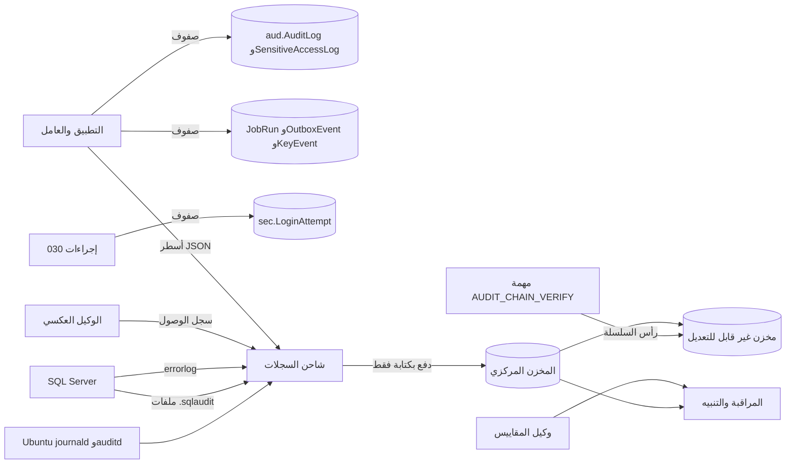
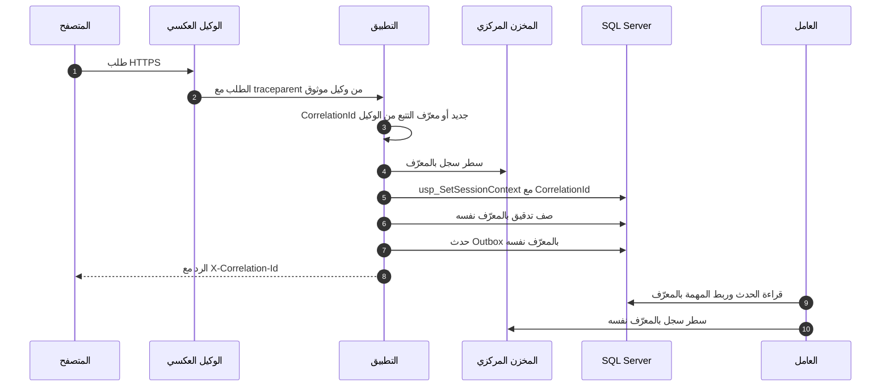

# DOC-S12 — متطلبات السجلات والمراقبة والتدقيق التشغيلي

| البند | القيمة |
|---|---|
| المعرّف | DOC-S12 (docs/30-readiness-documents.md) |
| الإصدار | 0.1 — مسودة للمراجعة — 2026-10-12 |
| المالك المقترح | مسؤول العمليات (OPS في DOC-B09) مع مسؤول الأمن (SEC) |
| الأولوية | P1 قبل S2 |
| يغطي | FR-PLT-022 إلى FR-PLT-025، FR-PLT-031، FR-PLT-044، BR-PLT-001، BR-PLT-005، BR-PLT-009، X-AUD-1، X-AUD-2، NFR-OPS-01 إلى NFR-OPS-04، NFR-SEC-11، NFR-SEC-14، NFR-AVL-01، O-13 (20-database-design)، O-24 (erd_open_items)، DQ-S08-10، DQ-S01-8 |
| يعتمد على | DOC-S03 (معرّف الارتباط)، DOC-S08 (حسابات القاعدة والتدقيق المميّز)، DOC-S10 (الخادم)، DOC-S09 (النسخ)، DOC-S02 (أحداث المفاتيح)، DOC-S06 وDOC-S07 (التصنيف والاحتفاظ)، DOC-F04 (ربط المهام)، DOC-F17 (Outbox والمهام)، DOC-B04 (مغلف الخطأ) |
| المصادر | db/model/10-platform.model، db/static/010_rls.sql، db/static/020_roles_and_grants.sql، db/static/030_session_context.sql، db/generated/tsql/005_delete_grants.sql، db/generated/tsql/007_table_grants.sql، docs/10-detailed-analysis/10-m0-m1-platform-organization.md، docs/10-detailed-analysis/00-overview-and-cross-cutting.md، docs/20-database-design.md، tools/dbgen/erd_open_items.py |

**الوسوم:** 🟢 قائم في المستودع أو مقرَّر · 🟡 مقترح ينتظر القرار · **[تحقق MS]** سلوك في SQL Server يُتحقق منه في وثائق Microsoft الرسمية.

## 1. الغرض والنطاق

**الغرض.** تحديد ما يُسجَّل وأين، وكيف يُربط الطلب الواحد عبر الطبقات، وكم يُحفظ وكيف يُحمى، وما المقاييس والتنبيهات، ومن يراجع ماذا ومتى. ومعه موقع مرساة سلسلة التدقيق خارج القاعدة (O-13 في 20-database-design).

**داخل النطاق:** سجل التدقيق في القاعدة، وسجلات الدخول والمفاتيح والمهام وOutbox، وسجلات التطبيق، وسجل أخطاء SQL Server، وSQL Server Audit، وسجلات النظام، والمقاييس واللوحات.

**خارج النطاق:** إشعارات المشترك داخل المنتج (10-m0-m1 §9.3 ووحدة NTF)، وتصميم Outbox (DOC-F17)، وإجراء الاستجابة للحوادث (DOC-S15)، وضبط الخادم نفسه (DOC-S10).

## 2. الوضع اليوم 🟢

| البند | الحالة | المصدر |
|---|---|---|
| سجل التدقيق | جدول مختلط للإضافة فقط بفئة وشدة ونتيجة وارتباط وعنوان، وأعمدة سلسلة فارغة حتى تفعيل FR-PLT-025 | db/model/10-platform.model:304-330 |
| من يكتب التدقيق | التطبيق ولوحة المشغّل (`tp_app` و`tp_platform`). لا إجراء ولا قادح في القاعدة يكتب `aud.AuditLog` | db/static/020_roles_and_grants.sql:65؛ db/generated/tsql/007_table_grants.sql:54-55 |
| حماية التدقيق | `tp_app` و`tp_platform` بلا تحديث ولا حذف؛ المنصة تقرأ صفوف `TenantId` الفارغ فقط (T38) | db/static/020_roles_and_grants.sql:65؛ db/static/010_rls.sql:80-86 |
| محاولات الدخول | يكتبها `usp_StartSession` و`usp_ConfirmMfa` في `sec.LoginAttempt` فقط، بلا أثر في التدقيق (O-24) | db/static/030_session_context.sql:124-129، :162؛ db/model/10-platform.model:199 |
| محاولة لمشترك غير معروف | لا تُكتب: الإدراج داخل فرع المشترك المعروف | db/static/030_session_context.sql:67-69، :124-129 |
| حذف آثار التشغيل | `tp_app` يحذف من `sec.LoginAttempt` و`cfg.OutboxEvent` و`cfg.JobRun` | db/generated/tsql/005_delete_grants.sql:11، :17-18 |
| معرّف الارتباط في القاعدة | يُحفظ في سياق الجلسة للقراءة فقط، ولا يقرؤه شيء في القاعدة | db/static/030_session_context.sql:169، :207 |
| أعمدة الارتباط | في التدقيق وسجل الوصول الحساس وأحداث المفاتيح وOutbox؛ لا عمود في `sec.LoginAttempt` ولا `cfg.JobRun` | db/model/10-platform.model:298، :317، :347، :546، :554-565 |
| سلامة الملفات | `IntegrityStatus` بالقيم `MISMATCH` و`MISSING` | db/model/10-platform.model:399 |
| SQL Server Audit وسجلات النظام | لا شيء في المستودع؛ المجموعات المقترحة في DOC-S08 §10 | — |
| المطلوب في التحليل | سجلات تشغيل مركزية وتتبّع أخطاء ولوحة صحة؛ سجلات بلا أرقام هويات أو كلمات مرور أو رموز | docs/10-detailed-analysis/00-overview-and-cross-cutting.md:173؛ docs/10-detailed-analysis/10-m0-m1-platform-organization.md:586 |

## 3. ما يُسجَّل وأين

### 3.1 سجل التدقيق `aud.AuditLog`

القاعدة 🟢: للإدراج فقط، والقيم المقيّدة مقنَّعة أبدًا، والصف بـ `TenantId` فارغ حدث منصة لا يراه مشترك (BR-PLT-001 وBR-PLT-009 في docs/10-detailed-analysis/10-m0-m1-platform-organization.md:227، :235؛ FR-PLT-022 وFR-PLT-023 في :124-125).

| الفئة (`Category`) | أمثلة `Action` 🟡 | الشدة | المرجع |
|---|---|---|---|
| `SECURITY` | `LOGIN_SUCCESS` و`FAILED_PASSWORD` و`DENIED_LOCKED` و`FAILED_MFA` و`LOCKOUT` و`LOGOUT` و`SESSION_TERMINATED` و`PASSWORD_CHANGED` و`MFA_RESET` | `HIGH` لإعادة MFA، وإلا `INFO` | BR-PLT-005 (:231)، BR-PLT-009 |
| `IDENTITY_ACCESS` | `IDENTITY_REVEAL` و`IDENTITY_IMAGE_VIEW` والتصدير الحساس، مع صف في `aud.SensitiveAccessLog` | `HIGH` | BR-PTY-009 (:280)، db/model/10-platform.model:332-355 |
| `CONFIG` | إسناد دور أو سحبه، ومنح صلاحية حساسة، وتغيير إعداد بالقيمة القديمة والجديدة، ومنح وصول الدعم | `HIGH` للحساس والدعم | BR-PLT-018 (:244)، BR-PLT-017 (:243) |
| `TREASURY` | إنشاء الكيانات المتتبَّعة وتعديلها وإلغاؤها | `INFO` | FR-PLT-022 |
| `PLATFORM` (`TenantId` فارغ) | دخول المشغّل، وتهيئة المشترك وتعليقه، ومراسم المفاتيح | `HIGH` لأحداث المفاتيح | DOC-S02 §13 (DQ-S02-8) |
| `SYSTEM` | ربط مهمة (DOC-F04 §5.2)، وفشل السلامة، ودمج الأشخاص | `HIGH` لفشل السلامة والدمج | docs/10-detailed-analysis/10-m0-m1-platform-organization.md:592 |

- فتح عارض التدقيق يضيف `AUDIT_VIEWED` (FR-PLT-024 في :126).
- أحداث الدخول تُكتب في التدقيق بعد معالجة O-24 (tools/dbgen/erd_open_items.py:155)؛ حتى ذلك الحين `sec.LoginAttempt` هو الأثر الوحيد.
- `rls.fn_AuditWrite` يقبل `TenantId` فارغًا من أي اتصال مربوط (db/static/010_rls.sql:88-94، O-19). المقترح في DQ-S01-5 يحصر صفوف المنصة في `tp_platform`.

### 3.2 السجلات التشغيلية في القاعدة

| الجدول | ما يحمله | ملاحظة |
|---|---|---|
| `sec.LoginAttempt` | نتيجة كل محاولة وعنوان IP ووكيل المتصفح، والبريد المكتوب لمستخدم مجهول (db/model/10-platform.model:199-208) | يحذفه `tp_app` اليوم (THR-30)؛ والمقترح حذفه بمهمة احتفاظ فقط |
| `sec.UserSession` | سبب الإنهاء `EndReason` (db/model/10-platform.model:229) | الإنهاء تحديث يقوم به التطبيق (O-24)، فيُكتب معه حدث تدقيق |
| `sec.KeyEvent` | أحداث مفاتيح المشترك ومنها `UNWRAP_FAILED` و`BACKUP_VERIFIED` (db/model/10-platform.model:291-299) | للإضافة فقط (db/generated/tsql/005_delete_grants.sql:46) |
| `cfg.JobRun` | آخر تشغيل ومدته ونتيجته وخطؤه (db/model/10-platform.model:554-565) | يحذفه ويعدّله `tp_app`، فلا تعتمد المراقبة عليه وحده (§6) |
| `cfg.OutboxEvent` | الحالة وعدد المحاولات وآخر خطأ (db/model/10-platform.model:532-552) | التصميم في DOC-F17 |

### 3.3 سجلات التطبيق 🟡

- **الصيغة:** سطر JSON لكل حدث، والوقت UTC بصيغة ISO 8601.
- **حقول إلزامية:** الوقت، والمستوى، والخدمة (واجهة، عامل، لوحة المشغّل)، والمضيف، والبيئة، والإصدار، و`CorrelationId`، ومعرّف المشترك العام `PublicId` ومعرّف الفاعل العام حين يُعرفان، واسم الحدث الثابت، وقالب المسار لا الرابط الكامل، ورمز الحالة، والمدة، ورقم خطأ SQL إن وُجد.
- **ممنوع:** كلمات المرور وسلاسل PHC، ورموز الجلسة وملفات تعريف الارتباط وترويسة `Authorization`، ورموز TOTP وأسرارها ورموز الاسترداد، ورموز الدعوة وإعادة التعيين، والقيم المقيّدة، وأجسام الطلبات والردود، وقيم معاملات SQL، والمفاتيح المفكوكة (THR-50). المرجع docs/10-detailed-analysis/10-m0-m1-platform-organization.md:586.
- **السرّي:** لا أسماء ولا عناوين بريد في السجل، بل المعرّفات العامة (DOC-S06، صف «سجلات التطبيق»). لمحاولة دخول ببريد مجهول يُسجَّل HMAC للبريد المطبَّع بمفتاح خادم، فتُربط المحاولات المتكررة دون حفظ البريد (DQ-S12-12).
- **المنقّح:** كل رسالة استثناء تمر بمنقّح قبل كتابتها في السجل أو في `cfg.JobRun.ErrorMessage` أو `cfg.OutboxEvent.LastError` (DOC-F02 §8).
- **المستوى في الإنتاج:** Information. لا Debug في بيئة فيها بيانات حقيقية.
- **الوكيل العكسي:** سجل وصول بلا سلسلة الاستعلام ولا ملفات تعريف الارتباط، وبعنوان العميل كما يحدده DOC-S03 §7.

### 3.4 سجل أخطاء SQL Server

- يحمل بدء الخدمة وإيقافها، وفشل الدخول، والأخطاء الجسيمة. مساره الافتراضي تحت `/var/opt/mssql/log/` [تحقق MS].
- تدوير يومي، وحفظ محلي محدود (DOC-S10 §5.3)، وشحن فوري إلى المخزن المركزي.

### 3.5 SQL Server Audit (DQ-S08-10، DQ-S01-8) 🟡

| البند | المقترح |
|---|---|
| مواصفة الخادم | المجموعات في DOC-S08 §10، ويضاف إليها `BACKUP_RESTORE_GROUP` و`DATABASE_CHANGE_GROUP` و`DATABASE_OBJECT_CHANGE_GROUP` [تحقق MS] |
| مواصفة قاعدة `BankFas` | `UPDATE` و`DELETE` على `aud.AuditLog` و`aud.SensitiveAccessLog` و`sec.KeyEvent`، و`DELETE` على `sec.LoginAttempt` و`cfg.JobRun`، لكل المبادئ (`BY public`) [تحقق MS أن ذلك يشمل dbo وsysadmin] |
| الاستثناء | دخول حسابات الخدمة الناجح لا يُسجَّل لكثرته، ويُسجَّل فشلها (DOC-S08 §10) |
| الهدف | ملفات في `/var/opt/mssql/audit` على V5 (DOC-S10 §3)، بحجم 256 MB للملف و40 ملفًا حدًا |
| عند فشل الكتابة | `ON_FAILURE = CONTINUE` مع تنبيه فوري AL-18 (DQ-S12-5) |
| الشحن | مهمة كل دقيقة تقرأ السجلات الجديدة بـ `sys.fn_get_audit_file` وتكتبها أسطر JSON للشاحن، والملفات المغلقة تُنسخ إلى المخزن غير القابل للتعديل. صلاحية القراءة المطلوبة [تحقق MS] |

السبب: `sysadmin` و`db_owner` يتجاوزون RLS والمنع ويعدّلون أي صف (DOC-S08 §9، THR-57). سلسلة البصمات لا تكشف ذلك وحدها (docs/20-database-design.md:165)، وSQL Server Audit المشحون خارج الخادم يكشفه.

### 3.6 سجلات النظام والمحيط

| المصدر | المحتوى | المرجع |
|---|---|---|
| journald | SSH وsudo والخدمات والنواة والجدار الناري | DOC-S10 §6.8 |
| auditd | تغيير ملفات الإعداد والمفاتيح والحذف من مجلدي النسخ والتدقيق | DOC-S10 §6.8 |
| التحديثات | سجل unattended-upgrades وapt | DOC-S10 §6.4 |
| لوحة المزوّد | الدخول وإنشاء اللقطات إن وفّر المزوّد سجلًا | DOC-S10 §4، الخطوة P-02 |
| تجديد الشهادات | نتيجة كل تجديد ACME | DOC-S05 §4.4 |
| النشر | سجل كل نشر | DOC-S11 §10 |

## 4. معرّف الارتباط من الطرف إلى الطرف

**القواعد 🟡:**
1. المصدر كما في DOC-S03 §8: يولّد التطبيق GUID لكل طلب، أو يأخذ معرّف التتبع ذا 16 بايتًا من الوكيل الموثوق. لا يُقبل معرّف من المتصفح. قيمة يرسلها العميل تُسجَّل حقلًا منفصلًا مقصوصًا فقط (تعارض مع DOC-B04 في §11).
2. المعرّف نفسه في: سطر السجل، و`@CorrelationId` (db/static/030_session_context.sql:169)، وكل صف تدقيق أو وصول حساس أو حدث مفتاح أو Outbox يكتبه الطلب، وترويسة الرد ومغلف الخطأ (DOC-B04 §8).
3. العامل يواصل معرّف الحدث الذي يعالجه، ومهمة مجدولة تأخذ معرّفًا واحدًا لكل تشغيل (DOC-F04 §5.2).
4. **الفجوات:** `usp_StartSession` و`usp_ConfirmMfa` بلا `@CorrelationId`، و`sec.LoginAttempt` و`cfg.JobRun` بلا عمود له (DOC-S03 §14). المقترح في DQ-S12-8: معامل وعمودان. ويُقترح أن تأخذ أعمدة الارتباط في جداول التدقيق قيمة افتراضية من `SESSION_CONTEXT(N'CorrelationId')` حين لا يمرّرها التطبيق [تحقق MS].
5. اختبار القبول NFR-OPS-01: طلب واحد يظهر معرّفه في سجل التطبيق وصف التدقيق وترويسة الرد (LOG-1).

## 5. الاحتفاظ والحماية

### 5.1 مدد الاحتفاظ 🟡

| السجل | المكان | المدة | المرجع |
|---|---|---|---|
| `aud.AuditLog` و`aud.SensitiveAccessLog` | القاعدة | 10 سنوات، افتراض يحسمه مختص | BR-PLT-016 (docs/10-detailed-analysis/10-m0-m1-platform-organization.md:242)؛ DOC-S07 P-15 وP-16 |
| `sec.LoginAttempt` | القاعدة | 180 يومًا | DOC-S07 P-13 |
| `sec.KeyEvent` | القاعدة | 10 سنوات، وما بقيت نسخة تحتاج المفتاح | DOC-S02 §6 |
| `cfg.JobRun` | القاعدة | 90 يومًا | — |
| `cfg.OutboxEvent` المسلّمة | القاعدة | DOC-F17 | — |
| سجلات التطبيق والوكيل | المخزن المركزي | 90 يومًا للبحث و12 شهرًا أرشيفًا | — |
| سجل أخطاء SQL Server وسجلات النظام | المخزن المركزي | 12 شهرًا | — |
| SQL Server Audit | المخزن غير القابل للتعديل | 3 سنوات | DQ-S12-3 |
| المقاييس | نظام المراقبة | 13 شهرًا للمقارنة السنوية | — |
| رؤوس سلسلة التدقيق | المخزن غير القابل للتعديل | مدة التدقيق نفسها | §5.3 |

- الحذف من جداول القاعدة بمهمة احتفاظ مدقَّقة، لا بحذف من `tp_app` (O-24).
- الحادث المفتوح يعلّق كل حذف للسجلات المتعلقة به (DOC-S15 §9).

### 5.2 الحماية 🟡

1. **خارج الخادم:** المخزن المركزي خارج VPS القاعدة وخارج حساب الاستضافة نفسه، في دولة يقبلها DOC-S07 (DQ-S12-2).
2. **دفع بكتابة فقط:** الخوادم تدفع ولا تملك حذفًا ولا استبدالًا. السجلات الأمنية ورؤوس السلسلة في تخزين غير قابل للتعديل خلال مدتها.
3. **التشفير:** TLS في النقل (DOC-S05)، وتشفير عند التخزين.
4. **الوصول:** القراءة لـ OPS وSEC، وDBA لسجلات SQL Server. كل وصول إلى المخزن يُسجَّل، ويُراجع ربع سنويًا.
5. **التصنيف:** سرّية، لأنها تحمل عناوين IP ومعرّفات (DOC-S06؛ DOC-S07 P-13).
6. **الوقت:** كل المصادر بتوقيت UTC ومزامنة ≤ 1 ثانية (NFR-OPS-07).
7. **المشترك:** لا يصل إلى هذه السجلات. يرى تدقيقه من عارض المنتج (FR-PLT-024).
8. **المنصة:** لا تقرأ تدقيق المشتركين (db/static/010_rls.sql:84؛ T38). مراقبتها الأمنية للمشتركين بعدّادات يرسلها التطبيق بلا محتوى (DQ-S12-11، ومعه DQ-S01-4).

### 5.3 مرساة سلسلة التدقيق (O-13 في 20-database-design) 🟡

- السلسلة لا تكشف العبث وحدها، لأن من يعدّل السجل يعيد حساب البصمات (docs/20-database-design.md:165). والقرار مفتوح (docs/20-database-design.md:541).
- **المقترح:** مهمة `AUDIT_CHAIN_VERIFY` (المثال في db/model/10-platform.model:555) تعمل لكل مشترك يوميًا: تتحقق من اتصال `ChainSeq` ومن كل `RowHash` منذ آخر مرساة، ثم تدفع رأس السلسلة (معرّف المشترك العام، وآخر `ChainSeq`، وآخر `RowHash`، والوقت) إلى المخزن غير القابل للتعديل، وتكتب حدث منصة.
- **التحقق:** يقارن التشغيل التالي السلسلة بآخر رأس في المخزن، لا بالقاعدة. أي اختلاف ينبّه AL-12 ويرسل `PLT.INTEGRITY_FAIL` للمشترك (docs/10-detailed-analysis/10-m0-m1-platform-organization.md:537-539).
- **الحد:** عبث بعد آخر مرساة لا يُكشف حتى المرساة التالية. الدورية يومية، وساعة إن كانت الكلفة مقبولة (DQ-S12-4). وSQL Server Audit (§3.5) يغطي هذه النافذة.
- تبدأ مع FR-PLT-025 في S2 (docs/10-detailed-analysis/10-m0-m1-platform-organization.md:127)، و`ChainSeq` فارغ حتى ذلك (db/model/10-platform.model:305).

## 6. المقاييس والتنبيهات

**المستويات 🟡:** A1 فوري يُستدعى له المناوب · A2 خلال ساعات العمل في اليوم نفسه · A3 في التقرير الأسبوعي. الحدود اقتراحات تُضبط بعد أربعة أسابيع من خط أساس (DQ-S12-13).

| المعرّف | الإشارة | الشرط 🟡 | المستوى | المستلم | المصدر |
|---|---|---|---|---|---|
| AL-01 | التوفر | فشل نقطة الصحة في 3 فحوص متتالية كل دقيقة | A1 | OPS | مراقب خارجي (NFR-AVL-01، NFR-AVL-03) |
| AL-02 | زمن الاستجابة | p95 فوق 2 ثانية لمدة 15 دقيقة | A2 | OPS | سجلات التطبيق (NFR-PERF-01) |
| AL-03 | الاتصال بالقاعدة | فشل أكثر من 5% من الاتصالات لمدة 5 دقائق | A1 | OPS وDBA | التطبيق |
| AL-04 | فشل الدخول على المنصة | أكثر من 200 فشل في 5 دقائق، أو 10 أضعاف خط الأساس | A1 | SEC | عدّاد التطبيق (THR-01) |
| AL-05 | فشل الدخول من عنوان واحد | أكثر من 30 في 10 دقائق | A2 | SEC | عدّاد التطبيق (BR-PLT-005) |
| AL-06 | القفل | 5 أقفال في 15 دقيقة لمشترك، أو 20 على المنصة | A1 | SEC | عدّاد التطبيق (THR-11) |
| AL-07 | فشل MFA | أكثر من 10 لمستخدم في 15 دقيقة | A2 | SEC | `FAILED_MFA` (THR-05) |
| AL-08 | أخطاء الربط | أي 50004 أو 50001، أو قفزة في 50002 و50003 | A2 | APP، وSEC للقفزة | سجلات التطبيق (DOC-F04 §4.5) |
| AL-09 | محمول المنع | أي خطأ 33504 من اتصال `tp_app` | A1 | SEC وDBA | سجلات التطبيق (R4، O-21) |
| AL-10 | فك المفتاح | أي `UNWRAP_FAILED` | A1 | SEC | `sec.KeyEvent` (DOC-S02 §7.2) |
| AL-11 | المهام | فشل بعد ساعة إعادة المحاولة، أو مهمة لم تبدأ خلال ضعف دوريتها | A2 | OPS | مقياس يرسله العامل، و`cfg.JobRun` (FR-PLT-044) |
| AL-12 | السلامة | فشل `AUDIT_CHAIN_VERIFY` أو `FILE_INTEGRITY`، أو `MISMATCH` أو `MISSING` | A1 | SEC | المهمة (FR-PLT-025، FR-PLT-031) |
| AL-13 | تأخر Outbox | أقدم حدث معلّق أقدم من 5 دقائق (A2) أو 30 دقيقة (A1)، أو أي حدث `DEAD` (A2) | A1 أو A2 | OPS | العامل (DOC-F17) |
| AL-14 | الأقراص والسجل | V2 إلى V5 فوق 80% (A2) أو 90% (A1)؛ سجل المعاملات فوق 70% | A1 أو A2 | OPS وDBA | وكيل المقاييس (DOC-S10 §9) |
| AL-15 | النسخ | شروط DOC-S09 §4.3: سجل 20 دقيقة، وكاملة 26 ساعة، ونقل 15 دقيقة، وفشل التحقق | A1 | DBA | سجل مهام النسخ |
| AL-16 | الشهادات | العامة قبل 21 يومًا (A2) و7 أيام (A1)؛ شهادة SQL Server قبل 30 يومًا (A2)؛ تدوير شهادة TDE السنوي قبل 30 يومًا (A3) | A1 إلى A3 | OPS | DOC-S05 §4.4، §5.2؛ DOC-S02 §10 |
| AL-17 | الوقت | فارق فوق 1 ثانية (A2) أو 5 ثوان (A1) | A1 أو A2 | OPS | خدمة الوقت (NFR-OPS-07) |
| AL-18 | التدقيق المميّز | دخول `breakglass`، أو تفعيل `sa`، أو تغيير منحة أو سياسة خارج النافذة، أو دخول `bankfas_migrator` خارجها، أو توقف التدقيق، أو حذف القاعدة، أو تعديل جداول التدقيق | A1 | SEC | SQL Server Audit (DOC-S08 §10) |
| AL-19 | النظام | دخول SSH بمفتاح غير مسجّل، أو sudo من غير عضو، أو حساب محلي جديد، أو تغيير ملف مراقب؛ وإعادة تشغيل معلّقة أكثر من 7 أيام (A2) | A1 أو A2 | SEC وOPS | journald وauditd |
| AL-20 | شذوذ الكشف | أكثر من 20 كشفًا لمستخدم في ساعة | إشعار المشترك، وA3 للمنصة | مدير الحساب، وSEC | BR-PTY-009؛ `SEC.REVEAL_ANOMALY` |
| AL-21 | الإصدارات | إصدار GA بلا مراجعة بعد 30 يومًا | A2 | OPS | المهمة الأسبوعية (FR-PLT-045، AC-PLT-4) |
| AL-22 | خط السجلات نفسه | لا سجلات من مضيف لمدة 10 دقائق | A2 | OPS | المخزن المركزي |

- عدّادات الدخول والقفل في AL-04 إلى AL-07 يرسلها التطبيق عند كل نتيجة، بمعرّف المشترك العام ونوع النتيجة فقط، لأن المنصة لا تقرأ `sec.LoginAttempt` تحت RLS. المرجع للتحقيق هو الجدول نفسه.
- AL-11 لا يعتمد على `cfg.JobRun` وحده، لأن `tp_app` يحذف منه ويعدّله (db/generated/tsql/005_delete_grants.sql:18؛ db/generated/tsql/007_table_grants.sql:87).
- إشعارات المشترك الفورية (القفل الثالث، والصلاحية الحساسة، وإعادة MFA، وشذوذ الكشف، والدعم) تبقى في المنتج (docs/10-detailed-analysis/10-m0-m1-platform-organization.md:530-537؛ NFR-OPS-04).

## 7. اللوحات 🟡

| اللوحة | المحتوى | الجمهور |
|---|---|---|
| LV-1 صحة المنصة | التوفر، وp95، ونسبة الأخطاء، وموارد التطبيق والقاعدة، والاتصالات | OPS، ولوحة المشغّل (NFR-OPS-02) |
| LV-2 الأمن | نتائج الدخول بأنواعها، والأقفال، وفشل MFA، وأخطاء 50001-50005 و33504، وأحداث AL-18 وAL-19 | SEC |
| LV-3 المهام وOutbox | آخر تشغيل لكل `JobKey`، والفشل، وعمق Outbox وعمر أقدم حدث، و`DEAD` | OPS؛ وللمشترك شاشة SCR-PLT-14 (DOC-B07) |
| LV-4 حماية البيانات | النسخ والنقل والاستعادة الأسبوعية، وحالة TDE، والشهادات، ورؤوس السلسلة، وفحص سلامة الملفات | DBA وSEC |
| LV-5 السعة | الأقراص، ومساحة السجل، ونمو الجداول الكبيرة (NFR-SCL-03) | DBA |
| LV-6 الإصدارات والترقيع | السجل مقابل الفعلي، وإعادة التشغيل المعلّقة، والتحديثات الأمنية المعلّقة | OPS |

## 8. من يراجع ماذا ومتى 🟡

| ماذا | من | متى |
|---|---|---|
| تنبيهات A1 | المناوب، وSEC للأمنية | فورًا، وفتح حادث وفق DOC-S15 عند الشك |
| LV-1 والتنبيهات المفتوحة | OPS | يوميًا |
| LV-2 | SEC | كل يوم عمل |
| أحداث SQL Server Audit عالية الشدة | SEC | خلال 24 ساعة من الحدث، ومراجعة أسبوعية للباقي |
| sudo وSSH وauditd | SEC | أسبوعيًا |
| LV-4 وتقرير الاستعادة | DBA | أسبوعيًا (DOC-S09 §7.1) |
| رؤوس السلسلة ونتائج السلامة | SEC | أسبوعيًا |
| الحسابات والأدوار والمفاتيح | SEC | شهريًا (DOC-S08 §10، DOC-S10 §8.4) |
| الحدود وضوضاء التنبيه | OPS مع SEC | شهريًا |
| تقرير التوفر | مدير التشغيل | شهريًا (NFR-AVL-01) |
| الاحتفاظ والإتلاف | LEG مع OPS | ربع سنويًا |
| تدقيق المشترك نفسه | مدير الحساب والمدقق (A-01 وA-04 في DOC-F01) | بحسب المشترك، بعارض المنتج |

## 9. معايير القبول

| المعرّف | المعيار | التحقق |
|---|---|---|
| LOG-1 | طلب واحد يظهر معرّفه في سجل التطبيق وصف التدقيق وترويسة الرد | اختبار تكامل (NFR-OPS-01) |
| LOG-2 | صفر تطابق لأنماط محظورة في سجلات اختبار القبول | مسح آلي (NFR-SEC-14) |
| LOG-3 | كل تنبيه AL-01 إلى AL-22 يُطلق مرة في بيئة الاختبار بمحاكاة شرطه | قبل الإطلاق |
| LOG-4 | حساب الشحن على الخادم لا يحذف ما شُحن | محاولة حذف مرفوضة |
| LOG-5 | تعديل صف في `aud.AuditLog` بحساب sysadmin في بيئة الاختبار يولّد سجل تدقيق خادم وتنبيه AL-18 | اختبار يدوي |
| LOG-6 | تعديل صف تدقيق بعد مرساة يُفشل `AUDIT_CHAIN_VERIFY` وينبّه | سيناريو قبول FR-PLT-025 (:127) |

## 10. القرارات المطلوبة

| المعرّف | السؤال | الافتراض المقترح | من يقرر | ما يعطّله |
|---|---|---|---|---|
| DQ-S12-1 | منظومة المراقبة والسجلات | مكدس مفتوح المصدر للمقاييس والسجلات والتنبيه على خادم صغير منفصل عن VPS القاعدة | OPS مع SEC | §3، §6 |
| DQ-S12-2 | موقع المخزن المركزي ودولته | خارج حساب الاستضافة، في الدولة نفسها التي يُقبل فيها الموقع المنفصل للنسخ (DQ-S09-2، DQ-S07-2) | OWN مع LEG | §5.2 |
| DQ-S12-3 | مدد الاحتفاظ | جدول §5.1 | LEG مع OWN | §5.1 |
| DQ-S12-4 | دورية مرساة السلسلة | يومية، وساعة إن كانت الكلفة مقبولة | SEC | FR-PLT-025 (S2) |
| DQ-S12-5 | سلوك SQL Server Audit عند فشل الكتابة | `CONTINUE` مع تنبيه A1 | SEC مع DBA | §3.5 |
| DQ-S12-6 | حساب المراقبة في القاعدة | `bankfas_monitor` بصلاحيات حالة الخادم وقراءة سجل النسخ في msdb فقط، بلا بيانات مشترك؛ يُضاف إلى DOC-S08 §3. أسماء الصلاحيات [تحقق MS] | DBA مع SEC | §6 |
| DQ-S12-7 | قبول معرّف الارتباط من العميل | لا، كما في DQ-S03-4؛ ويُصحَّح DOC-B04 | معماري الحلول | §4 |
| DQ-S12-8 | فجوات الارتباط | `@CorrelationId` لإجراءي الدخول وMFA، وعمود في `sec.LoginAttempt` و`cfg.JobRun`، وقيمة افتراضية من سياق الجلسة | معماري القاعدة | NFR-OPS-01 |
| DQ-S12-9 | أثر المحاولة لمشترك غير معروف | سطر سجل تطبيق وعدّاد؛ لا صف في القاعدة | معماري الحلول | AL-04، AL-05 |
| DQ-S12-10 | المناوبة | A1 على مدار الساعة من الإطلاق، وساعات العمل قبله | OWN مع مدير التشغيل | §6 |
| DQ-S12-11 | مراقبة المنصة لأمن المشتركين | عدّادات بلا محتوى يرسلها التطبيق | SEC | AL-04 إلى AL-07 |
| DQ-S12-12 | البريد في سجلات التطبيق | HMAC للبريد المطبَّع بمفتاح خادم، بلا نص صريح | SEC مع LEG | §3.3 |
| DQ-S12-13 | ضبط الحدود | قيم §6 مبدئيًا، ومراجعة بعد أربعة أسابيع من خط الأساس | OPS | §6 |

## 11. تعارضات وفجوات في المصادر

1. docs/30-readiness/DOC-B04-api-contract-and-error-model.md:62 يقبل `X-Correlation-Id` من الطلب ويولّده الخادم إن غاب، وdocs/30-readiness/DOC-S03-security-architecture-auth-sessions.md:132 يمنع قبوله من المتصفح. هذه الوثيقة تتبع DOC-S03.
2. BR-PLT-005 يقول إن كل محاولة دخول تُسجَّل (docs/10-detailed-analysis/10-m0-m1-platform-organization.md:231)، و`usp_StartSession` لا يكتب شيئًا حين يكون المشترك غير معروف أو مغلقًا (db/static/030_session_context.sql:67-69، :124-129).
3. FR-PLT-044 يطلب سجل تشغيل ظاهرًا للمدير (docs/10-detailed-analysis/10-m0-m1-platform-organization.md:146)، و`tp_app` يحذف من `cfg.JobRun` ويعدّله (db/generated/tsql/005_delete_grants.sql:18؛ db/generated/tsql/007_table_grants.sql:87)، فأثر الفشل قابل للمحو من اتصال مخترق.
4. السجل docs/30-readiness-documents.md:304 يستشهد بـ docs/20-database-design.md:539 لـ O-13، وهو اليوم في السطر 541؛ وبـ docs/21-data-dictionary.md:936 لـ `JobKey`، وهو اليوم في السطر 938.
5. السجل docs/30-readiness-documents.md:304 يقول إن أي ملف لا يذكر SQL Server Audit. ذكره اليوم DOC-S08 §10 وDOC-S01 (DQ-S01-8)، وهذه الوثيقة تفصّله.
6. `rls.fn_AuditWrite` يقبل `TenantId` فارغًا من أي اتصال مربوط (db/static/010_rls.sql:88-94)، فيستطيع مشترك كتابة صف يبدو حدث منصة (O-19). مراقبة أحداث المنصة لا تثق بها حتى يُحسم DQ-S01-5.

## 12. التتبع

| البند في هذه الوثيقة | المتطلب أو القاعدة أو القرار | المصدر |
|---|---|---|
| §3.1 | FR-PLT-022 إلى FR-PLT-024، BR-PLT-001، BR-PLT-009، X-AUD-1، X-AUD-2 | docs/10-detailed-analysis/10-m0-m1-platform-organization.md:124-126، :227، :235؛ docs/10-detailed-analysis/00-overview-and-cross-cutting.md:147-148 |
| §3.2 | BR-PLT-005، O-24 (erd_open_items)، THR-30 | db/static/030_session_context.sql:124-129؛ tools/dbgen/erd_open_items.py:151-156 |
| §3.3 | صف «السجلات»، NFR-SEC-14 | docs/10-detailed-analysis/10-m0-m1-platform-organization.md:586 |
| §3.5 | DQ-S08-10، DQ-S01-8، THR-57 | docs/30-readiness/DOC-S08-database-access-model-and-secrets.md:179-185 |
| §4 | FR-PLT-023، NFR-OPS-01، DQ-S03-4 | db/static/030_session_context.sql:169، :207؛ db/model/10-platform.model:317، :330 |
| §5.1 | BR-PLT-016، X-AUD-3 | docs/10-detailed-analysis/10-m0-m1-platform-organization.md:242؛ docs/10-detailed-analysis/00-overview-and-cross-cutting.md:149 |
| §5.3 | FR-PLT-025، O-13 (20-database-design) | docs/20-database-design.md:165، :541؛ db/model/10-platform.model:305، :321-323 |
| §6 AL-11، AL-12 | FR-PLT-044، FR-PLT-031 | docs/10-detailed-analysis/10-m0-m1-platform-organization.md:133، :146؛ db/model/10-platform.model:399، :554-565 |
| §6 AL-15 | DOC-S09 §4.3 | docs/30-readiness/DOC-S09-backup-restore-dr.md:76-84 |
| §6 AL-20 | BR-PTY-009 | docs/10-detailed-analysis/10-m0-m1-platform-organization.md:280 |
| §7، §8 | قابلية الدعم، NFR-OPS-02 | docs/10-detailed-analysis/00-overview-and-cross-cutting.md:173 |
