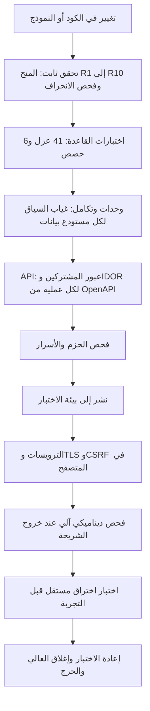

# DOC-S13 — خطة اختبار الأمن والعزل

| البند | القيمة |
|---|---|
| المعرّف | DOC-S13 (docs/30-readiness-documents.md) |
| الإصدار | 0.1 — مسودة للمراجعة — 2026-10-12 |
| المالك المقترح | مهندس ضمان الجودة مع مهندس الأمن (docs/30-readiness-documents.md:44) |
| الأولوية | P1 قبل S2؛ وبنود API في S0 تبدأ مع أول نقطة (O-09، erd_open_items) |
| يغطي | X-SEC-4، X-SEC-5، FR-PLT-020، FR-PLT-021، FR-PLT-036، FR-PLT-041، FR-PLT-046، BR-PLT-001، NFR-SEC-01، NFR-SEC-02، NFR-SEC-13، NFR-SEC-18، O-09 وO-18 إلى O-22 وO-24 (erd_open_items) |
| يعتمد على | DOC-S01 (THR-nn)، DOC-S03، DOC-S04، DOC-S06، DOC-B01، DOC-B03، DOC-B04، DOC-B06، DOC-B11 |
| المصادر | db/tests/tenant_isolation_tests.sql، db/tests/fac_share_rule_tests.sql، tools/ci/db_ci.sh، ../.github/workflows/treasury-db-ci.yml (جذر المستودع)، tools/dbgen/check_grants.py، tools/dbgen/erd_open_items.py، db/static/010_rls.sql، db/static/030_session_context.sql، db/generated/tsql/005_delete_grants.sql، db/generated/tsql/007_table_grants.sql، docs/10-detailed-analysis/*.md |

## 1. الغرض والنطاق

تحدد الوثيقة كل اختبار أمني لكل طبقة، ونتيجته المتوقعة، وموضعه في CI، وبوابة الشريحة التي يوقفها.

- **داخل النطاق:** اختبارات العزل في القاعدة، واختبارات عبور المشتركين وIDOR وغياب السياق لكل نقطة API، وربط فصول OWASP ASVS المستوى 2 بالضوابط والاختبارات، واختبارات الجلسة وCSRF والترويسات، واختبارات سياسة كلمة المرور وMFA، واختبار الاختراق، وحالات المخاطر المتبقية O-24.
- **خارج النطاق:** قيم السياسات (DOC-S04)، وتصميم الضوابط (DOC-S03)، وإعدادات TLS (DOC-S05)، وبيانات الاختبار (DOC-B06)، واستراتيجية الاختبار العامة وشدة العيوب (DOC-B01)، والاستجابة للحوادث (DOC-S15).
- لا يوجد كود تطبيق في المستودع بعد (docs/30-readiness-documents.md:338)، فكل اختبار على مستوى API أو المتصفح مقترح 🟡. اختبارات القاعدة موجودة وتمر 🟢.

**اختصارات:** أرقام T حالات db/tests/tenant_isolation_tests.sql، وFSR-Tn حالات db/tests/fac_share_rule_tests.sql (DQ-B01-4). THR-nn من DOC-S01. «030» هو db/static/030_session_context.sql.

## 2. ما يوجد اليوم

| البند | الحالة | المصدر |
|---|---|---|
| حالات العزل | 41 حالة: T1 إلى T38 مع T8b وT16b وT16c، بصفة tp_app وtp_readonly وtp_platform، في معاملة واحدة تُلغى | db/tests/tenant_isolation_tests.sql:1-19، :21-27 |
| حالات قاعدة الحصص | 6 حالات للمحفّز V-FAC-02، سلامة أعمال لا أمن | db/tests/fac_share_rule_tests.sql:2، :47-150 |
| قواعد المنح الثابتة | R1 إلى R10 بلا SQL Server | tools/dbgen/check_grants.py:4-16 |
| CI | الخطوة 3 للمنح، و6 للحصص (6 PASS بالضبط)، و7 للعزل (41 PASS بالضبط) | tools/ci/db_ci.sh:47-49، :59-74، :75-92 |
| خط GitHub | في جذر المستودع منذ 2026-10-12، يعمل عند تغيّر db/ أو tools/dbgen/ أو tools/ci/ | ../.github/workflows/treasury-db-ci.yml (جذر المستودع):7-21 |
| اختبارات API والمتصفح | لا توجد، لأن التطبيق غير موجود | O-09 (erd_open_items، tools/dbgen/erd_open_items.py:62-66) |
| المطلوب في المواصفات | «اختبار آلي لكل نقطة API ضد IDOR وضد عبور المشتركين» | docs/10-detailed-analysis/13-m6-workflow-engine-notifications.md:687؛ docs/10-detailed-analysis/14-m7-m8-letters-of-credit.md:666 |
| الهدف الأمني | ASVS المستوى 2، واختبار اختراق قبل التجربة (S5) | docs/10-detailed-analysis/00-overview-and-cross-cutting.md:140؛ docs/10-detailed-analysis/10-m0-m1-platform-organization.md:591 |

لم يُسجَّل في المستودع بعد أول تشغيل ناجح للخط على GitHub؛ التشغيل الكامل مثبت في حاوية التطوير فقط (tools/dbgen/erd_open_items.py:22).

## 3. طبقات الاختبار الأمني

| الطبقة | ما تغطيه | الأداة | أين تعمل | تفشل البناء أو البوابة |
|---|---|---|---|---|
| L1 ثابت | المنح والتشفير وترتيب النشر؛ وفحص انحراف التصنيف المقترح في DOC-S06 §10 | check_grants.py 🟢، فحص الانحراف 🟡 | CI الخطوة 3 | كل بناء |
| L2 القاعدة | RLS والربط والدخول والقفل والجلسات والمنح الفعلية | sqlcmd في db/tests 🟢 | CI الخطوتان 6 و7 | كل بناء |
| L3 تكامل | غياب السياق لكل استعلام، والربط لكل طلب، وسحب الربط | xUnit مع حاوية SQL Server 2025 🟡 (DQ-B01-1) | CI | كل بناء |
| L4 API | الحالات X1 إلى X11 في §5 لكل عملية | مولّد من OpenAPI 🟡 | CI | كل بناء؛ عملية بلا حالات تفشل البناء |
| L5 حزم وأسرار | ثغرات الحزم، وأسرار في المستودع | فاحص الحزم في خط التطبيق (DOC-B11 §5.2) 🟡 | CI وأسبوعيًا | ثغرة عالية بلا استثناء (NFR-SEC-16) |
| L6 متصفح | الكوكي وCSRF وCSP والترويسات | Playwright 🟡 (DQ-B01-1) | بيئة الاختبار | خروج الشريحة |
| L7 ديناميكي | فحص آلي للتطبيق المنشور | فاحص DAST 🟡 (DQ-S13-5) | بيئة الاختبار | خروج كل شريحة |
| L8 اختراق | §9 | مختبِر مستقل 🟡 | نسخة معزولة من UAT ببيانات اصطناعية | قبل التجربة (NFR-SEC-18) |

## 4. اختبارات العزل القائمة في القاعدة وربطها بالتهديدات

كل الحالات تمر في tools/ci/db_ci.sh على حاوية التطوير (السطور 75-92). العمود «السطر» يشير إلى db/tests/tenant_isolation_tests.sql.

| الحالة | ما تثبته | THR | السطر |
|---|---|---|---|
| T1 | بلا ربط لا يرى tp_app أي تسهيل | THR-17 | 114 |
| T2 | المشترك يرى تسهيله وحده | THR-07 | 126 |
| T3 | تسهيل مشترك آخر لا يُقرأ بالمفتاح | THR-07 | 138 |
| T4 | إدراج صف لمشترك آخر يُرفض 33504 | THR-07، THR-26 | 152 |
| T5 | إدراج صف للمشترك نفسه يُقبل (ضابط إيجابي) | THR-07 | 167 |
| T6 | تعديل تسهيل مشترك آخر لا يصل الصف | THR-07 | 182 |
| T7 | نقل صف إلى مشترك آخر يُرفض 33504 | THR-07 | 199 |
| T8 | حذف تسهيل مشترك آخر لا يحذف شيئًا | THR-07 | 211 |
| T8b | حذف يوم عطلة لمشترك آخر لا يحذف شيئًا | THR-07 | 228 |
| T9 | الصف العام يُقرأ، وصف المشترك الآخر لا يُقرأ | THR-07 | 248 |
| T10 | المشترك لا يدرج صفًا عامًا | لا THR صريح (DQ-S13-9) | 263 |
| T11 | المشترك لا يعدّل صفًا عامًا | لا THR صريح (DQ-S13-9) | 275 |
| T12 | المشترك لا يحذف صفًا عامًا | لا THR صريح (DQ-S13-9) | 287 |
| T13 | المشترك يضيف صف تدقيق لنفسه (ضابط إيجابي لـ T14) | THR-24 | 302 |
| T14 | لا صف تدقيق لمشترك آخر | THR-24، THR-39 | 314 |
| T15 | tp_app لا يعدّل التدقيق ولا يحذفه | THR-57 | 326 |
| T38 | المنصة تقرأ أحداثها لا أحداث المشتركين | THR-38 | 340 |
| T16 | ضبط TenantId يدويًا لا يكشف صفًا | THR-17 | 360 |
| T16b | tp_app لا يقرأ جدول الربط ولا يكتبه | THR-17 | 379 |
| T16c | رمز ربط خاطئ أو غائب لا يكشف صفًا | THR-17 | 392 |
| T28 | اتصال غير مربوط لا يرى المشترك ولا وحداته عبر العروض | THR-17 | 411 |
| T17 | الإجراء يرفض مشتركًا مجهولًا أو مغلقًا (50002) | THR-23، THR-27 | 429 |
| T18 | جلسة مشترك لا تربط مشتركًا آخر، وجلسة مستخدم معطّل لا تربط | THR-18 | 442 |
| T32 | رمز خاطئ وجلسة منتهية بالخمول وجلسة منهاة لا تربط | THR-03، THR-18 | 455 |
| T33 | الدخول يقارن التجزئة في القاعدة ويرفض بخطأ واحد 50005 | THR-01، THR-02 | 470 |
| T34 | خمسة إخفاقات تقفل، والكلمة الصحيحة ترفض بعدها | THR-01، THR-11 | 499 |
| T35 | tp_app لا يقرأ التجزئة ولا ينشئ جلسة ولا يغيّر الرمز ولا يمدد المهلة المطلقة | THR-04، THR-19، THR-22 | 524 |
| T36 | لا ربط قبل تسجيل MFA، والفشل يُسجَّل | THR-05، THR-06 | 546 |
| T25 | تعطيل المستخدم يسحب ربطه | THR-18 | 565 |
| T26 | إغلاق المشترك يسحب ربط اتصالاته | THR-23 | 579 |
| T27 | المشترك المعلّق يقرأ ولا يكتب | THR-23 | 593 |
| T30 | حذف صف المستخدم يسحب ربطه | THR-18 | 608 |
| T31 | المشترك المعلّق لا يحذف صفوفه | THR-23 | 624 |
| T37 | إنهاء جلسة يسحب ربط مستخدمها فورًا | THR-03 | 643 |
| T19 | جلسة صالحة تربط مشتركها ومستخدمها فقط | THR-18 | 658 |
| T20 | السياق المربوط لا يتغير، والربط الثاني يُرفض 50004 | THR-17، THR-18 | 678 |
| T29 | التقارير لا تقرأ سجل المشتركين ولا قائمة الوحدات | THR-42 | 693 |
| T21 | التقارير لا تقرأ عمودًا مقيّدًا (230) | THR-42 | 704 |
| T22 | التقارير لا تقرأ جدول المشغّلين ولا جدول الربط | THR-42، THR-43 | 713 |
| T23 | التقارير تقرأ عمودًا غير مقيّد (ضابط إيجابي) | THR-42 | 724 |
| T24 | كل جدول فيه TenantId مُرشَّح وكل سياسة مفعّلة | THR-07، THR-17، THR-37 | 735 |

- العدد: 41 حالة، منها 4 ضوابط إيجابية (T5 وT13 وT19 وT23). الحالات FSR-T1 إلى FSR-T6 لا تقابل أي THR لأنها تحمي سلامة الحصص (O-03، tools/dbgen/erd_open_items.py:27-31).
- التهديدات التي لا حالة قاعدة لها بعد: THR-20 وTHR-21 (O-24)، وTHR-25 (O-20)، وTHR-27 للمؤشرات (O-22)، وTHR-14 وTHR-28 وTHR-29 وTHR-31 وTHR-33 (نتائج المراجعة DR). حالاتها المقترحة في §10.
- عند إضافة حالة يتغير العدّاد الثابت 41 في tools/ci/db_ci.sh:88 يدويًا، إلى أن يُشتق من الملف (DOC-B01 §9).
