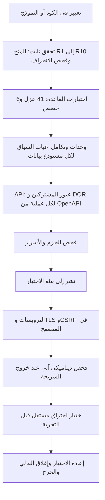

# DOC-S13 — خطة اختبار الأمن والعزل

| البند | القيمة |
|---|---|
| المعرّف | DOC-S13 (docs/30-readiness-documents.md) |
| الإصدار | 0.1 — مسودة للمراجعة — 2026-10-12 |
| المالك المقترح | مهندس ضمان الجودة مع مهندس الأمن (docs/30-readiness-documents.md:44) |
| الأولوية | P1 قبل S2؛ وبنود API في S0 تبدأ مع أول نقطة (O-09، erd_open_items) |
| يغطي | X-SEC-4، X-SEC-5، FR-PLT-020، FR-PLT-021، FR-PLT-036، FR-PLT-041، FR-PLT-046، BR-PLT-001، NFR-SEC-01، NFR-SEC-02، NFR-SEC-13، NFR-SEC-18، O-09 وO-18 إلى O-22 وO-24 (erd_open_items) |
| يعتمد على | DOC-S01 (THR-nn)، DOC-S03، DOC-S04، DOC-S06، DOC-B01، DOC-B03، DOC-B04، DOC-B06، DOC-B11 |
| المصادر | db/tests/tenant_isolation_tests.sql، db/tests/fac_share_rule_tests.sql، tools/ci/db_ci.sh، ../.github/workflows/treasury-db-ci.yml (جذر المستودع)، tools/dbgen/check_grants.py، tools/dbgen/erd_open_items.py، db/static/010_rls.sql، db/static/030_session_context.sql، db/generated/tsql/005_delete_grants.sql، db/generated/tsql/007_table_grants.sql، docs/10-detailed-analysis/*.md |

## 1. الغرض والنطاق

تحدد الوثيقة كل اختبار أمني لكل طبقة، ونتيجته المتوقعة، وموضعه في CI، وبوابة الشريحة التي يوقفها.

- **داخل النطاق:** اختبارات العزل في القاعدة، واختبارات عبور المشتركين وIDOR وغياب السياق لكل نقطة API، وربط فصول OWASP ASVS المستوى 2 بالضوابط والاختبارات، واختبارات الجلسة وCSRF والترويسات، واختبارات سياسة كلمة المرور وMFA، واختبار الاختراق، وحالات المخاطر المتبقية O-24.
- **خارج النطاق:** قيم السياسات (DOC-S04)، وتصميم الضوابط (DOC-S03)، وإعدادات TLS (DOC-S05)، وبيانات الاختبار (DOC-B06)، واستراتيجية الاختبار العامة وشدة العيوب (DOC-B01)، والاستجابة للحوادث (DOC-S15).
- لا يوجد كود تطبيق في المستودع بعد (docs/30-readiness-documents.md:338)، فكل اختبار على مستوى API أو المتصفح مقترح 🟡. اختبارات القاعدة موجودة وتمر 🟢.

**اختصارات:** أرقام T حالات db/tests/tenant_isolation_tests.sql، وFSR-Tn حالات db/tests/fac_share_rule_tests.sql (DQ-B01-4). THR-nn من DOC-S01. «030» هو db/static/030_session_context.sql.

## 2. ما يوجد اليوم

| البند | الحالة | المصدر |
|---|---|---|
| حالات العزل | 41 حالة: T1 إلى T38 مع T8b وT16b وT16c، بصفة tp_app وtp_readonly وtp_platform، في معاملة واحدة تُلغى | db/tests/tenant_isolation_tests.sql:1-19، :21-27 |
| حالات قاعدة الحصص | 6 حالات للمحفّز V-FAC-02، سلامة أعمال لا أمن | db/tests/fac_share_rule_tests.sql:2، :47-150 |
| قواعد المنح الثابتة | R1 إلى R10 بلا SQL Server | tools/dbgen/check_grants.py:4-16 |
| CI | الخطوة 3 للمنح، و6 للحصص (6 PASS بالضبط)، و7 للعزل (41 PASS بالضبط) | tools/ci/db_ci.sh:47-49، :59-74، :75-92 |
| خط GitHub | في جذر المستودع، يعمل عند تغيّر db/ أو tools/dbgen/ أو tools/ci/؛ أول تشغيل أخضر في 2026-10-12 بـ 6 و41 حالة | ../.github/workflows/treasury-db-ci.yml (جذر المستودع):7-21؛ O-02 (tools/dbgen/erd_open_items.py:22) |
| اختبارات API والمتصفح | لا توجد، لأن التطبيق غير موجود | O-09 (erd_open_items، tools/dbgen/erd_open_items.py:62-66) |
| المطلوب في المواصفات | «اختبار آلي لكل نقطة API ضد IDOR وضد عبور المشتركين» | docs/10-detailed-analysis/13-m6-workflow-engine-notifications.md:687؛ docs/10-detailed-analysis/14-m7-m8-letters-of-credit.md:666 |
| الهدف الأمني | ASVS المستوى 2، واختبار اختراق قبل التجربة (S5) | docs/10-detailed-analysis/00-overview-and-cross-cutting.md:140؛ docs/10-detailed-analysis/10-m0-m1-platform-organization.md:591 |

المرشّح يقصر الخط على ملفات القاعدة (../.github/workflows/treasury-db-ci.yml:10-20)، فلا يعمل عند تغيّر كود التطبيق. خط التطبيق في DOC-B11 §5.2 يحمل الطبقات L3 إلى L5.

## 3. طبقات الاختبار الأمني

| الطبقة | ما تغطيه | الأداة | أين تعمل | تفشل البناء أو البوابة |
|---|---|---|---|---|
| L1 ثابت | المنح والتشفير وترتيب النشر؛ وفحص انحراف التصنيف المقترح في DOC-S06 §10 | check_grants.py 🟢، فحص الانحراف 🟡 | CI الخطوة 3 | كل بناء |
| L2 القاعدة | RLS والربط والدخول والقفل والجلسات والمنح الفعلية | sqlcmd في db/tests 🟢 | CI الخطوتان 6 و7 | كل بناء |
| L3 تكامل | غياب السياق لكل استعلام، والربط لكل طلب، وسحب الربط | xUnit مع حاوية SQL Server 2025 🟡 (DQ-B01-1) | CI | كل بناء |
| L4 API | الحالات X1 إلى X11 في §5 لكل عملية | مولّد من OpenAPI 🟡 | CI | كل بناء؛ عملية بلا حالات تفشل البناء |
| L5 حزم وأسرار | ثغرات الحزم، وأسرار في المستودع | فاحص الحزم في خط التطبيق (DOC-B11 §5.2) 🟡 | CI وأسبوعيًا | ثغرة عالية بلا استثناء (NFR-SEC-16) |
| L6 متصفح | الكوكي وCSRF وCSP والترويسات | Playwright 🟡 (DQ-B01-1) | بيئة الاختبار | خروج الشريحة |
| L7 ديناميكي | فحص آلي للتطبيق المنشور | فاحص DAST 🟡 (DQ-S13-5) | بيئة الاختبار | خروج كل شريحة |
| L8 اختراق | §9 | مختبِر مستقل 🟡 | نسخة معزولة من UAT ببيانات اصطناعية | قبل التجربة (NFR-SEC-18) |

## 4. اختبارات العزل القائمة في القاعدة وربطها بالتهديدات

كل الحالات تمر في tools/ci/db_ci.sh على حاوية التطوير (السطور 75-92). العمود «السطر» يشير إلى db/tests/tenant_isolation_tests.sql.

| الحالة | ما تثبته | THR | السطر |
|---|---|---|---|
| T1 | بلا ربط لا يرى tp_app أي تسهيل | THR-17 | 114 |
| T2 | المشترك يرى تسهيله وحده | THR-07 | 126 |
| T3 | تسهيل مشترك آخر لا يُقرأ بالمفتاح | THR-07 | 138 |
| T4 | إدراج صف لمشترك آخر يُرفض 33504 | THR-07، THR-26 | 152 |
| T5 | إدراج صف للمشترك نفسه يُقبل (ضابط إيجابي) | THR-07 | 167 |
| T6 | تعديل تسهيل مشترك آخر لا يصل الصف | THR-07 | 182 |
| T7 | نقل صف إلى مشترك آخر يُرفض 33504 | THR-07 | 199 |
| T8 | حذف تسهيل مشترك آخر لا يحذف شيئًا | THR-07 | 211 |
| T8b | حذف يوم عطلة لمشترك آخر لا يحذف شيئًا | THR-07 | 228 |
| T9 | الصف العام يُقرأ، وصف المشترك الآخر لا يُقرأ | THR-07 | 248 |
| T10 | المشترك لا يدرج صفًا عامًا | لا THR صريح (DQ-S13-9) | 263 |
| T11 | المشترك لا يعدّل صفًا عامًا | لا THR صريح (DQ-S13-9) | 275 |
| T12 | المشترك لا يحذف صفًا عامًا | لا THR صريح (DQ-S13-9) | 287 |
| T13 | المشترك يضيف صف تدقيق لنفسه (ضابط إيجابي لـ T14) | THR-24 | 302 |
| T14 | لا صف تدقيق لمشترك آخر | THR-24، THR-39 | 314 |
| T15 | tp_app لا يعدّل التدقيق ولا يحذفه | THR-57 | 326 |
| T38 | المنصة تقرأ أحداثها لا أحداث المشتركين | THR-38 | 340 |
| T16 | ضبط TenantId يدويًا لا يكشف صفًا | THR-17 | 360 |
| T16b | tp_app لا يقرأ جدول الربط ولا يكتبه | THR-17 | 379 |
| T16c | رمز ربط خاطئ أو غائب لا يكشف صفًا | THR-17 | 392 |
| T28 | اتصال غير مربوط لا يرى المشترك ولا وحداته عبر العروض | THR-17 | 411 |
| T17 | الإجراء يرفض مشتركًا مجهولًا أو مغلقًا (50002) | THR-23، THR-27 | 429 |
| T18 | جلسة مشترك لا تربط مشتركًا آخر، وجلسة مستخدم معطّل لا تربط | THR-18 | 442 |
| T32 | رمز خاطئ وجلسة منتهية بالخمول وجلسة منهاة لا تربط | THR-03، THR-18 | 455 |
| T33 | الدخول يقارن التجزئة في القاعدة ويرفض بخطأ واحد 50005 | THR-01، THR-02 | 470 |
| T34 | خمسة إخفاقات تقفل، والكلمة الصحيحة ترفض بعدها | THR-01، THR-11 | 499 |
| T35 | tp_app لا يقرأ التجزئة ولا ينشئ جلسة ولا يغيّر الرمز ولا يمدد المهلة المطلقة | THR-04، THR-19، THR-22 | 524 |
| T36 | لا ربط قبل تسجيل MFA، والفشل يُسجَّل | THR-05، THR-06 | 546 |
| T25 | تعطيل المستخدم يسحب ربطه | THR-18 | 565 |
| T26 | إغلاق المشترك يسحب ربط اتصالاته | THR-23 | 579 |
| T27 | المشترك المعلّق يقرأ ولا يكتب | THR-23 | 593 |
| T30 | حذف صف المستخدم يسحب ربطه | THR-18 | 608 |
| T31 | المشترك المعلّق لا يحذف صفوفه | THR-23 | 624 |
| T37 | إنهاء جلسة يسحب ربط مستخدمها فورًا | THR-03 | 643 |
| T19 | جلسة صالحة تربط مشتركها ومستخدمها فقط | THR-18 | 658 |
| T20 | السياق المربوط لا يتغير، والربط الثاني يُرفض 50004 | THR-17، THR-18 | 678 |
| T29 | التقارير لا تقرأ سجل المشتركين ولا قائمة الوحدات | THR-42 | 693 |
| T21 | التقارير لا تقرأ عمودًا مقيّدًا (230) | THR-42 | 704 |
| T22 | التقارير لا تقرأ جدول المشغّلين ولا جدول الربط | THR-42، THR-43 | 713 |
| T23 | التقارير تقرأ عمودًا غير مقيّد (ضابط إيجابي) | THR-42 | 724 |
| T24 | كل جدول فيه TenantId مُرشَّح وكل سياسة مفعّلة | THR-07، THR-17، THR-37 | 735 |

- العدد: 41 حالة، منها 4 ضوابط إيجابية (T5 وT13 وT19 وT23). الحالات FSR-T1 إلى FSR-T6 لا تقابل أي THR لأنها تحمي سلامة الحصص (O-03، tools/dbgen/erd_open_items.py:27-31).
- التهديدات التي لا حالة قاعدة لها بعد: THR-20 وTHR-21 (O-24)، وTHR-25 (O-20)، وTHR-27 للمؤشرات (O-22)، وTHR-14 وTHR-28 وTHR-29 وTHR-31 وTHR-33 (نتائج المراجعة DR). حالاتها المقترحة في §10.
- عند إضافة حالة يتغير العدّاد الثابت 41 في tools/ci/db_ci.sh:88 يدويًا، إلى أن يُشتق من الملف (DOC-B01 §9).

## 5. عبور المشتركين وIDOR وغياب السياق على مستوى API

### 5.1 التجهيز

كل تشغيل يبدأ بقاعدة منشورة بـ tools/deploy/deploy.sh، ثم يؤهّل مشتركين اصطناعيين A وB بإجراء التأهيل نفسه (DOC-F05)، ويبذر لكلٍّ منهما بيانات من مولّدات DOC-B06 🟡:

- في كل مشترك: شركتان C1 وC2، ومستخدم لكل دور نظام، ومستخدم U1 نطاقه C1 وحدها، ومستخدم بلا أي صلاحية.
- لكل مورد في الشريحة صف واحد على الأقل في C1 وفي C2 لكل مشترك.
- الاتصال بحساب tp_app عبر sec.usp_StartSession ثم sec.usp_SetSessionContext، لا بحساب sa (DOC-B01 §3).
- يُحفظ PublicId كل صف من B قبل التشغيل، لأن التصفية تخفيها عن A.

### 5.2 الحالات لكل عملية

| الرمز | الحالة | المتوقع | المرجع |
|---|---|---|---|
| X1 | بلا كوكي جلسة أو بجلسة منتهية | 401 SESSION_INVALID، ولا استعلام بيانات | DOC-B04 §9.1؛ T32 |
| X2 | غياب السياق: الاتصال يصل الاستعلام بلا ربط عبر مفتاح اختبار (DQ-S13-4) | القراءة صفر صفوف أو 404؛ الكتابة 33504 فتعيد 500 مع تنبيه أمني؛ لا صف يتغير | FR-PLT-036؛ NFR-SEC-02؛ T1، T28 |
| X3 | PublicId من المشترك B في المسار بجلسة A | 404 NOT_FOUND بالجسم نفسه لمعرّف غير موجود؛ لا أثر في B | FR-PLT-021؛ AC-PLT-1؛ T3، T6، T8 |
| X4 | PublicId لصف في C2 بجلسة U1 | 404، لا 403 | FR-PLT-020 (docs/10-detailed-analysis/10-m0-m1-platform-organization.md:122) |
| X5 | مستخدم بلا الصلاحية المعلنة في x-permission | 403 FORBIDDEN قبل أي فحص للمعرّف | FR-PLT-021 (:123)؛ DOC-B04 §12 |
| X6 | القوائم والبحث والعدّ والتصدير | لا صف من B ولا من خارج النطاق، ولا يتأثر total بهما | DOC-B04 §5 |
| X7 | PublicId من B داخل الجسم مرجعًا (roleIds، companyId، facilityId…) | 422 REFERENCE_INVALID أو 404، ولا صف يُكتب | DOC-B04 §9.4؛ O-20 (erd_open_items) |
| X8 | كوكي جلسة A على مضيف B | 401؛ لا ربط | FR-PLT-046؛ AC-PLT-21؛ T18 |
| X9 | TenantId في المسار أو الاستعلام أو الجسم | 400 UNKNOWN_PARAMETER للاستعلام؛ وللجسم 400 MALFORMED_REQUEST 🟡 (DQ-S13-8)؛ لا يتغير المشترك | BR-PLT-001؛ DOC-B04 §3.1 |
| X10 | وحدة معطّلة للمشترك | 403 MODULE_DISABLED، والبيانات باقية | FR-PLT-003 (:105) |
| X11 | كتابة في مشترك SUSPENDED أو ARCHIVED_READ_ONLY | 403 TENANT_READ_ONLY ولا صف يتغير | BR-PLT-002؛ T27، T31 |

قواعد 🟡:

1. **التوليد.** تُولَّد قائمة الحالات من وثيقة OpenAPI المولَّدة في البناء (FR-PLT-041، :143). الامتدادات x-permission وx-company-scoped وx-module تحدد أي الحالات تنطبق (DQ-S13-3). عملية بلا حالات تفشل البناء، كما تطلب O-09 (tools/dbgen/erd_open_items.py:65).
2. **المعرّف.** SEC-API-{operationId}-X{n}، مثل SEC-API-getUser-X3. يحمل كل اختبار وسم FR وTHR ليقرأه مولّد التتبع (DOC-B08).
3. **تطابق الاستجابة.** في X3 وX4 تُقارن الحالة والجسم والترويسات بطلب معرّف عشوائي غير موجود، فلا يكشف الفرق وجود الصف.
4. **فحص الجسم.** كل استجابة في هذه الاختبارات تُمسح بحثًا عن PublicId أو اسم أو قيمة مقيّدة من B (DOC-S06 §10).
5. **الأثر.** بعد كل حالة كتابة يُقرأ صف B بحساب اختبار مربوط بـ B، ويُتحقق أن RowVersion لم يتغير.

### 5.3 نقاط S0 في هيكل OpenAPI

المسارات من هيكل DOC-B04 §12. العمود «خاص» يذكر ما يُضاف إلى الحالات العامة.

| العملية | الحالات | خاص |
|---|---|---|
| POST /auth/login | X8، X9 | بريد مستخدم من A على مضيف B يعطي 401 INVALID_CREDENTIALS بالرسالة نفسها والزمن نفسه تقريبًا (SEC-AUTH-02) |
| POST /auth/mfa | X1، X8 | جلسة تنتظر MFA من A لا تُستكمل على B |
| POST /auth/logout | X1 | ينهي جلسة الطالب وحده |
| GET /auth/session | X1، X8 | لا يعيد إلا مستخدم الجلسة ومشتركها |
| POST /auth/password-reset-requests | X9 | 202 دائمًا؛ بريد مستخدم B على مضيف A لا يرسل رسالة |
| POST /auth/password-resets | X8، X9 | رمز صادر لمستخدم B يُرفض على مضيف A بالرسالة الموحدة V-PLT-06 |
| POST /auth/invitations/accept | X8، X9 | كما السابق |
| GET /users | X1، X2، X5، X6، X8، X9 | البحث q بجزء بريد من B لا يعيد شيئًا |
| POST /users | X1، X2، X5، X7، X8، X9، X11 | roleIds من B تعطي 422؛ بريد مستخدم من B لا يكشف وجوده (O-21) |
| GET /users/{userId} | X1، X2، X3، X5، X8 | — |
| PATCH /users/{userId} | X1، X2، X3، X5، X8، X11 | — |
| POST /users/{userId}/actions/{action} | X1، X2، X3، X5، X8، X11 | لكل قيمة من القيم الست؛ فك قفل مستخدم B مستحيل |
| PUT /users/{userId}/roles | X1، X3، X5، X7، X11 | دور من B مرجعًا يعطي 422 |
| DELETE /users/{userId}/sessions | X1، X3، X5 | جلسات مستخدم B تبقى، وT37 يثبت السحب لمستخدم A |
| GET /roles | X1، X2، X5، X6 | — |
| POST /roles | X1، X5، X11 | — |
| GET /roles/{roleId} | X1، X3، X5 | — |
| PATCH /roles/{roleId} | X1، X3، X5، X11 | — |
| PUT /roles/{roleId}/permissions | X1، X3، X5، X11 | صلاحية مقفلة لدور غير TM وFO تعطي 403 PERMISSION_LOCKED (AC-PTY-1) |
| GET /permissions | X1 | كتالوج عالمي للقراءة فقط |
| GET، POST /platform/tenants | X1 | كوكي مشترك على مضيف المشغّل يعطي 401؛ الاستجابة عدّادات بلا بيانات أعمال (FR-PLT-005) |
| GET /platform/tenants/{tenantId} | X1 | OPERATOR_SUPPORT يقرأ ولا ينشئ |
| POST /platform/tenants/{tenantId}/actions/{action} | X1، X5 | OPERATOR_SUPPORT يُرفض بـ 403 |

موارد S0 خارج الهيكل اليوم، ويجب أن تظهر في OpenAPI المولَّد بحالاتها: المستندات ورفعها وتنزيلها (FR-PLT-027 إلى FR-PLT-030)، وعارض التدقيق وتصديره (FR-PLT-024)، والإعدادات (FR-PLT-043)، والترقيم (FR-PLT-026)، والمهام (FR-PLT-044)، ومنح وصول الدعم (FR-PLT-007). تنزيل مستند من B يعطي 404، وتنزيل مستند مقيّد بلا صلاحية الكشف يعطي 403 (AC-PLT-15).

### 5.4 نقاط الشرائح التالية

قوائم الموارد من §11 في كل مواصفة. الحالات X1 إلى X11 تنطبق على كل مورد، ويضاف لكل وحدة ما يلي.

| الوحدة والمصدر | الموارد | الشريحة | حالات خاصة |
|---|---|---|---|
| M1 (docs/10-detailed-analysis/10-m0-m1-platform-organization.md:568) | companies، parties مع identity-documents، authority-grants، authority-query، documents، kyc-profiles، audit-events | S1 وS1-ب وS2 | قواعد رؤية Party (FR-PTY-019)؛ الكشف والصور 403 لغير TM وFO (AC-PTY-1)؛ لا رقم كامل في أي استجابة غير نقطة الكشف |
| M2-M4 (docs/10-detailed-analysis/11-m2-m4-institutions-accounts-catalogs.md:567) | /institutions، /relationships، /bank-setup، /accounts، /signatories/{id}/authorities، /services/*، /base-rates/{id}/values، /catalogs/{kind} | S1 وS1-ب | أرقام الحسابات وIBAN مقنّعة؛ الصفوف العامة في الكتالوج المختلط للقراءة فقط (نظير T9 إلى T12)؛ كل خدمة /services/* معرَّضة تُختبر كغيرها |
| M5 (docs/10-detailed-analysis/12-m5-facilities-pricing-collateral-obligations.md:581) | /facilities، /limits، /utilizations، /reservations، /availability، /pricing/resolve، /collaterals، /obligations، /financial-statements، /terms/compare وغيرها | S2 وS2-ب | المعرّفات في الاستعلام لـ /availability و/pricing/resolve و/terms/compare تأخذ X3 وX4 لكل معرّف؛ حزمة الكفيل مقنّعة بلا صلاحية |
| M6 (docs/10-detailed-analysis/13-m6-workflow-engine-notifications.md:675) | /request-types، /templates، /requests وإجراءاته، /claim، /inbox، /search، /notifications | S3 | فصل المهام 403 SOD_VIOLATION؛ /claim على طلب من B يعطي 404؛ إشعار مستخدم آخر 404 (AC-NTF-2) |
| M7-M8 (docs/10-detailed-analysis/14-m7-m8-letters-of-credit.md:654) | /lc-terms، /lcs وتعديلاته، /drawings، /export-lcs/{id}/orders، /proformas، /counterparties | S3 وS4 | مسح استجابات الطالب والمبيعات بحثًا عن أعمدة الخزينة (BR-LCI-014، BR-LCE-015، :666)؛ IBAN المستفيد مقنّع |

## 6. ربط OWASP ASVS المستوى 2 بالضوابط والاختبارات

الهدف المستوى 2 🟢 (X-SEC-5، docs/10-detailed-analysis/00-overview-and-cross-cutting.md:140). أسماء الفصول وأرقامها أدناه من الإصدار 5.0 🟡، وتُطابق على نص الإصدار المعتمد قبل الاستعمال (DQ-S13-1). يُحفظ لكل متطلب من المستوى 2 سطر في قائمة فحص: ينطبق أو لا، والدليل، والنتيجة (DQ-S13-2).

| الفصل | الضوابط في BankFas | الاختبارات | الحالة |
|---|---|---|---|
| V1 Encoding and Sanitization | استعلامات بمعاملات فقط؛ لا SQL ديناميكي في وحدات EXECUTE AS (THR-34)؛ نصوص البنود بلا HTML (docs/10-detailed-analysis/14-m7-m8-letters-of-credit.md:668) | مراجعة كود؛ حمولات حقن في L7؛ AC-NTF-1 | 🟡 |
| V2 Validation and Business Logic | رموز V-XXX-nn في الخادم (DOC-B04 §9.2)؛ If-Match وIdempotency-Key؛ فصل المهام؛ قفل الحد | حالات 422 لكل رمز؛ NFR-PERF-03 وNFR-PERF-07؛ FSR-T1 إلى FSR-T6 🟢 | 🟢 للقاعدة، 🟡 للتطبيق |
| V3 Web Frontend Security | الكوكي وCSP والترويسات وCSRF وفحص Origin (DOC-S03 §4 إلى §6) | §7: SEC-SES وSEC-CSRF وSEC-HDR | 🟡 |
| V4 API and Web Service | عقد OpenAPI؛ معامل مجهول 400؛ لا CORS؛ problem+json (DOC-B04) | AC-PLT-18؛ X9؛ SEC-CSRF-04 | 🟡 |
| V5 File Handling | فحص المحتوى، 25 ميغابايت، فحص البرمجيات قبل الإتاحة، الحجر، التنزيل من نقطة مصرَّحة (FR-PLT-029، FR-PLT-030) | AC-PLT-15؛ NFR-SEC-15؛ X3 على التنزيل | 🟡 |
| V6 Authentication | Argon2id في القاعدة، والقفل، والخطأ الواحد، وMFA وTOTP ورموز الاسترداد (DOC-S04) | T33 إلى T36 🟢؛ T-S04-1 إلى T-S04-16 وSEC-AUTH في §8 | 🟢 جزئيًا |
| V7 Session Management | رمز معتم مجزّأ، والمهلتان، والسحب الفوري، والخروج (DOC-S03 §3) | T25، T26، T30، T32، T35، T37 🟢؛ SEC-SES في §7 | 🟢 جزئيًا |
| V8 Authorization | RLS والربط، والصلاحية، ونطاق الشركة، والصلاحيات المقفلة، وترتيب التقييم | T1 إلى T24 وT28 🟢؛ X3 إلى X6؛ AC-PTY-1؛ AC-PLT-13 | 🟢 للقاعدة |
| V9 Self-contained Tokens | لا ينطبق الآن: الرمز مرجعي لا JWT (DOC-S03 §3) | يُراجع مع رموز الخدمة والخطافات (docs/10-detailed-analysis/10-m0-m1-platform-organization.md:574-575) | لا ينطبق |
| V10 OAuth and OIDC | لا ينطبق حتى FR-PLT-015 في S5 | يُضاف مع ربط OIDC | لا ينطبق |
| V11 Cryptography | تشفير الأعمدة بمفتاح المشترك، والفهرس الأعمى، ولف المفاتيح، والتدوير (DOC-S02) | R7 وR8 في check_grants.py 🟢؛ AC-PLT-17؛ NFR-REC-04 | 🟢 جزئيًا |
| V12 Secure Communication | TLS 1.2 حدًا أدنى وHSTS (DOC-S05)؛ اتصال القاعدة بشهادة موثوقة خارج CI (DOC-B11 §9) | NFR-SEC-09؛ SEC-HDR-04 | 🟡 |
| V13 Configuration | أقل صلاحية للأدوار، ولا أسرار في المستودع، ودخول مستقل لكل بيئة، وبوابة الإصدارات | R1 إلى R10 🟢؛ فحص الأسرار وAC-PLT-4 🟡 | 🟢 جزئيًا |
| V14 Data Protection | التصنيف والتقنيع، ولا قيمة مقيّدة في السجلات والإشعارات وOutbox، وno-store | T21، T23 🟢؛ مسح الاستجابات والسجلات (DOC-S06 §10)؛ NFR-SEC-14؛ SEC-HDR-03 | 🟢 جزئيًا |
| V15 Secure Coding and Architecture | حدود الثقة (DOC-F01)، ونموذج التهديدات (DOC-S01)، وجرد الحزم | L5؛ مراجعة THR قبل كل شريحة | 🟡 |
| V16 Security Logging and Error Handling | تدقيق للإدراج فقط، وأحداث الشدة العالية، وخطأ بلا نص SQL، ومعرّف ارتباط | T13 إلى T15 وT38 🟢؛ AC-PLT-14؛ SEC-ERR-01 | 🟢 جزئيًا |
| V17 WebRTC | لا ينطبق | — | لا ينطبق |

## 7. اختبارات الجلسة وCSRF والترويسات

القيم من DOC-S03، وكلها 🟡 حتى يُبنى التطبيق. «متصفح» تعني Playwright على بيئة الاختبار، و«API» اختبار تكامل.

| المعرّف | ما يُختبر | المتوقع | المستوى | المرجع |
|---|---|---|---|---|
| SEC-SES-01 | خصائص كوكي الجلسة | الاسم __Host-bf_session، Secure، HttpOnly، SameSite=Lax، Path=/، بلا Domain ولا Expires | API | DOC-S03 §4 |
| SEC-SES-02 | كل Set-Cookie في كل استجابة | لا Domain=bankfas.com أبدًا | API | DOC-S03 §4؛ FR-PLT-046 |
| SEC-SES-03 | تثبيت الجلسة | كوكي مرسل قبل الدخول لا يُعتمد؛ رمز جديد 32 بايتًا بعد كل دخول | API | THR-04؛ 030:53-54 |
| SEC-SES-04 | الرمز خارج الروابط والسجلات | صفر تطابق لقيمة الرمز في سجلات التطبيق والوكيل | تكامل | NFR-SEC-14 |
| SEC-SES-05 | الخمول والمهلة المطلقة | طلب بعد 31 دقيقة خمول يعطي 401؛ لا جلسة بعد 12 ساعة | API مع ساعة مزيّفة | T32، T35؛ AC-PLT-12 |
| SEC-SES-06 | الخروج | الكوكي بقيمة فارغة وMax-Age=0، والجلسة EndedAt، والطلب التالي 401 | API | DOC-S03 §4 |
| SEC-SES-07 | إنهاء المدير للجلسة | الطلب التالي للمستخدم 401 | API | T37؛ FR-PLT-014 |
| SEC-SES-08 | فصل البوابتين | كوكي المشغّل على مضيف مشترك وكوكي المشترك على مضيف المشغّل يعطيان 401 | API | FR-PLT-006؛ DQ-S03-7 |
| SEC-CSRF-01 | طلب يغيّر الحالة بلا رمز CSRF أو برمز جلسة أخرى | 403 | API | DOC-S03 §5 |
| SEC-CSRF-02 | Origin من مضيف مشترك آخر، أو بلا Origin ولا Referer | 403 | API | DOC-S03 §4، §5 |
| SEC-CSRF-03 | نموذج الدخول بلا رمز ما قبل الجلسة | 403 | API | DOC-S03 §5 |
| SEC-CSRF-04 | CORS وطلب preflight من أصل آخر | لا Access-Control-Allow-Origin في أي استجابة | API | DOC-S03 §5 |
| SEC-HDR-01 | CSP على كل صفحة HTML | السياسة كما في DOC-S03 §6، وصفر مخالفات CSP في تشغيل Playwright | متصفح | DOC-S03 §6 |
| SEC-HDR-02 | الترويسات الأخرى | nosniff وno-referrer وPermissions-Policy وCOOP وCORP وX-Frame-Options DENY | API | DOC-S03 §6 |
| SEC-HDR-03 | التخزين المؤقت | Cache-Control: no-store لكل استجابة مصدَّقة ولصفحات الدخول والإعادة | API | DOC-S03 §6 |
| SEC-HDR-04 | TLS وHSTS | النتيجة في DOC-S05 بعد كل نشر | فحص آلي | NFR-SEC-09 |
| SEC-HDR-05 | روابط الدعوة والإعادة | الرمز يُرسل بـ POST ثم يُحوَّل إلى عنوان بلا رمز؛ السجلات تحجب المسار | متصفح وتكامل | DOC-S03 §6 |
| SEC-IP-01 | X-Forwarded-For مزيّف من العميل | ClientIp المخزّن هو ما رآه الوكيل؛ الوصول المباشر إلى منفذ التطبيق مرفوض | تكامل وبيئة الاختبار | DOC-S03 §7؛ THR-09 |
| SEC-ERR-01 | خطأ قاعدة مصطنع (547، 2627، 33504) | problem+json بلا رقم خطأ SQL ولا اسم قيد ولا قيمة مقيّدة، مع correlationId | API | DOC-B04 §8، §9.4 |

## 8. اختبارات سياسة كلمة المرور وMFA

القيم والاختبارات T-S04-1 إلى T-S04-16 معرَّفة في DOC-S04 §14، ولا تُكرَّر هنا. هذه الوثيقة تحدد موضعها:

| المجموعة | الحالات | الموضع المقترح 🟡 | الشرط |
|---|---|---|---|
| القاعدة، موجودة | T33، T34، T35، T36 | db/tests/tenant_isolation_tests.sql، الخطوة 7 | تمر اليوم 🟢 |
| القاعدة، جديدة | T-S04-1، T-S04-8، T-S04-10، T-S04-12، T-S04-16، وT-F06-1 للقفل الثالث | ملف جديد db/tests/auth_policy_tests.sql بخطوة CI مستقلة وعدّاد خاص (DQ-S13-6) | T-S04-8 بعد DQ-S04-5؛ T-S04-10 بعد DQ-F03-4؛ T-S04-12 بعد نقل الاستهلاك إلى القاعدة |
| وحدات التطبيق | T-S04-2، T-S04-4، T-S04-5، T-S04-6، T-S04-9 | اختبارات خدمة كلمة المرور وتقييد المعدل | مع أول كود دخول في S0 |
| تكامل | T-S04-3، T-S04-7، T-S04-11، T-S04-13، T-S04-14، T-S04-15 | اختبارات التكامل على حاوية SQL Server | مع الإجراءات المقترحة في DOC-S04 |

حالات API إضافية لا تذكرها DOC-S04 🟡:

| المعرّف | ما يُختبر | المتوقع | المرجع |
|---|---|---|---|
| SEC-AUTH-01 | بريد مجهول، وكلمة خاطئة، وحساب مقفل ومعطّل ومدعو | استجابة 401 واحدة بالجسم نفسه | DOC-B04 §9.5؛ T33 |
| SEC-AUTH-02 | زمن الرد لبريد مجهول مقابل بريد معروف | الفرق بين الوسيطين دون الحد في DQ-S13-7 | THR-02؛ DOC-F03 §5.2 |
| SEC-AUTH-03 | خمسون دخولًا متزامنًا | لا تتجاوز ذاكرة التجزئة السقف، ولا خطأ 500 | THR-11؛ NFR-PERF-05؛ DQ-B03-7 |
| SEC-AUTH-04 | كلمة مرور معروفة في سيناريو كامل | صفر تطابق في السجلات والتدقيق | FR-PLT-010؛ NFR-SEC-14 |
| SEC-AUTH-05 | رابط دعوة أو إعادة بعد إصدار رابط أحدث | الرابط القديم مرفوض بالرسالة الموحدة | DOC-S04 §6 |

## 9. اختبار الاختراق

### 9.1 التوقيت

| المرحلة | ما يجري | متى | المصدر |
|---|---|---|---|
| فحص ديناميكي آلي (L7) | فحص التطبيق المنشور في بيئة الاختبار بلا مختبِر بشري | عند خروج كل شريحة من S0 | 🟡 |
| اختبار اختراق مستقل | فريق خارجي مستقل عن فريق البناء | بعد تجميد ميزات S5 وقبل قرار التجربة (DOC-B12) | 🟢 «قبل التجربة (S5)» (docs/10-detailed-analysis/10-m0-m1-platform-organization.md:591)؛ NFR-SEC-18 |
| إعادة الاختبار | التحقق من إصلاح كل نتيجة حرجة أو عالية | قبل قرار التجربة | NFR-SEC-18 |
| فحص إعدادات الإنتاج | TLS والترويسات والمنافذ المفتوحة، بلا وصول إلى البيانات | قبل فتح الإنتاج للمشترك التجريبي | 🟡 |
| دوري | اختبار اختراق كامل | سنويًا، وبعد كل تغيير معماري كبير 🟡 | DQ-S13-10 |

### 9.2 النطاق

| داخل النطاق | خارج النطاق |
|---|---|
| بوابة المشترك وAPI على عنوان فرعي لبيئة الاختبار، بمشتركين اصطناعيين A وB | البنية التحتية لمزوّد الاستضافة (TB-13) |
| لوحة المشغّل على مضيفها المستقل (TB-2) | هجمات إغراق الحجم |
| الدخول وMFA والدعوة والإعادة وتصفير MFA (DOC-F03) | الهندسة الاجتماعية لموظفي العميل |
| عزل العناوين الفرعية والكوكي (FR-PLT-046) | أي بيانات حقيقية أو مجهّلة؛ البيانات اصطناعية فقط (DOC-B06) |
| IDOR بين المشتركين وبين الشركات داخل المشترك | — |
| رفع الملفات وتنزيلها والكشف والتصدير (FR-PLT-029، FR-PLT-030، FR-PTY-007) | — |
| منطق الأعمال: الحجز المتزامن، وفصل المهام، والتجاوز بسبب | — |
| السطح الخارجي للخادم: المنافذ وTLS وSSH (DOC-S10) | — |
| روابط البريد وسجلات SPF وDKIM وDMARC (THR-51) | — |

### 9.3 قواعد التنفيذ 🟡

1. تفويض مكتوب يوقّعه OWN وOPS، بنافذة زمنية وعناوين المصدر.
2. اختبار «رمادي»: حساب لكل دور في المشتركين، وحسابا مشغّل، ووثيقة OpenAPI، وهذه الوثيقة وDOC-S01. لا دخول sa ولا مفاتيح.
3. البيئة نسخة معزولة بطوبولوجيا UAT، ومفاتيحها مستقلة، وتُعاد بناؤها بعد الاختبار (DOC-B11 §2).
4. تصنيف النتائج يقابل شدة DOC-B01 §7: الحرج والعالي Sev1 أو Sev2 ويوقفان التجربة؛ المتوسط له تاريخ إصلاح قبل الإطلاق أو قبول موقّع وفق DQ-S01-1؛ المنخفض في السجل.
5. التقرير مستند مقيّد، ويُحفظ مع خطاب إعادة الاختبار دليلًا لـ NFR-SEC-18.

## 10. المخاطر المتبقية: حالات تُكتب عند الإغلاق

### 10.1 O-24 (erd_open_items)

البند مفتوح بتقدير متوسط (tools/dbgen/erd_open_items.py:151-156)، وDOC-S01 §5 يرفعه إلى عالٍ. الحالات أدناه تُضاف إلى db/tests/tenant_isolation_tests.sql بعد T38 حين يُنفَّذ ضابطها، ويرتفع العدّاد في tools/ci/db_ci.sh:88. الأرقام نهائية عند الإضافة.

| المعرّف | الخطر في O-24 | الحالة | المتوقع | THR |
|---|---|---|---|---|
| O24-T1 | تعديل PasswordHash وFailedAttempts وLockedUntil وStatus | UPDATE مباشر بصفة tp_app المربوط على مستخدم من مشتركه | 230 لكل عمود؛ والإجراء المقترح sec.usp_ChangePassword يعمل (DOC-S04 §5) | THR-19 |
| O24-T2 | تعديل MfaEnabled وMfaSecretEnc | UPDATE مباشر | 230 | THR-19 |
| O24-T3 | قراءة تجزئة سجل الكلمات | SELECT PasswordHash من sec.UserPasswordHistory | 230 (اليوم ممنوح: db/generated/tsql/007_table_grants.sql:46) | THR-20 |
| O24-T4 | حذف أثر الدخول | DELETE من sec.LoginAttempt؛ ثم دخول ناجح وفاشل | 229 (اليوم ممنوح: db/generated/tsql/005_delete_grants.sql:11)؛ وصف لكل نتيجة في aud.AuditLog | THR-30 |
| O24-T5 | قراءة تجزئات رموز الاسترداد | SELECT CodeHash من sec.MfaRecoveryCode | 230 (اليوم ممنوح: 007:42)؛ والاستهلاك بالإجراء مرة واحدة (T-S04-12) | R5 في DOC-S03 §12 |
| O24-T6 | إعادة فتح جلسة منهاة | UPDATE EndedAt = NULL على جلسة منهاة | 230؛ والإنهاء بـ sec.usp_EndSession يسحب الربط كما في T37 | THR-22 |
| O24-T7 | تمديد الخمول | UPDATE IdleExpiresAt بعد AbsoluteExpiresAt | 230 إن قُرّر الحجب؛ وإلا يقصّه الإجراء عند المهلة المطلقة (DQ-F04-8) | THR-22 |
| O24-T8 | لا حد لإخفاقات MFA | خمسة استدعاءات فاشلة لـ sec.usp_ConfirmMfa | الجلسة منهاة والربط مرفوض 50003 (T-S04-8) | THR-05، THR-21 |
| O24-T9 | ربط مستخدم MfaEnabled = 0 | جلسة لمستخدم ACTIVE بلا MFA خارج حالة التسجيل | الربط مرفوض 50003 (T-S04-10، DQ-F03-4) | THR-06 |

### 10.2 مخاطر مفتوحة أخرى

| البند | الحالة المقترحة | المتوقع | متى |
|---|---|---|---|
| O-18 (erd_open_items) | دخول عضو غير مدير الحساب إلى مشترك SUSPENDED | يتبع القرار: (أ) 50003 لغير المدير، أو (ب) 50002 للجميع؛ ويُعدَّل T27 | بعد القرار في DOC-F04 |
| O-19 (erd_open_items) | إدراج صف تدقيق TenantId فارغ من اتصال مشترك | 33504 | بعد DQ-S01-5 |
| O-20 (erd_open_items) | صف مشترك يشير إلى ref.UcpArticle لمشترك آخر | رفض قبل القيد، بلا 547 يكشف الوجود | بعد إضافة الفحص |
| O-21 (erd_open_items) | قبول متبقٍّ | X9 يثبت أن TenantId لا يأتي من الطلب، وV-PLT-07 لا يعمل إلا داخل المشترك | مع نقاط S0 |
| O-22 (erd_open_items) | وحدة يملكها dbo تستدعي sec.usp_SetSessionContext؛ مؤشر مفتوح بعد السحب | فحص ثابت يرفض الوحدة (THR-35)؛ التطبيق يغلق القارئ ويعيد الاتصال؛ 50002 و50003 بالاستجابة نفسها (DQ-B04-8) | الفحص الآن؛ الباقي مع التطبيق |
| DR-15، DR-17، DR-11، DR-14 | منحة دعم بنافذة خارج 1-72 ساعة؛ إعداد أضعف من حده؛ تعديل StorageKey أو Sha256؛ حذف حدث DEAD | رفض بقيد أو محفّز أو DENY | عند إصلاح كل نتيجة (THR-14، THR-28، THR-29، THR-33) |
| THR-31 | tp_app يعدّل WrappedKey في sec.TenantKey | 230 بعد نقل الكتابة إلى إجراء | مع DOC-S02 |

## 11. البوابات لكل شريحة

| الشريحة | الشرط الأمني للخروج |
|---|---|
| S0 | L1 وL2 خضراء؛ X1 إلى X11 لكل عملية S0 في OpenAPI المولَّد؛ SEC-SES وSEC-CSRF وSEC-HDR خضراء في بيئة الاختبار؛ O24-T1 إلى O24-T9 مضافة وتمر، لأن DQ-S01-2 يضع إغلاق O-24 قبل كود الدخول؛ لا نتيجة عالية في L7؛ مراجعة فصول V3 وV6 وV7 وV8 من القائمة |
| S1 | حالات X لكل نقطة جديدة؛ مسح الاستجابات للقيم المقنّعة (الهويات والحسابات)؛ T24 يمر بجداول S1 |
| S2 | ما سبق، وحالات V2 للحجز المتزامن (NFR-PERF-03)؛ بيانات DOC-B06 جاهزة |
| S3 وS4 | فصل المهام 403؛ مسح استجابات الطالب والمبيعات (docs/10-detailed-analysis/14-m7-m8-letters-of-credit.md:666) |
| قبل التجربة | قائمة ASVS المستوى 2 مكتملة بلا فشل غير مقبول؛ اختبار الاختراق بلا حرج أو عالٍ مفتوح بعد إعادة الاختبار (NFR-SEC-18)؛ فحص إعدادات الإنتاج |

## 12. القرارات المطلوبة

| المعرّف | السؤال | الافتراض المقترح | من يقرر | ما يعطّله |
|---|---|---|---|---|
| DQ-S13-1 | إصدار ASVS المعتمد | الإصدار 5.0، وتُطابق أرقام الفصول على نصه | SEC | §6، قائمة الفحص |
| DQ-S13-2 | شكل قائمة فحص ASVS ومكانها | ملف في المستودع بسطر لكل متطلب من المستوى 2: ينطبق، الدليل، النتيجة، التاريخ؛ يُراجع عند خروج كل شريحة | SEC مع QA | بوابات §11 |
| DQ-S13-3 | امتدادات OpenAPI لتوليد حالات X | x-permission (قائم في DOC-B04)، وx-company-scoped، وx-module | APP | L4 |
| DQ-S13-4 | مفتاح اختبار غياب السياق X2 | مصنع اتصالات للاختبار يتخطى usp_SetSessionContext، يُبنى في مشروع الاختبار وحده؛ فحص البناء يرفض وجوده في حزمة الإنتاج | APP مع SEC | X2 |
| DQ-S13-5 | أداة الفحص الديناميكي ومزوّد اختبار الاختراق | فاحص DAST مفتوح المصدر، مثل OWASP ZAP، في بيئة الاختبار؛ ومزوّد اختبار خارجي مستقل يختاره OWN | OWN مع SEC | L7، §9 |
| DQ-S13-6 | موضع حالات السياسة الجديدة في القاعدة | ملف db/tests/auth_policy_tests.sql بخطوة CI مستقلة وعدّاد خاص | DBA | §8 |
| DQ-S13-7 | حد فرق الزمن في SEC-AUTH-02 | فرق الوسيطين ≤ 50 مللي ثانية على 200 محاولة لكل نوع | SEC | SEC-AUTH-02، THR-02 |
| DQ-S13-8 | حقل TenantId أو حقل مجهول في الجسم | رفض 400 MALFORMED_REQUEST، لا إهمال صامت | APP | X9 |
| DQ-S13-9 | لا THR في DOC-S01 لكتابة مشترك صفًا عامًا في جدول مختلط | إضافة تهديد T لحد TB-3 ضابطه T10 إلى T12 في تحديث DOC-S01 | SEC | §4 |
| DQ-S13-10 | بيئة اختبار الاختراق وتكراره | نسخة معزولة ببيانات اصطناعية، قبل قرار التجربة بثلاثة أسابيع على الأقل لإتاحة الإصلاح وإعادة الاختبار، ثم سنويًا | OWN مع SEC | §9، DOC-B12 |
| DQ-S13-11 | مصدر معرّف الارتباط (§13 البند 3) | يولّده الخادم دائمًا ولا يُعتمد ما يرسله العميل، كما في DOC-S03 §8 | SA | SEC-ERR-01، NFR-OPS-01 |

## 13. تعارضات وفجوات في المصادر

1. docs/30-readiness-documents.md:312 يذكر 34 سطر PASS وأن db_ci.sh يتحقق من 34، والعدد الفعلي 41 (tools/ci/db_ci.sh:88)، وO-09 يذكر 41 أيضًا (tools/dbgen/erd_open_items.py:63).
2. السجل docs/30-readiness-documents.md:287 و:339 و:424 ما زال يستشهد بالملف .github/workflows/db-ci.yml، والإيداع d956805 حذفه ونقل الخط إلى ../.github/workflows/treasury-db-ci.yml (جذر المستودع)، وهو يعمل أخضر (O-02، tools/dbgen/erd_open_items.py:22).
3. docs/30-readiness/DOC-B04-api-contract-and-error-model.md:62 يقبل X-Correlation-Id من العميل ويولّده الخادم إن غاب، وdocs/30-readiness/DOC-S03-security-architecture-auth-sessions.md:132 يقول إن التطبيق لا يقبله من المتصفح (DQ-S13-11).
4. هيكل OpenAPI في DOC-B04 §12 لا يضم نقاط المستندات والتدقيق والإعدادات والترقيم والمهام ووصول الدعم، مع أن FR-PLT-007 وFR-PLT-022 إلى FR-PLT-030 وFR-PLT-043 وFR-PLT-044 في S0 (docs/10-detailed-analysis/10-m0-m1-platform-organization.md:109-146).
5. توقيت اختبار الاختراق: docs/10-detailed-analysis/00-overview-and-cross-cutting.md:217 يقول «قبل الإطلاق»، وdocs/10-detailed-analysis/10-m0-m1-platform-organization.md:591 يقول «قبل التجربة (S5)». نعتمد الأبكر.
6. DOC-S01 لا يسجل تهديدًا لكتابة المشترك صفًا عامًا في جدول مختلط، والحالات T10 إلى T12 تختبره (DQ-S13-9).
7. لا تهديد في DOC-S01 لقراءة tp_app تجزئات رموز الاسترداد، مع أن O-24 يذكرها (tools/dbgen/erd_open_items.py:153) وDOC-S03 §12 يسجلها خطرًا R5.

## 14. التتبع

| البند في هذه الوثيقة | المتطلب أو القاعدة أو القرار | المصدر |
|---|---|---|
| §2، §4 | X-SEC-4، FR-PLT-036، BR-PLT-001، O-09 (erd_open_items) | docs/10-detailed-analysis/00-overview-and-cross-cutting.md:139؛ db/tests/tenant_isolation_tests.sql؛ tools/dbgen/erd_open_items.py:62-66 |
| §3 | مستويات الاختبار، خط التطبيق | DOC-B01 §3؛ DOC-B11 §5.2 |
| §5 | FR-PLT-020، FR-PLT-021، FR-PLT-041، FR-PLT-046، AC-PLT-1، AC-PLT-21 | docs/10-detailed-analysis/10-m0-m1-platform-organization.md:122-123، :143، :148، :650 |
| §5.4 | قوائم الموارد، IDOR لكل نقطة | 10-m0-m1…:568؛ 11-m2-m4…:567؛ 12-m5…:581؛ 13-m6…:675، :687؛ 14-m7-m8…:654، :666 |
| §6 | X-SEC-5، NFR-SEC-13 | docs/10-detailed-analysis/00-overview-and-cross-cutting.md:140؛ DOC-B03 §5 |
| §7 | FR-PLT-014، FR-PLT-006، THR-03، THR-04، THR-08، THR-09 | DOC-S03 §3 إلى §8؛ db/static/030_session_context.sql:53-54، :116-118 |
| §8 | FR-PLT-010 إلى FR-PLT-013، BR-PLT-004 إلى BR-PLT-006 | DOC-S04 §14؛ db/static/030_session_context.sql:23-163 |
| §9 | NFR-SEC-18، اختبار الاختراق قبل التجربة | docs/10-detailed-analysis/10-m0-m1-platform-organization.md:591؛ docs/10-detailed-analysis/00-overview-and-cross-cutting.md:217 |
| §10.1 | O-24 (erd_open_items)، THR-19 إلى THR-22 | tools/dbgen/erd_open_items.py:151-156؛ db/static/030_session_context.sql:237-239؛ db/generated/tsql/007_table_grants.sql:24، :42، :46 |
| §10.2 | O-18 إلى O-22 (erd_open_items)، DR-11، DR-14، DR-15، DR-17 | tools/dbgen/erd_open_items.py:115-144؛ DOC-S01 §4 |
| §11 | خروج الشرائح | docs/10-detailed-analysis/00-overview-and-cross-cutting.md:194-201 |
