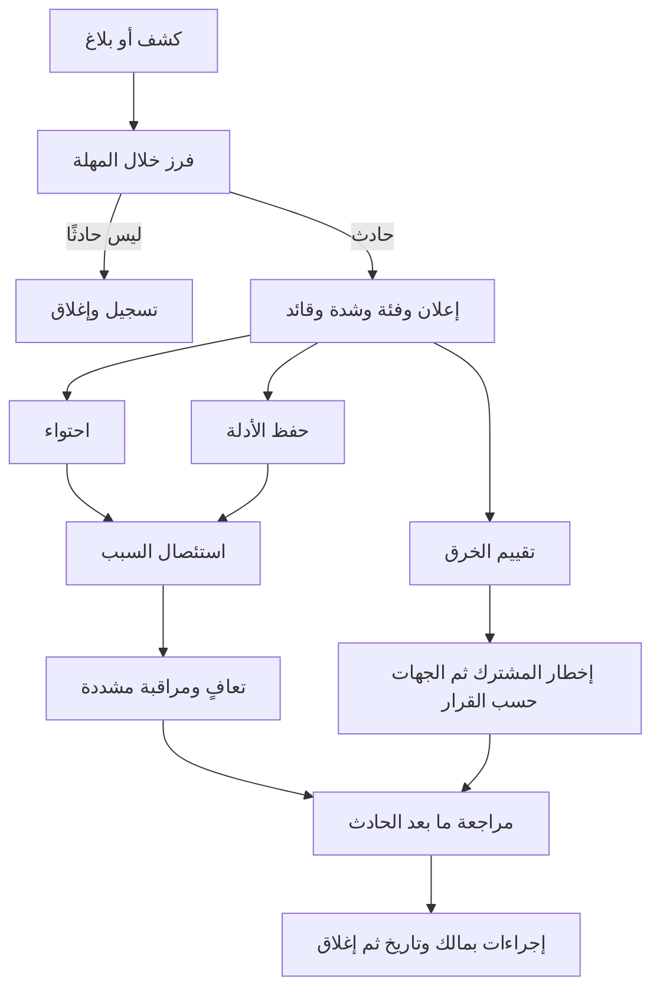
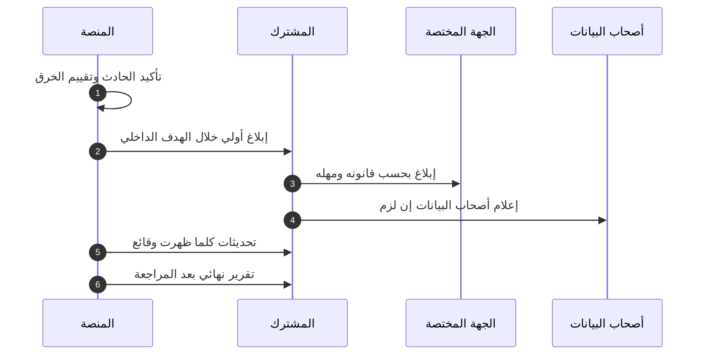

# DOC-S15 — إجراء الاستجابة للحوادث الأمنية وإخطار خرق البيانات

| البند | القيمة |
|---|---|
| المعرّف | DOC-S15 (docs/30-readiness-documents.md) |
| الإصدار | 0.1 — مسودة للمراجعة — 2026-10-12 |
| المالك المقترح | مسؤول الأمن (SEC في DOC-B09) مع المستشار القانوني ومسؤول حماية البيانات (LEG) |
| الأولوية | P2 قبل الإطلاق |
| يغطي | R4 وR5 (01)، X-AUD-4، صف الخصوصية في 10-m0-m1 §12، BR-PLT-009، BR-PLT-015، O-18 وO-24 (erd_open_items)، O-12 (20-database-design)، DOC-S07 §11، DQ-S07-7، DQ-S07-10 |
| يعتمد على | DOC-S12 (الكشف والسجلات)، DOC-S09 (التعافي)، DOC-S02 (المفاتيح)، DOC-S08 (الوصول الطارئ)، DOC-S07 (الأدوار والإخطار)، DOC-S10 (الخادم)، DOC-S01 (التهديدات)، DOC-B09 (الأدوار) |
| المصادر | docs/01-preliminary-analysis.md، docs/10-detailed-analysis/10-m0-m1-platform-organization.md، docs/10-detailed-analysis/00-overview-and-cross-cutting.md، docs/04-facility-agreements-analysis.md، docs/adr/0002-login-and-session-bound-context.md، db/static/030_session_context.sql، db/model/10-platform.model، tools/dbgen/erd_open_items.py، docs/20-database-design.md، docs/30-readiness/DOC-S01، DOC-S02، DOC-S07، DOC-S08، DOC-S09، DOC-S12 |

**الوسوم:** 🟢 قائم في المستودع أو مقرَّر · 🟡 مقترح ينتظر القرار.

**المصطلح.** «خرق البيانات» هنا وصول أو كشف أو فقد أو تعديل غير مأذون لبيانات شخصية أو مقيّدة. وهو غير «خرق التعهد» في الالتزامات المالية (`obl.ObligationBreach` في db/model/14-collateral-obligations-financials.model:344، ورمز الإشعار `CMP.BREACH`).

## 1. الغرض والنطاق

**الغرض.** إجراء واحد للحوادث الأمنية: تصنيفها وشدتها، والأدوار، ومصادر الكشف، والاحتواء للسيناريوهات الرئيسية، وحفظ الأدلة، وإخطار المشترك والجهات المختصة، ومراجعة ما بعد الحادث. المشترك مسؤول بيانات ويحتاج هذا الإجراء قبل الإطلاق (docs/10-detailed-analysis/10-m0-m1-platform-organization.md:588).

**داخل النطاق:** كل حادث يمس سرية بيانات المشتركين أو سلامتها أو توفرها، أو حسابات المنصة ومفاتيحها وخوادمها، أو المعالجين الفرعيين.

**خارج النطاق:** خطوات الاستعادة نفسها (DOC-S09 §8)، وتدوير المفاتيح بالتفصيل (DOC-S02 §10-§12)، وحدود التنبيه (DOC-S12 §6)، وتحديد القانون الواجب التطبيق ومهله، وهو قرار المالك مع المستشار (DOC-S07، DQ-S07-10).

## 2. الوضع اليوم 🟢

| البند | الحالة | المصدر |
|---|---|---|
| الخطر | تسريب البيانات بين المشتركين (R4) والبيانات الحساسة (R5) خطران رئيسيان | docs/01-preliminary-analysis.md:359-360 |
| الأدوار | افتراض: المشترك مسؤول بيانات والمنصة معالج 🟡 | docs/10-detailed-analysis/10-m0-m1-platform-organization.md:588 |
| الامتثال | 🔴 مراجعة قانونية لكل دولة لم تُجرَ | docs/10-detailed-analysis/00-overview-and-cross-cutting.md:150؛ docs/04-facility-agreements-analysis.md:253 |
| ما يطلبه DOC-S07 | إبلاغ المشترك بلا تأخير بهدف داخلي 24 ساعة بعد التأكيد، والمهلة النظامية يحددها المستشار، والمشترك هو المبلِّغ | docs/30-readiness/DOC-S07-privacy-impact-assessment.md:172-174 |
| أدوات الاحتواء في القاعدة | تعطيل المستخدم أو حذفه، وإنهاء الجلسة، وتغيير حالة المشترك، تسحب الربط فورًا بقوادح | db/static/030_session_context.sql:245-296؛ docs/adr/0002-login-and-session-bound-context.md:26 |
| حد التعليق | مشترك `SUSPENDED` يقبل ربطًا جديدًا يقرأ (O-18 مفتوح) | tools/dbgen/erd_open_items.py:117-118؛ db/static/030_session_context.sql:186-188 |
| المنصة وبيانات المشترك | `tp_platform` بلا وصول إلى جداول المشترك، والإجراءات المراجَعة للمنصة لم تُكتب | docs/20-database-design.md:117، :540 |
| آثار قابلة للمحو | `tp_app` يحذف محاولات الدخول (O-24) | db/generated/tsql/005_delete_grants.sql:11؛ tools/dbgen/erd_open_items.py:153 |
| الإجراء نفسه | لا يوجد قبل هذه الوثيقة؛ DOC-S02 §11.3 وDOC-S09 §8 يحيلان إليه | — |

## 3. فئات الحوادث

| الرمز | الفئة | أمثلة | التهديدات (DOC-S01) |
|---|---|---|---|
| IC-1 | تعرّض بين المشتركين | صف أو ملف أو تصدير لمشترك يصل مستخدم مشترك آخر | THR-07، THR-25 إلى THR-27، THR-46 |
| IC-2 | اختراق بيانات اعتماد | مستخدم أو مدير حساب أو مشغّل، أو مفتاح SSH لمسؤول، أو حساب قاعدة | THR-01، THR-03، THR-13، THR-19، THR-44، THR-56 |
| IC-3 | اختراق مفتاح | المفتاح الرئيسي K-05، أو مفتاح مشترك، أو شهادة TDE، أو مفتاح TLS الخاص | THR-31، THR-49، THR-50 |
| IC-4 | برمجية فدية أو فقد الخادم أو اختراقه | تشفير الأقراص، أو حذف، أو سيطرة على VPS | THR-56، THR-58، THR-59 |
| IC-5 | فشل سلامة التدقيق أو الملفات | فشل السلسلة، أو تعديل جداول التدقيق، أو `MISMATCH` | THR-29، THR-47، THR-57 |
| IC-6 | تسرّب مقيّد عبر قناة جانبية | قيمة مقيّدة في سجل أو بريد أو حمولة Outbox | THR-55؛ DOC-F02 §8 |
| IC-7 | إساءة من مستخدم مخوَّل | شذوذ كشف أو تصدير بلا سبب | THR-12 |
| IC-8 | هجوم على التوفر | حشو بيانات اعتماد يقفل الحسابات، أو استنزاف Argon2id | THR-11 |
| IC-9 | حادث لدى معالج فرعي | المزوّد، أو مرحّل البريد، أو مخزن المفاتيح، أو الموقع المنفصل | THR-58؛ DOC-S07 §9 |

كل حادث فيه وصول أو كشف أو فقد أو تعديل مؤكد أو مرجَّح لبيانات شخصية يمر بتقييم الخرق في §10.

## 4. مستويات الشدة 🟡

| المستوى | المعيار | زمن البدء | التصعيد |
|---|---|---|---|
| IS-1 حرج | تعرّض مؤكد بين المشتركين، أو مقيّد مكشوف، أو اختراق K-05 أو شهادة TDE، أو برمجية فدية، أو توقف كامل | فرز خلال 15 دقيقة وقائد خلال 30 دقيقة، على مدار الساعة | OWN وLEG فورًا |
| IS-2 عالٍ | اشتباه جدي بما سبق، أو اختراق مدير حساب أو مشغّل أو حساب قاعدة، أو فشل سلامة | خلال ساعة | OWN خلال 4 ساعات |
| IS-3 متوسط | اختراق مستخدم واحد بلا كشف، أو هجوم احتوته الضوابط، أو مفتاح TLS | يوم العمل نفسه | SEC |
| IS-4 منخفض | محاولة فاشلة أو مخالفة سياسة بلا أثر | التقرير الأسبوعي | — |

- هذه المستويات غير شدة العيوب Sev1 إلى Sev4 في docs/30-readiness/DOC-B01-test-strategy-and-plan.md:182-185. عيب Sev1 في الإنتاج يكسر العزل يُعامل IS-2 على الأقل حتى يُقيَّم.
- يرفع أي عضو المستوى في أي وقت. يخفضه قائد الحادث مع SEC فقط، ويُسجَّل السبب.

## 5. الأدوار 🟡

| الدور | من | المسؤولية | يقرر |
|---|---|---|---|
| قائد الحادث | SEC، ونائبه OPS | الإعلان والتصنيف وخطة الاحتواء والسجل | الاحتواء الجزئي وتعطيل الحسابات |
| المنفّذ التقني | OPS وDBA | الاحتواء والأدلة والتعافي | — |
| مسؤول الإخطار | LEG | تقييم الخرق ونص الإخطار وتوقيته | توصية للمالك |
| صاحب القرار | OWN | — | الإيقاف الكامل، وإخطار المشتركين والجهات، والكلفة |
| الحافظان KC-1 وKC-2 | DOC-S02 §9 | عمليات الضمان وتدوير المفاتيح | — |
| الكاتب | عضو يسمّيه القائد | سجل زمني بتوقيت UTC لكل فعل وقرار | — |

- قائمة الاتصال (الأدوار، ودعم المزوّد، والمستشار) تُحفظ خارج المنصة وتُراجع ربع سنويًا (DQ-S15-2).
- القائد لا يعتمد إغلاق حادث هو منفّذه الوحيد؛ يعتمده SEC أو OWN (قاعدة المُعِدّ والمعتمِد في DOC-B09 §3).

## 6. مصادر الكشف

| المصدر | الفئة | الشدة الأولية |
|---|---|---|
| بلاغ من مستخدم أو مشترك يرى بيانات غيره | IC-1 | IS-1 حتى يُنفى |
| AL-09: خطأ محمول المنع 33504 (DOC-S12 §6) | IC-1 | IS-2 |
| فشل اختبار عزل على وسم منشور (O-09) | IC-1 | IS-2 |
| AL-04 إلى AL-07: فشل الدخول والقفل وMFA | IC-2 أو IC-8 | IS-3 |
| AL-18: `breakglass` أو `sa` أو تغيير منحة خارج النافذة | IC-2 | IS-2 |
| AL-19: SSH بمفتاح غير مسجّل أو sudo من غير عضو | IC-2 أو IC-4 | IS-2 |
| AL-10: `UNWRAP_FAILED` (db/model/10-platform.model:293) | IC-3 | IS-2 |
| AL-12: فشل السلسلة أو `MISMATCH` أو `MISSING` (db/model/10-platform.model:399) | IC-5 | IS-2 |
| AL-20: أكثر من 20 كشفًا في ساعة (BR-PTY-009) | IC-7 | IS-3 |
| مسح السجلات يجد قيمة مقيّدة (NFR-SEC-14) | IC-6 | IS-2 |
| AL-01 مع ملفات مشفّرة أو رسالة فدية | IC-4 | IS-1 |
| إشعار من معالج فرعي (DOC-S07 §9) | IC-9 | بحسب المحتوى |
| بلاغ خارجي على قناة الأمن المنشورة | أي فئة | بعد الفرز |

قناة البلاغ المقترحة: `security@bankfas.com` منشورة على الموقع (DQ-S15-2).

## 7. دورة الاستجابة

- الاحتواء وحفظ الأدلة متوازيان، والأولوية لوقف الضرر. ما يمكن حفظه قبل التغيير يُحفظ أولًا (§9).
- تقييم الخرق يبدأ مع الإعلان، لا بعد التعافي، لأن مهلة إبلاغ المشترك تبدأ من التأكيد (§10.2).

## 8. الاحتواء للسيناريوهات الرئيسية

### 8.1 IC-1 تعرّض بين المشتركين

1. **التأكيد بأقل وصول:** معرّفات الارتباط من البلاغ أو التنبيه، ثم سجلات التطبيق في المخزن المركزي (DOC-S12 §4). المنصة لا تقرأ تدقيق المشتركين (db/static/010_rls.sql:84؛ T38)، فقراءة صفوف المشترك للتحقيق تتم بالوصول الطارئ بشخصين وتُسجَّل (DOC-S08 §9).
2. **الوقف:** إن عُرفت الوظيفة أو نقطة الواجهة، تُعطَّل بإعداد أو تُحجب عند الوكيل 🟡. وإن لم تُعرف، وضع الصيانة لكل المشتركين بقرار OWN.
3. **قطع الجلسات المعنية:** إنهاء جلسات المستخدمين الذين رأوا البيانات، فيُسحب ربطهم فورًا (db/static/030_session_context.sql:269-283).
4. **فحص حارس القاعدة:** هل السياسات مفعّلة؟ هل تغيّرت منحة أو سياسة؟ (DOC-S11 §8.2، وAL-18). ثم اختبارات العزل على الوسم نفسه في بيئة الاختبار، لا على الإنتاج (DOC-S11 §8.3).
5. **الاستئصال:** إصلاح مع اختبار انحدار جديد في db/tests أو في اختبارات الواجهة (DOC-S13)، ثم نشر وفق DOC-S11.
6. **الإخطار:** المشترك صاحب البيانات، والمشترك المستقبِل بطلب تأكيد حذف ما رآه (DQ-S15-11).

### 8.2 IC-2 اختراق بيانات اعتماد

| الحساب | الاحتواء الفوري | بعده |
|---|---|---|
| مستخدم مشترك | تعطيله يسحب ربطه (db/static/030_session_context.sql:245-256)، وإنهاء جلساته | إعادة كلمة المرور وMFA بيد مدير الحساب، ومراجعة تدقيقه |
| مدير حساب | كما سبق، وإبلاغ مدير حساب آخر للمشترك | مراجعة أحداث `CONFIG` التي أجراها |
| مشغّل منصة | تعطيله في `plat.PlatformOperator` وإنهاء جلساته | مراجعة أحداث `PLATFORM` ومنح الدعم؛ دخول المشغّل بلا إجراء في القاعدة بعد (DOC-F01 G-05) |
| مفتاح SSH لمسؤول | حذف المفتاح وقفل الحساب (DOC-S10 §8.2) | مراجعة journald وauditd؛ إن استُعمل المفتاح يُقيَّم IC-4 |
| حساب خدمة في القاعدة | التحويل إلى الحساب البديل وتعطيل المسرّب (DOC-S08 §6) | مراجعة SQL Server Audit لمصادر الاتصال |
| `bankfas_migrator` أو `breakglass` | تعطيل وتدوير | مقارنة الكتالوج بالمتوقع (DOC-S11 §8.2) ومراجعة كل تغيير منذ آخر نشر |

- المنصة لا تستطيع تعطيل مستخدم مشترك بلا مدير حسابه أو الوصول الطارئ، لأن `tp_platform` بلا وصول إلى جداول المشترك (docs/20-database-design.md:117). المقترح إجراء منصة مدقَّق للاحتواء ضمن O-12 (20-database-design) (DQ-S15-6).
- تعليق المشترك لا يمنع القراءة بربط جديد (O-18)، فلا يُعتمد عليه لوقف القراءة حتى يُحسم O-18 (DQ-S15-7). البديل اليوم: تعطيل المستخدمين وإنهاء الجلسات، أو حجب المشترك في التطبيق.
- محاولات الدخول قابلة للحذف من اتصال التطبيق (O-24)، فالتحقيق يعتمد أيضًا على سجلات التطبيق المشحونة.

### 8.3 IC-3 اختراق مفتاح

| المفتاح (DOC-S02 §4) | الاحتواء | المعالجة |
|---|---|---|
| K-05 المفتاح الرئيسي | قطع وصول الهويات المشتبه بها إلى مخزن المفاتيح | تدوير K-05 وإعادة لف كل `sec.TenantKey` وحدث `MASTER_KEY_CHANGED` لكل مشترك (DOC-S02 §10). إن تسربت نسخة من القاعدة أيضًا تُعد مفاتيح DATA وBLIND_INDEX وFILE مكشوفة فتُدوَّر، ويُقيَّم الخرق لكل المشتركين |
| K-06 إلى K-08 لمشترك | إيقاف استعمال المفتاح المكشوف | مفتاح جديد وإعادة تشفير بالمهمة (DOC-S02 §10)، وإخطار المشترك |
| K-03 شهادة TDE | — | شهادة جديدة وإعادة تشفير DEK بها؛ وإن تسربت نسخة أيضًا يُعاد توليد K-04 (DOC-S02 §10). الأعمدة المقيّدة تبقى محمية بـ L3 ما دام K-05 سليمًا |
| K-09 مفتاح MFA للمشغّلين | — | تدوير وإعادة تسجيل MFA لكل مشغّل (DOC-S02 §12) |
| مفتاح TLS للنطاق | إلغاء الشهادة لدى الجهة المصدرة | مفتاح وشهادة جديدان (DOC-S05 §4.4)، وتقدير نافذة الاعتراض |
| مفتاح شهادة SQL Server أو مفتاح مضيف SSH | — | استبدال (DOC-S05 §5.2)، وإبلاغ البصمة الجديدة خارج القناة |

فقد K-05 (لا تسرّبه) يُعالج بالضمان في DOC-S02 §11.3، ويُسجَّل حادثًا هنا.

### 8.4 IC-4 برمجية فدية أو فقد الخادم أو اختراقه

1. **العزل:** جدار المزوّد يمنع كل اتصال إلا من محطة المسؤول. لا إطفاء قبل جمع الأدلة المتطايرة إن أمكن (§9، E-5).
2. **سحب الأسرار التي كانت على الخادم:** سر حساب النشر، ومفتاح دفع النسخ، واعتماد شحن السجلات، وحسابات القاعدة، ومفاتيح SSH (DOC-S09 §8، الخطوة 13).
3. **التحقق من النسخ:** حساب الدفع كتابة فقط (DOC-S09 §5)، فالنسخ يُفترض سليمة. تُستعاد آخر سلسلة على خادم الاستعادة المعزول وتُفحص.
4. **إعادة البناء لا التنظيف:** خادم جديد بسكربت التجهيز (DOC-S10 §11)، واستعادة وفق DOC-S09 §8 إلى نقطة قبل الاختراق، يحددها المخزن المركزي غير القابل للتعديل.
5. **المفاتيح:** شهادة TDE كانت في master على الخادم المخترق، فتُعد مكشوفة (§8.3). وK-05 إن مُسّ مضيف التطبيق أيضًا.
6. **تقييم الخرق:** هل خرجت بيانات؟ سجلات الخروج في الجدار (DOC-S10 §6.2)، وأحداث `BACKUP_RESTORE_GROUP` في SQL Server Audit (DOC-S12 §3.5).
7. **الفدية:** لا دفع؛ القرار للمالك مع المستشار (DQ-S15-9).

فقد الخادم بلا اختراق (عطل لدى المزوّد) يتبع DOC-S09 §8 وحده، ويُسجَّل حادث توفر بلا تقييم خرق ما لم تُفقد بيانات.

### 8.5 IC-5 إلى IC-9 باختصار

| الفئة | الاحتواء والمعالجة |
|---|---|
| IC-5 السلامة | حفظ حالة القاعدة ومخزن المراسي؛ تحديد الصفوف المتغيرة بمدى `ChainSeq`؛ مراجعة SQL Server Audit لتعديل جداول التدقيق ومن أجراه (AL-18). عبث بحساب مميّز ينقل الحادث إلى IC-2 بشدة IS-1 أو IS-2. ملف `MISMATCH` يُقارن بنسخته في الموقع المنفصل |
| IC-6 قناة جانبية | تقييد الوصول إلى السجل أو الرسالة، وإصلاح المنقّح (DOC-F02 §8)، وحذف القيمة من المخزن بإجراء موثّق يوازن الحجز القانوني |
| IC-7 إساءة داخلية | المشترك صاحب القرار في موظفه؛ المنصة تزوّده بالمستخرج من تدقيقه وسجل الوصول الحساس |
| IC-8 التوفر | تقييد المعدل عند الحافة، وحجب العناوين، وفك الأقفال الجماعية بعد انتهاء الهجوم |
| IC-9 معالج فرعي | طلب التفاصيل من المعالج، وتقييم الأثر، وإخطار المشتركين بحسب العقد |

## 9. حفظ الأدلة

**المبادئ 🟡:** الحفظ قبل التغيير متى أمكن، وأقل وصول، وشخصان لكل جمع، وبصمة SHA-256 لكل عنصر، وتوقيت UTC، ولا تحليل على الإنتاج، والدليل الذي يحمل بيانات مقيّدة يبقى مقيّدًا.

| # | الدليل | الطريقة |
|---|---|---|
| E-1 | سجلات التطبيق والوكيل والنظام وسجل أخطاء SQL Server للنافذة الزمنية | تصدير من المخزن المركزي مع قائمة بصمات (DOC-S12 §5.2) |
| E-2 | ملفات SQL Server Audit | موجودة في المخزن غير القابل للتعديل؛ تُسجَّل أسماؤها وبصماتها |
| E-3 | صفوف التدقيق والوصول الحساس والدخول والجلسات للمشتركين والفترة المعنية | بالوصول الطارئ وبحث بمعرّف الارتباط والوقت، وتصدير ببصمة |
| E-4 | حالة الحماية في القاعدة: السياسات والمنح والحسابات والتدقيق وTDE | استعلامات القراءة في DOC-S11 §8.2 |
| E-5 | حالة الخادم المخترق: العمليات والاتصالات والجلسات، والذاكرة إن أمكن | قبل العزل أو الإطفاء |
| E-6 | لقطة القرص من المزوّد | بموافقة OWN فقط، لأنها تحمل البيانات ومفاتيح TDE معًا (DOC-S02 §3)؛ مشفّرة ومقيّدة الوصول |
| E-7 | سجل النشر وتشغيل CI للوسم المنشور | DOC-S11 §10 |
| E-8 | السجل الزمني للقرارات والاتصالات | الكاتب |

- **مخزن الأدلة:** مكان منفصل للكتابة مرة واحدة، بوصول SEC وLEG فقط، وكل وصول مسجّل (DQ-S15-10).
- **سجل الحيازة:** العنصر، والبصمة، ومن جمعه، والشاهد، والوقت، والمكان، وكل وصول لاحق.
- **الحجز القانوني:** يوقف كل حذف بالاحتفاظ للسجلات المعنية (DOC-S12 §5.1) حتى يرفعه LEG.

## 10. الإخطار

### 10.1 تقييم الخرق

يجيب LEG مع القائد ويوثّق: هل مُسّت بيانات شخصية، ومن أي فئة P-n (DOC-S07 §4)؟ أي المشتركين، وكم سجلًا وشخصًا تقريبًا؟ أهو سرية أم سلامة أم توفر؟ هل كانت الأعمدة المقيّدة مشفّرة ومفاتيحها سليمة؟ هل ما زال الحادث جاريًا؟ وما الخطر المرجّح على الأشخاص؟ النتيجة «خرق» أو «ليس خرقًا» بسبب مكتوب.

### 10.2 إلى المشترك

- 🟡 بلا تأخير بعد التأكيد، وبهدف داخلي 24 ساعة (docs/30-readiness/DOC-S07-privacy-impact-assessment.md:172؛ DQ-S15-4).
- إلى نقطة اتصال الخصوصية للمشترك (DQ-S07-7) ومدير حسابه، بالهاتف ثم كتابةً.
- المحتوى كما في docs/30-readiness/DOC-S07-privacy-impact-assessment.md:173: وصف الحادث، والفئات P-n، والعدد التقريبي، والإجراءات، ونقطة اتصال. ولا يُذكر فيه مشترك آخر.
- المشترك، بصفته مسؤول البيانات، هو المبلِّغ للجهة المختصة ولأصحاب البيانات (docs/30-readiness/DOC-S07-privacy-impact-assessment.md:172)، والمنصة تزوّده بما يلزم.

### 10.3 إلى الجهات المختصة

- القانون الواجب التطبيق ومهله قرار المالك مع المستشار لكل دولة (DQ-S07-10، X-AUD-4). المصادر تذكر مثالًا لا قرارًا (docs/04-facility-agreements-analysis.md:253). هذه الوثيقة لا تحدد مهلة نظامية.
- المنصة قد تكون مسؤول بيانات لحسابات المشغّلين وسجلات الأمن (docs/30-readiness/DOC-S07-privacy-impact-assessment.md:31)، فقد تلزمها هي الإبلاغ عن خرق يخصها. يحدد LEG ذلك (DQ-S15-5).
- الإبلاغ إلى جهات إنفاذ القانون قرار OWN بتوصية LEG.

### 10.4 من المعالجين الفرعيين وإليهم

- عقد المزوّد ومرحّل البريد يتضمن التزام إخطار بالخرق (docs/30-readiness/DOC-S07-privacy-impact-assessment.md:144).
- إشعار من معالج فرعي يُفتح حادثًا IC-9 ويمر بالتقييم نفسه.

### 10.5 سجل الإخطار

لكل إخطار: الجهة، والوقت بتوقيت UTC، والقناة، والنص المعتمد، ومن اعتمده، والإقرار بالاستلام.

## 11. التواصل أثناء الحادث 🟡

- على قدر الحاجة. قناة بديلة خارج البريد ونظام الدخول إن احتُمل اختراقهما.
- تحديث داخلي كل ساعتين في IS-1، ويوميًا في IS-2.
- لا بيان خارجي إلا بنص يعتمده OWN وLEG. لا اسم مشترك في القنوات المشتركة؛ يُستعمل معرّفه العام.
- توقف عام في IS-1 يُبلَّغ لمديري حسابات كل المشتركين بلا تفاصيل السبب حتى التقييم.

## 12. ما بعد الحادث 🟡

- مراجعة بلا لوم خلال 5 أيام عمل من الإغلاق في IS-1 وIS-2، و10 أيام في IS-3، وملخص شهري لـ IS-4.
- المحتوى: الخط الزمني، والسبب الجذري، وفجوة الكشف، وزمن الكشف، وزمن الاحتواء، وزمن إبلاغ المشترك مقابل 24 ساعة، وما نجح، والإجراءات بمالك وتاريخ.
- المخرجات الإلزامية: تحديث سجل التهديدات (DOC-S01)، والتنبيهات (DOC-S12)، واختبار انحدار لكل حادث عزل (DOC-S13)، وأدلة التشغيل (DOC-S10، DOC-S11)، وهذه الوثيقة إن لزم.
- تقرير نهائي للمشترك المتأثر (§10.2).

## 13. التمارين 🟡

| التمرين | الدورية | يشمل |
|---|---|---|
| تمرين طاولة على IC-1 وIC-2 | قبل الإطلاق، ثم نصف سنوي | الأدوار وقائمة الاتصال وتقييم الخرق ونص الإخطار |
| تمرين مفتاح | سنويًا، مع تمرين الضمان (DOC-S02 §11.2) | IC-3 |
| تمرين تعافٍ | ربع سنوي (DOC-S09 §7.1) | خطوات IC-4 |
| التحقق من قائمة الاتصال | ربع سنوي | كل رقم وعنوان |

## 14. القرارات المطلوبة

| المعرّف | السؤال | الافتراض المقترح | من يقرر | ما يعطّله |
|---|---|---|---|---|
| DQ-S15-1 | من يقود الحوادث وكيف تُغطى الساعات | ✅ معتمد من المالك (2026-10-12): SEC قائدًا وOPS نائبًا، والمناوبة كما في DQ-S12-10 | OWN | الإطلاق |
| DQ-S15-2 | قناة البلاغ وقائمة الاتصال | `security@bankfas.com` منشور، وقائمة هاتفية خارج المنصة تُراجع ربع سنويًا | SEC | §5، §6 |
| DQ-S15-3 | مقياس الشدة وأزمنته | ✅ معتمد من المالك (2026-10-12): جدول §4 | SEC مع OWN | §4 |
| DQ-S15-4 | الهدف الداخلي لإبلاغ المشترك | ✅ معتمد من المالك (2026-10-12): 24 ساعة من التأكيد، ويُثبت في عقد الاشتراك | LEG مع OWN | §10.2، DQ-S07-3 |
| DQ-S15-5 | القانون والجهات ومهلها، وهل تبلّغ المنصة بنفسها عن بياناتها | ✅ معتمد من المالك (2026-10-12): يحدده المستشار لكل دولة قبل الإطلاق | OWN مع LEG | §10.3، X-AUD-4 |
| DQ-S15-6 | احتواء المنصة لمستخدم مشترك بلا وصول طارئ | إجراء منصة مدقَّق ضمن O-12 (20-database-design) لتعطيل مستخدم وإنهاء جلساته، وحجب مشترك في التطبيق | معماري القاعدة مع SEC | §8.2 |
| DQ-S15-7 | وقف قراءة مشترك كامل | ✅ معتمد من المالك (2026-10-12): حسم O-18 بحيث يرفض `SUSPENDED` الربط الجديد إلا لمن تسمح له BR-PLT-002 | OWN مع معماري القاعدة | §8.2 |
| DQ-S15-8 | لقطة القرص دليلًا | ✅ معتمد من المالك (2026-10-12): بموافقة OWN فقط، ومعاملة المقيّد | OWN مع SEC | E-6 |
| DQ-S15-9 | سياسة الفدية | ✅ معتمد من المالك (2026-10-12): لا دفع | OWN مع LEG | §8.4 |
| DQ-S15-10 | مخزن الأدلة | حاوية كتابة مرة واحدة منفصلة في المخزن المركزي (DQ-S12-2) بوصول SEC وLEG | SEC | §9 |
| DQ-S15-11 | إخطار المشترك المستقبِل في IC-1 | نعم، بطلب تأكيد الحذف، بنص يعتمده LEG | LEG | §8.1 |
| DQ-S15-12 | مهل مراجعة ما بعد الحادث | 5 أيام عمل لـ IS-1 وIS-2، و10 لـ IS-3 | SEC | §12 |

## 15. تعارضات وفجوات في المصادر

1. السجل docs/30-readiness-documents.md:329 يقول إنه لا وثيقة تذكر إجراء استجابة أو مهلة إخطار. اليوم يضع DOC-S07 هدفًا داخليًا 24 ساعة (docs/30-readiness/DOC-S07-privacy-impact-assessment.md:172)، ويحيل إلى هذا الإجراء DOC-S02 §11.3 وDOC-S09 §8.
2. BR-PLT-002 يقصر دخول المشترك المعلّق على مدير الحساب، والإجراء يقبل ربطًا جديدًا لأي مستخدم نشط فيه (O-18؛ tools/dbgen/erd_open_items.py:117-118؛ db/static/030_session_context.sql:186-188). فالتعليق ليس أداة احتواء كاملة.
3. لا إجراء للمنصة على بيانات المشترك (docs/20-database-design.md:117، :540)، فاحتواء مستخدم مخترق يحتاج مدير حسابه أو الوصول الطارئ.
4. محاولات الدخول، وهي الأثر الوحيد للدخول اليوم، قابلة للحذف من اتصال التطبيق (db/generated/tsql/005_delete_grants.sql:11؛ O-24 في tools/dbgen/erd_open_items.py:153)، فأدلة IC-2 قابلة للمحو.
5. كلمة «خرق» مستعملة للتعهدات في M5 (docs/10-detailed-analysis/12-m5-facilities-pricing-collateral-obligations.md:383؛ docs/10-detailed-analysis/13-m6-workflow-engine-notifications.md:599) ولخرق البيانات هنا، والمسرد DOC-B10 بلا مدخل لأيهما. يُقترح مدخلان: Data breach «خرق البيانات» وCovenant breach «خرق التعهد».
6. X-AUD-4 ما زال 🔴 (docs/10-detailed-analysis/00-overview-and-cross-cutting.md:150)، فلا تُحدد مهل الإخطار النظامية قبل الإطلاق دون قرار DQ-S15-5.

## 16. التتبع

| البند في هذه الوثيقة | المتطلب أو القاعدة أو القرار | المصدر |
|---|---|---|
| §1، §3 | R4، R5، صف الخصوصية | docs/01-preliminary-analysis.md:359-360؛ docs/10-detailed-analysis/10-m0-m1-platform-organization.md:588 |
| §3 | THR-01 إلى THR-60 | docs/30-readiness/DOC-S01-threat-model.md:49-174 |
| §6 | BR-PLT-009، BR-PTY-009، FR-PLT-031، DOC-S12 §6 | docs/10-detailed-analysis/10-m0-m1-platform-organization.md:235، :280، :133 |
| §8.1، §8.2 | ADR 0002 (السحب)، O-18، O-24 | db/static/030_session_context.sql:245-296؛ tools/dbgen/erd_open_items.py:115-120، :151-156 |
| §8.2 | O-12 (20-database-design) | docs/20-database-design.md:117، :540 |
| §8.3 | BR-PLT-015، Q-PLT-12، DOC-S02 §10-§12 | docs/10-detailed-analysis/10-m0-m1-platform-organization.md:241، :624 |
| §8.4 | DOC-S09 §8، THR-59 | docs/30-readiness/DOC-S09-backup-restore-dr.md:134-172 |
| §9 | X-AUD-1، حماية السجلات | docs/10-detailed-analysis/00-overview-and-cross-cutting.md:147؛ docs/30-readiness/DOC-S12-logging-monitoring-audit.md |
| §10 | X-AUD-4، DOC-S07 §11، DQ-S07-7، DQ-S07-10 | docs/10-detailed-analysis/00-overview-and-cross-cutting.md:150؛ docs/30-readiness/DOC-S07-privacy-impact-assessment.md:168-174 |
