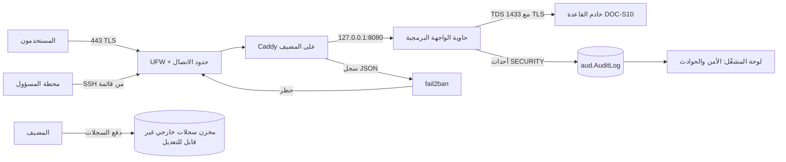

# DOC-S16 — دليل تشغيل مضيف التطبيق وحمايته من الاختراق والإغراق

| البند | القيمة |
|---|---|
| المعرّف | DOC-S16 (docs/30-readiness-documents.md) |
| الإصدار | 0.1 — مسودة للمراجعة — 2026-10-24 |
| المالك المقترح | مهندس DevOps / مسؤول الأنظمة (OPS) مع مسؤول الأمن (SEC) |
| الأولوية | P0 قبل التجربة |
| يغطي | قرار المالك في docs/31 الصف 48، ADR 0047، NFR-SEC-09، THR-56 إلى THR-59 (DOC-S01) |
| يعتمد على | DOC-S05 (TLS)، DOC-S10 (مضيف القاعدة)، DOC-S12 (السجلات والتنبيهات)، DOC-S15 (الاستجابة للحوادث) |
| المصادر | tools/host/، app/src/BankFas.Api/Infrastructure/SecurityGuard.cs، app/src/BankFas.Api/Endpoints/SecurityEndpoints.cs، app/src/BankFas.Api/Program.cs، app/web/vite.config.ts |

> كتب هذا المستند وكيل ذكاء اصطناعي، ويراجعه OPS وSEC قبل التنفيذ. كل أمر فيه مقترح يُجرَّب على خادم تجريبي ثم على الخادم الهدف. القيم بين `<...>` خاصة بالخادم، ولا تُكتب في المستودع.

**الوسوم:** 🟢 قائم في المستودع ومختبر · 🟡 قالب في المستودع ينتظر التطبيق على الخادم

## 1. الغرض والنطاق

يصف هذا المستند مضيف التطبيق، أي الخادم الذي تعمل عليه واجهة BankFas البرمجية وواجهتها الأمامية. اعتمد المالك له Linux مع Docker خلف Caddy، وقرر البناء دون طبقة Cloudflare (docs/31 الصف 48). أما خادم القاعدة فيصفه DOC-S10.

## 2. الصورة



## 3. طبقات الحماية

| الطبقة | ما تفعله | أين | الحالة |
|---|---|---|---|
| الحافة | شبكة توصيل بحماية من الإغراق وجدار تطبيقات | مؤجلة بقرار المالك | — |
| الشبكة لدى المزوّد | حماية الإغراق التي يقدمها مزوّد الاستضافة | يُطلب من المزوّد عند التعاقد | 🟡 |
| المضيف | UFW، وتحديد ping، وSYN cookies، وحد الاتصالات لكل عنوان، وfail2ban | tools/host/ | 🟡 |
| الوكيل | TLS، ومهل القراءة، وحد حجم الطلب، وسجل JSON | tools/host/Caddyfile | 🟡 |
| التطبيق | حد الطلبات لكل عنوان، والحظر المؤقت، وأحداث الأمن، والتنبيه | SecurityGuard | 🟢 |
| التشغيل | لوحة الأمن، وسجل الحوادث، وفحص المضيف، وإجراء «تحت الهجوم» | لوحة المشغّل وcheck_host.sh و§10 | 🟢 / 🟡 |

**تنبيه:** الإغراق الكبير (DDoS) لا يوقفه خادم واحد. ما يفعله هذا المستند هو صد الإغراق الصغير والمتوسط، وصد التخمين والفحص. والطبقة التالية عند الحاجة حافة: شبكة توصيل، أو حماية مزوّد سحابي محلي إن اشترطت متطلبات الإقامة إنهاء التشفير داخل المملكة. ولا تحتاج إضافتها تغييرًا في الشيفرة (§5.3).

## 4. الجدار الناري والنواة 🟡

```bash
sudo ADMIN_CIDRS="<ADMIN_CIDR_1> <ADMIN_CIDR_2>" bash tools/host/ufw.sh
sudo install -m 644 tools/host/sysctl-bankfas.conf /etc/sysctl.d/60-bankfas.conf && sudo sysctl --system
```

- الدخول مرفوض افتراضيًا. يُفتح 80 لتحدي الشهادة والتحويل إلى HTTPS، و443 للجميع ما دامت لا حافة، وSSH لعناوين الإدارة وحدها.
- ping يُجاب بخمسة طلبات في الثانية على الأكثر، وما زاد يُسقط.
- الاتصالات الجديدة إلى 443 من عنوان واحد محدودة بـ 300 في الدقيقة، و200 اتصال متزامن على الأكثر. السبب أن Caddy لا يملك حدًا لكل عنوان. والقيمتان متغيران في السكربت، وتُراجعان بعد أسابيع التجربة الأولى، لأن موظفي شركة واحدة خلف عنوان NAT واحد يُحسبون عنوانًا واحدًا.
- SYN cookies وrp_filter، ولا إعادة توجيه ولا توجيه من المصدر.
- **تحذير Docker:** المنافذ التي تنشرها الحاويات تتجاوز UFW. فلا تنشر أي حاوية منفذًا على عنوان عام: Caddy على المضيف، والواجهة البرمجية على 127.0.0.1 وحده (tools/host/compose.yml).
- يُتحقق بعد التطبيق: `sudo ufw status verbose`، و`ss -tulpn` يُظهر 22 و80 و443 وحدها على العناوين العامة، ومحاولة SSH من عنوان خارج القائمة تفشل.

## 5. الوكيل Caddy والعنوان الحقيقي

### 5.1 Caddy 🟡

- الملف: `tools/host/Caddyfile` إلى `/etc/caddy/Caddyfile`، ويُتحقق منه بـ `caddy validate`.
- الشهادات آلية. الشهادة العامة للنطاقات الفرعية (`*.<DOMAIN>`) تحتاج تحدي DNS، فيُبنى Caddy بوحدة مزوّد DNS.
- مهل القراءة (10 ثوانٍ للرؤوس و30 للجسم)، وحد الرؤوس 32KB، وحد الجسم 25MB. هذه الحدود تصد هجمات الاتصال البطيء.
- سجل الوصول JSON في `/var/log/caddy/access.log`، بتدوير 50MiB و30 ملفًا و90 يومًا، ومنه يقرأ fail2ban.
- TLS كما في DOC-S05: الإصدار 1.2 فأعلى. والتطبيق يرسل HSTS وCSP والرؤوس الأخرى بنفسه (WebSecurity.cs).

### 5.2 العنوان الحقيقي للعميل 🟢

- يقرأ التطبيق `X-Forwarded-For` من العناوين المسجلة في `Security:TrustedProxies` وحدها، وقفزة واحدة فقط. فإن أرسل عميل الرأس بنفسه لم يُغيّر شيئًا. وهذا مختبر (SecurityGuardTests).
- Caddy يستبدل الرأس القادم من العملاء، لأنه لا وكلاء موثوقين لديه.
- في `compose.yml` يصل Caddy إلى الحاوية من بوابة شبكتها الثابتة 172.30.0.1، فهي الوكيل الموثوق الوحيد.

### 5.3 إضافة حافة لاحقًا

1. يُضاف عنوان الحافة إلى `Security:TrustedProxies`، ويُضبط Caddy بـ `trusted_proxies` لنطاقات الحافة.
2. يُغلق 443 في UFW إلا لنطاقات الحافة.
3. تُضاف نطاقات الحافة إلى `ignoreip` في fail2ban.

لا يتغير شيء في الشيفرة.

## 6. حارس التطبيق ولوحة المشغّل 🟢

| الإعداد (القسم Security) | الافتراضي | المعنى |
|---|---|---|
| `TrustedProxies` | 127.0.0.1، ::1 | من يحق له تسمية العميل |
| `GuardEnabled` | true | تشغيل العدّ والحظر |
| `ApiPerMinute` | 600 | طلبات الواجهة البرمجية في الدقيقة من عنوان واحد |
| `RefusalLimit` / `RefusalWindowSeconds` | 40 / 300 | عدد الردود 401 و403 و429 الذي يحظر العنوان خلال النافذة |
| `BlockMinutes` | 30 | مدة الحظر الآلي |
| `AlertEmails` | فارغ | من يُبلَّغ بكل حظر آلي |

- العنوان المحظور يُرد بـ 403 `IP_BLOCKED` قبل أي معالجة. ويُسجل الحظر في `plat.IpBlock`، ومعه حدث تدقيق IP_BLOCKED بشدة HIGH، وتحذير في السجل، وبريد.
- الحظر من مشغّل آخر أو من نسخة أخرى يسري خلال 30 ثانية.
- لا يُحظر أبدًا العنوان المحلي ولا الوكيل الموثوق ولا العنوان المجهول. ولا يستطيع المشغّل حظرها (`V-SEC-TRUSTED`).
- **صفحة الأمن** في لوحة المشغّل تعرض الإعدادات، والعناوين المحظورة مع مصدرها وسببها ومدتها، وآخر مئة حدث أمني. ورفع الحظر والحظر اليدوي لمدير المشغّلين برمز جديد.
- **صفحة الحوادث** تحمل سجل DOC-S15:
  - الترقيم INC-YYYY-NNN.
  - الحالات: مفتوحة، محتواة، معالجة، مغلقة.
  - لا تُغلق الحادثة إلا بسببها الجذري، ولا تُعدّل بعد الإغلاق.
  - كل تغيير حدث أمني في سجل المنصة.
- تحديد الدخول (10 في الدقيقة) والتحقق بخطوتين (10 في 15 دقيقة) وإعادة التعيين (10 في الساعة) باقية كما في DOC-S04.
- خرائط الشيفرة (source maps) لا تُبنى في الإنتاج، فلا تظهر الشيفرة المصدرية في أدوات المتصفح. أما تعطيل أدوات المطوّر أو الزر الأيمن فلا يُعمل، لأنه يُتجاوز بسهولة ويضر الاستخدام. البديل أن الخادم يتحقق من كل عملية، وأن المطبوع يحمل مرجعه.

## 7. السجلات 🟡

| السجل | الإعداد | الملف |
|---|---|---|
| journald دائم بحد 2G و90 يومًا | `Storage=persistent` | tools/host/journald-bankfas.conf |
| Docker بتدوير 50m × 5 مضغوطة | `log-opts` | tools/host/docker-daemon.json |
| Caddy JSON | §5.1 | tools/host/Caddyfile |
| auditd على الحسابات وsudo وSSH والمفاتيح وDocker وCaddy وUFW وإعدادات التطبيق، وأوامر root من المستخدمين، وحذف سجلات Caddy | `augenrules --load` | tools/host/auditd-bankfas.rules |
| أحداث الأمن في التطبيق | Category SECURITY في aud.AuditLog | SecurityGuard وSecurityEndpoints |

- السجلات تُدفع إلى مخزن خارجي غير قابل للتعديل بحساب كتابة فقط (DOC-S12 §5.2). ولا يُعتمد على النسخة المحلية في أي تحقيق.
- fail2ban (tools/host/fail2ban/):
  - يحظر عند الجدار من فشل SSH أربع مرات.
  - ويحظر العنوان الذي يُرفض في سجل Caddy 120 مرة في عشر دقائق، لست ساعات، وتطول المدة مع التكرار حتى أسبوع.
  - هذا حظر أطول وأرخص من حظر التطبيق الذي يدوم دقائق.
  - عناوين الإدارة والشبكة الداخلية في `ignoreip`.

## 8. المراقبة والتنبيه 🟡

`tools/host/check_host.sh` يعمل بمؤقت systemd كل خمس دقائق:

```ini
# /etc/systemd/system/bankfas-check.service
[Service]
Type=oneshot
Environment=ALERT_MAIL=<SECURITY_MAILBOX>
ExecStart=/opt/bankfas/check_host.sh
# /etc/systemd/system/bankfas-check.timer
[Timer]
OnBootSec=2min
OnUnitActiveSec=5min
[Install]
WantedBy=timers.target
```

- ينبّه عند منفذ استماع جديد، أو حاوية جديدة، أو تغير في `authorized_keys`، أو قرص فوق 85%، أو ذاكرة فوق 90%، أو توقف Caddy أو Docker أو fail2ban أو auditd أو UFW، أو أكثر من 20 عنوانًا محظورًا من سجل Caddy.
- بعد تغيير مراجَع يُسجل الوضع الجديد بـ `check_host.sh accept`.
- **قنوات التنبيه:**
  - البريد إلى صندوق الأمن.
  - السجل بالوسم `bankfas-alert`، ويُشحن إلى المراقبة المركزية (DOC-S12 §6).
  - صفحة الأمن في لوحة المشغّل للحظر الآلي.
- تنبيهات DOC-S12 §6 تُضاف إليها:
  - ارتفاع الطلبات المرفوضة.
  - الحظر الآلي، وأكثر من 10 في الساعة تنبيه عاجل.
  - دخول SSH ناجح من أي عنوان.
  - تغير قواعد UFW.
  - إعادة تشغيل حاوية.

## 9. الاستجابة عند اكتشاف نشاط مشبوه 🟢 / 🟡

هذه الخطوات الاثنتا عشرة التي طلبها المالك، مدموجة في DOC-S15 §9.1، وربطها بالأدوات:

| # | الخطوة | الأداة |
|---|---|---|
| 1 | لا تحذف السجلات ولا تعِد تشغيل الخادم فورًا | — |
| 2 | احفظ نسخة من السجلات مع الوقت | `collect_evidence.sh`: نسخة بتوقيت UTC وبصمات SHA-256، ثم تُنقل خارج الخادم |
| 3 | اعزل الحساب أو العنوان فقط إذا كان ذلك آمنًا | لوحة المشغّل: حظر يدوي للعنوان، وتعطيل حساب المشغّل أو تعليق المشترك |
| 4 | لا تحظر الوكيل العكسي أو CDN بالخطأ | المنصة ترفض حظرها (`V-SEC-TRUSTED`)، وfail2ban يتجاهلها |
| 5 | تحقق من العمليات والمنافذ والحاويات الجديدة | `collect_evidence.sh` و`check_host.sh` |
| 6 | افحص `authorized_keys` والمستخدمين الجدد | كذلك، وقواعد auditd |
| 7 | أوقف الأسرار المتأثرة ودوّرها | DOC-S08 (حسابات القاعدة) وDOC-S02 (المفاتيح) |
| 8 | خذ لقطة قرص قبل التغييرات الكبيرة | بموافقة OWN (DQ-S15-8) |
| 9 | افحص الحاويات والصور وملفات Compose | `docker diff`، والبصمات في `collect_evidence.sh` |
| 10 | أعد البناء من مصدر موثوق | خادم جديد من tools/host/ وصورة من الوسم المنشور، لا تنظيف يدوي |
| 11 | أعد اختبار المصادقة والصلاحيات | اختبارات القبول والعزل (DOC-S13) على البيئة الجديدة |
| 12 | وثّق الحادثة وسببها الجذري والإجراءات التصحيحية | صفحة الحوادث، ولا تُغلق الحادثة بلا سبب جذري |

## 10. إجراء «تحت الهجوم» 🟡

1. **تأكيد الهجوم:** ارتفاع الطلبات في سجل Caddy، وكثرة الحظر في صفحة الأمن، وتنبيه `check_host.sh`.
2. **تشديد الحدود مؤقتًا:**
   - في التطبيق: `Security:ApiPerMinute` و`RefusalLimit`، وتطول `BlockMinutes`.
   - على المضيف: `HTTPS_PER_ADDRESS` في ufw.sh.
   - كل تشديد يُسجَّل في الحادثة.
3. **إيقاف المسارات المفتوحة للعامة مؤقتًا:** التسجيل والدعوات الجديدة وإعادة التعيين، بقرار OWN، مع إبلاغ المشتركين.
4. **طلب حماية الشبكة من المزوّد**، وإن تجاوز الإغراق طاقة الخادم تُفعَّل حافة (§5.3).
5. **العودة:** تُعاد القيم بعد 24 ساعة هادئة، وتُغلق الحادثة بسببها الجذري.

## 11. مراجعة التشفير

| البند | الحالة | المرجع |
|---|---|---|
| TLS من العميل إلى Caddy، الإصدار 1.2 فأعلى، وHSTS سنة | 🟡 Caddy / 🟢 الرأس | DOC-S05، WebSecurity.cs |
| TLS من التطبيق إلى القاعدة، والتحقق من الشهادة إلزامي خارج التطوير | 🟢 | ADR 0013، Program.cs |
| كلمات المرور Argon2id، وقائمة كلمات المرور المسرّبة | 🟢 | DOC-S04 |
| أسرار TOTP والبيانات الحساسة مغلفة بمفاتيح المشترك | 🟢 | DOC-S02، TenantKeyRing |
| TDE للقاعدة والنسخ مشفّرة | 🟡 | DOC-S02، DOC-S09 |
| أسرار التطبيق في ملف بيئة لـ root ومجلد أسرار للقراءة فقط، ولا شيء في المستودع | 🟡 | tools/host/compose.yml |
| الكوكيز Secure وHttpOnly وSameSite، ورمز CSRF | 🟢 | DOC-S03 |

لا ثغرة جديدة في التشفير. والمطلوب قبل التجربة تطبيق قوالب Caddy وملفات الأسرار على الخادم، ثم فحص TLS خارجي (DOC-S05 §9).

## 12. قبل الإطلاق العام (P1)

- Wazuh للتجميع المركزي وكشف التغير في الملفات. يغني عن AIDE، فلا يُشغَّلان معًا.
- Grafana وLoki لسجلات التشغيل، اختياريًا.
- تفعيل التحقق بخطوتين للمستخدمين من إدارة المنصة (docs/31 الصف 46).
- صورة التطبيق (Dockerfile) وخط نشرها، و`compose.yml` قالب لهما.
- حافة بحماية من الإغراق إن تطلب الحجم ذلك (§5.3).

## 13. القرارات المطلوبة

| المعرّف | السؤال | الافتراض المقترح | ما يعطّله |
|---|---|---|---|
| DQ-S16-1 | قيم الحارس للتجربة | كما في §6، وتُراجع بعد أسبوعين | التجربة |
| DQ-S16-2 | صندوق تنبيهات الأمن ومن يتابعه | صندوق SEC، ونائبه OPS | التجربة |
| DQ-S16-3 | حماية الشبكة لدى المزوّد | تُطلب في عقد الاستضافة | الاستضافة |
| DQ-S16-4 | مكان مخزن السجلات الخارجي غير القابل للتعديل | تخزين كائنات بقفل الكتابة مرة واحدة، داخل المملكة | التجربة |

## 14. التتبع

| المصدر | البند |
|---|---|
| docs/31 الصف 48 | P0: خرائط الشيفرة، وحد الواجهة، والحظر، واللوحة، والمضيف، والخطوات الاثنتا عشرة |
| ADR 0047 | القرار التقني |
| SecurityGuardTests | الوكيل الموثوق، والحد، والحظر الآلي واليدوي، والحوادث |
| DOC-S12 §6، DOC-S15 §9.1 | التنبيهات والاستجابة |
