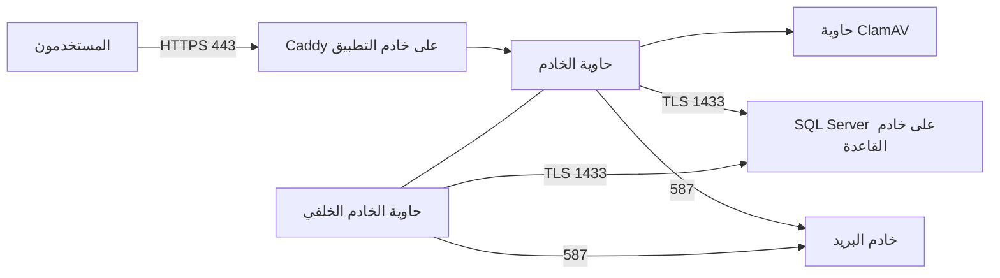

# دليل النشر على الخادم خطوة بخطوة (الصف 55 في `docs/31`)

التاريخ: 2026-10-25. كتبه وكيل ذكاء اصطناعي. يجمع هذا الدليل الخطوات بالترتيب في مكان واحد. أما التفاصيل والأسباب فتبقى في الوثائق المرجعية: DOC-S10 لخادم قاعدة البيانات، وDOC-S11 لنشر القاعدة، وDOC-S16 لخادم التطبيق، وDOC-S02 للمفاتيح، وDOC-S09 للنسخ الاحتياطي.

## كيف تقرأ الدليل

- **المنفّذ:** أمام كل خطوة من ينفّذها. OPS مسؤول التشغيل، وDBA مسؤول قاعدة البيانات، وOWN المالك.
- **الترتيب:** لا تبدأ خطوة قبل أن تنجح التي قبلها. ويُحفظ ناتج كل فحص في **سجل التجهيز**، وهو ملف أو دفتر لدى مسؤول التشغيل.
- **القيم بين `<...>`** خاصة بخادمكم، مثل `<DOMAIN>` اسم النطاق و`<DB_HOST>` اسم خادم القاعدة. لا تُكتب في المستودع أبدًا.
- **الأوامر بصلاحية root** تُنفّذ بـ `sudo` من حساب شخصي، لا بحساب root مباشرة.
- **البنية:** خادمان منفصلان كما اعتمدتَ (القرار 6، DQ-B11-2)، وكلاهما Ubuntu 24.04 LTS.
  - **خادم القاعدة:** SQL Server 2025.
  - **خادم التطبيق:** Docker وCaddy، وعليه الخادم والخادم الخلفي وClamAV في حاويات.



---

## الجزء A: التحضير، قبل أي خادم

| # | الخطوة | المنفّذ |
|---|---|---|
| A-01 | **اسم النطاق:** مثل `treasury.example.com`. البوابات تحته (`<رمز الشركة>.<DOMAIN>`)، ولوحة المشغّل `admin.<DOMAIN>` | OWN |
| A-02 | **مزوّد DNS يدعم الشهادة الشاملة (wildcard)** عبر واجهة برمجية، مثل Cloudflare DNS، ورمز وصول له. يحتاجه Caddy لإصدار شهادة `*.<DOMAIN>` | OWN مع OPS |
| A-03 | **خادمان Ubuntu 24.04 LTS** من مزوّد في الدولة المعتمدة (DQ-S07-1). حجم مقترح للبداية: التطبيق 4 معالجات و8 غيغابايت ذاكرة و100 غيغابايت قرص (منها نحو 30 لقائمة كلمات المرور). والقاعدة 4 معالجات و16 غيغابايت والأقراص الأربعة في DOC-S10 §3 | OWN مع OPS |
| A-04 | **حساب SMTP** للإرسال، مثل Microsoft 365 أو مزوّد بريد للمعاملات: الخادم والمستخدم وكلمة المرور وعنوان المرسل | OWN |
| A-05 | **إصدار SQL Server المرخَّص** (Standard أو Enterprise؛ DQ-S02-5). إصدار Developer لا يصلح للإنتاج | OWN |
| A-06 | **مكان آمن خارج الخوادم** لنسخة المفتاح الرئيسي وشهادة TDE، مثل خزنة كلمات مرور للمؤسسة أو قرص مشفّر في خزنة، **ويطّلع عليه شخصان** | OWN |
| A-07 | **عناوين IP** للمسؤولين، يُفتح منها SSH وحدها | OPS |
| A-08 | **سجلات DNS:** `<DOMAIN>` و`*.<DOMAIN>` إلى عنوان خادم التطبيق، و`<DB_HOST>` إلى خادم القاعدة. وتُفضَّل شبكة خاصة بين الخادمين إن وفّرها المزوّد | OPS |

---

## الجزء B: خادم قاعدة البيانات

التفاصيل في DOC-S10. هذه الخطوات بترتيبها:

| # | الخطوة | الأمر أو المرجع | الدليل في سجل التجهيز |
|---|---|---|---|
| B-01 | **إنشاء الخادم** وتسجيل بصمة مفتاح SSH للمضيف | `ssh-keygen -lf /etc/ssh/ssh_host_ed25519_key.pub` | البصمة |
| B-02 | **حسابات المسؤولين:** حساب شخصي لكل منهم بمفتاح Ed25519، ثم إغلاق دخول root وكلمات المرور | DOC-S10 §6.1 و§6.3 | `sshd -T` |
| B-03 | **الجدار الناري:** SSH من عناوين المسؤولين، و1433 من خادم التطبيق وحده | DOC-S10 §6.2 | `ufw status verbose` |
| B-04 | **التحديثات الآلية ومزامنة الوقت** | DOC-S10 §6.4 و§6.5 | `timedatectl` |
| B-05 | **أقراص البيانات والسجل والنسخ والتدقيق** وتركيبها | DOC-S10 §3 | `lsblk` و`findmnt` |
| B-06 | **تثبيت SQL Server 2025** بالإصدار المسجّل في `versions.json` بالضبط (17.0.5015.4)، ثم تثبيته من الترقية | DOC-S10 §5.1 | `apt-mark showhold` |
| B-07 | **إعدادات mssql-conf:** المسارات، وفرض التشفير، والذاكرة | DOC-S10 §5.2 | `mssql-conf list` |
| B-08 | **شهادة TLS لاسم `<DB_HOST>`** (انظر الملاحظة أدناه)، وتُضبط في `network.tlscert` و`network.tlskey` | DOC-S05 §5.1-5.2 | اتصال بلا `-C` ينجح |
| B-09 | **تسجيلات الدخول:** حساب SQL شخصي لكل DBA، ثم تعطيل `sa` | DOC-S08 §9 | `sys.server_principals` |
| B-10 | **التدقيق:** `sudo install -d -o mssql -g mssql -m 0750 /var/opt/mssql/audit`، ثم `tools/deploy/server_audit.sh apply` | ADR 0012 | `server_audit.sh check` يخرج بصفر |
| B-11 | **مفاتيح TDE في master** ونسخ الشهادة إلى المكان الآمن (A-06) | DOC-S02 §5.1، الخطوات 1 إلى 4 | سجل الضمان |
| B-12 | **إنشاء القاعدة الفارغة وحساب النشر:** `tools/deploy/prepare_database.sh prepare --generate` | ADR 0010 | القاعدة بترتيب `Arabic_100_CI_AS_SC` |
| B-13 | **فحص جاهزية خادم القاعدة** (قراءة فقط): النظام والإصدار والتشفير والشهادة والمجلدات والجدار وSSH | `sudo tools/deploy/check_db_host.sh` | يخرج بصفر |

**ملاحظة على شهادة B-08:**
- **الأسهل:** شهادة من جهة عامة لاسم `<DB_HOST>` (مثل `db.<DOMAIN>`)، تُصدر بـ certbot بتحدي DNS. فتثق بها حاويات التطبيق دون أي إعداد.
- **إن كانت الشهادة من جهة داخلية:** يُضاف ملف جهتها إلى حاويتي التطبيق في الخطوة H-06.

**الأدوات على خادم القاعدة.** تُنسخ إليه نسخة من المستودع، أو من حزمة الإصدار مع مطابقة بصمة SHA-256 (DQ-S11-4). وكل أوامر `tools/deploy` تُنفّذ من مجلد `treasury-platform` بالمتغيرات الآتية:

```bash
export SQL_SERVER=localhost,1433          # على خادم القاعدة نفسه
export SQL_USER=<your_admin_login>         # حسابك الشخصي، لا sa
read -rs SQLCMDPASSWORD; export SQLCMDPASSWORD
export SQLCMD=/opt/mssql-tools18/bin/sqlcmd
export BANKFAS_CHANGE_REF=GO-LIVE-001     # رقم التغيير في سجل النشر
export BANKFAS_SECRETS_DIR=/root/bankfas-db-secrets   # مجلد خاص (700) لأسرار تسجيلات الدخول
sudo install -d -m 700 "$BANKFAS_SECRETS_DIR"
```

---

## الجزء D: نشر قاعدة البيانات، داخل نافذة نشر

| # | الخطوة | الأمر |
|---|---|---|
| D-01 | **فتح النافذة:** يتحقق من عمل التدقيق ومن عدم اتصال أي حساب خدمة، ويفعّل حساب النشر | `tools/deploy/prepare_database.sh open` |
| D-02 | **النشر بحساب النشر.** كلمة مروره في `$BANKFAS_SECRETS_DIR/bankfas_migrator.secret` من B-12 | `SQL_USER=bankfas_migrator SQLCMDPASSWORD="$(cat $BANKFAS_SECRETS_DIR/bankfas_migrator.secret)" tools/deploy/deploy.sh` |
| D-03 | **مواصفة التدقيق للقاعدة الجديدة** | `tools/deploy/server_audit.sh apply` |
| D-04 | **تسجيلات دخول الخدمات الأربعة:** تطبيق، ومهام، ومنصة، ودعم | `tools/deploy/provision_logins.sh --generate` |
| D-05 | **تسجيل دخول المراقبة** | `tools/deploy/provision_monitor.sh --generate` |
| D-06 | **فحوص ما بعد النشر** بحساب المراقبة | DOC-S11 §8.2 |
| D-07 | **نموذج الاسترداد واللقطات** | `ALTER DATABASE BankFas SET RECOVERY FULL;` ثم `ALTER DATABASE BankFas SET READ_COMMITTED_SNAPSHOT ON WITH ROLLBACK IMMEDIATE;` |
| D-08 | **تفعيل TDE** على القاعدة ومتابعته حتى يكتمل، وذلك **قبل أي بيانات حقيقية** | DOC-S02 §5.1، الخطوتان 5 و6 |
| D-09 | **أول نسخة كاملة مشفّرة** وفحصها، ثم جدولة النسخ ودفعها إلى الموقع المنفصل | DOC-S09 §4 |
| D-10 | **دعوة المشغّل الأول**، وتظهر الدعوة مرة واحدة على الشاشة | انظر الأمر بعد الجدول |
| D-11 | **إغلاق النافذة:** يعطّل حساب النشر | `tools/deploy/prepare_database.sh close` |
| D-12 | **مراجعة التنبيهات**، والمتوقع صفر | `tools/deploy/server_audit.sh alerts <بداية النافذة>` |

**أمر الخطوة D-10:**

```bash
SQL_USER=bankfas_migrator SQLCMDPASSWORD="$(cat $BANKFAS_SECRETS_DIR/bankfas_migrator.secret)" \
  BANKFAS_DOMAIN=<DOMAIN> tools/deploy/bootstrap_operator.sh <operator-email> "<الاسم>"
```

- يطبع السكربت رابطًا صالحًا 48 ساعة يبدأ بـ `https://admin.<DOMAIN>/setup#token=...`.
- يُسلَّم الرابط للمشغّل **بقناة غير البريد الذي يذكره**، مثل رسالة شخصية مباشرة. ولا يُحفظ في أي ملف.
- يرفض السكربت تشغيله مرة ثانية. والمشغّلون التالون يُدعون من لوحة المشغّل.

**نقل الأسرار إلى خادم التطبيق.** تُنقل أسرار التطبيق والمهام والمنصة والدعم إلى خادم التطبيق بقناة آمنة، مثل `scp` بحساب شخصي، ثم تُحذف النسخة المؤقتة:

```bash
# على خادم القاعدة: الملفات الأربعة bankfas_{app,jobs,platform,support}_a.secret
sudo tar -C "$BANKFAS_SECRETS_DIR" -cf - bankfas_app_a.secret bankfas_jobs_a.secret bankfas_platform_a.secret bankfas_support_a.secret \
  | ssh <you>@<APP_HOST> 'umask 077; cat > /tmp/db-secrets.tar'
```

---

## الجزء H: خادم التطبيق

| # | الخطوة | الأمر أو المرجع |
|---|---|---|
| H-01 | **الأساس:** حسابات المسؤولين وSSH والتحديثات والوقت، كما في B-01 إلى B-04 | DOC-S16 §4 |
| H-02 | **الجدار وإعدادات النواة** | `sudo ADMIN_CIDRS="<cidr> ..." bash tools/host/ufw.sh` ثم `sudo cp tools/host/sysctl-bankfas.conf /etc/sysctl.d/60-bankfas.conf && sudo sysctl --system` |
| H-03 | **تثبيت Docker وإعداداته** | انظر الأوامر بعد الجدول |
| H-04 | **ملف القيم:** تُنسخ `tools/host/site.conf.example` إلى `/opt/bankfas/site.conf` (600)، وتُملأ قيم الخادم كلها في مكان واحد | `sudo install -d -m 700 /opt/bankfas && sudo install -m 600 tools/host/site.conf.example /opt/bankfas/site.conf && sudoedit /opt/bankfas/site.conf` |
| H-05 | **التجهيز من ملف القيم:** المجلدات بصلاحياتها، والمفتاح الرئيسي مرة واحدة، وملفات الإعداد وCaddyfile، وأسرار القاعدة، وكلمة SMTP، ورمز DNS. **يُنسخ ملف المفتاح فورًا إلى المكان الآمن (A-06)**، ويُسجَّل البصمة التي يطبعها السكربت | `sudo tools/host/provision_app_host.sh --db-secrets /tmp/db-secrets.tar` |
| H-06 | **شهادة SQL من جهة داخلية فقط.** تُضاف حزمة الجهات إلى الحاويتين: `/opt/bankfas/ca/ca-certificates.crt:/etc/ssl/certs/ca-certificates.crt:ro` في `volumes` للخدمتين في `compose.yml` | DOC-S05 |
| H-07 | **قائمة كلمات المرور المسرّبة.** تستغرق ساعات، ويمكن تشغيلها في الخلفية وإعادتها إن انقطعت | `sudo bash tools/host/download_breached.sh /srv/bankfas/breached` |
| H-08 | **Caddy بوحدة مزوّد DNS** (لأن الشهادة شاملة)، ثم ملف الإعداد | انظر الأوامر بعد الجدول |
| H-09 | **السجلات والتدقيق والحظر:** journald وauditd وfail2ban من `tools/host` | جدول `tools/host/README.md` |
| H-10 | **مراقبة المضيف كل 5 دقائق** | DOC-S16 §8 (وحدتا systemd `bankfas-check`) |

**أوامر الخطوة H-03:**

```bash
# من مستودع Docker الرسمي لـ Ubuntu (docs.docker.com/engine/install/ubuntu)
sudo apt-get install -y docker-ce docker-ce-cli containerd.io docker-buildx-plugin docker-compose-plugin
sudo cp tools/host/docker-daemon.json /etc/docker/daemon.json && sudo systemctl restart docker
```

**بديل يدوي للخطوة H-05:** السكربت قصير ومقسّم بعناوين (`tools/host/provision_app_host.sh`)، ويمكن تنفيذ كل جزء منه يدويًا. وتجربته دون تغيير الخادم ممكنة: `BANKFAS_ROOT=/tmp/try` يكتب كل شيء تحت ذلك المجلد.

**أوامر الخطوة H-08:**

```bash
xcaddy build --with github.com/caddy-dns/<provider>     # مثل cloudflare
# الخطوة H-05 كتبت /etc/caddy/Caddyfile ورمز DNS (/etc/caddy/dns.env)
sudo systemctl daemon-reload
sudo caddy validate --config /etc/caddy/Caddyfile && sudo systemctl reload caddy
```

---

## الجزء R: البناء والتشغيل وأول استعمال

| # | الخطوة | الأمر |
|---|---|---|
| R-01 | **بناء الصورتين** على خادم التطبيق أو جهاز بناء، من نسخة المستودع بالإصدار المعتمد | انظر الأوامر بعد الجدول |
| R-02 | **ضبط `compose.yml`:** اسما الصورتين ورقم إصدار ClamAV في `/opt/bankfas/compose.yml`. الصورة `bankfas-api:<VERSION>` تُكتب بلا سجل إن بُنيت على الخادم نفسه | `sudoedit /opt/bankfas/compose.yml` |
| R-02a | **فحص الجاهزية:** يجب أن يخرج بصفر قبل أول تشغيل، ويُحفظ ناتجه | `sudo tools/host/check_ready.sh` |
| R-03 | **التشغيل** | `cd /opt/bankfas && sudo docker compose up -d && sudo docker compose ps` |
| R-04 | **فحص التشغيل:** الحاويات الثلاث تعمل، وسجل الخادم بلا أخطاء، ولوحة المشغّل تُفتح | `sudo docker compose logs --tail 50 api worker` ثم `curl -sI https://admin.<DOMAIN>/` |
| R-05 | **المشغّل الأول:** يفتح الرابط من D-10، ويضع كلمة المرور، ويربط تطبيق المصادقة | المتصفح |
| R-06 | **أول مشترك** من لوحة المشغّل. فيُعدّه الخادم الخلفي خلال دقائق، ويُرسل دعوة مديره الأول بالبريد | لوحة المشغّل |
| R-07 | **فحص البريد والملفات:** يصل بريد الدعوة. ويُرفع مستند تجريبي فيُفحص، ثم تُطبع وثيقة PDF | بوابة المشترك |
| R-08 | **قبول المراقبة:** المضيف يقبل الحالة الحالية، والتنبيهات تصل | `sudo tools/host/check_host.sh accept` |

**أوامر الخطوة R-01:**

```bash
docker build -f app/deploy/Dockerfile --target api    -t bankfas-api:<VERSION> .
docker build -f app/deploy/Dockerfile --target worker -t bankfas-worker:<VERSION> .
# خلف وكيل شبكة يفحص TLS: --secret id=extra_ca,src=<ca.pem>  (ADR 0053)
```

**فحص اختياري قبل R-03، ويُنصح به في أول مرة.** يشغّل `tools/ci/image_pilot.sh` اختبار المتصفح كاملًا على الصورتين، كما شغّلناه في التشغيل التجريبي (`docs/53`).
- يُشغَّل على خادم تجريبي فيه SQL Server مؤقت، **لا على قاعدة الإنتاج**، لأنه يحتاج قاعدة جديدة فارغة.

---

## الجزء O: بعد التشغيل، الأعمال الدورية

| الإيقاع | العمل | الأمر أو المرجع |
|---|---|---|
| يوميًا | مراسي سلسلة التدقيق خارج القاعدة | `tools/deploy/audit_anchor.sh take <store>` (ADR 0033) |
| يوميًا | تنبيهات تدقيق الخادم | `tools/deploy/server_audit.sh alerts` |
| أسبوعيًا | التحقق الكامل من سلسلة التدقيق | `audit_anchor.sh verify <store> --full` |
| أسبوعيًا | تجربة استرجاع نسخة احتياطية | DOC-S09 |
| شهريًا | تحديث قائمة كلمات المرور المسرّبة | `download_breached.sh` (يكمل ما ينقص) |
| شهريًا | مراجعة النوافذ والحسابات | `server_audit.sh windows` ثم DOC-S08 |
| كل إصدار | ترقية القاعدة داخل نافذة، ثم بناء الصورتين الجديدتين وإعادة التشغيل | `migrate.sh status` ثم `migrate.sh apply` (ADR 0034)، ثم `docker compose up -d` |
| عند الحاجة | تدوير المفتاح الرئيسي | ملف جديد في `master-keys`، ثم `Keys__File__Current` إليه، ويبقى الملف القديم |
| عند الاشتباه | جمع الأدلة قبل أي تغيير | `sudo tools/host/collect_evidence.sh` (DOC-S15) |

## ما لا يغطيه هذا الدليل بعد

- **اختيار نظام لإدارة المفاتيح أو HSM** بدل ملف المفتاح الرئيسي (DQ-S02-1). الملف حل مؤقت مقبول لخادم واحد.
- **خادم احتياطي للقاعدة** (DQ-S09-7)، وهو مؤجَّل.
- **التحقق على الخادم الحقيقي:** أوامر SQL Server وmssql-conf موسومة في DOC-S10 بـ «[تحقق MS]»، فتُطابَق مع وثائق Microsoft للإصدار المثبّت.
