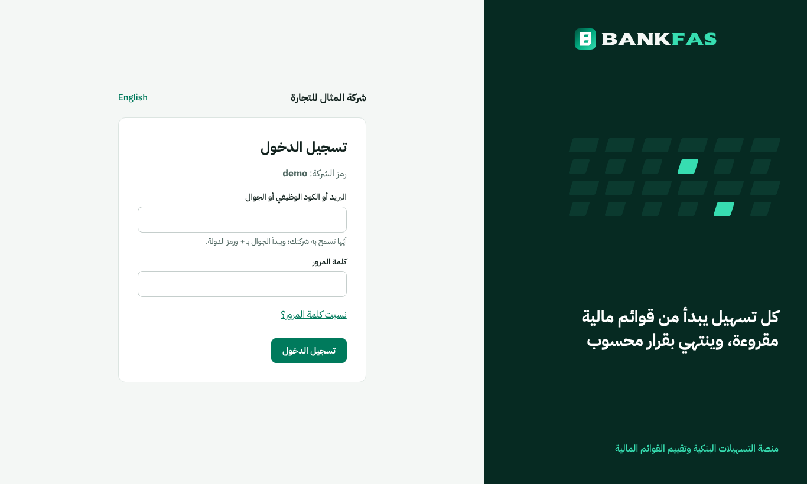
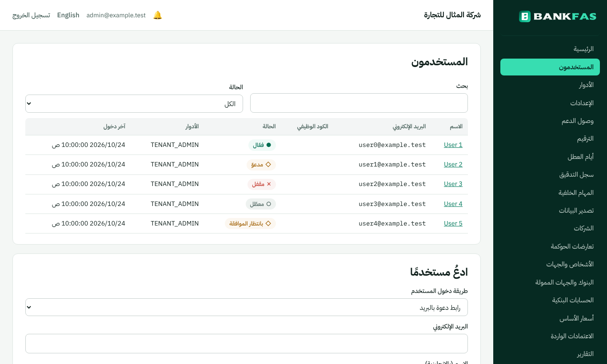
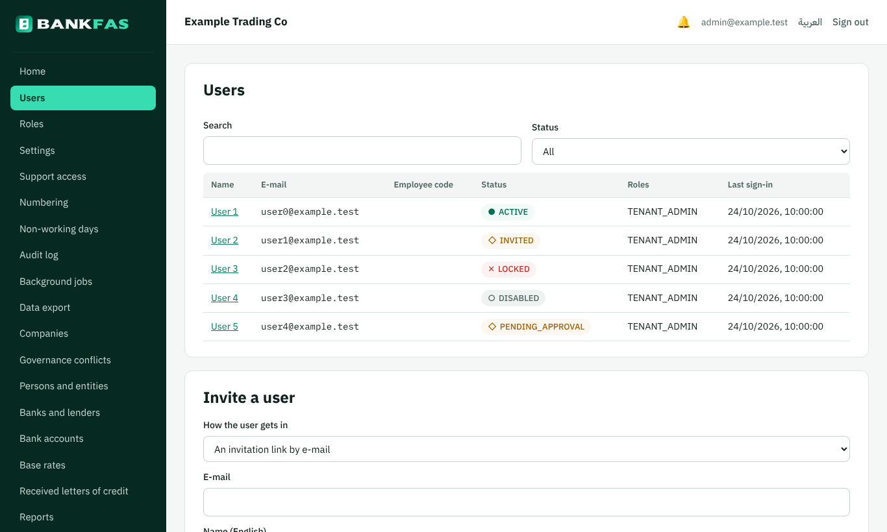
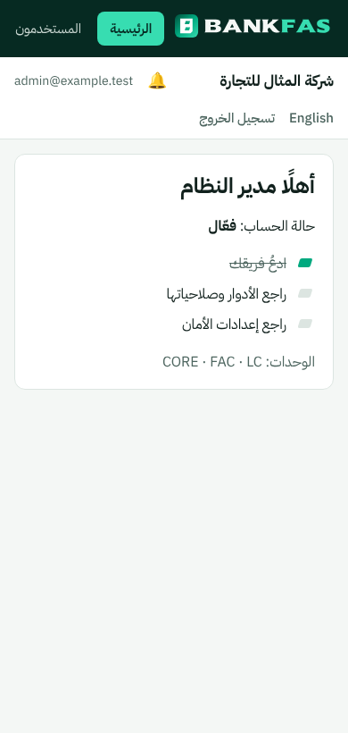

# تطبيق الهوية البصرية على الموقع (الصف 58 في `docs/31`)

التاريخ: 2026-10-25. كتبه وكيل ذكاء اصطناعي.

## 1. ما طلبه المالك

«في تصميم الموقع اعتمد الهوية البصرية المرفقة»، ثم «الان اعمل التصميم كاملا للموقع اذا كانت المعمارية و النظام جاهزا للاطلاق التجريبي».

النظام جاهز للتشغيل التجريبي: كل الاختبارات ناجحة محليًا وعلى GitHub، وصورتا النشر تعملان (`docs/53`)، ودليل النشر جاهز (`docs/54`). لذلك نُفّذ التصميم كاملًا على دليل الهوية البصرية، الإصدار 2.0، أكتوبر 2026.

## 2. ما نُقل من الدليل إلى الموقع

| من الدليل | في الموقع |
|---|---|
| الشعار ونسخه (ص 5–8) | رُسم الرمز من قياساته الهندسية (ص 6). وحُوّل اسم BANKFAS بخط Sekuya إلى أشكال، فلا يحمّل الموقع خط الشعار. النسخة الملونة على الفاتح، والمعكوسة على أخضر الخزنة. والرمز وحده أيقونة المتصفح |
| ألوان العلامة (ص 11) | أخضر الخزنة ‎#062A22‎، والزمردي ‎#00A97F‎، والنعناعي ‎#37DDB1‎ على الداكن فقط، والعاجي ‎#F4F7F5‎ أرضية الصفحات |
| ألوان المنصة (ص 13) | زر الإجراء الرئيسي ‎#007A5C‎، والنص ‎#11211D‎، والنص الثانوي ‎#4E6660‎، والفواصل ‎#DCE5E1‎، والبطاقات بيضاء |
| ألوان الحالات (ص 13) | كل حالة لون ورمز وكلمة: ○ مسودة، ◇ قيد الدراسة، ◆ في اللجنة، ● معتمد أو فعّال، ✕ مرفوض أو متوقف |
| الخطوط (ص 16–17) | IBM Plex Sans Arabic للعربية، وIBM Plex Sans للإنجليزية، وIBM Plex Mono للمبالغ والأرقام المرجعية في الجداول. الخطوط مضمّنة في الموقع نفسه، ولا تُطلب من أي جهة خارجية |
| الشق المائل (ص 18) | نمط صفوف الشقوق على صفحة الدخول، فيه شقّان بالنعناعي. ومؤشر قائمة المهام في الصفحة الأولى شقّ مائل |
| لوحة التسهيلات (ص 23) | شريط جانبي بأخضر الخزنة، فيه الشعار المعكوس، والصفحة الحالية بالنعناعي. وشريط علوي أبيض، وبطاقات بيضاء على أرضية عاجية |
| عناصر الواجهة (ص 20) | الأزرار: رئيسي ممتلئ، وثانوي بإطار، وزر الرفض بإطار أحمر. والحقول بحواف مستديرة وإطار زمردي عند الكتابة. ورأس الجدول رمادي فاتح |

## 3. الشاشات

صفحة الدخول بالعربية: لوحة العلامة في جهة بداية القراءة (اليمين)، والنموذج بجانبها.

شاشة المستخدمين: الشريط الجانبي، والحالات بلونها ورمزها.

الشاشة نفسها بالإنجليزية. اتجاه الصفحة ينقلب وحده.

على الجوال: الشريط الجانبي يصير شريطًا أفقيًا يُمرَّر فوق الصفحة.

البيانات في الصور توضيحية.

## 4. ما تغيّر في الكود

- `app/web/src/brand/`: ملفات الشعار الثلاثة (الرمز، والملون، والمعكوس). يولّدها `tools/brand/logo.js`.
- `app/web/src/brand.tsx`: الشعار، وشارة الحالة `Chip`، وتخطيط صفحات الدخول.
- `app/web/src/styles.css`: ملف التصميم كاملًا، وفيه الألوان والخطوط والمقاسات والمكونات.
- الشاشات: الشريط الجانبي في البوابة ولوحة المشغّل، وصفحات الدخول والتسجيل، وخلايا «الحالة» في 54 جدولًا.
- اختبار جديد `brand.test.tsx` يتحقق من ألوان الحالات. ولم يتغير شيء في الخادم أو قاعدة البيانات.
- القرار مكتوب في ADR 0055.

## 5. ما بقي

- **المطبوعات** (شروط الاعتماد، والفاتورة المبدئية، وطباعة الطلب، والتقارير بصيغة PDF): لها أنماطها الخاصة. نقلها إلى الهوية، بغلاف أخضر الخزنة كما في ص 24، خطوة لاحقة.
- **قوالب البريد الإلكتروني**: ما زالت نصًا بسيطًا.
- **ملف SVG الرسمي للشعار**: الشعار مرسوم من قياسات الدليل. إن وُجد ملف SVG معتمد من المصمم، يوضع مكانه في `app/web/src/brand/` دون أي تغيير آخر.
