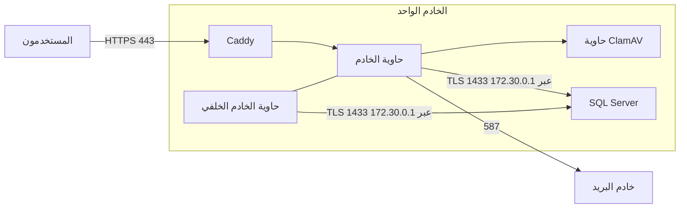

# دليل الخادم الواحد للتجربة (الصف 63 في `docs/31`)

التاريخ: 2026-10-25. كتبه وكيل ذكاء اصطناعي.

## 1. لمن هذا الدليل وحدوده

طلب المالك: «نعم جهّز دليل الخادم الواحد للتجربة»، بعد عرض خادم بمعالجين و8 غيغابايت ذاكرة و150 غيغابايت قرص.

- **الغرض:** تشغيل النظام كاملًا على خادم واحد، **للتجربة ببيانات توضيحية فقط**.
- **ما على الخادم الواحد:** قاعدة البيانات SQL Server، وCaddy، وحاويات الخادم والخادم الخلفي وClamAV.
- **ما يبقى كما هو:** كل خطوات دليل النشر `docs/54` وضوابطه. ويذكر هذا الدليل الفروق فقط، ويشير إلى رقم كل خطوة في `docs/54`.
- **ما لا يصلح له:** بيانات حقيقية لشركات أو بنوك. التشغيل الحقيقي على خادمين في الدولة المعتمدة بإصدار مرخّص من SQL Server، كما في `docs/54`.



## 2. الخادم وميزانية الذاكرة

الخادم المعروض: معالجان AMD EPYC، و8 غيغابايت ذاكرة، و150 غيغابايت NVMe، وUbuntu من اختيارك.

| الجزء | الذاكرة التقديرية | الضبط في هذا الدليل |
|---|---|---|
| SQL Server | حتى 3 غيغابايت | حد الذاكرة 3072 ميغابايت (الخطوة 4) |
| ClamAV | نحو 1.5 في العادة، ونحو 3 عند تحديث التواقيع | كما هو |
| الخادم مع طابعة PDF | نحو 1 | كما هو |
| الخادم الخلفي | نحو 0.3 | كما هو |
| النظام وCaddy | نحو 1 | كما هو |
| **المجموع** | **نحو 7 في العادة، ونحو 8.5 في الذروة** | **ذاكرة تبديل 4 غيغابايت (الخطوة 2)** |

**تصحيح لتقديري السابق:** ذكرتُ أن ClamAV يحتاج نحو 1.2 غيغابايت. والصحيح ما في `tools/host/compose.yml`: يصل إلى نحو 3 غيغابايت حين يحدّث تواقيعه. لذلك تلزم ذاكرة التبديل، وبها يكفي الخادم للتجربة.

**القرص:**
- القاعدة والنسخ: نحو 30 غيغابايت.
- قائمة كلمات المرور المسرّبة: نحو 30 غيغابايت.
- الصور والسجلات: نحو 10 غيغابايت.
- الباقي للمستندات.

والمعالجان يكفيان لمستخدمين قليلين، مع بطء ملحوظ عند طباعة PDF أو فحص ملف كبير.

## 3. قبل الشراء

| ما يُسأل عنه المزوّد | لماذا |
|---|---|
| صورة **Ubuntu 24.04 LTS** | الإصدار المسجّل في `versions.json`، والفحوص ترفض غيره |
| **المنفذ 587 للخارج مفتوح** | كثير من مزوّدي الخوادم الافتراضية يغلقون منافذ البريد افتراضيًا، وبدونه لا تصل الدعوات |
| **عنوان IPv4 ثابت** | تُوجَّه إليه سجلات DNS |
| **دولة مركز البيانات** | يُذكر في سجل التجهيز، حتى في التجربة |
| **لقطات (snapshots) للخادم** | للعودة إلى حالة سابقة إن تعطلت التجربة |
| السعر بعد الأشهر الثلاثة الأولى | 21.99 دولارًا شهريًا في العرض |

**ما يلزم من جهتك**، وهو الجزء A من `docs/54`:
- النطاق (A-01)، ورمز وصول مزوّد DNS للشهادة الشاملة (A-02).
- حساب SMTP (A-04).
- المكان الآمن لنسخة المفتاح الرئيسي (A-06).
- عناوين IP التي يُفتح منها SSH (A-07). إن كان عنوانك يتغير، فاطلب من المزوّد عنوانًا ثابتًا أو شبكة VPN، وإلا أُغلق عليك SSH عند تغيّره.

**سجلات DNS:** `<DOMAIN>` و`*.<DOMAIN>` إلى عنوان الخادم. ولا يلزم سجل لاسم القاعدة `db.<DOMAIN>`، فالخادم يصل إلى قاعدته داخليًا (الخطوة 4).

## 4. الخطوات

كل الأوامر من مجلد `treasury-platform` المستخرج من حزمة الإصدار (`docs/57`).

| # | الخطوة | الأمر أو المرجع |
|---|---|---|
| 1 | **الأساس:** إنشاء الخادم وتسجيل بصمة SSH، وحسابات المسؤولين، وإغلاق دخول root وكلمات المرور، والتحديثات الآلية ومزامنة الوقت | `docs/54` من B-01 إلى B-04، دون B-03 |
| 2 | **ذاكرة التبديل 4 غيغابايت** | انظر الأوامر بعد الجدول |
| 3 | **الجدار الناري**، بدل B-03 وH-02: SSH من عناوينك، و80 و443 للجميع، و1433 من شبكة الحاويات وحدها | `sudo ADMIN_CIDRS="<cidr>" DB_ON_THIS_HOST=1 bash tools/host/ufw.sh` ثم ملف sysctl كما في H-02 |
| 4 | **SQL Server**: الخطوات B-05 إلى B-13 من `docs/54`، بالفروق المذكورة بعد الجدول | `docs/54` الجزء B |
| 5 | **نشر القاعدة:** الجزء D كاملًا، ومنه TDE (D-08) والنسخة الاحتياطية الأولى (D-09) | `docs/54` الجزء D |
| 6 | **أسرار القاعدة إلى إعداد التطبيق** على الخادم نفسه، بلا نقل | انظر الأوامر بعد الجدول |
| 7 | **Docker** | `docs/54` H-03 |
| 8 | **ملف القيم:** كما في H-04، مع `DB_ADDRESS=172.30.0.1`، واسمي صورتي الإصدار | انظر المثال بعد الجدول |
| 9 | **التجهيز من ملف القيم:** كما في H-05. ومع `DB_ADDRESS` يضيف السكربت اسم القاعدة إلى الحاويتين وإلى `/etc/hosts`، ولا يكرر ما يجده | `sudo tools/host/provision_app_host.sh --db-secrets /tmp/db-secrets.tar` |
| 10 | **قائمة كلمات المرور المسرّبة، وCaddy، والسجلات، والمراقبة** | `docs/54` من H-07 إلى H-10 |
| 11 | **تحميل صورتي الإصدار** بدل البناء | `docs/57` القسم 4 |
| 12 | **فحص الجاهزية:** فيه قسم للقاعدة على الخادم نفسه: الحاويتان تصلان إليها، والجدار يسمح لشبكتهما، والذاكرة مع التبديل 11 غيغابايت على الأقل | `sudo tools/host/check_ready.sh` |
| 13 | **التشغيل وأول استعمال** | `docs/54` من R-03 إلى R-08 |

**أوامر الخطوة 2:**

```bash
sudo fallocate -l 4G /swapfile && sudo chmod 600 /swapfile
sudo mkswap /swapfile && sudo swapon /swapfile
echo '/swapfile none swap sw 0 0' | sudo tee -a /etc/fstab
echo 'vm.swappiness=10' | sudo tee /etc/sysctl.d/61-bankfas-swap.conf && sudo sysctl --system
```

**فروق الخطوة 4 عن الجزء B في `docs/54`:**
- **B-05، الأقراص:** قرص واحد. تُنشأ المجلدات الأربعة عليه بملكية mssql:
  ```bash
  sudo install -d -o mssql -g mssql -m 0750 /var/opt/mssql/{data,tlog,backup,audit}
  ```
  ولأن النسخ على القرص نفسه، **يجب أن تُدفع النسخ الاحتياطية إلى موقع خارج الخادم** في D-09، وإلا ضاعت مع الخادم.
- **B-06، الإصدار:** يُختار **Developer** في `mssql-conf setup`. هو مجاني وكامل المزايا، ومنها التدقيق وTDE، لكن ترخيصه للتطوير والتجربة فقط. ويبقى رقم الإصدار المثبّت هو المسجّل في `versions.json`.
- **B-07، الذاكرة:** يُحدَّد سقف SQL Server بـ 3072 ميغابايت، ثم يُعاد تشغيله:
  ```bash
  sudo /opt/mssql/bin/mssql-conf set memory.memorylimitmb 3072
  sudo systemctl restart mssql-server
  ```
- **B-08، الشهادة:** تُصدر لاسم `db.<DOMAIN>` بتحدي DNS، فلا يلزم سجل A له. ثم يُربط الاسم بالخادم نفسه:
  ```bash
  echo "127.0.0.1 db.<DOMAIN>" | sudo tee -a /etc/hosts
  ```
- **متغيرات الأدوات:** `SQL_SERVER=db.<DOMAIN>,1433` بدل `localhost,1433`. فالقاعدة تفرض التشفير، والشهادة باسم `db.<DOMAIN>` لا باسم localhost.
- **B-13، فحص الجاهزية:** يمر فحص «1433 مغلق أمام الجميع» لأن الجدار يفتحه لشبكة الحاويات وحدها.

**أوامر الخطوة 6:** بدل النقل بـ `scp` في نهاية الجزء D، يُجمع الملف على الخادم نفسه، والسكربت يحذفه بعد أخذ الأسرار:

```bash
( umask 077; sudo tar -C "$BANKFAS_SECRETS_DIR" -cf /tmp/db-secrets.tar \
    bankfas_app_a.secret bankfas_jobs_a.secret bankfas_platform_a.secret bankfas_support_a.secret )
```

**مثال الخطوة 8:**

```bash
DOMAIN=<DOMAIN>
DB_HOST=db.<DOMAIN>
DB_ADDRESS=172.30.0.1
API_IMAGE=bankfas-api:1.0.1
WORKER_IMAGE=bankfas-worker:1.0.1
```

## 5. ما يجب الانتباه إليه

- **كل شيء على جهاز واحد:** إن سقط الخادم سقط النظام كله. والنسخ الاحتياطية ونسخة المفتاح الرئيسي يجب أن تكون خارجه (A-06 وD-09).
- **إصدار Developer:** للتجربة ببيانات توضيحية فقط. ولا تُنقل قاعدة التجربة إلى الإنتاج. الإنتاج يبدأ بقاعدة جديدة على خادميه.
- **الأداء:** معالجان فقط، فيُتوقع بطء عند طباعة PDF، وعند فحص الملفات الكبيرة، وحين تحدّث مهمة ClamAV تواقيعها.
- **الترقية إلى إصدار جديد:** كما في `docs/57`، بتحميل الصورتين وتعديل الرقم في `compose.yml`. وإن كانت فيه ترقية للقاعدة، تُنفّذ أولًا بـ `migrate.sh` داخل نافذة نشر (`docs/54` الجزء O).

## 6. ما تغيّر في الأدوات

- `tools/host/site.conf.example`: قيمة جديدة `DB_ADDRESS`، تبقى فارغة مع خادمين.
- `tools/host/provision_app_host.sh`: مع `DB_ADDRESS` يضيف `extra_hosts` إلى حاويتي الخادم والخادم الخلفي، ويضيف اسم القاعدة إلى `/etc/hosts`، ولا يكرر ما يجده.
- `tools/host/ufw.sh`: `DB_ON_THIS_HOST=1` يفتح 1433 لشبكة الحاويات `172.30.0.0/24` وحدها.
- `tools/host/check_ready.sh`: قسم جديد للقاعدة على الخادم نفسه.
- **ما جُرّب:** تشغيل تجريبي في مجلد مؤقت (`BANKFAS_ROOT`)، مرتين، مع `DB_ADDRESS` وبدونه. فأُضيف الربط في الحاويتين، ولم يتكرر في التشغيل الثاني، ولم يتغير شيء مع خادمين. ولم يُجرَّب على خادم حقيقي بعد.
